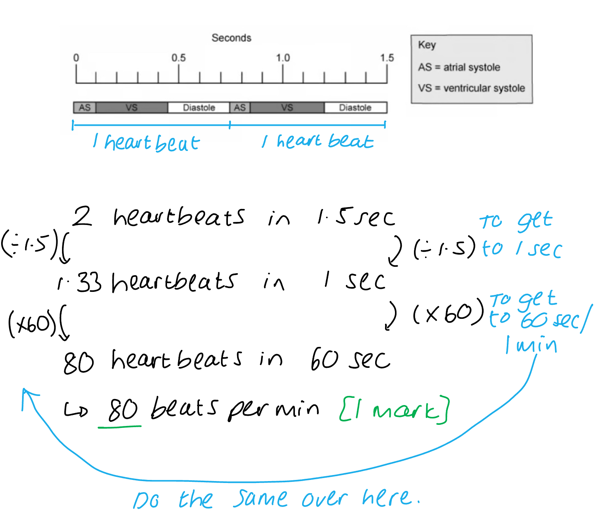

# Mark Schemes — The Heart
**8. Transport in Mammals** · Cambridge (CIE) A-LEVEL biology (9700)

## Multiple Choice Questions (30 questions)

### Q1
**Final answer:** **The correct answer is ****D**** because:**

- **At point ****1**** on the graph, the semilunar valves open**
- **At point ****2**** on the graph, the semilunar valves close**
- **At point ****3**** on the graph, the atrioventricular valves close**
- **At point ****4**** on the graph, the atrioventricular valves open**
- **This makes option ****D**** the correct row in the table**

### Q2
**Final answer:** **The correct answer is ****B**** because:**

- **Atrial contraction is controlled by the ****sinoatrial node ****(SAN) in the wall of the right atrium; the SAN sends out a wave of excitation which spreads across the atria**
- **A band of nonconductive collagen tissue prevents the wave from being passed from the atria to the ventricles**
- **The waves are transferred to the ****atrioventricular**** ****node**** (AVN) and pass through the bundle of His in the septum**
- **The bundle of His then conducts the wave of excitation to the ****Purkyne tissue**** in the ventricles**
- **If the impulse was not reaching the ventricles, but still reaching the atria, then the two faulty areas of the heart would be the ****atrioventricular node**** and the ****Purkyne tissue**

### Q3
**Final answer:** **The correct answer is ****B**** because there are two regions of the graph where the AV valves and semilunar valves are both closed:**

- **At point ****1**** on the graph, the semilunar valves ****open**
- **At point**** 2**** on the graph, the semilunar valves ****close**
- **At point ****3**** on the graph, the atrioventricular valves ****close**
- **At point ****4**** on the graph, the atrioventricular valves ****open**
- **The time that ****both ****valves are closed between ****1**** and ****3**** is:**

  - **Time at point 1 = 0.16 s**
  - **Time at point 3 = 0.12 s**
  - **Time closed = ****(0.16 - 0.12) = ****0.04 s**

- **The time that ****both ****valves are closed at the same time between 2 and 4 from the graph is:**

  - **Time at point 4 = 0.40 s**
  - **Time at point 2 = 0.36 s**
  - **Time closed =**** (0.40 - 0.36) =**** 0.04 s**

- **Total time both valves are closed = 0.04 + 0.04 = 0.08 s**

### Q4
**Final answer:** **The correct answer is ****C**** because:**

- **The nerve impulse from the atrioventricular node (AVN) travels to the Purkyne tissue (PT) through the bundle of His**
- **The nerve impulses from the Purkyne tissue (PT) travel to the ventricles**
- **The nerve impulses from the sinoatrial node (SAN) in the right atrium travel to the atrioventricular node (AVN)**

### Q5
**Final answer:** **The correct answer is ****D**** because:**

- **At point ****Q ****on the graph, the atrioventricular valves close**
- **At point ****R ****on the graph, the semilunar valves open**
- **At point ****S**** on the graph, the semilunar valves close**
- **At point ****T ****on the graph, the atrioventricular valves open**

### Q6
**Final answer:** **The correct answer is ****B**** because:**

- **B**** is the ****bicuspid valve**** that is between the left atrium and the left ventricle, the left-hand side of the heart transports oxygenated blood**
- **The ****bicuspid**** valve is identifiable by ****the**** two valve flaps**

> *A **is incorrect as this is the tricuspid valve in the right-hand side of the heart, the right-hand side of the heart transports deoxygenated blood*

> *C **&** D **are incorrect as these are both semilunar valves and will only open when blood is leaving a ventricle*

> *Exam Tip**: If you are not sure about the bicuspid and tricuspid valve position you could use the thickness of the ventricle wall to identify the left side of the heart. Remember the left side has a thicker ventricle wall than the right. The left-hand side of the heart carries oxygenated blood; it is **usually** shown on the right-hand side of an image.*

### Q7
**Final answer:** **The correct answer is ****B**** because:**

- **The first structure in the heart that the red blood cell (RBC) will pass by is the ****sinoatrial node****, which is located in the wall of the right atrium**
- **The second structure the RBC will pass through is the ****right**** ****atrium**
- **From the ****right**** ****atrium****, the RBC will go through the tricuspid valve. The t****ri****cuspid valve is located in the ****ri****ght side of the heart between the right atrium and right ventricle (it is an atrioventricular valve)**
- **After the tricuspid valve, the blood enters the right ventricle**
- **It will then pass through the semilunar valve into the pulmonary artery**

### Q8
**Final answer:** **The correct answer is ****A**** because:**

- **As the stroke volume (****SV****) increases so does the ventricular end-diastolic volume (****VEDV****)**
- **The ****VEDV**** is the amount of blood that the veins return to the heart before systole**
- **The stroke volume can be calculated from the ****VEDV****:**

  - **Stroke volume = end-diastolic volume – end-systolic volume**
- **This is ****not a directly proportional relationship ****(in such a relationship the two variables change at the same rate) as some blood will remain in the heart after systole**

> *B is incorrect as **this graph describes a directly proportional relationship.*

> *C **is incorrect as this graph describes a decrease in stroke volume as ventricular-end-diastolic volume increases.*

> *D **is incorrect as this graph describes that increasing VEDV does not affect stroke volume.*

### Q9
**Final answer:** **The correct answer is ****A ****because:**

**Final answer:** **Two complete cycles takes 1.92 seconds, meaning that a single cycle takes (1.92 ÷ 2 =) 0.96 seconds. We need to calculate how many times 0.96 fits into 60 seconds:**

**Final answer:** **60 ÷ 0.96 = 62.5 beats per min**

> *Alternative Method:*

### Q10
**Final answer:** **The correct answer is ****B**** because:**

- **Vessel**** 1**** will be the ****vena cava**** bringing deoxygenated blood from the body to the right atrium**
- **Vessel**** 2 ****will be the ****aorta ****taking oxygenated blood from the heart to the body**
- **Vessel**** 3**** will be the ****pulmonary artery**** taking deoxygenated blood from the heart to the lungs**
- **Vessel**** 4 ****will be the ****pulmonary vein**** bringing oxygenated blood back to the heart**
- **The correct option would be ****B**** as vessels ****4**** and**** 1**** bring blood ****to ****the heart and ****2**** and ****3 ****take blood ****away**** from the heart**

### Q11
**Final answer:** **The correct answer is ****B**** because:**

**Final answer:** **There is 1 heartbeat per 0.75 seconds, and 60 seconds in a minute, so we can calculate the number of times that 0.75 fits into 60 seconds:**

**Final answer:** **60 ÷ 0.75 = 80**

**Final answer:** **OR**

**Final answer:** **There are two complete heartbeats in 1.5 seconds, and 60 seconds in a minute, so:**

**Final answer:** **(60 ÷ 1.5) x 2**** = ****80**

**Final answer:** **OR**

### Q12
**Final answer:** **The correct answer is ****D**** because:**

- **The question states that fish oils are thought to improve the electrical excitation of the ventricles**
- **The part of the heart that carries electrical excitation to the ventricles is the Purkyne tissue (in the inner wall of the ventricles)**

> *A is incorrect as he vagus nerve is one of the cranial nerves that connect the brain to the body. The heart is one of the connections of the vagus nerve.*

> *B is incorrect as the sinoatrial node (SAN) is the pacemaker of the heart, situated in the wall of the right atrium. The SAN initiates and controls the heart rhythm for all other cardiac muscle cells in the heart.*

> *C is incorrect as the atrioventricular node (AVN) is situated at the junction between the atria and ventricles. It causes a slight delay in the transmission of the wave of excitation before stimulating the bundle of His.*

### Q13
**Final answer:** **The correct answer is ****D**** because:**

- **The semilunar valves are at the base of the arteries leaving the heart (the aorta and the pulmonary artery)**
- **These valves will close after ventricular contraction to prevent backflow of blood from the artery into the ventricle**
- **The point that is after ventricular contraction shown on the graph is point ****D**

> *A is incorrect as at this point in the graph, the semilunar valves are opening at the start of ventricular systole.*

> *B is incorrect as at this point in the graph, the atria have finished atrial systole and the atrioventricular valves are shut to prevent backflow into the atria.*

> *C is incorrect as this point in the graph shows the atrioventricular valves opening for passive filling during diastole.*

### Q14
**Final answer:** **The correct answer is ****B**** because:**

- **The part of the heart labelled ****3**** on the diagram is the ****right**** ****atrium****; deoxygenated blood comes into the right atrium from the body via the vena cava**
- **The part of the heart labelled ****4 ****on the diagram is the ****pulmonary artery****; this artery carries deoxygenated blood from the right ventricle to the lungs to be oxygenated**
- **The part labelled ****2**** in the diagram is the l****eft atrium****; this receives blood from the pulmonary vein from the lungs**
- **The part labelled ****1 ****in the diagram is the ****aorta**** this is the vessel leaving the left ventricle and transporting oxygenated blood to the body tissues**

> *Exam Tips**: *

- *Remember that **arteries** always go **away** from the heart ‘**A** – **a**way’ *
- *You may think that option **C** is correct, and technically blood does go through the heart in this sequence in one complete circulation of the body, however, the question refers to blood from the body*
- *We often discuss the flow of blood through the heart starting from when deoxygenated blood enters the heart from the vena cava into the right atrium *

### Q15
**Final answer:** **The correct answer is ****A**** because:**

- **The section labelled ****A**** on the graph describes the end of ****atrial**** ****systole**
- **Atrial systole is the ****contraction**** of the ****atria**** caused by the excitation from the sinoatrial node (SAN) in the right atrium**
- **At the end of atrial systole, blood is pushed into the ventricles so that they become full of blood**

> *B **is incorrect as this section of the graph describes **ventricular systole** where the pressure in the ventricles is increasing – blood is being pushed into the arteries.*

> *C **is incorrect as this part of the graph describes the middle and end of **ventricular systole** – when the pressure in the ventricles drops as blood enters the pulmonary artery and aorta.*

> *D **is incorrect as this part of the graph describes **diastole**; both the atria and the ventricles are relaxing at this point. *

### Q16
**Final answer:** **The correct answer is ****C**** because:**

- **Cardiac output is the ****volume of blood**** pumped in one minute**
- **If the aortic pressure decreases, the cardiac output would increase to increase the pressure**
- **There would be no change to the pressure in the vena cava as this is the pressure in the vessels after the blood has passed through the body**
- **An ****increase**** in ****carbon**** ****dioxide**** levels (e.g. during exercise) would increase the volume of blood pumped by the heart to increase ****oxygenation**** of the tissues and remove excess carbon dioxide as quickly as possible**
- **The Vagus nerve controls the heartbeat through excitation of the sinoatrial node (SAN). Specifically, it acts to lower the heart rate. This will remain unchanged when the cardiac output is increased**

### Q17
**Final answer:** **The correct answer is ****A**** because:**

- **Atrial contraction is controlled by the ****sinoatrial node (SAN)**** in the wall of the right atrium; the SAN sends out a wave of excitation which spreads across the atria**
- **A band of nonconductive collagen tissue prevents the wave from being passed from the atria to the ventricles**
- **The waves are transferred to the ****atrioventricular node (AVN)**** and passed through the bundle of His in the septum**
- **The bundle of His then conduct the wave of excitation to the ****Purkyne tissue**** in the ventricles**

### Q18
**Final answer:** **The correct answer is ****D**** because:**

- **The ****hole**** in the ****septum**** shown in the diagram would allow the mixing of blood from the ****left**** atrium and the ****right**** atrium**
- **The left atrium would contain oxygenated blood**
- **The right atrium would contain deoxygenated blood**
- **The mixing of the blood would reduce the overall oxygen saturation of haemoglobin as deoxygenated blood would be pumped around the body and not just to the lungs**

> *A **is incorrect as irregular heartbeats are generally caused by problems with the SAN and AVN. *

> *B **is incorrect as  a delay in ventricular systole would be caused by issues with the conductivity of the atrioventricular node, the bundle of His or the **Purkyne tissue.*

> *C is incorrect as the pulmonary artery takes blood from the right ventricle to the lungs. A hole in the septum in the atria would not cause an increase in pressure in this vessel.*

> * *

### Q19
**Final answer:** **The correct answer is ****A**** because:**

- **The ****aortic**** ****semilunar**** ****valve**** is at the base of the aorta where it joins the left ventricle; its role is to prevent the backflow of blood into the ventricles**
- **If this valve narrows, then not as much blood will be able to pass through to the aorta**
- **This will mean, for the same cardiac flow, the left ****ventricle**** will need to ****pump**** ****more****, which will lead to a thickening of the wall over time**
- **The thicker the wall, the larger the heart, but the smaller the left ventricle becomes**
- **The heart cannot relax fully during diastole and this can lead to heart failure**

> *B **is incorrect as the left ventricle will increase in size, not decrease. When the heart has **less** heart muscle and is generally weaker, this is known as **cardiomyopathy.*

> *C** is incorrect as the blood will not be leaking out of the left ventricle, this condition could be caused by a hole in the** septum.*

> *D **is incorrect as the bicuspid valve is there to prevent the backflow of blood. The condition that causes this is **bicuspid or mitral valve prolapse.*

### Q20
**Final answer:** **The correct answer is ****C**** because:**

- **The left-hand side delivers blood to the body (****3****) through the aorta and systemic arteries; to reach all tissue in the body the blood in the left side of the heart needs to be at higher pressure, and this is generated by the thicker muscle (****1****).**
- **The right ventricle delivers blood to the lungs, which are next to the heart, and where the alveoli could be damaged by high blood pressure, so a thinner muscle wall generates less pressure on this side of the heart (****4****).**

> *Statement 2 is incorrect; the blood from the right-hand side of the heart travels to the lungs, which are next to the heart, so this is less distance than is travelled by blood leaving the left side of the heart.*

### Q21
**Final answer:** **The correct answer is ****D**** because:**

- **During systole the atria contract, closely followed by the ventricles**
- **Blood pressure is measured as the ****pressure**** inside the arteries generated by the blood**
- **Systolic ****blood pressure would be measured at the ****end of systole in the heart ****when the pressure in the arteries is at a maximum.**

> *A **is incorrect as the blood pressure in the arteries when the heart is relaxed (in diastole) is called **diastolic blood pressure.*

> *B **is incorrect as the right ventricle pumps blood to the **lungs**; this occurs at a much lower pressure than that generated by the left ventricle pumping blood to the **body**.*

> *C **is incorrect as after contraction (systole), the pressure in the left ventricle is reduced as blood pressure is now generated in the **arteries.*

### Q22
**Final answer:** **The correct answer is ****D**** because:**

- **The ****aorta**** is the main artery leaving the heart, transporting oxygenated blood from the heart to the blood tissues; its average wall thickness is about 2 mm**
- **Arteries have three layers; the endothelial layer lining the lumen is called the ****tunica intima, ****a middle thicker layer called the ****tunica media****, and an outer layer called the ****tunica external**
- **The tunica ****media**** and tunica ****externa**** both contain ****elastic**** fibres (called elastin) and ****collagen**

  - **The elastin fibres allow the arteries to ****stretch**** and ****recoil**** which allows the blood to flow at high pressure**
  - **The collagen fibres provide ****strength**** to the artery wall**

> *A **is incorrect as the tunica media contains **smooth** **muscle** and arteries do have a relatively small lumen, but neither of these features will enable the artery to withstand the high pressures in the aorta.*

> *B **is incorrect as while the artery does contain large quantities of elastin fibres they do not have a large lumen*

> *C **is incorrect as while the artery does contain large quantities of collagen, they do not contain endometrial tissue. The **endometrium** is the innermost lining of the uterus.*

### Q23
**Final answer:** **The correct answer is ****C**** because:**

- **The aorta is the largest artery in the body****, ****leaving the left side of the heart via the left ventricle**
- **Once the blood has left the heart through the ****aortic**** valve, it travels through the ****aorta****, which makes a cane-shaped curve and is connected with other major arteries to deliver oxygen-rich blood to tissues in the body**

> *A is incorrect as the vessel labelled A is the pulmonary artery, taking deoxygenated blood from the right side of the heart to the lungs.*

> *B is incorrect as the vessel labelled B is the vena cava, this is the vein that brings deoxygenated blood from the tissues to the right atrium.*

> *D is incorrect as the vessel labelled D is the pulmonary vein, bringing oxygenated blood from the lungs to the left atrium.*

### Q24
**Final answer:** **The correct answer is ****D**** because:**

- **After ****atrial**** ****systole****, there is a fraction of a second pause as the wave of contraction is transmitted through the Purkyne tissue through the septum**
- **The blood has been pushed from the atria to the ventricles**
- **The ventricles start to contract, it is at this point the ****atrioventricular valves ****(****bicuspid**** on the left and the ****tricuspid**** on the right) close to prevent backflow into the atria as the pressure in the ventricles increases**
- **It is the closing of these valves that causes the characteristic ****‘lub’**** sound in the heartbeat**

> *A, B **&** C **are incorrect as they all include **option 1** (closing of the semilunar valves). During atrial systole, the semilunar valves at the base of the arteries leaving the heart are closed. The closing of the semilunar valves produces the **‘dub’** sound.*

### Q25
**Final answer:** **The correct answer is ****C**** because:**

- **The ****Purkyne tissue ****is found in the walls of the inner ventricles of the heart**
- **At the start of the heartbeat, the ****sinoatrial**** ****node**** (SAN) in the wall of the right atrium sends out a wave of excitation to the atria**
- **A band of nonconductive collagen tissue prevents the wave from being passed from the atria to the ventricles**
- **The waves are transferred to the atrioventricular node and passed through the bundle of His in the septum**
- **The bundle of His then conduct the wave of excitation to the Purkyne tissue in the ventricles**

> *A **is incorrect as the role of the septum is to separate the two sides of the heart and prevent the mixing of oxygenated and deoxygenated blood.*

> *B **is incorrect as the role of the **sinoatrial node** is to control the heartbeat. This is known as the pacemaker of the heart.*

> *D **is incorrect as the muscle fibres in the atria conduct the wave of excitation started by the sinoatrial node. Purkyne tissue is not found in atrial walls.*

### Q26
**Final answer:** **The correct answer is ****D**** because:**

- **The arrow labelled ****D**** is the left ventricle**
- **The graph shows at 0.2s that the left ventricle is increasing in pressure, this means that ventricular systole has started, and the pressure is building in the left ventricle due to ventricular muscle contraction**

> *A **is incorrect as the area of the heart labelled **A** is the septum, this separates the left and right-hand sides of the heart. *

> *B **is incorrect as the area of the heart labelled **B** is the aorta, this transports the oxygenated blood under pressure to the tissues of the body. The pressure in the aorta starts to increase after 0.2s in the graph.*

> *C **is incorrect as the area of the heart labelled **C** is the left atrium. Atrial systole can be seen in the graph between 0 and 0.2s.*

### Q27
**Final answer:** **The correct answer is ****C**** because:**

- **Ventricular**** ****diastole**** is the relaxation of the muscles in the ventricles of the heart**
- **During ventricular diastole, the ****atrioventricular**** ****valves**** are ****open**** to allow passive filling of the atria and ventricles (as a result of the force of gravity pulling blood down)**

> *A **is incorrect as the pressure in the two atria is different; the left side of the heart having a pressure up to 8 mm Hg, the right side less than 5 mm Hg. During ventricular diastole the pressure in the atria doesn’t change. *

> *B **is incorrect as the pressure in the atria is not higher than the ventricles during ventricular diastole' this only happens during atrial systole.*

> *D **is incorrect as the semilunar valves are at the base of the arteries leaving the heart, during diastole these valves would be closed to prevent backflow of blood into the heart.*

### Q28
**Final answer:** **The correct answer is ****B**** because:**

- **The ****semilunar valves**** are found at the base of the arteries leaving the heart, they would need to be open during ****ventricular systole**** to allow the blood to leave the heart and fill the pulmonary artery and aorta**
- **The ****atrioventricular valves**** are the valves that separate the atria and ventricles, they**** ****would need to ****close**** to prevent the backflow of blood into the atria**

> *A **is incorrect as the **atrioventricular valves** would need to be **closed** to prevent backflow of blood. *

> *C **is incorrect as the **semilunar valves** would need to be **open **to allow the blood to leave the heart.*

> *D **is incorrect as if both sets of valves were closed then the blood would have no route out of the heart and high pressure would build up.*

> * *

### Q29
**Final answer:** **The correct answer is ****A**** because:**

- **Ventricular systole**** is the contraction of the ventricles.**
- **The contraction of the muscles will cause an increase in ventricle pressure.**
- **The ****atrioventricular valves**** will be closed to prevent backflow into the atria. This means that the pressure within the atria will not change**

> *B, C & D are incorrect as all these options include statement 3 (“the aortic pressure will increase”). This will only happen once the pressure in the ventricles has increased enough to force open the semilunar valves. *

### Q30
**Final answer:** **The correct answer is ****A**** because:**

- **During ****ventricular**** ****systole****, both ventricles are ****contracting****. The pressure in the left ventricle will increase due to the contraction of the muscles**
- **The ****high**** ****pressure**** in the ventricles ****opens**** the ****semilunar**** ****valves****, it is at this point that the pressure in the aorta will increase **

> *B **is incorrect as the bicuspid valve is an **atrioventricular valve **(AV valve) between the left atrium and left ventricle, this will close during ventricular systole (contraction) to prevent backflow into the heart. The **semilunar valves** would need to open not close as the pressure in the ventricles increases.*

> *C **is incorrect as the bicuspid valve is an **atrioventricular valve** (AV valve) between the left atrium and left ventricle, this will need to close during ventricular systole (contraction) to prevent backflow into the heart. The **semilunar valves** would open as the pressure in the ventricles increases.*

> *D **is incorrect as it is not possible for the pressure in the left atrium to become higher than that of the left ventricle; the wall of the atria is much thinner than the wall of the ventricle and most blood fills ventricles from the atria as a result of the force of gravity acting on it. *
