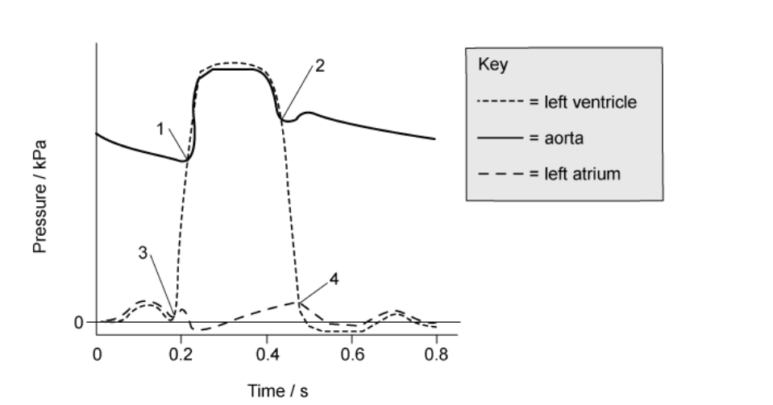
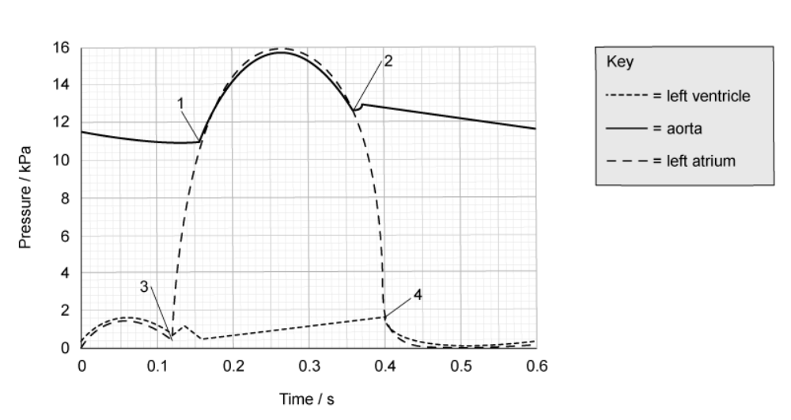
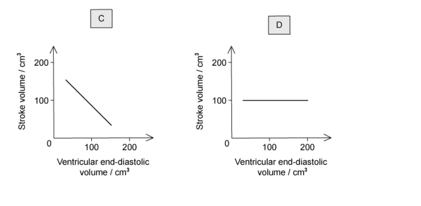
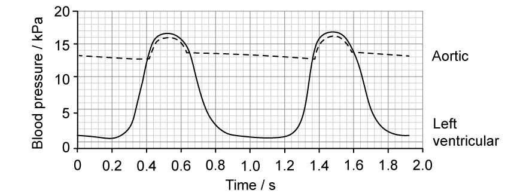
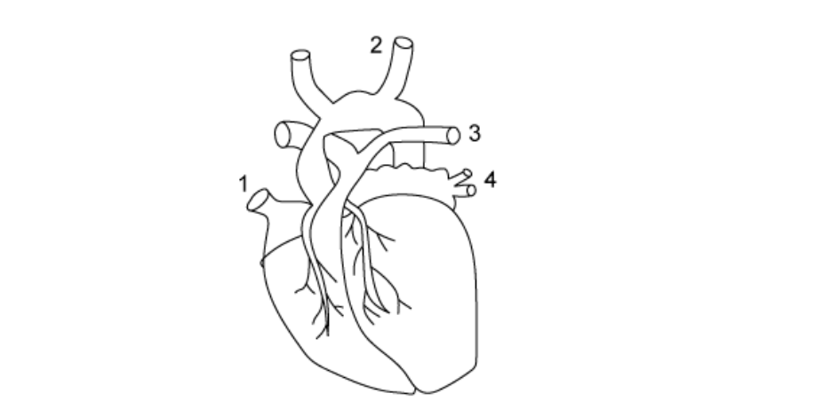
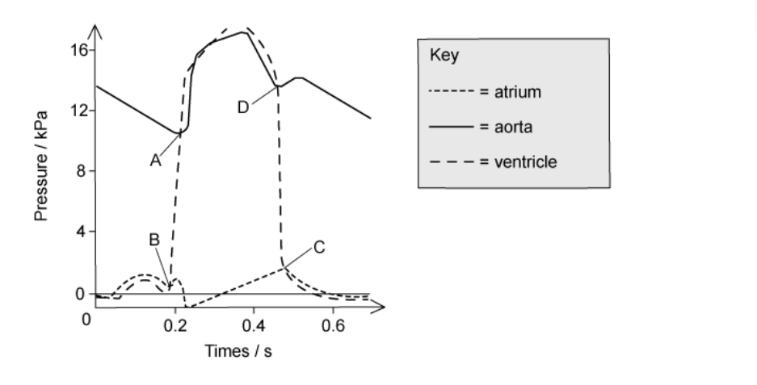
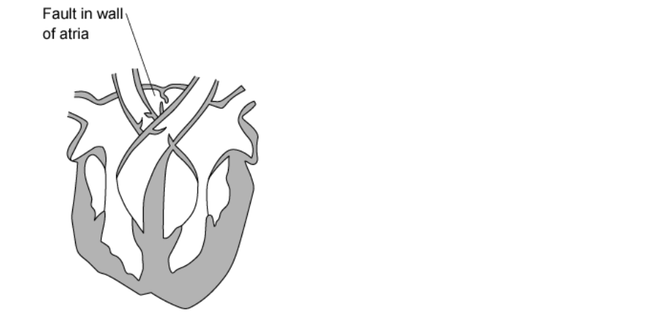
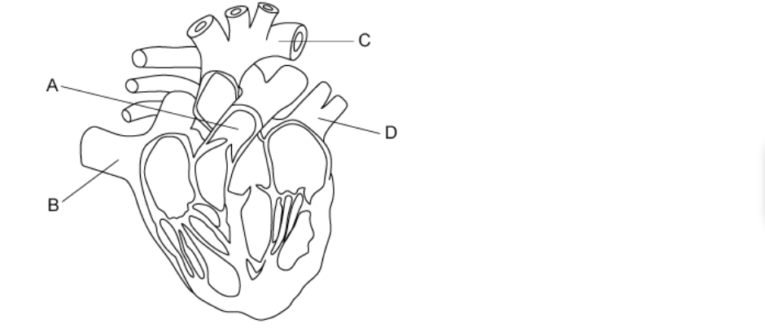
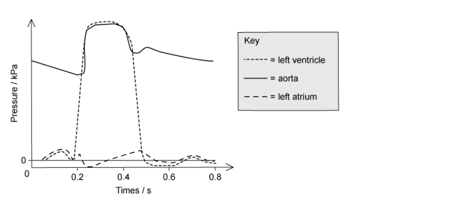
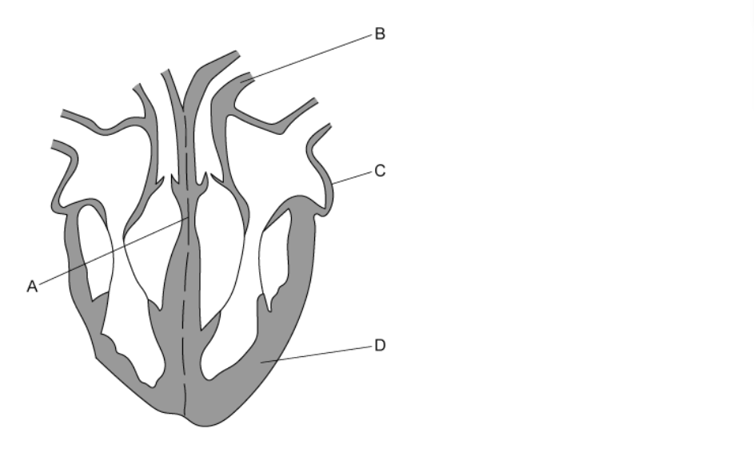

# Exam Questions — The Heart
**8. Transport in Mammals** · Cambridge (CIE) A-LEVEL biology (9700)
> Source: [https://www.savemyexams.com/a-level/biology/cie/25/topic-questions/](https://www.savemyexams.com/a-level/biology/cie/25/topic-questions/) · 30 questions across 1 sets

## Multiple Choice Questions (30 questions)

### Q1 — hard — 1 marks

**Q1** [1 mark]

The graph shows the pressure changes in the left side of the heart over time.

Which row of the table below shows what is happening at points **1**, **2**,** 3** and **4 **to the semilunar valves and the atrioventricular valves?

|   | Semilunar valve | Atrioventricular valve |   |   |
|---|---|---|---|---|
|   | Opens | Closes | Opens | Closes |
| **A** | 2 | 3 | 1 | 4 |
| **B** | 2 | 3 | 4 | 1 |
| **C** | 1 | 2 | 3 | 4 |
| **D** | 1 | 2 | 4 | 3 |

### Q2 — hard — 1 marks

**Q2** [1 mark]

A disease that causes a lower than normal heart rate is called ‘heart block’. When a doctor was treating a patient with this condition, he found that they had normal electrical impulses but these were not correctly conducted to the ventricles.

Which of the following could be faulty in the patient?

| **1** | atrioventricular node (AVN) |
|---|---|
| **2** | sinoatrial node (SAN) |
| **3** | Purkyne tissue |

### Q3 — hard — 1 marks

**Q3** [1 mark]

The graph shows the pressure changes in the left side of the heart over time. The cardiac cycle shown lasts 0.6 seconds (s).

The points on the graph **1**, **2**, **3** and **4** show when the atrioventricular and semilunar valves are open or closed.

What is the total time in one cardiac cycle when the atrioventricular valves and the semilunar valves are both closed at the same time?

### Q4 — hard — 1 marks

**Q4** [1 mark]

The table below describes events during the cardiac cycle.

Which row is correct?

|   | nerve impulses from atrioventricular node (AVN) to | nerve impulses from Purkyne tissue (PT) to | nerve impulses from the sinoatrial node (SAN) to |
|---|---|---|---|
| **A** | PT | the atria | AVN |
| **B** | SAN | the atria | PT |
| **C** | PT | the ventricles | AVN |
| **D** | SAN | the ventricles | PT |

### Q5 — hard — 1 marks

**Q5** [1 mark]

The graph shows the pressure changes during a cardiac cycle

Which row correctly identifies Q, R, S and T?

|   | Q | R | S | T |
|---|---|---|---|---|
| **A** | semilunar valves close | atrioventricular valves open | atrioventricular valves close | semilunar valves open |
| **B** | semilunar valves open | atrioventricular valves close | atrioventricular valves open | semilunar valves close |
| **C** | atrioventricular valves close | semilunar valves close | semilunar valves open | atrioventricular valves open |
| **D** | atrioventricular valves close | semilunar valves open | semilunar valves close | atrioventricular valves open |

### Q6 — hard — 1 marks

**Q6** [1 mark]

The diagram shows a horizontal cross section of a human heart. The atria have been removed so the valves can be seen.

Which of the labels shows the valve that is pushed open when oxygenated blood is entering a ventricle?

### Q7 — hard — 1 marks

**Q7** [1 mark]

After entering the right side of the heart, a red blood cell will pass through or pass by the following structures:

| **1** | tricuspid valve |
|---|---|
| **2** | semilunar valve |
| **3** | right atrium |
| **4** | right ventricle |
| **5** | sinoatrial node |

Which option shows the correct order that red blood cells will pass through?

### Q8 — hard — 1 marks

**Q8** [1 mark]

The volume of blood pumped by each contraction of the ventricle is called the stroke volume. The volume of blood in the ventricle before systole is called the ventricular end-diastolic volume.

The following graphs show the relationship between stroke volume and ventricular end-diastolic volume.

Which one is correct?

### Q9 — hard — 1 marks

**Q9** [1 mark]

The graph below shows the blood pressure changes in the aorta and left ventricle during two complete cardiac cycles.

**Fig. 1**

What is this person's heart rate?

### Q10 — hard — 1 marks

**Q10** [1 mark]

The diagram is of the external heart structure and blood vessels.

Which row of the table below shows the combination of blood vessels that supply blood to the heart and carry blood away from the heart?

|   | To the heart | Away from the heart |
|---|---|---|
| **A** | 2 and 3 | 1 and 4 |
| **B** | 4 and 1 | 2 and 3 |
| **C** | 3 and 4 | 1 and 2 |
| **D** | 1 and 2 | 3 and 4 |

### Q11 — medium — 1 marks

**Q11** [1 mark]

The diagram below shows two cardiac cycles of a patient. The events of the cycle are placed next to a timescale.

How fast is the patient’s heart beating?

### Q12 — medium — 1 marks

**Q12** [1 mark]

The electrical excitation of the ventricles of the heart are thought to be improved by taking fish oils.

What part of the heart could the fish oils help?

### Q13 — medium — 1 marks

**Q13** [1 mark]

The graph shows the pressure in different parts of the heart during one cardiac cycle

At which point does the semilunar valve of the aorta close?

### Q14 — medium — 1 marks

**Q14** [1 mark]

The diagram below shows the heart and associated blood vessels.

Which of the following would be correct for the flow of blood through the heart from the body?

### Q15 — medium — 1 marks

**Q15** [1 mark]

The graph below shows the pressure in different parts of the left side of the heart during one cardiac cycle.

At the end of which section in the graph (**A, B, C **or **D) **would the ventricle be full of blood?

### Q16 — medium — 1 marks

**Q16** [1 mark]

The table shows some changing conditions in the body.

Which row would cause the largest rise in cardiac output?

|   | aortic blood pressure | blood pressure in the vena cava | carbon dioxide concentration of the blood | frequency of impulses in the Vagus nerve |
|---|---|---|---|---|
| **A**  **B**  **C**  **D** | no change  no change  decrease  decrease | decrease  decrease  no change  no change | ncrease  no change  increase  no change | no change  increase  no change  increase |

### Q17 — medium — 1 marks

**Q17** [1 mark]

The following parts of the heart all control the heartbeat.

| **1** | Purkyne tissue |
|---|---|
| **2** | atrioventricular node (AVN) |
| **3** | sinoatrial node (SAN) |

Which row in the table below is correct for ventricular contraction and atrial contraction?

|   | Ventricular contraction | Atrial contraction |
|---|---|---|
| **A** | Purkyne tissue carries a wave of excitation | SAN produces a wave of excitation |
| **B** | Purkyne tissue carries a wave of excitation | SAN and AVN produce a wave of excitation |
| **C** | AVN produces a wave of excitation | Purkyne tissue carries a wave of excitation |
| **D** | SAN produces a wave of excitation | AVN produces a wave of excitation |

### Q18 — medium — 1 marks

**Q18** [1 mark]

The diagram shows a fault in the wall of the atria.

Which of the following would describe the effect of this fault?

### Q19 — medium — 1 marks

**Q19** [1 mark]

The narrowing of the aortic semilunar valve is a heart disorder called aortic stenosis.

Which of the following would describe the effect of aortic stenosis on the heart structure and function?

### Q20 — medium — 1 marks

**Q20** [1 mark]

The muscle of the left-hand side of the heart is thicker than the right-hand side.

Which of the following are consequences of this difference in muscle thickness?

1. The left side of the heart generates higher blood pressure
2. Blood leaving the right ventricle travels a greater distance than blood leaving the left ventricle
3. The left ventricle delivers blood to the body
4. The right ventricle generates lower pressure than the left-hand side

### Q21 — easy — 1 marks

**Q21** [1 mark]

What is systolic blood pressure?

### Q22 — easy — 1 marks

**Q22** [1 mark]

The following are some features of blood vessels.

Which feature enables the aorta to withstand the high pressure at ventricular systole?

### Q23 — easy — 1 marks

**Q23** [1 mark]

Which structure is correctly labelled on the diagram below?

### Q24 — easy — 1 marks

**Q24** [1 mark]

The characteristic ‘lub-dub’ sound of the heartbeat is caused by the movement of valves in the heart.

What causes the first sound after atrial systole in the cardiac cycle?

| 1 | closing of the semilunar valves |
|---|---|
| 2 | opening of the semilunar valves |
| 3 | closing of the atrioventricular valves |

### Q25 — easy — 1 marks

**Q25** [1 mark]

Purkyne (Purkinje) tissue is found in the mammalian heart. What is its function?

### Q26 — easy — 1 marks

**Q26** [1 mark]

The graph shows the pressure in different parts of the heart during one cardiac cycle

At 0.2 seconds which part of the heart is responding to the excitatory stimulus?

### Q27 — easy — 1 marks

**Q27** [1 mark]

During ventricular diastole what happens in the heart?

### Q28 — easy — 1 marks

**Q28** [1 mark]

When the pressure in the ventricles in the heart is at its maximum what is the state of the valves?

|   | **semilunar valves** | **atrioventricular valves** |
|---|---|---|
| **A** | open | open |
| **B** | open | closed |
| **C** | closed | open |
| **D** | closed | closed |

### Q29 — easy — 1 marks

**Q29** [1 mark]

Which of the following statements happens during ventricular systole in a human heartbeat?

| **1** | ventricular pressure increases |
|---|---|
| **2** | atrial pressure does not change |
| **3** | aortic pressure increases |

### Q30 — easy — 1 marks

**Q30** [1 mark]

What happens in the left ventricle during a contraction?
