# Exam Questions — The Gas Exchange System
**9. Gas Exchange** · Cambridge (CIE) A-LEVEL biology (9700)
> Source: [https://www.savemyexams.com/a-level/biology/cie/25/topic-questions/](https://www.savemyexams.com/a-level/biology/cie/25/topic-questions/) · 45 questions across 2 sets

## Multiple Choice Questions (30 questions)

### Q1 — hard — 1 marks

**Q1** [1 mark]

What is the correct order for the events that occur during mucus secretion from goblet cells in the trachea?

| 1 | Secretion of a glycoprotein |
|---|---|
| 2 | Addition of a carbohydrate to protein |
| 3 | Separation of a vesicle from the Golgi apparatus |
| 4 | Fusion of the vesicle with the plasma membrane |

### Q2 — hard — 1 marks

**Q2** [1 mark]

Emphysema is a lung disease that results in the alveoli being unable to return to their original shape after inhalation. Stages in the development of emphysema are shown in the diagram below.

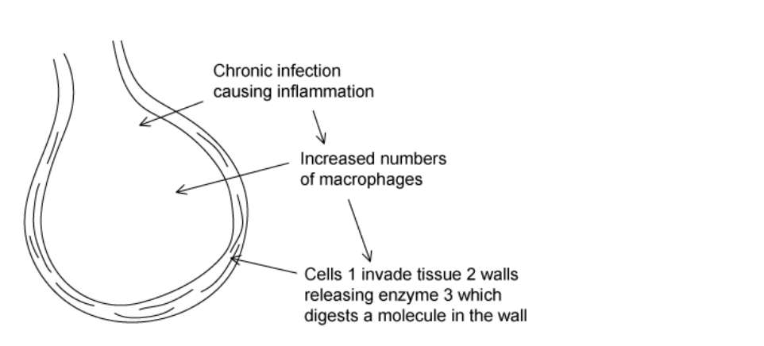

What correctly identifies 1, 2 and 3?

|   | 1 | 2 | 3 |
|---|---|---|---|
| **A** | phagocytes | alveoli | elastase |
| **B** | phagocytes | bronchiole | ligase |
| **C** | lymphocytes | alveoli | elastase |
| **D** | lymphocytes | bronchiole | ligase |

### Q3 — hard — 1 marks

**Q3** [1 mark]

A bronchus wall is shown in the photomicrograph.

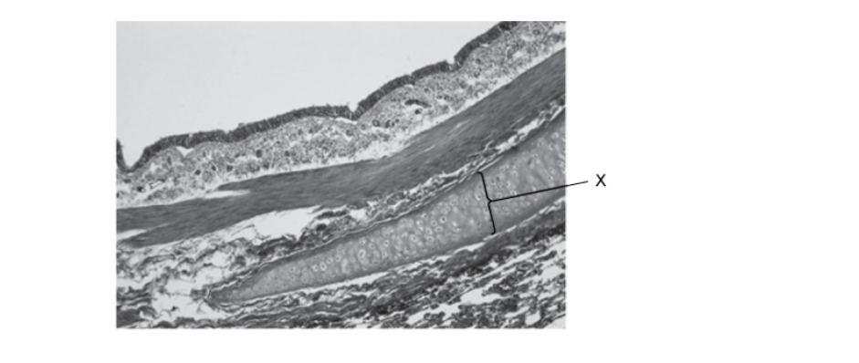

What is the function of tissue X?

### Q4 — hard — 1 marks

**Q4** [1 mark]

The diagram shows specialised tissues in a magnified section of a human lung.

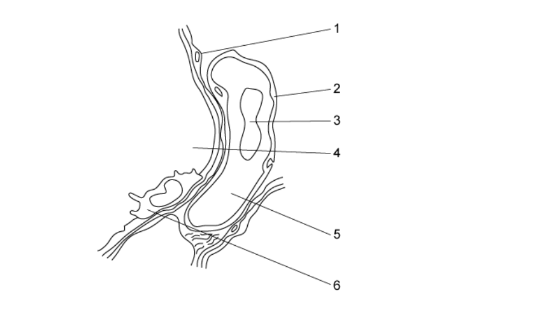

Where can HCO3- ions, carbonic anhydrase and lysosomes be found in high proportions?

|   | HCO3- ions | carbonic anhydrase | lysosomes |
|---|---|---|---|
| **A** | 4 | 2 | 5 |
| **B** | 5 | 3 | 6 |
| **C** | 6 | 4 | 1 |
| **D** | 3 | 1 | 4 |

### Q5 — hard — 1 marks

**Q5** [1 mark]

Some research has suggested that there is a positive correlation between smoking and the risk of developing lung cancer. The results of two studies of men between 1950 and 1998 are shown in the graphs below.

Note Deaths per 100,000 of age group, are deaths from lung cancer.

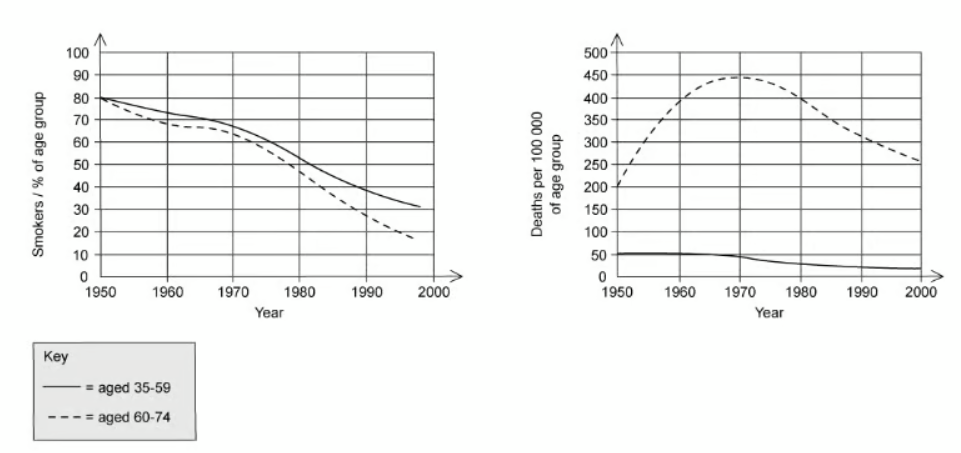

Which statement is **not** supported by the data in the graphs?

### Q6 — hard — 1 marks

**Q6** [1 mark]

Which of the following organelles do goblet cells have large quantities of?

| 1 | Secretory vesicles |
|---|---|
| 2 | Rough endoplasmic reticulum |
| 3 | Mitochondria |
| 4 | Lysosomes |

### Q7 — hard — 1 marks

**Q7** [1 mark]

The efficiency of gas exchange was the same in all four people.

*tidal volume(dm**3**) = volume of lung after inhalation(dm**3**) – volume of lung after exhalation(dm**3**)*

Which person absorbed most oxygen during four minutes of normal breathing?

| person | tidal volume / dm3 | total lung volume / dm3 | breathing rate / breaths per minute |
|---|---|---|---|
| **A** | 0.6 | 6.4 | 14 |
| **B** | 0.6 | 6.0 | 15 |
| **C** | 0.5 | 6.4 | 16 |
| **D** | 0.4 | 5.8 | 17 |

### Q8 — hard — 1 marks

**Q8** [1 mark]

The alveoli walls are damaged by a disease.

What effect does this have on the surface area and volume of the lungs?

|   | volume | surface area |
|---|---|---|
| **A** | no change | no change |
| **B** | no change | decreased |
| **C** | decreased | decreased |
| **D** | increased | decreased |

### Q9 — hard — 1 marks

**Q9** [1 mark]

During an asthma attack, extra mucus is produced and tubes within the gas exchange system narrow.

Which of the following responses occur during an asthma attack?

| 1 | Exocytosis in goblet cells increases |
|---|---|
| 2 | Activity of ciliated epithelium increases |
| 3 | Smooth muscles respire faster |

### Q10 — hard — 1 marks

**Q10** [1 mark]

If an asthmatic person inhales an allergen the following occurs:

- Goblet cells that line the bronchi and bronchioles secrete excess mucus
- Bronchi and bronchioles become narrow and inflamed

What effect do these responses have on gaseous exchange?

| 1 | Increase the diffusion distance from the alveoli into the blood |
|---|---|
| 2 | Increase the risk of developing a lung infection |
| 3 | Decrease the diffusion gradient for oxygen in the lungs |

### Q11 — medium — 1 marks

**Q11** [1 mark]

|   | highest affinity                →       lowest affinity |   |   |
|---|---|---|---|
| **A** | oxygen | carbon dioxide | carbon monoxide |
| **B** | oxygen | carbon monoxide | carbon dioxide |
| **C** | carbon monoxide | carbon dioxide | oxygen |
| **D** | carbon monoxide | oxygen | carbon dioxide |

What is the correct order of binding affinity to haemoglobin?

### Q12 — medium — 1 marks

**Q12** [1 mark]

Why do bronchioles have a folded inner lining?

### Q13 — medium — 1 marks

**Q13** [1 mark]

The trachea and alveoli are key structures in the human gas exchange system.

Which tissues are present in each?

|   |   | cartilage | epithelium with goblet cells | smooth muscle |
|---|---|---|---|---|
| **A** | trachea  alveoli | Y  N | Y  N | Y  N |
| **B** | trachea  alveoli | Y  N | Y  Y | N  Y |
| **C** | trachea  alveoli | Y  N | Y  N | Y  Y |
| **D** | trachea  alveoli | Y  Y | Y  Y | Y  Y |

Key: Y=present N=absent

### Q14 — medium — 1 marks

**Q14** [1 mark]

Haemoglobin can bind to oxygen, carbon dioxide and carbon monoxide.

| 1 | Oxygen |
|---|---|
| 2 | Carbon dioxide |
| 3 | Carbon monoxide |

Which gases bind to the same site on the haemoglobin molecule?

### Q15 — medium — 1 marks

**Q15** [1 mark]

Which of the following does not lead to a maximised uptake of oxygen in the lungs?

### Q16 — medium — 1 marks

**Q16** [1 mark]

A scientist looks at the wall of a bronchus under an electron microscope.

What would they expect to see?

| 1 | Exocytotic vesicles |
|---|---|
| 2 | Cartilage cells |
| 3 | Ciliated cells |

### Q17 — medium — 1 marks

**Q17** [1 mark]

The diagram shows a section of a specialised type of epithelium.

Where can this epithelium be found in the respiratory system?

|   | bronchus | all bronchioles | trachea |
|---|---|---|---|
| **A** | ✓ | ✓ | ✓ |
| **B** | ✓ | X | ✓ |
| **C** | X | ✓ | ✓ |
| **D** | ✓ | ✓ | X |

Key: ✓= present, X= absent

### Q18 — medium — 1 marks

**Q18** [1 mark]

A student was asked to describe the differences between four microscope slides of sections taken from different parts of the gas exchange system.

| slide 1 | not present: glands, cartilage  present: few ciliated epithelial cells, smooth muscle |
|---|---|

| slide 2 | present: goblet cells, incomplete cartilage rings, glands, smooth muscle, ciliated epithelial cells |
|---|---|

| slide 3 | present: goblet cells, plates of cartilage, ciliated epithelial cells, glands, smooth muscle |
|---|---|

| slide 4 | not present: goblet cells, cartilage, glands, smooth muscle  present: squamous epithelial cells |
|---|---|

Which is the correct identification of the parts of the gas exchange system?

|   | slide 1 | slide 2 | slide 3 | slide 4 |
|---|---|---|---|---|
| **A** | bronchiole | trachea | bronchus | alveolus |
| **B** | bronchus | trachea | alveolus | bronchiole |
| **C** | bronchiole | bronchus | trachea | alveolus |
| **D** | alveolus | bronchiole | trachea | bronchus |

### Q19 — medium — 1 marks

**Q19** [1 mark]

Which row correctly describes a bronchiole?

|   | diameter (mm) | collagen and elastic fibres | site of gas exchange | cilia |
|---|---|---|---|---|
| **A** | 0.25 | no | yes | yes |
| **B** | 0.5 | no | no | no |
| **C** | 1 | yes | no | yes |
| **D** | 20 | yes | no | yes |

### Q20 — medium — 1 marks

**Q20** [1 mark]

A cross-section of a bronchus is shown in the photomicrograph.

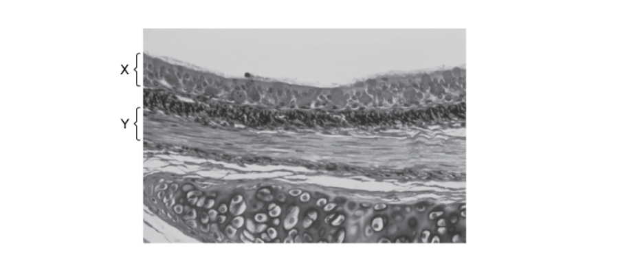

What is the function of **X** and **Y**?

|   | **X** | **Y** |
|---|---|---|
| **A** | trap dust and dirt | secrete mucus |
| **B** | secrete mucus | prevent collapse of the airway |
| **C** | waft dust and dirt upwards | constrict airway |
| **D** | support the airway | dilate airway |

### Q21 — easy — 1 marks

**Q21** [1 mark]

Label the structures in the human breathing system.

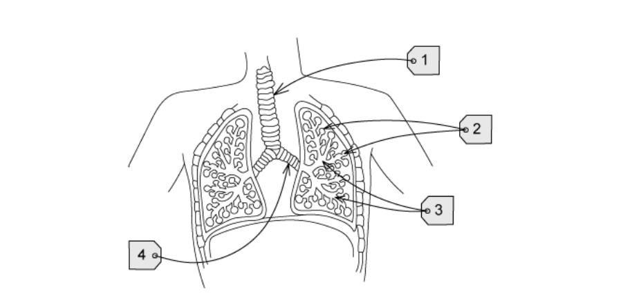

|   | **1** | **2** | **3** | **4** |
|---|---|---|---|---|
| **A** | bronchus | trachea | vein | bronchiole |
| **B** | bronchiole | alveoli | vein | bronchus |
| **C** | trachea | alveoli | bronchus | bronchiole |
| **D** | trachea | alveoli | bronchiole | bronchus |

### Q22 — easy — 1 marks

**Q22** [1 mark]

Which function is paired with the incorrect cell or tissue?

|   | **function** | **cell / tissue** |
|---|---|---|
| **A** | destroys bacteria by producing enzymes | goblet cells |
| **B** | reinforces the trachea | cartilage |
| **C** | constricts bronchioles | smooth muscle |
| **D** | moves mucus over the surface of the trachea | ciliated |

### Q23 — easy — 1 marks

**Q23** [1 mark]

Goblet cells, squamous epithelial cells and ciliated cells are found in various structures that make up the human lung.

Where are these cells located?

|   | **Goblet** | **Squamous Epithelial** | **Ciliated** |
|---|---|---|---|
| **A** | pulmonary vein | alveolus | trachea |
| **B** | bronchus | bronchiole | trachea |
| **C** | trachea | alveolus | bronchiole |
| **D** | bronchiole | pulmonary vein | bronchus |

### Q24 — easy — 1 marks

**Q24** [1 mark]

Which fact about alveoli and blood capillaries does not lead to an increased efficiency of gaseous exchange in the lungs?

### Q25 — easy — 1 marks

**Q25** [1 mark]

Which row correctly gives the approximate diameters of the alveolus, trachea, bronchus and bronchiole within a human lung?

|   | **alveolus / mm** | **trachea / mm** | **bronchiole / mm** | **bronchus / mm** |
|---|---|---|---|---|
| **A** | 0.25 | 12 | 0.50 | 18 |
| **B** | 0.25 | 18 | 0.50 | 12 |
| **C** | 0.50 | 12 | 0.25 | 18 |
| **D** | 0.50 | 18 | 0.25 | 12 |

### Q26 — easy — 1 marks

**Q26** [1 mark]

Which row correctly describes the pulmonary artery?

|   | **blood carried** | **lumen size** | **muscle in walls** |
|---|---|---|---|
| **A** | oxygenated | small | thick |
| **B** | oxygenated | large | thin |
| **C** | deoxygenated | small | thick |
| **D** | deoxygenated | large | thin |

### Q27 — easy — 1 marks

**Q27** [1 mark]

What is the function of elastic fibres in the lungs?

### Q28 — easy — 1 marks

**Q28** [1 mark]

The diagram shows a cross-section of a bronchus wall (not to scale).

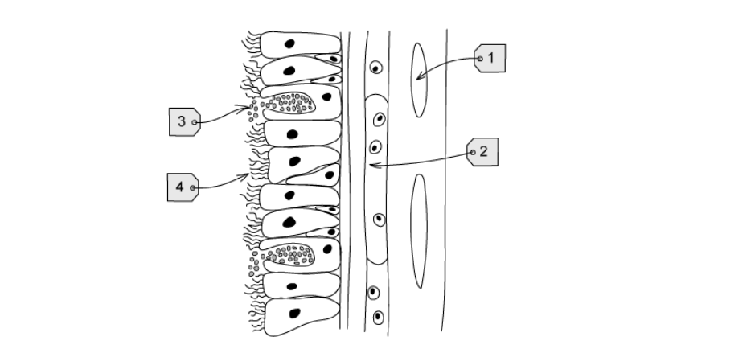

Which row correctly labels the diagram?

|   | **1** | **2** | **3** | **4** |
|---|---|---|---|---|
| **A** | smooth muscle | elastic fibres | phagocyte | squamous endothelium |
| **B** | cartilage | smooth muscle | goblet cell | ciliated epithelium |
| **C** | smooth muscle | elastic fibres | phagocyte | ciliated epithelium |
| **D** | cartilage | smooth muscle | goblet cell | squamous endothelium |

### Q29 — easy — 1 marks

**Q29** [1 mark]

What are the correct functions of the named tissues of the gas exchange system?

|   | **smooth muscle** | **cartilage** | **ciliated epithelium** | **elastic fibres** |
|---|---|---|---|---|
| **A** | controls the airflow to and from the alveoli | supports small bronchioles | traps bacteria and dirt in the air | allows the trachea to stretch |
| **B** | contacts to increase airflow | prevents choking | secretes mucus | supports the trachea |
| **C** | changes the diameter of bronchioles | keeps airways open | moves mucus out of airways | enables alveoli to expand during inhalation |
| **D** | traps bacteria and dirt in the air | prevents the trachea from collapsing when coughing | keeps a layer of mucus lining the airways | causes elastic recoil when exhaling |

### Q30 — easy — 1 marks

**Q30** [1 mark]

Goblet cells and ciliated epithelium are both found in which structures in the breathing system?

|   | **bronchioles** | **bronchi** | ** trachea** |
|---|---|---|---|
| **A** | **Y** | **Y** | **N** |
| **B** | **Y** | **N** | **N** |
| **C** | **N** | **N** | **Y** |
| **D** | **N** | **Y** | **Y** |

Key: **Y** = both found **N** = both not found

## Structured Questions (15 questions)

### Q1 — hard — 12 marks

**Q1** [3 marks]

Describe the pathway taken by a molecule of oxygen from the outside air to the blood of a human.

**Q1** [3 marks]

Premature babies can suffer from a deficiency of pulmonary surfactant, a substance that prevents alveolar collapse. This can lead to a condition known as respiratory distress syndrome (RDS). Fig. 1 below shows the possible appearance of the lung tissue of an RDS patient and the appearance of normal lung tissue.

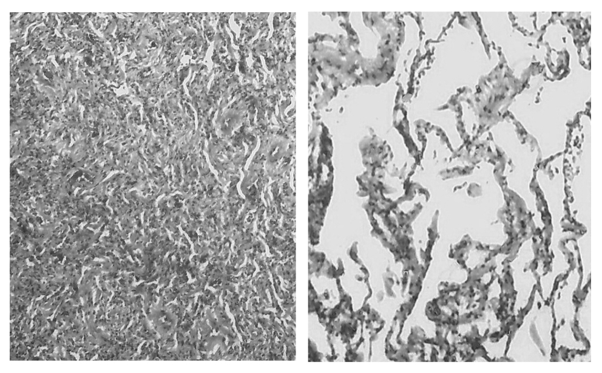

*Atlas of Pulmonary Pathology, **[CC BY-SA 2.0](https://creativecommons.org/licenses/by-sa/2.0/)*

**Fig. 1**

(i) Identify and label healthy lung tissue on Fig. 1.

[1]

(ii) Explain the effect of RDS on the lung tissue shown in Fig. 1.

[2]

**Q1** [4 marks]

RDS can be treated by the administration of an alternative form of pulmonary surfactant to the lungs. The graph shown in Fig. 2 gives the effect of different variations of pulmonary surfactant on the lung volume of rabbits at different pressures. The variations include pulmonary surfactant isolated from sheep lungs, as well as synthetic versions of pulmonary surfactant that contain its separate lipid and protein components. Note that cm H2O is a unit of pressure.

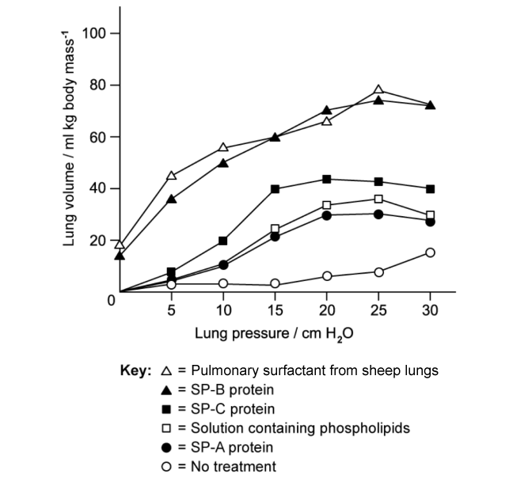

**Fig. 2**

Use the information provided to explain why each of the following statements is **incorrect**:

(i) Pulmonary surfactant is essential for lung expansion.

[1]

(ii) Phospholipids are the active component of pulmonary surfactant.

[1]

(iii) Pulmonary surfactant from sheep is the most effective treatment for RDS in premature babies.

[2]

**Q1** [2 marks]

The form of pulmonary surfactant produced in mammalian lungs contains proteins known as SP-A and SP-D, which are known to be involved with the activation of phagocytes.

Suggest, with a reason, a symptom that would result from a deficiency of SP-A and SP-D proteins.

### Q2 — hard — 14 marks

**Q2** [4 marks]

Fig. 1 shows a tissue sample taken from a human lung. Two cells are labelled **A **and **B**.

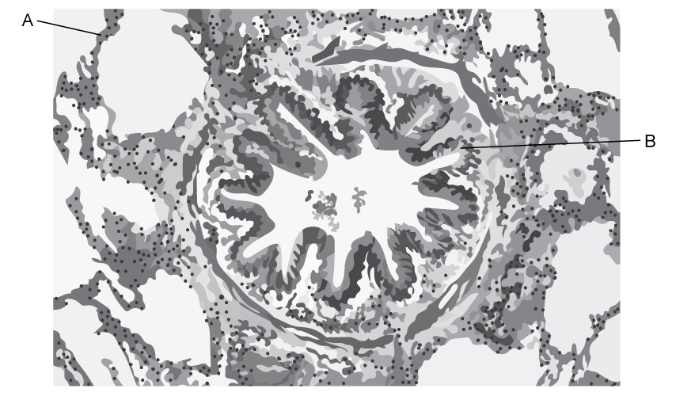

**Fig. 1**

Identify cell **A** and cell **B** **and **describe their function.

**Q2** [2 marks]

**Extract:**

Fig. 1 shows a tissue sample taken from a human lung. Two cells are labelled A and B.

Cell A identity:
- Alveolar epithelial cell

Cell A function:
- The surface for gas exchange OR secretes surfactant

Cell **A** is adapted for its function.

Describe and explain **one** structural feature of cell **A** that makes it well adapted for gas exchange.

**Q2** [5 marks]

Scientists grew alveolar epithelium cells in culture for 10 days. The cells were exposed to hydrogen peroxide. Hydrogen peroxide is a toxin that is found in cigarette smoke. Each day the scientists calculated the mass of cells that died each hour. Their results are shown in Table 1 below.

**Table 1**

| **Day** | **Mass of alveolar epithelium cells died in 1 hour / µg** | **Rate of cell death** |
|---|---|---|
| 0 | 0.06 |   |
| 2 | 0.08 |   |
| 4 | 0.12 |   |
| 6 | 0.16 |   |
| 8 | 0.21 |   |
| 10 | 0.25 |   |

(i) For each day, calculate the rate of cell death per minute. Record the rates in standard form and give an appropriate unit.

[2]

(ii) Plot a suitable graph of your processed data on the grid in Fig. 2.

[3]

**Fig. 2**

**Q2** [3 marks]

**Extract:**

Scientists grew alveolar epithelium cells in culture for 10 days. The cells were exposed to hydrogen peroxide. Hydrogen peroxide is a toxin that is found in cigarette smoke. Each day the scientists calculated the mass of cells that died each hour. Their results are shown in Table 1 below.

Table 1

| Day | Mass of alveolar epithelium cells died in 1 hour / µg | Rate of cell death |
| 0 | 0.06 |   |
| 2 | 0.08 |   |
| 4 | 0.12 |   |
| 6 | 0.16 |   |
| 8 | 0.21 |   |
| 10 | 0.25 |   |

Alpha-1-antitrypsin is a protein that reduces the activity of enzymes that can damage lung tissue. Hydrogen peroxide reduces the activity of alpha-1-antitrypsin. Scientists investigated the effect of different concentrations of hydrogen peroxide on the activity of alpha-1-antitrypsin. Fig. 3 shows their results.

**Fig. 3**

Use Fig. 3 and the information from part (c) to explain why long-term smokers suffer from shortness of breath.

### Q3 — hard — 10 marks

**Q3** [3 marks]

Fig. 1 shows a micrograph of a section of lung tissue. It contains a cross-section of part of an airway within the lung.

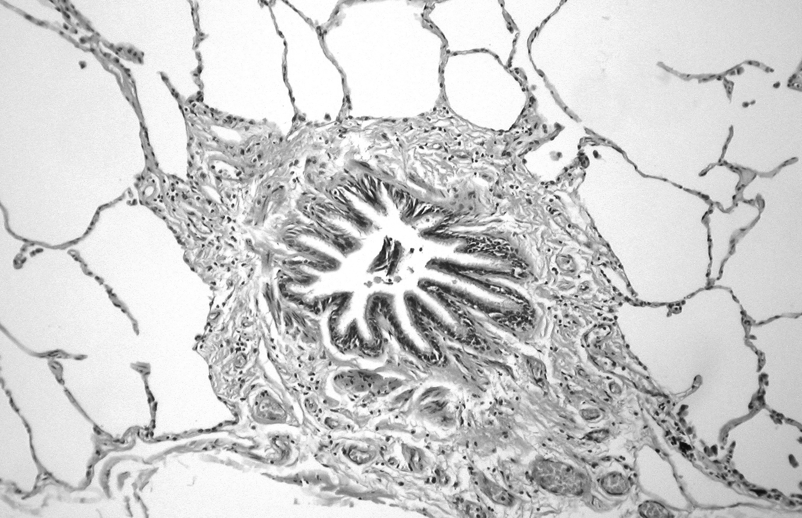

*Dr. Yale Rosen, CC BY-SA 2.0, via **[Flickr](https://www.flickr.com/photos/pulmonary_pathology/5414785258)*

**Fig. 1**

(i) Suggest the name of the type of airway shown in Fig. 1.

[1]

(ii) Describe the evidence from Fig. 1 that supports your answer to part (i).

[2]

**Q3** [4 marks]

**Extract:**

Fig. 1 shows a micrograph of a section of lung tissue. It contains a cross-section of part of an airway within the lung.

(i) Suggest the name of the type of airway shown in Fig. 1.

(ii) Describe the evidence from Fig. 1 that supports your answer to part (i).

Fig. 2 represents the same type of airway as that shown in Fig. 1 in a person with Chronic Obstructive Pulmonary Disease (COPD).

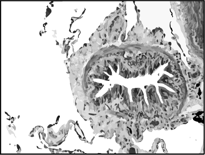

**Fig. 2**

(i) Use Fig. 2 to describe the impacts of COPD on the airways.

[2]

(ii) Explain how COPD would affect lung function.

[2]

**Q3** [3 marks]

**Extract:**

Fig. 2 represents the same type of airway as that shown in Fig. 1 in a person with Chronic Obstructive Pulmonary Disease (COPD).

(ii) Explain how COPD would affect lung function.

COPD would affect lung function as follows...
- A reduced volume of air enters the alveoli AS there is reduced airflow; [1 mark]
- Less oxygen diffuses into the blood AS there is a reduced concentration gradient (between the alveoli and the blood); [1 mark]

A person suffering from COPD may present with symptoms such as fatigue.

Explain why this is the case.

### Q4 — hard — 12 marks

**Q4** [3 marks]

Explain how the alveoli are adapted to maximise gas exchange efficiency in mammals.

**Q4** [2 marks]

An adult has a total alveolar surface area of 5.2 x 107 mm2. One alveolus has a surface area of 0.104 mm2.

Calculate how many alveoli this person has in each lung. Give your answer as an ordinary number, **not** in standard form.

**Q4** [3 marks]

Allergies occur when the immune system responds to a normally non-harmful antigen known as an allergen. Some allergic reactions affect the gas exchange system and can make breathing more difficult.

Suggest the events that could occur in the gas exchange system in response to an allergen that might make breathing more difficult.

**Q4** [4 marks]

Serious allergic reactions can sometimes lead to asthma attacks which can be very dangerous.

Scientists investigated the effect of a drug called albuterol which can be used to treat asthma. They divided a large number of asthma patients into three groups; **A**, **B** and **C**. The groups were treated as follows:

- Group **A** inhaled a fixed volume of spray containing albuterol every day
- Group **B** was given an inhaler that contained no active drug
- Group **C** did not receive any treatment

The scientists measured the forced expiratory volume (FEV) of each patient at regular intervals. The FEV is the volume of air forced out of the lungs in the first second when breathing out. The scientists recorded each patient’s FEV before treatment started and after 30 days of treatment. They then calculated the mean increase in FEV for each group. Their results are shown in Fig.1.

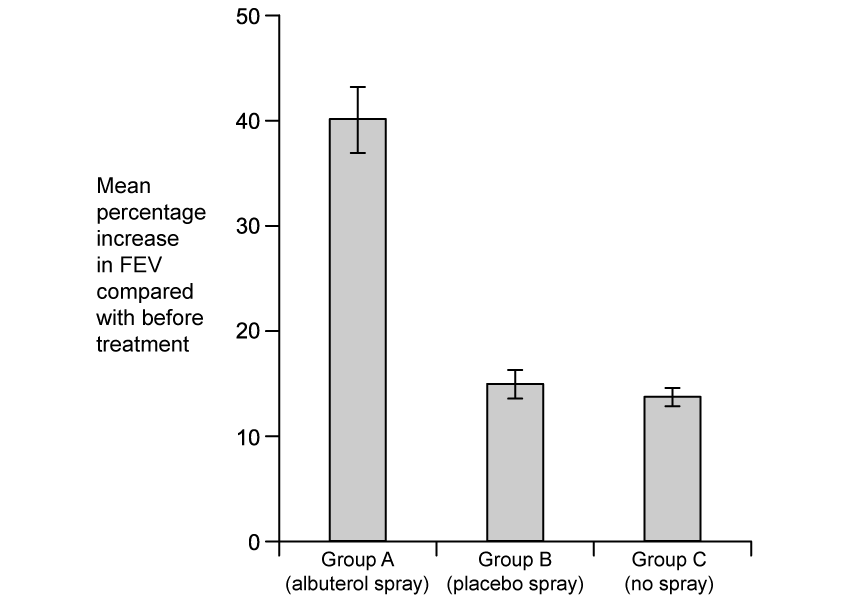

**Fig. 1**

Evaluate the effectiveness of albuterol in the treatment of patients with asthma.

### Q5 — hard — 8 marks

**Q5** [2 marks]

Air can contain pollutants such as particulate matter; solid and liquid particles that are suspended in air.  A high concentration of particulate matter can result in the death of some alveolar epithelium cells which are then replaced by non-specialised, thickened tissue.

Explain the effect of this on gas exchange within the lungs.

**Q5** [2 marks]

Particulate matter exposure has been linked to mortality. Fig. 1 shows the particulate matter concentration and attributable mortality rate per 100 000 of the population for three global regions from the year 2000 to 2020.

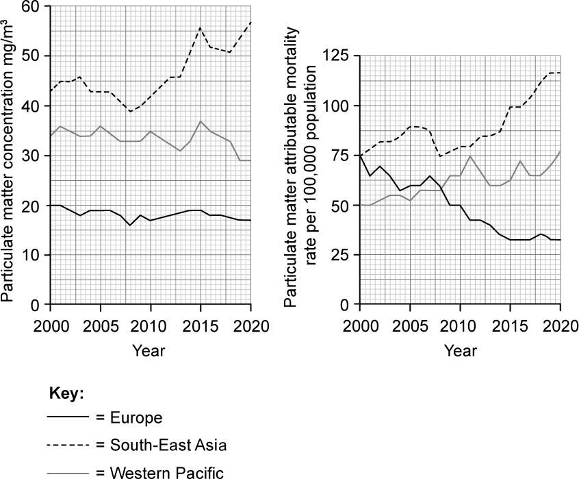

**Fig. 1**

Calculate the percentage change in the particulate matter concentration in South East Asia. Give your answer to three significant figures.

**Q5** [4 marks]

**Extract:**

Particulate matter exposure has been linked to mortality. Fig. 1 shows the particulate matter concentration and attributable mortality rate per 100 000 of the population for three global regions from the year 2000 to 2020.

A student studied Fig. 1 and concluded that an increase in particulate matter concentration correlated with an increase in particulate matter-attributable mortality rate.

Use Fig. 1 to assess this conclusion.

### Q6 — medium — 7 marks

**Q6** [1 mark]

Fig. 1 shows two images of lung tissue.

- **A** is a photomicrograph of healthy lung tissue
- **B **is a photomicrograph of lung tissue from a person with emphysema, a chronic obstructive pulmonary disease (COPD)

The images are both at magnification ×40.

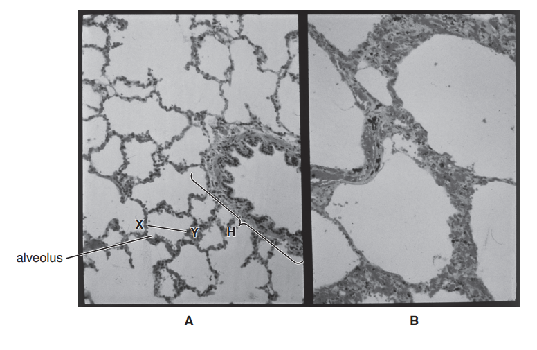

**Fig. 1**

Name the structure labelled **H** in Fig. 1**A**.

*Source: Oct/Nov 2018  9700/22 Q1A*

**Q6** [2 marks]

**Extract:**

Fig. 1 shows two images of lung tissue.

- **A** is a photomicrograph of healthy lung tissue
- **B** is a photomicrograph of lung tissue from a person with emphysema, a chronic obstructive pulmonary disease (COPD)

The images are both at magnification ×40.

Calculate the actual diameter of the alveolus at **X–Y**.

Write down the formula and use it to make your calculation.

When measured with a ruler on the page, the image of alveolus **X-Y** would appear as follows:

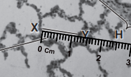

Give your answer to the nearest whole micrometre (μm).

*Source: Oct/Nov 2018  9700/22 Q1B*

**Q6** [4 marks]

**Extract:**

Fig. 1 shows two images of lung tissue.

- A is a photomicrograph of healthy lung tissue
- B is a photomicrograph of lung tissue from a person with emphysema, a chronic obstructive pulmonary disease (COPD)

The images are both at magnification ×40.

Gas exchange in the lungs occurs in the alveoli.

Describe the process of gas exchange in healthy lungs **and **suggest how this compares with gas exchange in the diseased lung shown in Fig. 1**B**.

*Source: Oct/Nov 2018  9700/22 Q1C*

### Q7 — medium — 7 marks

**Q7** [2 marks]

Fig.1 shows a section of tissue in the airways.

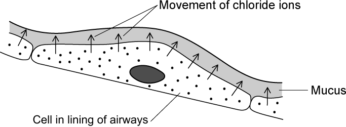

**Fig. 1**

Explain the role of mucus in the airways.

**Q7** [3 marks]

**Extract:**

Fig.1 shows a section of tissue in the airways.

**Fig. 1**

Chloride ions contribute to the production of mucus, ensuring that the mucus is at the correct *viscosity* within the airways. Note that the 'viscosity' of a liquid refers to the ease with which it flows; a low-viscosity liquid flows easily, while a high-viscosity liquid flows less easily.

Suggest how the movement of chloride ions, as shown in Fig. 1, can alter the viscosity of mucus.

**Q7** [2 marks]

**Extract:**

Fig.1 shows a section of tissue in the airways.

The tissue shown in Fig. 1 is found within the structure represented in Fig. 2

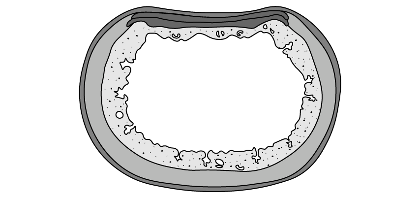

**Fig. 2**

(i) Identify the structure shown in Fig. 2.

[1]

(ii) Give a reason for your answer to part (i).

[1]

### Q8 — medium — 13 marks

**Q8** [2 marks]

Fig. 1 is an image of an electron micrograph showing a cross section through the lining of part of the human gas exchange system. The magnification of Fig. 1 is x5000.

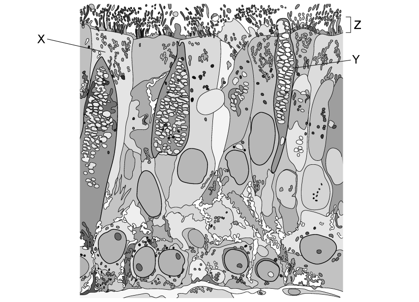

**                                                      Fig. 1**

The line marked **Z** in Fig.1 measures 3.1 cm.

Calculate the actual length of the structure measured by line **Z**. Give your answer in µm.

**Q8** [4 marks]

**Extract:**

Fig. 1 is an image of an electron micrograph showing a cross section through the lining of part of the human gas exchange system. The magnification of Fig. 1 is x5000.

For Fig.1:

(i) Identify the type of tissue shown.

[1]

(ii) Identify structures **X** and **Y**.

[2]

(iii) Name **one** location in the gas exchange system where the structures identified in part (ii) would both be found.

[1]

**Q8** [4 marks]

**Extract:**

Fig. 1 is an image of an electron micrograph showing a cross section through the lining of part of the human gas exchange system. The magnification of Fig. 1 is x5000.

Fig. 1

Structures **X** and **Y** are...

- **X** = ciliated epithelial cell;
- **Y** = goblet cell;

Explain the functions of structures **X** and **Y **in Fig.1.

**Q8** [3 marks]

**Extract:**

(ii) Structures X and Y are...
- X = ciliated epithelial cell; [1 mark]
- Y = goblet cell; [1 mark]

The function of structures X and Y are...
- Structure Y produces mucus; [1 mark]
- Mucus traps dust/sand/allergens/pollen/pathogens/bacteria/viruses; [1 mark]
- Structure X wafts mucus upwards / towards the top of the airways / towards the throat; [1 mark]
- Mucus can be swallowed and trapped pathogens destroyed by stomach acid; [1 mark]

Certain lung conditions can lead to remodelling of the lining of the airways and an increase in the numbers of structure **Y** from Fig.1. This is known as cell metaplasia and can lead to damaging symptoms.

Suggest **three **symptoms that may result from metaplasia of structure **Y** from Fig.1.

### Q9 — medium — 10 marks

**Q9** [3 marks]

Fig.1 shows different structures in the human airways viewed in cross section under a light microscope.

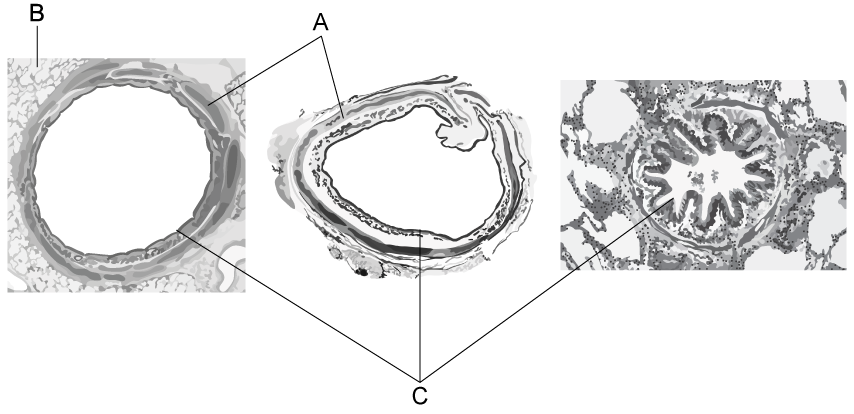

**                                                        Fig. 1**

Identify the tissues or structures labelled **A **to** C** in Fig. 1.

**Q9** [1 mark]

**Extract:**

Fig.1 shows different structures in the human airways viewed in cross section under a light microscope.

Identify the tissues or structures labelled **A **to** C** in Fig. 1.

The tissues or structures marked **A** to **C** in Fig.1 are...
- **C** = ciliated epithelium; [1 mark]

Give **one **difference in the composition of **C** between the trachea and bronchi, and the bronchioles.

**Q9** [2 marks]

Emphysema is a condition that can affect the lungs of individuals frequently exposed to cigarette smoke or high levels of air pollution. Fig. 2 shows two microscope images of the structures labelled **B** in Fig.1; one shows the normal structure of **B** while the other shows the structure of **B** when affected by emphysema. The images are shown at x40 magnification.

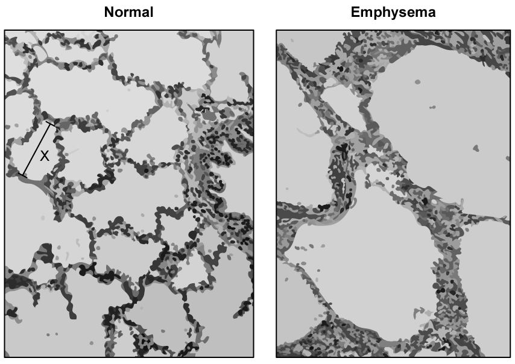

**                                                       Fig. 2**

The line marked **X** in Fig. 2 is 8.5 mm in length.

Use the information provided to calculate the actual diameter of the structure measured by line **X**. Give your answer in µm.

**Q9** [4 marks]

**Extract:**

From part a: **B** = alveolus/alveoli

From part c: Emphysema is a condition that can affect the lungs of individuals frequently exposed to cigarette smoke or high levels of air pollution. Fig. 2 shows two microscope images of the structures labelled **B** in Fig.1; one shows the normal structure of **B** while the other shows the structure of **B** when affected by emphysema. The images are shown at x40 magnification.

**                                                       Fig. 2**

Individuals suffering from emphysema can experience a symptom known as cyanosis, where the fingers and lips take on a blueish discolouration.

With reference to Fig. 2 suggest why individuals with emphysema might experience cyanosis. Note that deoxygenated blood is darker in colour than oxygenated blood.

### Q10 — medium — 15 marks

**Q10** [2 marks]

Smoking cigarettes is known to damage ciliated epithelial tissue in the airways.

Explain the effect of damaged ciliated epithelial tissue on the gas exchange system.

**Q10** [6 marks]

Fig. 1 shows the number of lung cancer deaths in men and women aged between 25 and 79 in the UK between 1970 and 2023.

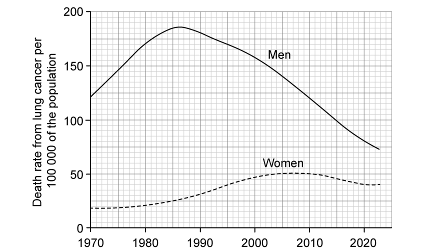

**Fig.1**

(i) Compare the lung cancer death rates of men and women shown in Fig. 1.

[4]

(ii) Explain the advantage of calculating the death rate per 100 000 of the population.

[2]

**Q10** [3 marks]

**Extract:**

Fig. 1 shows the number of lung cancer deaths in men and women aged between 25 and 79 in the UK between 1970 and 2023.

Calculate the percentage change in death rates in men between the maximum number of deaths and the minimum number of deaths. Give your answer to two significant figures.

**Q10** [4 marks]

Fig. 2 shows the difference in lung tissue between a non-smoker (**A**) and a cigarette smoker **(B).**

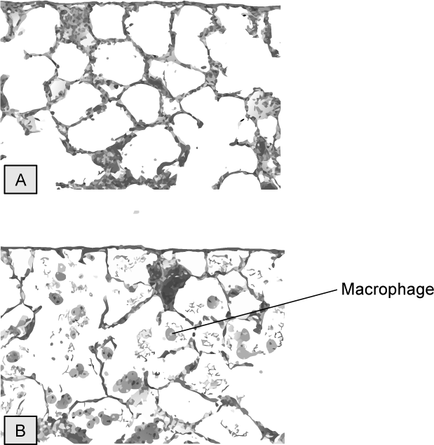

**Fig. 2**

(i) Identify the lung tissue shown in Fig. 2.

[1]

(ii) Use Fig. 2 to explain how changes in the lungs might contribute to a reduction in the overall health of individuals who smoke cigarettes.

[3]

### Q11 — easy — 10 marks

**Q11** [3 marks]

Fig. 1 shows the structure of the human gas exchange system.

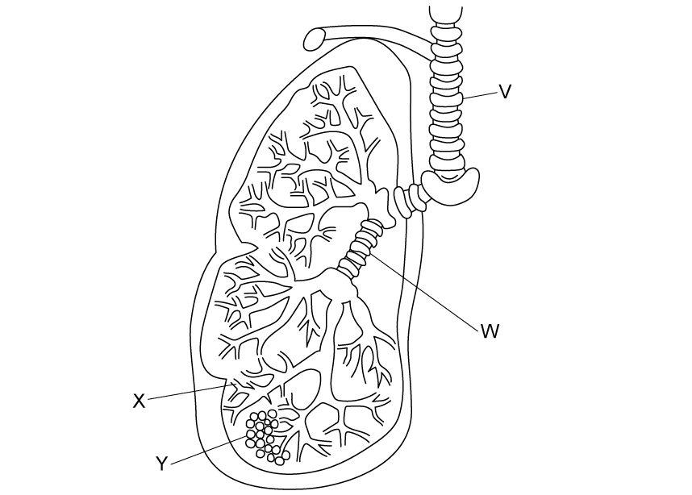

**                                                    Fig 1**

Identify structures **V**, **W**, and **X** in Fig. 1.

**Q11** [3 marks]

**Extract:**

Fig. 1 shows the structure of the human gas exchange system.

Fig 1

Identify structures V, W, and X in Fig. 1.

V = trachea
W = bronchus/bronchi
X = bronchiole(s)

For Fig. 1:

(i) Identify **one** tissue type that is present in structures **V,** **W, **and **X** but not in structure **Y**.

[1]

(ii) Explain the function of the tissue identified in part (i).

[2]

**Q11** [2 marks]

**Extract:**

Fig. 1 shows the structure of the human gas exchange system.

Fig. 2 is an image of a micrograph showing a cross section through structure **Y**.

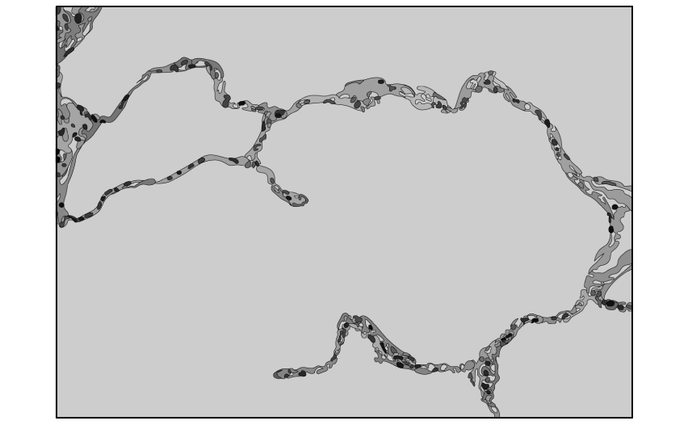

**                                                           Fig. 2**

Explain **one** structural adaptation visible in Fig. 2.

**Q11** [2 marks]

**Extract:**

Fig. 2 is an image of a micrograph showing a cross section through structure Y.

One structural adaptation visible in Fig. 2 is...
- Structure Y is surrounded by / contains squamous epithelium; [1 mark]
- This provides a short diffusion distance/pathway for oxygen/carbon dioxide; [1 mark]

Identify **and** explain **one** **other** feature of structure **Y** that assists its function.

### Q12 — easy — 9 marks

**Q12** [3 marks]

Fig 1. shows an alveolus and a neighbouring capillary.

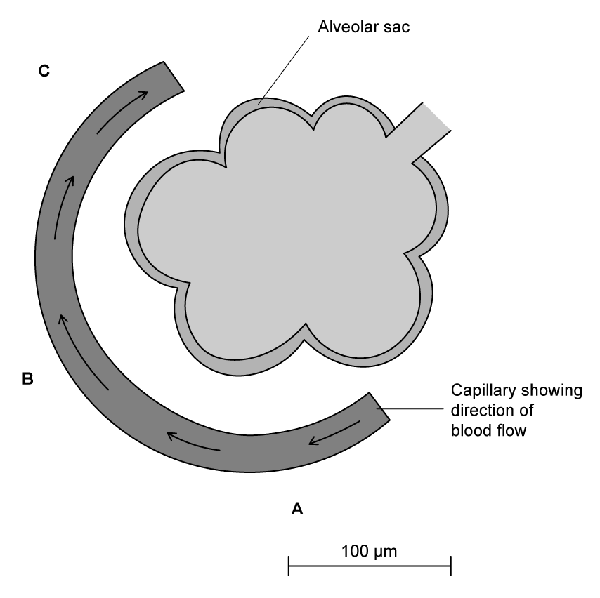

**Fig. 1**

Using the terms 'high', 'medium' and 'low', complete the table to show the relative blood concentrations of the substances indicated at the points **A**, **B **and **C** shown in Fig. 1

|   | A | B | C |
|---|---|---|---|
| Oxygen |   |   |   |
| Haemoglobin/oxyhaemoglobin |   |   |   |
| Carbon dioxide |   |   |   |

**Q12** [3 marks]

Each alveolus allows the passage of 6 × 10-3 mm3 of blood per minute when a healthy person is at rest.

This person has 450 million alveoli per lung.

Calculate the flow rate of blood through the lungs of this person.

State your answer in standard form using the units mm3min-1.

**Q12** [2 marks]

Starting with the innermost layer and travelling outwards, place the following tissues/structures into the order that they are found in a human trachea.

- Cartilage
- Tracheal wall
- Connective tissue
- Lumen
- Ciliated epithelium with glands

**Q12** [1 mark]

C-shaped rings of cartilage strengthen the trachea along its length. These are C-shaped to allow the trachea to narrow under certain circumstances. The trachea runs alongside the oesophagus for much of its length.

Suggest why the trachea has to become narrower on occasions.

### Q13 — easy — 10 marks

**Q13** [3 marks]

Table 1 compares the features of the human gas exchange system.

Complete the table by putting a tick (**✓**) in each box if the feature is present and a cross (×) if the feature is absent in each structure.

The first row has been done for you.

**Table 1**

| **Structure** | **Structural feature present** |   |   |   |   |
|---|---|---|---|---|---|
| **Cartilage** | **Elastic fibres** | **Goblet cells** | **Ciliated Epithelium** | **Smooth muscle** |   |
| Trachea | **✓** | **✓** | **✓** | **✓** | **✓** |
| Bronchi |   |   |   |   |   |
| Bronchioles |   |   |   |   |   |
| Alveoli |   |   |   |   |   |

**Q13** [3 marks]

Complete the following sentences about the gas exchange system.

Choose the correct words from the list below.

| **volume    airways    villi    bacteria    bronchioles   eaten   **  **cilia    nose    saliva    digested    throat   swallowed** |
|---|

*Ciliated epithelial cells have projections called ............... .*

*The role of these projections is to sweep ............... , dust and mucus out of the ............... .*

*The dust and mucus are swept towards the ............... where they can be ............... and destroyed by stomach acid. *

**Q13** [2 marks]

Fig. 1 shows different structures in the human airways viewed in cross section under a light microscope.

**                                                         Fig. 1**

Identify the structures labelled **B **in Fig. 1 **and **name the process that takes place here.

**Q13** [2 marks]

**Extract:**

Fig. 1 shows different structures in the human airways viewed in cross section under a light microscope.

Explain one function of structure **A** in Fig. 1.

### Q14 — easy — 7 marks

**Q14** [2 marks]

Table 1 shows some structures of the breathing system.

**Table 1**

| **Structure** | **Sequence (1st, 2nd, 3rd, 4th or 5th)** |
|---|---|
| Trachea |   |
| Alveolus |   |
| Bronchus |   |
| Facial airways |   |
| Bronchioles |   |

Complete Table 1 by indicating the sequence of structures that are passed through by a molecule of carbon dioxide during **exhalation **(from 1st to 5th).

**Q14** [1 mark]

State the name of the organ that drives the processes of inhalation and exhalation in the breathing system.

**Q14** [3 marks]

The exchange of oxygen occurs between the alveoli and the capillaries in the lungs.

(i) Give the name of the process by which oxygen is transported from alveolar air into red blood cells.

[1]

(ii) State **one **feature of the alveoli that increases the efficiency of gas exchange.

[1]

(iii) Identify the gas, dissolved in the blood, with which oxygen is exchanged.

[1]

**Q14** [1 mark]

**Extract:**

The exchange of oxygen occurs between the alveoli and the capillaries in the lungs.

(ii) State one feature of the alveoli that increases the efficiency of gas exchange.

One feature of alveoli that increases the efficiency of gas exchange...

Any one of the following:

- Alveolar wall/epithelium is one cell thick OR only one layer of epithelial cells (for oxygen to diffuse through); [1 mark]
- Alveolar epithelium cells are flattened/squamous; [1 mark]

Identify the** tissue** of the gas exchange system shown in Fig. 1.

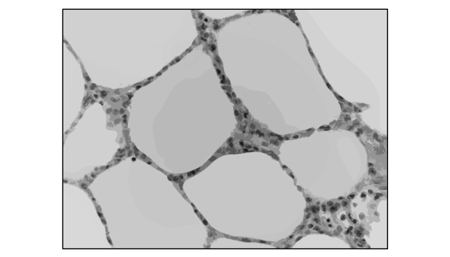

**Fig. 1**

### Q15 — easy — 6 marks

**Q15** [1 mark]

The lungs are often described as the main organ of human gas exchange.

State the tissue that the lungs exchange gases with.

**Q15** [2 marks]

Draw straight lines to link each of the airways shown to their approximate internal diameters.

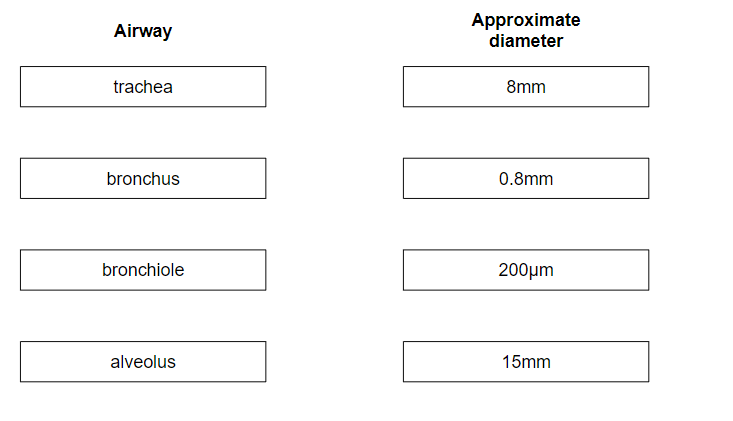

**Q15** [2 marks]

**Extract:**

The descending order of internal diameters is:

trachea → bronchus → bronchiole → alveolus

Around 55% of the inner surface of the trachea is coated with cilia, whereas in the bronchi, the coverage is approximately 47% and in the bronchioles, the value is 27%.

Suggest a reason for this pattern.

**Q15** [1 mark]

Cartilage tissue, like that found in the breathing system, has a limited ability to repair itself in case of disease or injury.

Identify **one** feature of cartilage that explains this.
