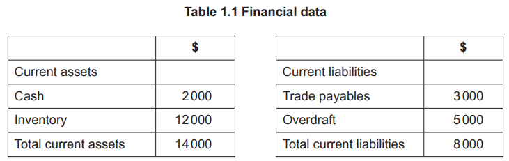
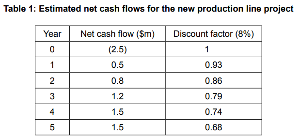
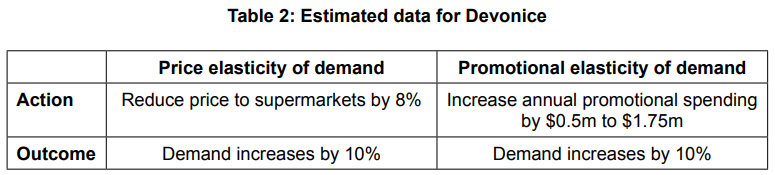
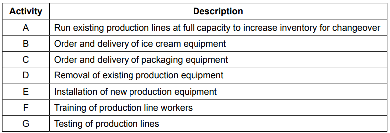
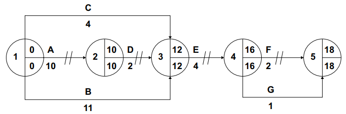

# Exam Questions — Business Objectives
**1. Business and Its Environment** · Cambridge (CIE) A-LEVEL business (9609)
> Source: [https://www.savemyexams.com/a-level/business/cie/23/topic-questions/](https://www.savemyexams.com/a-level/business/cie/23/topic-questions/) · 26 questions across 1 sets

## Exam Questions (26 questions)

### Q1 — easy — 3 marks

**Q1** [3 marks]

> **[case-study]**
> **Torque (TQ)**
> 
> Torque (TQ) services and repairs cars in country H. It began in 2010 as a single garage owned by Elif, whose objective at the time was simply to earn enough to keep the business open.
> 
> By 2018 TQ was well established and Elif set a new objective of opening ten garages within five years. TQ now has twelve.
> 
> Electric vehicles have grown quickly in country H.
> 
> **Table 1.1: Electric vehicles in country H**
> 
> | Share of new cars sold that were electric, 2018 (%) | 4 |
> |---|---|
> | Share of new cars sold that were electric, 2025 (%) | 31 |
> | TQ mechanics qualified to service electric vehicles (%) | 15 |
> 
> Electric vehicles need less routine servicing than petrol cars, and most of TQ's mechanics are not yet qualified to work on them. Elif's objective for the next three years is to have every mechanic trained to service electric vehicles.

Explain **one** reason why TQ's objectives have changed over time.

### Q2 — easy — 3 marks

**Q2** [3 marks]

> **[case-study]**
> **Quill (QL)**
> 
> Quill (QL) runs private language schools in country J. It teaches English and Mandarin to adults and employs 60 teachers across four schools.
> 
> QL's owner, Dieter, has told staff that his objective is "to grow the business and improve teaching quality". Managers at each school have interpreted this differently. One has spent money on new classroom equipment, another has reduced class sizes, and a third has advertised heavily for new students.
> 
> At a recent meeting, Dieter's finance manager suggested replacing this with a SMART objective: to increase student numbers from 900 to 1,100 by the end of next year, while keeping the proportion of students who pass their final examination above 85%.

Explain **one** benefit to QL of setting SMART objectives.

### Q3 — easy — 2 marks

**Q3** [2 marks]

Define the term 'social enterprise'.

### Q4 — hard — 12 marks

**Q4** [12 marks]

Discuss why the shareholders of a public limited company might not support corporate social responsibility (CSR) as a business objective.

*Source: Nov 2020 Paper 13 Q7A*

### Q5 — hard — 20 marks

**Q5** [20 marks]

‘Ethics should always influence the human resource management (HRM) activities of a mining business.’

Discuss the extent to which you agree with this view.

*Source: June 2023 Paper 11 Q6B*

### Q6 — hard — 20 marks

**Q6** [20 marks]

Evaluate the view that a mission statement is only important to a bank if it significantly influences the strategy and tactics of that business.

*Source: Specimen 2023 Paper 1 Q5B*

### Q7 — easy — 3 marks

**Q7** [3 marks]

> **[case-study]**
> **UPlane Components (UC) **
> 
> UC is a private limited company providing engine parts for commercial aircraft. It uses batch production in factory A and flow production in factory B. As part of UC’s commitment to corporate social responsibility (CSR), it provides a training scheme for the long-term unemployed, based in factory A.
> 
> UC’s products are sold to aircraft engine manufacturers. Demand for aircraft engines has increased by 45% over recent years. The aircraft engine manufacturers want inventory just when needed and are demanding a reduction in prices.
> 
> In 2017, UC opened factory B which is 5km away from factory A. Factory B has a high level of automation, resulting in low unit costs for the parts produced there. Production is capital intensive. UC has a plan to automate factory A. The production workers are not happy about this proposal and have asked for more details. The workers’ representatives have asked for a meeting with the human resource manager.
> 
> In December 2019 a fault was discovered in one of the engine components supplied by UC and produced in factory A. UC had to recall 2000 parts at a cost of \$200000. This has had an impact on part of its triple bottom line and UC is unlikely to meet its targets. Table 1.1 shows some financial data for UC.
> 
> **Table 1.1: Financial data for UC**
> 
> |   | **Year ending 30 November 2019 (\$m)** | **Year ending 30 November 2020 (\$m forecast)** |
> |---|---|---|
> | Revenue | 5.8 | 6.4 |
> | Cost of sales | 2.3 | 3.4 |
> | Expenses | 1.3 | 1.6 |
> | Cost of recall | - | 0.2 |
> 
> Amjit, the human resource manager, believes that the fault was caused by the negligence of Jack, one of the production supervisors. Jack claims that he was made to work overtime to try and meet production targets. This caused him to become tired and make a mistake in one batch of parts. Amjit wants to dismiss Jack.

Explain the term ‘triple bottom line’.

*Source: Nov 2020 Paper 21 Q1AII*

### Q8 — hard — 20 marks

**Q8** [20 marks]

**Extract:**

## MERIDIAN TECHNOLOGIES (MT)

**Background**

Meridian Technologies (MT) is a private limited company based in country K. It designs and manufactures smart home devices, including wireless speakers, smart thermostats, and home security systems.

MT was founded 12 years ago by entrepreneur Hana Park and has grown to employ 850 workers across two manufacturing facilities in country K.

MT sells its products domestically and exports to several countries in Asia and Europe. Competition in the smart home device market is intense. MT faces growing pressure from several large multinational companies (MNCs) that compete aggressively on price and brand recognition.

**Organisational Change**

Until two years ago, MT operated with a flat organisational structure in which considerable authority was delegated to regional managers. Following a period of rapid growth, Hana decided to restructure the business, reducing the number of management levels and centralising all major decision-making at head office.

The restructuring has not been universally welcomed. A recent internal employee survey found that 64% of workers felt less motivated since the change was introduced. Three experienced regional managers left the business within six months of the restructuring being implemented.

**Expansion Plans**

MT is planning to expand its production capacity and is evaluating two investment projects. Table 1 shows data for Project A. Table 2 shows the projected annual net cash flows for Project B.

**Table 1: Project A — Automated Production Line**

| Initial investment (\$) | 600,000 |
|---|---|
| Useful life | 5 years |
| Residual value at end of useful life (\$) | 0 |
| Estimated annual profit (\$) | 120,000 |

**Table 2: Project B — Expansion of Existing Facility**

| **Year** | **Net cash flow (\$)** |
|---|---|
| 1 | 80,000 |
| 2 | 100,000 |
| 3 | 120,000 |
| 4 | 150,000 |
| 5 | 100,000 |
| **Initial investment** | **400,000** |

**Export Markets and Exchange Rates**

MT currently generates 40% of its revenue from exports. Approximately 60% of MT's export revenue is earned in euros (€). In the past 12 months, country K's currency has strengthened significantly against the euro, rising in value by 15%.

Table 3 shows MT's revenue by market for the year ended December 2023.

**Table 3: MT Revenue by Market (year ended December 2023)**

| **Market** | **Revenue (\$000)** |
|---|---|
| Country K (domestic) | 6,200 |
| Europe | 2,800 |
| Asia | 1,300 |
| **Total** | **10,300** |

**Pricing Strategy**

MT's Finance Director has suggested reducing the selling price of the smart thermostat in order to increase market share and compete more effectively against MNC rivals. Table 4 shows the relevant pricing and demand data.

**Table 4: Smart Thermostat — Pricing and Demand Data**

| Current selling price (\$) | 80 |
|---|---|
| Current annual sales (units) | 50,000 |
| Proposed new selling price (\$) | 72 |
| Forecast annual sales at new price (units) | 57,500 |

**Corporate Social Responsibility**

MT sources many of its components from suppliers based in country L, where labour costs are significantly lower than in country K. A pressure group called EthicsWatch has recently published a report claiming that some of MT's suppliers in country L use poor working conditions and pay employees below the minimum wage. The report has received widespread media coverage in country K and has been shared extensively on social media.

Hana is considering whether to introduce a formal corporate social responsibility (CSR) strategy. This would include auditing all of MT's suppliers in country L and switching to certified ethical suppliers where necessary. MT's operations director estimates that this would increase raw material costs by approximately 12%.

> **[case-study]**
> **MERIDIAN TECHNOLOGIES (MT)**
> 
> **Background**
> 
> Meridian Technologies (MT) is a private limited company based in country K. It designs and manufactures smart home devices, including wireless speakers, smart thermostats, and home security systems.
> 
> MT was founded 12 years ago by entrepreneur Hana Park and has grown to employ 850 workers across two manufacturing facilities in country K.
> 
> MT sells its products domestically and exports to several countries in Asia and Europe. Competition in the smart home device market is intense. MT faces growing pressure from several large multinational companies (MNCs) that compete aggressively on price and brand recognition.
> 
> **Organisational Change**
> 
> Until two years ago, MT operated with a flat organisational structure in which considerable authority was delegated to regional managers. Following a period of rapid growth, Hana decided to restructure the business, reducing the number of management levels and centralising all major decision-making at head office.
> 
> The restructuring has not been universally welcomed. A recent internal employee survey found that 64% of workers felt less motivated since the change was introduced. Three experienced regional managers left the business within six months of the restructuring being implemented.
> 
> **Expansion Plans**
> 
> MT is planning to expand its production capacity and is evaluating two investment projects. Table 1 shows data for Project A. Table 2 shows the projected annual net cash flows for Project B.
> 
> **Table 1: Project A — Automated Production Line**
> 
> | Initial investment (\$) | 600,000 |
> |---|---|
> | Useful life | 5 years |
> | Residual value at end of useful life (\$) | 0 |
> | Estimated annual profit (\$) | 120,000 |
> 
> **Table 2: Project B — Expansion of Existing Facility**
> 
> | **Year** | **Net cash flow (\$)** |
> |---|---|
> | 1 | 80,000 |
> | 2 | 100,000 |
> | 3 | 120,000 |
> | 4 | 150,000 |
> | 5 | 100,000 |
> | **Initial investment** | **400,000** |
> 
> **Export Markets and Exchange Rates**
> 
> MT currently generates 40% of its revenue from exports. Approximately 60% of MT's export revenue is earned in euros (€). In the past 12 months, country K's currency has strengthened significantly against the euro, rising in value by 15%.
> 
> Table 3 shows MT's revenue by market for the year ended December 2023.
> 
> **Table 3: MT Revenue by Market (year ended December 2023)**
> 
> | **Market** | **Revenue (\$000)** |
> |---|---|
> | Country K (domestic) | 6,200 |
> | Europe | 2,800 |
> | Asia | 1,300 |
> | **Total** | **10,300** |
> 
> **Pricing Strategy**
> 
> MT's Finance Director has suggested reducing the selling price of the smart thermostat in order to increase market share and compete more effectively against MNC rivals. Table 4 shows the relevant pricing and demand data.
> 
> **Table 4: Smart Thermostat — Pricing and Demand Data**
> 
> | Current selling price (\$) | 80 |
> |---|---|
> | Current annual sales (units) | 50,000 |
> | Proposed new selling price (\$) | 72 |
> | Forecast annual sales at new price (units) | 57,500 |
> 
> **Corporate Social Responsibility**
> 
> MT sources many of its components from suppliers based in country L, where labour costs are significantly lower than in country K. A pressure group called EthicsWatch has recently published a report claiming that some of MT's suppliers in country L use poor working conditions and pay employees below the minimum wage. The report has received widespread media coverage in country K and has been shared extensively on social media.
> 
> Hana is considering whether to introduce a formal corporate social responsibility (CSR) strategy. This would include auditing all of MT's suppliers in country L and switching to certified ethical suppliers where necessary. MT's operations director estimates that this would increase raw material costs by approximately 12%.

'Introducing a corporate social responsibility (CSR) strategy is the most effective way for MT to improve its long-term business performance.'

Evaluate this view.

### Q9 — medium — 8 marks

**Q9** [8 marks]

**Extract:**

Cash4Trash (C4T) C4T is located in the capital city of country A in Africa. This private limited company was started six years ago by Andy and Kris, who both had experience working for a large international charity. C4T is a social enterprise, initially financed by international charities and a grant from the government of country A. The government also provided land to C4T for its factory. C4T’s corporate objectives include two social objectives which are to: • improve the environment of the city • provide jobs for the unemployed. C4T collects and cleans all types of recyclable materials that have been discarded as trash (rubbish). The clean materials are then used to create products for sale, such as bags made from woven plastic. A local artist volunteers her services to help with product designs. C4T has grown and now manufactures a range of products from recycled materials, including bags and jewellery. Cases for laptops and smartphones are currently its most popular products. Products are sold to local people and tourists in its shop next to the factory. C4T also sells via its website. C4T employs 90 people in its factory, who were previously unemployed. It runs training courses for 16 to 18 year olds to teach them basic skills. All profit is re-invested to expand and improve the business. C4T has won awards for being a sustainable social enterprise. Operations problems Factory employees work in teams and are rewarded with bonus payments if they exceed targets. Each team collects materials and other resources needed for production from a central store. However, sometimes this store runs out of resources, halting production. Products are checked for quality at the end of the production process and many are rejected and faults have to be corrected. Employees have been trained to specialise in one task within one team. Andy and Kris feel that time and resources are being wasted and would like to reorganise the factory and improve employee flexibility. Marketing Marketing products made from recycled materials can be a major challenge in country A. Many consumers think these products are of inferior quality. However, C4T’s brand image is strong. Its products have featured in premium magazines and on websites aimed at consumers who are ‘socially responsible’. Kris works hard to keep the C4T website up-to-date and maintain its social media presence, as part of the company’s attempt to establish good customer relationships. An ambitious new idea Plastic water bottles have become a real environmental problem over recent years as more are bought and thrown away when empty. Kris is planning to introduce a new type of product. He thinks there is a market for durable, reusable plastic drinking bottles. These will be made from recycled plastic and marketed as souvenirs for tourists. Demand will be highest during holiday periods. They will be produced in a range of colours, with country A’s name and flag on them. A new C4T slogan ‘Protecting the environment’ will be printed on each bottle. A factory extension will be required to recycle the plastic materials to be used and to manufacture the bottles. Kris is planning to recruit the new employees required on part-time flexible contracts. C4T’s objective for the bottles would be to make a profit, so labour costs will need to be kept low. The recruitment of skilled employees able to achieve high productivity levels will be important.

Finance The factory extension will cost \$1.5m to build and equip with machinery. The government of country A will provide a grant of \$1m. Andy and Kris are hoping to raise the remaining \$0.5m from a bank loan. However, a local venture capitalist has offered to invest \$0.5m in return for 30% of the profit from the new product and substantial involvement in future decision making. C4T’s latest accounts valued its non-current liabilities at \$3m and its capital employed at \$5m. Forecast annual data for the reusable bottles is shown in Table 1. Table 1: Forecast annual data for the reusable bottles Forecast data for 2021 (\$000) Revenue 390 Material and recycling costs 130 Labour costs 100 Marketing, management and administration costs 60 A special order C4T has been approached by a design company in country A with a one-off special order. This company specialises in computer and phone accessories. The order is for 5000 cases for laptops, which would be branded with the design company logo. The design company will pay \$5 per case. C4T sells similar cases for \$7. C4T would need to move employees and resources from other product teams to increase capacity if the order is accepted. Average material and labour costs are not expected to change. The design company requires the laptop cases to be delivered during 2021. Financial and capacity data is shown in Table 2. Table 2: Special order data Special order number of units 5000 Annual capacity for laptop cases 12000 Forecast output of laptop cases in 2021 without the special order 9000 Usual price per unit \$7 Proposed special order selling price \$5 Total raw material variable cost at annual output of 9000 laptop cases \$18000 Total labour variable cost at annual output of 9000 laptop cases \$13500 The economy Country A has a relatively young population with an average age of 28 years. It is one of the fastest growing economies in Africa. The government is stable and incomes are rising, especially in the cities. Unemployment is falling which has led to some worries about increasing inflation which means the central bank may raise interest rates.

Further options for growth In addition to the reusable bottles, Andy and Kris are looking for other growth opportunities for C4T. They are both committed to their original social enterprise, but have different ideas of how to move the business forward. Two possible options are: Option 1 – favoured by Kris Increase recycling facilities further, using additional new machinery at the current site. Manufacture low-cost reusable shopping bags which would be branded ‘Bag4Ever’. These would be mass-produced and sold in bulk to supermarkets and shops. They would be sold at a low price, as an alternative to single-use plastic carrier bags which the government will ban in 2022. Option 2 – favoured by Andy Enter into a joint venture with a well-known African design company to launch a range of luxury travel cases. These would combine recycled materials with other materials, such as leather and traditional African designed cloth. These cases would be made in a new factory. They would be promoted to high income consumers and sold through outlets in shopping centres (malls) and airports in many countries. C4T will only be able to afford one of these options and it is clear that they both take the company in different strategic directions. Further information about the two options is in Table 3. Table 3: Research data for Options 1 and 2 Option 1 Bag4Ever project Option 2 Luxury travel cases Initial cost (\$000) 500 800 Probability of success 0.8 0.65 Expected monetary value (\$000) 1500 3000 Time needed for implementation 10 months 18 months Major driving forces • Use of C4T core competency • Possibility of further government funding • High added value and therefore potential profit • Opportunity to enter export markets Major restraining forces • Lack of experience of mass production techniques • Possible shortage of recyclable materials • Lack of marketing expertise in overseas markets • High level of competition in market for luxury travel cases

Read the [extract](https://www.savemyexams.com/a-level/business/cie/past-papers/paper/ppr_wQrGTM3pcfSYPMQq/?pdf=https%3A%2F%2Fpastpapers.papacambridge.com%2Fdirectories%2FCAIE%2FCAIE-pastpapers%2Fupload%2F9609_w20_in_33.pdf&type=resource&resourceIndex=0) before answering

Analyse the benefits to C4T of its two social objectives.

*Source: November 2020 Paper 33 Q1*

### Q10 — medium — 8 marks

**Q10** [8 marks]

> **[case-study]**
> **Electric Cars (EC) **
> 
> EC is a public limited company producing electric cars. Market research suggests that electric cars are in the early stage of the product life cycle. The demand for electric cars is likely to increase substantially in the next 10 years. EC is based in country X, where it is one of three electric car manufacturers. However, other manufacturers could start to produce electric cars if the forecast market growth is correct.
> 
> EC’s promotion has only been aimed at high income groups. The government of country X recently announced that it will support the use of electric cars. This will help EC to achieve its objective to increase sales volume by 50% over the next two years.
> 
> One year ago, EC invested \$10m in new production facilities. The investment was funded by a long-term bank loan. Interest payments on the bank loan have reduced EC’s profit margin from 9% to 4%. EC will need to cut unit costs through increased efficiency.
> 
> EC initially launched its cars using a price skimming strategy but sales growth has been slow. If EC can achieve a 50% growth in sales over the next two years, it will be in a strong financial position. This means it will be able to spend more on the development of a larger product portfolio of electric cars.
> 
> Jancie, the Finance Director, has produced forecasts for EC’s financial data over the next two years, as shown in Table 2.1.
> 
> **Table 2.1: Extract from EC’s forecast financial data**
> 
> |   | **2020 (\$m)** | **2021 (\$m)** |
> |---|---|---|
> | Inventories | 30 | 50 |
> | Cash | 10 | 20 |
> | Trade receivables | 10 | 20 |
> | Trade payables | 25 | 30 |
> | Current ratio | 2 | **X** |

Analyse **two **reasons why clear business objectives are important for EC.

*Source: November 2020 Paper 21 Q2C*

### Q11 — medium — 8 marks

**Q11** [8 marks]

Analyse why mission statements are important to many businesses.

*Source: November 2020 Paper 13 Q7A*

### Q12 — easy — 2 marks

**Q12** [2 marks]

> **[case-study]**
> **UPlane Components (UC) **
> 
> UC is a private limited company providing engine parts for commercial aircraft. It uses batch production in factory A and flow production in factory B. As part of UC’s commitment to corporate social responsibility (CSR), it provides a training scheme for the long-term unemployed, based in factory A.
> 
> UC’s products are sold to aircraft engine manufacturers. Demand for aircraft engines has increased by 45% over recent years. The aircraft engine manufacturers want inventory just when needed and are demanding a reduction in prices.
> 
> In 2017, UC opened factory B which is 5km away from factory A. Factory B has a high level of automation, resulting in low unit costs for the parts produced there. Production is capital intensive. UC has a plan to automate factory A. The production workers are not happy about this proposal and have asked for more details. The workers’ representatives have asked for a meeting with the human resource manager.
> 
> In December 2019 a fault was discovered in one of the engine components supplied by UC and produced in factory A. UC had to recall 2000 parts at a cost of \$200000. This has had an impact on part of its triple bottom line and UC is unlikely to meet its targets. Table 1.1 shows some financial data for UC.
> 
> **Table 1.1: Financial data for UC**
> 
> |   | **Year ending 30 November 2019 (\$m)** | **Year ending 30 November 2020 (\$m forecast)** |
> |---|---|---|
> | Revenue | 5.8 | 6.4 |
> | Cost of sales | 2.3 | 3.4 |
> | Expenses | 1.3 | 1.6 |
> | Cost of recall | - | 0.2 |
> 
> Amjit, the human resource manager, believes that the fault was caused by the negligence of Jack, one of the production supervisors. Jack claims that he was made to work overtime to try and meet production targets. This caused him to become tired and make a mistake in one batch of parts. Amjit wants to dismiss Jack.

Define the term ‘corporate social responsibility (CSR)’.

*Source: November 2020 Paper 21 Q1AI*

### Q13 — medium — 8 marks

**Q13** [8 marks]

**Extract:**

Historic Buildings and Gardens (HBG) HBG was started in 1965 as a social enterprise in country R. HBG’s main objective is to protect the country’s heritage through conserving buildings and gardens of historic interest. HBG now owns over 200 historic buildings and gardens throughout country R. These are open to the public and HBG receives most of its income from the two million members who pay an annual subscription to visit the historic buildings and gardens. HBG charges admission fees to non-members. Gift shops and cafés also provide a source of income. HBG needs sufficient income to cover costs and finance expansion in new conservation projects. However, it is also aware of a responsibility to provide social benefits to local communities such as employment and education. HBG appointed Eusebio Alves as Managing Director in October 2018 with the objective of increasing membership, admissions and income as they had been falling in recent years. Strategic Review Eusebio started by conducting a strategic analysis of HBG. He completed a SWOT analysis. Table 1 is an extract from the results of the analysis. Table 1: SWOT Analysis 2018 Strengths • High brand awareness • Highest membership of any organisation in country R • High levels of customer satisfaction among the over 50 age group Opportunities • Increasing levels of international tourism to country R • Rising gross domestic product (GDP) per head • New technologies to improve the customer experience and marketing • Falling cost of renewable energy sources such as wind power Weaknesses • Average annual labour turnover of 11% in the last 5 years • 10% reduction in membership since 2015 • Limited access for disabled people at 40% of properties • 70% of members are over 50 • Narrow hierarchical organisational structure • Corporate culture unwilling to accept change Threats • Minimum wage legislation proposed for 2021 • Laws to protect the rights of disabled people being considered by the government • Increasing consumer awareness of social responsibility

Eusebio noted the following observations made by employees, managers and customers: • local managers were frustrated by the time taken for senior managers to respond to ideas for innovation and change • other employees feel they have little responsibility and are just given orders without explanation • customers complain that they are not valued and there is little opportunity for giving feedback to HBG. Eusebio used this analysis to identify four strategic changes required in order to achieve the objectives he had been set: • making the business more responsive to market changes • improving social responsibility • targeting younger customers • improving financial control by establishing profit centres. Eusebio recognised that these four strategic changes would need to be supported by developing a change culture within HBG to be successful. Centralised control At the end of 2018, Eusebio told his Board of Directors that: ‘HBG is bureaucratic with a centralised organisational structure. It is essential to change the way the business is organised and make it more responsive.’ He proposed the following changes. • remove three layers of middle management • delegate greater authority to managers of buildings and gardens to make decisions about local marketing and operations • operate buildings and gardens as individual profit centres • encourage two way communication with employees. However, the Board of Directors would retain control of national marketing, purchase of new buildings, IT infrastructure and strategic decision making. The Human Resources Director expressed concerns about the implications of decentralisation and the need for training. However, in early 2019 HBG began to implement the organisational changes proposed by Eusebio. This followed a two-month employee consultation. Social responsibility Eusebio thinks that HBG should focus more on its corporate social responsibilities. He told the Board of Directors that: ‘we can gain a competitive advantage over other businesses in the leisure industry if we focus on increasing our positive social and environmental impact. However, we must ensure that HBG makes a genuine change to its culture and uses independent social auditors to report on our progress.’Target market Country R has an ageing population. HBG has used a consistent marketing strategy for targeting its core customers. National advertisements are placed in newspapers and magazines aimed at older readers. Every year HBG has a themed television campaign; in 2019 the theme was titled ‘Connecting with the past’. HBG cafés sell traditional style food and drinks. HBG recruited Nelinha Torres from a social media company to be the new Marketing Director. Her aim is to create a more dynamic marketing strategy that targets a younger audience without losing older members. She commissioned market research and found the following information. • 15% of visitors bring children to HBG buildings and of these 20% were grandparents bringing grandchildren • families with children (‘young families’) value their leisure time but have limited income • price elasticity of demand for young family membership is estimated to be −1.5 • most customers under 50 use the internet to plan and book their leisure activities in advance • although there is good brand awareness, 60% of respondents were not aware of the variety of facilities and events at HBG buildings and gardens. Nelinha and her team are due to present their marketing strategy proposals to the Board of Directors next week. Oldbury Castle Oldbury Castle is a building of historic interest owned by HBG. It attracts 105000 visitors per year. Following the creation of Oldbury Castle as a profit centre, visitor numbers have increased by 10%. However, the manager is concerned about the profitability of the café. He has monitored its financial performance and has noted that it does not cover its full costs. The café is similar to those at other HBG properties and sells a range of traditional meals and refreshments. A recent customer survey suggested that many visitors do not consider the café offers value for money. Feedback also indicates that the menu is considered old fashioned. The manager is considering whether to keep the café open or to use the space to expand the gift shop, which is highly profitable. Table 2 contains data regarding revenue and costs. Table 2: Revenue and cost data Café Year ending 15 May 2020 (\$000) Gift shop Year ending 15 May 2020 (\$000) Revenue 300 200 Direct costs of food/sales 50 80 Direct labour 120 40 Allocated fixed costs from Oldbury Castle 105 30 Allocated fixed costs from HBG 35 10 Project Alderly HBG’s mission is to conserve historic buildings and gardens in country R. It keeps a sizeable fund to enable it to purchase appropriate buildings and gardens. HBG is about to purchase Alderly Gardens. These gardens are of national significance. Although the gardens are well maintained, HBG will not open them to the public until facilities such as toilets for customersare improved. HBG’s experienced building team will complete all improvements. Eusebio wants the gardens to be open to the public in time for the holiday season, which starts in 23 weeks. Eusebio has created a project team to manage the transition and they have gathered information and produced a network analysis. Further details are provided in Table 3 and Appendix 1. Table 3: Network analysis for opening Alderly Gardens Activity Activity described Preceding activities Duration (weeks) A Complete purchase of gardens None 5 B Draft building plans None 1 C Gain planning permission for building work A & B 4 D Order and delivery of materials C 2 E Building work D 7 F Order and delivery of fixtures and fittings C 1 G Install fixtures and fittings E & F 2 H Plan marketing A 1 J Recruit employees C 2 K Train employees J 3 L Implement the marketing plan H 2 Appendix 1: Critical Path Analysis A 2 4 5 5 1 3 0 0 5 9 9 6 11 11 7 11 17 8 18 18 9 20 20 5 H 1 B 1 C 4 F

Read the [extract ](https://www.savemyexams.com/a-level/business/cie/past-papers/paper/ppr_ZBqjvH4pD9pkQSDM/?pdf=https%3A%2F%2Fpastpapers.papacambridge.com%2Fdirectories%2FCAIE%2FCAIE-pastpapers%2Fupload%2F9609_s20_in_32.pdf&type=resource&resourceIndex=0)before answering

Analyse the likely impact on HBG’s costs and revenues of increasing its focus on corporate social responsibility (CSR).

*Source: June 2020 Paper 32 Q1*

### Q14 — hard — 20 marks

**Q14** [20 marks]

**Extract:**

Jan Guiding Service (JGS) Jan loves being in the countryside. Many years ago, he visited country P, where mountains take up 80% of the land area. Country P is one of the poorest countries in the world, with very low income per head. Jan made his home there and took a job assisting with walking groups. He gained a certificate as a professional mountain walking guide. The start of JGS Five years ago Jan set up JGS, in partnership with Gorl, another professional mountain walking guide. JGS offers mountain walking tours. JGS organises and promotes these tours. Originally, Jan and Gorl guided most of the walking tours themselves. JGS has always outsourced all its travel and accommodation. Jan and Gorl are spending more time on managing the business and less time guiding as the demand for JGS tours increases. JGS now outsources most of its mountain guiding. Customers stay with host families in mountain villages, most of which cannot be reached by road. Host families are paid by JGS to provide food and accommodation for its customers. Many families compete to provide these services to JGS. Using outsourcing in this way gives JGS many benefits. JGS employs an administrator to organise outsourcing. JGS is one of the few businesses operating in this market. However, Jan knows that other businesses are becoming interested in offering mountain walking tours. Demand for JGS services JGS has not increased its prices for three years. Over 95% of JGS customers are visitors from country K. Demand for JGS tours is increasing and Jan thinks that income levels in country K are an important factor. Average income in country K rose by 5% in 2019. Demand for JGS tours from residents of country K increased by 20% in the same period. Jan currently believes that there is still time to get more bookings for quarters 3 and 4 in 2020. He also knows that increasing the effectiveness of the JGS Internet presence is important. Gorl has analysed sales figures for the last three years. Table 1 shows his results. He has used the moving average method and has forecast the centred moving average (trend) sales figure for Quarter 3 2021 of \$86560.

Table 1: Sales figures for JGS Year Quarter Sales (\$000) Centred moving average (Trend) (\$000) Seasonal variation (\$000) 2017 3 34 4 78 2018 1 40 41.5 –1.5 2 10 45.0 –35.0 3 42 48.0 –6.0 4 98 50.0 48.0 2019 1 44 52.25 –8.25 2 22 56.75 –34.75 3 48 62.0 –14.0 4 128 64.25 63.75 2020 1 56 2 28 Increasing the number of employees – need for clearer organisational structure? Jan and Gorl are planning to increase the number of employees for two main reasons: • The rapid growth of JGS means that three regional managers and additional administrative employees will be needed. • The government of country P has introduced new, stricter employment regulations. It has stated these will apply to all businesses. This now means that businesses using outsourcing must insist that outsource providers keep to these stricter employment regulations. Jan and Gorl think that providing guiding and accommodation services through direct employment of workers is the best way of meeting these requirements. They are unsure whether to offer flexible temporary contracts or part time permanent positions. Jan suggested to Gorl that: ‘Our rapidly expanding business and external environment changes mean that a clear effective organisational structure will be very important.’ Jan wishes to keep control and is reluctant to give responsibility to employees who might not be reliable. He added: ‘Centralising decision making enables rapid decisions and is key to success. We must have authority and make employees accountable to us.’ Gorl replied: ‘Employees can be trusted to take decisions. They are closer to the problems and find solutions faster. Delegation is essential for success.’ They think JGS might need a marketing department. This would be responsible for the planned increase in marketing activities necessary to maintain expansion.

Costing each tour Gorl and Jan have different views on the minimum number of customers needed before each tour can take place. This is because they have different views about how to deal with the fixed and variable costs. JGS policy is to provisionally confirm that a tour will take place once customer numbers reach six. The business then hopes to get at least two more customers before the tour starts. However, Jan now thinks that a tour should go ahead with just two customers. Gorl is not happy about this. They discuss the financial information in Table 2. Table 2: Cost and price information (\$) Fixed costs per tour: administration, marketing, guide, transport 550 Variable costs per customer: accommodation, food 370 Price per customer 480 Corporate social responsibility issues JGS has a business model based on attracting customers who wish to experience the culture of people who live in country P’s high mountains. Jan and Gorl are aware that this culture is under threat from too many tourists, cheap souvenir production, corruption and increasing environmental damage. JGS tries to operate to the highest standards, which can result in high costs. However, other businesses do not. Consequently, there is irresponsible forestry, litter, inappropriate payments by tourists, bribes for local authorities and businesses not paying villagers a fair price for services. Pressure groups in country K and country P are increasing their demands that tourist businesses provide for the needs of the various communities in country P. Some customers might be willing to pay higher prices to ethical and responsible travel businesses. The government in country P has set up an official enquiry into the corporate social responsibility of the tourism industry. Additional opportunities for growth Jan and Gorl are always aiming to expand JGS. They are enthusiastic about the future and are considering two growth options. They know it is very important to make an assessment of the risk involved in each option.

Option 1: a partnership with KrazyTours Jan has held initial talks with KrazyTours; a large multinational tourist operator that is considering expanding into country P. KrazyTours is only interested in a partnership with a business already operating. In effect this would be a franchise agreement. The two businesses agreed the following points: • JGS would arrange mountain walks in country P with agreed costs that would need to be paid in advance. • KrazyTours market these holidays in over 120 countries, providing JGS with client lists. JGS would pay a fee for each tour. This arrangement offers the possibility of increased revenue and profit for JGS but carries risks. KrazyTours may fail to deliver customers and may pressure JGS to lower prices significantly. Option 2: guided walks for tourists Expanding into the general tourist market by offering guided visits and/or walks to attractions. These include historical sites, temples, markets and a wildlife park. This would require JGS to: • research and identify suitable venues with appropriate transport and accommodation arrangements • employ suitably qualified guides to take charge of the groups • engage in additional targeted marketing. The risks are that several businesses from country P already offer such holidays and competition is higher than for mountain walks. Jan presented Gorl with a completed decision tree calculation shown in Table 3. They discuss the risks involved in each option as well as the forces that might make them choose one option rather than the other. It is unlikely that JGS will be in a position to carry out both Options. The business is at a key point in its life. Are Jan and Gorl too ambitious? What could go wrong? Table 3: Decision Tree calculation Option 1 KrazyTours Option 2 Tourist walks Cost (\$000) 34 110 Probability of positive market response (%) Expected outcome with positive market response (\$000) 70 80 60 180 Probability of negative market response (%) Expected outcome with negative market response (\$000) 30 45 40 135 Expected Monetary Value (\$000) 35.5 52

Read the [extract ](https://www.savemyexams.com/a-level/business/cie/past-papers/paper/ppr_CN4fYsd6GVvh4KpP/?pdf=https%3A%2F%2Fpastpapers.papacambridge.com%2Fdirectories%2FCAIE%2FCAIE-pastpapers%2Fupload%2F9609_s20_in_31.pdf&type=resource&resourceIndex=0)before answering

Evaluate whether JGS should maintain high standards of corporate social responsibility (CSR).

*Source: June 2020 Paper 31 Q5*

### Q15 — hard — 12 marks

**Q15** [12 marks]

> **[case-study]**
> **Super Candy (SC) **
> 
> SC is a large public limited company that sells low-sugar candy (sweets) with natural flavourings. The candy is made using flow production in SC’s four large factories in country T.
> 
> SC uses psychographic market segmentation when planning its marketing mix.
> 
> SC has completed some secondary market research using published accounts. The data is about one of SC’s main competitors, Organic Kandy (OK) and compares the results with data about SC (see Table 2.1). OK is in the same market as SC.
> 
> **Table 2.1: Secondary market research about OK and SC for 2020**
> 
> |   | **OK** | **SC** |
> |---|---|---|
> | Revenue | \$60m | **X** |
> | Market share by revenue | 40% | 34% |
> | Different varieties of candy | 12 | 18 |
> | Main channels of distribution | Wholesalers  Large supermarkets  Health food shops | Wholesalers  Small retailers  E-commerce |
> | Target market(s) | Mass market | People with interests in:  - Nature - Sports - Travel - Health |
> 
> There have been a number of media reports in country T about the increasing importance of corporate social responsibility (CSR). A large food manufacturing business in country T recently lost many customers due to reports about its use of plastic packaging.
> 
> The directors of SC are particularly concerned about this trend because of SC’s use of plastic in its packaging. The marketing department has been told to conduct some primary market research on this issue. The directors are planning to discuss making CSR a new business objective for SC.

Evaluate the benefits to SC of having corporate social responsibility (CSR) as a business objective.

*Source: November 2021 Paper 23 Q2D*

### Q16 — easy — 2 marks

**Q16** [2 marks]

> **[case-study]**
> **Auto Bike (AB) **
> 
> AB is a private limited company that repairs and maintains motorbikes. AB has nine garages in country J and employs eight highly qualified mechanics in each garage.
> 
> Two of the most popular motorbike services that AB sells are the standard service and the advanced service. Table 2.1 contains price and cost information for these services.
> 
> **Table 2.1: Price and cost information**
> 
> |   | **Price** | **Direct costs per service** | **Allocated indirect costs per service** |
> |---|---|---|---|
> | Standard service | \$250 | \$50 | \$60 |
> | Advanced service | \$400 | \$60 | \$100 |
> 
> In April, AB sold 1000 standard services and 200 advanced services. The profit margin for an advanced service is higher than the standard service. The directors have decided to promote the advanced service to try and increase sales. Each garage has been given a budget to use for below the line promotion methods with an objective of increasing sales of advanced services in the next six months.
> 
> The level of motivation of the mechanics is low. Many mechanics believe that they are not paid well and the conditions of work are dirty and noisy. AB uses a time-based payment method which rewards each mechanic at the same hourly rate. In a recent survey, many mechanics complained that the payment method was unfair. They believe it rewards ‘lazy workers’ as much as those who work hard. It also does not take into account the difficulties involved in some jobs and the simplicity of others. The Human Resources Director has been asked to investigate a new payment method.

Define the term ‘objective’.

*Source: November 2021 Paper 22 Q2AI*

### Q17 — easy — 2 marks

**Q17** [2 marks]

> **[case-study]**
> **Rehana Recycles (RR) **
> 
> Rehana is very environmentally aware. One year ago, Rehana identified a business opportunity to reuse waste products and set up Rehana Recycles (RR) as a sole trader.
> 
> A local company sells bottled drinks and reuses the empty glass bottles that are returned by customers. It cannot reuse any damaged bottles, so they are dumped as waste. Rehana asked this company if she could have the damaged glass bottles. The company agreed she could have them at no cost.
> 
> RR melts down the glass and makes unique vases and other glassware products. RR’s mission statement is ‘Make waste beautiful’. Rehana markets her products as ‘Lovely for the planet, lovely for you’. The business has a strong local brand image. Rehana has recently invested in marketing which focuses on her unique selling point of recycling waste.
> 
> To help satisfy demand, Rehana recently employed two local artists who are also very environmentally aware. They are skilled in making handmade glass jewellery. RR currently makes handmade products using job production.
> 
> Rehana has a democratic leadership style. Rehana has produced some financial data shown in Table 1.1.
> 
> 
> 
> As demand has grown, Rehana needs to increase her output. Rehana has identified two ways of increasing output. She could either:
> 
> - keep using job production and employ more artists to create unique glassware products using the RR brand, or
> - change to batch production and make a larger number of standardised glassware using the RR brand.

Define the term ‘mission statement’.

*Source: March 2022 Paper 22 Q1AI*

### Q18 — easy — 3 marks

**Q18** [3 marks]

> **[case-study]**
> **Motorcycle Components (MC) **
> 
> MC is a large public limited company that produces a range of components used by motorcycle manufacturers. MC’s mission statement is ‘to be the world leader in delivering quality motorcycle components to our customers’.
> 
> The motorcycle component industry is very competitive and MC’s customers expect high quality and a short lead time. MC operates a Just in Time (JIT) inventory control system. MC’s good relationships with its suppliers ensure that JIT operates efficiently. The production workers at MC are highly skilled and the business benefits from a low labour turnover.
> 
> Liquidity management is very important in the motorcycle component industry. The industry average for the acid test ratio is 1. A summary of some key data for MC has been prepared by the Finance Director, as shown in Table 2.1.
> 
> **Table 2.1: Summary financial data as at 30 April 2022 (\$ million)**
> 
> | Trade receivables | 26 |
> |---|---|
> | Cash | 19 |
> | Inventory | 1 |
> | Trade payables | 30 |
> | Other current liabilities | 20 |
> 
> The Operations Director, Jay, is proposing new capital expenditure of \$4 million. Jay thinks that automation of the production process will have significant financial benefits for MC. He wishes to gain approval from the Board of Directors to implement a process innovation project. Jay believes that, with good communication and the involvement of employees, he can effectively manage the project.

Explain the term ‘mission statement’.

*Source: June 2022 Paper 21 Q2AII*

### Q19 — medium — 8 marks

**Q19** [8 marks]

Analyse **two** reasons why a business should set SMART objectives.

*Source: June 2023 Paper 11 Q6A*

### Q20 — medium — 8 marks

**Q20** [8 marks]

Analyse the** **ways in which ethics may influence the activities of a business.

*Source: Specimen 2023 Paper 1 Q4*

### Q21 — hard — 12 marks

**Q21** [12 marks]

> **[case-study]**
> **Devonice Ltd (DL) **
> 
> Gabriel Romana founded DL in 2012 in country Y. He used his savings to develop Devonice, a luxury ice cream brand made from natural ingredients. DL started manufacturing ice cream in a small factory in 2013.
> 
> **Organisation and growth **
> 
> DL has grown rapidly. Gabriel has increased the product range with new flavours of ice cream. In 2016, DL opened its second factory and its first Devonice ice cream shop in country Y. At present, most sales are made to supermarkets in country Y. However, Gabriel has plans to open more ice cream shops. He is also considering selling DL franchise agreements to increase export sales. Gabriel enjoys being in control of the business and intends to maintain a centralised structure. Managers of the functional departments report directly to Gabriel and he makes all major decisions.
> 
> **The production line project **
> 
> DL has two factories, operating 24 hours a day. In total, there are 5 production lines and 200 workers able to produce 30 million litres of ice cream per year. Capacity utilisation is currently 90%. To increase capacity and flexibility, Gabriel is considering investing in computerised production lines. Gabriel wants this project completed within 20 weeks in time for the summer season.
> 
> The operations manager has prepared a critical path analysis (CPA) for the project (see Appendix 1 and Appendix 2).
> 
> The operations manager is worried about the project. He told Gabriel: ‘This new system is complex and untried. I am also worried about delays and the impact on our workers.’ Estimated net cash flows of the project are shown in Table 1.
> 
> 
> 
> **A competitive market **
> 
> Devonice is now the market-leading brand in country Y and is exported to 10 other countries. DL’s innovative marketing and high quality product have contributed to sales growth. DL targets young adults and has developed a premium brand image. Promotion includes the use of social media, school sponsorship and celebrity endorsement. DL also donates a share of its profits to environmental charities.
> 
> Market conditions in country Y are challenging. A multi-million dollar advertising campaign by a global ice cream brand has increased competition. DL sales have remained stable but market share has fallen. In response, Gabriel is considering reducing the price of Devonice or increasing promotional spending. The marketing department has estimated the promotional elasticity of demand and price elasticity of demand for Devonice. Details are in Table 2.
> 
> 
> 
> The marketing manager recommends reducing price to widen the market appeal of the brand and open up new distribution opportunities. However, Gabriel believes this could damage the brand image. In his opinion, increasing promotional spending is the better decision.
> 
> **Corporate social responsibility (CSR)**
> 
> Despite rising incomes in country Y, there is concern about health related problems due to poor diet. In 2020, a pressure group started a campaign to persuade food manufacturers to take greater responsibility for the impact of their products. The group demanded government action to reduce sales of food products high in sugar and fat by:
> 
> - regulating product labelling
> - restricting advertising
> - introducing a tax on these products
> 
> DL could change ingredients to reduce sugar content. However, Gabriel is worried about consumer reaction. DL is also facing pressure to stop using palm oil because of the loss of rainforest associated with its production. Palm oil helps make ice cream smooth and creamy. There are alternatives DL could use, but these are more expensive.
> 
> **Appendix 1: Critical path analysis (CPA) for the production line project**
> 
> 
> 
> **Appendix 2: Network diagram for the production line project**
> 
> 

Evaluate whether DL should consider corporate social responsibility in its decision-making.

*Source: Specimen 2023 Paper 3 Q5*

### Q22 — easy — 2 marks

**Q22** [2 marks]

Define the term ‘corporate social responsibility’ (CSR).

*Source: June 2022 Paper 13 Q2A*

### Q23 — medium — 8 marks

**Q23** [8 marks]

**Extract:**

Heart Data (HD) HD designs and manufactures micro circuit boards containing advanced software. The boards are used in data processing, IT system manufacture and vehicle control. HD is a private limited company with two shareholders who are also the directors. One is responsible for the Design Division, the other for the Manufacturing Division. HD started in 2002 and now employs 18 electronic engineering graduates. One of these graduates is responsible for managing HD’s website and for dealing with customer enquiries and orders. HD also employs an accountant and two administration staff. HD is located in country Q. HD still has its original mission statement: “to provide world class software solutions to customers”. The geographic split of HD’s sales is: • 40% country Q • 30% US • 30% other countries Corporate social responsibility (CSR) issues HD’s customers include social media operators, police and security forces, retailers, governments and universities. The micro circuit boards contain metals, such as nickel, which are difficult to recycle. Some pressure groups claim that metals used in micro circuit boards are obtained from mines which employ child labour. HD’s accountant also believes that some manufacturers make payments to foreign governments which do not appear in their company accounts. Two pressure groups and country Q’s government have asked HD for a detailed social audit. Organisational structure The Design Division is organised in a matrix structure. Design engineers work on their own and also in small teams, each on a specific project such as a customer’s special order. These temporary teams exist for the life of each custom made circuit board project. Each team has designers with the particular skills required. The Design Director delegates responsibility to each team for the completion of each project. The teams choose their own leaders and a team member to communicate with the customer. HD design engineers work from home for 20% of their hours. They communicate by electronic methods except when a team holds problem‑solving meetings. HD’s project design teams have an excellent reputation with customers for designing problem‑ free circuit boards to meet their specific needs. However, the Design Director is worried about recent trends in the Design Division. Absenteeism and labour turnover of design engineers are increasing and project completion dates are being delayed. One design engineer told the director “I have two managers to report to and working with constantly changing teams is bad for morale”. See Table 1 for human resources data. The Manufacturing Division has a hierarchical structure including a factory manager. The 22 employees making the micro circuit boards are given specific, well‑defined tasks which they are trained for and they follow detailed instructions. Five supervisors regularly monitor their work. Table 1: HD human resources data January – May 2022 Total number of employees Number of employees that left HD Design Division 18 5 Manufacturing Division 22 1 Administration staff 3 0

Capacity HD manufactures the boards in its own factory. 40% of HD sales are standard circuit boards. The other 60% are custom made. HD’s maximum monthly capacity is 1 million units. However, the flexibility of HD’s design teams and the quality of its circuit boards have led to substantial increases in demand. This has resulted in HD’s factory operating at over maximum capacity for several months. Output in May 2022 reached 1.05 million units. The Manufacturing Director thinks that this is unsustainable because of the lack of time for machine maintenance and the pressure on production workers. The director has considered outsourcing some of the manufacturing of custom made circuit boards to an overseas supplier or building a factory extension. A possible joint venture HD occasionally works with other similar businesses. The Managing Director of MW, a small manufacturing company, has approached HD with a proposal for a joint venture. MW has an original concept for a circuit board that will enable detailed analysis of large amounts of data from satellites observing distant stars. This circuit board would be sold in a niche market that MW does not operate in. The joint venture would require the expertise of HD’s design engineers to develop this concept to a product launch. It would be produced by MW but marketed by HD. The life of this product is estimated to be two years. Financial forecasts indicate that HD’s share of potential revenue would be \$5m, yielding an operating profit of \$0.5m. Tables 2 and 3 show extracts from HD’s financial statements. Table 2: Extracts from HD’s income statements June 2021 – May 2022 (\$m) Revenue 40 Cost of sales 22 Gross profit 18 Wages and expenses 10 Operating profit 8 Tax 4 Dividends payable for year June 2021 – May 2022 are \$4m. Table 3: Extracts from HD’s statement of financial position at 31 May 2022 (\$m) Non‑current assets 8 Current assets 20 Total assets 28 Non‑current liabilities 4 Current liabilities 4 Total liabilities 8 Net assets 20 Share capital 10 Reserves 10

Globalisation and Marketing HD’s circuit boards are sold in a specialised market in which quality, not price, is the most important factor. HD has a very good reputation. Its unique selling point (USP) is that its engineers provide comprehensive after sales support and advice to customers. HD’s main promotional activity is through its own website. HD’s website manager acts in a marketing role. She has compiled a market report. This states that in the last 18 months there have been significant changes in customer enquiries. The geographical location of potential customers is changing, price is becoming more important and enquiries often do not result in orders being placed with HD. She concludes these changes may be because of: • increased competitors’ marketing activity • increased globalisation • increased economic collaboration by countries setting up free trade areas without tariffs • merger activity among competitors resulting in multinational companies • rapidly expanding markets e.g. BRICS. Future strategies HD’s directors have ambitious objectives for the business. Appendix 1 shows some of the HD’s directors’ recent strategic analysis. The directors are now considering two strategic options for long‑term growth. Either option would be in addition to HD’s existing activities. Both options would use HD’s core competencies. Option 1 HD would take over another circuit board manufacturer in a low‑income country. This would reduce manufacturing costs. External finance would be required for this option. HD’s organisational structure and corporate culture might have to change significantly. Option 2 HD would design, develop and manufacture a new product for analysis of the huge quantities of data generated in medical trials. This product would be targeted at universities and teaching hospitals. This option would require additional design engineers with different skills. Internal finance is available for this option. Appendix 1: HD SWOT analysis Strengths Opportunities • Good reputation • Employee skills in circuit board design • High levels of customer loyalty • Attracting employees with different specialist skills • Growing international markets • Developing innovative products for new technology markets Weaknesses Threats • Operating over maximum capacity • No promotion other than HD’s website • High labour turnover of design engineers • Increasing competition • New technology replacing circuit boards • Increasing investment in Research and Development by competitors

Read the [extract ](https://www.savemyexams.com/a-level/business/cie/past-papers/paper/ppr_w6DCJ5J3hbGhZbSD/?pdf=https%3A%2F%2Fpastpapers.co%2Fcie%2FA-Level%2FBusiness-9609%2F2022-May-June%2F9609_s22_in_31.pdf&type=resource&resourceIndex=0)before answering

Analyse **two **benefits to HD of increasing its focus on corporate social responsibility (CSR).

*Source: June 2022 Paper 31 Q1*

### Q24 — easy — 1 marks

**Q24** [1 mark]

> **[case-study]**
> **Delicious Cocoa (DC) **
> 
> DC is a co-operative owned by cocoa farmers in country X. It has 500 workers. In 2022, DC produced 2000 tonnes of raw cocoa beans. Productivity is expected to increase by 5% in 2023. Although DC is profitable, it has no retained earnings.
> 
> DC focuses on the triple bottom line as its main objective. The members of the co-operative (farmers) are motivated within the current operation.
> 
> Zara, the Managing Director, has recently completed a workforce plan. She has identified that young people do not want to work on DC’s farms. Their concerns are:
> 
> - lack of investment in training
> - most of the work is manual
> - lack of control over earnings.
> 
> Ranjit, the Operations Director, has identified an opportunity to create added value by investing in a capital intensive factory.
> 
> The factory will process raw cocoa beans produced by DC’s farms into cocoa butter. Cocoa butter is a premium product and attracts higher profit margins than raw cocoa beans. The processing factory will require a significant capital investment (see Table 2.1).
> 
> **Table 2.1 Data for the cocoa processing factory**
> 
> |   | **\$** |
> |---|---|
> | Initial investment:  Land  Machinery  Training | 100 000  150 000  15 000 |
> | Average variable costs per tonne | 5 000 |
> | Average selling price per tonne | 10 000 |

Identify **one **element of the triple bottom line.

*Source: June 2023 Paper 21 Q2AI*

### Q25 — hard — 12 marks

**Q25** [12 marks]

> **[case-study]**
> **Charlie’s Chocolates (CC) **
> 
> CC is a large public limited company that manufactures a wide range of chocolate bars. Production takes place in low wage countries so that costs can be kept low. CC has suffered recently from poor publicity due to the high levels of sugar used in the production of its chocolate. A national newspaper has recently published an article about how CC exploits employees in low wage countries. The Marketing Director, Alan, is aware of recent trends showing that consumers are becoming more ethical in their buying decisions. He thinks this might explain why sales decreased by 10% last year.
> 
> He has asked to meet with the Managing Director, Ikram, to discuss a major change towards more ethical production methods. This could mean re-locating production back to the home country. This will increase costs and involve the recruitment of additional employees. In response to recent Government guidelines to improve health, Alan wants to decrease the amount of sugar used in the chocolate bars.
> 
> Alan is also thinking about the financial accounts for this year that he received this morning from Ikram (see Table 1 and Table 2).
> 
> **Table 1 – Extract from Income Statement**
> 
> |   | \$000s |
> |---|---|
> | Revenue | 7000 |
> | Cost of sales | 4150 |
> | Gross profit | 2850 |
> | Profit for the year | 1350 |
> | Retained earnings | 565 |
> 
> **Table 2 – Extract from Statement of Financial Position**
> 
> |   | \$000s |
> |---|---|
> | Non-current assets | 3000 |
> | Current assets | 900 |
> | Current liabilities | 400 |
> | Working capital | 500 |
> | Net assets | 3500 |
> 
> With sales declining from last year, Alan has to think carefully about the next steps for marketing. He knows that the product range is of good quality – the problem is the poor image of the company. For example, he is aware that a local consumer group is trying to organise a demonstration outside one of CC’s factories in the next few weeks.

Discuss the factors that CC should consider in making a decision on whether or not to become a more ethical business.

*Source: Specimen 2016 Paper 2 Q1D*

### Q26 — medium — 8 marks

**Q26** [8 marks]

Analyse **two **reasons why it is important for a business to set SMART objectives.

*Source: Specimen 2023 Paper 1 Q5A*

