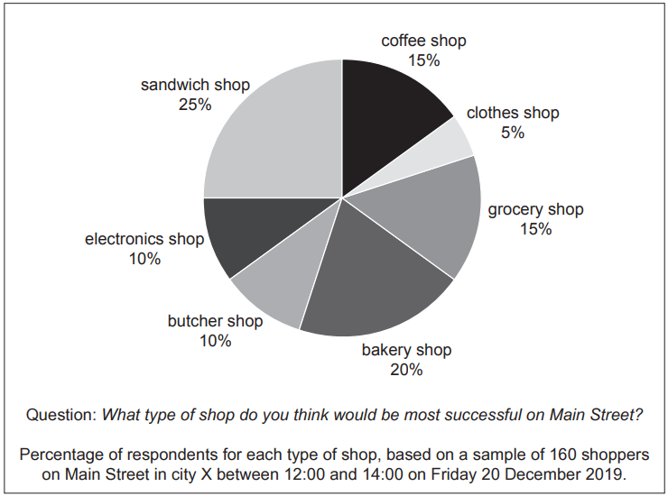

# Exam Questions — Enterprise
**1. Business and Its Environment** · Cambridge (CIE) A-LEVEL business (9609)
> Source: [https://www.savemyexams.com/a-level/business/cie/23/topic-questions/](https://www.savemyexams.com/a-level/business/cie/23/topic-questions/) · 19 questions across 1 sets

## Exam Questions (19 questions)

### Q1 — medium — 8 marks

**Q1** [8 marks]

> **[case-study]**
> **Thread (TH)**
> 
> Thread (TH) makes school uniforms in country Z. It was set up four years ago by Mariam, who had spent nine years working as a buyer for a large clothing retailer.
> 
> While working as a buyer, Mariam noticed that schools in her region were paying high prices for uniforms imported from overseas. She believed the same garments could be made locally for far less. She left her job, invested \$30,000 of her own savings, and formed a partnership with her sister, who contributed a further \$20,000.
> 
> Mariam rented a small factory unit and bought twelve industrial sewing machines. She recruited 60 workers from the local area, most of whom had never used industrial equipment before, and trained them herself over three months. She also negotiated directly with a fabric mill in a neighbouring country, cutting out the wholesalers that her competitors use.
> 
> TH now sells a hard-wearing cotton blend that Mariam developed with the mill. Schools report that the uniforms last around a year longer than the imported ones they replaced.
> 
> **Table 1.1: TH selected data**
> 
> | Revenue in year 1 (\$) | 180,000 |
> |---|---|
> | Revenue in year 4 (\$) | 940,000 |
> | Number of schools supplied | 34 |
> | TH price compared with imported uniforms | 25% lower |
> 
> Mariam is now considering whether TH should begin supplying schools in a neighbouring region.

Analyse **two** ways in which Mariam has carried out the role of an entrepreneur at TH.

### Q2 — medium — 8 marks

**Q2** [8 marks]

> **[case-study]**
> **Lattice (LT)**
> 
> Lattice (LT) is a private limited company based in country Y. It was founded fourteen years ago and now employs 320 people. LT develops software that helps delivery companies plan their routes.
> 
> Almost all of LT's income comes from a single product, RouteMaster, which was launched eleven years ago. Two competitors have released newer route-planning software in the past eighteen months, and several of LT's customers have asked why RouteMaster has changed so little.
> 
> **Table 1.1: LT selected data**
> 
> | Revenue in 2025 (\$m) | 24 |
> |---|---|
> | Share of revenue from RouteMaster (%) | 78 |
> | Labour turnover, software developers (%) | 22 |
> | Industry average labour turnover (%) | 14 |
> 
> Several of LT's software developers have suggested ideas for new products, but they have no time to work on them because they are fully occupied maintaining RouteMaster for existing customers.
> 
> LT's Managing Director, Anika, wants to encourage intrapreneurship. She has proposed that every developer is given one day each fortnight to work on their own project, and that LT sets aside an annual fund of \$200,000 to develop the most promising employee ideas.
> 
> LT's Finance Director disagrees. He estimates that the lost development time would cost LT around \$900,000 each year, and points out that most employee ideas never become products that customers will pay for.

Analyse **two** benefits to LT of encouraging intrapreneurship among its employees.

### Q3 — medium — 8 marks

**Q3** [8 marks]

> **[case-study]**
> **Kiln (KL)**
> 
> Priya worked for twelve years as a secondary school art teacher in country X. She has always made handmade ceramic tableware in her spare time and sells it at local craft markets. Last year she decided to leave teaching and set up Kiln (KL) as a sole trader, producing handmade plates, bowls and mugs to sell to homeware shops.
> 
> Priya has \$18,000 in personal savings. She estimates that KL needs \$45,000 before it can begin trading, as shown in Table 1.1. She approached two banks for a loan. Both refused, saying that KL has no trading record and no assets to offer as security.
> 
> **Table 1.1: KL estimated start-up costs**
> 
> | **Item** | **Cost (\$)** |
> |---|---|
> | Industrial kiln | 20,000 |
> | Workshop equipment and tools | 9,000 |
> | First three months' rent on workshop | 8,500 |
> | Raw materials (clay and glazes) | 5,000 |
> | Safety certification and licences | 2,500 |
> | **Total** | **45,000** |
> 
> The homeware market in country X is dominated by three established manufacturers. The largest holds 40% of the market and supplies plates to retailers at \$12 each. Priya has calculated that KL's cost of making one plate is \$9.
> 
> Before KL can begin production, its workshop must pass a safety inspection. Priya has been told that the certification process usually takes about four months.
> 
> Priya is confident about the quality of her designs. However, she has no experience of pricing, managing cash flow or negotiating with suppliers. A friend has advised her to write a business plan before going any further.

Analyse **two** barriers to entrepreneurship faced by Priya.

### Q4 — hard — 12 marks

**Q4** [12 marks]

> **[case-study]**
> **The Shop (TS) **
> 
> Thomas worked for 30 years as a manager of a factory. Although he was very good at his job, he was recently made redundant.
> 
> Thomas always wanted to open a shop. He thinks he has the qualities an entrepreneur is likely to need for success. He has undertaken some primary market research to identify possible opportunities in city X where he lives (see Fig. 1.1).
> 
> 
> 
> **Fig. 1.1: Market research**
> 
> Thomas now needs to make a decision about which type of shop to open. He has used the data in Fig. 1.1 and some secondary market research to identify two options.
> 
> *Option 1: Coffee shop *
> The coffee shop would provide hot drinks that customers could take away and drink elsewhere. It would also sell some bakery items, such as biscuits and doughnuts. There are four other shops selling takeaway hot drinks and bakery items in the city, as well as five cafés. Thomas thinks that the profit margin would be 6% to 8%.
> 
> *Option 2: Sandwich shop *
> The sandwich shop would make sandwiches using job production. Customers can choose from a range of sandwich fillings, as well as cold drinks and snacks. There is only one competitor in the city. It is a well-known international franchise that spends a lot of money on promotion. Thomas thinks that the profit margin would be 10% to 15%.

Recommend which of the two options Thomas should choose for his new shop. Justify your recommendation.

*Source: June 2020 Paper 22 Q1D*

### Q5 — easy — 4 marks

**Q5** [4 marks]

Explain **two **reasons why many new businesses fail in their first year of operation.

*Source: June 2020 Paper 11 Q2B*

### Q6 — easy — 4 marks

**Q6** [4 marks]

Explain **two **qualities of a successful entrepreneur.

*Source: Nov 2021 Paper 12 Q1B*

### Q7 — easy — 3 marks

**Q7** [3 marks]

> **[case-study]**
> **Clever Televisions (CTV) **
> 
> CTV is a public limited company that produces and sells televisions. It has been operating in country A for 30 years. CTV owns 3 factories and has over 100 employees. CTV’s factories use a combination of capital and skilled labour to produce the televisions. The leadership style in all the factories is autocratic. Employees’ pay is based on time worked each week.
> 
> The CTV brand is known for high‑quality and reliability. It targets high‑income customers. CTV uses price skimming when it launches a new product.
> 
> In total, 6 million televisions were sold in country A in 2019. Table 2.1 shows market growth data.
> 
> **Table 2.1: Television sales in country A**
> 
> | **Year** | **Market growth** |
> |---|---|
> | 2020 | +2% |
> | 2021 | +1% |
> | 2022 | –3% (forecast) |
> 
> The market for televisions in country A is very competitive, and the business environment is dynamic. CTV plans to introduce a lower-priced television brand to appeal to the mass market. This brand will be known as STV.
> 
> CTV has decided to introduce automation into one of its factories to produce the STV televisions. This will lead to redundancies in that factory.
> 
> The employees in the other two factories are concerned they might also face redundancy and so motivation is currently low. The Human Resources Director recommends that CTV should find ways in which employees can participate in the management and control of the business.

Explain what is meant by ‘the business environment is dynamic’.

*Source: June 2022 Paper 23 Q2AII*

### Q8 — easy — 3 marks

**Q8** [3 marks]

**Extract:**

**NaturaBite Foods (NF)**

NaturaBite Foods (NF) is a private limited company in country G that produces organic snack foods, including energy bars, dried fruit mixes, and nut butters. NF sells its products to supermarkets and health food stores across country G. NF has built a strong brand with the slogan 'nothing artificial, nothing hidden'.

NF currently uses flow production to manufacture its products in large quantities. The production manager believes that switching to batch production will allow NF to produce a wider range of flavours and varieties, responding to changing customer preferences. However, the Finance Director has raised concerns about the cost of reorganising the production process.

NF employs 60 workers in one factory. The Production Manager believes there is significant room to improve labour productivity without increasing headcount. Table 2.1 shows NF's financial data for 2023.

**Table 2.1: NF financial data 2023**

|   |   |
|---|---|
| Selling price per unit (\$) | 4.00 |
| Variable cost per unit (\$) | 1.50 |
| Total fixed costs (\$) | 75,000 |
| Current annual output (units) | 40,000 |
| Maximum capacity (units) | 55,000 |

> **[case-study]**
> **NaturaBite Foods (NF)**
> 
> NaturaBite Foods (NF) is a private limited company in country G that produces organic snack foods, including energy bars, dried fruit mixes, and nut butters. NF sells its products to supermarkets and health food stores across country G. NF has built a strong brand with the slogan 'nothing artificial, nothing hidden'.
> 
> NF currently uses flow production to manufacture its products in large quantities. The production manager believes that switching to batch production will allow NF to produce a wider range of flavours and varieties, responding to changing customer preferences. However, the Finance Director has raised concerns about the cost of reorganising the production process.
> 
> NF employs 60 workers in one factory. The Production Manager believes there is significant room to improve labour productivity without increasing headcount. Table 2.1 shows NF's financial data for 2023.
> 
> **Table 2.1: NF financial data 2023**
> 
> | Selling price per unit (\$) | 4.00 |
> |---|---|
> | Variable cost per unit (\$) | 1.50 |
> | Total fixed costs (\$) | 75,000 |
> | Current annual output (units) | 40,000 |
> | Maximum capacity (units) | 55,000 |

Explain the term 'added value'.

### Q9 — easy — 4 marks

**Q9** [4 marks]

> **[case-study]**
> **Priya’s Bookshop (PB) **
> 
> Priya lives in town R which is situated in beautiful countryside with nice walks nearby. Many tourists visit town R.
> 
> The town’s council would like town R to become branded as a ‘booktown’, a town with many bookshops selling new and used books. The council announced a new financial scheme offering grants to attract entrepreneurs willing to open a bookshop.
> 
> Priya applied for a grant to start up Priya’s Bookshop (PB). Part of her grant application included a cash flow forecast, shown in Table 1.1.
> 
> **Table 1.1: Cash flow forecast, first three months of trading (\$000)**
> 
> |   | Month 1 | Month 2 | Month 3 |
> |---|---|---|---|
> | Cash in: |   |   |   |
> | Owner’s capital | 15 | 0 | 0 |
> | Grant | 20 | 0 | 0 |
> | Revenue | 4 | 6 | 11 |
> | Cash out: |   |   |   |
> | Initial set up costs | 20 | 0 | 0 |
> | Utilities (power, water etc) | 0 | 0 | 2 |
> | Employee costs | 1 | 1 | 3 |
> | Purchases | 6 | 3 | 4 |
> | Marketing | 10 | 5 | 4 |
> | Opening balance | 0 | 2 | -1 |
> | Closing balance | 2 | -1 | **X** |
> 
> Priya’s grant application was successful and she opened PB well aware of the need for both cash and profit.
> 
> Priya now wants to raise awareness of PB in town R. Priya did some market research and decided to use market segmentation. This will help her to decide on the promotional methods she could use for her bookshop. See Table 1.2.
> 
> **Table 1.2: Age and gender of residents in town R**
> 
> | Age group (years) | Percentage of residents in age group | Percentage of age group who are female |
> |---|---|---|
> | 0–15 | 19% | 50% |
> | 16–64 | 63% | 55% |
> | 65+ | 18% | 60% |

Explain **two **entrepreneurial qualities that Priya has shown.

*Source: June 2022 Paper 21 Q1C*

### Q10 — easy — 2 marks

**Q10** [2 marks]

Define the term ‘opportunity cost’.

*Source: June 2020 Paper 11 Q2A*

### Q11 — medium — 8 marks

**Q11** [8 marks]

> **[case-study]**
> **The Shop (TS) **
> 
> Thomas worked for 30 years as a manager of a factory. Although he was very good at his job he was recently made redundant.
> 
> Thomas always wanted to open a shop. He thinks he has the qualities an entrepreneur is likely to need for success. He has undertaken some primary market research to identify possible opportunities in city X where he lives (see Fig. 1.1).
> 
> 
> 
> **Fig. 1.1: Market research**
> 
> Thomas now needs to make a decision about which type of shop to open. He has used the data in Fig. 1.1 and some secondary market research to identify two options.
> 
> *Option 1: Coffee shop *
> The coffee shop would provide hot drinks that customers could take away and drink elsewhere. It would also sell some bakery items, such as biscuits and doughnuts. There are four other shops selling takeaway hot drinks and bakery items in the city, as well as five cafés. Thomas thinks that the profit margin would be 6% to 8%.
> 
> *Option 2: Sandwich shop *
> The sandwich shop would make sandwiches using job production. Customers can choose from a range of sandwich fillings, as well as cold drinks and snacks. There is only one competitor in the city. It is a well-known international franchise that spends a lot of money on promotion. Thomas thinks that the profit margin would be 10% to 15%.

Analyse **two **qualities that Thomas will need to be a successful entrepreneur.

*Source: June 2020 Paper 22 Q1C*

### Q12 — hard — 12 marks

**Q12** [12 marks]

Discuss the possible challenges for an entrepreneur in starting a new business selling only vegetarian food products.

*Source: November 2021 Paper 13 Q7B*

### Q13 — easy — 3 marks

**Q13** [3 marks]

> **[case-study]**
> **Delicious Cocoa (DC) **
> 
> DC is a co-operative owned by cocoa farmers in country X. It has 500 workers. In 2022, DC produced 2000 tonnes of raw cocoa beans. Productivity is expected to increase by 5% in 2023. Although DC is profitable, it has no retained earnings.
> 
> DC focuses on the triple bottom line as its main objective. The members of the co-operative (farmers) are motivated within the current operation.
> 
> Zara, the Managing Director, has recently completed a workforce plan. She has identified that young people do not want to work on DC’s farms. Their concerns are:
> 
> - lack of investment in training
> - most of the work is manual
> - lack of control over earnings.
> 
> Ranjit, the Operations Director, has identified an opportunity to create added value by investing in a capital intensive factory.
> 
> The factory will process raw cocoa beans produced by DC’s farms into cocoa butter. Cocoa butter is a premium product and attracts higher profit margins than raw cocoa beans. The processing factory will require a significant capital investment (see Table 2.1).
> 
> **Table 2.1 Data for the cocoa processing factory**
> 
> |   | **\$** |
> |---|---|
> | Initial investment:  Land  Machinery  Training | 100 000  150 000  15 000 |
> | Average variable costs per tonne | 5 000 |
> | Average selling price per tonne | 10 000 |

Explain the term 'added value*'.*

*Source: June 2023 Paper 21 Q2AII*

### Q14 — medium — 8 marks

**Q14** [8 marks]

Analyse **two** ways marketing could be used to add value to a product.

*Source: November 2021 Paper 12 Q5A*

### Q15 — hard — 12 marks

**Q15** [12 marks]

> **[case-study]**
> **Seaside Hotel (SH) **
> 
> SH is a large hotel located in a tourist area of country H. SH has 120 rooms and employs 42 workers during the peak (busiest) season, which is from April to September. Table 2.1 shows employee data for SH’s peak season.
> 
> **Table 2.1: Employee data for SH’s peak season**
> 
> | **Type** | **Number** | **Main tasks** |
> |---|---|---|
> | Manager | 3 | - decision-making - supervising other employees |
> | Cleaner | 12 | - cleaning rooms, corridors and reception area to required standard - maintaining a clean and safe working environment |
> | Customer service | 16 | - greeting guests upon arrival - making sure guests are satisfied |
> | Marketing | 7 | - designing promotional materials - promoting hotel to increase number of guests |
> | Other | 4 | - various |
> 
> SH makes half of the cleaners and customer service employees redundant at the end of the peak season.
> 
> To break even, the hotel must sell 72 rooms per night. The hotel offers good views of the sea and it is very busy in the peak season when the weather is hot. Table 2.2 shows SH’s sales of rooms.
> 
> **Table 2.2: SH’s sales of rooms 2021–2022**
> 
> | **Time period** | **Average percentage of rooms sold per night** |
> |---|---|
> | April 2021 – September 2021 | 95% |
> | October 2021 – March 2022 | 45% |
> 
> SH does not have a restaurant. It has a joint venture with a restaurant close to the hotel where SH’s customers receive a discount on their food and drink. The hotel advertises the restaurant on social media and the restaurant advertises the hotel on its menu.
> 
> Tia is one of the managers of SH. She has an autocratic leadership style and is responsible for the cleaners and marketing employees.
> 
> The directors of SH aim to increase the value added to the service that SH provides.

Recommend how SH could increase the value added to its service. Justify your recommendation.

*Source: June 2022 Paper 22 Q2D*

### Q16 — easy — 2 marks

**Q16** [2 marks]

Define the term ‘entrepreneur’.

*Source: November 2021 Paper 12 Q1A*

### Q17 — easy — 2 marks

**Q17** [2 marks]

> **[case-study]**
> **Clever Televisions (CTV) **
> 
> CTV is a public limited company that produces and sells televisions. It has been operating in country A for 30 years. CTV owns 3 factories and has over 100 employees. CTV’s factories use a combination of capital and skilled labour to produce the televisions. The leadership style in all the factories is autocratic. Employees’ pay is based on time worked each week.
> 
> The CTV brand is known for high‑quality and reliability. It targets high‑income customers. CTV uses price skimming when it launches a new product.
> 
> In total, 6 million televisions were sold in country A in 2019. Table 2.1 shows market growth data.
> 
> **Table 2.1: Television sales in country A**
> 
> | **Year** | **Market growth** |
> |---|---|
> | 2020 | +2% |
> | 2021 | +1% |
> | 2022 | –3% (forecast) |
> 
> The market for televisions in country A is very competitive and the business environment is dynamic. CTV plans to introduce a lower priced television brand to appeal to the mass market. This brand will be known as STV.
> 
> CTV has decided to introduce automation into one of its factories to produce the STV televisions. This will lead to redundancies in that factory.
> 
> The employees in the other two factories are concerned they might also face redundancy and so motivation is currently low. The Human Resources Director recommends that CTV should find ways in which employees can participate in the management and control of the business.

Define the term ‘capital’.

*Source: June 2022 Paper 23 Q2AI*

### Q18 — easy — 1 marks

**Q18** [1 mark]

> **[case-study]**
> **Great Resources (GR) **
> 
> GR is a business partnership that creates educational resources. It sells direct to schools and teachers via its own website.
> 
> Sanjay, Rukmal and Boris are entrepreneurial teachers who formed the GR partnership. One year ago, they identified a gap in the market to supply interactive, digital resources. GR’s website is subscription only. An online marketing campaign, which used penetration pricing, attracted 250 subscribers in the first six months of operation. The start-up costs were financed with a \$5000 bank overdraft, which is GR’s only debt.
> 
> Reviews for GR’s products in teaching journals are positive but cash flow is poor. Many customers have taken advantage of a recent sales promotion for one month’s free membership and posted positive reviews. Unfortunately, few have then taken out a regular subscription.
> 
> As revenue has not increased as much as the entrepreneurs had hoped, they must now consider alternative promotion methods. They have researched possible promotion methods and decided to advertise in an educational newspaper. The newspaper has a readership of half a million people.
> 
> Expert Materials (EM) is a large national company that also advertises in the newspaper. EM is GR’s closest competitor. The EM brand is well-known and trusted in the educational resources market. Table 1.1 shows some marketing data.
> 
> **Table 1.1 Marketing data**
> 
> |   | GR | EM | Total market |
> |---|---|---|---|
> | Revenue (\$000) | 15 | 300 | 500 |
> | Number of customers | 300 | 5000 | 7000 |
> | Annual advertising spend (\$000) | 7.5 | 45 | 60 |

Identify **one **barrier to entrepreneurship.

*Source: June 2023 Paper 21 Q1AI*

### Q19 — easy — 3 marks

**Q19** [3 marks]

> **[case-study]**
> **Designer Clothing (DC)**
> 
> DC is a medium-sized private limited company. It has been trading for 10 years. DC makes luxury dresses for women using job production methods. DC has an excellent reputation for quality. A DC designer has a meeting with every customer to design a dress that satisfies the customer’s individual needs, including choice of fabric and colour. Cost-based pricing is used with 50% added to the average cost of each dress.
> 
> DC’s employees are highly skilled and paid hourly rates (a time-based method). Ikram, one of the designers, has just had a meeting with a new customer, Lydia. Lydia wants Ikram to design and make a new dress for her. Ikram has worked out the production data shown in Table 2.1 for the dress.
> 
> **Table 2.1: Production data for the dress for Lydia**
> 
> | Production time | 20 hours |
> |---|---|
> | Hourly rate | \$10 |
> | Material costs | \$250 |
> | Indirect cost allocation | \$25 |
> | Other costs such as packaging | \$25 |
> 
> Jenny, the Managing Director, wants to use DC’s excellent reputation and move into a new market. Jenny wants to create a new range of DC branded trousers for women. Jenny has developed some elements of a marketing mix for the new trousers:
> 
> - Product: quality trousers aimed at women aged 25–50
> - Distribution channel: sold in large shops
> - Promotion: branded with the DC logo
> 
> Jenny will develop a business plan when she receives the market research report, which includes feedback from a focus group. Jenny thinks that the pricing strategy DC currently uses will not be appropriate for the new trousers.
> 
> The new product range would use a batch production method. The Production Director, Khaleal, has identified the machinery needed for the new production method. Khaleal is worried about the problems that introducing the new production method might cause DC’s employees.

Explain the term ‘business plan’.

*Source: Specimen 2023 Paper 2 Q2AII*

