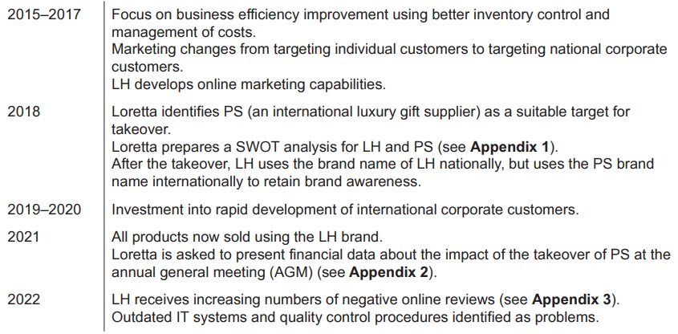
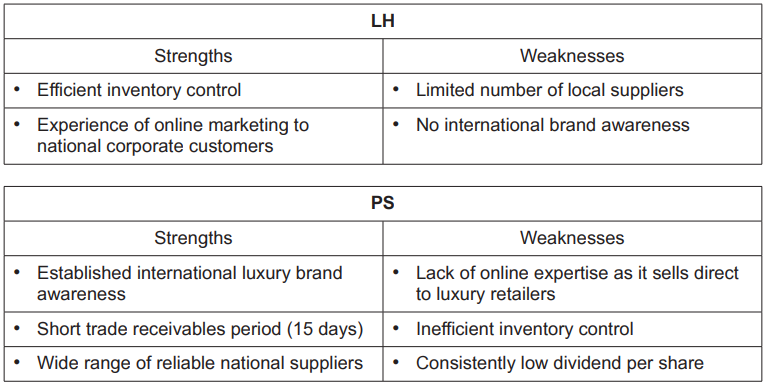
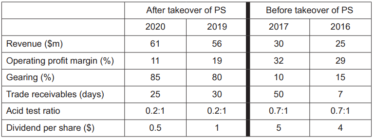
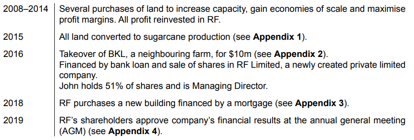
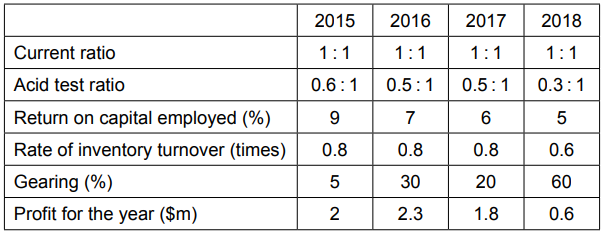

# Exam Questions — Size of Business
**1. Business and Its Environment** · Cambridge (CIE) A-LEVEL business (9609)
> Source: [https://www.savemyexams.com/a-level/business/cie/23/topic-questions/](https://www.savemyexams.com/a-level/business/cie/23/topic-questions/) · 20 questions across 1 sets

## Exam Questions (20 questions)

### Q1 — medium — 8 marks

**Q1** [8 marks]

> **[case-study]**
> **Iris (IR)**
> 
> Iris (IR) is a chain of opticians in country K. Two years ago IR merged with a smaller rival that owned 25 shops, creating a business with 65 shops in total.
> 
> IR's directors expected the merger to achieve two objectives: to cut costs by buying frames and lenses in much larger quantities, and to raise market share to 30%.
> 
> The two businesses had worked in very different ways. IR had always allowed each shop manager to choose which frames to stock, while the smaller chain ordered everything centrally. Two years on, the two groups of shops still use separate ordering systems, and IR has not yet been able to place combined orders with its suppliers.
> 
> Nineteen optometrists have left IR since the merger. Several said they disliked the new working practices introduced afterwards.
> 
> **Table 1.1: IR selected data**
> 
> | Shops | 65 |
> |---|---|
> | Market share before the merger (%) | 19 |
> | Market share now (%) | 24 |
> | Target market share (%) | 30 |
> | Cost of merging the two businesses so far (\$m) | 6.2 |
> | Amount originally budgeted for merging (\$m) | 3.5 |

Analyse **two** reasons why IR's merger has not achieved its objectives.

### Q2 — medium — 8 marks

**Q2** [8 marks]

> **[case-study]**
> **Rye (RY)**
> 
> Rye (RY) owns 28 bakery shops in country L and also supplies bread to two supermarket chains. It employs 400 people and bakes everything at one central bakery.
> 
> Flour is RY's largest single cost. RY buys all of its flour from three independent mills.
> 
> **Table 1.1: RY selected data**
> 
> | Revenue in 2025 (\$m) | 26 |
> |---|---|
> | Flour as a share of total production costs (%) | 34 |
> | Increase in the flour price paid by RY, 2023-2025 (%) | 41 |
> | Deliveries from mills arriving late in 2025 (%) | 12 |
> 
> Twice in the past year a mill failed to deliver on time and RY could not bake enough bread to fill its supermarket orders. One supermarket has warned RY that further failures will end the contract.
> 
> RY's directors are considering buying one of the three mills. Its owner is willing to sell for \$4.5m. The mill currently supplies RY and eleven other bakeries in country L.

Analyse **two** benefits to RY of backward vertical integration.

### Q3 — medium — 8 marks

**Q3** [8 marks]

> **[case-study]**
> **Lantern (LN)**
> 
> Lantern (LN) owns seven hotels in country M. It was founded in 1962 by Ana Ferreira and has been owned by the Ferreira family ever since. LN employs 340 people.
> 
> LN is run by Ana's son, Paulo, who is 71 and has been Managing Director for thirty years. Paulo has said he intends to retire within two years.
> 
> Paulo has three children. Only one, Sofia, works in the business, as Marketing Manager, and she has said she does not want to take over as Managing Director. The other two have careers outside the hotel industry.
> 
> Last year LN appointed Paulo's nephew as Operations Director. Two experienced hotel managers who had applied for the role left LN within six months of the decision.
> 
> LN's hotels are well maintained but none has been refurbished for over twelve years. Competing hotel groups in country M have opened newly built hotels with conference facilities, which LN does not offer. Paulo has refused to borrow money or to sell shares to fund refurbishment, saying that LN has never been in debt and he does not want outside investors involved in the business.
> 
> **Table 1.1: LN selected data**
> 
> | Hotels | 7 |
> |---|---|
> | Employees | 340 |
> | Revenue in 2025 (\$m) | 21 |
> | Average room occupancy in 2020 (%) | 78 |
> | Average room occupancy in 2025 (%) | 61 |

Analyse **two** weaknesses of LN being a family business.

### Q4 — medium — 8 marks

**Q4** [8 marks]

> **[case-study]**
> **Cedar (CD)**
> 
> Cedar (CD) is a building firm in country N. It employs nine people - two bricklayers, three carpenters, a plasterer and two apprentices - alongside its owner, Tomas.
> 
> The construction industry in country N is made up of a small number of very large contractors and a very large number of small firms.
> 
> **Table 1.1: Structure of the construction industry in country N**
> 
> | Firms with more than 250 employees | 12 |
> |---|---|
> | Firms with 10-249 employees | 1,900 |
> | Firms with fewer than 10 employees | 41,000 |
> | Share of industry output produced by firms with fewer than 10 employees (%) | 38 |
> 
> About two thirds of CD's work comes from subcontracts for the three largest contractors in country N, which use CD for carpentry and plastering on housing developments. The remainder comes from home extensions and repairs for local customers, who often choose CD because Tomas visits personally to discuss the work before quoting a price.
> 
> The large contractors do not employ their own carpenters or plasterers. They prefer to hire firms such as CD when a project requires them, so that they do not have to pay wages during periods when work is quiet.

Analyse **two** reasons why small businesses such as CD continue to be important in the construction industry in country N.

### Q5 — easy — 3 marks

**Q5** [3 marks]

> **[case-study]**
> **Harbour (HB)**
> 
> Harbour (HB) is a supermarket chain with 34 stores along the coast of country Q. It employs 1,400 people and is known for stocking fish and fresh produce from suppliers in the towns where its stores are located.
> 
> HB buys from around 200 small local suppliers. Many of these suppliers sell most of what they produce to HB.
> 
> A national supermarket group has offered to buy HB. The national group operates 600 stores across country Q, buys centrally from a small number of large suppliers, and sells at lower prices than HB.
> 
> HB's directors have recommended that shareholders accept the offer. Local newspapers have reported concern among shoppers and suppliers about what the sale would mean.

Explain **one** way the proposed takeover could affect HB's suppliers.

### Q6 — easy — 3 marks

**Q6** [3 marks]

> **[case-study]**
> **Orbit (OB)**
> 
> Orbit (OB) manufactures cases, chargers and headphones for mobile phones in country R. It was set up eight years ago and employs 45 people at a single factory.
> 
> OB sells mainly to independent phone shops across country R. Demand for its products has grown steadily, and OB's factory now runs at 96% of its capacity. In the past year OB has turned down two large orders because it could not produce enough units in time.
> 
> **Table 1.1: OB selected data**
> 
> | Employees | 45 |
> |---|---|
> | Revenue in 2025 (\$m) | 3.8 |
> | Capacity utilisation (%) | 96 |
> | Average cost per unit (\$) | 4.20 |
> | Orders refused in 2025 (units) | 60,000 |
> 
> OB's owner is considering renting a second factory unit nearby.

Explain **one** reason why OB might want to grow.

### Q7 — easy — 3 marks

**Q7** [3 marks]

> **[case-study]**
> **Willow (WL)**
> 
> Willow (WL) owns six garden centres in country S. It sells plants, tools, compost and garden furniture, and each centre has a small cafe.
> 
> WL was started in 1971 by Grace Adeyemi, who opened a single plant nursery. It is now run by her daughter and two grandchildren, and the family still owns all of the shares. WL employs 210 people.
> 
> Several of WL's managers began as weekend staff and have worked for the business for more than twenty years. WL is well known in country S for the quality of its plants and for staff who can give expert gardening advice.
> 
> A national garden retailer has recently opened two large stores in the same region, selling similar products at lower prices.

Explain **one** strength of WL being a family business.

### Q8 — easy — 3 marks

**Q8** [3 marks]

> **[case-study]**
> **Meridian (MR)**
> 
> Meridian (MR) is a coach travel company in country T. It runs scheduled services between towns and cities, and hires out coaches for school trips and private tours.
> 
> MR owns a fleet of 48 coaches, kept at two depots. It employs 90 people, most of whom are drivers. Because modern coaches are expensive to buy, MR has a large amount of money tied up in its fleet compared with many businesses employing a similar number of people.
> 
> **Table 1.1: MR selected data**
> 
> | Employees | 90 |
> |---|---|
> | Revenue in 2025 (\$m) | 14 |
> | Capital employed (\$m) | 22 |
> | Coaches owned | 48 |
> | Share of the coach travel market in country T (%) | 11 |
> 
> MR's Managing Director has been asked to compare MR with a rival coach operator that employs 260 people but owns only 20 coaches, because it hires the rest.

Explain **one** method that could be used to measure the size of MR.

### Q9 — easy — 3 marks

**Q9** [3 marks]

Explain **one** reason why a business might choose to remain small.

### Q10 — easy — 2 marks

**Q10** [2 marks]

Define the term 'strategic alliance'.

### Q11 — easy — 2 marks

**Q11** [2 marks]

Define the term 'hostile takeover'.

### Q12 — easy — 2 marks

**Q12** [2 marks]

Define the term 'horizontal integration'.

### Q13 — easy — 2 marks

**Q13** [2 marks]

Define the term 'organic growth'.

### Q14 — hard — 20 marks

**Q14** [20 marks]

‘Marketing is the most important factor for the success of small businesses.’

Discuss the extent to which you agree with this view.

*Source: November 2020 Paper 12 Q6*

### Q15 — medium — 8 marks

**Q15** [8 marks]

> **[case-study]**
> **Braid Runner (BR) **
> 
> Lewis is a hairdresser. He rents a small shop which he uses as a hairdressers called Braid Runner (BR). Lewis is a sole trader and he set up BR 25 years ago.
> 
> BR is the smallest of all the hairdressers in city Y. Lewis works on his own. He has repeat customers who have been using BR for many years. However, there are many large franchises in city Y which offer a much cheaper haircut than BR.
> 
> Lewis is considering increasing the price of a haircut, and he has outlined the costs and revenue of the business in Table 2.1.
> 
> **Table 2.1: Costs and revenue of BR**
> 
> | Variable costs per customer | \$3.50 |
> |---|---|
> | Fixed costs per week | \$675 |
> | Price | \$8 |
> 
> Lewis would like to employ another hairdresser so that he can work fewer hours in BR. The new employee would have to be able to work in BR on their own. They would be responsible for taking bookings, dealing with customers and some financial transactions. Lewis has drawn up a person specification (see Fig. 2.1) that will be placed on a job website.
> 
> | **Characteristic** | **Essential** | **Desirable** |
> |---|---|---|
> | Qualifications | - Hairdressing qualification | - A-Levels or high school standards in Mathematics and Business |
> | Physical | - Must be between 18 and 30 years old | - Female |
> | Experience | - None r - equired | - Experience of dealing with customers/consumers - Experience of working alone |
> | Personal qualities | - Able to work in a team - Good communication | - Friendly |
> 
> **Fig. 2.1: Person specification created by Lewis**

Analyse **one **advantage and **one **disadvantage for Lewis of operating as a small business.

*Source: November 2020 Paper 23 Q2C*

### Q16 — hard — 12 marks

**Q16** [12 marks]

> **[case-study]**
> **Super Heroes (SH) **
> 
> SH is a leisure (theme) park aimed at 10–18 year olds. It is owned by two companies, X and Y, which started SH as a joint venture. Company X owns many leisure centres and swimming pools. Company Y owns many brands based on superheroes.
> 
> SH employs 200 full-time workers and an extra 50 seasonal workers during the busiest times of the year. The park has 10 large rides which take up 2km2 of land. There are also many smaller rides, restaurants, toilets and shops. The price of an entrance ticket is \$11 per customer. Table 1.1 shows the costs for SH in 2019.
> 
> **Table 1.1: SH costs for 2019**
> 
> | Total fixed costs (per year) | \$12m |
> |---|---|
> | Variable costs (per customer) | \$3 |
> | Total costs | \$42m |
> 
> One of the larger rides at SH is the Iron Blaster. The number of customers who use this ride has decreased each year for the last three years. This has led the management of SH to consider its options for internal growth.
> 
> *Option 1 – A new virtual reality (VR) ride *
> This option would involve developing the Iron Blaster into a VR ride. Most of the structure of the Iron Blaster could be used, but customers would be given a VR headset to wear during the ride. The cost of developing the VR ride would be \$2m. The Iron Blaster ride would be closed for a three-month period during the off-peak season for the development to be carried out. No employees would be made redundant or dismissed.
> 
> *Option 2 – A new hotel *
> SH does not currently have a hotel. It could demolish the Iron Blaster to provide the space to build one. Many of the competitors of SH have a hotel near or within their leisure parks. Hotel customers would pay a high price for a room but have free access to the leisure park’s facilities. Market research suggests that the average hotel customer would spend twice as long in the leisure park than a non-hotel customer. The cost of developing the hotel would be \$15m and take a year to build. All of the employees currently working on the Iron Blaster ride would face redundancy or dismissal.

Recommend which one of the two options SH should choose for internal growth. Justify your recommendation.

*Source: June 2020 Paper 23 Q1D*

### Q17 — hard — 12 marks

**Q17** [12 marks]

**Extract:**

Heart Data (HD) HD designs and manufactures micro circuit boards containing advanced software. The boards are used in data processing, IT system manufacture and vehicle control. HD is a private limited company with two shareholders who are also the directors. One is responsible for the Design Division, the other for the Manufacturing Division. HD started in 2002 and now employs 18 electronic engineering graduates. One of these graduates is responsible for managing HD’s website and for dealing with customer enquiries and orders. HD also employs an accountant and two administration staff. HD is located in country Q. HD still has its original mission statement: “to provide world class software solutions to customers”. The geographic split of HD’s sales is: • 40% country Q • 30% US • 30% other countries Corporate social responsibility (CSR) issues HD’s customers include social media operators, police and security forces, retailers, governments and universities. The micro circuit boards contain metals, such as nickel, which are difficult to recycle. Some pressure groups claim that metals used in micro circuit boards are obtained from mines which employ child labour. HD’s accountant also believes that some manufacturers make payments to foreign governments which do not appear in their company accounts. Two pressure groups and country Q’s government have asked HD for a detailed social audit. Organisational structure The Design Division is organised in a matrix structure. Design engineers work on their own and also in small teams, each on a specific project such as a customer’s special order. These temporary teams exist for the life of each custom made circuit board project. Each team has designers with the particular skills required. The Design Director delegates responsibility to each team for the completion of each project. The teams choose their own leaders and a team member to communicate with the customer. HD design engineers work from home for 20% of their hours. They communicate by electronic methods except when a team holds problem‑solving meetings. HD’s project design teams have an excellent reputation with customers for designing problem‑ free circuit boards to meet their specific needs. However, the Design Director is worried about recent trends in the Design Division. Absenteeism and labour turnover of design engineers are increasing and project completion dates are being delayed. One design engineer told the director “I have two managers to report to and working with constantly changing teams is bad for morale”. See Table 1 for human resources data. The Manufacturing Division has a hierarchical structure including a factory manager. The 22 employees making the micro circuit boards are given specific, well‑defined tasks which they are trained for and they follow detailed instructions. Five supervisors regularly monitor their work. Table 1: HD human resources data January – May 2022 Total number of employees Number of employees that left HD Design Division 18 5 Manufacturing Division 22 1 Administration staff 3 0

Capacity HD manufactures the boards in its own factory. 40% of HD sales are standard circuit boards. The other 60% are custom made. HD’s maximum monthly capacity is 1 million units. However, the flexibility of HD’s design teams and the quality of its circuit boards have led to substantial increases in demand. This has resulted in HD’s factory operating at over maximum capacity for several months. Output in May 2022 reached 1.05 million units. The Manufacturing Director thinks that this is unsustainable because of the lack of time for machine maintenance and the pressure on production workers. The director has considered outsourcing some of the manufacturing of custom made circuit boards to an overseas supplier or building a factory extension. A possible joint venture HD occasionally works with other similar businesses. The Managing Director of MW, a small manufacturing company, has approached HD with a proposal for a joint venture. MW has an original concept for a circuit board that will enable detailed analysis of large amounts of data from satellites observing distant stars. This circuit board would be sold in a niche market that MW does not operate in. The joint venture would require the expertise of HD’s design engineers to develop this concept to a product launch. It would be produced by MW but marketed by HD. The life of this product is estimated to be two years. Financial forecasts indicate that HD’s share of potential revenue would be \$5m, yielding an operating profit of \$0.5m. Tables 2 and 3 show extracts from HD’s financial statements. Table 2: Extracts from HD’s income statements June 2021 – May 2022 (\$m) Revenue 40 Cost of sales 22 Gross profit 18 Wages and expenses 10 Operating profit 8 Tax 4 Dividends payable for year June 2021 – May 2022 are \$4m. Table 3: Extracts from HD’s statement of financial position at 31 May 2022 (\$m) Non‑current assets 8 Current assets 20 Total assets 28 Non‑current liabilities 4 Current liabilities 4 Total liabilities 8 Net assets 20 Share capital 10 Reserves 10

Globalisation and Marketing HD’s circuit boards are sold in a specialised market in which quality, not price, is the most important factor. HD has a very good reputation. Its unique selling point (USP) is that its engineers provide comprehensive after sales support and advice to customers. HD’s main promotional activity is through its own website. HD’s website manager acts in a marketing role. She has compiled a market report. This states that in the last 18 months there have been significant changes in customer enquiries. The geographical location of potential customers is changing, price is becoming more important and enquiries often do not result in orders being placed with HD. She concludes these changes may be because of: • increased competitors’ marketing activity • increased globalisation • increased economic collaboration by countries setting up free trade areas without tariffs • merger activity among competitors resulting in multinational companies • rapidly expanding markets e.g. BRICS. Future strategies HD’s directors have ambitious objectives for the business. Appendix 1 shows some of the HD’s directors’ recent strategic analysis. The directors are now considering two strategic options for long‑term growth. Either option would be in addition to HD’s existing activities. Both options would use HD’s core competencies. Option 1 HD would take over another circuit board manufacturer in a low‑income country. This would reduce manufacturing costs. External finance would be required for this option. HD’s organisational structure and corporate culture might have to change significantly. Option 2 HD would design, develop and manufacture a new product for analysis of the huge quantities of data generated in medical trials. This product would be targeted at universities and teaching hospitals. This option would require additional design engineers with different skills. Internal finance is available for this option. Appendix 1: HD SWOT analysis Strengths Opportunities • Good reputation • Employee skills in circuit board design • High levels of customer loyalty • Attracting employees with different specialist skills • Growing international markets • Developing innovative products for new technology markets Weaknesses Threats • Operating over maximum capacity • No promotion other than HD’s website • High labour turnover of design engineers • Increasing competition • New technology replacing circuit boards • Increasing investment in Research and Development by competitors

Read the following [extract ](https://pastpapers.co/caie/A-Level/Business-9609/2022-May-June/9609_s22_in_31.pdf)before answering

Recommend whether the directors of HD should accept MW’s joint venture offer. Justify your recommendation.

*Source: June 2022 Paper 31 Q4B*

### Q18 — easy — 3 marks

**Q18** [3 marks]

> **[case-study]**
> **Child Play (CP) **
> 
> Su is a sole trader who started a business called CP which operates a play area for children. The play area is inside a building and includes toys and other play equipment. Customers book on CP’s website for each hour that they would like to use the play area. CP is two kilometres away from the nearest city which has a large population.
> 
> Su does not pay for any promotion and she relies on recommendations and reviews from previous customers. Su currently charges a price of \$10 an hour for a group of up to 5 children. Only one group can book CP for each hour. Demand is greater than supply so Su may increase the price to \$15 per hour. She has completed some market research to see if this is a good idea. Her findings are in Table 1.1.
> 
> **Table 1.1: Market research about prices for CP**
> 
> | **Price** | **Quantity (hours) demanded per day** |
> |---|---|
> | \$10 | 10 |
> | \$15 | 6 |
> 
> Su is also thinking about expanding the business by opening a café targeted at parents with children.
> 
> The café would be located at the entrance to CP’s play area. There are many other cafés in the city centre two kilometres away. Su believes that product differentiation is essential for the profitability of the café.
> 
> Su plans to use CP’s working capital as the source of finance to open the new café. The café will need to earn revenue quickly, so she plans to open it in four weeks. She will need quick and low‑cost promotion methods if the café is to succeed.

Explain **one **way in which the size of CP can be measured.

*Source: June 2022 Paper 23 Q1BII*

### Q19 — hard — 20 marks

**Q19** [20 marks]

**Extract:**

Luxury Hampers (LH) In 2015 Loretta bought LH, an established food hamper business. A hamper is a gift box or basket containing food and drink. Loretta purchased the business for \$500000 using a combination of personal savings and venture capital. Loretta set a short-term objective of profit maximisation and planned for rapid expansion within a five-year period. LH buys high-quality food and drink products directly from manufacturers and packages the products into hampers to sell as luxury gifts. Timeline of LH 2015–2017 Focus on business efficiency improvement using better inventory control and management of costs. Marketing changes from targeting individual customers to targeting national corporate customers. LH develops online marketing capabilities. 2018 Loretta identifies PS (an international luxury gift supplier) as a suitable target for takeover. Loretta prepares a SWOT analysis for LH and PS (see Appendix 1). After the takeover, LH uses the brand name of LH nationally, but uses the PS brand name internationally to retain brand awareness. 2019–2020 Investment into rapid development of international corporate customers. 2021 All products now sold using the LH brand. Loretta is asked to present financial data about the impact of the takeover of PS at the annual general meeting (AGM) (see Appendix 2). 2022 LH receives increasing numbers of negative online reviews (see Appendix 3). Outdated IT systems and quality control procedures identified as problems. Developing an operations strategy In 2023, a cyber-attack corrupted 75% of LH’s IT systems and data. Incomplete supplier data was recovered. However, all customer data was lost. This led to cancelled orders and LH experienced considerable damage to its reputation. LH’s shareholders called an extraordinary general meeting (EGM) and Loretta was replaced as Managing Director by Sanjay, the Operations Director. Sanjay has identified several problems which need to be solved in both the short and long-term. He considers there are several opportunities to improve LH’s operational efficiency. Sanjay knows a new operations strategy must be developed with an appropriate budget. The strategy will have clear objectives to increase data security and improve customer service.

Appendix 1: Extracts from 2018 SWOT analysis for LH and PS LH Strengths Weaknesses • Efficient inventory control • Limited number of local suppliers • Experience of online marketing to national corporate customers • No international brand awareness PS Strengths Weaknesses • Established international luxury brand awareness • Lack of online expertise as it sells direct to luxury retailers • Short trade receivables period (15 days) • Inefficient inventory control • Wide range of reliable national suppliers • Consistently low dividend per share Appendix 2: Extracts from LH’s financial data presented 2021 After takeover of PS Before takeover of PS 2020 2019 2017 2016 Revenue (\$m) 61 56 30 25 Operating profit margin (%) 11 19 32 29 Gearing (%) 85 80 10 15 Trade receivables (days) 25 30 50 7 Acid test ratio 0.2:1 0.2:1 0.7:1 0.7:1 Dividend per share (\$) 0.5 1 5 4 Appendix 3: Extracts from online reviews in 2022 ‘Although the packaging was excellent and the hamper was delivered on time, the contents were not what I ordered! Not happy and not using LH again!’ ‘LH over-promised on delivery times. I wanted to provide New Year hampers for all of my senior managers across Europe and they were delivered after the festival period.’ ‘Impossible to contact LH customer service. Ordered from someone much better!’

> **[case-study]**
> **Luxury Hampers (LH) **
> 
> In 2015 Loretta bought LH, an established food hamper business. A hamper is a gift box or basket containing food and drink. Loretta purchased the business for \$500000 using a combination of personal savings and venture capital. Loretta set a short-term objective of profit maximisation and planned for rapid expansion within a five-year period.
> 
> LH buys high-quality food and drink products directly from manufacturers and packages the products into hampers to sell as luxury gifts.
> 
> **Timeline of LH**
> 
> 
> 
> **Developing an operations strategy**
> 
> In 2023, a cyber-attack corrupted 75% of LH’s IT systems and data. Incomplete supplier data was recovered. However, all customer data was lost. This led to cancelled orders and LH experienced considerable damage to its reputation.
> 
> LH’s shareholders called an extraordinary general meeting (EGM) and Loretta was replaced as Managing Director by Sanjay, the Operations Director.
> 
> Sanjay has identified several problems which need to be solved in both the short and long-term. He considers there are several opportunities to improve LH’s operational efficiency.
> 
> Sanjay knows a new operations strategy must be developed with an appropriate budget. The strategy will have clear objectives to increase data security and improve customer service.
> 
> **Appendix 1: Extracts from 2018 SWOT analysis for LH and PS**
> 
> 
> 
> **Appendix 2: Extracts from LH’s financial data presented 2021**
> 
> 
> 
> **Appendix 3: Extracts from online reviews in 2022 **
> 
> ‘Although the packaging was excellent and the hamper was delivered on time, the contents were not what I ordered! Not happy and not using LH again!’
> 
> ‘LH over-promised on delivery times. I wanted to provide New Year hampers for all of my senior managers across Europe and they were delivered after the festival period.’
> 
> ‘Impossible to contact LH customer service. Ordered from someone much better!’

Evaluate whether LH made the correct strategic decision to take over PS.

*Source: June 2023 Paper 41 Q1*

### Q20 — hard — 20 marks

**Q20** [20 marks]

**Extract:**

Ryan’s Farm (RF) RF was set up in Australia in 2001 when John Ryan bought a farm, equipment and inventory for \$1.5m. He financed the purchase with a bank loan which was fully repaid by 2008. Initially, RF produced sugarcane, pineapples and mangoes. Timeline of RF’s strategy for growth 2008–2014 Several purchases of land to increase capacity, gain economies of scale and maximise profit margins. All profit reinvested in RF. 2015 All land converted to sugarcane production (see Appendix 1). 2016 Takeover of BKL, a neighbouring farm, for \$10m (see Appendix 2). Financed by bank loan and sale of shares in RF Limited, a newly created private limited company. John holds 51% of shares and is Managing Director. 2018 RF purchases a new building financed by a mortgage (see Appendix 3). 2019 RF’s shareholders approve company’s financial results at the annual general meeting (AGM) (see Appendix 4). Developing a new business strategy In 2020 a fire destroyed all RF’s buildings and its inventory of recently harvested sugarcane. RF was unable to continue operations. John Ryan has chosen to retire and has left his controlling share of the company to his daughter, Sue. Sue is determined to create a successful new farming business called RF2. She has adopted the following mission and aims as the basis of a business strategy. Mission Profitability through sustainability Aims • develop business options for farming the land • identify market opportunities • develop core competencies • operate efficiently within a dynamic environment • choose appropriate finance Sue would now like advice on which approaches she should use to develop a new business strategy.

Appendix 1: Sugarcane production in Australia (2015) • Large profit margins. • 80% of Australian sugarcane is exported. The main export markets include Russia, China, Indonesia and the United States. • Australia does not subsidise sugarcane production. However, European and American producers are subsidised. • Brazilian sugarcane farmers are more efficient than Australian sugarcane farmers. • Global demand for sugarcane and sugarcane products is forecast to continue growing. • There is pressure on the industry to make production more sustainable, e.g. using less water. Appendix 2: HR Director’s report summary following RF’s takeover of BKL (2016) The two farms had very different corporate cultures. RF uses hard HRM whereas BKL used soft HRM. Most of the BKL employees were on flexi-time contracts. RF employees have annualised contracts. RF moved BKL employees onto annualised contracts, but half of them chose to leave. Recruitment is difficult. Productivity is forecast to fall. Appendix 3: Data on the new building (2018) • Increases RF’s inventory capacity by 300%. Allows RF to hold high levels of inventory for several months to take advantage of price changes. • Computerised inventory control system. • Links with enterprise resource planning (ERP) system used by all the major sugar factories. Appendix 4: Analysis of RF’s financial accounts between 2015 and 2018 2015 2016 2017 2018 Current ratio 1 : 1 1 : 1 1 : 1 1 : 1 Acid test ratio 0.6 : 1 0.5 : 1 0.5 : 1 0.3 : 1 Return on capital employed (%) 9 7 6 5 Rate of inventory turnover (times) 0.8 0.8 0.8 0.6 Gearing (%) 5 30 20 60 Profit for the year (\$m) 2 2.3 1.8 0.6

> **[case-study]**
> **Ryan’s Farm (RF) **
> 
> RF was set up in Australia in 2001 when John Ryan bought a farm, equipment and inventory for \$1.5m. He financed the purchase with a bank loan which was fully repaid by 2008. Initially, RF produced sugarcane, pineapples and mangoes.
> 
> **Timeline of RF’s strategy for growth**
> 
> 
> 
> **Developing a new business strategy **
> 
> In 2020 a fire destroyed all RF’s buildings and its inventory of recently harvested sugarcane. RF was unable to continue operations. John Ryan has chosen to retire and has left his controlling share of the company to his daughter, Sue.
> 
> Sue is determined to create a successful new farming business called RF2. She has adopted the following mission and aims as the basis of a business strategy.
> 
> Mission
> 
> - Profitability through sustainability
> 
> Aims
> 
> - Develop business options for farming the land
> - Identify market opportunities
> - Develop core competencies
> - Operate efficiently within a dynamic environment
> - Choose appropriate finance
> 
> Sue would now like advice on which approaches she should use to develop a new business strategy.
> 
> **Appendix 1: Sugarcane production in Australia (2015) **
> 
> - Large profit margins
> - 80% of Australian sugarcane is exported. The main export markets include Russia, China, Indonesia and the United States
> - Australia does not subsidise sugarcane production. However, European and American producers are subsidised
> - Brazilian sugarcane farmers are more efficient than Australian sugarcane farmers
> - Global demand for sugarcane and sugarcane products is forecast to continue growing
> - There is pressure on the industry to make production more sustainable, e.g. using less water
> 
> **Appendix 2: HR Director’s report summary following RF’s takeover of BKL (2016) **
> 
> The two farms had very different corporate cultures. RF uses hard HRM whereas BKL used soft HRM. Most of the BKL employees were on flexi-time contracts
> 
> RF employees have annualised contracts. RF moved BKL employees onto annualised contracts, but half of them chose to leave. Recruitment is difficult. Productivity is forecast to fall
> 
> **Appendix 3: Data on the new building (2018)**
> 
> Increases RF’s inventory capacity by 300%. Allows RF to hold high levels of inventory for several months to take advantage of price changes
> 
> Computerised inventory control system
> 
> Links with enterprise resource planning (ERP) system used by all the major sugar factories
> 
> **Appendix 4: Analysis of RF’s financial accounts between 2015 and 2018**
> 
> 

Evaluate RF’s strategy for growth between 2008 and 2019.

*Source: Specimen 2023 Paper 4 Q1*

