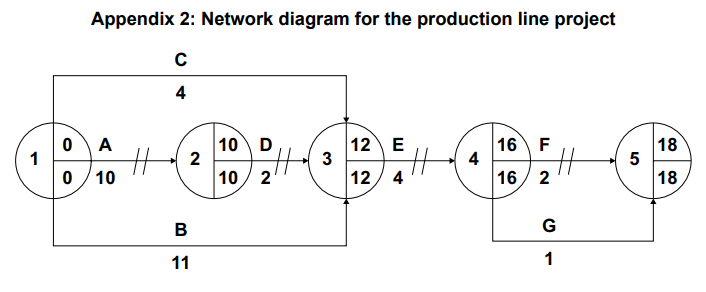

# Exam Questions — Investment Appraisal (A Level)
**5. Finance & Accounting** · Cambridge (CIE) A-LEVEL business (9609)
> Source: [https://www.savemyexams.com/a-level/business/cie/23/topic-questions/](https://www.savemyexams.com/a-level/business/cie/23/topic-questions/) · 18 questions across 1 sets

## Exam Questions (19 questions)

### Q1 — hard — 12 marks

**Q1** [12 marks]

> **[case-study]**
> **Nayland Water**
> 
> Nayland Water designs and installs water treatment systems in country E. It is appraising a new plant costing \$2.4 million with an expected life of ten years.
> 
> The appraisal produces:
> 
> - a net present value of \$410 000 at a discount rate of 8%
> - a payback period of 6 years 2 months
> 
> The forecast assumes revenue grows 5% a year for ten years. Nayland's revenue has grown at 5% a year for the last three years.
> 
> Two of Nayland's four largest contracts are with the government and are re-tendered every three years.
> 
> Nayland's bank has indicated that borrowing costs will rise. At a discount rate of 11%, the net present value becomes negative.
> 
> The treatment technology used in the plant is expected to be superseded within about eight years.

Evaluate whether Nayland Water can rely on its investment appraisal when deciding to proceed with the new plant.

### Q2 — hard — 12 marks

**Q2** [12 marks]

> **[case-study]**
> **Radlett Timber**
> 
> Radlett Timber runs a sawmill in country S, employing 60 people. It is the largest employer in its town. Its customers are furniture makers who buy from Radlett because it supplies hand-finished, made-to-order timber.
> 
> Radlett is choosing between two investments:
> 
> - **Option 1: an automated cutting line.** Net present value \$620 000. It would replace 22 of the 60 workers and produces standard sizes only.
> - **Option 2: upgrading the existing line.** Net present value \$310 000. No redundancies.
> 
> Radlett's directors promised employees in 2025 that there would be no compulsory redundancies before 2028.
> 
> The automated line's net present value assumes the mill runs at 85% capacity. Over the last three years Radlett has averaged 68%.

Evaluate whether Radlett Timber should choose the automated cutting line rather than upgrading its existing line.

### Q3 — hard — 12 marks

**Q3** [12 marks]

> **[case-study]**
> **Torrin**
> 
> Torrin hires out excavators and diggers to builders in country N. It is choosing between two machines, each costing \$240 000.
> 
> **Table 1.1 Forecast net cash inflows (\$)**
> 
> |   | Machine A | Machine B |
> |---|---|---|
> | Year 1 | 110 000 | 40 000 |
> | Year 2 | 100 000 | 60 000 |
> | Year 3 | 40 000 | 90 000 |
> | Year 4 | 20 000 | 120 000 |
> | Year 5 | 10 000 | 140 000 |
> 
> Torrin's finance director appraises every project using payback alone, and applies a rule that an investment must pay back within three years. Machine A pays back in 2 years 9 months and Machine B in 3 years 5 months.
> 
> Torrin has an overdraft of \$90 000 which its bank has asked it to reduce. Machine B is a newer model with lower emissions, and country N introduces emissions rules for hire equipment in 2029.
> 
> Torrin's owner says the business has always used payback and it has never let them down.

Evaluate whether Torrin should continue to rely on the payback method when choosing between the two machines.

### Q4 — easy — 3 marks

**Q4** [3 marks]

Explain **one** reason why a business might use more than one investment appraisal method.

### Q5 — easy — 3 marks

**Q5** [3 marks]

Explain **one** qualitative factor a business should consider before making a major investment.

### Q6 — easy — 3 marks

**Q6** [3 marks]

Explain what a positive net present value tells a business about an investment.

### Q7 — easy — 3 marks

**Q7** [3 marks]

Explain why a business discounts future cash flows when appraising an investment.

### Q8 — easy — 2 marks

**Q8** [2 marks]

Define the term 'net present value'.

### Q9 — easy — 3 marks

**Q9** [3 marks]

Explain **one** limitation of the accounting rate of return.

### Q10 — easy — 2 marks

**Q10** [2 marks]

Define the term 'accounting rate of return'.

### Q11 — easy — 3 marks

**Q11** [3 marks]

Explain **one** advantage to a business of using the payback method.

### Q12 — easy — 2 marks

**Q12** [2 marks]

Define the term 'payback period'.

### Q13 — easy — 3 marks

**Q13** [3 marks]

Explain why a business carries out investment appraisal before committing to a major project.

### Q14 — medium — 3 marks

**Q14** [3 marks]

**Extract:**

**KOPARA BEVERAGES (KB)**

**Background**

Kopara Beverages (KB) is a private limited company based in country P. It manufactures and sells premium fruit juices and plant-based drinks, including cold-pressed juices, coconut water blends, and protein smoothies. Founded 15 years ago by entrepreneur Lily Sato, KB now employs 400 workers in one large production facility in country P.

KB sells its products domestically and has recently begun exporting to country Q, where demand for healthy, natural drinks is growing rapidly. KB's mission is 'to bring nutritious, sustainably produced beverages to customers across the world'.

**Organisational Structure**

Two years ago, KB moved from a centralised management structure to a decentralised one, giving production and marketing managers greater autonomy over day-to-day decisions. Lily believes the change has increased innovation and improved employee morale.

However, KB's Finance Director has raised concerns about inconsistent financial decisions being made across departments and a lack of coordinated budgeting.

**Investment Projects**

To meet growing demand from country Q, KB is evaluating two investment projects. Table 1 shows data for Project A. Table 2 shows projected annual net cash flows and discount factors for Project B.

**Table 1: Project A — New Production Line**

| Initial investment (\$000) | 500 |
|---|---|
| Useful life | 4 years |
| Residual value at end of useful life (\$000) | 0 |
| Estimated annual profit (\$000) | 80 |

**Table 2: Project B — Automated Bottling System**

| **Year** | **Net Cash Flow (\$000)** | **Discount Factor (10%)** | **Present Value (\$000) ** |
|---|---|---|---|
| 1 | 100 | 0.909 | 90.9 |
| 2 | 120 | 0.826 | 99.1 |
| 3 | 150 | 0.751 | 112.7 |
| 4 | 80 | 0.683 | 54.6 |
| **Total present value (\$000)** |   |   |   |
| **Initial investment (\$000)** |   |   | **340** |
| **Net present value (NPV) (\$000)** |   |   |   |

**Financial Performance**

KB's Finance Director has produced financial data for 2022 and 2023 to allow comparison of the business's performance. Table 3 shows selected financial data.

**Table 3: KB selected financial data**

|   | **2023 (\$000)** | **2022 (\$000)** |
|---|---|---|
| Revenue | 8,500 | 7,200 |
| Net profit | 510 | 576 |
| Share capital | 1,500 | 1,500 |
| Retained earnings | 700 | 600 |
| Long-term borrowings | 800 | 300 |

**Competitive Pressures**

The domestic market for beverages in country P has become increasingly competitive. Several large multinational companies (MNCs) have entered the market with similar healthy drink products, often at significantly lower prices than KB. KB's share of the domestic market has fallen from 18% to 14% over the past two years.

KB's Marketing Director is recommending that KB invests in product innovation — developing new flavours, new formats, and stronger branding — to differentiate its products from MNC rivals and justify its premium price.

The Finance Director disagrees, believing that KB must reduce prices to remain competitive and maintain market share.

KB's export revenue from country Q has grown by 35% in the past year. Country Q has a growing middle-class population with rising health awareness and disposable income. Lily is considering whether KB should seek additional long-term finance to accelerate its expansion into country Q.

Read the [insert ](https://cdn.savemyexams.com/uploads/2026/04/45237-Insert%20-%20CIE%20A%20Level%20Business%20Paper%203%20Insert%20Practice%20Set%202.pdf)before answering questions 3a, 3b and 3c

Calculate the average rate of return (ARR) for Project A.

### Q15 — medium — 3 marks

**Q15** [3 marks]

**Extract:**

## MERIDIAN TECHNOLOGIES (MT)

**Background**

Meridian Technologies (MT) is a private limited company based in country K. It designs and manufactures smart home devices, including wireless speakers, smart thermostats, and home security systems.

MT was founded 12 years ago by entrepreneur Hana Park and has grown to employ 850 workers across two manufacturing facilities in country K.

MT sells its products domestically and exports to several countries in Asia and Europe. Competition in the smart home device market is intense. MT faces growing pressure from several large multinational companies (MNCs) that compete aggressively on price and brand recognition.

**Organisational Change**

Until two years ago, MT operated with a flat organisational structure in which considerable authority was delegated to regional managers. Following a period of rapid growth, Hana decided to restructure the business, reducing the number of management levels and centralising all major decision-making at head office.

The restructuring has not been universally welcomed. A recent internal employee survey found that 64% of workers felt less motivated since the change was introduced. Three experienced regional managers left the business within six months of the restructuring being implemented.

**Expansion Plans**

MT is planning to expand its production capacity and is evaluating two investment projects. Table 1 shows data for Project A. Table 2 shows the projected annual net cash flows for Project B.

**Table 1: Project A — Automated Production Line**

| Initial investment (\$) | 600,000 |
|---|---|
| Useful life | 5 years |
| Residual value at end of useful life (\$) | 0 |
| Estimated annual profit (\$) | 120,000 |

**Table 2: Project B — Expansion of Existing Facility**

| **Year** | **Net cash flow (\$)** |
|---|---|
| 1 | 80,000 |
| 2 | 100,000 |
| 3 | 120,000 |
| 4 | 150,000 |
| 5 | 100,000 |
| **Initial investment** | **400,000** |

**Export Markets and Exchange Rates**

MT currently generates 40% of its revenue from exports. Approximately 60% of MT's export revenue is earned in euros (€). In the past 12 months, country K's currency has strengthened significantly against the euro, rising in value by 15%.

Table 3 shows MT's revenue by market for the year ended December 2023.

**Table 3: MT Revenue by Market (year ended December 2023)**

| **Market** | **Revenue (\$000)** |
|---|---|
| Country K (domestic) | 6,200 |
| Europe | 2,800 |
| Asia | 1,300 |
| **Total** | **10,300** |

**Pricing Strategy**

MT's Finance Director has suggested reducing the selling price of the smart thermostat in order to increase market share and compete more effectively against MNC rivals. Table 4 shows the relevant pricing and demand data.

**Table 4: Smart Thermostat — Pricing and Demand Data**

| Current selling price (\$) | 80 |
|---|---|
| Current annual sales (units) | 50,000 |
| Proposed new selling price (\$) | 72 |
| Forecast annual sales at new price (units) | 57,500 |

**Corporate Social Responsibility**

MT sources many of its components from suppliers based in country L, where labour costs are significantly lower than in country K. A pressure group called EthicsWatch has recently published a report claiming that some of MT's suppliers in country L use poor working conditions and pay employees below the minimum wage. The report has received widespread media coverage in country K and has been shared extensively on social media.

Hana is considering whether to introduce a formal corporate social responsibility (CSR) strategy. This would include auditing all of MT's suppliers in country L and switching to certified ethical suppliers where necessary. MT's operations director estimates that this would increase raw material costs by approximately 12%.

Read the [insert ](https://cdn.savemyexams.com/uploads/2026/04/52945-Insert%20-%20Paper%203%20Business%20Decision-Making%20%E2%80%94%20Practice%20Paper%20Set%201.pdf)before answering this question.

Calculate the average rate of return (ARR) for Project A.

### Q16 — medium — 3 marks

**Q16** [3 marks]

**Extract:**

**Pizza Adventure Company (PAC) **

PAC is a private limited company which owns restaurants. It was started ten years ago in a large city in country X, which is located in Asia. The business was set up by Paulo who had moved to country X from Italy with his parents to start a farm. Paulo soon decided to move to the city where he observed the growing popularity of international food. He decided that he could adapt traditional pizza recipes to appeal to the tastes of Asian customers. This would also attract the increasing numbers of tourists visiting the city. PAC has grown very fast and now owns 10 restaurants throughout country X, in major cities and tourist resorts. The restaurants are managed by local employees. Their performance is assessed by Paulo and his brother Gio, the directors of PAC. Planning and resource management is supported by enterprise resource planning (ERP) software throughout the company. Economic environment The economy of country X has grown in recent years and average incomes are rising by 5% per year. Annual inflation is steady at 4% and unemployment is falling, especially in the cities. Changes in government policy have led to the currency exchange rate of country X appreciating (increasing in value) against other major currencies. The government of country X sees overseas tourists as an economic benefit, so it has lifted travel restrictions and launched a worldwide advertising campaign to encourage visitors. Products and services PAC restaurants sell a wide range of pizzas and other foods, such as salads. Customers have a wide choice of ingredients and toppings for their pizza. Many of these ingredients and toppings are grown or produced at Paulo’s own family farm. This business model has proved very popular and the restaurants are full most lunchtimes and evenings. PAC also offers a takeaway service that enables customers to order by phone or online using an App. Food delivery is outsourced to a specialist company which uses motorbikes to avoid the problem of heavy traffic in the cities. Marketing Paulo’s daughter, Alice, is responsible for marketing. She has talked to Paulo about increasing the range of food available in the restaurants, as she believes that the market for pizza in country X is approaching the maturity stage. In addition, competition is increasing with several multi-national pizza companies starting up in country X. Alice would like PAC to serve a wider range of vegetarian options and many more salads, as well as the pizzas. She has noticed increasing numbers of online articles about the need to eat a healthy diet, with pizzas often mentioned as examples of unhealthy food items. Alice wants to launch a new ‘healthy life’ range of meals at two of the biggest restaurants to test the market. The target market for the new range will be young professionals trying to lead a healthy lifestyle. Alice has used her skills as an ICT graduate to build a website for PAC, which she now maintains on a daily basis, including news on new products, special offers and customer reviews. PAC restaurants have received many excellent reviews on travellers’ websites as well as in local newspaper articles and tourism guides.

Finance PAC’s profits have increased every year. Paulo has always reinvested most of the profit back into the company, after paying dividends to himself and other family shareholders. Paulo has also financed the purchase of some of PAC’s restaurants through loans from banks. Financial data for PAC is shown in Appendix 1. A new project Paulo has identified the rising popularity of ‘street food’ being sold by mobile vendors at events and markets. He would like to import four pizza vans in 2020, equipped with ovens. Pizzas can then be prepared and sold wherever the vans are taken. The total investment will be \$50000 per van. Each van will cost \$2000 per year to maintain. Paulo plans to purchase the vans using a bank loan. However, Gio is worried about PAC taking on further non-current liabilities. The data for the proposed pizza van project is shown in Appendix 2 and Appendix 3. Human resource and quality issues The restaurant managers have a wide range of delegated powers, including employee recruitment and food ordering, according to the individual restaurant sales. Paulo promotes teamwork in each location. All employees are provided with a uniform and given a free meal at the end of their duty hours. Restaurant opening times are long, requiring careful workforce planning. PAC employees have different employment contracts. Restaurant managers are full-time, permanent employees. Most waiting staff have flexible, part-time contracts. Labour turnover rates are high because restaurant work is demanding and pressurised, with some leavers saying they feel ‘undervalued’. Paulo and his management team try to ensure that food and quality service standards are consistently high in all PAC restaurants. All ingredients are stored carefully and used while still fresh. However, recently there have been an increasing number of customer complaints about the quality of service at two PAC restaurants. A customer has also complained that they became very ill after eating a pizza at a PAC restaurant. She claimed that the food had not been cooked thoroughly. The manager of the restaurant did not take this complaint seriously and she did not inform Gio and Paulo about it. Further expansion Paulo would like to expand PAC further with the aim of increasing return on capital employed. He is planning to meet with his management team to consider two opportunities. Only one strategy will be chosen. A summary of research data is shown in Appendix 4. Option 1: Purchase of ‘Healthy Juice’ bar business Take over ownership of a business which operates two ‘Healthy Juice’ bars in shopping malls in country X. Option 2: Sell franchises of PAC restaurants in countries Y and Z Sell franchises of the PAC restaurant model in neighbouring countries Y and Z. This would require the establishment of a central head office to administer the franchised outlets. Ingredients would be sourced from local suppliers.

Appendix 1: Financial data for PAC (\$m) Actual data for 2019 Forecast for 2020 (without new pizza van investment) Revenue 5.2 5.3 Cost of sales 1.3 1.5 Labour costs 1.5 1.7 Marketing and administration costs 0.7 0.8 Other expenses 1.1 1.1 Non-current liabilities 4.9 4.8 Capital employed 10 10 Appendix 2: Financial data for pizza van project Year Net cash flow (\$000) Discount factors at 8% 0 (200) 1 1 70 0.93 2 70 0.86 3 80 0.79 4 80 0.74 Appendix 3: Forecast data for each pizza van in 2021, prepared by Gio Forecasted number of customers 6000 Average spend per customer \$7.00 Average variable cost per customer \$2.50 Labour costs \$12000 Van operating costs including maintenance \$3500

Appendix 4: Research data for Options 1 and 2 Option 1 Purchase of ‘Healthy Juice’ bar business Option 2 Sell franchises of PAC restaurants in countries Y and Z Initial cost \$0.75m \$0.5m Timescale needed for implementation 3 months 1–2 years Probability of success 0.85 0.55 Main driving forces • Widen PAC product portfolio • Widen market and extend reach of PAC brand • Use of PAC core competency • Become an international company and brand name Main restraining force • Lack of familiarity with juice products and shopping mall environment • Increasing local and international competitors • Lack of familiarity with franchising and countries Y and Z • Difficult to control franchisees outside country X Position on Ansoff matrix New product, existing market Existing product, new market

Read the following [extract ](https://www.savemyexams.com/a-level/business/cie/past-papers/paper/ppr_7KtnPqWVY4HFRSHC/?pdf=https%3A%2F%2Fpastpapers.papacambridge.com%2Fdirectories%2FCAIE%2FCAIE-pastpapers%2Fupload%2F9609_s20_in_33.pdf&type=resource&resourceIndex=0)(Appendix 2) before answering

Calculate the forecast net present value (NPV) of the proposed pizza van project over four years.

*Source: June 2020 Paper 33 Q4A*

### Q17 — medium — 3 marks

**Q17** [3 marks]

**Extract:**

**World Spices Corporation (WSC) **

World Spices Corporation (WSC) is based in country X, which uses the dollar (\$) as its currency. WSC was started 20 years ago by Max Cole. His daughters Suki and Dasha, together with a board of directors now manage the company. It converted to a public limited company in 2009. The Cole family has a controlling interest, owning 55% of the shares. WSC imports raw spices from many countries, including the US and India. WSC processes the raw spices into a range of products, including single and mixed spices for cooking and spiced sauces, dips and relishes. Recipes for these products are kept secret. The exact details are only known to Suki, Dasha and the Operations Director. These recipes are important intellectual property of the company. WSC markets its products as ‘fair trade’ and publicises that fair prices are paid to spice growers. WSC also claims to monitor working conditions and employment practices of its suppliers. This is difficult due to the fact that growers are in remote locations around the world. The WSC brand name is recognised globally. Products are sold globally to both food manufacturing businesses and retailers. WSC has grown very fast due to the increasing popularity of spicy food in developed countries. WSC built a new factory to meet this demand. The final stage of spice processing is highly automated, using computer aided machinery (CAM). Economic environment Country X’s economy is slowly recovering from recession. Economic growth is forecast to be 2% this year and unemployment is falling. The \$ in country X has appreciated against other major currencies in recent years. The demand for WSC’s products from different countries fluctuates for many reasons, including changes in foreign exchange rates. Table 1: Annual changes in demand for WSC’s products (%) Area 2018 2019 2020 Europe +10 +8 +5 US +14 +9 –3 Asia +8 +5 –2 Others +5 +4 –1 Marketing WSC sells mainly to business customers and marketing communications are all online. WSC uses social media to keep in touch with business customers. Its website publicises products to both businesses and consumers. The website also has a range of recipes using WSC’s spices, which are updated regularly to encourage users to visit regularly

The ready meals project WSC’s marketing department has investigated demand for ‘ready meals’. These are pre-cooked meals that are sold ready prepared and packaged. Customers will be able to heat the ready meals quickly using an oven or microwave. Demand for spicy ready meals is growing quickly, especially in Asian markets. Reaction to WSC’s new ready meals has been very positive in focus group tasting sessions. The factory extension and new production equipment necessary for the ready meals project will cost \$1.5m. In addition, WSC’s Marketing Director has requested a launch marketing budget of \$750000 to increase customers’ awareness of the new products. WSC plans to distribute these ready meals through supermarkets. A coordinated marketing strategy will be needed for the new ready meals. Table 2 shows investment appraisal data for the ready meals project. Table 2: Investment appraisal data for the ready meals project Year Net cash flow \$m Discount factors at 6% 0 (1.5) 1 1 0.30 0.94 2 0.55 0.89 3 0.60 0.84 4 0.60 0.79 5 0.60 0.75

Finance WSC financed its growth with retained profits and a bank loan of \$10m. Dividend payments to investors have remained stable and comparable to companies in the same industry. Suki and Dasha would like to finance the new ready meals project by offering new shares for sale to existing shareholders (a rights issue), instead of more bank borrowing. Financial data for WSC is shown in Table 3. Table 3: Financial data for WSC 2019 (\$) 2020 (\$) Revenue 21.5m 23.5m Cost of raw materials 10.0m 11.0m Direct labour costs 2.6m 2.8m Marketing and administration costs 1.6m 1.7m Other expenses 1.0m 1.1m Operating profit 6.3m 6.9m Profit after tax and interest 4.8m 5.9m Non-current liabilities 10.0m 10.0m Capital employed 24.0m 25.0m Total annual dividends 3.5m 3.4m Share price at year end 12.00 11.00 Dividend per share 1.50 1.45 Human resources and operations Production workers, who maintain the taste and quality of the spice products, are highly skilled and important to the business. They are able to detect small differences in the products by regular tasting. The directors are worried that labour turnover has increased recently. Some experienced employees have moved to companies that offer better chances of promotion. Suki and Dasha would like to increase employee involvement in order to widen employees’ roles and increase labour flexibility. This would be part of a move towards lean production with the aim of making factory operations more efficient. Raw spices lose flavour if inventory is kept for too long and a large amount of space is needed for storage. The current production system leads to high wastage rates of raw materials.

Further developments The directors of WSC would like to expand the company further. There are two possible options. They need to make a strategic choice as it will not be possible to carry out both projects. Option A Take over a small fast food restaurant chain in country X and rebrand it as ‘WSC street food cafés.’ WSC would need to recruit experienced senior staff to manage the street food cafés. They would retain existing fast food chain employees. Option B Extend the WSC product range into drinks for the first time. These would include exclusive recipe tea, coffee and chocolate drink mixes. WSC would need to find suppliers of raw materials and build a new production line. A summary of the information collected so far is shown in Appendix 1. Appendix 1: Research data for Options A and B Option A Take over a small fast food restaurant chain in country X Option B Extend the WSC product range into drinks Initial cost \$3.5m \$2m Estimated time for completion 9 months 1.5 years Main driving forces • WSC expertise in spice recipes • Growing demand for spicy foods • WSC expertise in processing spices • Recognised brand name Main restraining forces • Highly competitive fast food market in country X • WSC lack of knowledge and experience of running street food cafés • WSC lack of knowledge and experience in market for drinks • Need to find reliable suppliers Competitive rivalry • Low supplier power • High threat of substitutes • High supplier power • High threat of substitutes Estimated chances of success 65% 55% Estimated monetary value over five years \$5m \$4m

Read the following [extract ](https://www.savemyexams.com/a-level/business/cie/past-papers/paper/ppr_xX39VSNfF3VMtrBk/?pdf=https%3A%2F%2Fpastpapers.co%2Fcie%2FA-Level%2FBusiness-9609%2F2021-Oct-Nov%2F9609_w21_in_33.pdf&type=resource&resourceIndex=0)(Table 2) before answering

Calculate the forecast net present value (NPV), for the ready meals project.

*Source: November 2021 Paper 33 Q4AI,AII*

### Q18 — medium — 3 marks

**Q18** [3 marks]

**Extract:**

Devonice Ltd (DL) Gabriel Romana founded DL in 2012 in country Y. He used his savings to develop Devonice, a luxury ice cream brand made from natural ingredients. DL started manufacturing ice cream in a small factory in 2013. Organisation and growth DL has grown rapidly. Gabriel has increased the product range with new flavours of ice cream. In 2016, DL opened its second factory and its first Devonice ice cream shop in country Y. At present, most sales are made to supermarkets in country Y. However, Gabriel has plans to open more ice cream shops. He is also considering selling DL franchise agreements to increase export sales. Gabriel enjoys being in control of the business and intends to maintain a centralised structure. Managers of the functional departments report directly to Gabriel and he makes all major decisions. The production line project DL has two factories, operating 24 hours a day. In total, there are 5 production lines and 200 workers able to produce 30 million litres of ice cream per year. Capacity utilisation is currently 90%. To increase capacity and flexibility, Gabriel is considering investing in computerised production lines. Gabriel wants this project completed within 20 weeks in time for the summer season. The operations manager has prepared a critical path analysis (CPA) for the project (see Appendix 1 and Appendix 2). The operations manager is worried about the project. He told Gabriel: ‘This new system is complex and untried. I am also worried about delays and the impact on our workers.’ Estimated net cash flows of the project are shown in Table 1. Table 1: Estimated net cash flows for the new production line project Year Net cash flow (\$m) Discount factor (8%) 0 (2.5) 1 1 0.5 0.93 2 0.8 0.86 3 1.2 0.79 4 1.5 0.74 5 1.5 0.68 A competitive market Devonice is now the market-leading brand in country Y and is exported to 10 other countries. DL’s innovative marketing and high quality product have contributed to sales growth. DL targets young adults and has developed a premium brand image. Promotion includes the use of social media, school sponsorship and celebrity endorsement. DL also donates a share of its profits to environmental charities.

Market conditions in country Y are challenging. A multi-million dollar advertising campaign by a global ice cream brand has increased competition. DL sales have remained stable but market share has fallen. In response, Gabriel is considering reducing the price of Devonice or increasing promotional spending. The marketing department has estimated the promotional elasticity of demand and price elasticity of demand for Devonice. Details are in Table 2. Table 2: Estimated data for Devonice Price elasticity of demand Promotional elasticity of demand Action Reduce price to supermarkets by 8% Increase annual promotional spending by \$0.5m to \$1.75m Outcome Demand increases by 10% Demand increases by 10% The marketing manager recommends reducing price to widen the market appeal of the brand and open up new distribution opportunities. However, Gabriel believes this could damage the brand image. In his opinion, increasing promotional spending is the better decision. Corporate social responsibility (CSR) Despite rising incomes in country Y, there is concern about health related problems due to poor diet. In 2020, a pressure group started a campaign to persuade food manufacturers to take greater responsibility for the impact of their products. The group demanded government action to reduce sales of food products high in sugar and fat by: • regulating product labelling • restricting advertising • introducing a tax on these products. DL could change ingredients to reduce sugar content. However, Gabriel is worried about consumer reaction. DL is also facing pressure to stop using palm oil because of the loss of rainforest associated with its production. Palm oil helps make ice cream smooth and creamy. There are alternatives DL could use, but these are more expensive. Appendix 1: Critical path analysis (CPA) for the production line project Activity Description A Run existing production lines at full capacity to increase inventory for changeover B Order and delivery of ice cream equipment C Order and delivery of packaging equipment D Removal of existing production equipment E Installation of new production equipment F Training of production line workers G Testing of production lines

Read the following [extract ](https://www.savemyexams.com/a-level/business/cie/past-papers/paper/ppr_WRR6Rd9qmYKKgv2g/?pdf=https%3A%2F%2Fwww.cambridgeinternational.org%2FImages%2F596165-2023-specmen-paper-3-insert.pdf&type=resource&resourceIndex=0)(Table 1)before answering

Using the data in Table 1, calculate the payback period for the production line project.

*Source: Specimen 2023 Paper 3 Q3A*

