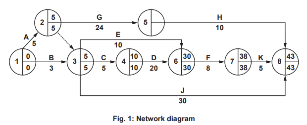

# Exam Questions — Human Resource Strategy (A Level)
**2. Human Resource Management** · Cambridge (CIE) A-LEVEL business (9609)
> Source: [https://www.savemyexams.com/a-level/business/cie/23/topic-questions/](https://www.savemyexams.com/a-level/business/cie/23/topic-questions/) · 18 questions across 1 sets

## Exam Questions (18 questions)

### Q1 — hard — 12 marks

**Q1** [12 marks]

> **[case-study]**
> **Thornbury (TB)**
> 
> Thornbury (TB) supplies gas and electricity to homes in country W. It employs 4,000 people across a head office, three regional centres and a field engineering team.
> 
> TB's HR department keeps personnel records on paper at each location. Holiday requests, training records and absence data are held separately and are not shared between sites.
> 
> **Table 1.1: TB selected data**
> 
> | Employees | 4,000 |
> |---|---|
> | HR staff | 34 |
> | Average time to answer an employee query about pay or holiday (working days) | 6 |
> | Employees whose training records could not be located last year | 310 |
> | Cost of a proposed integrated HR system (\$000) | 1,400 |
> | Estimated annual saving in HR staff time (\$000) | 290 |
> 
> TB's finance director notes that the system would take almost five years to repay its cost.

Evaluate whether TB should invest in an integrated HR system.

### Q2 — hard — 12 marks

**Q2** [12 marks]

> **[case-study]**
> **Kingsmere (KM)**
> 
> Kingsmere (KM) is an estate agency with 31 branches in country B, employing 280 negotiators who value homes and sell them.
> 
> Negotiators are currently judged only on the number of properties they sell each month, and a monthly bonus is paid to the top ten performers.
> 
> **Table 1.1: KM selected data**
> 
> | Branches | 31 |
> |---|---|
> | Negotiators | 280 |
> | Average properties sold per negotiator per month | 3.4 |
> | Properties valued above the eventual selling price (%) | 44 |
> | Sales that fell through before completion (%) | 27 |
> | Customer satisfaction score (out of 10) | 6.4 |
> 
> KM's HR director proposes judging negotiators on a combination of sales completed, valuation accuracy and customer satisfaction.

Evaluate whether KM should change how it measures the performance of its negotiators.

### Q3 — hard — 12 marks

**Q3** [12 marks]

> **[case-study]**
> **Vinehall (VH)**
> 
> Vinehall (VH) provides catering for weddings, conferences and corporate events in country R. Demand is highly seasonal, with around 60% of its work falling between May and September.
> 
> VH employs 90 permanent staff and takes on up to 400 casual workers during the busy season. Casual staff are recruited afresh each year, given a two-hour briefing, and paid by the shift.
> 
> **Table 1.1: VH selected data**
> 
> | Permanent staff | 90 |
> |---|---|
> | Casual staff at peak | 400 |
> | Share of annual revenue earned May to September (%) | 60 |
> | Casual staff returning from the previous season (%) | 18 |
> | Events receiving a complaint about service (%) | 14 |
> | Cost of proposed training and guaranteed return contracts (\$000 per year) | 620 |
> 
> VH's operations director argues that better-trained returning staff would reduce complaints. VH's finance director argues that casual labour must stay cheap and flexible because demand collapses in winter.

Evaluate whether VH should adopt a softer approach to human resource management.

### Q4 — medium — 8 marks

**Q4** [8 marks]

> **[case-study]**
> **Amberley (AM)**
> 
> Amberley (AM) is a retail bank in country K employing 6,800 people across 240 branches and two head offices.
> 
> AM receives around 19,000 applications a year for its graduate training scheme, from which it recruits 120 trainees. Applications are currently read by a team of eight HR staff.
> 
> AM is considering using an AI system to screen applications and rank candidates before any are read by a person.
> 
> **Table 1.1: AM selected data**
> 
> | Graduate applications per year | 19,000 |
> |---|---|
> | Trainees recruited per year | 120 |
> | HR staff currently screening applications | 8 |
> | Average time from application to first interview (weeks) | 11 |
> | Cost of the AI screening system (\$000 per year) | 210 |
> | Applications the AI system would pass to a person (%) | 15 |

Analyse **two** effects on AM of using an AI system to screen job applications.

### Q5 — medium — 8 marks

**Q5** [8 marks]

> **[case-study]**
> **Bellfield (BF)**
> 
> Bellfield (BF) owns 62 clothing shops in country S and employs 1,100 sales assistants.
> 
> Sales assistants are paid the minimum wage. There is no training after an initial half-day induction, and no route to promotion except waiting for a supervisor to leave.
> 
> **Table 1.1: BF selected data**
> 
> | Shops | 62 |
> |---|---|
> | Sales assistants | 1,100 |
> | Annual labour turnover (%) | 68 |
> | Average length of service (months) | 7 |
> | Sales conversion rate, best shop (%) | 31 |
> | Sales conversion rate, worst shop (%) | 12 |
> 
> BF's new HR director has \$900,000 a year to spend on improving performance.

Analyse **two** ways BF could improve the performance of its sales assistants.

### Q6 — medium — 8 marks

**Q6** [8 marks]

> **[case-study]**
> **Ashford (AF)**
> 
> Ashford (AF) assembles electronic control units for washing machines and ovens in country D. It employs 520 people and supplies four large appliance manufacturers.
> 
> AF's largest customer has warned that it will review the contract unless quality improves.
> 
> **Table 1.1: AF selected data**
> 
> | Employees | 520 |
> |---|---|
> | Units assembled per day | 9,400 |
> | Units failing final inspection (%) | 8 |
> | Units returned by customers after delivery (%) | 2.1 |
> | Cost of rework and replacement last year (\$000) | 780 |
> | Share of revenue from the largest customer (%) | 39 |
> 
> AF's production manager says the failures are concentrated among a group of assemblers who have not met the required standard for several months.

Analyse **two** consequences for AF of poor employee performance.

### Q7 — medium — 8 marks

**Q7** [8 marks]

> **[case-study]**
> **Redwood (RW)**
> 
> Redwood (RW) is an accountancy practice in country H employing 240 accountants across five offices.
> 
> Accountants are currently told at the start of each year that they should "work hard and look after clients". Their pay rise is decided by a partner at the end of the year, and staff say they do not know what the rise is based on.
> 
> **Table 1.1: RW selected data**
> 
> | Accountants | 240 |
> |---|---|
> | Offices | 5 |
> | Accountants saying they understand how their performance is judged (%) | 24 |
> | Annual staff turnover (%) | 27 |
> | Fee income per accountant (\$000) | 96 |
> | Fee income per accountant in the highest-performing office (\$000) | 131 |
> 
> RW's senior partner has proposed introducing Management by Objectives, with each accountant agreeing three measurable objectives with a manager every six months.

Analyse **two** benefits to RW of introducing Management by Objectives.

### Q8 — easy — 3 marks

**Q8** [3 marks]

> **[case-study]**
> **Fernbank (FB)**
> 
> Fernbank (FB) provides IT support to small businesses in country C. It employs 85 technicians who visit customers or resolve problems by telephone.
> 
> FB currently judges technician performance by the number of jobs each one closes per week.
> 
> **Table 1.1: FB selected data**
> 
> | Technicians | 85 |
> |---|---|
> | Average jobs closed per technician per week | 24 |
> | Jobs where the customer contacted FB again about the same problem within a week (%) | 19 |
> | Customer satisfaction score (out of 10) | 6.1 |
> 
> FB's operations manager thinks the current measure may be encouraging technicians to close jobs before problems are properly fixed.

Explain **one** other way FB could measure the performance of its technicians.

### Q9 — easy — 3 marks

**Q9** [3 marks]

Explain **one** benefit to a business of using artificial intelligence in human resource management.

### Q10 — easy — 3 marks

**Q10** [3 marks]

Explain **one** way information technology is used in human resource management.

### Q11 — easy — 3 marks

**Q11** [3 marks]

> **[case-study]**
> **Larkspur (LS)**
> 
> Larkspur (LS) operates 46 travel agency branches in country W, employing 390 consultants who sell holidays to walk-in customers.
> 
> Consultants are paid a fixed salary. Their performance is reviewed once a year in a meeting with a branch manager, and no targets are set between reviews.
> 
> **Table 1.1: LS selected data**
> 
> | Branches | 46 |
> |---|---|
> | Consultants | 390 |
> | Average sales per consultant per week (\$) | 4,100 |
> | Sales per consultant in the best-performing branch (\$) | 7,300 |
> | Consultants saying their annual review was useful (%) | 19 |
> 
> LS's HR director has proposed introducing quarterly objectives agreed between each consultant and their manager.

Explain **one** way LS's proposal could improve employee performance.

### Q12 — easy — 3 marks

**Q12** [3 marks]

> **[case-study]**
> **Eastvale (EV)**
> 
> Eastvale (EV) operates a warehouse in country S, packing and dispatching online orders. It employs 480 staff, of whom 310 are on temporary contracts.
> 
> Staff are set an individual target of 140 items packed per hour. A screen above each packing station shows how each worker is performing against that target.
> 
> **Table 1.1: EV selected data**
> 
> | Employees | 480 |
> |---|---|
> | Staff on temporary contracts | 310 |
> | Target items packed per hour | 140 |
> | Average items packed per hour | 112 |
> | Orders returned because of packing errors (%) | 6 |
> | Staff leaving within their first three months (%) | 41 |
> 
> Temporary staff receive one morning of training before starting work.

Explain **one** cause of poor employee performance at EV.

### Q13 — easy — 2 marks

**Q13** [2 marks]

Define the term 'flexi-time'.

### Q14 — easy — 2 marks

**Q14** [2 marks]

Define the term 'labour productivity'.

### Q15 — easy — 2 marks

**Q15** [2 marks]

Define the term 'Management by Objectives'.

### Q16 — easy — 2 marks

**Q16** [2 marks]

Define the term 'zero hours contract'.

### Q17 — easy — 2 marks

**Q17** [2 marks]

Define the term 'hard HRM'.

### Q18 — medium — 8 marks

**Q18** [8 marks]

**Extract:**

Urban Bee Hive (UBH) Co-working After Amit Menda graduated from university, he started work for a business in the US. The business specialised in designing workplace environments that aim to improve productivity. Whilst working in the US, Amit observed the growth of co-working. Co-working provides office space and support services for businesses. It offers a flexible solution for businesses which need an alternative to traditional long-term leasing or ownership of office space. In 2018, using his knowledge and experience, Amit founded UBH, a private limited company. It is based in country W, where co-working is still a relatively new idea. UBH focuses on providing office space to entrepreneurs and small businesses as and when they demand it. UBH calls its co-working centres ‘beehives’. There are three shareholders in UBH, all of whom are directors. Amit owns 50% of the shares while the other two shareholders own 25% each. A difficult economic climate Until 2020, UBH’s expansion was rapid. This internal growth was mainly financed by bank loans. However, in 2020 UBH came close to failing. There was a recession in country W when economic output fell by 10%. Many of UBH’s small business customers became insolvent during the recession. UBH was left with significant unused capacity and almost no working capital. The government responded quickly to the recession and made the following changes to its economic policies: • increased investment in infrastructure including road and rail transport • reduced income tax • reduced central bank interest rates • delayed payment of business and property taxes. Amit believes that without these changes to economic policies UBH would have failed. Marketing strategy UBH’s marketing strategy has targeted entrepreneurs starting new businesses and small, established businesses. Each UBH co-working centre (beehive) provides customers with shared kitchen facilities and snack vending machines. Customers are offered flexible contracts from 1 day to 1 year. They can either lease a hot desk (any desk available that day), a dedicated desk (the same desk for the duration of the contract) or a private office. Customers can also rent meeting rooms of various sizes by the hour. All customers benefit from unlimited internet access and printing facilities.

The Marketing Director has produced a situational analysis for the Board of Directors to consider. Selected details are given below. • In 2020, capacity utilisation fell to a low of 50%. • During 2021, following the recession, UBH opened 3 new beehives. UBH now has 10 beehives in country W. • In 2021, two international corporations entered the market in direct competition with UBH. • Customer feedback shows a high level of satisfaction with UBH’s facilities. • Customer feedback rates price, flexible contracts and distance from key transport hubs as the three most important factors in choosing a co-working centre. • Price elasticity of demand for leasing desks is estimated to be –0.5. • Most new business start-ups are unaware of the benefits of co-working. • Social media advertising has been the most cost-effective method of attracting customers. • Some larger businesses, including multinationals, make use of co-working centres in country W. However, they demand premium facilities and more space per desk than UBH currently provide. • Forecast market growth for co-working in country W in 2023 is 10%. Table 1: Price per month for leasing desks at UBH and market leader UBH (\$) Market leader (\$) Hot desk 150 140 Dedicated desk 300 280 Private office 2500 2300 Amit is concerned that capacity utilisation across UBH’s 10 beehives averages 80% compared to the target of 100%. He has asked the marketing department to propose changes to the marketing strategy to increase sales and reach target capacity. Managing co-working centres and Human Resource Management (HRM) Amit has delegated authority to centre managers to make decisions about local advertising, day-to-day operational issues and hiring of employees such as cleaners, IT technicians and security. Each UBH beehive also has a customer relationship manager. UBH encourages its beehives to hold special events to promote their facilities and increase customer interaction. Recent events include educational talks and business advice sessions. UBH employees have flexible employment contracts. Employees can spend 5% of their time working on individual projects of interest. All new recruits receive extensive training. UBH’s vision includes ‘Our people are our greatest strength and we are committed to providing opportunities for each individual to fulfil their potential. Our team is energetic with an entrepreneurial spirit, ready to face challenges.’

Beehive 811 UBH is scheduled to open its new centre, Beehive 811, very soon. The Operations Director prepared a network analysis at the start of this project and predicted it would finish within Amit’s deadline of 45 days. Table 2 and Fig. 1 provide details of the network analysis and diagram. Table 2: Network analysis Activity Activity detail Preceding activities Duration (days) A Agree and sign lease with landlord None 5 B Draft building plans None 3 C Order and delivery of building materials A & B 5 D Building work and inspection C 20 E Order and delivery of office equipment A & B 10 F Installation of office equipment D & E 8 G Employee recruitment A 24 H Employee training G 10 J Initial marketing of centre A & B 30 K Fire inspection and certificate F 5

The project started 10 days ago. The delivery of office equipment is delayed by 12 days. Amit is concerned that any delay in opening will lead to a loss of income if prospective customers decide to go elsewhere.

Going public? After making a loss in 2020, UBH returned to profit in 2021. UBH has ambitious expansion plans for the next 18 months. As well as opening Beehive 811, UBH is aiming to open 3 more centres in 2022 and 10 more in 2023. Office buildings are expensive in country W so UBH uses a combination of long-term leases and joint investments with landlords to reduce cash outflows. UBH will need to invest \$16m to finance this expansion. Amit is in favour of changing UBH to a public limited company (plc). UBH could offer its shares for sale to the public by early 2023. The other two shareholders warned Amit that the cost of a stock exchange flotation is likely to be very high. The Finance Director predicts that interest rates in country W will increase from 2% to 4% by 2023. Table 3 provides data from UBH’s latest financial statements. Table 3: Extracts from UBH’s financial statements 2021 (\$m) 2020 (\$m) Income statement Revenue 14.4 6 Profit/loss for the year 1.5 (3) Dividends paid 0.5 0.2 Statement of financial position (at end of year) Non-current liabilities 12 9 Share capital 2 2 Retained earnings 3.5 2.5 Trade receivables 1.1 0.7 Cash and cash equivalents 0.7 0.1 Current liabilities 3 4.5

Strategies for the future Amit conducted a strategic analysis of UBH to identify strategic options. A summary of Porter’s Five Forces for option 2 is shown in Appendix 1. The board has to make a decision between the following two strategic options. Strategic option 1: Expand into country Z Open beehives which offer the same facilities as those in country W. Economic growth in country Z is high. There are few businesses offering co-working centres in country Z. Strategic option 2: Target large business customers in country W Develop high specification beehives to attract multinational and other large business customers. Premium facilities will be required and centres will need to be located near international transport hubs within country W. Table 4 contains a summary of strategic choice technique data. Table 4: Summary of data from strategic choice techniques over 5-year period Strategic option 1: Expand into country Z Strategic option 2: Target large business customers in country W Driving forces • Rapid economic growth • Multinational investment in country W Restraining forces • Political instability • High cost • Brand development required Capital cost \$6m \$10m Accounting rate of return (ARR) 10% 15% Decision tree: Expected monetary value Probability of success \$2m 60% \$6m 70%

Appendix 1: Porter’s Five Forces for option 2: Target large business customers in country W Threat of new entrants • High capital costs to enter market • High product differentiation Buyer power • Limited land available for expansion Threat of substitutes • Substitute services available from landlords, hotels and conference centres • Digital technologies offer new ways of working Supplier power • Corporate clients have financial power

Read the following [extract ](https://www.savemyexams.com/a-level/business/cie/past-papers/paper/ppr_J9J9rt82ykwrKWXX/?pdf=https%3A%2F%2Fpastpapers.papacambridge.com%2Fdirectories%2FCAIE%2FCAIE-pastpapers%2Fupload%2F9609_m22_in_32.pdf&type=resource&resourceIndex=0)before answering.

Analyse **two **benefits to UBH of its approach to human resource management (HRM).

*Source: March 2022 Paper 32 Q1*

