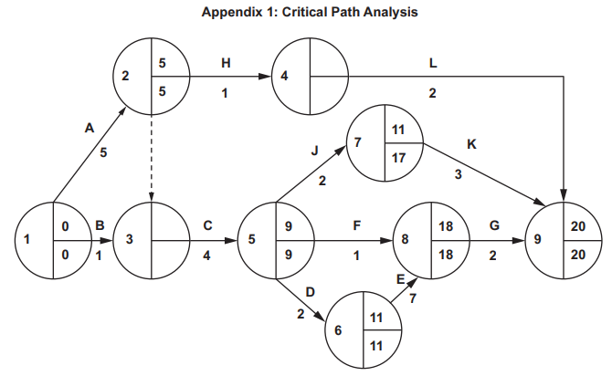
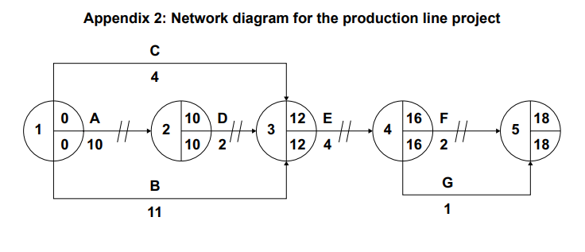

# Exam Questions — Organisational Structure (A Level)
**2. Human Resource Management** · Cambridge (CIE) A-LEVEL business (9609)
> Source: [https://www.savemyexams.com/a-level/business/cie/23/topic-questions/](https://www.savemyexams.com/a-level/business/cie/23/topic-questions/) · 20 questions across 1 sets

## Exam Questions (20 questions)

### Q1 — medium — 8 marks

**Q1** [8 marks]

> **[case-study]**
> **Chapter House (CH)**
> 
> Chapter House (CH) owns 31 bookshops in country W and employs 380 people.
> 
> CH's founder, Mira, still approves every stock order, every price reduction and every request for local advertising. Shop managers must email her and wait for a reply.
> 
> **Table 1.1: CH selected data**
> 
> | Shops | 31 |
> |---|---|
> | Employees | 380 |
> | Average time for a shop manager to receive a decision from Mira (working days) | 6 |
> | Shop manager turnover in the past year (%) | 29 |
> | Shops whose manager has more than five years' experience | 22 |
> 
> Mira works around 70 hours a week and says she no longer has time to plan CH's expansion into two new cities.
> 
> Several shop managers have said they could choose local stock better than head office, because they know which authors sell in their own town.

Analyse **two** benefits to CH of Mira delegating more decisions to her shop managers.

### Q2 — easy — 3 marks

**Q2** [3 marks]

Explain **one** reason why a business might change its organisational structure.

### Q3 — easy — 3 marks

**Q3** [3 marks]

> **[case-study]**
> **Greenway (GW)**
> 
> Greenway (GW) maintains parks and business grounds in country F. It employs 140 people working in 18 teams across the country.
> 
> GW's owner, Marcus, requires every team leader to send him photographs of completed work and to telephone him before buying materials costing more than \$50.
> 
> Team leaders say the calls waste time, particularly when a job needs a part urgently. Three team leaders have left in the past year, two of them saying they were not trusted to do their jobs.
> 
> Marcus says he has seen work done badly in the past and cannot risk GW's reputation.

Explain **one** conflict between control and trust in the way Marcus delegates.

### Q4 — easy — 3 marks

**Q4** [3 marks]

Explain **one** difference between a line function and a staff function.

### Q5 — easy — 3 marks

**Q5** [3 marks]

> **[case-study]**
> **Fairstone (FS)**
> 
> Fairstone (FS) is an insurance company in country Y employing 2,400 people. It has nine levels of hierarchy between the chief executive and the staff who deal with customers.
> 
> A customer wanting to claim more than \$5,000 must have the claim approved at four separate levels.
> 
> FS's average time to settle a claim is 34 days. Two newer insurance companies in country Y settle claims in under a week, and have taken 6% of FS's market share in three years.

Explain **one** drawback to FS of its hierarchical structure.

### Q6 — easy — 3 marks

**Q6** [3 marks]

> **[case-study]**
> **Rosemont (RM)**
> 
> Rosemont (RM) manufactures skincare products in country H. It employs 260 people and sells to pharmacies and department stores.
> 
> RM is organised into four departments: production, marketing, finance, and human resources. Each is led by a director who reports to the managing director.
> 
> Staff in each department work only within their own specialism. RM's chemists all sit within production, and its designers all sit within marketing.
> 
> RM's managing director says the arrangement means she always knows who is responsible for what.

Explain **one** benefit to RM of a functional structure.

### Q7 — easy — 2 marks

**Q7** [2 marks]

Define the term 'decentralisation'.

### Q8 — easy — 2 marks

**Q8** [2 marks]

Define the term 'matrix structure'.

### Q9 — easy — 2 marks

**Q9** [2 marks]

Define the term 'authority'.

### Q10 — easy — 2 marks

**Q10** [2 marks]

Define the term 'delegation'.

### Q11 — easy — 2 marks

**Q11** [2 marks]

Define the term 'span of control'.

### Q12 — medium — 8 marks

**Q12** [8 marks]

**Extract:**

**KOPARA BEVERAGES (KB)**

**Background**

Kopara Beverages (KB) is a private limited company based in country P. It manufactures and sells premium fruit juices and plant-based drinks, including cold-pressed juices, coconut water blends, and protein smoothies. Founded 15 years ago by entrepreneur Lily Sato, KB now employs 400 workers in one large production facility in country P.

KB sells its products domestically and has recently begun exporting to country Q, where demand for healthy, natural drinks is growing rapidly. KB's mission is 'to bring nutritious, sustainably produced beverages to customers across the world'.

**Organisational Structure**

Two years ago, KB moved from a centralised management structure to a decentralised one, giving production and marketing managers greater autonomy over day-to-day decisions. Lily believes the change has increased innovation and improved employee morale.

However, KB's Finance Director has raised concerns about inconsistent financial decisions being made across departments and a lack of coordinated budgeting.

**Investment Projects**

To meet growing demand from country Q, KB is evaluating two investment projects. Table 1 shows data for Project A. Table 2 shows projected annual net cash flows and discount factors for Project B.

**Table 1: Project A — New Production Line**

| Initial investment (\$000) | 500 |
|---|---|
| Useful life | 4 years |
| Residual value at end of useful life (\$000) | 0 |
| Estimated annual profit (\$000) | 80 |

**Table 2: Project B — Automated Bottling System**

| **Year** | **Net Cash Flow (\$000)** | **Discount Factor (10%)** | **Present Value (\$000) ** |
|---|---|---|---|
| 1 | 100 | 0.909 | 90.9 |
| 2 | 120 | 0.826 | 99.1 |
| 3 | 150 | 0.751 | 112.7 |
| 4 | 80 | 0.683 | 54.6 |
| **Total present value (\$000)** |   |   |   |
| **Initial investment (\$000)** |   |   | **340** |
| **Net present value (NPV) (\$000)** |   |   |   |

**Financial Performance**

KB's Finance Director has produced financial data for 2022 and 2023 to allow comparison of the business's performance. Table 3 shows selected financial data.

**Table 3: KB selected financial data**

|   | **2023 (\$000)** | **2022 (\$000)** |
|---|---|---|
| Revenue | 8,500 | 7,200 |
| Net profit | 510 | 576 |
| Share capital | 1,500 | 1,500 |
| Retained earnings | 700 | 600 |
| Long-term borrowings | 800 | 300 |

**Competitive Pressures**

The domestic market for beverages in country P has become increasingly competitive. Several large multinational companies (MNCs) have entered the market with similar healthy drink products, often at significantly lower prices than KB. KB's share of the domestic market has fallen from 18% to 14% over the past two years.

KB's Marketing Director is recommending that KB invests in product innovation — developing new flavours, new formats, and stronger branding — to differentiate its products from MNC rivals and justify its premium price.

The Finance Director disagrees, believing that KB must reduce prices to remain competitive and maintain market share.

KB's export revenue from country Q has grown by 35% in the past year. Country Q has a growing middle-class population with rising health awareness and disposable income. Lily is considering whether KB should seek additional long-term finance to accelerate its expansion into country Q.

Read the [insert ](https://cdn.savemyexams.com/uploads/2026/04/45237-Insert%20-%20CIE%20A%20Level%20Business%20Paper%203%20Insert%20Practice%20Set%202.pdf)before answering this question.

Analyse **two** effects of decentralisation on KB's business.

### Q13 — medium — 8 marks

**Q13** [8 marks]

**Extract:**

## MERIDIAN TECHNOLOGIES (MT)

**Background**

Meridian Technologies (MT) is a private limited company based in country K. It designs and manufactures smart home devices, including wireless speakers, smart thermostats, and home security systems.

MT was founded 12 years ago by entrepreneur Hana Park and has grown to employ 850 workers across two manufacturing facilities in country K.

MT sells its products domestically and exports to several countries in Asia and Europe. Competition in the smart home device market is intense. MT faces growing pressure from several large multinational companies (MNCs) that compete aggressively on price and brand recognition.

**Organisational Change**

Until two years ago, MT operated with a flat organisational structure in which considerable authority was delegated to regional managers. Following a period of rapid growth, Hana decided to restructure the business, reducing the number of management levels and centralising all major decision-making at head office.

The restructuring has not been universally welcomed. A recent internal employee survey found that 64% of workers felt less motivated since the change was introduced. Three experienced regional managers left the business within six months of the restructuring being implemented.

**Expansion Plans**

MT is planning to expand its production capacity and is evaluating two investment projects. Table 1 shows data for Project A. Table 2 shows the projected annual net cash flows for Project B.

**Table 1: Project A — Automated Production Line**

| Initial investment (\$) | 600,000 |
|---|---|
| Useful life | 5 years |
| Residual value at end of useful life (\$) | 0 |
| Estimated annual profit (\$) | 120,000 |

**Table 2: Project B — Expansion of Existing Facility**

| **Year** | **Net cash flow (\$)** |
|---|---|
| 1 | 80,000 |
| 2 | 100,000 |
| 3 | 120,000 |
| 4 | 150,000 |
| 5 | 100,000 |
| **Initial investment** | **400,000** |

**Export Markets and Exchange Rates**

MT currently generates 40% of its revenue from exports. Approximately 60% of MT's export revenue is earned in euros (€). In the past 12 months, country K's currency has strengthened significantly against the euro, rising in value by 15%.

Table 3 shows MT's revenue by market for the year ended December 2023.

**Table 3: MT Revenue by Market (year ended December 2023)**

| **Market** | **Revenue (\$000)** |
|---|---|
| Country K (domestic) | 6,200 |
| Europe | 2,800 |
| Asia | 1,300 |
| **Total** | **10,300** |

**Pricing Strategy**

MT's Finance Director has suggested reducing the selling price of the smart thermostat in order to increase market share and compete more effectively against MNC rivals. Table 4 shows the relevant pricing and demand data.

**Table 4: Smart Thermostat — Pricing and Demand Data**

| Current selling price (\$) | 80 |
|---|---|
| Current annual sales (units) | 50,000 |
| Proposed new selling price (\$) | 72 |
| Forecast annual sales at new price (units) | 57,500 |

**Corporate Social Responsibility**

MT sources many of its components from suppliers based in country L, where labour costs are significantly lower than in country K. A pressure group called EthicsWatch has recently published a report claiming that some of MT's suppliers in country L use poor working conditions and pay employees below the minimum wage. The report has received widespread media coverage in country K and has been shared extensively on social media.

Hana is considering whether to introduce a formal corporate social responsibility (CSR) strategy. This would include auditing all of MT's suppliers in country L and switching to certified ethical suppliers where necessary. MT's operations director estimates that this would increase raw material costs by approximately 12%.

Read the [insert ](https://cdn.savemyexams.com/uploads/2026/04/52945-Insert%20-%20Paper%203%20Business%20Decision-Making%20%E2%80%94%20Practice%20Paper%20Set%201.pdf)before answering this question.

Analyse **two** problems that MT might face as a result of centralising its management structure.

### Q14 — hard — 16 marks

**Q14** [16 marks]

**Extract:**

Historic Buildings and Gardens (HBG) HBG was started in 1965 as a social enterprise in country R. HBG’s main objective is to protect the country’s heritage through conserving buildings and gardens of historic interest. HBG now owns over 200 historic buildings and gardens throughout country R. These are open to the public and HBG receives most of its income from the two million members who pay an annual subscription to visit the historic buildings and gardens. HBG charges admission fees to non-members. Gift shops and cafés also provide a source of income. HBG needs sufficient income to cover costs and finance expansion in new conservation projects. However, it is also aware of a responsibility to provide social benefits to local communities such as employment and education. HBG appointed Eusebio Alves as Managing Director in October 2018 with the objective of increasing membership, admissions and income as they had been falling in recent years. Strategic Review Eusebio started by conducting a strategic analysis of HBG. He completed a SWOT analysis. Table 1 is an extract from the results of the analysis. Table 1: SWOT Analysis 2018 Strengths • High brand awareness • Highest membership of any organisation in country R • High levels of customer satisfaction among the over 50 age group Opportunities • Increasing levels of international tourism to country R • Rising gross domestic product (GDP) per head • New technologies to improve the customer experience and marketing • Falling cost of renewable energy sources such as wind power Weaknesses • Average annual labour turnover of 11% in the last 5 years • 10% reduction in membership since 2015 • Limited access for disabled people at 40% of properties • 70% of members are over 50 • Narrow hierarchical organisational structure • Corporate culture unwilling to accept change Threats • Minimum wage legislation proposed for 2021 • Laws to protect the rights of disabled people being considered by the government • Increasing consumer awareness of social responsibility

Eusebio noted the following observations made by employees, managers and customers: • local managers were frustrated by the time taken for senior managers to respond to ideas for innovation and change • other employees feel they have little responsibility and are just given orders without explanation • customers complain that they are not valued and there is little opportunity for giving feedback to HBG. Eusebio used this analysis to identify four strategic changes required in order to achieve the objectives he had been set: • making the business more responsive to market changes • improving social responsibility • targeting younger customers • improving financial control by establishing profit centres. Eusebio recognised that these four strategic changes would need to be supported by developing a change culture within HBG to be successful. Centralised control At the end of 2018, Eusebio told his Board of Directors that: ‘HBG is bureaucratic with a centralised organisational structure. It is essential to change the way the business is organised and make it more responsive.’ He proposed the following changes. • remove three layers of middle management • delegate greater authority to managers of buildings and gardens to make decisions about local marketing and operations • operate buildings and gardens as individual profit centres • encourage two way communication with employees. However, the Board of Directors would retain control of national marketing, purchase of new buildings, IT infrastructure and strategic decision making. The Human Resources Director expressed concerns about the implications of decentralisation and the need for training. However, in early 2019 HBG began to implement the organisational changes proposed by Eusebio. This followed a two-month employee consultation. Social responsibility Eusebio thinks that HBG should focus more on its corporate social responsibilities. He told the Board of Directors that: ‘we can gain a competitive advantage over other businesses in the leisure industry if we focus on increasing our positive social and environmental impact. However, we must ensure that HBG makes a genuine change to its culture and uses independent social auditors to report on our progress.’

Target market Country R has an ageing population. HBG has used a consistent marketing strategy for targeting its core customers. National advertisements are placed in newspapers and magazines aimed at older readers. Every year HBG has a themed television campaign; in 2019 the theme was titled ‘Connecting with the past’. HBG cafés sell traditional style food and drinks. HBG recruited Nelinha Torres from a social media company to be the new Marketing Director. Her aim is to create a more dynamic marketing strategy that targets a younger audience without losing older members. She commissioned market research and found the following information. • 15% of visitors bring children to HBG buildings and of these 20% were grandparents bringing grandchildren • families with children (‘young families’) value their leisure time but have limited income • price elasticity of demand for young family membership is estimated to be −1.5 • most customers under 50 use the internet to plan and book their leisure activities in advance • although there is good brand awareness, 60% of respondents were not aware of the variety of facilities and events at HBG buildings and gardens. Nelinha and her team are due to present their marketing strategy proposals to the Board of Directors next week. Oldbury Castle Oldbury Castle is a building of historic interest owned by HBG. It attracts 105000 visitors per year. Following the creation of Oldbury Castle as a profit centre, visitor numbers have increased by 10%. However, the manager is concerned about the profitability of the café. He has monitored its financial performance and has noted that it does not cover its full costs. The café is similar to those at other HBG properties and sells a range of traditional meals and refreshments. A recent customer survey suggested that many visitors do not consider the café offers value for money. Feedback also indicates that the menu is considered old fashioned. The manager is considering whether to keep the café open or to use the space to expand the gift shop, which is highly profitable. Table 2 contains data regarding revenue and costs. Table 2: Revenue and cost data Café Year ending 15 May 2020 (\$000) Gift shop Year ending 15 May 2020 (\$000) Revenue 300 200 Direct costs of food/sales 50 80 Direct labour 120 40 Allocated fixed costs from Oldbury Castle 105 30 Allocated fixed costs from HBG 35 10 Project Alderly HBG’s mission is to conserve historic buildings and gardens in country R. It keeps a sizeable fund to enable it to purchase appropriate buildings and gardens. HBG is about to purchase Alderly Gardens. These gardens are of national significance. Although the gardens are well maintained, HBG will not open them to the public until facilities such as toilets for customersare improved. HBG’s experienced building team will complete all improvements. Eusebio wants the gardens to be open to the public in time for the holiday season, which starts in 23 weeks. Eusebio has created a project team to manage the transition and they have gathered information and produced a network analysis. Further details are provided in Table 3 and Appendix 1. Table 3: Network analysis for opening Alderly Gardens Activity Activity described Preceding activities Duration (weeks) A Complete purchase of gardens None 5 B Draft building plans None 1 C Gain planning permission for building work A & B 4 D Order and delivery of materials C 2 E Building work D 7 F Order and delivery of fixtures and fittings C 1 G Install fixtures and fittings E & F 2 H Plan marketing A 1 J Recruit employees C 2 K Train employees J 3 L Implement the marketing plan H 2

Read the following [extract ](https://www.savemyexams.com/a-level/business/cie/past-papers/paper/ppr_ZBqjvH4pD9pkQSDM/?pdf=https%3A%2F%2Fpastpapers.papacambridge.com%2Fdirectories%2FCAIE%2FCAIE-pastpapers%2Fupload%2F9609_s20_in_32.pdf&type=resource&resourceIndex=0)before answering

Discuss whether introducing a decentralised organisational structure will benefit HBG.

*Source: June 2020 Paper 32 Q3*

### Q15 — hard — 20 marks

**Q15** [20 marks]

**Extract:**

Normax Hotels (NH) NH is a public limited company that owns 32 hotels in country X. Jolin is the Chief Executive. NH has a centralised organisational structure. NH has three types of hotel: • Luxury hotels offer high quality accommodation at premium prices in city centres and exclusive beach resorts. They attract guests from all over the world as well as high‑income earners in country X. • Family hotels offer family rooms, children’s play areas, babysitting services and activities for children in rural and seaside locations. • Basic hotels offer clean, simple accommodation with basic food and facilities. The guests are low‑income travellers and students. They are located in city retail parks. Each hotel manager has limited authority to make decisions because they are told what to do by NH’s Head Office. NH is organised into the following functional departments: administration, operations, finance, marketing, human resources, IT and strategic planning. International expansion? Country Q is a low‑income country. It has a small but growing number of locally owned hotels. Jolin has held two meetings with the Minister for Tourism in country Q to discuss the possibility of opening three NH hotels in her country. These would be located in areas of outstanding natural beauty. Jolin told her that the three hotels would employ several hundred people and generate significant profits. However, the Minister expressed concern that country Q could lose more than it gained from such an investment from a large foreign company. She would have to consider the proposal in more detail. Operations issues Jolin is concerned that profits have recently decreased. He monitors key statistics and is considering introducing lean production principles. Table 1 shows some relevant information. NH holds high levels of inventory of supplies needed for the rooms. Each hotel can supply enough sheets, towels, soaps and cosmetics to every room every day, whether needed or not. The kitchens are expected to have enough food inventory for three days. A small but increasing number of employees have been dismissed for taking home food from the kitchen stores.

Table 1: NH capacity utilisation (room occupancy) and price data, 2019 Hotel type Total number of rooms Budgeted average number of rooms occupied per night Average number of rooms actually occupied per night Price per room per night Luxury 1600 1400 1300 \$150 Family 1400 1100 1000 \$110 Basic 2000 1800 1600 \$40 Customer service Hotel managers claim that they follow company policy and insist that employees do the same. However, many customers complain about the difficulty of communicating with employees and managers who often claim that they are ‘too busy’. Another common complaint is that the hotels need modernising. Head Office has received some letters from employees with ideas for improvements but these have not been considered. Table 2 shows information about NH customers’ experience. Table 2: NH customers’ experience Hotel type Customer complaints 2019 Percentage change of customer complaints from 2018 Average customer satisfaction rating out of 10 Luxury 8560 +8 8.3 Family 6800 +7 7.1 Basic 9040 +9 8.1 Human resource issues Hotel employees are recruited by each hotel manager. Many employees have part time, flexible and temporary contracts. None of them are on zero hour contracts. All employees are trained to perform only one role in the hotel. The hotel managers are given strict labour cost budgets. Each manager has assistant managers who decide the allocation of tasks. Employees have worksheets that detail each task and how long it should take. No time is allowed to discuss these details. The Human Resource Director has just returned from a conference about Management by Objectives (MBO) and is now considering the information in Table 3.

Table 3: NH employee information 2018 2019 Employment costs as a percentage of total costs 68% 74% Employees average hourly wage rate \$8 \$8 Trade union membership as a percentage of employees 14% 18% Percentage of employees involved in disciplinary proceedings 3% 6% Labour turnover: non‑management employees 14% 26% Labour turnover: assistant managers 4% 15% Average job satisfaction rating out of 10: non‑management employees 6 5 Average job satisfaction rating out of 10: assistant managers 9 8 Marketing NH hotels Jolin is worried about room occupancy rates being below budget. Katie, the Marketing Director, told Jolin that: • the balance between the advertising media used (magazines, television and direct marketing) needed to be reviewed • economic and market conditions have not been favourable • room prices are fixed at the start of each year. Jolin insisted that Katie should revise the marketing plan to achieve the objectives of increased occupancy rates and increased revenue. A possible takeover Pitro, the Finance Director, has prepared the latest financial statements. See Table 4 and Table 5. Jolin recently told him: ‘I have been approached by the owners of EatBest, a restaurant chain, who want to sell the business. If NH takes over EatBest it could be completed in 2021. It would involve making a cash payment of \$20m plus 0.5m NH shares. EatBest’s restaurants are valued at \$40m.’ Jolin has forecast that this takeover would result in the following changes to NH’s accounts for the year ending 31 October 2021: • revenue would increase to \$170m, cost of sales would increase to \$46m and expenses would increase to \$109m • additional borrowing of \$50m at 5% interest per year • current assets and current liabilities increase by 10%.

Table 4: NH income statement year ended 31 October 2020 \$m Revenue 140 Cost of sales 36 Gross profit 104 Expenses 84 Operating profit 20 Interest 4 Profit before tax 16 Profit after tax 8 Dividends 5 Retained earnings 3 Table 5: Extract from NH statement of financial position at 31 October 2020 \$m Non‑current assets 80 Current assets 35 Total assets 115 Non‑current liabilities (60) Current liabilities (20) Total liabilities (80) Net assets 35 Directors’ meeting Jolin has just had a meeting with the directors. He started by reminding them that NH is recognised as having three core competencies which must provide the framework for any strategic decisions made. These are: • outstanding customer service • professional standards that focus on efficiency • clear leadership based on understanding the industry.

The directors discussed whether the organisational structure of NH should be changed. Jolin told the directors: ‘I am convinced that we need to change the organisational structure of NH. When the company started with just one hotel it was obvious that functional organisation was best. Now I think this is a barrier to success. Perhaps we should consider management theory including Chandler’s assertion that strategy and structure are linked. Maybe we also need to consider delayering NH’s organisational structure.’ Jolin finished the meeting by telling directors: ‘We also need a new strategy to avoid decline. We have to review our objectives and structure as part of producing a detailed strategic plan for success.’

Read the following [extract](https://www.savemyexams.com/a-level/business/cie/past-papers/paper/ppr_NDGNcgfhhxw6CyTD/?pdf=https%3A%2F%2Fpastpapers.papacambridge.com%2Fdirectories%2FCAIE%2FCAIE-pastpapers%2Fupload%2F9609_w20_in_31.pdf&type=resource&resourceIndex=0) before answering

Evaluate whether successful implementation of a new strategy requires NH to change its organisational structure.

*Source: November 2020 Paper 31 Q6*

### Q16 — hard — 16 marks

**Q16** [16 marks]

**Extract:**

Jan Guiding Service (JGS) Jan loves being in the countryside. Many years ago, he visited country P, where mountains take up 80% of the land area. Country P is one of the poorest countries in the world, with very low income per head. Jan made his home there and took a job assisting with walking groups. He gained a certificate as a professional mountain walking guide. The start of JGS Five years ago Jan set up JGS, in partnership with Gorl, another professional mountain walking guide. JGS offers mountain walking tours. JGS organises and promotes these tours. Originally, Jan and Gorl guided most of the walking tours themselves. JGS has always outsourced all its travel and accommodation. Jan and Gorl are spending more time on managing the business and less time guiding as the demand for JGS tours increases. JGS now outsources most of its mountain guiding. Customers stay with host families in mountain villages, most of which cannot be reached by road. Host families are paid by JGS to provide food and accommodation for its customers. Many families compete to provide these services to JGS. Using outsourcing in this way gives JGS many benefits. JGS employs an administrator to organise outsourcing. JGS is one of the few businesses operating in this market. However, Jan knows that other businesses are becoming interested in offering mountain walking tours. Demand for JGS services JGS has not increased its prices for three years. Over 95% of JGS customers are visitors from country K. Demand for JGS tours is increasing and Jan thinks that income levels in country K are an important factor. Average income in country K rose by 5% in 2019. Demand for JGS tours from residents of country K increased by 20% in the same period. Jan currently believes that there is still time to get more bookings for quarters 3 and 4 in 2020. He also knows that increasing the effectiveness of the JGS Internet presence is important. Gorl has analysed sales figures for the last three years. Table 1 shows his results. He has used the moving average method and has forecast the centred moving average (trend) sales figure for Quarter 3 2021 of \$86560.

Table 1: Sales figures for JGS Year Quarter Sales (\$000) Centred moving average (Trend) (\$000) Seasonal variation (\$000) 2017 3 34 4 78 2018 1 40 41.5 –1.5 2 10 45.0 –35.0 3 42 48.0 –6.0 4 98 50.0 48.0 2019 1 44 52.25 –8.25 2 22 56.75 –34.75 3 48 62.0 –14.0 4 128 64.25 63.75 2020 1 56 2 28 Increasing the number of employees – need for clearer organisational structure? Jan and Gorl are planning to increase the number of employees for two main reasons: • The rapid growth of JGS means that three regional managers and additional administrative employees will be needed. • The government of country P has introduced new, stricter employment regulations. It has stated these will apply to all businesses. This now means that businesses using outsourcing must insist that outsource providers keep to these stricter employment regulations. Jan and Gorl think that providing guiding and accommodation services through direct employment of workers is the best way of meeting these requirements. They are unsure whether to offer flexible temporary contracts or part time permanent positions. Jan suggested to Gorl that: ‘Our rapidly expanding business and external environment changes mean that a clear effective organisational structure will be very important.’ Jan wishes to keep control and is reluctant to give responsibility to employees who might not be reliable. He added: ‘Centralising decision making enables rapid decisions and is key to success. We must have authority and make employees accountable to us.’ Gorl replied: ‘Employees can be trusted to take decisions. They are closer to the problems and find solutions faster. Delegation is essential for success.’ They think JGS might need a marketing department. This would be responsible for the planned increase in marketing activities necessary to maintain expansion.

Costing each tour Gorl and Jan have different views on the minimum number of customers needed before each tour can take place. This is because they have different views about how to deal with the fixed and variable costs. JGS policy is to provisionally confirm that a tour will take place once customer numbers reach six. The business then hopes to get at least two more customers before the tour starts. However, Jan now thinks that a tour should go ahead with just two customers. Gorl is not happy about this. They discuss the financial information in Table 2. Table 2: Cost and price information (\$) Fixed costs per tour: administration, marketing, guide, transport 550 Variable costs per customer: accommodation, food 370 Price per customer 480 Corporate social responsibility issues JGS has a business model based on attracting customers who wish to experience the culture of people who live in country P’s high mountains. Jan and Gorl are aware that this culture is under threat from too many tourists, cheap souvenir production, corruption and increasing environmental damage. JGS tries to operate to the highest standards, which can result in high costs. However, other businesses do not. Consequently, there is irresponsible forestry, litter, inappropriate payments by tourists, bribes for local authorities and businesses not paying villagers a fair price for services. Pressure groups in country K and country P are increasing their demands that tourist businesses provide for the needs of the various communities in country P. Some customers might be willing to pay higher prices to ethical and responsible travel businesses. The government in country P has set up an official enquiry into the corporate social responsibility of the tourism industry. Additional opportunities for growth Jan and Gorl are always aiming to expand JGS. They are enthusiastic about the future and are considering two growth options. They know it is very important to make an assessment of the risk involved in each option

Option 1: a partnership with KrazyTours Jan has held initial talks with KrazyTours; a large multinational tourist operator that is considering expanding into country P. KrazyTours is only interested in a partnership with a business already operating. In effect this would be a franchise agreement. The two businesses agreed the following points: • JGS would arrange mountain walks in country P with agreed costs that would need to be paid in advance. • KrazyTours market these holidays in over 120 countries, providing JGS with client lists. JGS would pay a fee for each tour. This arrangement offers the possibility of increased revenue and profit for JGS but carries risks. KrazyTours may fail to deliver customers and may pressure JGS to lower prices significantly. Option 2: guided walks for tourists Expanding into the general tourist market by offering guided visits and/or walks to attractions. These include historical sites, temples, markets and a wildlife park. This would require JGS to: • research and identify suitable venues with appropriate transport and accommodation arrangements • employ suitably qualified guides to take charge of the groups • engage in additional targeted marketing. The risks are that several businesses from country P already offer such holidays and competition is higher than for mountain walks. Jan presented Gorl with a completed decision tree calculation shown in Table 3. They discuss the risks involved in each option as well as the forces that might make them choose one option rather than the other. It is unlikely that JGS will be in a position to carry out both Options. The business is at a key point in its life. Are Jan and Gorl too ambitious? What could go wrong? Table 3: Decision Tree calculation Option 1 KrazyTours Option 2 Tourist walks Cost (\$000) 34 110 Probability of positive market response (%) Expected outcome with positive market response (\$000) 70 80 60 180 Probability of negative market response (%) Expected outcome with negative market response (\$000) 30 45 40 135 Expected Monetary Value (\$000) 35.5 52

Read the following [extract ](https://www.savemyexams.com/a-level/business/cie/past-papers/paper/ppr_CN4fYsd6GVvh4KpP/?pdf=https%3A%2F%2Fpastpapers.papacambridge.com%2Fdirectories%2FCAIE%2FCAIE-pastpapers%2Fupload%2F9609_s20_in_31.pdf&type=resource&resourceIndex=0)before answering

JGS is planning to increase the number of employees. Recommend an appropriate organisational structure for JGS. Justify your recommendation.

*Source: June 2020 Paper 31 Q3*

### Q17 — medium — 8 marks

**Q17** [8 marks]

**Extract:**

AerCore (AC) Omar is the founder and Chief Executive Officer (CEO) of AC, a private limited company. AC was founded in 2000 and manufactures fitness equipment in country K. Membership of fitness centres is increasing in country K as a result of rising incomes and greater awareness of the benefits of exercise. AC sells and leases fitness equipment such as treadmills and rowing machines to fitness centres, hotels and large corporations. AC does not currently sell directly to consumers. AC exports to a neighbouring country though sales have declined there in the past two years. Foreign manufacturers have begun to sell their fitness equipment in country K due to the growth of the market. Control from the centre Omar and six other family members own all the shares of AC and they are the only directors. Omar keeps control of all aspects of the business. Organisation is hierarchical and centralised. Managers have only limited authority. AC has expanded gradually over the years, financed by retained profits and bank loans. AC has made sufficient profit to give shareholders a good return. Table 1 shows selected data from AC’s latest annual accounts. Table 1: Selected data from AC’s annual accounts as at 30 September 2021 (\$m) Revenue 84 Cost of sales 44 Expenses 36 Total dividends 2 Current assets 3 Current liabilities 2 Non-current liabilities 40 Shareholder equity 25 Omar has plans to significantly expand AC in the next three years. Omar believes this requires the board to consider two key questions: • Should AC convert to a public limited company (plc)? • Would decentralisation benefit AC? Consumer fitness equipment market AC currently focuses on the industrial sector of the fitness market. Marketing relies on promotion at trade fairs, advertising in industry magazines and direct selling to hotels, gyms and corporate offices. Omar’s brother Khalil is the Marketing Director. He has identified that there is rapid growth in the consumer equipment fitness market. In this market people purchase fitness equipment to use in their own homes. Khalil believes that price is important to these consumers. The equipment does not need to be as durable as for the industrial sector.

His research suggests the increasing number of people who are overweight is a driving factor for growth in the use of fitness products at home. The Board of Directors has agreed to his proposal to develop products more suitable for entering the consumer market in 2022. Khalil has researched the consumer fitness equipment market in country K. Table 2 gives a summary of his research. Table 2: The consumer fitness equipment market in country K in 2020 Market share of the three biggest suppliers of fitness equipment 60% Number of suppliers of fitness equipment 50 Change in advertising expenditure by the market leading brand +30% Average spend on fitness equipment \$550 Growth of consumer market 3% Proportion of households with fitness equipment 5% Proportion of consumers buying fitness equipment online 75% Khalil will outline his proposed marketing strategy to the Board of Directors next week. He will recommend an objective of achieving a market share of 5% within 2 years. Manufacturing problems AC’s employees are skilled and there is a production line for each product. Quality control inspectors are employed to ensure that fitness equipment conforms to the quality standards set by AC. However, Omar is concerned about the increase in the proportion of substandard output. The operations manager estimates that the average cost to AC of correcting substandard output is \$70 per unit. The operations manager has also reported that production of treadmills was recently stopped for two days due to late delivery of an important component. Table 3 contains factory data. Table 3: Factory data for 2020 Number of employees 80 Number of days lost through absenteeism 600 Average monthly output (units of equipment) 5100 Percentage of substandard output 3% Omar asked the operations manager to investigate the problems and make a recommendation for change. The operations manager reported the following: • Production line workers are paid approximately 90% of the industry average. • Labour turnover in 2020 was 15%. • Workers feel that they are not valued by AC. • Workers do not feel that they are trusted. The operations manager has recommended that AC should introduce Total Quality Management (TQM). He has also told Omar that he has insufficient authority to make the necessary decisions to manage operations effectively

Growth strategies Competitive rivalry in the fitness industry is high. Existing businesses aim to maintain market share. Growth is mainly driven by entering new markets. Research and development focuses on product development. As well as entering the consumer market in country K, Omar will present two other strategies for growth at the next Board meeting. These are outlined below: Option 1: market development. Enter the fitness market in country P. Initially this would target the industrial sector. Option 2: diversification. Diversify into the tertiary sector by opening a chain of fitness centres in country K. These would target the premium segment of the market. Omar has researched both options and estimated sales and costs to help make the decision. Extracts from his research are shown in Appendix 2. Appendix 1: Forecast economic data for country K 2022 2023 2024 Annual growth in real GDP (%) 3 5 3.5 Inflation rate (%) 6 9 10 Indirect tax rate (sales tax) (%) 10 12 12 Direct tax rate (income tax) (%) 24 26 26 Unemployment rate (%) 9 7.8 7.4 Interest rate (%) 6 8 8

Read the following [extract ](https://www.savemyexams.com/a-level/business/cie/past-papers/paper/ppr_VCYdRgbwH4cv2SMj/?pdf=https%3A%2F%2Fpastpapers.co%2Fcie%2FA-Level%2FBusiness-9609%2F2021-Oct-Nov%2F9609_w21_in_32.pdf&type=resource&resourceIndex=0)before answering

Analyse **two **benefits of changing to a decentralised organisational structure as AC continues to expand.

*Source: November 2021 Paper 32 Q1*

### Q18 — hard — 12 marks

**Q18** [12 marks]

**Extract:**

Heart Data (HD) HD designs and manufactures micro circuit boards containing advanced software. The boards are used in data processing, IT system manufacture and vehicle control. HD is a private limited company with two shareholders who are also the directors. One is responsible for the Design Division, the other for the Manufacturing Division. HD started in 2002 and now employs 18 electronic engineering graduates. One of these graduates is responsible for managing HD’s website and for dealing with customer enquiries and orders. HD also employs an accountant and two administration staff. HD is located in country Q. HD still has its original mission statement: “to provide world class software solutions to customers”. The geographic split of HD’s sales is: • 40% country Q • 30% US • 30% other countries Corporate social responsibility (CSR) issues HD’s customers include social media operators, police and security forces, retailers, governments and universities. The micro circuit boards contain metals, such as nickel, which are difficult to recycle. Some pressure groups claim that metals used in micro circuit boards are obtained from mines which employ child labour. HD’s accountant also believes that some manufacturers make payments to foreign governments which do not appear in their company accounts. Two pressure groups and country Q’s government have asked HD for a detailed social audit. Organisational structure The Design Division is organised in a matrix structure. Design engineers work on their own and also in small teams, each on a specific project such as a customer’s special order. These temporary teams exist for the life of each custom made circuit board project. Each team has designers with the particular skills required. The Design Director delegates responsibility to each team for the completion of each project. The teams choose their own leaders and a team member to communicate with the customer. HD design engineers work from home for 20% of their hours. They communicate by electronic methods except when a team holds problem‑solving meetings. HD’s project design teams have an excellent reputation with customers for designing problem‑ free circuit boards to meet their specific needs. However, the Design Director is worried about recent trends in the Design Division. Absenteeism and labour turnover of design engineers are increasing and project completion dates are being delayed. One design engineer told the director “I have two managers to report to and working with constantly changing teams is bad for morale”. See Table 1 for human resources data. The Manufacturing Division has a hierarchical structure including a factory manager. The 22 employees making the micro circuit boards are given specific, well‑defined tasks which they are trained for and they follow detailed instructions. Five supervisors regularly monitor their work. Table 1: HD human resources data January – May 2022 Total number of employees Number of employees that left HD Design Division 18 5 Manufacturing Division 22 1 Administration staff 3 0

Capacity HD manufactures the boards in its own factory. 40% of HD sales are standard circuit boards. The other 60% are custom made. HD’s maximum monthly capacity is 1 million units. However, the flexibility of HD’s design teams and the quality of its circuit boards have led to substantial increases in demand. This has resulted in HD’s factory operating at over maximum capacity for several months. Output in May 2022 reached 1.05 million units. The Manufacturing Director thinks that this is unsustainable because of the lack of time for machine maintenance and the pressure on production workers. The director has considered outsourcing some of the manufacturing of custom made circuit boards to an overseas supplier or building a factory extension. A possible joint venture HD occasionally works with other similar businesses. The Managing Director of MW, a small manufacturing company, has approached HD with a proposal for a joint venture. MW has an original concept for a circuit board that will enable detailed analysis of large amounts of data from satellites observing distant stars. This circuit board would be sold in a niche market that MW does not operate in. The joint venture would require the expertise of HD’s design engineers to develop this concept to a product launch. It would be produced by MW but marketed by HD. The life of this product is estimated to be two years. Financial forecasts indicate that HD’s share of potential revenue would be \$5m, yielding an operating profit of \$0.5m. Tables 2 and 3 show extracts from HD’s financial statements. Table 2: Extracts from HD’s income statements June 2021 – May 2022 (\$m) Revenue 40 Cost of sales 22 Gross profit 18 Wages and expenses 10 Operating profit 8 Tax 4 Dividends payable for year June 2021 – May 2022 are \$4m. Table 3: Extracts from HD’s statement of financial position at 31 May 2022 (\$m) Non‑current assets 8 Current assets 20 Total assets 28 Non‑current liabilities 4 Current liabilities 4 Total liabilities 8 Net assets 20 Share capital 10 Reserves 10

Globalisation and Marketing HD’s circuit boards are sold in a specialised market in which quality, not price, is the most important factor. HD has a very good reputation. Its unique selling point (USP) is that its engineers provide comprehensive after sales support and advice to customers. HD’s main promotional activity is through its own website. HD’s website manager acts in a marketing role. She has compiled a market report. This states that in the last 18 months there have been significant changes in customer enquiries. The geographical location of potential customers is changing, price is becoming more important and enquiries often do not result in orders being placed with HD. She concludes these changes may be because of: • increased competitors’ marketing activity • increased globalisation • increased economic collaboration by countries setting up free trade areas without tariffs • merger activity among competitors resulting in multinational companies • rapidly expanding markets e.g. BRICS. Future strategies HD’s directors have ambitious objectives for the business. Appendix 1 shows some of the HD’s directors’ recent strategic analysis. The directors are now considering two strategic options for long‑term growth. Either option would be in addition to HD’s existing activities. Both options would use HD’s core competencies. Option 1 HD would take over another circuit board manufacturer in a low‑income country. This would reduce manufacturing costs. External finance would be required for this option. HD’s organisational structure and corporate culture might have to change significantly. Option 2 HD would design, develop and manufacture a new product for analysis of the huge quantities of data generated in medical trials. This product would be targeted at universities and teaching hospitals. This option would require additional design engineers with different skills. Internal finance is available for this option. Appendix 1: HD SWOT analysis Strengths Opportunities • Good reputation • Employee skills in circuit board design • High levels of customer loyalty • Attracting employees with different specialist skills • Growing international markets • Developing innovative products for new technology markets Weaknesses Threats • Operating over maximum capacity • No promotion other than HD’s website • High labour turnover of design engineers • Increasing competition • New technology replacing circuit boards • Increasing investment in Research and Development by competitors

Read the following[ extract](https://www.savemyexams.com/a-level/business/cie/past-papers/paper/ppr_w6DCJ5J3hbGhZbSD/?pdf=https%3A%2F%2Fpastpapers.co%2Fcie%2FA-Level%2FBusiness-9609%2F2022-May-June%2F9609_s22_in_31.pdf&type=resource&resourceIndex=0)  before answering

Evaluate the extent to which the organisational structure of the Design Division contributes to the success of HD.

*Source: June 2022 Paper 31 Q3*

### Q19 — medium — 8 marks

**Q19** [8 marks]

**Extract:**

Devonice Ltd (DL) Gabriel Romana founded DL in 2012 in country Y. He used his savings to develop Devonice, a luxury ice cream brand made from natural ingredients. DL started manufacturing ice cream in a small factory in 2013. Organisation and growth DL has grown rapidly. Gabriel has increased the product range with new flavours of ice cream. In 2016, DL opened its second factory and its first Devonice ice cream shop in country Y. At present, most sales are made to supermarkets in country Y. However, Gabriel has plans to open more ice cream shops. He is also considering selling DL franchise agreements to increase export sales. Gabriel enjoys being in control of the business and intends to maintain a centralised structure. Managers of the functional departments report directly to Gabriel and he makes all major decisions. The production line project DL has two factories, operating 24 hours a day. In total, there are 5 production lines and 200 workers able to produce 30 million litres of ice cream per year. Capacity utilisation is currently 90%. To increase capacity and flexibility, Gabriel is considering investing in computerised production lines. Gabriel wants this project completed within 20 weeks in time for the summer season. The operations manager has prepared a critical path analysis (CPA) for the project (see Appendix 1 and Appendix 2). The operations manager is worried about the project. He told Gabriel: ‘This new system is complex and untried. I am also worried about delays and the impact on our workers.’ Estimated net cash flows of the project are shown in Table 1. Table 1: Estimated net cash flows for the new production line project Year Net cash flow (\$m) Discount factor (8%) 0 (2.5) 1 1 0.5 0.93 2 0.8 0.86 3 1.2 0.79 4 1.5 0.74 5 1.5 0.68 A competitive market Devonice is now the market-leading brand in country Y and is exported to 10 other countries. DL’s innovative marketing and high quality product have contributed to sales growth. DL targets young adults and has developed a premium brand image. Promotion includes the use of social media, school sponsorship and celebrity endorsement. DL also donates a share of its profits to environmental charities.

Market conditions in country Y are challenging. A multi-million dollar advertising campaign by a global ice cream brand has increased competition. DL sales have remained stable but market share has fallen. In response, Gabriel is considering reducing the price of Devonice or increasing promotional spending. The marketing department has estimated the promotional elasticity of demand and price elasticity of demand for Devonice. Details are in Table 2. Table 2: Estimated data for Devonice Price elasticity of demand Promotional elasticity of demand Action Reduce price to supermarkets by 8% Increase annual promotional spending by \$0.5m to \$1.75m Outcome Demand increases by 10% Demand increases by 10% The marketing manager recommends reducing price to widen the market appeal of the brand and open up new distribution opportunities. However, Gabriel believes this could damage the brand image. In his opinion, increasing promotional spending is the better decision. Corporate social responsibility (CSR) Despite rising incomes in country Y, there is concern about health related problems due to poor diet. In 2020, a pressure group started a campaign to persuade food manufacturers to take greater responsibility for the impact of their products. The group demanded government action to reduce sales of food products high in sugar and fat by: • regulating product labelling • restricting advertising • introducing a tax on these products. DL could change ingredients to reduce sugar content. However, Gabriel is worried about consumer reaction. DL is also facing pressure to stop using palm oil because of the loss of rainforest associated with its production. Palm oil helps make ice cream smooth and creamy. There are alternatives DL could use, but these are more expensive. Appendix 1: Critical path analysis (CPA) for the production line project Activity Description A Run existing production lines at full capacity to increase inventory for changeover B Order and delivery of ice cream equipment C Order and delivery of packaging equipment D Removal of existing production equipment E Installation of new production equipment F Training of production line workers G Testing of production lines

Read the following [extract](https://www.savemyexams.com/a-level/business/cie/past-papers/paper/ppr_WRR6Rd9qmYKKgv2g/?pdf=https%3A%2F%2Fwww.cambridgeinternational.org%2FImages%2F596165-2023-specmen-paper-3-insert.pdf&type=resource&resourceIndex=0) before answering

Analyse **two **possible advantages to DL of centralisation as the business continues to expand.

*Source: Specimen 2023 Paper 3 Q1*

### Q20 — hard — 16 marks

**Q20** [16 marks]

**Extract:**

Waste To Zero (WTZ) Making use of waste As a young boy Amandi Said supplemented his family’s income by finding waste materials and products and making new products to sell. Later, he employed other teenagers to collect waste such as card and plastics in the capital city of country R. Amandi sold these waste materials to recycling companies. In 2015, Amandi set up WTZ as a private limited company and a summary of its rapid growth is provided below. 2015 WTZ gains contract from local government to collect recyclable waste. This is sorted at the new WTZ recycling centre and then sold to local manufacturers. 2017 WTZ opens its first factory producing the innovative Hydrocamel – a water barrel made from recycled plastic waste. The Hydrocamel is sold to local communities and charities to improve access to clean water in low‑income countries. 2019 WTZ converts to a public limited company. Operations expand to other major cities in country R. Additional waste recycling centres and factories open. One centre in country R burns waste products to generate electricity. 2020 WTZ patents a process for creating bricks from waste plastic and rubber. These bricks can be used to build durable and affordable houses. 2021 WTZ takes over MR, a company that recycles metal. 2022 WTZ’s market share for collecting and recycling plastic waste in country R reaches 60%. Ownership and finance Amandi retains a controlling stake in WTZ. He has always been motivated by profit and the desire to secure a future for his children. Amandi is willing to take risks. WTZ has entered new markets and invested in research and development. Business expansion has been financed by bank borrowing and by the public offer of shares on the stock market in 2019. Table 1 and Table 2 provide selected information from the financial statements of WTZ. Table 1: Extracts from WTZ’s income statement (year ending 30 April) 2022 (\$m) 2021 (\$m) Revenue 60.0 50.0 Profit for the year 5.6 6.4 Dividends 4.8 4.4

Table 2: Extracts from WTZ’s statement of financial position (at 30 April) 2022 (\$m) 2021 (\$m) Non‑current liabilities 14.0 10.0 Share capital 4.0 4.0 Retained profit reserves 4.0 3.8 Inventories 4.0 3.2 Trade receivables 1.6 1.5 Cash 0.2 0.4 Current liabilities 4.2 3.6 Notes: Authorised share capital – 20 million shares @ \$0.5 Number of shares issued – 8 million Current share price – \$3 Operational efficiency Amandi’s focus has always been on minimising costs to maximise profit margins. Many factory employees are on flexible contracts and are paid the minimum wage for unskilled work. Many employees work long hours. Working conditions in WTZ’s factories are difficult with poor ventilation and a lack of facilities for employees to take breaks. Employees have demanded the right to join a trade union. However, unemployment in country R is high, so WTZ has refused to recognise trade unions. The new operations manager at the Hydrocamel factory, Khalid, reported the following problems to the directors: • employee absenteeism is increasing • productivity is not increasing • quality standards are below expectations with 5% of output rejected • inefficient collection of recycled materials • high inventory levels. Khalid recommends a lean approach to production including the introduction of Kaizen (continuous improvement). To be effective this change would require investment in employee training.

Marketing Hydrocamel has been a very successful product since its launch in 2017. The Hydrocamel helps families reduce the time needed to collect and transport water. The Hydrocamel can store 100 litres of water and is designed to be rolled so that it is easily movable. In 2019 a competitor brand, the Hippo Barrel, was launched and WTZ’s sales growth slowed. The marketing manager, Kofi, is planning a marketing strategy to increase sales to 50000 units per year which is the maximum capacity of the factory. He collected the following information as part of his situational analysis: • price of the Hydrocamel is \$140 • price of the competitor’s Hippo Barrel was reduced by 20% to \$120 in 2020 • this resulted in an 8% decrease in demand for the Hydrocamel to 40000 units in 2021 • estimated price elasticity of demand for the Hydrocamel is –1.2 • WTZ promotes the Hydrocamel through adverts in specialist magazines and by contacting charities directly • the promotional budget in 2021 was \$10000 • targeted marketing spending is estimated to have promotional elasticity of demand of 1.3. Organisational structure Amandi has not changed the organisational structure of WTZ as the business expanded. The business has a hierarchical structure with functional areas of operations, human resources, marketing and finance. The business has been successful and continues to expand. Continued expansion has made it more difficult for Amandi to have effective control over the business. He thinks that managers focus too much on their functional responsibilities and this prevents them from planning strategically. Amandi considers the current organisational structure to be a weakness that is constraining growth. In discussion with other directors, Amandi commented ‘WTZ is increasingly diversified and we need a structure that can support growth and drive innovation. Changes will also be needed if we expand into other countries to process waste and generate electricity.’ An increased focus on corporate social responsibility (CSR) Kofi recommends that WTZ engages more with the local community. He reported to Amandi that ‘WTZ should be a leading supporter of sustainable development. We could use our expertise in recycling to develop a positive brand image and promote the company as protecting the future for all. Ambitious environmental objectives could be set. However, there is likely to be an impact on the costs of the business. There are, for example, operational and human resource issues we need to overcome as we focus on CSR.’ Growth strategies for the future Amandi used strategic analysis techniques to consider the strategic direction of WTZ’s continued expansion. An extract from his external environment analysis (PEST) is shown in Appendix 1. He identified two potential strategic options. Amandi plans to proceed with only one of the options. However, the Finance Director is concerned about the capital cost and the potential impact on working capital.Option 1: Purchase a small business called Lacpac Takeover Lacpac which produces recyclable non‑plastic packaging for the food industry. It is an innovative company and a market leader in country R. Option 2: Expansion to country S Country S is a high‑income country with a large population. WTZ would build a factory for processing plastic waste. WTZ would use its core competencies to gain contracts from the government of country S. Appendix 2 provides further data on each option. Appendix 1: External environment analysis (PEST) Political • Some low‑income countries have banned processing of plastic waste from high‑income countries • There is proposed regulation in country R to reduce the use of plastics in food packaging Economic • Economic growth in country R is forecast to be 5% per year on average over the next 5 years • Global interest rates forecast to decrease in 2023 Social • Increasing environmental awareness in country R and country S • Global environmental pressure groups propose consumer boycotts against businesses which operate unsustainably Technological • Increasing use of computer controlled machinery for collecting and sorting recycled material • Innovations in processing of waste materials Appendix 2: Summary of data from strategic choice techniques over 5‑year period Option 1: Takeover of Lacpac Option 2: Expansion into country S Driving forces Rapid market growth in use of recyclable non‑plastic packaging in the food industry Builds on core competencies of WTZ Restraining forces High cost Competitive market in country S Capital cost \$20m \$10m Accounting Rate of Return (ARR) 15% 10% Decision tree: Expected monetary value Probability of success \$9m 60% \$4m 70%

Read the following [extract](https://www.savemyexams.com/a-level/business/cie/past-papers/paper/ppr_69GKQfX9rnjKkKYY/?pdf=https%3A%2F%2Fpastpapers.papacambridge.com%2Fdirectories%2FCAIE%2FCAIE-pastpapers%2Fupload%2F9609_s22_in_32.pdf&type=resource&resourceIndex=0) (line 89) before answering

Recommend appropriate changes to WTZ’s organisational structure to ‘support growth and drive innovation’. Justify your recommendation.

*Source: June 2022 Paper 32 Q5*

