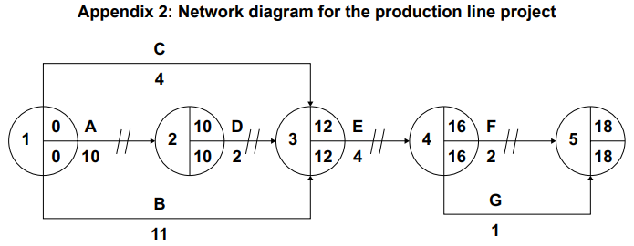

# Exam Questions — Marketing Analysis (A Level)
**3. Marketing** · Cambridge (CIE) A-LEVEL business (9609)
> Source: [https://www.savemyexams.com/a-level/business/cie/23/topic-questions/](https://www.savemyexams.com/a-level/business/cie/23/topic-questions/) · 19 questions across 1 sets

## Exam Questions (19 questions)

### Q1 — hard — 12 marks

**Q1** [12 marks]

> **[case-study]**
> **Ashcroft Solar**
> 
> Ashcroft Solar installs solar panels on homes in country Y. It forecasts sales using four-period centred moving averages drawn from five years of quarterly data. These show steady underlying growth and a strong seasonal pattern, with installations peaking in spring and summer.
> 
> The government has just announced that the subsidy paid to homeowners for solar installation will end in 18 months. The sales director argues the existing forecasting method is reliable because it is built on real data. The operations director argues that past data cannot capture the effect of the subsidy ending, and that the judgement of experienced installers should be used instead.

Evaluate whether Ashcroft Solar should continue to rely on time series analysis rather than qualitative forecasting when planning for the next two years.

### Q2 — hard — 12 marks

**Q2** [12 marks]

> **[case-study]**
> **Brackenfield**
> 
> Brackenfield produces bottled fruit drinks in country P. Research carried out two years ago estimated the price elasticity of demand for its main product at -1.8. The marketing director wants to cut the price by 10%, expecting sales volume to rise by 18%.
> 
> Since that research was completed, two new competitors have entered the market with similar drinks, a government health campaign has discouraged consumption of sugary drinks, and Brackenfield has launched a reformulated low-sugar version of the product. Its factory is currently operating at 88% capacity.

Evaluate whether Brackenfield should rely on its price elasticity of demand estimate of -1.8 when deciding to cut its price by 10%.

### Q3 — easy — 3 marks

**Q3** [3 marks]

> **[case-study]**
> **Loxley**
> 
> Loxley manufactures gardening tools in country E. Its sales have been flat for three years. The marketing director has suggested collecting ideas for new products from Loxley's own repair department, which sees which tools are returned as broken and how they have failed.

Explain **one** benefit to Loxley of using its repair department as a source of ideas for product development.

### Q4 — easy — 3 marks

**Q4** [3 marks]

> **[case-study]**
> **Juniper Air**
> 
> Juniper Air is a budget airline operating in country V. It must decide six months in advance how many aircraft to lease for the summer season, and once signed, the leases cannot be cancelled.

Explain **one** reason why sales forecasting is important for Juniper Air.

### Q5 — easy — 2 marks

**Q5** [2 marks]

Define the term 'promotional elasticity of demand'.

### Q6 — easy — 3 marks

**Q6** [3 marks]

> **[case-study]**
> **Portland Appliances**
> 
> Portland Appliances manufactures washing machines and refrigerators in country N. Its research shows the income elasticity of demand for its premium range is +2.4. Economists forecast that average incomes in country N will fall by 3% next year.

Explain **one** way in which the income elasticity of demand for its premium range may affect Portland Appliances' production decisions.

### Q7 — easy — 2 marks

**Q7** [2 marks]

Define the term 'income elasticity of demand'.

### Q8 — medium — 3 marks

**Q8** [3 marks]

**Extract:**

## MERIDIAN TECHNOLOGIES (MT)

**Background**

Meridian Technologies (MT) is a private limited company based in country K. It designs and manufactures smart home devices, including wireless speakers, smart thermostats, and home security systems.

MT was founded 12 years ago by entrepreneur Hana Park and has grown to employ 850 workers across two manufacturing facilities in country K.

MT sells its products domestically and exports to several countries in Asia and Europe. Competition in the smart home device market is intense. MT faces growing pressure from several large multinational companies (MNCs) that compete aggressively on price and brand recognition.

**Organisational Change**

Until two years ago, MT operated with a flat organisational structure in which considerable authority was delegated to regional managers. Following a period of rapid growth, Hana decided to restructure the business, reducing the number of management levels and centralising all major decision-making at head office.

The restructuring has not been universally welcomed. A recent internal employee survey found that 64% of workers felt less motivated since the change was introduced. Three experienced regional managers left the business within six months of the restructuring being implemented.

**Expansion Plans**

MT is planning to expand its production capacity and is evaluating two investment projects. Table 1 shows data for Project A. Table 2 shows the projected annual net cash flows for Project B.

**Table 1: Project A — Automated Production Line**

| Initial investment (\$) | 600,000 |
|---|---|
| Useful life | 5 years |
| Residual value at end of useful life (\$) | 0 |
| Estimated annual profit (\$) | 120,000 |

**Table 2: Project B — Expansion of Existing Facility**

| **Year** | **Net cash flow (\$)** |
|---|---|
| 1 | 80,000 |
| 2 | 100,000 |
| 3 | 120,000 |
| 4 | 150,000 |
| 5 | 100,000 |
| **Initial investment** | **400,000** |

**Export Markets and Exchange Rates**

MT currently generates 40% of its revenue from exports. Approximately 60% of MT's export revenue is earned in euros (€). In the past 12 months, country K's currency has strengthened significantly against the euro, rising in value by 15%.

Table 3 shows MT's revenue by market for the year ended December 2023.

**Table 3: MT Revenue by Market (year ended December 2023)**

| **Market** | **Revenue (\$000)** |
|---|---|
| Country K (domestic) | 6,200 |
| Europe | 2,800 |
| Asia | 1,300 |
| **Total** | **10,300** |

**Pricing Strategy**

MT's Finance Director has suggested reducing the selling price of the smart thermostat in order to increase market share and compete more effectively against MNC rivals. Table 4 shows the relevant pricing and demand data.

**Table 4: Smart Thermostat — Pricing and Demand Data**

| Current selling price (\$) | 80 |
|---|---|
| Current annual sales (units) | 50,000 |
| Proposed new selling price (\$) | 72 |
| Forecast annual sales at new price (units) | 57,500 |

**Corporate Social Responsibility**

MT sources many of its components from suppliers based in country L, where labour costs are significantly lower than in country K. A pressure group called EthicsWatch has recently published a report claiming that some of MT's suppliers in country L use poor working conditions and pay employees below the minimum wage. The report has received widespread media coverage in country K and has been shared extensively on social media.

Hana is considering whether to introduce a formal corporate social responsibility (CSR) strategy. This would include auditing all of MT's suppliers in country L and switching to certified ethical suppliers where necessary. MT's operations director estimates that this would increase raw material costs by approximately 12%.

Read the [insert ](https://cdn.savemyexams.com/uploads/2026/04/52945-Insert%20-%20Paper%203%20Business%20Decision-Making%20%E2%80%94%20Practice%20Paper%20Set%201.pdf)before answering this question.

Calculate the **price elasticity of demand (PED)** for the smart thermostat

### Q9 — medium — 3 marks

**Q9** [3 marks]

**Extract:**

**Garbanzo Restaurants (GR) **

Leff Alfa left school with no formal qualifications. However, he had a passion for food and started working for a fast food business in country F. Leff worked hard and within five years was promoted to restaurant manager. By 2010, he had become dissatisfied with not being able to make strategic decisions. He decided to start up his own business. Leff is now the Managing Director of GR, a medium-sized private limited company in country F. GR has a chain of 15 restaurants which sell high quality, healthy food using locally sourced produce (ingredients). GR has expanded slowly. However, Leff is now considering ambitious growth strategies requiring significant capital investment. Leff makes the decisions GR has an organisational structure with a tall hierarchy. Leff retains control of all key decisions aided by the Finance, Human Resource and Marketing Directors. These directors report directly to Leff and help him plan and decide on strategies, tactics and policies for GR and its restaurants. GR employs a manager for each restaurant with responsibility for implementing Leff’s policies, recruiting employees and sourcing local produce. Leff makes decisions about pricing and menus. He sets and monitors budgets for each restaurant. Restaurant managers have a small marketing budget. GR has a much larger central marketing budget to develop the GR brand. Restaurant 16 Leff has decided to open a new restaurant. He has identified two possible locations. Location X is an existing fast food outlet in a shopping mall near a city. There are three other restaurants in the shopping mall. Location Y is in a tourist resort and would require more work to convert the building to a suitable restaurant layout. Leff has gathered information about the two locations. This is shown in Table 1.

Table 1: Information on the two locations Location X Location Y Estimated time until opening of restaurant 2 months 6 months Target market Local community Tourists Capital cost of building work and equipment \$30000 \$100000 Monthly fixed costs (including leasing cost) \$12000 \$24000 Estimated average variable cost per customer \$2 \$2 Estimated average revenue per customer \$8 \$10 Expected average monthly number of customers 3000 5000 Number of customers per month needed to break even 2000 See Question 2(a)(i) Expected monthly profit \$6000 See Question 2(a)(iii) Length of contract for leasing the building 1 year 3 years Human resource problems Suma, the Human Resource Director, is worried about the high level of labour turnover and absenteeism at many restaurants, particularly among kitchen employees. These problems add to GR’s recruitment and training costs. All new employees receive the minimum legally required training in food hygiene and health and safety. Most restaurant managers are recruited externally and Leff prefers individuals with strong personalities who ‘get things done’. The restaurant market is highly competitive. Consequently, Leff aims to keep labour costs low and maintain as much labour flexibility as possible. Many kitchen employees and waiters are paid the legal minimum wage. However, waiters can supplement their income through the tips that customers give for good service and food. Some employees have part-time contracts and some employees have full-time contracts. A small number of employees are on zero hour contracts even though the government is planning to make these illegal. Restaurant managers impose the rigid work practices developed by Leff and decide the weekly allocation of tasks. There is little consultation with employees about any changes introduced to the restaurants. Suma has conducted a survey of employees and leavers to provide feedback about GR. Tables 2 and 3 provide selected employee data and information from the survey

Table 2: Employee data 2018 2019 Number of restaurant employees 200 200 Labour turnover 20% 22% Days lost through absenteeism 1400 1450 Table 3: Extract from surveys of employees and leavers Positive factors of working for GR • High level of tips (stated by some waiters) • Good working conditions Negative factors of working for GR • Lack of empowerment • Limited consultation Main reasons for leaving GR • Dissatisfaction with allocation of work tasks • Low pay • No opportunities for promotion • Variable working hours Increasing revenues GR’s objective for 2021 is to increase revenue by 10% and profit by 15% at its existing restaurants. Leff and Alec, the Marketing Director, are working on the marketing plan for 2021. Using past revenue data, market reports and primary research, Alec has considered how changes to price and promotion might affect demand. The price of a typical falafel meal at GR is \$6 and in the last twelve months, 360000 of these meals were sold. He estimates that competitors in GR’s market segment will, on average, increase prices by 5% in 2021. If GR prices and other factors remain unchanged, Alec estimates additional sales of 14400 falafel meals. Alec has also estimated that promotional elasticity of demand is 0.2. GR’s current annual spend on above the line promotion is \$150000. GR’s revenue was \$5.76m during the last 12 months.

Budgeting for success Leff sets quarterly budgets for all restaurants. He uses an incremental budgeting approach. Every quarter he meets with individual restaurant managers to monitor performance and give them new budgets. Leff is unhappy with the performance of Restaurant 13, which has failed to meet budget targets for the last 18 months. See Table 4. At the most recent meeting, the manager of Restaurant 13 blamed the adverse variances on: • increased recruitment and training costs due to higher labour turnover • a new competitor opening a nearby restaurant 12 months ago • a reduction in tourist numbers caused by appreciation of country F’s currency exchange rate • an increase in costs of locally sourced food due to poor weather. The manager told Leff that: ‘Unrealistic budgets demotivate me and other employees and do not help with the allocation of resources.’ Table 4 shows recent budget data for Restaurant 13. Table 4: Restaurant 13 – Budget data for the 3 months to 30 September 2020 Budget (\$) Actual (\$) Revenue 120000 115000 Cost of sales 27000 28000 Restaurant overhead costs 60000 65000 Allocated Head Office overheads 15000 15000 Profit 18000 7000 Strategic options for growth Leff has decided to expand GR. He has conducted a thorough strategic analysis of his business and as a result is considering two strategic options. Strategy 1: Manufacture chilled meals. GR restaurants already sell a range of chilled meals, produced and packaged in each restaurant, for customers to purchase and reheat later. A national supermarket is interested in selling these GR meals throughout country F. GR would need to establish a manufacturing site to meet the potential demand for these meals. Leff estimates a capital cost of \$3m. Strategy 2: Takeover of Abila. Abila is a group of 10 restaurants in country F. The owners want to sell the business for \$1.5m. If GR purchased Abila it would have to rebrand the group and update the restaurants. This would cost a further \$0.5m. Leff believes that he can improve profitability of these restaurants through rationalisation. There would be many redundancies. Appendix 1 and Appendix 2, on the next page, give further information about Leff’s strategic analysis.

Appendix 1: SWOT analysis for GR Strengths • Strong brand image • Quality meals • Low gearing Opportunities • Market growth in restaurant market of 3% per annum • Increasing sales of chilled meals of 10% per annum Weaknesses • Labour turnover • Demotivated employees Threats • Competitors with greater economies of scale • New entrants to the market • Changes in the legal environment Appendix 2: Porter’s Five Forces – Country F chilled meal market Threat of new entrants • Low consumer brand loyalty in market Buyer power • Three supermarkets control 80% of the market Threat of substitutes • Many substitutes available Supplier power • Few manufacturers of chilled meals

Read the following [extract](https://www.savemyexams.com/a-level/business/cie/past-papers/paper/ppr_2mBRm3pH3QFYFHGx/?pdf=https%3A%2F%2Fpastpapers.papacambridge.com%2Fdirectories%2FCAIE%2FCAIE-pastpapers%2Fupload%2F9609_w20_in_32.pdf&type=resource&resourceIndex=0) (lines 67-76) before answering

Calculate the increase in revenue for GR if promotion spending is increased to \$195 000.

*Source: November 2020 Paper 32 Q4AII*

### Q10 — easy — 3 marks

**Q10** [3 marks]

> **[case-study]**
> **UFilters (UF) **
> 
> UF is a public limited company selling to an industrial market. It manufactures air conditioning units. UF produces two sizes of air conditioning units, medium and large. Most of its air conditioning units are sold for use in warehouses and computer server rooms. The units are expensive compared to competitors but UF believes its units are of a higher quality. Market research suggests that there is a growing demand for small air conditioning units to be placed in offices. To produce a new size of unit would require spending \$180000 to purchase new machinery.
> 
> UF relies on customer recommendations for new orders. However, some customers have been dissatisfied with the service received. UF has received several complaints, including:
> 
> - engineers turning up late or not at all
> - poor communication from UF
> - little choice in the size of units supplied
> - appointment times are not always convenient and can be difficult to change.
> 
> Sylvie, the Marketing Director of UF, is concerned about the sales data (Table 1.1) as sales have fallen 10% on the previous year.
> 
> **Table 1.1: Selected sales data for UF, 2019**
> 
> | **Unit size** | **Price (\$)** | **Unit sales** |
> |---|---|---|
> | Medium | 900 | 3500 |
> | Large | 2000 | 800 |
> 
> Sylvie is considering two options to increase sales (see Table 1.2).
> 
> **Table 1.2: Options to increase sales**
> 
> | *Option 1 * Reduce the price of the units by 10% | - Competitors’ prices are 8% lower on average. - The estimated price elasticity of demand is –0.8. |
> |---|---|
> | *Option 2*  Implement a performance related pay scheme (PRP) | - Sales staff are currently paid a monthly salary. - To introduce a PRP scheme the monthly salary would be reduced by 10%. - Targets would be set and if sales staff met the targets then they would receive PRP increasing their monthly salary by 15%. |

Explain the term ‘price elasticity of demand’.

*Source: June 2020 Paper 21 Q1AII*

### Q11 — hard — 12 marks

**Q11** [12 marks]

**Extract:**

**Fashion Frames plc (FF) **

FF makes plastic frames for glasses (spectacles) in a factory in country W, in South East Asia. FF sells its plastic frames to wholesale businesses that market well-known brands of plastic frames which they sell globally. The wholesalers reject 7% of the frames supplied by FF because of substandard quality. The FF design team create dynamic styles based on the demands of the wholesalers. Meeting delivery times is very important. FF only delivers 85% of its sales on time. FF needs to improve this percentage. Improving quality Chang, the production manager, aims to reduce the high level of rejects by the wholesalers. He has identified a number of factors which make this difficult including: • employees know that rejected frames can be recycled • production targets are very difficult to meet • problems with suppliers of raw materials • breakdowns with machinery. Chang proposes introducing Total Quality Management (TQM). He thinks this will reduce the number of substandard frames and improve FF’s delivery times. Chang forecasts successful implementation of TQM will also increase output by 10% and average variable cost will fall by 5%. However, Chang is aware that there may be problems with TQM and forecasts can be inaccurate. Table 1 shows information on FF’s output, costs and prices, before TQM is implemented. Table 1: FF’s output, costs and prices Year ending September 2021 Maximum capacity 16 million frames Actual output 14 million frames Average variable cost \$20 Average selling price \$40 Communication challenges FF has a centralised organisational structure with a low degree of delegation. Directors make decisions, department managers plan how to implement these and supervisors give instructions. Employees have little responsibility or control. FF has provided good pay, good conditions of work and security of employment. However, employees are aware that the directors are considering significant changes to working conditions. All employees find it difficult to discuss this with their line managers. Many employees work alone so information is passed on informally and often inaccurately. This uncertainty has begun to lead to dissatisfaction, complaints, higher absence rates and lower productivity. Privatisation of electricity and water industries In country W, state-owned businesses supply all electricity and water. Prices of services in these industries have risen at above the rate of inflation for the last three years. Sometimes, electricity supply is interrupted and FF finds it difficult to obtain information about reconnection. Water quality is variable. The government has announced it intends to privatise these industries in the next three years, to improve these services.

Buying 3D printers 3D printers that make frames for glasses as part of a CAD/CAM process are becoming available. Chang is considering whether FF should invest in this rapidly developing technology. 3D printers have a guaranteed life span of four years but he believes they are probably usable for six years. There is no way of accurately estimating their value after four years. The directors have told Chang that an acceptable accounting rate of return (ARR) is 5%. Chang thinks new 3D printers will increase FF’s long-term profitability. The 3D printers will result in significant reductions in employee costs and waste and substandard reject costs. Maintenance and training costs will, however, increase. Table 2 and Table 3 show some of Chang’s research. Table 2: Investment appraisal for 3D printers: cash flow forecasts \$m Year 0 Year 1 Year 2 Year 3 Year 4 Buy printers (10) Increased maintenance costs (0.1) (0.1) (0.1) (0.1) Increased training costs (0.2) (0.2) (0.2) (0.2) (0.2) Employee cost reductions 2.1 2.1 2.1 2.1 Waste and reject cost reductions 0.8 0.8 0.8 0.8 Net cash flow (10.2) 2.6 2.6 2.6 2.6 Table 3: Discount factors at 5% discount rate Year 0 Year 1 Year 2 Year 3 Year 4 Discount factors 1.000 0.952 0.907 0.864 0.823 There are risks that this technology might be replaced in future by even more advanced process innovations but Chang is keen to invest in 3D printers. He knows competitors are considering buying them. Product development and marketing The marketing manager is concerned that FF relies only on specific orders from wholesalers for plastic frames. He proposes that FF should use product development to design and manufacture metal glasses frames. These would be marketed to wholesalers and directly to businesses who sell glasses with globally recognised brands. FF would have to acquire new skills and equipment in order to design and manufacture metal frames. The marketing manager visited international trade fairs and found that several competitors have research and development (R&D) departments. Strategic choice: enter the Asia Pacific retail market The Chief Executive Officer (CEO) states: ‘My strategic analysis shows that FF must continue with the current business model but should take a new direction as well. My strategic choice is that FF should enter the retail glasses market in the Asia Pacific region. This will mean selling our own glasses in retail shops. We will need to work closely with lens manufacturers. Increased eye strain and higher disposable income are driving the increasing demand for higher value glasses. We could use the Ansoff Matrix to help analyse the link between this business strategy and risk. There are several approaches we could use to enter this new market.’

The CEO illustrates his proposal with Table 4 and Table 5. Table 4: Retail glasses market entry decision tree analysis Regional market Expected monetary value North America + \$3m Europe +\$4m Asia Pacific + \$14m Table 5: Retail glasses sales data Total sales 2021 (\$bn) Forecast sales growth 2021–2025 (%) North America 37 8 Europe 39 8 Asia Pacific 35 10 Rest of world 8 14 Managing a change to team working FF currently produces frames on production lines. There are nine stages in the production process, including cutting out plastic sheets, smoothing component parts, attaching them, and final shaping and polishing. Employees only carry out the one task they have been trained for in the production process. The Directors are considering a proposal from Chang to move to team working. A team would be responsible for the whole production of a product and would take all necessary decisions. If successful, FF could possibly reduce the lead-time from order to completion by 60%, inventory levels by 27% and increase productivity by 20%. A change to team working means greater delegation and less centralisation. Control, authority and trust involving directors, managers, supervisors and production employees will have to change. This strategic change must be managed effectively and directors are confident that Chang has the necessary theoretical knowledge. The benefits he identified will only be achieved if he applies the correct techniques to manage the introduction of team working.

Refer the following [extract ](https://pastpapers.co/caie/a-level/business-9609/2021-oct-nov/9609_w21_in_31.pdf)before answering

Evaluate the importance to FF of following the product development process before adding metal glasses frames to its product range.

*Source: November 2021 Paper 31 Q5*

### Q12 — medium — 3 marks

**Q12** [3 marks]

> **[case-study]**
> **Snappy Box (SB) **
> 
> SB is owned by Ralph who is a sole trader. The business prints photographs. Ralph has one shop on the main street of city D. Customers bring their saved digital photographs into the shop and these are printed on high-quality paper.
> 
> SB uses a large printing machine that can print on almost any size of paper to produce different sized photograph prints. The process is very capital-intensive and most customers request a batch of photographs to be printed.
> 
> SB is the only shop in city D that prints photographs. However, recently a number of online competitors have started to offer low-priced photograph prints to customers. Ralph has noticed that his sales have decreased significantly because of this competition. Ralph estimates the demand for his photograph prints has a price elasticity of demand of –4.
> 
> SB already has a low profit margin and Ralph is struggling to compete with the online retailers. However, Ralph has an idea to introduce job production into his shop. He could stop printing photographs and instead focus on framing individual photographs for customers. These frames will be made for any sized photograph or picture and can be made from a variety of materials chosen by the customer.
> 
> Ralph will need specialised equipment to allow him to make the frames. The equipment would cost \$10000. He has identified two possible sources of finance for this equipment.
> 
> The first possible source of finance is for Ralph to lease the equipment from the company that produces it. The lease would be for five years at a fixed cost of \$400 per month.
> 
> The second possible source of finance is for Ralph to sell the photograph printing machine for at least \$10000, to purchase the equipment to make frames.

Use Ralph’s estimate of the price elasticity of demand to calculate the percentage change in demand for printed photographs if the price is reduced by 10%.

*Source: November 2021 Paper 22 Q1BI*

### Q13 — easy — 2 marks

**Q13** [2 marks]

**Extract:**

**Waste To Zero (WTZ) **

Making use of waste As a young boy Amandi Said supplemented his family’s income by finding waste materials and products and making new products to sell. Later, he employed other teenagers to collect waste such as card and plastics in the capital city of country R. Amandi sold these waste materials to recycling companies. In 2015, Amandi set up WTZ as a private limited company and a summary of its rapid growth is provided below. 2015 WTZ gains contract from local government to collect recyclable waste. This is sorted at the new WTZ recycling centre and then sold to local manufacturers. 2017 WTZ opens its first factory producing the innovative Hydrocamel – a water barrel made from recycled plastic waste. The Hydrocamel is sold to local communities and charities to improve access to clean water in low‑income countries. 2019 WTZ converts to a public limited company. Operations expand to other major cities in country R. Additional waste recycling centres and factories open. One centre in country R burns waste products to generate electricity. 2020 WTZ patents a process for creating bricks from waste plastic and rubber. These bricks can be used to build durable and affordable houses. 2021 WTZ takes over MR, a company that recycles metal. 2022 WTZ’s market share for collecting and recycling plastic waste in country R reaches 60%. Ownership and finance Amandi retains a controlling stake in WTZ. He has always been motivated by profit and the desire to secure a future for his children. Amandi is willing to take risks. WTZ has entered new markets and invested in research and development. Business expansion has been financed by bank borrowing and by the public offer of shares on the stock market in 2019. Table 1 and Table 2 provide selected information from the financial statements of WTZ. Table 1: Extracts from WTZ’s income statement (year ending 30 April) 2022 (\$m) 2021 (\$m) Revenue 60.0 50.0 Profit for the year 5.6 6.4 Dividends 4.8 4.4

Table 2: Extracts from WTZ’s statement of financial position (at 30 April) 2022 (\$m) 2021 (\$m) Non‑current liabilities 14.0 10.0 Share capital 4.0 4.0 Retained profit reserves 4.0 3.8 Inventories 4.0 3.2 Trade receivables 1.6 1.5 Cash 0.2 0.4 Current liabilities 4.2 3.6 Notes: Authorised share capital – 20 million shares @ \$0.5 Number of shares issued – 8 million Current share price – \$3 Operational efficiency Amandi’s focus has always been on minimising costs to maximise profit margins. Many factory employees are on flexible contracts and are paid the minimum wage for unskilled work. Many employees work long hours. Working conditions in WTZ’s factories are difficult with poor ventilation and a lack of facilities for employees to take breaks. Employees have demanded the right to join a trade union. However, unemployment in country R is high, so WTZ has refused to recognise trade unions. The new operations manager at the Hydrocamel factory, Khalid, reported the following problems to the directors: • employee absenteeism is increasing • productivity is not increasing • quality standards are below expectations with 5% of output rejected • inefficient collection of recycled materials • high inventory levels. Khalid recommends a lean approach to production including the introduction of Kaizen (continuous improvement). To be effective this change would require investment in employee training.

Marketing Hydrocamel has been a very successful product since its launch in 2017. The Hydrocamel helps families reduce the time needed to collect and transport water. The Hydrocamel can store 100 litres of water and is designed to be rolled so that it is easily movable. In 2019 a competitor brand, the Hippo Barrel, was launched and WTZ’s sales growth slowed. The marketing manager, Kofi, is planning a marketing strategy to increase sales to 50000 units per year which is the maximum capacity of the factory. He collected the following information as part of his situational analysis: • price of the Hydrocamel is \$140 • price of the competitor’s Hippo Barrel was reduced by 20% to \$120 in 2020 • this resulted in an 8% decrease in demand for the Hydrocamel to 40000 units in 2021 • estimated price elasticity of demand for the Hydrocamel is –1.2 • WTZ promotes the Hydrocamel through adverts in specialist magazines and by contacting charities directly • the promotional budget in 2021 was \$10000 • targeted marketing spending is estimated to have promotional elasticity of demand of 1.3. Organisational structure Amandi has not changed the organisational structure of WTZ as the business expanded. The business has a hierarchical structure with functional areas of operations, human resources, marketing and finance. The business has been successful and continues to expand. Continued expansion has made it more difficult for Amandi to have effective control over the business. He thinks that managers focus too much on their functional responsibilities and this prevents them from planning strategically. Amandi considers the current organisational structure to be a weakness that is constraining growth. In discussion with other directors, Amandi commented ‘WTZ is increasingly diversified and we need a structure that can support growth and drive innovation. Changes will also be needed if we expand into other countries to process waste and generate electricity.’ An increased focus on corporate social responsibility (CSR) Kofi recommends that WTZ engages more with the local community. He reported to Amandi that ‘WTZ should be a leading supporter of sustainable development. We could use our expertise in recycling to develop a positive brand image and promote the company as protecting the future for all. Ambitious environmental objectives could be set. However, there is likely to be an impact on the costs of the business. There are, for example, operational and human resource issues we need to overcome as we focus on CSR.’ Growth strategies for the future Amandi used strategic analysis techniques to consider the strategic direction of WTZ’s continued expansion. An extract from his external environment analysis (PEST) is shown in Appendix 1. He identified two potential strategic options. Amandi plans to proceed with only one of the options. However, the Finance Director is concerned about the capital cost and the potential impact on working capital.

Option 1: Purchase a small business called Lacpac Takeover Lacpac which produces recyclable non‑plastic packaging for the food industry. It is an innovative company and a market leader in country R. Option 2: Expansion to country S Country S is a high‑income country with a large population. WTZ would build a factory for processing plastic waste. WTZ would use its core competencies to gain contracts from the government of country S. Appendix 2 provides further data on each option. Appendix 1: External environment analysis (PEST) Political • Some low‑income countries have banned processing of plastic waste from high‑income countries • There is proposed regulation in country R to reduce the use of plastics in food packaging Economic • Economic growth in country R is forecast to be 5% per year on average over the next 5 years • Global interest rates forecast to decrease in 2023 Social • Increasing environmental awareness in country R and country S • Global environmental pressure groups propose consumer boycotts against businesses which operate unsustainably Technological • Increasing use of computer controlled machinery for collecting and sorting recycled material • Innovations in processing of waste materials Appendix 2: Summary of data from strategic choice techniques over 5‑year period Option 1: Takeover of Lacpac Option 2: Expansion into country S Driving forces Rapid market growth in use of recyclable non‑plastic packaging in the food industry Builds on core competencies of WTZ Restraining forces High cost Competitive market in country S Capital cost \$20m \$10m Accounting Rate of Return (ARR) 15% 10% Decision tree: Expected monetary value Probability of success \$9m 60% \$4m 70%

Read the following [extract ](https://www.savemyexams.com/a-level/business/cie/past-papers/paper/ppr_69GKQfX9rnjKkKYY/?pdf=https%3A%2F%2Fpastpapers.papacambridge.com%2Fdirectories%2FCAIE%2FCAIE-pastpapers%2Fupload%2F9609_s22_in_32.pdf&type=resource&resourceIndex=0)(lines 71–74) before answering

Calculate the cross elasticity of demand of the Hydrocamel following the price reduction of the Hippo Barrel.

*Source: June 2022 Paper 32 Q2AI*

### Q14 — medium — 3 marks

**Q14** [3 marks]

> **[case-study]**
> **Child Play (CP) **
> 
> Su is a sole trader who started a business called CP which operates a play area for children. The play area is inside a building and includes toys and other play equipment. Customers book on CP’s website for each hour that they would like to use the play area. CP is two kilometres away from the nearest city which has a large population. Su does not pay for any promotion and she relies on recommendations and reviews from previous customers.
> 
> Su currently charges a price of \$10 an hour for a group of up to 5 children. Only one group can book CP for each hour. Demand is greater than supply so Su may increase the price to \$15 per hour. She has completed some market research to see if this is a good idea. Her findings are in Table 1.1.
> 
> **Table 1.1: Market research about prices for CP**
> 
> | **Price** | **Quantity (hours) demanded per day** |
> |---|---|
> | \$10 | 10 |
> | \$15 | 6 |
> 
> Su is also thinking about expanding the business by opening a café targeted at parents with children.
> 
> The café would be located at the entrance to CP’s play area. There are many other cafés in the city centre two kilometres away. Su believes that product differentiation is essential for the profitability of the café.
> 
> Su plans to use CP’s working capital as the source of finance to open the new café. The café will need to earn revenue quickly, so she plans to open it in four weeks. She will need quick and low‑cost promotion methods if the café is to succeed.

Calculate the price elasticity of demand if Su increases the price from \$10 to \$15 an hour.

*Source: June 2022 Paper 23 Q1BI*

### Q15 — easy — 2 marks

**Q15** [2 marks]

Define the term ‘price elasticity of demand’.

*Source: June 2022 Paper 12 Q4A*

### Q16 — easy — 3 marks

**Q16** [3 marks]

Explain **one **way price elasticity of demand influences the pricing decisions of a business.

*Source: June 2022 Paper 11 Q3*

### Q17 — medium — 3 marks

**Q17** [3 marks]

**Extract:**

**Devonice Ltd (DL) **

Gabriel Romana founded DL in 2012 in country Y. He used his savings to develop Devonice, a luxury ice cream brand made from natural ingredients. DL started manufacturing ice cream in a small factory in 2013. Organisation and growth DL has grown rapidly. Gabriel has increased the product range with new flavours of ice cream. In 2016, DL opened its second factory and its first Devonice ice cream shop in country Y. At present, most sales are made to supermarkets in country Y. However, Gabriel has plans to open more ice cream shops. He is also considering selling DL franchise agreements to increase export sales. Gabriel enjoys being in control of the business and intends to maintain a centralised structure. Managers of the functional departments report directly to Gabriel and he makes all major decisions. The production line project DL has two factories, operating 24 hours a day. In total, there are 5 production lines and 200 workers able to produce 30 million litres of ice cream per year. Capacity utilisation is currently 90%. To increase capacity and flexibility, Gabriel is considering investing in computerised production lines. Gabriel wants this project completed within 20 weeks in time for the summer season. The operations manager has prepared a critical path analysis (CPA) for the project (see Appendix 1 and Appendix 2). The operations manager is worried about the project. He told Gabriel: ‘This new system is complex and untried. I am also worried about delays and the impact on our workers.’ Estimated net cash flows of the project are shown in Table 1. Table 1: Estimated net cash flows for the new production line project Year Net cash flow (\$m) Discount factor (8%) 0 (2.5) 1 1 0.5 0.93 2 0.8 0.86 3 1.2 0.79 4 1.5 0.74 5 1.5 0.68 A competitive market Devonice is now the market-leading brand in country Y and is exported to 10 other countries. DL’s innovative marketing and high quality product have contributed to sales growth. DL targets young adults and has developed a premium brand image. Promotion includes the use of social media, school sponsorship and celebrity endorsement. DL also donates a share of its profits to environmental charities.

Market conditions in country Y are challenging. A multi-million dollar advertising campaign by a global ice cream brand has increased competition. DL sales have remained stable but market share has fallen. In response, Gabriel is considering reducing the price of Devonice or increasing promotional spending. The marketing department has estimated the promotional elasticity of demand and price elasticity of demand for Devonice. Details are in Table 2. Table 2: Estimated data for Devonice Price elasticity of demand Promotional elasticity of demand Action Reduce price to supermarkets by 8% Increase annual promotional spending by \$0.5m to \$1.75m Outcome Demand increases by 10% Demand increases by 10% The marketing manager recommends reducing price to widen the market appeal of the brand and open up new distribution opportunities. However, Gabriel believes this could damage the brand image. In his opinion, increasing promotional spending is the better decision. Corporate social responsibility (CSR) Despite rising incomes in country Y, there is concern about health related problems due to poor diet. In 2020, a pressure group started a campaign to persuade food manufacturers to take greater responsibility for the impact of their products. The group demanded government action to reduce sales of food products high in sugar and fat by: • regulating product labelling • restricting advertising • introducing a tax on these products. DL could change ingredients to reduce sugar content. However, Gabriel is worried about consumer reaction. DL is also facing pressure to stop using palm oil because of the loss of rainforest associated with its production. Palm oil helps make ice cream smooth and creamy. There are alternatives DL could use, but these are more expensive. Appendix 1: Critical path analysis (CPA) for the production line project Activity Description A Run existing production lines at full capacity to increase inventory for changeover B Order and delivery of ice cream equipment C Order and delivery of packaging equipment D Removal of existing production equipment E Installation of new production equipment F Training of production line workers G Testing of production lines

Read the following [extract ](https://www.savemyexams.com/a-level/business/cie/past-papers/paper/ppr_WRR6Rd9qmYKKgv2g/?pdf=https%3A%2F%2Fwww.cambridgeinternational.org%2FImages%2F596165-2023-specmen-paper-3-insert.pdf&type=resource&resourceIndex=0)(Table 2) before answering

Calculate the promotional elasticity of demand (PrED) for Devonice ice cream.

*Source: Specimen 2023 Paper 3 Q4A*

### Q18 — medium — 2 marks

**Q18** [2 marks]

**Extract:**

**WoodPlayer (WP) **

Rona Lupa is a skilled woodworker who set up her own business, WP, to manufacture wooden toys. She started WP in 2015 in country A. The toys are sold to retailers. Quality control and assurance WP has grown rapidly and is now a private limited company employing 35 people in one factory. WP employs skilled workers and offers them training opportunities. Production workers are paid a basic wage plus a piece rate. Workers are expected to check their own work and a brief final inspection is made before products are despatched. Rona is proud of the company’s quality assurance. Leadership and communication Rona is one of two directors. She owns 90% of WP’s total share capital of \$1 million. The other director has a limited role in decision-making. Rona thinks of all the ideas for new products. There are managers for each functional area of the business – Operations, Marketing and Finance. Each manager meets individually with Rona and gives her a written report once a week. Rona holds one meeting with all employees at the start of each week to communicate plans and give updates on new developments. Forecast revenue Sales of WP’s products are highly seasonal. Table 1.1 shows data produced by the Marketing Manager. He thinks every functional area of the business will find sales forecasts useful in planning for the future. Table 1.1 WP sales data (\$m) Revenue (* forecast data) Trend (* forecast data) Seasonal variation Average seasonal variation 2019 Q3 1.0 Q4 1.1 2020 Q1 1.8 1.288 0.512 0.550 Q2 1.2 1.313 –0.113 –0.084 Q3 1.1 1.350 –0.250 –0.250 Q4 1.2 1.400 –0.200 –0.217 2021 Q1 2.0 1.438 0.562 0.550 Q2 1.4 1.450 –0.050 –0.084 Q3 1.2 1.463 –0.263 –0.250 Q4 1.2 1.488 –0.288 –0.217 2022 Q1 2.1 1.525 0.575 0.550 Q2 1.5 1.588 X –0.084 Q3 1.4 1.638 –0.238 –0.250 Q4 1.5 1.663 –0.163 –0.217 2023 Q1 2.2 1.688* 0.512 –0.550 Q2 1.6* 1.710* –0.110 –0.084 Q3 Y 1.755* –0.250 –0.250

New range of play equipment for outdoor use? Rona is considering a new product range of outdoor play equipment. Some market research has already been carried out which indicates a significant probability of success. Additional machinery will need to be purchased to manufacture the new range. Existing employees will need training on the new machines. WP could finance the new product range with borrowing and existing cash. The return on capital employed (ROCE) for year ending 31 May 2023 is 10%. Based on producing the new product range from January 2024, the Finance Manager provided Rona with forecast financial information for the year ending 31 May 2024: • total issued share capital will remain at \$1m • current ratio will fall from 0.8:1 to 0.7:1 • gearing ratio will rise from 30% to 40% • reserves will be \$2m • non-current liabilities will rise from \$1.5m to \$2m. Table 1.2 shows extracts from WP’s financial statements for year ending 31 May 2023 and forecast data for year ending 31 May 2024. Table 1.2 Extract from WP’s financial statements (\$m) Forecast for year ending 31 May 2024 Year ending 31 May 2023 Revenue 7.0 6.5 Cost of sales 3.5 3.3 Gross profit 3.5 3.2 Expenses 3.3 2.7 Profit from operations 0.2 0.5 Profit for the year 0.1 0.25 Dividends 0.05 0.15 External influences on WP WP is a relatively small producer in its market sector. It has a unique selling point (USP) which is a combination of good design and excellent quality at an affordable price. This means it is unlikely that any competitor will be able to threaten WP’s market share in the near future. Country A is facing several economic challenges: inflation, skills shortages and high government borrowing. The government intends to implement the following economic policy measures in the next six months: • restrict pay rises for public sector workers • increase income tax rates • increase tax for businesses which do not provide employee training • increase interest rates.

Read the following [extract ](https://pastpapers.co/caie/a-level/business-9609/2023-may-june/9609_s23_in_31.pdf)(Table 1.1) before answering

Using the data in Table 1.1, calculate the seasonal variation for 2022 Q2 (**X**).

*Source: June 2023 Paper 31 Q3A*

### Q19 — easy — 3 marks

**Q19** [3 marks]

> **[case-study]**
> **George’s Gym (GG) **
> 
> George identified a potential niche market for a new gym in his local area. He set up GG as a sole trader business three years ago. GG is a modern gym with the latest equipment.
> 
> George has recently gained planning permission to build a new swimming pool. George wants to open the swimming pool because a national competitor is planning to open a new gym close by and he wants GG to remain competitive. The swimming pool will cost \$400 000 and George has yet to decide on the best source of finance. He has \$50 000 in savings that he could use and he does not have any mortgage or loans. George is thinking about seeking a private investor but is unsure of the risks involved.
> 
> The local population is wealthy. Last year (2012), GG had 300 members who each paid a membership fee of \$60 per month. George is thinking about new ways of increasing revenue such as offering additional ‘keep fi t’ classes. He also plans to increase the monthly fee he charges members to \$66. His accountant has told him he needs to think about the price elasticity of demand before making a pricing decision.
> 
> **Table 3 – Annual revenue and profit for the year for the previous 3 years (\$000)**
> 
> |   | 2010 | 2011 | 2012 |
> |---|---|---|---|
> | Annual revenue | 120 | 160 | X |
> | Profit for the year | 20 | 50 | 80 |
> 
> George hopes that the information in Table 3 will help show any potential lender how attractive the gym is as an investment.
> 
> GG has a problem of a high labour turnover of personal trainers. Three of them have left in the last six months. He has just employed a new personal trainer, Sally. George needs to issue her contract of employment. George thinks that the reasons for the high labour turnover include:
> 
> - George is always busy and so he can never offer an effective induction training programme for his employees
> - GG salaries are below average for the industry.

Explain how George might use the concept of price elasticity of demand in deciding whether or not to increase GG’s membership fee.

*Source: Specimen 2016 Paper 2 Q2BII*

