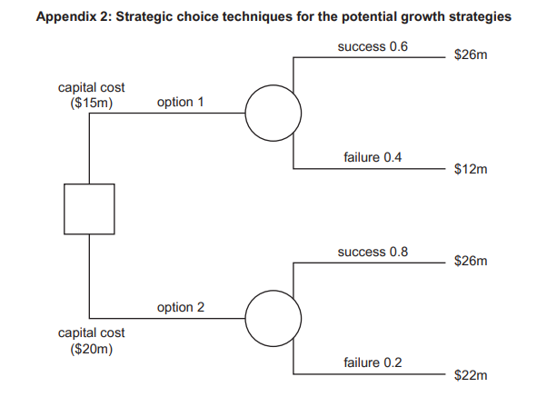

# Exam Questions — Marketing Strategy (A Level)
**3. Marketing** · Cambridge (CIE) A-LEVEL business (9609)
> Source: [https://www.savemyexams.com/a-level/business/cie/23/topic-questions/](https://www.savemyexams.com/a-level/business/cie/23/topic-questions/) · 18 questions across 1 sets

## Exam Questions (22 questions)

### Q1 — medium — 8 marks

**Q1** [8 marks]

> **[case-study]**
> **Stanhope Bathrooms**
> 
> Stanhope Bathrooms sells bathroom fittings in country R through showrooms and online. Until now, the showroom team, the online team and the advertising agency have each set their own prices, promotions and product photography.
> 
> The same tap is priced at \$95 online and \$128 in showrooms, and a discount advertised on television last month was not available in showrooms. Customer complaints have risen by 40%.

Analyse **two** benefits to Stanhope Bathrooms of adopting a coordinated marketing strategy.

### Q2 — medium — 8 marks

**Q2** [8 marks]

> **[case-study]**
> **Ledbury Print**
> 
> Ledbury Print provides commercial printing in country F. It has repositioned itself as a fast-turnaround service, promising delivery within 48 hours, and its advertising emphasises speed.
> 
> However, its website quotes a standard lead time of seven days, its sales team offers discounts to customers who place orders four weeks in advance, and its two largest presses are 15 years old and break down roughly twice a month.

Analyse **two** problems that a lack of consistency in Ledbury Print's marketing strategy may cause.

### Q3 — medium — 8 marks

**Q3** [8 marks]

> **[case-study]**
> **Carrow**
> 
> Carrow manufactures luggage in country J. Its marketing objective for the next two years is to raise the share of its sales coming from customers aged under 30 from 12% to 25%.
> 
> Its promotion is currently placed in airline magazines and on airport advertising boards. Its range consists mainly of large hard-shell suitcases priced between \$180 and \$260. Research shows that travellers under 30 mostly take short trips with cabin-sized bags and book through mobile apps.

Analyse **two** changes Carrow could make to its marketing strategy in order to achieve this objective.

### Q4 — medium — 8 marks

**Q4** [8 marks]

> **[case-study]**
> **Pennine Crafts**
> 
> Pennine Crafts sells craft supplies online in country D. It has 180 000 registered customers and records every product viewed, added to a basket and purchased. It stocks 9 000 different products.
> 
> Its weekly email newsletter goes to every customer with identical content, and the proportion of customers opening it has fallen from 24% to 11% over two years.

Analyse **two** ways in which artificial intelligence could improve Pennine Crafts' marketing.

### Q5 — medium — 8 marks

**Q5** [8 marks]

> **[case-study]**
> **Brightside Tyres**
> 
> Brightside Tyres operates 40 tyre-fitting centres in country Q and wants to expand into country M. It is considering franchising: local businesspeople would run centres under the Brightside Tyres name, paying an initial fee and a share of revenue, and buying tyres from Brightside Tyres.
> 
> Brightside Tyres has limited capital. Country M has different vehicle safety regulations from country Q, and an established chain there already operates 120 centres.

Analyse **two** benefits to Brightside Tyres of using franchising to enter the market in country M.

### Q6 — easy — 3 marks

**Q6** [3 marks]

> **[case-study]**
> **Everdon Games**
> 
> Everdon Games publishes board games in country S. In January it produced a detailed marketing plan for the year, setting out promotional spending quarter by quarter and a launch date of October for its main new game.
> 
> In March, a competitor announced a very similar game for release in June, and the cost of printed cardboard rose by 20%.

Explain **one** limitation of marketing planning for Everdon Games.

### Q7 — easy — 3 marks

**Q7** [3 marks]

> **[case-study]**
> **Thornbury Paints**
> 
> Thornbury Paints manufactures paint in country W and wants to sell in country B. Paint is heavy and expensive to transport, and country B applies a 25% import tariff on manufactured goods. Thornbury Paints has limited capital and no knowledge of country B's regulations on chemical products.

Explain **one** factor that may influence the method Thornbury Paints uses to enter country B.

### Q8 — easy — 3 marks

**Q8** [3 marks]

> **[case-study]**
> **Redmoor**
> 
> Redmoor is a parcel delivery business in country T, considering expansion into one of two neighbouring countries.
> 
> Country J has a large population and fast-growing online shopping, but poor roads and no address system in rural areas. Country K is smaller and growing slowly, but has reliable roads and an established postal address system.

Explain **one** factor Redmoor should consider when selecting which international market to enter.

### Q9 — easy — 3 marks

**Q9** [3 marks]

> **[case-study]**
> **Ivybridge Cards**
> 
> Ivybridge Cards designs and prints greeting cards in country M. Its home market is small and sales have been flat for two years. Around 70% of its cards carry no written message, only images.

Explain **one** reason why international marketing may be important for Ivybridge Cards.

### Q10 — easy — 3 marks

**Q10** [3 marks]

> **[case-study]**
> **Vanta Telecom**
> 
> Vanta Telecom provides mobile phone services in country F. It holds records of how much data each of its 2 million customers uses, when they contact customer service, and which tariffs they have changed. Until now it has sent the same promotional offer to every customer.

Explain **one** way in which information technology could improve Vanta Telecom's marketing.

### Q11 — easy — 3 marks

**Q11** [3 marks]

> **[case-study]**
> **Wensley**
> 
> Wensley produces handmade artisan cheese in country D. It sells through delicatessens at premium prices, and its brand is built on traditional methods. Wensley has been offered shelf space by a discount supermarket chain, which would require it to cut its price by 40% and use plain packaging.

Explain **one** reason why Wensley's marketing strategy should be consistent with its product and its market.

### Q12 — easy — 3 marks

**Q12** [3 marks]

> **[case-study]**
> **Hartley Instruments**
> 
> Hartley Instruments makes guitars and violins in country R. It has never written a marketing plan, and decisions about promotion are taken by the owner month by month. Sales have grown, but the marketing budget was overspent by 30% last year.

Explain **one** benefit to Hartley Instruments of producing a marketing plan.

### Q13 — easy — 2 marks

**Q13** [2 marks]

Define the term 'pan-global marketing'.

### Q14 — easy — 2 marks

**Q14** [2 marks]

Define the term 'artificial intelligence'.

### Q15 — easy — 2 marks

**Q15** [2 marks]

Define the term 'marketing plan'.

### Q16 — hard — 16 marks

**Q16** [16 marks]

**Extract:**

**AerCore (AC) **

Omar is the founder and Chief Executive Officer (CEO) of AC, a private limited company. AC was founded in 2000 and manufactures fitness equipment in country K. Membership of fitness centres is increasing in country K as a result of rising incomes and greater awareness of the benefits of exercise. AC sells and leases fitness equipment such as treadmills and rowing machines to fitness centres, hotels and large corporations. AC does not currently sell directly to consumers. AC exports to a neighbouring country though sales have declined there in the past two years. Foreign manufacturers have begun to sell their fitness equipment in country K due to the growth of the market. Control from the centre Omar and six other family members own all the shares of AC and they are the only directors. Omar keeps control of all aspects of the business. Organisation is hierarchical and centralised. Managers have only limited authority. AC has expanded gradually over the years, financed by retained profits and bank loans. AC has made sufficient profit to give shareholders a good return. Table 1 shows selected data from AC’s latest annual accounts. Table 1: Selected data from AC’s annual accounts as at 30 September 2021 (\$m) Revenue 84 Cost of sales 44 Expenses 36 Total dividends 2 Current assets 3 Current liabilities 2 Non-current liabilities 40 Shareholder equity 25 Omar has plans to significantly expand AC in the next three years. Omar believes this requires the board to consider two key questions: • Should AC convert to a public limited company (plc)? • Would decentralisation benefit AC? Consumer fitness equipment market AC currently focuses on the industrial sector of the fitness market. Marketing relies on promotion at trade fairs, advertising in industry magazines and direct selling to hotels, gyms and corporate offices. Omar’s brother Khalil is the Marketing Director. He has identified that there is rapid growth in the consumer equipment fitness market. In this market people purchase fitness equipment to use in their own homes. Khalil believes that price is important to these consumers. The equipment does not need to be as durable as for the industrial sector.

His research suggests the increasing number of people who are overweight is a driving factor for growth in the use of fitness products at home. The Board of Directors has agreed to his proposal to develop products more suitable for entering the consumer market in 2022. Khalil has researched the consumer fitness equipment market in country K. Table 2 gives a summary of his research. Table 2: The consumer fitness equipment market in country K in 2020 Market share of the three biggest suppliers of fitness equipment 60% Number of suppliers of fitness equipment 50 Change in advertising expenditure by the market leading brand +30% Average spend on fitness equipment \$550 Growth of consumer market 3% Proportion of households with fitness equipment 5% Proportion of consumers buying fitness equipment online 75% Khalil will outline his proposed marketing strategy to the Board of Directors next week. He will recommend an objective of achieving a market share of 5% within 2 years. Manufacturing problems AC’s employees are skilled and there is a production line for each product. Quality control inspectors are employed to ensure that fitness equipment conforms to the quality standards set by AC. However, Omar is concerned about the increase in the proportion of substandard output. The operations manager estimates that the average cost to AC of correcting substandard output is \$70 per unit. The operations manager has also reported that production of treadmills was recently stopped for two days due to late delivery of an important component. Table 3 contains factory data. Table 3: Factory data for 2020 Number of employees 80 Number of days lost through absenteeism 600 Average monthly output (units of equipment) 5100 Percentage of substandard output 3% Omar asked the operations manager to investigate the problems and make a recommendation for change. The operations manager reported the following: • Production line workers are paid approximately 90% of the industry average. • Labour turnover in 2020 was 15%. • Workers feel that they are not valued by AC. • Workers do not feel that they are trusted. The operations manager has recommended that AC should introduce Total Quality Management (TQM). He has also told Omar that he has insufficient authority to make the necessary decisions to manage operations effectively.

Growth strategies Competitive rivalry in the fitness industry is high. Existing businesses aim to maintain market share. Growth is mainly driven by entering new markets. Research and development focuses on product development. As well as entering the consumer market in country K, Omar will present two other strategies for growth at the next Board meeting. These are outlined below: Option 1: market development. Enter the fitness market in country P. Initially this would target the industrial sector. Option 2: diversification. Diversify into the tertiary sector by opening a chain of fitness centres in country K. These would target the premium segment of the market. Omar has researched both options and estimated sales and costs to help make the decision. Extracts from his research are shown in Appendix 2. Appendix 1: Forecast economic data for country K 2022 2023 2024 Annual growth in real GDP (%) 3 5 3.5 Inflation rate (%) 6 9 10 Indirect tax rate (sales tax) (%) 10 12 12 Direct tax rate (income tax) (%) 24 26 26 Unemployment rate (%) 9 7.8 7.4 Interest rate (%) 6 8 8

Option 1: market development Option 2: diversification Payback 4 years 5 years Accounting rate of return (ARR) first ten years 10% 13% Key driving forces • Strong economic growth in country P • Growth in fitness centre membership • Stable growing market in country K • Opportunity for increased sales of AC’s equipment • Develop branding Key restraining forces • Existing competition • Foreign exchange rate risks • Capacity constraints • Lack of managerial expertise in tertiary sector • Cost

Read the following [extract ](https://www.savemyexams.com/a-level/business/cie/past-papers/paper/ppr_VCYdRgbwH4cv2SMj/?pdf=https%3A%2F%2Fpastpapers.co%2Fcie%2FA-Level%2FBusiness-9609%2F2021-Oct-Nov%2F9609_w21_in_32.pdf&type=resource&resourceIndex=0)before answering

Recommend a possible marketing strategy for AC to enter the consumer fitness equipment market. Justify your recommendation.

*Source: November 2021 Paper 32 Q3*

### Q17 — hard — 12 marks

**Q17** [12 marks]

**Extract:**

Urban Bee Hive (UBH) Co-working After Amit Menda graduated from university, he started work for a business in the US. The business specialised in designing workplace environments that aim to improve productivity. Whilst working in the US, Amit observed the growth of co-working. Co-working provides office space and support services for businesses. It offers a flexible solution for businesses which need an alternative to traditional long-term leasing or ownership of office space. In 2018, using his knowledge and experience, Amit founded UBH, a private limited company. It is based in country W, where co-working is still a relatively new idea. UBH focuses on providing office space to entrepreneurs and small businesses as and when they demand it. UBH calls its co-working centres ‘beehives’. There are three shareholders in UBH, all of whom are directors. Amit owns 50% of the shares while the other two shareholders own 25% each. A difficult economic climate Until 2020, UBH’s expansion was rapid. This internal growth was mainly financed by bank loans. However, in 2020 UBH came close to failing. There was a recession in country W when economic output fell by 10%. Many of UBH’s small business customers became insolvent during the recession. UBH was left with significant unused capacity and almost no working capital. The government responded quickly to the recession and made the following changes to its economic policies: • increased investment in infrastructure including road and rail transport • reduced income tax • reduced central bank interest rates • delayed payment of business and property taxes. Amit believes that without these changes to economic policies UBH would have failed. Marketing strategy UBH’s marketing strategy has targeted entrepreneurs starting new businesses and small, established businesses. Each UBH co-working centre (beehive) provides customers with shared kitchen facilities and snack vending machines. Customers are offered flexible contracts from 1 day to 1 year. They can either lease a hot desk (any desk available that day), a dedicated desk (the same desk for the duration of the contract) or a private office. Customers can also rent meeting rooms of various sizes by the hour. All customers benefit from unlimited internet access and printing facilities.

The Marketing Director has produced a situational analysis for the Board of Directors to consider. Selected details are given below. • In 2020, capacity utilisation fell to a low of 50%. • During 2021, following the recession, UBH opened 3 new beehives. UBH now has 10 beehives in country W. • In 2021, two international corporations entered the market in direct competition with UBH. • Customer feedback shows a high level of satisfaction with UBH’s facilities. • Customer feedback rates price, flexible contracts and distance from key transport hubs as the three most important factors in choosing a co-working centre. • Price elasticity of demand for leasing desks is estimated to be –0.5. • Most new business start-ups are unaware of the benefits of co-working. • Social media advertising has been the most cost-effective method of attracting customers. • Some larger businesses, including multinationals, make use of co-working centres in country W. However, they demand premium facilities and more space per desk than UBH currently provide. • Forecast market growth for co-working in country W in 2023 is 10%. Table 1: Price per month for leasing desks at UBH and market leader UBH (\$) Market leader (\$) Hot desk 150 140 Dedicated desk 300 280 Private office 2500 2300 Amit is concerned that capacity utilisation across UBH’s 10 beehives averages 80% compared to the target of 100%. He has asked the marketing department to propose changes to the marketing strategy to increase sales and reach target capacity. Managing co-working centres and Human Resource Management (HRM) Amit has delegated authority to centre managers to make decisions about local advertising, day-to-day operational issues and hiring of employees such as cleaners, IT technicians and security. Each UBH beehive also has a customer relationship manager. UBH encourages its beehives to hold special events to promote their facilities and increase customer interaction. Recent events include educational talks and business advice sessions. UBH employees have flexible employment contracts. Employees can spend 5% of their time working on individual projects of interest. All new recruits receive extensive training. UBH’s vision includes ‘Our people are our greatest strength and we are committed to providing opportunities for each individual to fulfil their potential. Our team is energetic with an entrepreneurial spirit, ready to face challenges.’

Beehive 811 UBH is scheduled to open its new centre, Beehive 811, very soon. The Operations Director prepared a network analysis at the start of this project and predicted it would finish within Amit’s deadline of 45 days. Table 2 and Fig. 1 provide details of the network analysis and diagram. Table 2: Network analysis Activity Activity detail Preceding activities Duration (days) A Agree and sign lease with landlord None 5 B Draft building plans None 3 C Order and delivery of building materials A & B 5 D Building work and inspection C 20 E Order and delivery of office equipment A & B 10 F Installation of office equipment D & E 8 G Employee recruitment A 24 H Employee training G 10 J Initial marketing of centre A & B 30 K Fire inspection and certificate F 5 2 5 5 1 0 0 3 5 5 4 10 10 5 A B 3 C 5 D 20 J 30 F 8 K 5 E 10 G 24 H 10 5 6 30 30 7 38 38 8 43 43 Fig. 1: Network diagram The project started 10 days ago. The delivery of office equipment is delayed by 12 days. Amit is concerned that any delay in opening will lead to a loss of income if prospective customers decide to go elsewhere.Going public? After making a loss in 2020, UBH returned to profit in 2021. UBH has ambitious expansion plans for the next 18 months. As well as opening Beehive 811, UBH is aiming to open 3 more centres in 2022 and 10 more in 2023. Office buildings are expensive in country W so UBH uses a combination of long-term leases and joint investments with landlords to reduce cash outflows. UBH will need to invest \$16m to finance this expansion. Amit is in favour of changing UBH to a public limited company (plc). UBH could offer its shares for sale to the public by early 2023. The other two shareholders warned Amit that the cost of a stock exchange flotation is likely to be very high. The Finance Director predicts that interest rates in country W will increase from 2% to 4% by 2023. Table 3 provides data from UBH’s latest financial statements. Table 3: Extracts from UBH’s financial statements 2021 (\$m) 2020 (\$m) Income statement Revenue 14.4 6 Profit/loss for the year 1.5 (3) Dividends paid 0.5 0.2 Statement of financial position (at end of year) Non-current liabilities 12 9 Share capital 2 2 Retained earnings 3.5 2.5 Trade receivables 1.1 0.7 Cash and cash equivalents 0.7 0.1 Current liabilities 3 4.5Strategies for the future Amit conducted a strategic analysis of UBH to identify strategic options. A summary of Porter’s Five Forces for option 2 is shown in Appendix 1. The board has to make a decision between the following two strategic options. Strategic option 1: Expand into country Z Open beehives which offer the same facilities as those in country W. Economic growth in country Z is high. There are few businesses offering co-working centres in country Z. Strategic option 2: Target large business customers in country W Develop high specification beehives to attract multinational and other large business customers. Premium facilities will be required and centres will need to be located near international transport hubs within country W. Table 4 contains a summary of strategic choice technique data. Table 4: Summary of data from strategic choice techniques over 5-year period Strategic option 1: Expand into country Z Strategic option 2: Target large business customers in country W Driving forces • Rapid economic growth • Multinational investment in country W Restraining forces • Political instability • High cost • Brand development required Capital cost \$6m \$10m Accounting rate of return (ARR) 10% 15% Decision tree: Expected monetary value Probability of success \$2m 60% \$6m 70%Appendix 1: Porter’s Five Forces for option 2: Target large business customers in country W Threat of new entrants • High capital costs to enter market • High product differentiation Buyer power • Limited land available for expansion Threat of substitutes • Substitute services available from landlords, hotels and conference centres • Digital technologies offer new ways of working Supplier power • Corporate clients have financial power

Read the following [extract ](https://www.savemyexams.com/a-level/business/cie/past-papers/paper/ppr_J9J9rt82ykwrKWXX/?pdf=https%3A%2F%2Fpastpapers.papacambridge.com%2Fdirectories%2FCAIE%2FCAIE-pastpapers%2Fupload%2F9609_m22_in_32.pdf&type=resource&resourceIndex=0)before answering

Evaluate **two **changes that UBH could make to its current marketing strategy to increase sales and reach its target capacity utilisation.

*Source: March 2022 Paper 32 Q5*

### Q18 — hard — 16 marks

**Q18** [16 marks]

**Extract:**

**Pop Cool (PC)**

PC is a public limited company. Its head office is in Europe and it operates with centralised decision making. The company owns the Pop Cool brand name, logo and the distinctive bottle shape that is still used in some markets. PC operates its own bottling and canning factories in some countries. However, it also has joint venture agreements with packaging businesses in other countries. Much of the fruit and sugar used in producing the soft drinks is imported from African and Asian countries. 75% of PC’s sales and 90% of its profits are earned in the USA and Europe. The directors of PC are keen to develop other markets and other products so that the company becomes less dependent on a few key markets and products. Economic changes The economies of the USA and Europe have experienced very slow economic growth since 2008 – and some have even been hit by recession. Interest rates are very low as the monetary policy of these countries is aiming to boost demand. However, this has contributed to exchange rate depreciations of the US dollar and the European euro. Consumer spending has fallen due to declining real incomes. There are ageing populations in most of the countries where PC sells its products. A loss of competitiveness in many industrial sectors has resulted in rising unemployment. Statement of financial position valuations Since 2008 PC’s share price has fallen. This has been the trend for many public limited companies. PC’s Finance Director has been considering three changes that will affect PC’s accounts. He could make all three changes or just one or two of them. • When calculating depreciation of new production equipment bought last year for \$25m, use an estimated life of 8 years not 5 years. The equipment would still have an estimated residual value of \$3m. • Sell \$10m of property assets and lease them back at an annual leasing cost of \$1.5m. • Revalue the company’s intangible assets by 50%. He used an extract of PC’s most recent accounts to calculate what the impact of these changes might be on profit and gearing (see Appendix 1). Entering new markets – Africa and Asia Paul, PC’s Chief Executive Officer (CEO), has been discussing with the Marketing Director, Suzy, alternative marketing strategies the company could use to enter the rapidly expanding markets of Asia and Africa. They have different views. Paul stated that: ‘I think we should take over an existing soft drinks manufacturer in, for example, India or China. We would then have all of the production facilities and distribution channels through large supermarkets that we will need. The existing brand names could then be replaced with the Pop Cool brand which we would advertise very heavily for a short period. Consumers will be attracted to this because it is so popular elsewhere in the world.’ Suzy replied: ‘There could be local opposition to this globalised approach – although the marketing economies of scale will be substantial. I think we should develop a range of soft drinks to suit local tastes with brand names that reflect local language and culture. We could distribute these new drinks through small retail stores and street markets. This way we will slowly but steadily build up consumer awareness and loyalty.’

Workforce planning in country X Country X is one of PC’s biggest markets. The company fully owns all of the production facilities in this country and it has a large sales and marketing team too. PC employs 468 people in country X and labour costs are the company’s biggest expense in this country. The Human Resources department is under pressure from PC’s Head Office to reduce labour costs in country X by 15%. The Human Resources manager in country X, Bill, thinks that cutting labour costs might be risky. He told other senior managers: ‘We must maintain consistent and adequate production levels so that consumers can always buy the quantity they want. Production workers are sometimes reluctant to learn new skills and they are resistant to job flexibility. Should we cut back on sales and marketing staff? Perhaps we should employ more production workers on flexible contracts. Another option is to introduce even more automation at our main packaging plant.’ The other managers agreed with him that meeting this new company objective of reducing labour costs was going to need careful workforce planning. Special order in country X PC’s marketing team in country X has just received an enquiry from the country’s largest supermarket group – Superfood. The supermarket is asking PC to produce one large batch of soft drinks as a trial product to be sold under Superfood’s own brand name. The drinks would be similar to an existing Pop Cool product. PC’s Marketing manager in country X is not prepared to take this decision without the approval of Head Office. He consulted with the Operations manager in country X. They compiled data to present to PC’s senior management team in country X before asking Head Office for a final decision (see Appendix 2). Future options for PC’s growth PC’s Board of Directors has been criticised by the newspapers and by major shareholders for the company’s slow rate of growth in sales and profits since 2008. Apart from expansion into markets in Asia and Africa, the directors are investigating two other strategic options for growth and increasing long term profitability. Option A: Develop new flavours and distinctive names for a wider range of PC products. These could include: Pop Cool Energy aimed at the sports people market segment and Pop Cool Vital aimed at young people wanting to buy healthy drinks. The Marketing Director believes that much clearer market segmentation is the best strategy for achieving market penetration and higher profits. He said at a recent Board meeting: ‘This is a low risk strategy that could be implemented within two years’. Option B: Extend the Pop Cool brand name and image by organising a joint venture with a clothing designer. The plan would be to launch a range of modern clothes aimed at young consumers. With careful and extensive promotion, the CEO thinks that these consumers would quickly link the clothing range with Pop Cool’s positive image. He believes that the best way to expand profitably in the longer term is for PC to diversify into markets and products that could lead to higher profit margins than those achieved with soft drinks.

Appendix 1: Extract from Pop Cool’s latest published accounts (before any changes proposed by Finance Director) Statement of financial position extract as at 31 October 2013 \$m Non-current assets: Land Buildings Production equipment Vehicles Intangible assets Total non-current assets 78 112 78 10 80 358 Net current assets 86 Non-current liabilities 156 Shareholders’ equity 288 Income statement extract for year ending 31 October 2013 Revenue 750 Profit after depreciation and interest 87 Appendix 2: Superfood’s special order – data produced by Marketing manager and Operations manager PC’s annual production capacity in country X 50m cans PC’s actual production level (2012) in country X 45m cans Superfood order 4m cans Unit material cost per can of drink \$0.10 Unit direct labour cost per can of drink \$0.15 Cost of new design of can for Superfood and product testing \$0.5m Transport costs for Superfood order \$0.1m PC factory overhead cost per can of drink (2012) \$0.25 Price per can offered by Superfood to PC \$0.50

Read the following [extract ](https://www.savemyexams.com/a-level/business/cie/past-papers/paper/ppr_P5tNnV2wFf4rKdFh/?pdf=https%3A%2F%2Fwww.cambridgeinternational.org%2FImages%2F356763-2018-specimen-paper-3-insert.pdf&type=resource&resourceIndex=0)(lines 28-41) before answering

Recommend to PC’s Board of Directors which one of the two strategies should be adopted for entering new markets in Asia and Africa.

*Source: Specimen 2018 Paper 3 Q3*

