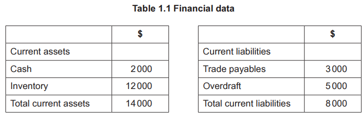
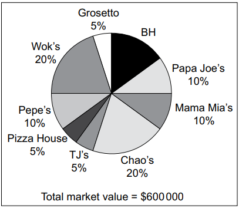

# Exam Questions — The Marketing Mix
**3. Marketing** · Cambridge (CIE) A-LEVEL business (9609)
> Source: [https://www.savemyexams.com/a-level/business/cie/23/topic-questions/](https://www.savemyexams.com/a-level/business/cie/23/topic-questions/) · 27 questions across 1 sets

## Exam Questions (39 questions)

### Q1 — easy — 1 marks

**Q1** [1 mark]

> **[case-study]**
> **Ravi's Sportswear (RS)**
> 
> Ravi founded RS in country J eight years ago. The business designs and sells sportswear and running shoes. RS employs 25 full-time staff and sells its products through its own website and a small number of selected sports retailers across country J.
> 
> Ravi has recently launched a new range of women's sportswear, targeting the growing women's fitness market in country J. He has invested heavily in digital promotion and influencer partnerships to promote the new range, which has led to high marketing expenditure in the first quarter of 2024.
> 
> RS currently uses on-the-job training to develop all new employees. Ravi is considering whether to switch to off-the-job training, which would be more expensive in the short term but would develop employees' skills more systematically.
> 
> Table 1.1 shows RS's cash flow forecast for the first three months of 2024.
> 
> **Table 1.1: RS cash flow forecast (January–March 2024)**
> 
> |   | January (\$000) | February (\$000) | March (\$000) |
> |---|---|---|---|
> | Cash inflows | 45 | 28 | 52 |
> | Cash outflows |   |   |   |
> | Cost of goods sold | 22 | 18 | 25 |
> | Wages | 12 | 12 | 12 |
> | Marketing | 15 | 5 | 5 |
> | **Total outflows** | **49** | **35** | **42** |
> | **Net cash flow** | **−4** | **−7** |   |
> | Opening balance | 12 | 8 |   |
> | **Closing balance** | **8** |   |   |

Identify **one** method of digital promotion.

### Q2 — medium — 8 marks

**Q2** [8 marks]

> **[case-study]**
> **Ravi's Sportswear (RS)**
> 
> Ravi founded RS in country J eight years ago. The business designs and sells sportswear and running shoes. RS employs 25 full-time staff and sells its products through its own website and a small number of selected sports retailers across country J.
> 
> Ravi has recently launched a new range of women's sportswear, targeting the growing women's fitness market in country J. He has invested heavily in digital promotion and influencer partnerships to promote the new range, which has led to high marketing expenditure in the first quarter of 2024.
> 
> RS currently uses on-the-job training to develop all new employees. Ravi is considering whether to switch to off-the-job training, which would be more expensive in the short term but would develop employees' skills more systematically.
> 
> Table 1.1 shows RS's cash flow forecast for the first three months of 2024.
> 
> **Table 1.1: RS cash flow forecast (January–March 2024)**
> 
> |   | January (\$000) | February (\$000) | March (\$000) |
> |---|---|---|---|
> | Cash inflows | 45 | 28 | 52 |
> | Cash outflows |   |   |   |
> | Cost of goods sold | 22 | 18 | 25 |
> | Wages | 12 | 12 | 12 |
> | Marketing | 15 | 5 | 5 |
> | **Total outflows** | **49** | **35** | **42** |
> | **Net cash flow** | **−4** | **−7** |   |
> | Opening balance | 12 | 8 |   |
> | **Closing balance** | **8** |   |   |

Analyse **two** ways RS could use promotion to increase sales of its new women's sportswear range.

### Q3 — easy — 3 marks

**Q3** [3 marks]

**Extract:**

**Sana Textiles (ST)**

Sana Textiles (ST) is a private limited company in country M that manufactures and sells premium cotton fabric. Its slogan is 'crafted for those who demand the best'. The market for fabric is very competitive, with ST facing growing pressure from cheaper foreign competitors. ST has traditionally used a price skimming strategy, targeting customers who value quality over price. However, ST has recently lost market share as more customers switch to lower-priced alternatives.

ST's products are currently sold exclusively through a network of authorised distributors across country M. The Finance Director has produced financial data for 2023, shown in Table 2.1.

**Table 2.1 ST financial data 2023**

|   |   |
|---|---|
| Average selling price per unit (\$) | 25 |
| Average variable cost per unit (\$) | 10 |
| Total fixed costs (\$000) | 180 |
| Total units sold (000) | 20 |
| Maximum capacity (000 units) | 25 |

Employee motivation at ST has become a serious concern. Many employees report that their work is repetitive and offers little opportunity for personal development. Two senior supervisors recently left to work for a competitor. ST's management is considering introducing performance-related pay to motivate the remaining workforce.

> **[case-study]**
> **Sana Textiles (ST)**
> 
> Sana Textiles (ST) is a private limited company in country M that manufactures and sells premium cotton fabric. Its slogan is 'crafted for those who demand the best'. The market for fabric is very competitive, with ST facing growing pressure from cheaper foreign competitors. ST has traditionally used a price skimming strategy, targeting customers who value quality over price. However, ST has recently lost market share as more customers switch to lower-priced alternatives.
> 
> ST's products are currently sold exclusively through a network of authorised distributors across country M. The Finance Director has produced financial data for 2023, shown in Table 2.1.
> 
> **Table 2.1 ST financial data 2023**
> 
> |   |   |
> |---|---|
> | Average selling price per unit (\$) | 25 |
> | Average variable cost per unit (\$) | 10 |
> | Total fixed costs (\$000) | 180 |
> | Total units sold (000) | 20 |
> | Maximum capacity (000 units) | 25 |
> 
> Employee motivation at ST has become a serious concern. Many employees report that their work is repetitive and offers little opportunity for personal development. Two senior supervisors recently left to work for a competitor. ST's management is considering introducing performance-related pay to motivate the remaining workforce.

Explain **one** way ST could use its place strategy to increase sales.

### Q4 — easy — 3 marks

**Q4** [3 marks]

**Extract:**

**Sana Textiles (ST)**

Sana Textiles (ST) is a private limited company in country M that manufactures and sells premium cotton fabric. Its slogan is 'crafted for those who demand the best'. The market for fabric is very competitive, with ST facing growing pressure from cheaper foreign competitors. ST has traditionally used a price skimming strategy, targeting customers who value quality over price. However, ST has recently lost market share as more customers switch to lower-priced alternatives.

ST's products are currently sold exclusively through a network of authorised distributors across country M. The Finance Director has produced financial data for 2023, shown in Table 2.1.

**Table 2.1 ST financial data 2023**

|   |   |
|---|---|
| Average selling price per unit (\$) | 25 |
| Average variable cost per unit (\$) | 10 |
| Total fixed costs (\$000) | 180 |
| Total units sold (000) | 20 |
| Maximum capacity (000 units) | 25 |

Employee motivation at ST has become a serious concern. Many employees report that their work is repetitive and offers little opportunity for personal development. Two senior supervisors recently left to work for a competitor. ST's management is considering introducing performance-related pay to motivate the remaining workforce.

> **[case-study]**
> **Sana Textiles (ST)**
> 
> Sana Textiles (ST) is a private limited company in country M that manufactures and sells premium cotton fabric. Its slogan is 'crafted for those who demand the best'. The market for fabric is very competitive, with ST facing growing pressure from cheaper foreign competitors. ST has traditionally used a price skimming strategy, targeting customers who value quality over price. However, ST has recently lost market share as more customers switch to lower-priced alternatives.
> 
> ST's products are currently sold exclusively through a network of authorised distributors across country M. The Finance Director has produced financial data for 2023, shown in Table 2.1.
> 
> **Table 2.1 ST financial data 2023**
> 
> |   |   |
> |---|---|
> | Average selling price per unit (\$) | 25 |
> | Average variable cost per unit (\$) | 10 |
> | Total fixed costs (\$000) | 180 |
> | Total units sold (000) | 20 |
> | Maximum capacity (000 units) | 25 |
> 
> Employee motivation at ST has become a serious concern. Many employees report that their work is repetitive and offers little opportunity for personal development. Two senior supervisors recently left to work for a competitor. ST's management is considering introducing performance-related pay to motivate the remaining workforce.

Explain the term 'price skimming'.

### Q5 — easy — 3 marks

**Q5** [3 marks]

> **[case-study]**
> **Electric Cars (EC) **
> 
> EC is a public limited company producing electric cars. Market research suggests that electric cars are in the early stage of the product life cycle. The demand for electric cars is likely to increase substantially in the next 10 years. EC is based in country X, where it is one of three electric car manufacturers. However, other manufacturers could start to produce electric cars if the forecast market growth is correct.
> 
> EC’s promotion has only been aimed at high income groups. The government of country X recently announced that it will support the use of electric cars. This will help EC to achieve its objective to increase sales volume by 50% over the next two years.
> 
> One year ago, EC invested \$10m in new production facilities. The investment was funded by a long-term bank loan. Interest payments on the bank loan have reduced EC’s profit margin from 9% to 4%. EC will need to cut unit costs through increased efficiency.
> 
> EC initially launched its cars using a price skimming strategy but sales growth has been slow. If EC can achieve a 50% growth in sales over the next two years, it will be in a strong financial position. This means it will be able to spend more on the development of a larger product portfolio of electric cars.
> 
> Jancie, the Finance Director, has produced forecasts for EC’s financial data over the next two years, as shown in Table 2.1.
> 
> **Table 2.1: Extract from EC’s forecast financial data**
> 
> |   | **2020 (\$m)** | **2021 (\$m)** |
> |---|---|---|
> | Inventories | 30 | 50 |
> | Cash | 10 | 20 |
> | Trade receivables | 10 | 20 |
> | Trade payables | 25 | 30 |
> | Current ratio | 2 | **X** |

Explain the term ‘product life cycle’.

*Source: November 2020 Paper 21 Q2AII*

### Q6 — easy — 2 marks

**Q6** [2 marks]

> **[case-study]**
> **Braid Runner (BR) **
> 
> Lewis is a hairdresser. He rents a small shop which he uses as a hairdressers called Braid Runner (BR). Lewis is a sole trader and he set up BR 25 years ago.
> 
> BR is the smallest of all the hairdressers in city Y. Lewis works on his own. He has repeat customers who have been using BR for many years. However, there are many large franchises in city Y which offer a much cheaper haircut than BR.
> 
> Lewis is considering increasing the price of a haircut and he has outlined the costs and revenue of the business in Table 2.1.
> 
> **Table 2.1: Costs and revenue of BR**
> 
> | Variable costs per customer | \$3.50 |
> |---|---|
> | Fixed costs per week | \$675 |
> | Price | \$8 |
> 
> Lewis would like to employ another hairdresser so that he can work fewer hours in BR. The new employee would have to be able to work in BR on their own. They would be responsible for taking bookings, dealing with customers and some financial transactions. Lewis has drawn up a person specification (see Fig. 2.1) that will be placed on a job website.
> 
> | **Characteristic** | **Essential** | **Desirable** |
> |---|---|---|
> | Qualifications | - Hairdressing qualification | - A-Levels or high school standards in Mathematics and Business |
> | Physical | - Must be between 18 and 30 years old | - Female |
> | Experience | - None required | - Experience of dealing with customers/consumers - Experience of working alone |
> | Personal qualities | - Able to work in a team - Good communication | - Friendly |

Define the term ‘price’.

*Source: November 2020 Paper 23 Q2AI*

### Q7 — easy — 3 marks

**Q7** [3 marks]

> **[case-study]**
> **Aashna’s Pies (AP) **
> 
> AP produces and sells high quality pies. Aashna set up AP five years ago when she spotted a gap in the market. AP is a private limited company and Aashna is the majority shareholder. All of the pies use the AP branding which is growing in popularity.
> 
> AP owns a factory where all the pies are produced. Pies are packaged and sold individually. The range of pies produced by AP is shown in Table 1.1.
> 
> **Table 1.1: AP’s product portfolio**
> 
> | **Name of pie** | **Filling** | **Price per pie** | **Annual change in sales quantity (2018 to 2019)** | **Stage on the product life cycle** |
> |---|---|---|---|---|
> | Meaty Marvel | Chicken and lamb | \$2.80 | +3% | Maturity |
> | Vegetarian Victory | Broccoli, cheese and carrot | \$2.50 | –10% | Decline |
> | Fishy Fortunes | Cod, prawns and cheese | \$3.00 | +20% | Growth |
> 
> The pastry case of each pie is exactly the same no matter what filling is used. All of AP’s pastry is made using flow production. However each filling is made by specialist workers who use batch production.
> 
> Aashna is concerned about the sales of Vegetarian Victory pies and she is considering stopping production of this pie. However, the Operations Director has pointed out that AP might lose its economies of scale if the business reduces the total number of pies produced.
> 
> The Marketing Director would like Aashna to read his report about developing products in the future. He has done some market research (see Fig. 1.1).
> 
> | - The price elasticity of demand for AP’s pies is price inelastic - Some consumers are worried about possible health risks of eating too much meat - The average family eats three pies per meal and chooses pies for a meal once every two weeks - The pies have a short ‘best before’ date – they must be eaten within two days of purchase - The average family has one member who does not eat meat. |
> |---|
> 
> **Fig. 1.1: Market research to aid developing products in the future**

Explain **one **way in which AP could use product portfolio analysis.

*Source: November 2020 Paper 23 Q1BII*

### Q8 — easy — 2 marks

**Q8** [2 marks]

> **[case-study]**
> **Gemini Theatre (GT) **
> 
> GT is a private limited company fully owned by the Gemini family. It owns a small theatre. This building is used to show live stage performances. Some of the performances are created by GT and some are created by visiting groups who rent the theatre. Table 2.1 shows the planned performances for January 2021.
> 
> **Table 2.1: Planned performances for January 2021**
> 
> | **Name of performance** | **Created by** | **Number of performances** | **Ticket price** | **Percentage of tickets sold** |
> |---|---|---|---|---|
> | A Summer Dream | Visiting group | 9 | \$40 | 100% |
> | Wise Owl | GT | 14 | \$15 | 60% |
> | La Poeme Ballet | GT | 5 | \$20 | 40% |
> 
> GT gains all the revenue from performances created by GT. Visiting groups must pay 50% of their total ticket revenue to GT. The theatre has a maximum of 250 tickets that can be sold for each performance.
> 
> GT uses cost-based pricing to set each ticket price for its own performances. Each performance makes a profit but the company often experiences cash flow problems.
> 
> GT needs to recruit a new Theatre Manager. The person hired will have many duties, including the responsibility for all of GT’s administration as well as some accounting. The Directors are considering two people who were both recently interviewed. Table 2.2 contains information gained from the interview process.
> 
> **Table 2.2: Information gained from the interview process**
> 
> | Nick | Portia |
> |---|---|
> | - Three years working for a similar theatre business - A Levels in Business, Art and Chinese - Very organised and efficient - No management experience - Wants to move overseas in the future | - Eight years working as a manager for a bank - No formal qualifications - Late for the interview - Good sense of humour - Looking for a long-term career |

Define the term ‘cost-based pricing'.

*Source: November 2020 Paper 22 Q2AI*

### Q9 — easy — 2 marks

**Q9** [2 marks]

Define the term ‘branding’.

*Source: November 2020 Paper 12 Q1A*

### Q10 — medium — 8 marks

**Q10** [8 marks]

Analyse **two **reasons why a business might use a price skimming strategy.

*Source: November 2020 Paper 11 Q7A*

### Q11 — easy — 3 marks

**Q11** [3 marks]

> **[case-study]**
> **Super Heroes (SH) **
> 
> SH is a leisure (theme) park aimed at 10–18 year olds. It is owned by two companies, X and Y, which started SH as a joint venture. Company X owns many leisure centres and swimming pools. Company Y owns many brands based on superheroes.
> 
> SH employs 200 full-time workers and an extra 50 seasonal workers during the busiest times of the year. The park has 10 large rides which take up 2km2 of land. There are also many smaller rides, restaurants, toilets and shops. The price of an entrance ticket is \$11 per customer. Table 1.1 shows the costs for SH in 2019.
> 
> **Table 1.1: SH costs for 2019**
> 
> | Total fixed costs (per year) | \$12m |
> |---|---|
> | Variable costs (per customer) | \$3 |
> | Total costs | \$42m |
> 
> One of the larger rides at SH is the Iron Blaster. The number of customers who use this ride has decreased each year for the last three years. This has led the management of SH to consider its options for internal growth.
> 
> *Option 1 – A new virtual reality (VR) ride* 
> This option would involve developing the Iron Blaster into a VR ride. Most of the structure of the Iron Blaster could be used but customers would be given a VR headset to wear during the ride. The cost of developing the VR ride would be \$2m. The Iron Blaster ride would be closed for a three month period during the off-peak season for the development to be carried out. No employees would be made redundant or dismissed.
> 
> *Option 2 – A new hotel *
> SH does not currently have a hotel. It could demolish the Iron Blaster to provide the space to build one. Many of the competitors of SH have a hotel near or within their leisure parks. Hotel customers would pay a high price for a room but have free access to the leisure park’s facilities. Market research suggests that the average hotel customer would spend twice as long in the leisure park than a non-hotel customer. The cost of developing the hotel would be \$15m and take a year to build. All of the employees currently working on the Iron Blaster ride would face redundancy or dismissal.

Explain **one **way in which SH could increase the sales of entrance tickets.

*Source: June 2020 Paper 23 Q1BII*

### Q12 — easy — 3 marks

**Q12** [3 marks]

> **[case-study]**
> **Hannah’s Handbags (HH) **
> 
> Hannah started HH six years ago. HH operates in a niche market providing unique bags. The bags are made using job production. As demand grew for the bags, Hannah took on a partner, her brother Kwom. They both agreed to keep the name ‘Hannah’s Handbags’ as it is an established, reputable and widely recognised brand.
> 
> HH operates from a small workshop and showroom. Customers are encouraged to visit the showroom to discuss design and materials with either Hannah or Kwom.
> 
> HH employs four highly skilled specialist production staff. Table 2.1 shows an extract from the latest income statement.
> 
> **Table 2.1: Extract of financial data for HH (year ended 30 October 2019)**
> 
> |   | **\$000** |
> |---|---|
> | Revenue | 980 |
> | Cost of sales | 588 |
> | Expenses | 245 |
> 
> **A new product **
> 
> Hannah and Kwom would like to expand the business by producing a limited number of batch produced bags to sell online. Hannah has noticed other bag producers do this successfully. The new market has many more competitors, with 15 large businesses and many small ones. The bags would have to be priced competitively. Kwom estimates that this new venture would require additional finance of \$350000. HH would also require a specialist IT provider to set up a website and a marketing agency to run a viral marketing campaign.

Explain the term ‘viral marketing’.

*Source: June 2020 Paper 21 Q2AII*

### Q13 — easy — 3 marks

**Q13** [3 marks]

Explain **one **disadvantage to a business of using price discrimination.

*Source: June 2020 Paper 11 Q4B*

### Q14 — medium — 8 marks

**Q14** [8 marks]

> **[case-study]**
> **Auto Bike (AB) **
> 
> AB is a private limited company that repairs and maintains motorbikes. AB has nine garages in country J and employs eight highly qualified mechanics in each garage.
> 
> Two of the most popular motorbike services that AB sells are the standard service and the advanced service. Table 2.1 contains price and cost information for these services.
> 
> **Table 2.1: Price and cost information**
> 
> |   | **Price** | **Direct costs per service** | **Allocated indirect costs per service** |
> |---|---|---|---|
> | Standard service | \$250 | \$50 | \$60 |
> | Advanced service | \$400 | \$60 | \$100 |
> 
> In April, AB sold 1000 standard services and 200 advanced services. The profit margin for an advanced service is higher than the standard service. The directors have decided to promote the advanced service to try and increase sales. Each garage has been given a budget to use for below the line promotion methods with an objective of increasing sales of advanced services in the next six months.
> 
> The level of motivation of the mechanics is low. Many mechanics believe that they are not paid well and the conditions of work are dirty and noisy. AB uses a time-based payment method which rewards each mechanic at the same hourly rate. In a recent survey, many mechanics complained that the payment method was unfair. They believe it rewards ‘lazy workers’ as much as those who work hard. It also does not take into account the difficulties involved in some jobs and the simplicity of others. The Human Resources Director has been asked to investigate a new payment method.

Analyse **two **below the line promotion methods that AB could use to increase the sales of advanced services.

*Source: November 2021 Paper 22 Q2C*

### Q15 — easy — 2 marks

**Q15** [2 marks]

Define the term ‘marketing mix’.

*Source: November 2021 Paper 13 Q1A*

### Q16 — medium — 8 marks

**Q16** [8 marks]

> **[case-study]**
> **Rehana Recycles (RR)**
> 
> Rehana is very environmentally aware. One year ago, Rehana identified a business opportunity to reuse waste products and set up Rehana Recycles (RR) as a sole trader.
> 
> A local company sells bottled drinks and reuses the empty glass bottles that are returned by customers. It cannot reuse any damaged bottles, so they are dumped as waste. Rehana asked this company if she could have the damaged glass bottles. The company agreed she could have them at no cost.
> 
> RR melts down the glass and makes unique vases and other glassware products. RR’s mission statement is ‘Make waste beautiful’. Rehana markets her products as ‘Lovely for the planet, lovely for you’. The business has a strong local brand image. Rehana has recently invested in marketing which focuses on her unique selling point of recycling waste.
> 
> To help satisfy demand, Rehana recently employed two local artists who are also very environmentally aware. They are skilled in making handmade glass jewellery. RR currently makes handmade products using job production. Rehana has a democratic leadership style.
> 
> Rehana has produced some financial data shown in Table 1.1.
> 
> 
> 
> As demand has grown, Rehana needs to increase her output. Rehana has identified two ways of increasing output. She could either:
> 
> - keep using job production and employ more artists to create unique glassware products using the RR brand, or
> - change to batch production and make a larger number of standardised glassware using the RR brand.

Analyse **two **benefits for RR of having a unique selling point (USP).

*Source: March 2022 Paper 22 Q1C*

### Q17 — medium — 8 marks

**Q17** [8 marks]

Analyse how a business might use the internet in **two **elements of the marketing mix.

*Source: November 2021 Paper 11 Q7A*

### Q18 — hard — 20 marks

**Q18** [20 marks]

‘The most effective way for a loss-making retail clothing business to survive is to change the price element of its marketing mix.’

Discuss whether you agree with this statement.

*Source: March 2022 Paper 12 Q6*

### Q19 — easy — 3 marks

**Q19** [3 marks]

> **[case-study]**
> **Child Play (CP) **
> 
> Su is a sole trader who started a business called CP which operates a play area for children. The play area is inside a building and includes toys and other play equipment. Customers book on CP’s website for each hour that they would like to use the play area. CP is two kilometres away from the nearest city which has a large population. Su does not pay for any promotion and she relies on recommendations and reviews from previous customers.
> 
> Su currently charges a price of \$10 an hour for a group of up to 5 children. Only one group can book CP for each hour. Demand is greater than supply so Su may increase the price to \$15 per hour. She has completed some market research to see if this is a good idea. Her findings are in Table 1.1.
> 
> **Table 1.1: Market research about prices for CP**
> 
> | **Price** | **Quantity (hours) demanded per day** |
> |---|---|
> | \$10 | 10 |
> | \$15 | 6 |
> 
> Su is also thinking about expanding the business by opening a café targeted at parents with children.
> 
> The café would be located at the entrance to CP’s play area. There are many other cafés in the city centre two kilometres away. Su believes that product differentiation is essential for the profitability of the café.
> 
> Su plans to use CP’s working capital as the source of finance to open the new café. The café will need to earn revenue quickly, so she plans to open it in four weeks. She will need quick and low‑cost promotion methods if the café is to succeed.

Explain the term ‘product differentiation’.

*Source: June 2022 Paper 23 Q1AII*

### Q20 — hard — 12 marks

**Q20** [12 marks]

> **[case-study]**
> **Priya’s Bookshop (PB) **
> 
> Priya lives in town R which is situated in beautiful countryside with nice walks nearby. Many tourists visit town R.
> 
> The town’s council would like town R to become branded as a ‘booktown’, a town with many bookshops selling new and used books. The council announced a new financial scheme offering grants to attract entrepreneurs willing to open a bookshop.
> 
> Priya applied for a grant to start up Priya’s Bookshop (PB). Part of her grant application included a cash flow forecast, shown in Table 1.1.
> 
> **Table 1.1: Cash flow forecast, first three months of trading (\$000)**
> 
> |   | Month 1 | Month 2 | Month 3 |
> |---|---|---|---|
> | Cash in: |   |   |   |
> | Owner’s capital | 15 | 0 | 0 |
> | Grant | 20 | 0 | 0 |
> | Revenue | 4 | 6 | 11 |
> | Cash out: |   |   |   |
> | Initial set up costs | 20 | 0 | 0 |
> | Utilities (power, water etc) | 0 | 1 | 2 |
> | Employee costs | 1 | 1 | 3 |
> | Purchases | 6 | 3 | 4 |
> | Marketing | 10 | 5 | 4 |
> | Opening balance | 0 | 2 | -1 |
> | Closing balance | 2 | -1 | **X** |
> 
> Priya’s grant application was successful and she opened PB well aware of the need for both cash and profit.
> 
> Priya now wants to raise awareness of PB in town R. Priya did some market research and decided to use market segmentation. This will help her to decide on the promotional methods she could use for her bookshop. See Table 1.2.
> 
> **Table 1.2: Age and gender of residents in town R**
> 
> | Age group (years) | Percentage of residents in age group | Percentage of age group who are female |
> |---|---|---|
> | 0–15 | 19% | 50% |
> | 16–64 | 63% | 55% |
> | 65+ | 18% | 60% |

Recommend suitable promotional methods that Priya could use to raise awareness of PB in town R. Justify your recommendation.

*Source: June 2022 Paper 21 Q1D*

### Q21 — medium — 8 marks

**Q21** [8 marks]

Analyse **two** advantages to a business of using online advertising.

*Source: June 2022 Paper 12 Q7A*

### Q22 — easy — 2 marks

**Q22** [2 marks]

Define the term ‘price discrimination’.

*Source: June 2022 Paper 13 Q4A*

### Q23 — hard — 12 marks

**Q23** [12 marks]

> **[case-study]**
> **Great Resources (GR) **
> 
> GR is a business partnership that creates educational resources. It sells direct to schools and teachers via its own website.
> 
> Sanjay, Rukmal and Boris are entrepreneurial teachers who formed the GR partnership. One year ago, they identified a gap in the market to supply interactive, digital resources. GR’s website is subscription only. An online marketing campaign, which used penetration pricing, attracted 250 subscribers in the first six months of operation. The start-up costs were financed with a \$5000 bank overdraft, which is GR’s only debt.
> 
> Reviews for GR’s products in teaching journals are positive but cash flow is poor. Many customers have taken advantage of a recent sales promotion for one month’s free membership and posted positive reviews. Unfortunately, few have then taken out a regular subscription.
> 
> As revenue has not increased as much as the entrepreneurs had hoped, they must now consider alternative promotion methods. They have researched possible promotion methods and decided to advertise in an educational newspaper. The newspaper has a readership of half a million people.
> 
> Expert Materials (EM) is a large national company that also advertises in the newspaper. EM is GR’s closest competitor. The EM brand is well-known and trusted in the educational resources market. Table 1.1 shows some marketing data.
> 
> **Table 1.1 Marketing data**
> 
> |   | **GR** | **EM** | **Total market** |
> |---|---|---|---|
> | Revenue (\$000) | 15 | 300 | 500 |
> | Number of customers | 300 | 5000 | 7000 |
> | Annual advertising spend (\$000) | 7.5 | 45 | 60 |

Evaluate whether price or promotion is the most important element of GR’s marketing mix.

*Source: June 2023 Paper 21 Q1D*

### Q24 — easy — 2 marks

**Q24** [2 marks]

Define the term product differentiation.

*Source: June 2023 Paper 11 Q2A*

### Q25 — medium — 3 marks

**Q25** [3 marks]

> **[case-study]**
> **Designer Clothing (DC) **
> 
> DC is a medium sized private limited company. It has been trading for 10 years. DC makes luxury dresses for women using job production methods. DC has an excellent reputation for quality. A DC designer has a meeting with every customer to design a dress that satisfies the customer’s individual needs, including choice of fabric and colour. Cost-based pricing is used with 50% added to the average cost of each dress.
> 
> DC’s employees are highly skilled and paid hourly rates (a time based method). Ikram, one of the designers, has just had a meeting with a new customer, Lydia. Lydia wants Ikram to design and make a new dress for her. Ikram has worked out the production data shown in Table 2.1 for the dress.
> 
> **Table 2.1: Production data for the dress for Lydia**
> 
> | Production time | 20 hours |
> |---|---|
> | Hourly rate | \$10 |
> | Material costs | \$250 |
> | Indirect cost allocation | \$25 |
> | Other costs such as packaging | \$25 |
> 
> Jenny, the Managing Director, wants to use DC’s excellent reputation and move into a new market. Jenny wants to create a new range of DC branded trousers for women. Jenny has developed some elements of a marketing mix for the new trousers:
> 
> - Product: quality trousers aimed at women aged 25–50
> - Distribution channel: sold in large shops
> - Promotion: branded with the DC logo
> 
> Jenny will develop a business plan when she receives the market research report, which includes feedback from a focus group. Jenny thinks that the pricing strategy DC currently uses will not be appropriate for the new trousers.
> 
> The new product range would use a batch production method. The Production Director, Khaleal, has identified the machinery needed for the new production method. Khaleal is worried about the problems that introducing the new production method might cause DC’s employees.

Calculate the price of the dress for Lydia.

*Source: Specimen 2023 Paper 2 Q2BI*

### Q26 — easy — 2 marks

**Q26** [2 marks]

Define the term ‘cost-based pricing’.

*Source: Specimen 2016 Paper 1 Q2A*

### Q27 — easy — 1 marks

**Q27** [1 mark]

> **[case-study]**
> **Barbecue House (BH) **
> 
> BH is a fast food restaurant and takeaway business, which sells a range of burgers, kebabs, pizzas and side orders. BH also has a delivery service to the local area.
> 
> BH is owned by Amir who mortgaged his home to finance the start-up of the business. Amir operates BH as a sole trader. His son also works within the business as a chef. Amir has been advised to change the legal structure of BH and to become a private limited company to protect the business and himself.
> 
> BH is located on a busy high street. There are many other similar businesses on the high street and in the surrounding area. Amir knows that the continued success of the business requires him to identify a gap in the market and develop a unique selling point (USP). Amir has carried out some market research (see Table 1.1 and Fig. 1.1).
> 
> **Table 1.1: Market research data about competitors within 2 km of BH**
> 
> | Total number of competitors | 8 |
> |---|---|
> | Number of competitors who offer delivery services | 4 |
> | Number of competitors who do not sell Asian food | 6 |
> 
> 
> 
> **Fig. 1.1: Market share data for competitors within 2 km of BH**
> 
> The two market leaders are Wok’s and Chao’s. Both businesses specialise in Asian food but neither has a delivery service. Amir would like to increase BH’s market share. He is considering starting to sell Asian food. None of his employees have any experience cooking or selling Asian food but Amir believes that the possible increase in income would be worth any extra costs.

Identify **one **benefit for a business of a unique selling point (USP).

*Source: Specimen 2023 Paper 2 Q1AI*

