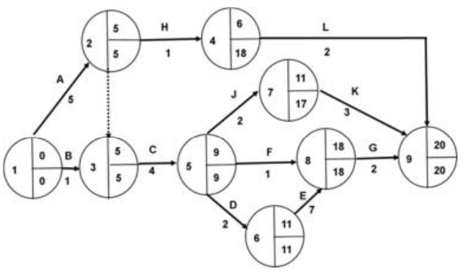

# Mark Schemes — Operations Strategy (A Level)
**4. Operations Management** · Cambridge (CIE) A-LEVEL business (9609)

## Exam Questions (21 questions)

### Q1
A network diagram is a chart showing all the activities required to complete a project in the order they must be carried out **[1]**, including which activities cannot begin until others have been finished **[1]**

> **[mark-scheme]**
> Define requires a clear statement of the meaning of the term
> 
> An example alone is not sufficient for full marks but can support a partial definition for 1 mark
> 
> **Indicative content**
> 
> - A network diagram maps the activities in a project, their durations and the sequence in which they must occur
> - A network diagram shows the order and dependencies of project activities, allowing the shortest possible completion time to be identified
> - A network diagram is a diagram of activities and nodes representing how the stages of a project relate to one another in time

> **[exam-tip]**
> A list of tasks is not a network diagram. What the diagram adds is dependency: which activities must wait for others and which can run alongside them. That is the whole reason it can reveal a critical path, so build the idea of one activity depending on another into your definition.

### Q2
Lean production aims to eliminate waste, including spare inventory, spare capacity and spare time **[1]**. Because so little slack remains in the system, a disruption such as a late delivery or a machine breakdown cannot be absorbed **[1]**. Production stops almost immediately rather than continuing from reserves, so the business loses output at exactly the point when it has no spare capacity to catch up, and may miss customer deadlines it has already committed to **[1]**

> **[mark-scheme]**
> Explain requires a clear statement of meaning (AO1) supported by contextual development (AO2)
> 
> - Valid AO1 is awarded 1 mark
> - Valid AO2 is awarded up to 2 marks
> 
> **Indicative content**
> 
> AO1
> 
> - Lean production is an approach aiming to eliminate all forms of waste from the production process
> 
> AO2
> 
> - Minimal inventory means a late delivery halts production almost at once
> - Removing spare capacity leaves no means of catching up once output has been lost
> - Heavy dependence on suppliers delivering on time transfers risk the business cannot control
> - Continuous pressure to eliminate waste can be stressful for employees and raise turnover
> - Introducing lean methods requires training and cultural change that take time and money before any saving appears
> 
> Accept any other valid response.

> **[exam-tip]**
> The limitation of lean is the flip side of its strength. The slack it removes is exactly what a business would otherwise use to absorb a problem, so efficiency and resilience pull against each other. Framing your answer that way gives you a proper chain rather than a general observation that lean can go wrong.

### Q3
Artificial intelligence uses computer systems to find patterns in data and make predictions from them **[1]**. In operations it can analyse records of machine performance to predict when a component is likely to fail **[1]**. The business can then replace that component during planned downtime rather than after a breakdown halts production, avoiding both the lost output and the rushed repair costs that an unexpected failure brings **[1]**

> **[mark-scheme]**
> Explain requires a clear statement of meaning (AO1) supported by contextual development (AO2)
> 
> - Valid AO1 is awarded 1 mark
> - Valid AO2 is awarded up to 2 marks
> 
> **Indicative content**
> 
> AO1
> 
> - Artificial intelligence uses computer systems to identify patterns in data and make predictions from them
> 
> AO2
> 
> - Analysing machine performance data allows failures to be predicted and repairs scheduled into planned downtime
> - Demand forecasting from sales patterns lets production and inventory be planned more accurately
> - Automated visual inspection can identify defects more consistently than human checking
> - Scheduling systems can allocate jobs across machines to reduce changeover time
> - Analysis of delivery and supplier data can identify which suppliers cause the most disruption
> 
> Accept any other valid response.

> **[exam-tip]**
> Artificial intelligence is not the same as automation. A robot arm repeating a fixed movement is automation; AI is the system predicting when that arm will need servicing. The marks here go to answers describing something being predicted or learned from data, so make sure yours does more than replace a person with a machine.

### Q4
An ERP system holds information from every function of a business in one integrated system **[1]**. When a sales order is entered, the production and purchasing departments see the requirement immediately rather than waiting for it to be passed on **[1]**. Materials can then be ordered and production scheduled against actual demand instead of estimates, so the business holds less inventory while being less likely to run short, cutting storage costs and lost sales at the same time **[1]**

> **[mark-scheme]**
> Explain requires a clear statement of meaning (AO1) supported by contextual development (AO2)
> 
> - Valid AO1 is awarded 1 mark
> - Valid AO2 is awarded up to 2 marks
> 
> **Indicative content**
> 
> AO1
> 
> - An ERP system integrates information across all functions of a business into one shared system
> 
> AO2
> 
> - Sales orders are visible to production and purchasing immediately, so materials are ordered against real demand
> - Lower inventory levels reduce storage costs while shortages become less likely
> - Accurate, shared data on capacity allows production to be scheduled where spare capacity exists
> - Costing and pricing decisions draw on current figures rather than out-of-date departmental records
> - Management sees the position of the whole business at once, so problems are spotted sooner
> 
> Accept any other valid response.

> **[exam-tip]**
> ERP touches almost everything a business does, which makes a general answer very easy to write and worth very little. Choose one function, whether inventory, capacity or pricing, and follow the improvement through in that area alone. A narrow answer developed properly beats a broad one every time.

### Q5
Enterprise Resource Planning is a single integrated software system that manages information across all the main functions of a business **[1]**, so that data entered in one area, such as sales, is immediately available to others, such as production and finance **[1]**

> **[mark-scheme]**
> Define requires a clear statement of the meaning of the term
> 
> An example alone is not sufficient for full marks but can support a partial definition for 1 mark
> 
> **Indicative content**
> 
> - Enterprise Resource Planning is software linking a business's functions into one system sharing a common set of data
> - Enterprise Resource Planning integrates information on inventory, production, sales, purchasing and finance so all areas work from the same figures
> - Enterprise Resource Planning is a system that replaces separate departmental records with one shared database covering the whole business

> **[exam-tip]**
> The word doing the work here is "integrated". A business with separate systems for sales, stock and payroll has software, but not an ERP. What makes it an ERP is that the systems are one system, so an entry in one function updates the others. Get that idea in and the second mark follows.

### Q6
One benefit is faster and more accurate design **[K]**. CAD allows a business to produce accurate 2D or 3D drawings quickly and try out different designs before committing to one. This could reduce the time and cost spent on developing a new product, helping the business bring new products to market faster than competitors **[An]**. This speed advantage could be especially valuable in a fast-moving market **[Ap]**, where being first to launch a new design can help the business win customers before rivals catch up **[An]**

Another benefit is fewer errors reaching production **[K]**. CAD gives a clear visual of the final product before it is made, so faults can be spotted early. This could reduce costly mistakes and wasted materials during manufacturing **[Ap]**, improving the overall quality of the finished product and reducing the chance of customer complaints **[An]**. Higher and more consistent quality could also help build the business's reputation over time, making customers more likely to return or recommend the business to others **[An]**

> **[mark-scheme]**
> - An 8-mark analyse question requires two developed points, each with knowledge of a relevant concept, applied to the business context, and followed by a chain of reasoning that explains the causes, impacts or consequences for the business
> - This is a 'Level of response' answer where the examiner judges how well you have displayed the key skills of knowledge, application and analysis
> 
> | **Level** | **Knowledge** | **Application** | **Analysis** |
> |---|---|---|---|
> | **2** | **2 marks**  - The answer shows knowledge of **two** relevant points that answer the question | **2 marks**  - The answer links **two** relevant points to the business in the case study | **4 marks**  - The answer clearly explains the causes, impacts or consequences of **two** points |
> | **3 marks**  - The answer clearly explains the causes, impacts or consequences of **one** point |   |   |   |
> | **1** | **1 mark**  - The answer shows knowledge of **one** relevant point that answers the question | **1 mark**  - The answer links **one** relevant point to the business in the case study | **2 marks**  - The answer makes a basic attempt to explain the causes, impacts or consequences of **two** points. |
> | **1 mark**  - The answer makes a basic attempt to explain the causes, impacts or consequences of **one** point |   |   |   |
> 
> **Indicative content**
> 
> - CAD allows a business to produce fast and accurate 2D or 3D drawings and models, so designers can try out a variety of designs quickly
> 
>   - This could reduce the time and cost spent on product development, allowing the business to bring new products to market faster than using traditional design methods.
> - CAD gives a clear visualisation of the final product and its individual parts before it is made, so any design faults are more likely to be spotted early
> 
>   - This could reduce the number of errors that reach production, improving the quality of the final product and reducing costly reworking or wasted materials.
> - CAD systems can be linked directly to CAM machines, so designs can be sent straight from the computer to production
> 
>   - This could speed up the whole process from design to manufacture, helping the business respond more quickly to customer demand or changes in the market.
> - CAD data can be easily shared between departments, such as design, marketing and production, via email or a shared system
> 
>   - This could improve communication and coordination within the business, reducing misunderstandings and delays caused by departments working from different or outdated information.
> 
> Accept any other valid response.

### Q7
Process innovation means changing how a business makes its products, often using new technology or methods **[1]**. For a manufacturing business, this could mean introducing more automation into production **[1]**. This can reduce how much it relies on labour and cut down on downtime, so the business can produce more output at a lower cost **[1]**

> **[mark-scheme]**
> Explain requires a clear statement of meaning (AO1) supported by contextual development (AO2)
> 
> - Valid AO1 is awarded 1 mark
> - Valid AO2 is awarded up to 2 marks
> 
> **Indicative content**
> 
> AO1
> 
> - Process innovation means introducing a new or significantly improved method of producing or delivering goods, such as new technology or a new production process.
> 
> AO2
> 
> - A manufacturing business could change its production process, for example moving from batch to flow production, allowing higher output to be produced more quickly and at a lower cost per unit.
> - A business could use more technology, such as automation, to reduce production downtime and reduce reliance on labour, which lowers costs and increases output.
> - A business could improve its inventory management, such as introducing JIT, reducing the amount of money tied up in stock and cutting storage costs.
> 
> Accept any other valid response.

### Q8
(i)

Node 3: EST = 5** [1]**
LFT = 5** [1]**

Node 4: EST = 6** [1]**
LFT = 18** [1]**

(ii)

ACDEG** [1]**

(iii)

20 weeks** [1]**

> **[mark-scheme]**
> - One mark is available for each correct answer
> - You do not need to draw the completed network diagram

### Q9
Operational flexibility means a business can change how it produces goods to meet different needs **[1]**. For a large furniture manufacturer, this is important because it may get both big orders from retailers and smaller, custom orders **[1]**. Being flexible means it can produce both types without losing the smaller, possibly more profitable, orders **[1]**

> **[mark-scheme]**
> Explain requires a clear statement of meaning (AO1) supported by contextual development (AO2)
> 
> - Valid AO1 is awarded 1 mark
> - Valid AO2 is awarded up to 2 marks
> 
> **Indicative content**
> 
> AO1
> 
> - Operational flexibility means the ability of a business to adapt its production process to changes in demand, design or order size.
> 
> AO2
> 
> - A large furniture manufacturer needs to match or better competitors' offerings on design or delivery time, so flexibility allows it to update product ranges or speed up production to keep up with rival businesses.
> - Flexibility allows a large furniture manufacturer to meet small or customised orders as well as large ones, so it does not miss out on potentially profitable one-off or bespoke orders just because it is set up mainly for mass production.
> - Long delivery times can lead to lost customers, so a flexible manufacturer can adjust production to reduce delays and keep customers satisfied.
> 
> Accept any other valid response

### Q10
One disadvantage is the high initial cost** [K]**. Computer-controlled machinery is expensive to buy and install. For a small manufacturing business, this could be very difficult to afford and may mean the business has to borrow money, increasing its financial risk if the investment does not pay off as quickly as expected **[An]**. This could also reduce the funds available for other important areas, such as marketing or staff training, which could hold back the growth of the business** [Ap] [An]**

Another disadvantage is that CAM might not suit a business whose products are handmade** [K]**, like furniture or home decorations** [Ap]**. If being handmade is the business's unique selling point, introducing CAM could take this away. This could make the business less competitive, as customers who valued the handmade quality might buy from a different business instead **[An]**. Over time, this loss of customers could reduce the business's revenue and damage its brand image in a market where it previously stood out **[An]**

> **[mark-scheme]**
> - An 8-mark analyse question requires two developed points, each with knowledge of a relevant concept, applied to the business context, and followed by a chain of reasoning that explains the causes, impacts or consequences for the business
> - This is a 'Level of response' answer where the examiner judges how well you have displayed the key skills of knowledge, application and analysis
> 
> | **Level** | **Knowledge** | **Application** | **Analysis** |
> |---|---|---|---|
> | **2** | **2 marks**  - The answer shows knowledge of **two** relevant points that answer the question | **2 marks**  - The answer links **two** relevant points to the business in the case study | **4 marks**  - The answer clearly explains the causes, impacts or consequences of **two** points |
> | **3 marks**  - The answer clearly explains the causes, impacts or consequences of **one** point |   |   |   |
> | **1** | **1 mark**  - The answer shows knowledge of **one** relevant point that answers the question | **1 mark**  - The answer links **one** relevant point to the business in the case study | **2 marks**  - The answer makes a basic attempt to explain the causes, impacts or consequences of **two** points. |
> | **1 mark**  - The answer makes a basic attempt to explain the causes, impacts or consequences of **one** point |   |   |   |
> 
> **Indicative content**
> 
> - CAM involves buying and installing expensive computer-controlled machinery, so the initial cost can be very high for a small manufacturing business
> 
>   - This could strain the business's cash flow or require significant borrowing, increasing financial risk if the investment does not pay off quickly.
> - Existing staff may not have the skills needed to operate CAM equipment, which could lead to redundancies
> 
>   - This is costly to the business in redundancy payments and could also damage its reputation with the local community, potentially affecting future recruitment or even customer loyalty.
> - A business may need to recruit new, more highly skilled employees to operate and maintain the CAM equipment
> 
>   - Even though fewer employees might be needed overall, these skilled workers are likely to demand higher wages, which could increase the business's wage bill per employee.
> - CAM may not suit all small manufacturers
> 
>   - A business that makes handmade products, such as furniture or home decorations, could lose its unique selling point (USP) of being handmade if it introduces CAM, which could make it less competitive if customers specifically value the handmade nature of its products.
> 
> Accept any other valid response.

### Q11
Operational flexibility is important for a multinational car manufacturer because it operates in many different countries with different customer needs **[K]**. Being able to change production volumes or adapt models **[Ap]** to suit local tastes means the manufacturer can respond quickly to demand **[An]**, rather than producing cars that customers in a particular country do not want. This can help the business avoid wasted resources and lost sales **[An]**

Innovation is also important, especially in research and development **[K]**. Coming up with new, more cost-effective or sustainable components can reduce production costs and help the car manufacturer build a good brand image, which matters a lot in such a competitive industry **[Ap]** **[An]**. Being flexible and innovative can help a car manufacturer create a unique selling point that helps it stand out from competitors **[An]**

However, how important this is may depend on the country the manufacturer operates in **[E]**, as some markets are more competitive or demanding than others **[K]**. It could also be argued that because most car manufacturers now include lots of innovative features as standard **[Ap]**, it is harder to gain a real advantage just from innovation alone **[E]**. Overall, I think flexibility and innovation are very important for a multinational car manufacturer to stay competitive globally, but they need to be combined with strong marketing and financial management to be fully effective, since production alone does not guarantee success in such a competitive market **[E]**

> **[mark-scheme]**
> - This is a 'Level of response' answer where the examiner judges how well you have displayed the key skills of knowledge and application, analysis and evaluation
> - A full-mark answer will include
> 
>   - Strong knowledge applied to the question stem throughout
>   - Detailed interconnected points with logical chains of reasoning
>   - Evaluation of relevant issues which leads to a conclusion supported by strong reasoning
>   - The importance of at least two points must be identified and analysed
> 
> **Knowledge and application**
> 
> | **Mark** | **Descriptor** |
> |---|---|
> | **4** | - Shows understanding of two reasons for the importance of operational flexibility and innovation to a multinational car manufacturer |
> | **3** | - Shows understanding of one reason for the importance of operational flexibility and innovation to a multinational car manufacturer |
> | **2** | - Shows knowledge of two reasons for the importance of operational flexibility and innovation to a multinational car manufacturer |
> | **1** | - Shows understanding of one reason for the importance of operational flexibility and innovation to a multinational car manufacturer |
> 
> **Analysis and evaluation**
> 
> | **Mark** | **Descriptor** |
> |---|---|
> | **8** | - Justified recommendation with developed weighing of key arguments in business context |
> | **7** | - Justified recommendation based on arguments in context |
> | **6** | - Developed recommendation based on arguments in context |
> | **5** | - An evaluative statement or recommendation based on arguments in context |
> | **4** | - Argument based on two reasons for the importance of operational flexibility and innovation to a multinational car manufacturer |
> | **3** | - Argument based on one reason for the importance of operational flexibility and innovation to a multinational car manufacturer |
> | **2** | - Analysis based on two reasons for the importance of operational flexibility and innovation to a multinational car manufacturer |
> | **1** | - Analysis based on one reason for the importance of operational flexibility and innovation to a multinational car manufacturer |
> 
> **Indicative content **
> 
> - Operational flexibility is the ability of a manufacturer to vary the level of production and range of products in response to consumer demands
> 
>   - For a car manufacturer, this could mean adjusting production volumes or delivery times for specific models, which helps it respond quickly to changes in demand across different countries and avoid over- or under-producing certain models, reducing wasted resources or lost sales.
> - A multinational car manufacturer operates across many countries with different consumer tastes and cultures, so flexible, well-informed management and workers are needed to adapt models or features to local markets
> 
>   - This can help the manufacturer better meet the needs of each market, increasing sales and competitiveness compared with a rigid, one-size-fits-all approach.
> - Operational innovation means using new or improved production processes, often coming from a flexible, learning research and development (R&D) environment
> 
>   - Creative thinking in R&D can lead to more cost-effective or sustainable components, which could reduce production costs or improve the manufacturer's environmental image, both important in a highly competitive car market.
> - Flexible and innovative working across manufacturing can help create a unique selling point (USP), competitive advantage, or distinctive brand image
> 
>   - Without this, a car manufacturer risks becoming disconnected from changing market demands and unresponsive to competitors who innovate faster, potentially losing market share.
> 
> **Evaluation**
> 
> - Flexibility and innovation could be seen as essential for a car manufacturer to survive in such a highly competitive global market.
> - However, their importance may depend on which country the manufacturer is operating in, as consumer expectations and competitive pressure vary between markets.
> - It could also be argued that since so many manufacturers now include innovative features as standard, genuine innovation opportunities (and therefore competitive advantage from innovation alone) may be more limited than they first appear.
> - Flexibility and innovation are not confined to production - their importance should also be weighed against other business functions, such as marketing and finance, which also play a major role in a car manufacturer's success.
> 
> Accept any other valid response.

### Q12
> **[mark-scheme]**
> **A C D F K**** [1]**
> 
> Identify requires you to name or state a relevant barrier; no further explanation is needed.
> 
> **Indicative content**
> 
> - A C D F K is the only valid answer

### Q13
Product and process innovation has clearly helped TK grow so far **[E]**. Being an early adopter of the smartphone app, which most orders now come through, has helped TK stand out from other delivery companies **[K]**, and its patented recyclable packaging supports its promise of high-quality meals **[Ap]**, which matters a lot since customers never see TK's food being made. This innovation is likely to keep helping TK's future profitability by keeping customers loyal and attracting new ones in a market with growing competition **[Ap] [An]**

However, innovation is not always successful and can carry real risk **[K]**. When a social media review made demand for the vegan curry meal suddenly spike, TK's kitchens could not keep up, and some customers were left disappointed **[Ap]**. This shows that new menu ideas alone do not guarantee more profit if operations cannot support them **[An]**. The planned ADV trial is another example: it could cut delivery costs and support profitability if it works, but it costs \$1.5m and is unproven, so it could turn out to be an expensive failure that TK has to fund through more borrowing, especially as TK already has a \$15m loan **[Ap] [An]**

Innovation's importance to TK's future profitability also depends on other factors **[K]**. Even a great new packaging idea or menu item needs good marketing so customers know about it and needs kitchens with enough capacity and inventory control to actually deliver it, which the vegan curry problem shows is not always the case **[Ap] [E]**

Overall, I think product and process innovation is very important to TK's future profitability **[E]**, because it is central to how TK differentiates itself from competitors in a crowded market **[Ap]**. However, its importance depends on TK also getting its operations right, since the vegan curry example shows that innovation without the ability to deliver on it can actually damage sales and reputation instead of growing profit **[E]**. TK should keep innovating, but also invest in improving inventory and production planning so that new ideas can be properly delivered to customers **[E]**

> **[mark-scheme]**
> - This is a 'Level of response' answer where the examiner judges how well you have displayed the key skills of knowledge, application, analysis and evaluation
> - A full-mark answer will include
> 
>   - Strong knowledge applied to the business context or question stem throughout
>   - Detailed interconnected points with logical chains of reasoning
>   - Evaluation of relevant issues which leads to a conclusion supported by strong reasoning
>   - The importance of at least two points must be identified and analysed
> 
> **Knowledge and application**
> 
> | **Mark** | **Descriptor** |
> |---|---|
> | **4** | - Shows understanding of two implications in context |
> | **3** | - Shows understanding of one implication in context |
> | **2** | - Shows knowledge of two implications |
> | **1** | - Shows knowledge of one implication |
> 
> **Analysis and evaluation**
> 
> | **Mark** | **Descriptor** |
> |---|---|
> | **8** | - Justified recommendation with developed weighing of key arguments in business context |
> | **7** | - Justified recommendation based on arguments in context |
> | **6** | - Developed recommendation based on arguments in context |
> | **5** | - An evaluative statement or recommendation based on arguments in context |
> | **4** | - Argument based on two implications in context |
> | **3** | - Argument based on one implication in context |
> | **2** | - Analysis of two implications |
> | **1** | - Analysis of one implication |
> 
> **Indicative content**
> 
> - Innovation means developing new or updated products and processes to maintain or improve competitive advantage
> 
>   - TK has been at the forefront of innovation in food delivery, being an early adopter of the smartphone app through which most orders are now placed, which has helped differentiate TK from competitors and supported the growth in revenue and profit seen since 2019.
> - TK's patented recyclable packaging keeps meals hot and in good condition, supporting its USP of high quality food
> 
>   - Since TK never sees customers face-to-face, this innovation is important for building trust, but developing it was costly, which reduces short-term profit and dividends even if it protects profitability in the long run.
> - Menu innovation, such as introducing vegan dishes, allows TK to respond to changing social trends like fewer people eating meat and more people ordering deliveries
> 
>   - However, when demand suddenly surged for the vegan curry meal after a social media review, kitchens could not produce enough, showing that a good product innovation can fail to convert into extra profit if operations cannot keep up with it.
> - The planned \$1.5m trial of automated delivery vehicles (ADVs) is a process innovation aimed at faster, lower-cost delivery
> 
>   - If successful, this could significantly cut delivery costs and boost future profitability, but it is unproven and would need financing through further borrowing or a new share issue, so it carries real risk of being a costly failure with no return.
> 
> **Evaluation**
> 
> - Continuing innovation is likely to remain important for TK to keep its competitive edge as competition increases, but its importance depends on other factors too, such as marketing (customers need to know about new products) and operational efficiency (e.g. the Operations Director's interest in JIT to reduce food wastage).
> - The vegan curry example shows that innovation's benefit to profitability depends on TK's ability to respond flexibly and plan for unexpected demand - good ideas alone do not guarantee profit without strong execution.
> - There is a risk that too much menu innovation could threaten TK's core USP of consistent "customer favourites," so innovation needs to be balanced rather than constant.
> 
> Accept any other valid response

### Q14
One benefit is a reduction in rejected output **[K]**. Khalid reported that 5% of the Hydrocamel factory's output is rejected **[Ap]**. Kaizen gives employees responsibility to find and fix problems in their own work through kaizen groups. This could reduce the number of faulty products made, cutting waste costs and helping Amandi's aim of keeping costs low **[An]**. Fewer rejected Hydrocamels would also mean more finished units are available to sell, which could help WTZ meet Kofi's target of increasing sales to 50,000 units a year **[An]**

Another benefit is reduced absenteeism **[K]**. Khalid also reported that absenteeism is increasing at the factory. Kaizen gives employees more responsibility, which can increase their motivation, similar to Herzberg's theory. More motivated employees are likely to take fewer days off work, meaning less disruption to production and less pressure on other employees who would otherwise have to cover for absent colleagues **[An]**. This could help productivity rise steadily over time, which is important since Khalid noted that productivity is not currently increasing at the factory **[Ap] [An]**

> **[mark-scheme]**
> - An 8-mark analyse question requires two developed points, each with knowledge of a relevant concept, applied to the business context, and followed by a chain of reasoning that explains the causes, impacts or consequences for the business
> - This is a 'Level of response' answer where the examiner judges how well you have displayed the key skills of knowledge, application and analysis
> 
> | **Level** | **Knowledge** | **Application** | **Analysis** |
> |---|---|---|---|
> | **2** | **2 marks**  - The answer shows knowledge of **two** relevant points that answer the question | **2 marks**  - The answer links **two** relevant points to the business in the case study | **4 marks**  - The answer clearly explains the causes, impacts or consequences of **two** points |
> | **3 marks**  - The answer clearly explains the causes, impacts or consequences of **one** point |   |   |   |
> | **1** | **1 mark**  - The answer shows knowledge of **one** relevant point that answers the question | **1 mark**  - The answer links **one** relevant point to the business in the case study | **2 marks**  - The answer makes a basic attempt to explain the causes, impacts or consequences of **two** points. |
> | **1 mark**  - The answer makes a basic attempt to explain the causes, impacts or consequences of **one** point |   |   |   |
> 
> **Indicative content**
> 
> - Kaizen involves teamworking through kaizen groups, giving employees at the Hydrocamel factory the responsibility to identify and solve problems themselves
> 
>   - Since Khalid has reported that 5% of output is currently rejected, empowering workers to find and fix causes of faults could reduce this rejection rate, cutting waste costs and helping meet Amandi's focus on minimising costs.
> - Kaizen makes small, incremental improvements based on employees' own knowledge of their work
> 
>   - Because productivity at the Hydrocamel factory is not currently increasing, giving workers the responsibility to suggest efficiency improvements could raise productivity, which would lower the unit cost of producing each Hydrocamel and support WTZ's profit margins.
> - Increased employee responsibility under Kaizen can improve motivation (linking to Herzberg's motivators)
> 
>   - Since Khalid has reported increasing absenteeism at the factory, more engaged and motivated employees are likely to take fewer days off, reducing disruption to production and the pressure placed on other staff covering absences.
> - Kaizen groups can also address WTZ's inefficient collection of recycled materials and high inventory levels
> 
>   - By empowering employees closest to these processes to suggest improvements, WTZ could reduce the amount of cash tied up in inventory, freeing up working capital, which is a current concern given WTZ's falling cash balance (from \$0.4m to \$0.2m).
> 
> Accept any other valid response.

### Q15
Lead time is the amount of time between an order being placed** [1]** and the goods being delivered** [1]**

> **[mark-scheme]**
> Define requires a clear statement of the meaning of the term
> 
> An example alone is not sufficient for full marks but can support a partial definition for 1 mark
> 
> **Indicative content**
> 
> - The period of time between the start of a process and the completion of that process, such as the time between placing an order and receiving the goods.
> - The amount of time it takes from when an order is placed to when it is delivered or fulfilled.
> - The time delay between the start and end of a business process, e.g. from ordering raw materials to them arriving at the business

### Q16
Computer aided manufacture is when technology, like computer-controlled machines or robots **[1]**, is used to make or improve products **[1]**

> **[mark-scheme]**
> Define requires a clear statement of the meaning of the term
> 
> An example alone is not sufficient for full marks but can support a partial definition for 1 mark
> 
> **Indicative content**
> 
> - The use of technology/software/robots/machines to create, produce or manufacture products, or to improve the production process.
> - The use of computer-controlled machinery or robots to directly carry out the manufacture of products.
> - Technology that controls and operates machinery used to make products, often with little or no human involvement

### Q17
Sanjay should prioritise fixing LH's IT security first. The cyber-attack destroyed all customer data and corrupted 75% of LH's systems, which is a major reason for LH's damaged reputation **[Ap]**, as shown by the negative online reviews. Investing in new, secure IT systems would help stop another attack happening and start to rebuild customer trust **[An]**. However, this kind of investment is likely to be expensive and could take a long time to put in place, meaning LH could keep losing customers to competitors in the meantime **[An]**

At the same time, Sanjay needs to deal with the quality control problems shown in the reviews, like wrong hamper contents and poor customer service **[Ap]**. LH could introduce proper quality assurance and try to rebuild a strong supplier base, similar to the reliable national suppliers PS brought to the business **[Ap]**. The problem is that a lot of LH's supplier information was also lost in the cyber-attack, so this could take time to fix properly, and existing supplier contracts may not be easy to change quickly **[An]**

A big constraint on Sanjay's plans is LH's financial position **[K]**. Gearing has risen to 85% and the acid test ratio has fallen to just 0.2:1 **[Ap]**, showing LH has very little short-term cash available and is already relying heavily on debt. This makes it risky for LH to borrow even more money to fund a full IT and quality overhaul all at once **[An]**

Overall, I would advise Sanjay to focus first on restoring IT security and recovering essential data **[E]**, since this is the most urgent cause of LH's reputational damage and lost trust. Quality control and supplier issues should be tackled in a second phase, once LH's finances allow it, because trying to fund everything immediately would be too risky given LH's high gearing and weak liquidity **[Ap]** **[E]**. Getting the basics of trust and security right first gives LH the best chance of stopping further customer loss before investing more heavily in longer-term improvements **[E]**

> **[mark-scheme]**
> - This is a 'Level of response' answer where the examiner judges how well you have displayed the key skills of knowledge and application, analysis and evaluation
> - A full-mark answer will include
> 
>   - Strong knowledge applied to the business context or question stem throughout
>   - Detailed interconnected points with logical chains of reasoning
>   - Evaluation of relevant issues which leads to a conclusion supported by strong reasoning
>   - The importance of at least two points must be identified and analysed
> 
> **Knowledge and application**
> 
> | **Mark** | **Descriptor** |
> |---|---|
> | **5** | - Developed knowledge of relevant key term(s) and/or factor(s) is used to answer the question - Developed application of relevant point(s) to the business context |
> | **4** | - Partially-developed knowledge of relevant key term(s) and/or factor(s) is used to answer the question - Developed application of relevant point(s) to the business context |
> | **3** | - Partially-developed knowledge of relevant key term(s) and/or factor(s) is used to answer the question - Limited application of relevant point(s) to the business context |
> | **2** | - Limited knowledge of relevant key term(s) and/or factor(s) is used to answer the question - Limited application of relevant point(s) to the business context |
> | **1** | - Limited knowledge of relevant key term(s) and/or factor(s) is used to answer the question |
> 
> **Analysis and evaluation**
> 
> | **Marks** | **Descriptor** |
> |---|---|
> | **12-15** | - Developed analysis of the overall strategy that identifies connections between causes, impacts and/or consequences - A developed judgement/conclusion is made in the business context that draws together developed evaluative comments which weigh up some key arguments in the business context |
> | **7-11** | - Developed analysis of individual strategic element(s) that identifies connections between causes, impacts and/or consequences - A developed judgement/ conclusion is made - Developed evaluative comments which weigh up some key arguments |
> | **1-6** | - Limited analysis that identifies connections between causes, impacts and/or consequences - A judgement/conclusion is made with limited supporting comment/evidence. • An attempt is made to weigh up the arguments |
> 
> **Indicative content **
> 
> - The 2023 cyber-attack corrupted 75% of LH's IT systems and destroyed all customer data
> 
>   - Investing in new, secure IT systems (and possibly ERP) could rebuild customer trust and reduce the risk of a repeat attack, but this is likely to be costly and slow to implement, during which time competitors could take advantage and win over LH's damaged customer base.
> - Online reviews show customers are unhappy about wrong hamper contents and poor customer service, and LH's quality control procedures were already flagged as outdated in 2022
> 
>   - Introducing quality assurance and rebuilding a reliable supplier base (drawing on PS's "wide range of reliable national suppliers" from the 2018 SWOT) could directly reduce these complaints, but LH's supplier data was also largely lost in the cyber-attack, meaning this could take significant time to rebuild from scratch.
> - LH's financial position has weakened sharply since the PS takeover
> 
>   - Gearing has risen to 85% and the acid test ratio has fallen to 0.2:1, with dividend per share collapsing from \$5 in 2017 to \$0.5 in 2020 — this severely limits how much new investment Sanjay can fund without taking on even more debt, which is risky given gearing is already very high.
> - LH also has an opportunity to improve coordination between departments through ERP, linking data across the business
> 
>   - This could help prevent the kind of fragmented systems that made LH vulnerable to the cyber-attack, though implementing ERP is itself expensive and could disrupt day-to-day operations while it is introduced.
> 
> **Evaluation**
> 
> - Sanjay must consider how much time LH realistically has - can the business keep operating and serving customers while a new strategy is rolled out, especially given the reputational damage already done?
> - The scale of the response should reflect LH's very limited financial resources (weak acid test ratio, high gearing) - this may mean a phased approach is more realistic than trying to fix everything (IT, suppliers, quality control) at once.
> - Much of the strategy depends on LH's ability to find and rebuild relationships with reliable suppliers, which is uncertain given the loss of supplier data.
> 
> Accept any other valid response

### Q18
One limitation is that CPA relies on accurate time estimates **[K]**, but DL has never done a project like this before. This means the time given for training workers on the new computerised production lines could be wrong **[An]**. Since there is only a two-week float before the summer season deadline **[Ap]**, even a small delay in training could mean DL misses its 20-week target completion time **[An]**

Another limitation is that CPA does not consider qualitative factors **[K]**, like how workers feel. The operations manager is worried about the impact on production line workers. If workers resist the change or worry about losing their jobs, this could cause delays or disruption **[An]** that the CPA diagram does not show, even though DL's factories are already running at 90% capacity **[Ap]** and cannot easily afford production downtime **[An]**

> **[mark-scheme]**
> - An 8-mark analyse question requires two developed points, each with knowledge of a relevant concept, applied to the business context, and followed by a chain of reasoning that explains the causes, impacts or consequences for the business
> - This is a 'Level of response' answer where the examiner judges how well you have displayed the key skills of knowledge, application and analysis
> 
> | **Level** | **Knowledge** | **Application** | **Analysis** |
> |---|---|---|---|
> | **2** | **2 marks**  - The answer shows knowledge of **two** relevant points that answer the question | **2 marks**  - The answer links **two** relevant points to the business in the case study | **4 marks**  - The answer clearly explains the causes, impacts or consequences of **two** points |
> | **3 marks**  - The answer clearly explains the causes, impacts or consequences of **one** point |   |   |   |
> | **1** | **1 mark**  - The answer shows knowledge of **one** relevant point that answers the question | **1 mark**  - The answer links **one** relevant point to the business in the case study | **2 marks**  - The answer makes a basic attempt to explain the causes, impacts or consequences of **two** points. |
> | **1 mark**  - The answer makes a basic attempt to explain the causes, impacts or consequences of **one** point |   |   |   |
> 
> **Indicative content**
> 
> - CPA relies on accurate time estimates for each activity, but DL has no previous experience of this type of project, so durations such as training production line workers on the new computerised system could easily be underestimated, which could push the project beyond the 20-week deadline needed for the summer season, given only a two-week float is available.
> - CPA is a purely quantitative technique and does not account for qualitative factors like employee reactions
> 
>   - The operations manager is worried about the impact on workers, so if production line workers resist the change or fear job losses, this could cause delays that the CPA plan does not account for, threatening the project's completion date.
> - CPA depends on external factors staying reliable, such as the delivery of new ice cream and packaging equipment (Activities B and C)
> 
>   - Since DL's factories are already operating at 90% capacity, any late delivery from suppliers would eat into the small two-week float, risking the whole project overrunning before the summer season.
> - A CPA plan is only as good as the people implementing it
> 
>   - The operations manager himself has expressed concern that the new system is "complex and untried," so if he or the team managing the project lack experience integrating this new technology, the actual project could run slower than the CPA predicts, even if the diagram itself is drawn correctly.
> 
> Accept all valid responses.
