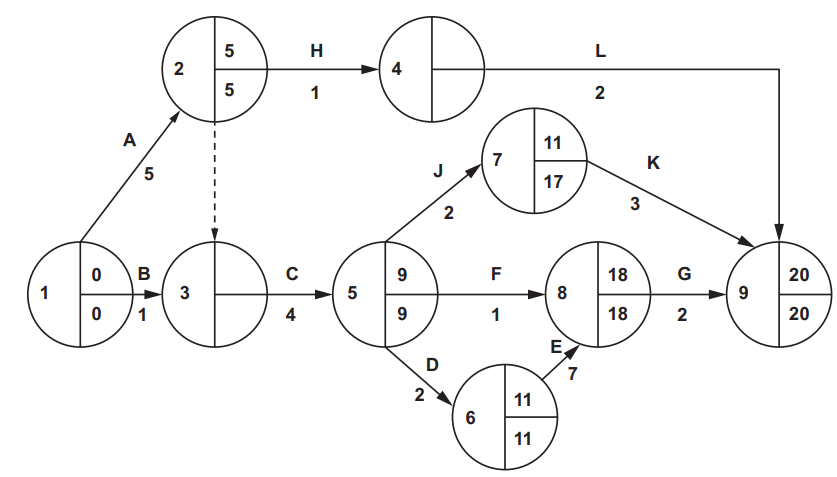
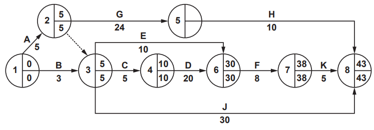
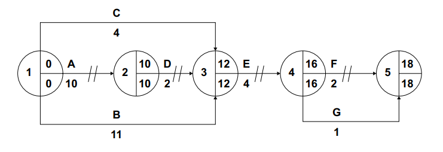

# Exam Questions — Operations Strategy (A Level)
**4. Operations Management** · Cambridge (CIE) A-LEVEL business (9609)
> Source: [https://www.savemyexams.com/a-level/business/cie/23/topic-questions/](https://www.savemyexams.com/a-level/business/cie/23/topic-questions/) · 18 questions across 1 sets

## Exam Questions (21 questions)

### Q1 — easy — 2 marks

**Q1** [2 marks]

Define the term 'network diagram'.

### Q2 — easy — 3 marks

**Q2** [3 marks]

Explain **one** limitation of lean production.

### Q3 — easy — 3 marks

**Q3** [3 marks]

Explain **one** way in which artificial intelligence could improve a business's operations.

### Q4 — easy — 3 marks

**Q4** [3 marks]

Explain **one** way in which an Enterprise Resource Planning system could improve a business's efficiency.

### Q5 — easy — 2 marks

**Q5** [2 marks]

Define the term 'Enterprise Resource Planning'.

### Q6 — medium — 8 marks

**Q6** [8 marks]

Analyse **two** benefits to a business of introducing computer aided design (CAD).

*Source: November 2020 Paper 13 Q5A*

### Q7 — easy — 3 marks

**Q7** [3 marks]

Explain **one **way that process innovation could improve the efficiency of a manufacturing business.

*Source: November 2020 Paper 11 Q4B*

### Q8 — medium — 6 marks

**Q8** [6 marks]

Here is a network analysis diagram for a project.

(i) Complete nodes 3 and 4 on the network analysis.

[4]

(ii) Identify the critical path.

[1]

(iii) Calculate the minimum time to complete the project.

[1]

*Source: June 2020 Paper 32 Q4AI,AII,AIII*

### Q9 — easy — 3 marks

**Q9** [3 marks]

Explain **one reason **why operational flexibility is important to a large furniture manufacturer.

*Source: June 2020 Paper 13 Q3*

### Q10 — medium — 8 marks

**Q10** [8 marks]

Analyse **two **possible disadvantages of Computer-Aided Manufacture (CAM) for a small manufacturing business.

*Source: June 2020 Paper 12 Q7A*

### Q11 — hard — 12 marks

**Q11** [12 marks]

Discuss the importance of operational flexibility and innovation to a multinational car manufacturer.

*Source: November 2021 Paper 13 Q5B*

### Q12 — easy — 1 marks

**Q12** [1 mark]

Here is a network diagram for a project.

Identify the activities on the critical path.

*Source: March 2022 Paper 32 Q2AI,AII,AIII,AIV*

### Q13 — hard — 12 marks

**Q13** [12 marks]

**Extract:**

**Thierry’s Kitchen (TK) **

Thierry’s Kitchen (TK) operates in four European countries with its head office in country H. TK was started by Thierry Radelet in 2017, after he gave up a senior management role in a food delivery company to start his own business. Thierry had observed the rise in popularity of delivery of cooked meals to offices and households. He identified a gap in the market for an efficient service, which would focus on high‑quality cooked meals for delivery only. TK grew quickly and converted to a public limited company in 2019. TK now has two kitchens in each of four European capital cities. The eight locations are outside the city centres and each kitchen has the capacity to produce 2200 meals each day. Meals are packaged and then delivered to customers by motorcycle. Thierry works at the company’s head office, attached to TK’s first kitchen location in country H. He visits the other kitchens once every month. Thierry and a team of directors make all the major decisions about the main menu items and new locations. Each kitchen has a manager who is responsible for decisions about inventory management and human resources. TK has financed its growth through retained profits and a loan of \$15 million. Dividend payments to shareholders have been consistently above average for the catering industry. External environment The European countries in which TK operates experienced economic recessions during 2020. There has been economic growth since then. Governments have supported recovering economies with grants and loans to small and medium‑sized businesses, including TK. Social and technological changes have included fewer consumers eating at restaurants. Smartphone apps are increasingly used for online shopping and ordering meal deliveries. More employees are now working from home rather than in offices. The populations of European capital cities include significant numbers of young, professional individuals who earn above average incomes. Marketing TK differentiates its meal service from the increasing number of competitors on the basis of choice, quality and packaging. The menu is varied and includes daily special offers. Consumers are assured of the high‑quality of TK’s meals as it provides a complete service; from sourcing ingredients to cooking, packaging and delivery. TK’s Operations Director has worked closely with a packaging company to research, develop and patent a range of recyclable packaging containers that ensure meals arrive hot and in excellent condition. Marketing is mainly on its website and social media. However, TK’s Marketing Director believes that the monthly distribution of leaflets to businesses and households is a good use of the marketing budget. The average selling price of a meal is \$8. The delivery charge is \$5 per order and the average order is for 3 meals. Innovation Thierry has always ensured that TK is at the forefront of product and process innovations in the food delivery business. The majority of TK’s orders are received through its smartphone app. Thierry and the other TK directors are now interested in trialling automated (driverless) delivery vehicles (ADVs) in country H. The ADVs will be computer controlled and offer fast, low‑cost meal deliveries. ADVs may be ideal for deliveries in city locations. The capital cost of the ADV trial will be \$1.5 million. This could be financed by further bank borrowing or a new share issue.

Operations and human resources TK’s kitchen operations are labour‑intensive. Meals are produced using batch production, but demand for different meals is difficult to predict due to changing food trends. This makes it very difficult to control inventory. Frequently, too much of some menu items is produced leading to food wastage. Recently, following a social media review praising a TK vegan curry meal, demand increased so quickly that the kitchens failed to produce enough. Some customers were disappointed because their orders were not met. TK’s Operations Director is investigating the use of lean production techniques, such as Just in Time (JIT), which he believes could improve efficiency. Each kitchen employs a manager and a team of ten full‑time chefs on permanent employment contracts. There are also kitchen assistants, meal packers and delivery drivers who are employed on a range of part‑time and zero‑hours contracts. Workers are under pressure to constantly improve productivity while maintaining high quality. As Thierry always reminds employees ‘the quality of our food is our USP, because we do not see customers face‑to‑face or serve them their meals’. Most TK employees are shareholders in the company. Annual productivity bonuses are paid in TK shares. Kitchen 2 – a problem kitchen Kitchen 2 is one of TK’s kitchens in country J. Kitchen 2 is not performing well because sales have declined over the past six months. The reasons for this are unclear. Kitchen 2 sells TK’s main menu items and has a maximum capacity of 2200 meals per day. The average daily output is 1000 meals but Saturday is the only day when all the meals produced are sold. Kitchen 2 is located in a low‑income area and the average order value is lower than for other kitchens. Thierry has asked for further financial information about Kitchen 2. Details of this are shown in Table 1. Table 1: Financial data for Kitchen 2 for the last 6 months \$m Revenue 1.40 Cost of sales (ingredients and packaging) 0.38 Variable labour costs 0.80 Variable delivery costs 0.01 Rent and fixed utility costs 0.20 Head office costs including marketing 0.02

Table 2 shows extracts from TK’s financial data for 2021. Table 2: Extracts from TK’s financial data 2021 \$m Revenue 25.40 Operating profit 3.98 Profit for the year 3.18 Total annual dividends 1.50 Non‑current liabilities 15.00 Capital employed 30.00 \$ Share price at year end 14.00 Dividend per share 1.20 Further developments The directors of TK would like to diversify the activities of the business. They are considering two possible options for this. They will need to make a strategic choice as it will not be possible to carry out both projects. Option 1 Start a chain of luxury TK restaurants in the European cities where the kitchens are located. The restaurants would offer new menu choices including local speciality dishes. Option 2 Extend the TK product range to include packaged vegetable snacks. This would involve the takeover of a small manufacturer of premium snacks. A summary of the strategic choice data is shown in Appendix 1.

Appendix 1: Strategic choice data for options 1 and 2 Option 1 TK luxury restaurant chain Option 2 Takeover of snack manufacturer Initial cost \$4m \$2.5m Estimated accounting rate of return (ARR) 9.1% 7.6% Main driving force Market for luxury restaurants may grow as economies recover from recession Can be sold and delivered with existing meal delivery service Main restraining force Ability to respond to high level of competition in the market No experience in packaged snack production Estimated chances of failure 35% 30% Estimated monetary value over five years \$3.5m \$2.2m

Read the following[ extract](https://www.savemyexams.com/a-level/business/cie/past-papers/paper/ppr_PQyQv9BX7WN7txwf/?pdf=https%3A%2F%2Fpastpapers.papacambridge.com%2Fdirectories%2FCAIE%2FCAIE-pastpapers%2Fupload%2F9609_s22_in_33.pdf&type=resource&resourceIndex=0) before answering

Evaluate the importance of product and process innovation to the future profitability of TK.

*Source: June 2022 Paper 33 Q3*

### Q14 — medium — 8 marks

**Q14** [8 marks]

**Extract:**

**Waste To Zero (WTZ) **

Making use of waste As a young boy Amandi Said supplemented his family’s income by finding waste materials and products and making new products to sell. Later, he employed other teenagers to collect waste such as card and plastics in the capital city of country R. Amandi sold these waste materials to recycling companies. In 2015, Amandi set up WTZ as a private limited company and a summary of its rapid growth is provided below. 2015 WTZ gains contract from local government to collect recyclable waste. This is sorted at the new WTZ recycling centre and then sold to local manufacturers. 2017 WTZ opens its first factory producing the innovative Hydrocamel – a water barrel made from recycled plastic waste. The Hydrocamel is sold to local communities and charities to improve access to clean water in low‑income countries. 2019 WTZ converts to a public limited company. Operations expand to other major cities in country R. Additional waste recycling centres and factories open. One centre in country R burns waste products to generate electricity. 2020 WTZ patents a process for creating bricks from waste plastic and rubber. These bricks can be used to build durable and affordable houses. 2021 WTZ takes over MR, a company that recycles metal. 2022 WTZ’s market share for collecting and recycling plastic waste in country R reaches 60%. Ownership and finance Amandi retains a controlling stake in WTZ. He has always been motivated by profit and the desire to secure a future for his children. Amandi is willing to take risks. WTZ has entered new markets and invested in research and development. Business expansion has been financed by bank borrowing and by the public offer of shares on the stock market in 2019. Table 1 and Table 2 provide selected information from the financial statements of WTZ. Table 1: Extracts from WTZ’s income statement (year ending 30 April) 2022 (\$m) 2021 (\$m) Revenue 60.0 50.0 Profit for the year 5.6 6.4 Dividends 4.8 4.4Table 2: Extracts from WTZ’s statement of financial position (at 30 April) 2022 (\$m) 2021 (\$m) Non‑current liabilities 14.0 10.0 Share capital 4.0 4.0 Retained profit reserves 4.0 3.8 Inventories 4.0 3.2 Trade receivables 1.6 1.5 Cash 0.2 0.4 Current liabilities 4.2 3.6 Notes: Authorised share capital – 20 million shares @ \$0.5 Number of shares issued – 8 million Current share price – \$3 Operational efficiency Amandi’s focus has always been on minimising costs to maximise profit margins. Many factory employees are on flexible contracts and are paid the minimum wage for unskilled work. Many employees work long hours. Working conditions in WTZ’s factories are difficult with poor ventilation and a lack of facilities for employees to take breaks. Employees have demanded the right to join a trade union. However, unemployment in country R is high, so WTZ has refused to recognise trade unions. The new operations manager at the Hydrocamel factory, Khalid, reported the following problems to the directors: • employee absenteeism is increasing • productivity is not increasing • quality standards are below expectations with 5% of output rejected • inefficient collection of recycled materials • high inventory levels. Khalid recommends a lean approach to production including the introduction of Kaizen (continuous improvement). To be effective this change would require investment in employee training.

Marketing Hydrocamel has been a very successful product since its launch in 2017. The Hydrocamel helps families reduce the time needed to collect and transport water. The Hydrocamel can store 100 litres of water and is designed to be rolled so that it is easily movable. In 2019 a competitor brand, the Hippo Barrel, was launched and WTZ’s sales growth slowed. The marketing manager, Kofi, is planning a marketing strategy to increase sales to 50000 units per year which is the maximum capacity of the factory. He collected the following information as part of his situational analysis: • price of the Hydrocamel is \$140 • price of the competitor’s Hippo Barrel was reduced by 20% to \$120 in 2020 • this resulted in an 8% decrease in demand for the Hydrocamel to 40000 units in 2021 • estimated price elasticity of demand for the Hydrocamel is –1.2 • WTZ promotes the Hydrocamel through adverts in specialist magazines and by contacting charities directly • the promotional budget in 2021 was \$10000 • targeted marketing spending is estimated to have promotional elasticity of demand of 1.3. Organisational structure Amandi has not changed the organisational structure of WTZ as the business expanded. The business has a hierarchical structure with functional areas of operations, human resources, marketing and finance. The business has been successful and continues to expand. Continued expansion has made it more difficult for Amandi to have effective control over the business. He thinks that managers focus too much on their functional responsibilities and this prevents them from planning strategically. Amandi considers the current organisational structure to be a weakness that is constraining growth. In discussion with other directors, Amandi commented ‘WTZ is increasingly diversified and we need a structure that can support growth and drive innovation. Changes will also be needed if we expand into other countries to process waste and generate electricity.’ An increased focus on corporate social responsibility (CSR) Kofi recommends that WTZ engages more with the local community. He reported to Amandi that ‘WTZ should be a leading supporter of sustainable development. We could use our expertise in recycling to develop a positive brand image and promote the company as protecting the future for all. Ambitious environmental objectives could be set. However, there is likely to be an impact on the costs of the business. There are, for example, operational and human resource issues we need to overcome as we focus on CSR.’ Growth strategies for the future Amandi used strategic analysis techniques to consider the strategic direction of WTZ’s continued expansion. An extract from his external environment analysis (PEST) is shown in Appendix 1. He identified two potential strategic options. Amandi plans to proceed with only one of the options. However, the Finance Director is concerned about the capital cost and the potential impact on working capital.

Option 1: Purchase a small business called Lacpac Takeover Lacpac which produces recyclable non‑plastic packaging for the food industry. It is an innovative company and a market leader in country R. Option 2: Expansion to country S Country S is a high‑income country with a large population. WTZ would build a factory for processing plastic waste. WTZ would use its core competencies to gain contracts from the government of country S. Appendix 2 provides further data on each option. Appendix 1: External environment analysis (PEST) Political • Some low‑income countries have banned processing of plastic waste from high‑income countries • There is proposed regulation in country R to reduce the use of plastics in food packaging Economic • Economic growth in country R is forecast to be 5% per year on average over the next 5 years • Global interest rates forecast to decrease in 2023 Social • Increasing environmental awareness in country R and country S • Global environmental pressure groups propose consumer boycotts against businesses which operate unsustainably Technological • Increasing use of computer controlled machinery for collecting and sorting recycled material • Innovations in processing of waste materials Appendix 2: Summary of data from strategic choice techniques over 5‑year period Option 1: Takeover of Lacpac Option 2: Expansion into country S Driving forces Rapid market growth in use of recyclable non‑plastic packaging in the food industry Builds on core competencies of WTZ Restraining forces High cost Competitive market in country S Capital cost \$20m \$10m Accounting Rate of Return (ARR) 15% 10% Decision tree: Expected monetary value Probability of success \$9m 60% \$4m 70%

Read the following [extract ](https://www.savemyexams.com/a-level/business/cie/past-papers/paper/ppr_69GKQfX9rnjKkKYY/?pdf=https%3A%2F%2Fpastpapers.papacambridge.com%2Fdirectories%2FCAIE%2FCAIE-pastpapers%2Fupload%2F9609_s22_in_32.pdf&type=resource&resourceIndex=0)before answering

Analyse **two **possible benefits to WTZ of introducing Kaizen.

*Source: June 2022 Paper 32 Q1*

### Q15 — easy — 2 marks

**Q15** [2 marks]

> **[case-study]**
> **Motorcycle Components (MC) **
> 
> MC is a large public limited company that produces a range of components used by motorcycle manufacturers. MC’s mission statement is ‘to be the world leader in delivering quality motorcycle components to our customers’.
> 
> The motorcycle component industry is very competitive and MC’s customers expect high quality and a short lead time. MC operates a Just in Time (JIT) inventory control system. MC’s good relationships with its suppliers ensure that JIT operates efficiently. The production workers at MC are highly skilled and the business benefits from a low labour turnover.
> 
> Liquidity management is very important in the motorcycle component industry. The industry average for the acid test ratio is 1. A summary of some key data for MC has been prepared by the Finance Director, as shown in Table 2.1.
> 
> **Table 2.1: Summary financial data as at 30 April 2022 (\$ million)**
> 
> | Trade receivables | 26 |
> |---|---|
> | Cash | 19 |
> | Inventory | 1 |
> | Trade payables | 30 |
> | Other current liabilities | 20 |
> 
> The Operations Director, Jay, is proposing new capital expenditure of \$4 million. Jay thinks that automation of the production process will have significant financial benefits for MC. He wishes to gain approval from the Board of Directors to implement a process innovation project. Jay believes that, with good communication and the involvement of employees, he can effectively manage the project.

Define the term ‘lead time’.

*Source: June 2022 Paper 21 Q2AI*

### Q16 — easy — 2 marks

**Q16** [2 marks]

Define the term ‘computer aided manufacture’ (CAM).

*Source: June 2022 Paper 11 Q4A*

### Q17 — hard — 20 marks

**Q17** [20 marks]

> **[case-study]**
> **Luxury Hampers (LH)**
> 
> In 2015 Loretta bought LH, an established food hamper business. A hamper is a gift box or basket containing food and drink. Loretta purchased the business for \$500000 using a combination of personal savings and venture capital. Loretta set a short-term objective of profit maximisation and planned for rapid expansion within a five-year period.
> 
> LH buys high-quality food and drink products directly from manufacturers and packages the products into hampers to sell as luxury gifts.
> 
> **Timeline of LH**
> 
> 2015–2017
> 
> Focus on business efficiency improvement using better inventory control and management of costs. 
> Marketing changes from targeting individual customers to targeting national corporate customers. 
> LH develops online marketing capabilities.
> 
> 2018
> 
> Loretta identifies PS (an international luxury gift supplier) as a suitable target for takeover. 
> Loretta prepares a SWOT analysis for LH and PS (see **Appendix 1**). 
> After the takeover, LH uses the brand name of LH nationally, but uses the PS brand name internationally to retain brand awareness.
> 
> 2019–2020
> 
> Investment into rapid development of international corporate customers.
> 
> 2021
> 
> All products now sold using the LH brand. 
> Loretta is asked to present financial data about the impact of the takeover of PS at the annual general meeting (AGM) (see **Appendix 2**).
> 
> 2022
> 
> LH receives increasing numbers of negative online reviews (see **Appendix 3**). 
> Outdated IT systems and quality control procedures identified as problems.
> 
> **Developing an operations strategy **
> 
> In 2023, a cyber-attack corrupted 75% of LH’s IT systems and data. Incomplete supplier data was recovered. However, all customer data was lost. This led to cancelled orders and LH experienced considerable damage to its reputation.
> 
> LH’s shareholders called an extraordinary general meeting (EGM) and Loretta was replaced as Managing Director by Sanjay, the Operations Director.
> 
> Sanjay has identified several problems which need to be solved in both the short and long-term. He considers there are several opportunities to improve LH’s operational efficiency.
> 
> Sanjay knows a new operations strategy must be developed with an appropriate budget. The strategy will have clear objectives to increase data security and improve customer service.
> 
> **Appendix 1: Extracts from 2018 SWOT analysis for LH and PS**
> 
> | **LH** |   |
> |---|---|
> | Strengths | Weaknesses |
> | - Efficient inventory control | - Limited number of local suppliers |
> | - Experience of online marketing to national corporate customers | - No international brand awareness |
> 
> | **PS** |   |
> |---|---|
> | Strengths | Weaknesses |
> | - Established international luxury brand awareness | - Lack of online expertise as it sells direct to luxury retailers |
> | - Short trade receivables period (15 days) | - Inefficient inventory control |
> | - Wide range of reliable national suppliers | - Consistently low dividend per share |
> 
> **Appendix 2: Extracts from LH’s financial data presented 2021**
> 
> |   | After takeover of PS | Before takeover of PS |   |   |
> |---|---|---|---|---|
> |   | 2020 | 2019 | 2017 | 2016 |
> | Revenue (\$m) | 61 | 56 | 30 | 25 |
> | Operating profit margin (%) | 11 | 19 | 32 | 29 |
> | Gearing (%) | 85 | 80 | 10 | 15 |
> | Trade receivables (days) | 25 | 30 | 50 | 7 |
> | Acid test ratio | 0.2:1 | 0.2:1 | 0.7:1 | 0.7:1 |
> | Dividend per share (\$) | 0.5 | 1 | 5 | 4 |
> 
> **Appendix 3: Extracts from online reviews in 2022 **
> 
> ‘Although the packaging was excellent and the hamper was delivered on time, the contents were not what I ordered! Not happy and not using LH again!’
> 
> ‘LH over-promised on delivery times. I wanted to provide New Year hampers for all of my senior managers across Europe and they were delivered after the festival period.’
> 
> ‘Impossible to contact LH customer service. Ordered from someone much better!’

Advise Sanjay on an operations strategy for LH to overcome the problems it is experiencing.

*Source: June 2023 Paper 41 Q2*

### Q18 — medium — 8 marks

**Q18** [8 marks]

**Extract:**

**Devonice Ltd (DL) **

Gabriel Romana founded DL in 2012 in country Y. He used his savings to develop Devonice, a luxury ice cream brand made from natural ingredients. DL started manufacturing ice cream in a small factory in 2013. Organisation and growth DL has grown rapidly. Gabriel has increased the product range with new flavours of ice cream. In 2016, DL opened its second factory and its first Devonice ice cream shop in country Y. At present, most sales are made to supermarkets in country Y. However, Gabriel has plans to open more ice cream shops. He is also considering selling DL franchise agreements to increase export sales. Gabriel enjoys being in control of the business and intends to maintain a centralised structure. Managers of the functional departments report directly to Gabriel and he makes all major decisions. The production line project DL has two factories, operating 24 hours a day. In total, there are 5 production lines and 200 workers able to produce 30 million litres of ice cream per year. Capacity utilisation is currently 90%. To increase capacity and flexibility, Gabriel is considering investing in computerised production lines. Gabriel wants this project completed within 20 weeks in time for the summer season. The operations manager has prepared a critical path analysis (CPA) for the project (see Appendix 1 and Appendix 2). The operations manager is worried about the project. He told Gabriel: ‘This new system is complex and untried. I am also worried about delays and the impact on our workers.’ Estimated net cash flows of the project are shown in Table 1. Table 1: Estimated net cash flows for the new production line project Year Net cash flow (\$m) Discount factor (8%) 0 (2.5) 1 1 0.5 0.93 2 0.8 0.86 3 1.2 0.79 4 1.5 0.74 5 1.5 0.68 A competitive market Devonice is now the market-leading brand in country Y and is exported to 10 other countries. DL’s innovative marketing and high quality product have contributed to sales growth. DL targets young adults and has developed a premium brand image. Promotion includes the use of social media, school sponsorship and celebrity endorsement. DL also donates a share of its profits to environmental charities.

Market conditions in country Y are challenging. A multi-million dollar advertising campaign by a global ice cream brand has increased competition. DL sales have remained stable but market share has fallen. In response, Gabriel is considering reducing the price of Devonice or increasing promotional spending. The marketing department has estimated the promotional elasticity of demand and price elasticity of demand for Devonice. Details are in Table 2. Table 2: Estimated data for Devonice Price elasticity of demand Promotional elasticity of demand Action Reduce price to supermarkets by 8% Increase annual promotional spending by \$0.5m to \$1.75m Outcome Demand increases by 10% Demand increases by 10% The marketing manager recommends reducing price to widen the market appeal of the brand and open up new distribution opportunities. However, Gabriel believes this could damage the brand image. In his opinion, increasing promotional spending is the better decision. Corporate social responsibility (CSR) Despite rising incomes in country Y, there is concern about health related problems due to poor diet. In 2020, a pressure group started a campaign to persuade food manufacturers to take greater responsibility for the impact of their products. The group demanded government action to reduce sales of food products high in sugar and fat by: • regulating product labelling • restricting advertising • introducing a tax on these products. DL could change ingredients to reduce sugar content. However, Gabriel is worried about consumer reaction. DL is also facing pressure to stop using palm oil because of the loss of rainforest associated with its production. Palm oil helps make ice cream smooth and creamy. There are alternatives DL could use, but these are more expensive. Appendix 1: Critical path analysis (CPA) for the production line project Activity Description A Run existing production lines at full capacity to increase inventory for changeover B Order and delivery of ice cream equipment C Order and delivery of packaging equipment D Removal of existing production equipment E Installation of new production equipment F Training of production line workers G Testing of production lines

Appendix 2: Network diagram for the production line project

Read the following [extract](https://www.savemyexams.com/a-level/business/cie/past-papers/paper/ppr_WRR6Rd9qmYKKgv2g/?pdf=https%3A%2F%2Fwww.cambridgeinternational.org%2FImages%2F596165-2023-specmen-paper-3-insert.pdf&type=resource&resourceIndex=0) before answering

Analyse **two **possible limitations to DL of using critical path analysis (CPA) when planning the production line project.

*Source: Specimen 2023 Paper 3 Q2*

