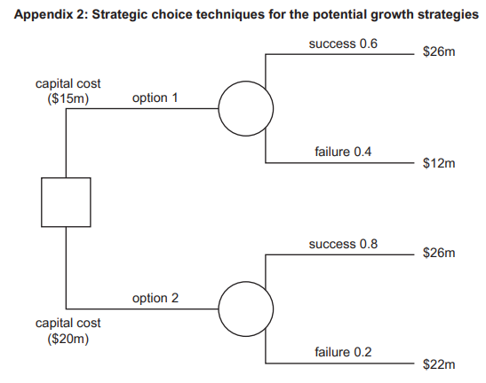

# Exam Questions — The Nature of Operations
**4. Operations Management** · Cambridge (CIE) A-LEVEL business (9609)
> Source: [https://www.savemyexams.com/a-level/business/cie/23/topic-questions/](https://www.savemyexams.com/a-level/business/cie/23/topic-questions/) · 26 questions across 1 sets

## Exam Questions (29 questions)

### Q1 — medium — 8 marks

**Q1** [8 marks]

> **[case-study]**
> **NaturaBite Foods (NF)**
> 
> NaturaBite Foods (NF) is a private limited company in country G that produces organic snack foods, including energy bars, dried fruit mixes, and nut butters. NF sells its products to supermarkets and health food stores across country G. NF has built a strong brand with the slogan 'nothing artificial, nothing hidden'.
> 
> NF currently uses flow production to manufacture its products in large quantities. The production manager believes that switching to batch production will allow NF to produce a wider range of flavours and varieties, responding to changing customer preferences. However, the Finance Director has raised concerns about the cost of reorganising the production process.
> 
> NF employs 60 workers in one factory. The Production Manager believes there is significant room to improve labour productivity without increasing headcount. Table 2.1 shows NF's financial data for 2023.
> 
> **Table 2.1: NF financial data 2023**
> 
> |   |   |
> |---|---|
> | Selling price per unit (\$) | 4.00 |
> | Variable cost per unit (\$) | 1.50 |
> | Total fixed costs (\$) | 75,000 |
> | Current annual output (units) | 40,000 |
> | Maximum capacity (units) | 55,000 |

Analyse **two** ways NF could improve its labour productivity.

### Q2 — easy — 1 marks

**Q2** [1 mark]

> **[case-study]**
> **NaturaBite Foods (NF)**
> 
> NaturaBite Foods (NF) is a private limited company in country G that produces organic snack foods, including energy bars, dried fruit mixes, and nut butters. NF sells its products to supermarkets and health food stores across country G. NF has built a strong brand with the slogan 'nothing artificial, nothing hidden'.
> 
> NF currently uses flow production to manufacture its products in large quantities. The production manager believes that switching to batch production will allow NF to produce a wider range of flavours and varieties, responding to changing customer preferences. However, the Finance Director has raised concerns about the cost of reorganising the production process.
> 
> NF employs 60 workers in one factory. The Production Manager believes there is significant room to improve labour productivity without increasing headcount. Table 2.1 shows NF's financial data for 2023.
> 
> **Table 2.1: NF financial data 2023**
> 
> |   |   |
> |---|---|
> | Selling price per unit (\$) | 4.00 |
> | Variable cost per unit (\$) | 1.50 |
> | Total fixed costs (\$) | 75,000 |
> | Current annual output (units) | 40,000 |
> | Maximum capacity (units) | 55,000 |

Identify **one** method of production.

### Q3 — medium — 8 marks

**Q3** [8 marks]

Analyse **two **impacts on a business of increasing the use of automation in its production process.

### Q4 — easy — 3 marks

**Q4** [3 marks]

> **[case-study]**
> **Aashna’s Pies (AP) **
> 
> AP produces and sells high quality pies. Aashna set up AP five years ago when she spotted a gap in the market. AP is a private limited company and Aashna is the majority shareholder. All of the pies use the AP branding which is growing in popularity.
> 
> AP owns a factory where all the pies are produced. Pies are packaged and sold individually. The range of pies produced by AP is shown in Table 1.1.
> 
> **Table 1.1: AP’s product portfolio**
> 
> | **Name of pie** | **Filling** | **Price per pie** | **Annual change in sales quantity (2018 to 2019)** | **Stage on the product life cycle** |
> |---|---|---|---|---|
> | Meaty Marvel | Chicken and lamb | \$2.80 | +3% | Maturity |
> | Vegetarian Victory | Broccoli, cheese and carrot | \$2.50 | –10% | Decline |
> | Fishy Fortunes | Cod, prawns and cheese | \$3.00 | +20% | Growth |
> 
> The pastry case of each pie is exactly the same no matter what filling is used. All of AP’s pastry is made using flow production. However each filling is made by specialist workers who use batch production.
> 
> Aashna is concerned about the sales of Vegetarian Victory pies and she is considering stopping production of this pie. However, the Operations Director has pointed out that AP might lose its economies of scale if the business reduces the total number of pies produced.
> 
> The Marketing Director would like Aashna to read his report about developing products in the future. He has done some market research (see Fig. 1.1).
> 
> | - The price elasticity of demand for AP’s pies is price inelastic - Some consumers are worried about possible health risks of eating too much meat - The average family eats three pies per meal and chooses pies for a meal once every two weeks - The pies have a short ‘best before’ date – they must be eaten within two days of purchase - The average family has one member who does not eat meat. |
> |---|
> 
> **Fig. 1.1: Market research to aid developing products in the future**

Explain what is meant by the term ‘flow production’.

*Source: November 2020 Paper 23 Q1AII*

### Q5 — easy — 2 marks

**Q5** [2 marks]

> **[case-study]**
> **Electric Cars (EC) **
> 
> EC is a public limited company producing electric cars. Market research suggests that electric cars are in the early stage of the product life cycle. The demand for electric cars is likely to increase substantially in the next 10 years. EC is based in country X, where it is one of three electric car manufacturers. However, other manufacturers could start to produce electric cars if the forecast market growth is correct.
> 
> EC’s promotion has only been aimed at high income groups. The government of country X recently announced that it will support the use of electric cars. This will help EC to achieve its objective to increase sales volume by 50% over the next two years.
> 
> One year ago, EC invested \$10m in new production facilities. The investment was funded by a long-term bank loan. Interest payments on the bank loan have reduced EC’s profit margin from 9% to 4%. EC will need to cut unit costs through increased efficiency.
> 
> EC initially launched its cars using a price skimming strategy but sales growth has been slow. If EC can achieve a 50% growth in sales over the next two years, it will be in a strong financial position. This means it will be able to spend more on the development of a larger product portfolio of electric cars.
> 
> Jancie, the Finance Director, has produced forecasts for EC’s financial data over the next two years, as shown in Table 2.1.
> 
> **Table 2.1: Extract from EC’s forecast financial data**
> 
> |   | **2020 (\$m)** | **2021 (\$m)** |
> |---|---|---|
> | Inventories | 30 | 50 |
> | Cash | 10 | 20 |
> | Trade receivables | 10 | 20 |
> | Trade payables | 25 | 30 |
> | Current ratio | 2 | **X** |

Define the term ‘efficiency’.

*Source: November 2020 Paper 21 Q2AI*

### Q6 — hard — 12 marks

**Q6** [12 marks]

Discuss the view that it is more important for a manufacturer of bicycles to be effective than it is to be efficient.

*Source: November 2020 Paper 13 Q5B*

### Q7 — easy — 2 marks

**Q7** [2 marks]

Define the term ‘intellectual capital’.

*Source: November 2020 Paper 13 Q4A*

### Q8 — easy — 2 marks

**Q8** [2 marks]

Define the term ‘effectiveness’.

*Source: November 2020 Paper 12 Q4A*

### Q9 — easy — 2 marks

**Q9** [2 marks]

Define the term ‘productivity’.

*Source: November 2021 Paper 11 Q4A*

### Q10 — medium — 2 marks

**Q10** [2 marks]

> **[case-study]**
> **Flight Food (FF) **
> 
> FF is a large secondary sector business that supplies airlines with in-flight meals. Meals are manufactured using batch production. A different variety of meal is made each hour with a five minute changeover time between batches. FF makes use of Just in Time (JIT) to manage inventory wherever possible. Trucks arrive each hour and deliver the materials needed for production.
> 
> The market for airline meals is very competitive. FF uses market segmentation when deciding which meals are most likely to appeal to different airlines. FF must adapt to changes in tastes and the demands of each airline.
> 
> FF is a labour intensive business. The workers are employed with short-term (six month) employment contracts. They are only offered new contracts if they meet their production targets. Table 2.1 shows some production data for FF’s two work teams.
> 
> **Table 2.1: Worker data for FF**
> 
> |   | **Team A** | **Team B** |
> |---|---|---|
> | Number of workers | 100 | 50 |
> | Productivity (per worker per day) | 300 meals | 240 meals |
> 
> The Board of Directors of FF is considering changing the manufacturing process to flow production. This would require purchasing Computer Aided Manufacturing (CAM) equipment and using a capital intensive production process. Production targets would no longer be used for employees because the machinery would be set at a specific production rate.
> 
> Sabrina, the Operations Director, has put forward the following advantages for moving to flow production:
> 
> - more products made each hour
> - lower employment costs
> - improved quality.
> 
> Ben, the Human Resource Director, is worried about the change from a labour intensive process to a capital intensive process.

Calculate the total number of meals per day produced by both teams.

*Source: June 2020 Paper 23 Q2BI,BII*

### Q11 — easy — 3 marks

**Q11** [3 marks]

> **[case-study]**
> **Market Solution (MS) **
> 
> MS is a public limited company in the tertiary sector. MS advises businesses on elements of the marketing mix. Most of its customers are small businesses who cannot afford their own marketing department. MS designs marketing materials for these businesses to use.
> 
> Although MS uses computer aided design (CAD), the business is labour intensive. MS employs specialist marketing workers as well as administrative support workers. Table 2.1 shows some data about employees of MS.
> 
> **Table 2.1: MS employee data**
> 
> |   | **Specialist marketing workers** | **Administrative support workers** |
> |---|---|---|
> | Average number of workers in 2019 | 40 | 88 |
> | Payment method | Salary plus bonus | Performance related pay plus bonus |
> | Number of workers who left in 2019 | 2 | 11 |
> | Average pay (compared to national average) | High | Low |
> | Main need of the workers | Achievement | Affiliation |
> | Main hygiene factors | - Pay - Flexible hours of work | - Staff restaurant - Holidays |
> | Is a bonus expected in 2020? | Yes | No |
> 
> MS has recently employed Hetti as the new Human Resources Manager. Hetti thinks that the ideas of the motivational theorists are important when managing employees. She is particularly worried about the labour turnover of the administrative support workers.
> 
> MS has recently taken on a new customer, named Books Outlet (BO). BO has an objective to increase its revenue by targeting a younger market segment. BO has provided MS with the following information about its current marketing mix (see Table 2.2).
> 
> **Table 2.2: Current marketing mix for BO**
> 
> | **Product **  - Books aimed at customers who are 30 years and older - Specialist books on many topics – BO is often the only seller in the area | **Price **  - Price skimming |
> |---|---|
> | **Promotion **  - Window display - Local newspaper advertising | **Place **  - A retail shop on the main street - Postal sales from a brochure |

Explain **one **possible advantage to MS of being labour intensive.

*Source: June 2020 Paper 22 Q2C*

### Q12 — medium — 8 marks

**Q12** [8 marks]

> **[case-study]**
> **Hannah’s Handbags (HH) **
> 
> Hannah started HH six years ago. HH operates in a niche market providing unique bags. The bags are made using job production. As demand grew for the bags, Hannah took on a partner, her brother Kwom. They both agreed to keep the name ‘Hannah’s Handbags’ as it is an established, reputable and widely recognised brand.
> 
> HH operates from a small workshop and showroom. Customers are encouraged to visit the showroom to discuss design and materials with either Hannah or Kwom.
> 
> HH employs four highly skilled specialist production staff. Table 2.1 shows an extract from the latest income statement.
> 
> **Table 2.1: Extract of financial data for HH (year ended 30 October 2019)**
> 
> |   | **\$000** |
> |---|---|
> | Revenue | 980 |
> | Cost of sales | 588 |
> | Expenses | 245 |
> 
> **A new product **
> 
> Hannah and Kwom would like to expand the business by producing a limited number of batch produced bags to sell online. Hannah has noticed other bag producers do this successfully. The new market has many more competitors, with 15 large businesses and many small ones. The bags would have to be priced competitively. Kwom estimates that this new venture would require additional finance of \$350000. HH would also require a specialist IT provider to set up a website and a marketing agency to run a viral marketing campaign.

Analyse **one **advantage and **one **disadvantage to HH of using job production.

*Source: June 2020 Paper 21 Q2C*

### Q13 — hard — 20 marks

**Q13** [20 marks]

‘In a large computer manufacturing business, the operations department is more important for achieving success than the marketing department.’

Discuss the extent to which you agree with this view.

*Source: June 2020 Paper 11 Q6*

### Q14 — medium — 2 marks

**Q14** [2 marks]

**Extract:**

**AerCore (AC) **

Omar is the founder and Chief Executive Officer (CEO) of AC, a private limited company. AC was founded in 2000 and manufactures fitness equipment in country K. Membership of fitness centres is increasing in country K as a result of rising incomes and greater awareness of the benefits of exercise. AC sells and leases fitness equipment such as treadmills and rowing machines to fitness centres, hotels and large corporations. AC does not currently sell directly to consumers. AC exports to a neighbouring country though sales have declined there in the past two years. Foreign manufacturers have begun to sell their fitness equipment in country K due to the growth of the market. Control from the centre Omar and six other family members own all the shares of AC and they are the only directors. Omar keeps control of all aspects of the business. Organisation is hierarchical and centralised. Managers have only limited authority. AC has expanded gradually over the years, financed by retained profits and bank loans. AC has made sufficient profit to give shareholders a good return. Table 1 shows selected data from AC’s latest annual accounts. Table 1: Selected data from AC’s annual accounts as at 30 September 2021 (\$m) Revenue 84 Cost of sales 44 Expenses 36 Total dividends 2 Current assets 3 Current liabilities 2 Non-current liabilities 40 Shareholder equity 25 Omar has plans to significantly expand AC in the next three years. Omar believes this requires the board to consider two key questions: • Should AC convert to a public limited company (plc)? • Would decentralisation benefit AC? Consumer fitness equipment market AC currently focuses on the industrial sector of the fitness market. Marketing relies on promotion at trade fairs, advertising in industry magazines and direct selling to hotels, gyms and corporate offices. Omar’s brother Khalil is the Marketing Director. He has identified that there is rapid growth in the consumer equipment fitness market. In this market people purchase fitness equipment to use in their own homes. Khalil believes that price is important to these consumers. The equipment does not need to be as durable as for the industrial sector.

His research suggests the increasing number of people who are overweight is a driving factor for growth in the use of fitness products at home. The Board of Directors has agreed to his proposal to develop products more suitable for entering the consumer market in 2022. Khalil has researched the consumer fitness equipment market in country K. Table 2 gives a summary of his research. Table 2: The consumer fitness equipment market in country K in 2020 Market share of the three biggest suppliers of fitness equipment 60% Number of suppliers of fitness equipment 50 Change in advertising expenditure by the market leading brand +30% Average spend on fitness equipment \$550 Growth of consumer market 3% Proportion of households with fitness equipment 5% Proportion of consumers buying fitness equipment online 75% Khalil will outline his proposed marketing strategy to the Board of Directors next week. He will recommend an objective of achieving a market share of 5% within 2 years. Manufacturing problems AC’s employees are skilled and there is a production line for each product. Quality control inspectors are employed to ensure that fitness equipment conforms to the quality standards set by AC. However, Omar is concerned about the increase in the proportion of substandard output. The operations manager estimates that the average cost to AC of correcting substandard output is \$70 per unit. The operations manager has also reported that production of treadmills was recently stopped for two days due to late delivery of an important component. Table 3 contains factory data. Table 3: Factory data for 2020 Number of employees 80 Number of days lost through absenteeism 600 Average monthly output (units of equipment) 5100 Percentage of substandard output 3% Omar asked the operations manager to investigate the problems and make a recommendation for change. The operations manager reported the following: • Production line workers are paid approximately 90% of the industry average. • Labour turnover in 2020 was 15%. • Workers feel that they are not valued by AC. • Workers do not feel that they are trusted. The operations manager has recommended that AC should introduce Total Quality Management (TQM). He has also told Omar that he has insufficient authority to make the necessary decisions to manage operations effectively.

Growth strategies Competitive rivalry in the fitness industry is high. Existing businesses aim to maintain market share. Growth is mainly driven by entering new markets. Research and development focuses on product development. As well as entering the consumer market in country K, Omar will present two other strategies for growth at the next Board meeting. These are outlined below: Option 1: market development. Enter the fitness market in country P. Initially this would target the industrial sector. Option 2: diversification. Diversify into the tertiary sector by opening a chain of fitness centres in country K. These would target the premium segment of the market. Omar has researched both options and estimated sales and costs to help make the decision. Extracts from his research are shown in Appendix 2. Appendix 1: Forecast economic data for country K 2022 2023 2024 Annual growth in real GDP (%) 3 5 3.5 Inflation rate (%) 6 9 10 Indirect tax rate (sales tax) (%) 10 12 12 Direct tax rate (income tax) (%) 24 26 26 Unemployment rate (%) 9 7.8 7.4 Interest rate (%) 6 8 8

Option 1: market development Option 2: diversification Payback 4 years 5 years Accounting rate of return (ARR) first ten years 10% 13% Key driving forces • Strong economic growth in country P • Growth in fitness centre membership • Stable growing market in country K • Opportunity for increased sales of AC’s equipment • Develop branding Key restraining forces • Existing competition • Foreign exchange rate risks • Capacity constraints • Lack of managerial expertise in tertiary sector • Cost

Read the following [extract ](https://www.savemyexams.com/a-level/business/cie/past-papers/paper/ppr_VCYdRgbwH4cv2SMj/?pdf=https%3A%2F%2Fpastpapers.co%2Fcie%2FA-Level%2FBusiness-9609%2F2021-Oct-Nov%2F9609_w21_in_32.pdf&type=resource&resourceIndex=0)before answering

Calculate for 2020 the labour productivity per month

*Source: November 2021 Paper 32 Q4AI*

### Q15 — easy — 2 marks

**Q15** [2 marks]

> **[case-study]**
> **Super Candy (SC) **
> 
> SC is a large public limited company that sells low-sugar candy (sweets) with natural flavourings. The candy is made using flow production in SC’s four large factories in country T.
> 
> SC uses psychographic market segmentation when planning its marketing mix.
> 
> SC has completed some secondary market research using published accounts. The data is about one of SC’s main competitors, Organic Kandy (OK) and compares the results with data about SC (see Table 2.1). OK is in the same market as SC.
> 
> **Table 2.1: Secondary market research about OK and SC for 2020**
> 
> |   | **OK** | **SC** |
> |---|---|---|
> | Revenue | \$60m | **X** |
> | Market share by revenue | 40% | 34% |
> | Different varieties of candy | 12 | 18 |
> | Main channels of distribution | Wholesalers  Large supermarkets  Health food shops | Wholesalers  Small retailers  E-commerce |
> | Target market(s) | Mass market | People with interests in:  - Nature - Sports - Travel - Health |
> 
> There have been a number of media reports in country T about the increasing importance of corporate social responsibility (CSR). A large food manufacturing business in country T recently lost many customers due to reports about its use of plastic packaging.
> 
> The directors of SC are particularly concerned about this trend because of SC’s use of plastic in its packaging. The marketing department has been told to conduct some primary market research on this issue. The directors are planning to discuss making CSR a new business objective for SC.

Define the term ‘flow production’.

*Source: November 2021 Paper 23 Q2AI*

### Q16 — medium — 8 marks

**Q16** [8 marks]

> **[case-study]**
> **Snappy Box (SB) **
> 
> SB is owned by Ralph who is a sole trader. The business prints photographs. Ralph has one shop on the main street of city D. Customers bring their saved digital photographs into the shop and these are printed on high-quality paper.
> 
> SB uses a large printing machine that can print on almost any size of paper to produce different sized photograph prints. The process is very capital-intensive and most customers request a batch of photographs to be printed.
> 
> SB is the only shop in city D that prints photographs. However, recently a number of online competitors have started to offer low-priced photograph prints to customers. Ralph has noticed that his sales have decreased significantly because of this competition. Ralph estimates the demand for his photograph prints has a price elasticity of demand of –4.
> 
> SB already has a low profit margin and Ralph is struggling to compete with the online retailers. However, Ralph has an idea to introduce job production into his shop. He could stop printing photographs and instead focus on framing individual photographs for customers. These frames will be made for any sized photograph or picture and can be made from a variety of materials chosen by the customer.
> 
> Ralph will need specialised equipment to allow him to make the frames. The equipment would cost \$10000. He has identified two possible sources of finance for this equipment.
> 
> The first possible source of finance is for Ralph to lease the equipment from the company that produces it. The lease would be for five years at a fixed cost of \$400 per month.
> 
> The second possible source of finance is for Ralph to sell the photograph printing machine for at least \$10000, to purchase the equipment to make frames.

Analyse **one** advantage and **one **disadvantage to Ralph of introducing job production.

*Source: November 2021 Paper 22 Q1C*

### Q17 — easy — 3 marks

**Q17** [3 marks]

Explain **one **possible disadvantage for a business of labour-intensive production.

*Source: November 2021 Paper 11 Q4B*

### Q18 — easy — 3 marks

**Q18** [3 marks]

> **[case-study]**
> **Benjamin’s Beds (BB) **
> 
> Benjamin’s Beds (BB) is a large manufacturer of beds and has a strong brand image for quality. Its main channel of distribution is through the producer market (B2B) to national hotel chains. Recently, BB has also entered the consumer market (B2C) by selling online direct to customers.
> 
> BB uses flow production. BB’s existing machinery is old and cannot satisfy the increased demand. The directors of BB have decided its existing machinery needs replacing. Table 2.1 shows data for existing and proposed new machinery.
> 
> **Table 2.1 Data for existing and proposed new machinery**
> 
> |   | Variable cost per unit  (\$) | Output per year |
> |---|---|---|
> | Existing machinery | 50 | 5000 |
> | New machinery | 40 | 7500 |
> 
> Fixed costs are \$500 000 per year. Using new machinery would reduce this by 10%.
> 
> BB sales data suggests that its market share is growing rapidly. The consumer market (B2C) is becoming more important to BB because online orders are increasing. However, online demand is for a wide range of bed styles. The consumer market requires a substantial marketing budget and some retraining of employees.
> 
> Orders from national hotel chains in the producer market (B2B) are for a more limited range of bed styles. These orders remain constant with low marketing costs. However, BB is increasingly under pressure to reduce prices to hotels.
> 
> BB uses non-financial motivators and until recently had a motivated workforce. Efficiency is falling due to employees having to work longer hours because of increased demand. This is decreasing staff morale and welfare.

Explain the term ‘efficiency’.

*Source: March 2022 Paper 22 Q2AII*

### Q19 — medium — 8 marks

**Q19** [8 marks]

> **[case-study]**
> **Clever Televisions (CTV) **
> 
> CTV is a public limited company that produces and sells televisions. It has been operating in country A for 30 years. CTV owns 3 factories and has over 100 employees. CTV’s factories use a combination of capital and skilled labour to produce the televisions. The leadership style in all the factories is autocratic. Employees’ pay is based on time worked each week.
> 
> The CTV brand is known for high‑quality and reliability. It targets high‑income customers. CTV uses price skimming when it launches a new product.
> 
> In total, 6 million televisions were sold in country A in 2019. Table 2.1 shows market growth data.
> 
> **Table 2.1: Television sales in country A**
> 
> | **Year** | **Market growth** |
> |---|---|
> | 2020 | +2% |
> | 2021 | +1% |
> | 2022 | –3% (forecast) |
> 
> The market for televisions in country A is very competitive and the business environment is dynamic. CTV plans to introduce a lower priced television brand to appeal to the mass market. This brand will be known as STV.
> 
> CTV has decided to introduce automation into one of its factories to produce the STV televisions. This will lead to redundancies in that factory.
> 
> The employees in the other two factories are concerned they might also face redundancy and so motivation is currently low. The Human Resources Director recommends that CTV should find ways in which employees can participate in the management and control of the business.

Analyse **two **advantages to CTV of introducing automation into one of its factories.

*Source: June 2022 Paper 23 Q2C*

### Q20 — easy — 2 marks

**Q20** [2 marks]

> **[case-study]**
> **Farm Produce (FP) **
> 
> FP is a primary sector co-operative made up of six farms in country G. Each farm grows a range of fruit and vegetables. FP employs 26 workers across the farms and distribution centre. Each farm transports its fruit and vegetables to the distribution centre where they are packaged and sent to customers’ homes. Table 1.1 contains data about the farming industry in country G.
> 
> **Table 1.1: Data about the farming industry in country G**
> 
> | - Farms producing fruit and vegetables are given an annual government grant. - Most farms are labour intensive. - The government promotes the importance of eating fresh fruit and vegetables. - Most farms are small family businesses. - Minimum wage for farm workers will increase by 10% next year. |
> |---|
> 
> FP’s customers pay for a box of seasonal fruit and vegetables that is delivered each week. Data about the different box sizes sold by FP is shown in Table 1.2.
> 
> **Table 1.2: FP’s cost and price data**
> 
> | **Box size** | **Variable cost per box ** **(\$)** | **Allocated monthly fixed costs ** **(\$)** | **Price per box ** **(\$)** | **Sales in April 2022** |
> |---|---|---|---|---|
> | Small | 8 | 2000 | 10 | 400 |
> | Medium | 10 | 2000 | 20 | 300 |
> | Large | 15 | 2000 | 35 | 150 |
> 
> FP is concerned about the profitability of the small box size. It believes it should stop selling this product.

Define the term ‘labour intensive’ (line 8).

*Source: June 2022 Paper 22 Q1AI*

### Q21 — medium — 8 marks

**Q21** [8 marks]

Analyse the advantages to a business of using mass customisation.

*Source: June 2022 Paper 12 Q5A*

### Q22 — hard — 12 marks

**Q22** [12 marks]

> **[case-study]**
> **Delicious Cocoa (DC) **
> 
> DC is a co-operative owned by cocoa farmers in country X. It has 500 workers. In 2022, DC produced 2000 tonnes of raw cocoa beans. Productivity is expected to increase by 5% in 2023. Although DC is profitable, it has no retained earnings.
> 
> DC focuses on the triple bottom line as its main objective. The members of the co-operative (farmers) are motivated within the current operation.
> 
> Zara, the Managing Director, has recently completed a workforce plan. She has identified that young people do not want to work on DC’s farms. Their concerns are:
> 
> - lack of investment in training
> - most of the work is manual
> - lack of control over earnings.
> 
> Ranjit, the Operations Director, has identified an opportunity to create added value by investing in a capital intensive factory.
> 
> The factory will process raw cocoa beans produced by DC’s farms into cocoa butter. Cocoa butter is a premium product and attracts higher profit margins than raw cocoa beans. The processing factory will require a significant capital investment (see Table 2.1).
> 
> **Table 2.1 Data for the cocoa processing factory**
> 
> |   | \$ |
> |---|---|
> | Initial investment:  Land  Machinery  Training | 100 000  150 000  15 000 |
> | Average variable costs per tonne | 5 000 |
> | Average selling price per tonne | 10 000 |

Evaluate whether DC should grow its operations by opening its new cocoa processing factory.

*Source: June 2023 Paper 21 Q2D*

### Q23 — medium — 3 marks

**Q23** [3 marks]

> **[case-study]**
> **Delicious Cocoa **
> 
> (DC) DC is a co-operative owned by cocoa farmers in country X. It has 500 workers. In 2022, DC produced 2000 tonnes of raw cocoa beans. Productivity is expected to increase by 5% in 2023. Although DC is profitable, it has no retained earnings.
> 
> DC focuses on the triple bottom line as its main objective. The members of the co-operative (farmers) are motivated within the current operation.
> 
> Zara, the Managing Director, has recently completed a workforce plan. She has identified that young people do not want to work on DC’s farms. Their concerns are:
> 
> - lack of investment in training
> - most of the work is manual
> - lack of control over earnings.
> 
> Ranjit, the Operations Director, has identified an opportunity to create added value by investing in a capital intensive factory.
> 
> The factory will process raw cocoa beans produced by DC’s farms into cocoa butter. Cocoa butter is a premium product and attracts higher profit margins than raw cocoa beans. The processing factory will require a significant capital investment (see Table 2.1).
> 
> **Table 2.1 Data for the cocoa processing factory**
> 
> |   | \$ |
> |---|---|
> | Initial investment:  Land  Machinery  Training | 100 000  150 000  15000 |
> | Average variable costs per tonne | 5 000 |
> | Average selling price per tonne | 10 000 |

Calculate DC’s expected labour productivity in 2023.

*Source: June 2023 Paper 21 Q2BI,BII*

### Q24 — medium — 8 marks

**Q24** [8 marks]

> **[case-study]**
> **Designer Clothing (DC) **
> 
> DC is a medium sized private limited company. It has been trading for 10 years. DC makes luxury dresses for women using job production methods. DC has an excellent reputation for quality. A DC designer has a meeting with every customer to design a dress that satisfies the customer’s individual needs, including choice of fabric and colour. Cost-based pricing is used with 50% added to the average cost of each dress.
> 
> DC’s employees are highly skilled and paid hourly rates (a time based method). Ikram, one of the designers, has just had a meeting with a new customer, Lydia. Lydia wants Ikram to design and make a new dress for her. Ikram has worked out the production data shown in Table 2.1 for the dress.
> 
> **Table 2.1: Production data for the dress for Lydia**
> 
> | Production time | 20 hours |
> |---|---|
> | Hourly rate | \$10 |
> | Material costs | \$250 |
> | Indirect cost allocation | \$25 |
> | Other costs such as packaging | \$25 |
> 
> Jenny, the Managing Director, wants to use DC’s excellent reputation and move into a new market. Jenny wants to create a new range of DC branded trousers for women. Jenny has developed some elements of a marketing mix for the new trousers:
> 
> - Product: quality trousers aimed at women aged 25–50
> - Distribution channel: sold in large shops
> - Promotion: branded with the DC logo
> 
> Jenny will develop a business plan when she receives the market research report, which includes feedback from a focus group. Jenny thinks that the pricing strategy DC currently uses will not be appropriate for the new trousers.
> 
> The new product range would use a batch production method. The Production Director, Khaleal, has identified the machinery needed for the new production method. Khaleal is worried about the problems that introducing the new production method might cause DC’s employees.

Analyse **two **human resource problems that DC might experience from the introduction of a new batch production method.

*Source: Specimen 2023 Paper 2 Q2C*

### Q25 — easy — 2 marks

**Q25** [2 marks]

Define the term ‘sustainability’.

*Source: Specimen 2023 Paper 1 Q2A*

### Q26 — easy — 3 marks

**Q26** [3 marks]

Explain the difference between efficiency and effectiveness in business operations.

*Source: Specimen 2016 Paper 1 Q3*

