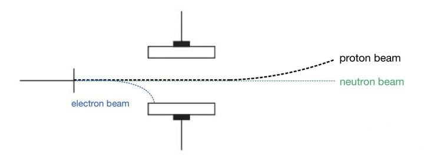
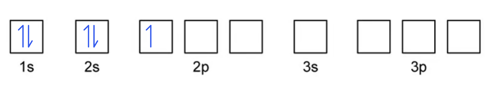
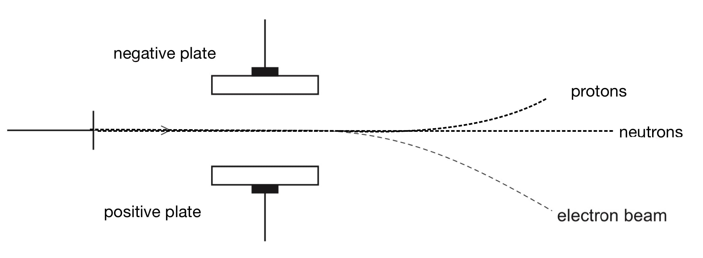

# Mark Schemes — Particles in the Atom & Atomic Radius
**1. Atomic Structure** · Cambridge (CIE) A-LEVEL chemistry (9701)

## Multiple Choice Questions (16 questions)

### Q1
**Final answer:** **The correct answer is B**

- Phosphorus has an atomic number of 15, so the 31P3− ion must have **15 protons**.
- A 3− ion has gained 3 electrons: 15 + 3 = **18 electrons**.
- Row **B** is the only option with 15 protons and 18 electrons.

**A** is incorrect as it has 15 protons but only 15 electrons, meaning it represents a neutral phosphorus atom, not the P3− ion.

**C** is incorrect as it has 16 protons. 16 is the atomic number of sulfur, not phosphorus, so this cannot be a phosphide ion.

**D** is incorrect as it has 16 protons, so it is not phosphorus. Also, with equal numbers of protons and electrons it carries no charge.

### Q2
**Final answer:** **The correct answer is C**

- Protons carry a **positive charge (+1)**, neutrons are **electrically neutral (0)** and electrons carry a **negative charge (−1)**.
- Protons and neutrons each have a relative mass of **1**; the relative mass of an electron is $\frac{1}{1836}$.

**A** is incorrect as although the charges are correct, it gives the relative mass of the electron as 1. This is the relative mass of a proton or neutron, not an electron.

**B** is incorrect as protons carry a positive charge (+1), not 0, and electrons carry a negative charge (−1), not positive.

**D** is incorrect as neutrons are electrically neutral (0), not +1, and the relative mass of an electron is $\frac{1}{1836}$, not 1.

### Q3
**Final answer:** **The correct answer is B**

- The **atomic number** of magnesium is 12, so 26Mg2+ has **12 protons**.
- The number of neutrons = mass number − atomic number = 26 − 12 = **14 neutrons**.
- The 2+ charge means the ion has lost 2 electrons: 12 − 2 = **10 electrons**.

**A** is incorrect as it gives 10 protons. The atomic number of Mg is 12, so the ion must have 12 protons.

**C** is incorrect as it gives 26 neutrons. This confuses the mass number with the neutron count; the number of neutrons is 26 − 12 = 14.

**D** is incorrect as it gives 14 protons. This confuses the neutron count with the proton count; the number of protons is determined by the atomic number (12).

> **[exam-tip]**
> Remember to subtract electrons for positive ions and add electrons for negative ions.

### Q4
**Final answer:** **The correct answer is C**

- Lithium (Li) has atomic number 3, so each Li atom has 3 protons.
- Li+ has lost one electron, so it has 2 electrons.
- Each Li+ ion contains 3 + 2 = 5 protons and electrons in total.
- For 2 moles of Li+:

2 × 5 × 6.02 × 1023 = 6.02 × 1024

**A** is incorrect as it counts electrons only (2 per Li+ ion):

2 × 2 × 6.02 × 1023 = 2.4 × 1024

**B** is incorrect as it counts protons only (3 per Li+ ion):

2 × 3 × 6.02 × 1023 = 3.6 × 1024

**D** is incorrect as it treats Li+ as a neutral lithium atom with 3 protons and 3 electrons:

2 × 6 × 6.02 × 1023 = 7.2 × 1024

### Q5
**Final answer:** **The correct answer is D**

- Statement **D** claims the particles travel at different speeds, but this is **not** correct.
- In this type of experiment, all three particles enter the electric field with the **same initial velocity**.
- The direction and degree of deflection are determined by the **charge** and **mass** of each particle, not by their speed.

  - Protons deflect towards the negative plate.
  - Electrons deflect towards the positive plate.
  - Neutrons pass straight through undeflected as they carry no charge.
- Electrons are deflected more than protons because they have a **much smaller mass** but carry the same magnitude of charge.

**A** is not the answer as it correctly states that protons and electrons are deflected because they are charged particles.

**B** is not the answer as it correctly states that neutrons are undeflected because they carry no charge.

**C** is not the answer as it correctly states that the electron is deflected more than the proton because it has less mass.

### Q6
**Final answer:** **The correct answer is B**

- The atomic number of phosphorus is 15, so the ion has **15 protons**.
- The number of neutrons = mass number − atomic number = 32 − 15 = **17 neutrons**.
- The 3− charge means the ion has gained 3 electrons: 15 + 3 = **18 electrons**.

**A** is incorrect as although it correctly gives 15 protons and 17 neutrons, it gives 32 electrons. This would correspond to a 17− charge, not 3−.

**C** is incorrect as phosphorus has an atomic number of 15, not 17, so the ion cannot have 17 protons.

**D** is incorrect as it has 17 protons, which is not the atomic number of phosphorus, and 32 electrons gives the wrong ionic charge.

### Q7
**Final answer:** **The correct answer is C**

- Moving down Group I, each successive element gains an additional **electron shell**.
- This increases the distance of the outer electrons from the nucleus, so the **atomic radius increases** moving down the group.
- The increase in atomic radius is caused by the addition of electron shells, **not** by increasing nuclear forces.
- Option **C** is therefore the statement that is not correct.

**A** is not the answer as it correctly states that atomic radius increases moving down Group I.

**B** is not the answer as it correctly identifies the addition of electron shells as the cause of the increase in atomic radius.

**D** is not the answer as it correctly states that Rb has the greatest atomic radius of the elements listed.

### Q8
**Final answer:** **The correct answer is D**

- The **atomic number** and the **proton number** are equivalent terms, referring to the number of **protons** in the nucleus of an atom.
- The **mass number** is the total number of protons and neutrons (**nucleons**) in the nucleus.

**A** is incorrect as the atomic number is not the number of atoms. It is the number of protons in the nucleus.

**B** is incorrect as the atomic number is the number of protons, not electrons.

**C** is incorrect as both the atomic number and the proton number refer to the number of protons, not electrons or neutrons.

> **[exam-tip]**
> The atomic number and proton number are interchangeable terms as both describe the number of protons in the nucleus. This question tests whether you know these two terms have exactly the same meaning.

### Q9
**Final answer:** **The correct answer is A**

- Calcium has an atomic number of **20**, so 40Ca+ has **20 protons**.
- The number of neutrons = mass number − atomic number = 40 − 20 = **20 neutrons**.
- The +1 charge means the ion has lost one electron: 20 − 1 = **19 electrons**.
- 40Ca+ therefore has 19 electrons and 20 neutrons, matching the description of **X**.

**B** is incorrect as 39K+ has 19 − 1 = 18 electrons, not 19.

**C** is incorrect as 38Ar is a neutral atom with 18 electrons, not 19.

**D** is incorrect as 45Sc has 45 − 21 = 24 neutrons (not 20) and 21 electrons (not 19).

### Q10
**Final answer:** **The correct answer is A**

- The **atomic number** of sodium is 11, so 23Na+ has **11 protons**.
- The **mass number** is 23, so it has 23 − 11 = **12 neutrons**.
- The +1 charge means it has lost one electron: 11 − 1 = **10 electrons**.
- 11 protons, 12 neutrons and 10 electrons are all different values. ✓

**B** is incorrect as 27Al is a neutral atom, so it has equal numbers of protons and electrons (13 each).

**C** is incorrect as 19F− has 10 neutrons and 10 electrons. Two of the three values are equal.

**D** is incorrect as 32S2− has 16 protons and 16 neutrons. Two of the three values are equal.

### Q11
**Final answer:** **The correct answer is B**

- Each hydrogen atom contains only **1 proton** in its nucleus.
- There are 3 hydrogen atoms in H3+, so there are **3 protons** in total.
- The ion has a single positive charge, so it must have 3 − 1 = **2 electrons**.
- Hydrogen-1 atoms contain **no neutrons**.

**A** is incorrect as with 3 protons and a +1 charge, H3+ must have 3 − 1 = 2 electrons, not 1.

**C** is incorrect as H3+ consists of three hydrogen-1 atoms, giving 3 protons and 0 neutrons in total, not 2 protons and 1 neutron.

**D** is incorrect as H3+ contains 3 protons (one from each hydrogen atom), not 2, and no neutrons.

### Q12
**Final answer:** **The correct answer is B**

- Atoms are **electrically neutral** because the overall negative charge from the electrons is exactly cancelled by the overall positive charge from the protons.
- Each proton carries a charge of +1 and each electron carries a charge of −1; in a neutral atom the number of protons equals the number of electrons, so the charges cancel completely.

**A** is incorrect as the difference in mass between protons and electrons does not affect the overall charge of the atom.

**C** is incorrect as neutrons carry no charge and therefore do not balance any electrical charge in the atom.

**D** is incorrect as the positions of electrons and protons within the atom do not determine whether the atom is electrically neutral. It is the equality of their opposite charges that matters.

### Q13
**Final answer:** **The correct answer is A**

- Moving across Period 3, electrons are added to the **same energy level.**

  - No new electron shells are added.
- Statement **A** claims that electron shells are added moving across the period.

  - This would increase the nuclear force of attraction, which is **not** correct.
- The **nuclear charge** increases with each successive element (atomic number increases by 1), pulling the outer electrons closer to the nucleus.
- With no additional shielding from new shells, the atomic radius **decreases** across Period 3.

**B** is not the answer as it correctly states that nuclear charge increases moving across Period 3 due to the increasing atomic number.

**C** is not the answer as it correctly states that there is a greater force of attraction between the nucleus and the outer electrons as nuclear charge increases.

**D** is not the answer as it correctly states that atomic radius decreases across Period 3.

### Q14
**Final answer:** **The correct answer is D**

- The nucleus contains protons and neutrons, each with a relative mass of 1 (approximately **1836 times greater** than that of an electron).
- Protons and neutrons are packed tightly together, making the nucleus **small** and **dense**; the presence of protons gives it a **positive charge**.
- Electrons occupy energy shells around the nucleus, making the surrounding space **mainly empty**.
- The diameter of an atom is approximately 1 × 105 times larger than the diameter of the nucleus.

**A** is incorrect as the nucleus is positively charged, not neutral because it contains protons, which each carry a +1 charge.

**B** is incorrect as the nucleus is small, not large, and the surrounding space is mainly empty rather than densely populated with electrons.

**C** is incorrect as the nucleus is positively charged due to its protons, not neutral.

### Q15
**Final answer:** **The correct answer is B**

- All three species have **18 electrons** and therefore the same electron configuration.
- For isoelectronic species, atomic radius decreases as **nuclear charge** (proton number) increases.
- Basically, more protons pull the electrons closer to the nucleus.
- Proton numbers: Cl− = 17, Ar = 18, K+ = 19.
- Order from largest to smallest radius: **Cl****-**** > Ar > K****+**.

**A** is incorrect as it places K+ as the largest species; K+ has the highest proton number (19) and therefore the greatest nuclear attraction, giving it the smallest radius of the three.

**C** is incorrect as it places Cl− last; Cl− has the lowest proton number (17) and therefore experiences the least nuclear attraction, giving it the largest radius.

**D** is incorrect as it places Ar first; Ar has 18 protons compared to Cl−'s 17, so Ar has a smaller radius than Cl−.

### Q16
**Final answer:** **The correct answer is A**

- The **atomic number** of phosphorus is 15, so the $\mathrm{P} pre_{15} pre^{31^{3} -}$ ion has **15 protons**.
- The number of neutrons = mass number − atomic number = 31 − 15 = **16 neutrons**.
- The 3− charge means the ion has gained 3 electrons: 15 + 3 = **18 electrons**.

**B** is incorrect as phosphorus has an atomic number of 15, not 16, so a phosphide ion cannot have 16 protons.

**C** is incorrect as it also has 16 protons, which is not the atomic number of phosphorus.

**D** is incorrect as a neutral phosphorus atom has 15 electrons, but the 3− charge means the ion has gained 3 electrons, giving 18 electrons, not 15.

## Structured Questions (6 questions)

### Q1
The completed table is:

| **atomic number** | **nucleon number** | **number of electrons** | **number of protons** | **number of neutrons** | **species** |
|---|---|---|---|---|---|
| 15 | 31 | 18 | **Final answer:** **15** | **Final answer:** **16** | 31P3- |
| **Final answer:** **17** | **Final answer:** **36** | 18 | 17 | 19 | 36Cl- |

**[2 marks]**

> **[mark-scheme]**
> 1 mark for row 1 all correct: 15 protons, 16 neutrons, species = 31P3-
> 
> 1 mark for row 2 all correct: atomic number = 17, nucleon number = 36, species = 36Cl-

> **[exam-tip]**
> The number of protons equals the atomic number. The number of neutrons equals the nucleon number minus the atomic number.
> 
> To identify the element from its atomic number, use the Periodic Table. Write the nucleon number as a superscript before the symbol and the ionic charge as a superscript after the symbol.
> 
> For ions, adjust the electron count for the charge. P3- has gained three electrons: 15 protons but 18 electrons. Cl- has gained one electron: 17 protons but 18 electrons, giving nucleon number 17 + 19 = 36.
The completed diagram is:

**[3 marks]**

> **[mark-scheme]**
> 1 mark for neutron path drawn as a straight line, labelled "neutrons" / "neutron beam"
> 
> 1 mark for electron path deflected towards the positive plate, labelled "electrons" / "electron beam"
> 
> 1 mark for electron path showing more deflection / a sharper curve than the proton path

> **[exam-tip]**
> Neutrons carry no charge and are not deflected by the electric field — draw a straight horizontal line in the same direction as the original beam.
> 
> Electrons are negatively charged and deflect towards the positive plate. The key third mark is that electrons deflect more than protons. Although they carry the same magnitude of charge, electrons are approximately 1836 times lighter, giving them a much larger charge-to-mass ratio and therefore a sharper, steeper curve.
> **[mark-scheme]**
> The atomic radius of a chlorine atom is smaller than that of a sulfur atom because:
> 
> - Chlorine has a greater nuclear charge / more protons than sulfur **[1 mark]**
> - The outer electrons in both atoms occupy the same shell / shielding is similar
> **AND**
> The greater nuclear charge in chlorine draws the outer electrons closer to the nucleus **[1 mark]**

> **[exam-tip]**
> Both sulfur and chlorine are in Period 3 and have the same number of electron shells. Chlorine has one more proton than sulfur, giving it a greater nuclear charge. Since the outer electrons in both atoms are in the same (third) shell, shielding is similar. The higher nuclear charge in chlorine therefore pulls the outer electrons closer to the nucleus, reducing the atomic radius.

### Q2
The completed table is:

| **Particle** | **Relative charge** | **Relative mass** |
|---|---|---|
| Proton | **Final answer:** **+1** | **Final answer:** **1** |
| Neutron | **Final answer:** **0** | **Final answer:** **1** |
| Electron | **Final answer:** **−1** | **Final answer:** **0** |

**[3 marks]**

> **[mark-scheme]**
> 1 mark for proton: relative charge = +1 **AND **relative mass = 1
> 
> 1 mark for neutron: relative charge = 0 / no charge / neutral **AND **relative mass = 1
> 
> 1 mark for electron: relative charge = −1 **AND **relative mass = 0 / negligible / 1/1836
> 
> Electron relative mass values of 1/1800, 1/1840, or a value in the range 5.4 x 10-4 to 5.6 x 10-4 are accepted

> **[exam-tip]**
> The relative mass of an electron is roughly 1/1836 of a proton, which is so small it is treated as negligible, so 0 is the expected answer. Values close to the true mass, such as 1/1836 or 1/1840, are also accepted.
> 
> For the relative charge of a neutron, "no charge", "neutral", and "zero" all mean the same thing and are all accepted.
> **[mark-scheme]**
> Silicon is placed in the:
> 
> - p block **[1 mark]**
> - Silicon's highest energy / outermost / valence electron is in a (3)p orbital **[1 mark]**
> 
> The number 3 is not required. Any other number is not accepted.

> **[exam-tip]**
> The blocks of the Periodic Table are named after the type of orbital the outermost electron occupies. Silicon's electron configuration ends in 3p2, so its outermost electron is in a p orbital, making it a p block element.
> 
> You do not need to include the number 3 in your answer. Including any other number will cost you the mark.
> **[mark-scheme]**
> i) Isotopes are:
> 
> - Atoms of the same element with the same number of protons / same atomic number but different numbers of neutrons / different mass numbers **[1 mark]**

> **[exam-tip]**
> Always include both parts of the definition — same number of protons and different numbers of neutrons. Stating only one part will not score the mark.
> 
> Do not confuse isotopes with ions: isotopes differ in neutron number, not in electron number or charge.

ii) To calculate the relative atomic mass, *A*r, of silicon:

*A*r = $\frac{(92.23\times28)+(4.68\times29)+(3.09\times30)}{100}$

*A*r = $\frac{2582.44+135.72+92.70}{100}$

*A*r = **28.11** **[1 mark]**

> **[mark-scheme]**
> 1 mark for *A*r = 28.11

> **[exam-tip]**
> To calculate relative atomic mass, multiply each isotope's mass number by its percentage abundance, add the results together, then divide by 100.
> 
> The question asks for two decimal places, so round 28.1086... to 28.11.

### Q3
> **[mark-scheme]**
> i) The trend in atomic radius across Period 2 is:
> 
> - Atomic radius decreases (from Li to F) **[1 mark]**
> - Nuclear charge increases across Period 2
> **AND**
> Shielding is similar / constant across the period / electrons are added to the same shell **[1 mark]**
> - There is a stronger attraction between the nucleus and outer electrons **[1 mark]**

> **[exam-tip]**
> This is a three-point answer:
> 
> - State the trend
> - Give the cause
> - Explain why
> 
> Make sure you state that atomic radius decreases before giving the explanation, or you risk missing the first marking point.
> 
> The key phrase for the second marking point is that shielding remains roughly constant across the period because all new electrons enter the same shell (the 2nd shell).
> 
> This means the increasing nuclear charge acts more effectively on the outer electrons, pulling them closer.

> **[mark-scheme]**
> ii) The atomic radius of neon cannot be determined in the same way because:
> 
> - Neon does not form covalent bonds / exists as single atoms / is monoatomic **[1 mark]**
> - Atomic radius is defined as half the distance between the nuclei of two covalently bonded atoms of the same element **[1 mark]**

> **[exam-tip]**
> The atomic radius values in the table are covalent radii, measured as half the bond length between two atoms of the same element. Since neon is a noble gas and does not form bonds, no bond length can be measured and this method cannot be applied.
The box notation for boron in the ground state is:

**[1 mark]**

> **[mark-scheme]**
> 1 mark for correct ground state box notation for boron: 1s2 2s2 2p1 with paired electrons drawn with opposite spins and the 2p electron in any of the three 2p boxes

> **[exam-tip]**
> The ground state electronic configuration of boron is 1s2 2s2 2p1.
> 
> In box notation, paired electrons must be drawn with opposite spins (one arrow up, one arrow down). The single 2p electron can be placed in any of the three 2p boxes with any spin direction.
> 
> In the excited state, one 2s electron is promoted to the 2p subshell, giving 1s2 2s1 2p2. This question asks for the ground state, so the excited state configuration would not be accepted.
> **[mark-scheme]**
> The first ionisation energy of boron is lower than that of beryllium because:
> 
> - The outer electron of B is in the 2p subshell
> **AND**
> The outer electron of Be is in the 2s subshell **[1 mark]**
> - The 2p subshell is at higher energy / further from the nucleus / more shielded by the 2s electrons than the 2s subshell
> **AND**
> Less energy is required to remove the outer electron of B **[1 mark]**

> **[exam-tip]**
> The key is subshell type, not electron count. Although B has more protons than Be, the extra electron is in the higher-energy 2p subshell, which is further from the nucleus and partially shielded by the 2s electrons. This makes the 2p electron easier to remove than Be's 2s electron.
> 
> The electronic configurations are:
> 
> - Be: 1s2 2s2
> - B: 1s2 2s2 2p1
> **[mark-scheme]**
> The formula of the compound formed when element J reacts with chlorine is:
> 
> - JCl2 **[1 mark]**

> **[exam-tip]**
> To identify the group of element J, look for the largest jump between consecutive ionisation energies. The largest jump is between the 2nd (1450 kJ mol-1) and 3rd (7733 kJ mol-1) ionisation energies.
> 
> This large jump occurs because the 3rd electron is being removed from a new, inner shell that is much closer to the nucleus and experiences less shielding. This tells us J has 2 outer shell electrons and is in Group 2.
> 
> Group 2 elements form 2+ ions, so two chloride ions (Cl-) are needed to balance the charge, giving JCl2.

### Q4
The completed table is:

| **Species** | **number of protons** | **number of neutrons** | **number of electrons** |
|---|---|---|---|
| 23Na | **Final answer:** **11** | **Final answer:** **12** | **Final answer:** **11** |
| 32S2- | **Final answer:** **16** | **Final answer:** **16** | **Final answer:** **18** |
| 86Sr2+ | **Final answer:** **38** | **Final answer:** **48** | **Final answer:** **36** |

**[3 marks]**

> **[mark-scheme]**
> 1 mark for all three values for 23Na correct: 11 protons, 12 neutrons, 11 electrons
> 
> 1 mark for all three values for 32S2- correct: 16 protons, 16 neutrons, 18 electrons
> 
> 1 mark for all three values for 86Sr2+ correct: 38 protons, 48 neutrons, 36 electrons

> **[exam-tip]**
> The number of protons equals the atomic number, which you can find on the Periodic Table. The number of neutrons is the mass number minus the atomic number.
> 
> For neutral atoms, electrons equal protons.
> 
> For ions, adjust for the charge: add electrons for negative ions and subtract for positive ions. For S2-, add 2 (16 + 2 = 18). For Sr2+, subtract 2 (38 - 2 = 36).
> **[mark-scheme]**
> The trend in atomic radius across Period 3, and the reason, are:
> 
> - Decreases **[1 mark]**
> 
> Explanation:
> 
> - The atomic / proton number / nuclear charge increases **[1 mark]**
> - Shielding remains the same / similar across the period
> **OR**
> Electrons are added to the same principal quantum shell **[1 mark]**

> **[exam-tip]**
> Across Period 3, each element has one more proton than the last, increasing the nuclear charge. The extra electrons are added to the same outer shell, so shielding stays roughly constant. The stronger nuclear pull on the same outer electrons contracts the atom, so atomic radius decreases.
> **[mark-scheme]**
> The chloride ion has a larger radius than chlorine because:
> 
> - The Cl- ion has the same nuclear charge / same number of protons (17) but one more electron / more electrons (18) **[1 mark]**
> - Greater electron-electron repulsion / the outer electrons experience a reduced effective nuclear charge, causing the electron cloud to expand **[1 mark]**

> **[exam-tip]**
> Chlorine gains one electron to form Cl-, giving it 17 protons but 18 electrons. The nuclear charge stays the same, but there is now more electron-electron repulsion in the outer shell. This repulsion pushes the electrons further from the nucleus, increasing the ionic radius compared to the atomic radius.

### Q5
The correct labelling is shown in Fig. 5.1:

**[1 mark]**

> **[mark-scheme]**
> 1 mark for both plates correctly labelled

> **[exam-tip]**
> Electrons are negatively charged and are deflected towards the positive plate.
> 
> Neutrons carry no charge and pass straight through unaffected.
> 
> Protons are positively charged and are deflected towards the negative plate.
> 
> Protons are deflected by a much smaller angle than electrons. Although they carry the same magnitude of charge, protons have a mass approximately 1836 times greater than electrons, giving them a much smaller charge-to-mass ratio and therefore less deflection.
The completed table is:

| **Species** | **number of protons** | **number of neutrons** | **number of electrons** |
|---|---|---|---|
| 23Na | **Final answer:** **11** | **Final answer:** **12** | **Final answer:** **11** |
| 32S2– | **Final answer:** **16** | **Final answer:** **16** | **Final answer:** **18** |
| 86Sr2+ | **Final answer:** **38** | **Final answer:** **48** | **Final answer:** **36** |

**[3 marks]**

> **[mark-scheme]**
> 1 mark for all three values correct for 23Na
> 
> 1 mark for all three values correct for 32S2–
> 
> 1 mark for all three values correct for 86Sr2+

> **[exam-tip]**
> The number of protons equals the atomic number, found on the Periodic Table.
> 
> The number of neutrons = mass number (the superscript before the symbol) minus the atomic number.
> 
> For ions, adjust the electron count by the charge: subtract electrons for positive charges (Sr2+ has 38 − 2 = 36 electrons), and add electrons for negative charges (S2– has 16 + 2 = 18 electrons).
> **[mark-scheme]**
> The full electronic configuration of the 32S2– ion is:
> 
> - 1s2 2s2 2p6 3s2 3p6 **[1 mark]**

> **[exam-tip]**
> A sulfur atom has 16 electrons with configuration 1s2 2s2 2p6 3s2 3p4. The S2– ion gains 2 electrons, giving 18 electrons in total.
> 
> The resulting configuration, 1s2 2s2 2p6 3s2 3p6, is the same as that of argon. Ions that are isoelectronic with a noble gas are particularly stable.
> 
> Because the question asks for the full electronic configuration, noble gas shorthand such as [Ne] 3s2 3p6 is not accepted.

### Q6
The completed table is:

| **Subatomic particle** | **Relative charge** | **Relative mass** |
|---|---|---|
| Proton | **Final answer:** **+1** | 1 |
| Neutron | **Final answer:** **0** | **Final answer:** **1** |
| Electron | **Final answer:** **-1** | $\frac{1}{1836}$ |

**[4 marks]**

> **[mark-scheme]**
> 1 mark for proton relative charge: +1
> 
> 1 mark for neutron relative charge: 0
> 
> 1 mark for neutron relative mass: 1
> 
> 1 mark for electron relative charge: -1
> 
> The relative mass of an electron can be expressed as $\frac{1}{1836}$, $\frac{1}{2000}$, or 5 × 10-4. In many contexts it is acceptable to describe the electron mass as negligible or approximately zero.

> **[exam-tip]**
> These values are fundamental to atomic structure and should be memorised.
The completed table is:

| **Species** | **Number of protons** | **Number of neutrons** | **Number of electrons** |
|---|---|---|---|
| 31P | **Final answer:** **15** | **Final answer:** **16** | **Final answer:** **15** |
| 24Na+ | **Final answer:** **11** | **Final answer:** **13** | **Final answer:** **10** |
| 37Cl– | **Final answer:** **17** | **Final answer:** **20** | **Final answer:** **18** |

**[3 marks]**

> **[mark-scheme]**
> 1 mark for all three values correct for 31P
> 
> 1 mark for all three values correct for 24Na+
> 
> 1 mark for all three values correct for 37Cl–

> **[exam-tip]**
> The number of protons equals the atomic number, found on the Periodic Table.
> 
> The number of neutrons = mass number (the superscript before the symbol) minus the atomic number.
> 
> For ions, adjust the electron count: subtract electrons for positive charges (Na+ has 11 − 1 = 10 electrons), and add electrons for negative charges (Cl− has 17 + 1 = 18 electrons).
> **[mark-scheme]**
> Isotopes of the same element have different physical properties because:
> 
> - Isotopes have different numbers of neutrons / different mass numbers **[1 mark]**

> **[exam-tip]**
> Physical properties such as density, melting point, and boiling point depend on the mass of the atom. Since isotopes differ in their number of neutrons, they have different masses and therefore different physical properties.
> **[mark-scheme]**
> The chemical properties of 35Cl and 37Cl are identical because:
> 
> - They have the same electronic configuration / same number of electrons / same number of outer shell electrons **[1 mark]**

> **[exam-tip]**
> Chemical properties are determined by the arrangement of electrons, particularly the outer shell electrons that take part in bonding and reactions. Since isotopes of the same element have the same atomic number, they have the same number of electrons and the same electronic configuration, giving identical chemical properties.
