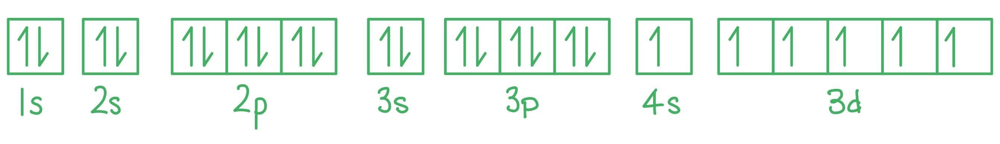

# Mark Schemes — Electrons, Energy Levels & Atomic Orbitals
**1. Atomic Structure** · Cambridge (CIE) A-LEVEL chemistry (9701)

## Multiple Choice Questions (12 questions)

### Q1
**Final answer:** **The correct answer is C**

- A neutral chromium atom has the anomalous configuration [Ar]3d5 4s1.
- When transition metals form ions, they lose the 4s electrons before the 3d electrons.
- To form Cr3+, the atom loses its one 4s electron and two 3d electrons:

[Ar]3d5 4s1 − 3e- → [Ar]3d3

- The number of d electrons in Cr3+ is **3**.
- Phosphorus has the configuration [Ne]3s2 3p3.

  - Its outermost occupied subshell is 3p, which contains **3 electrons.**
  - This matches the 3 d electrons in Cr3+.

**A** is incorrect as aluminium has the configuration [Ne]3s2 3p1. Its outermost subshell (3p) contains only 1 electron.

**B** is incorrect as gallium has the configuration [Ar]3d10 4s2 4p1. Its outermost subshell (4p) contains only 1 electron.

**D** is incorrect as vanadium has the configuration [Ar]3d3 4s2. Its outermost occupied subshell is 4s, which contains 2 electrons.

### Q2
**Final answer:** **The correct answer is C**

- The electronic configuration of V is [Ar]3d3 4s2.

- The electronic configuration of V2+ is [Ar]3d3.

- The 4s subshell fills first and empties first, so forming a 2+ ion removes both 4s electrons, leaving 3d3 intact.

**A** is incorrect as Cr has the anomalous configuration [Ar]3d5 4s1. Removing the 4s electron gives Cr+ = [Ar]3d5, not 3d3.

**B** is incorrect as Ti has the configuration [Ar]3d2 4s2. Removing both 4s electrons gives Ti2+ = [Ar]3d2.

**D** is incorrect as the electronic configuration of V3+ is [Ar]3d2 (two 4s and one 3d electron removed).

### Q3
**Final answer:** **The correct answer is D**

- The electronic configuration of vanadium is 1s2 2s2 2p6 3s2 3p6 3d3 4s2.

- According to the Aufbau principle, electrons fill subshells in order of increasing energy. For the relevant subshells: 3s, 3p, 4s, 3d.

- Note that 4s fills before 3d because 4s has lower energy than 3d.

- In order of **decreasing** energy (reversed): 3d, 4s, 3p, 3s.

**A** is incorrect as 3s, 3p, 4s, 3d is the **increasing** energy order (Aufbau filling order), not decreasing.

**B** is incorrect as it places 4s above 3d (4s has lower energy than 3d) and 3s above 3p (3p has higher energy than 3s).

**C** is incorrect as it places 4s above 3d. The 3d subshell has higher energy than 4s, so 3d must appear first in a decreasing sequence.

### Q4
**Final answer:** **The correct answer is D**

- The s orbital is **spherical** in shape; the p orbitals are **dumbbell-shaped**.
- The px orbital lies along the x-axis and the py orbital lies along the y-axis.
- Orbital 1 is spherical, so it is s. Orbital 2 is dumbbell-shaped along the x-axis, so it is px. Orbital 3 is dumbbell-shaped along the y-axis, so it is py.

**A** is incorrect as not all three orbitals shown are p-type. Orbital 1 is spherical, so it must be s.

**B** is incorrect as the dumbbell orbital aligned along the x-axis is px, not pz.

**C** is incorrect as orbital 3 is aligned along the y-axis, making it py, not pz.

### Q5
**Final answer:** **The correct answer is C**

- With a **proton number** of 17, the element is chlorine (Cl).
- In atoms, the number of protons equals the number of electrons; a neutral Cl atom has 17 electrons.
- A single negative charge means one extra electron has been gained: the chloride ion, Cl-, has **18 electrons**.
- Its electronic configuration is:

1s2 2s2 2p6 3s2 3p6

- This is isoelectronic with argon (Ar).

**A** is incorrect as this configuration has only 16 electrons. It represents Cl with one electron removed (Cl+), not Cl-.

**B** is incorrect as this is the configuration of neutral Cl (17 electrons). A negative charge means one electron must be added.

**D** is incorrect as this configuration has 19 electrons. The charge is 1-, so only one extra electron is added, not two.

### Q6
**Final answer:** **The correct answer is D**

- N- has the electronic configuration 1s2 2s2 2p4.
- Removing one electron gives N with the configuration 1s2 2s2 2p3.
- The 2p subshell can hold 6 electrons, so 3 electrons represent a half-filled p subshell.

**A** is incorrect as F is 1s² 2s² 2p⁵. Removing one electron gives F⁺ (1s² 2s² 2p⁴), which is not half-filled.

**B** is incorrect as Li⁺ is 1s². Removing one electron gives Li²⁺ (1s¹), which has no p electrons at all.

**C** is incorrect as N is 1s² 2s² 2p³. Removing one electron gives N⁺ (1s² 2s² 2p²), which is not half-filled. (N is *already* half-filled, but the question asks about the species formed after removal.)

### Q7
**Final answer:** **The correct answer is B**

- The electronic configuration of chromium is 1s2 2s2 2p6 3s2 3p6 3d5 4s1.
- There are 5 unpaired 3d electrons and 1 unpaired 4s electron, giving a total of 6 unpaired electrons as shown in the electron box notation below.

**A** is incorrect as carbon has 2 unpaired electrons in the 2p subshell: 1s2 2s2 2p2.

**C** is incorrect as iron has 4 unpaired electrons in the 3d subshell: 1s2 2s2 2p6 3s2 3p6 3d6 4s2.

**D** is incorrect as sulfur has 2 unpaired electrons in the 3p subshell: 1s2 2s2 2p6 3s2 3p4.

### Q8
**Final answer:** **The correct answer is C**

- With a **proton number** of 35, the element is bromine (Br).
- In atoms, the number of protons equals the number of electrons; a neutral Br atom has 35 electrons.
- A single negative charge means one extra electron has been gained: the bromide ion, Br-, has **36 electrons**.
- Its electronic configuration is:

1s2 2s2 2p6 3s2 3p6 3d10 4s2 4p6

- This is isoelectronic with krypton (Kr).

**A** is incorrect as this configuration has only 34 electrons. It represents Br with one electron removed (Br+), not Br-.

**B** is incorrect as this is the configuration of neutral Br (35 electrons). A negative charge means one electron must be added.

**D** is incorrect as this configuration has 37 electrons. The charge is 1-, so only one extra electron is added, not two.

### Q9
**Final answer:** **The correct answer is B**

- When two electrons occupy the same orbital, they experience **spin-pair repulsion** due to their opposing spins.

- However, the energy required to overcome this spin-pair repulsion is **less** than the energy difference between adjacent orbitals.

- It is therefore energetically more favourable for electrons to pair up in a lower energy orbital than to occupy a higher energy orbital.

**A** is incorrect as the energy required to overcome spin-pair repulsion is less than (not greater than) the energy difference between the orbitals. Electrons pair up precisely because pairing costs less energy.

**C** is incorrect as electrons in the same orbital must have opposing spins (Pauli exclusion principle) and always experience spin-pair repulsion.

**D** is incorrect as electrons in the same orbital experience greater repulsion than electrons in separate orbitals, which is the basis of Hund's rule.

### Q10
**Final answer:** **The correct answer is C**

- **Isoelectronic** means the species have the same electron configuration:

  - 1s2 2s2 2p6.
- Two electrons are **added** to the oxygen 2p subshell to form O2-.
- Two electrons are **removed** from the magnesium 3s subshell to form Mg2+.
- Since all three species have the same electron configuration, ionic radius depends on the **number of protons** as more protons means greater nuclear attraction and a smaller radius.

  - O2- has 8 protons.
  - Ne has 10 protons.
  - Mg2+ has 12 protons.
- Therefore the order of increasing radius is:

Mg2+ < Ne < O2-

### Q11
**Final answer:** **The correct answer is C**

- Free radicals are atoms or groups of atoms that have one or more **unpaired electrons.**
- They are **highly reactive** due to the presence of the unpaired electron(s).

- An example is the **homolytic fission** of halogens by UV light:

Cl2 → 2Cl•

- The dot after the Cl indicates the presence of an unpaired electron.

**A** is incorrect as a species with a lone pair of electrons describes a nucleophile.

**B** is incorrect as heterolytic bond fission produces ions (a cation and an anion), not free radicals. Free radicals are formed by **homolytic** fission.

**D** is incorrect as a species that acts as an electron pair acceptor describes an electrophile.

### Q12
**Final answer:** **The correct answer is C**

- The electron configuration of Mg is 1s2 2s2 2p6 3s2.

- The outermost occupied subshell is 3s, which has a maximum capacity of 2 electrons and contains 2 electrons. It is completely filled.

**A** is incorrect as the electronic configuration of Al is 1s2 2s2 2p6 3s2 3p1. The outermost subshell (3p) is incomplete.

**B** is incorrect as the electronic configuration of Cl is 1s2 2s2 2p6 3s2 3p5. The outermost subshell (3p) is incomplete.

**D** is incorrect as the electronic configuration of Si is 1s2 2s2 2p6 3s2 3p2. The outermost subshell (3p) is incomplete.
