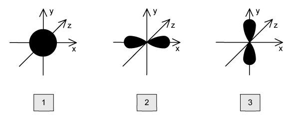

# Exam Questions — Electrons, Energy Levels & Atomic Orbitals
**1. Atomic Structure** · Cambridge (CIE) A-LEVEL chemistry (9701)
> Source: [https://www.savemyexams.com/a-level/chemistry/cie/25/topic-questions/](https://www.savemyexams.com/a-level/chemistry/cie/25/topic-questions/) · 17 questions across 2 sets

## Multiple Choice Questions (12 questions)

### Q1 — hard — 1 marks

**Q1** [1 mark]

Which atom has the same number of electrons in its outermost occupied subshell as the number of d electrons in a Cr3+ ion?

### Q2 — hard — 1 marks

**Q2** [1 mark]

Which ion has the electronic configuration [Ar]3d3?

### Q3 — medium — 1 marks

**Q3** [1 mark]

What is the correct sequence for four subshells of a vanadium atom in order of decreasing energy according to the Aufbau principle?

### Q4 — medium — 1 marks

**Q4** [1 mark]

The diagram shows three atomic orbitals, labelled 1, 2 and 3.

Which row gives the correct label for each orbital?

|   | **1** | **2** | **3** |
|---|---|---|---|
| **A** | px | py | pz |
| **B** | s | pz | py |
| **C** | s | px | pz |
| **D** | s | px | py |

### Q5 — medium — 1 marks

**Q5** [1 mark]

An ion has a single negative charge and a proton number of 17.

What is the electronic configuration of this ion?

### Q6 — hard — 1 marks

**Q6** [1 mark]

Which species produces a half-filled p subshell when one electron is removed?

### Q7 — medium — 1 marks

**Q7** [1 mark]

An atom of element **Z** has six unpaired electrons.

Which element could be **Z**?

### Q8 — medium — 1 marks

**Q8** [1 mark]

An ion has a single negative charge and a proton number of 35.

What is the correct electronic configuration of this ion?

### Q9 — hard — 1 marks

**Q9** [1 mark]

Which statement explains why electrons pair up in a lower energy orbital rather than occupying a higher energy orbital?

### Q10 — easy — 1 marks

**Q10** [1 mark]

Which row gives the correct order of increasing radius (smallest to largest)?

|   | **Smallest** |   | **Largest** |
|---|---|---|---|
| **A** | Mg2+ | O2- | Ne |
| **B** | Ne | O2- | Mg2+ |
| **C** | Mg2+ | Ne | O2- |
| **D** | O2- | Ne | Mg2+ |

### Q11 — easy — 1 marks

**Q11** [1 mark]

Which statement describes a free radical?

### Q12 — easy — 1 marks

**Q12** [1 mark]

Which element has a completely filled outermost subshell?

## Structured Questions (5 questions)

### Q1 — medium — 5 marks

**Q1** [1 mark]

State the full electronic configuration of a chromium atom.

**Q1** [2 marks]

i) State what the symbol [Ar] represents.

[1]

ii) Complete Fig. 2.1 to show the electronic configuration of a chromium atom using the electrons in boxes notation.

[1]

**Fig. 2.1**

**Q1** [2 marks]

This question is about the chromium(III) ion, $\text{Cr} pre_{24} pre^{52^{3} +}$.

i) Deduce the number of protons, neutrons, and electrons in a 52Cr3+ ion.

protons ..........................

neutrons ..........................

electrons ..........................

[1]

ii) State the full electronic configuration of a chromium(III) ion.

[1]

### Q2 — medium — 6 marks

**Q2** [3 marks]

i) State the full electronic configuration of a rubidium ion, Rb+.

[1]

ii) Compare the ionic radius of a rubidium ion to the atomic radius of a krypton atom. Explain your answer.

[2]

**Q2** [2 marks]

The third shell consists of the 3s, 3p and 3d sub-shells.

i) State the total number of orbitals present in the third shell.

[1]

ii) List the 3d, 4s and 4p sub-shells in order of increasing energy.

[1]

**Q2** [1 mark]

**Extract:**

ii) List the 3d, 4s and 4p sub-shells in order of increasing energy.

The 3d, 4s and 4p sub-shells in order of increasing energy are:
- 4s, 3d, 4p

Rubidium forms an ionic compound with selenium, Rb2Se.

Complete Fig. 3.1 to show the electronic configuration of the valence electrons in a selenium atom.

**Fig. 3.1**

### Q3 — hard — 8 marks

**Q3** [1 mark]

In the blast furnace, carbon reacts with a limited supply of oxygen to form carbon monoxide.

Write an equation for this reaction.

**Q3** [2 marks]

i) Identify the highest energy sub-shell occupied by electrons in an oxygen atom.

[1]

ii) Sketch the shape of an orbital from this sub-shell on the axes in Fig. 5.1.

**Fig. 5.1**

[1]

**Q3** [5 marks]

i) Complete Fig. 5.2 to show the electronic configuration of a carbon atom in the ground state.

**Fig. 5.2**

[1]

ii) A molecule of carbon monoxide, CO, contains a triple covalent bond.

Deduce the hybridisation of the carbon atom in carbon monoxide.

[1]

iii) Describe how the σ and π bonds form in a molecule of carbon monoxide. Refer to orbital overlap in your answer.

[3]

### Q4 — easy — 5 marks

**Q4** [1 mark]

Aluminium is a metal in Group 13.

Complete the electronic configuration for an aluminium atom in Fig. 3.1.

**Fig. 3.1**

**Q4** [1 mark]

Sketch the shape of a 2s orbital on the axes in Fig. 3.2.

**Fig. 3.2**

**Q4** [1 mark]

The first ionisation energies of Li, Mg and Na are shown in Table 3.1.

Complete Table 3.1 to identify the missing elements.

**Table 3.1**

| **Element** | **First ionisation energy / kJ mol****-1** |
|---|---|
|   | 494 |
| Li | 519 |
|   | 736 |

**Q4** [2 marks]

Explain why the first ionisation energy of aluminium is lower than the first ionisation energy of magnesium.

### Q5 — medium — 9 marks

**Q5** [2 marks]

Complete Table 2.1 with information for two of the subatomic particles in an atom of 197Au.

**Table 2.1**

| particle | relative mass | relative charge | location within atom | total number in 197Au |
|---|---|---|---|---|
| electron | 5 x 10-4 | −1 |   | 79 |
| neutron |   |   | nucleus |   |

**Q5** [3 marks]

i) Define the term *isotope*.

[2]

ii) Explain why different isotopes of gold have identical chemical properties.

[1]

**Q5** [1 mark]

Gold(III) chloride has the formula AuCl3.

Complete Fig. 2.1 to show the electronic configuration of the chloride ion, Cl-, using the electrons in boxes notation.

**Fig. 2.1**

**Q5** [3 marks]

Sketch the shapes of an s orbital and a p orbital on the axes in Fig. 2.2. Label each type of orbital.

**Fig. 2.2**
