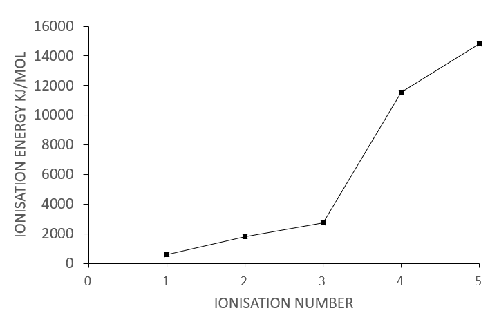
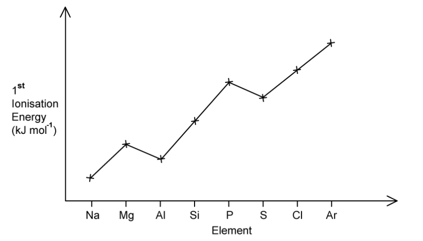
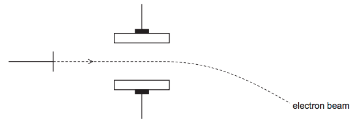
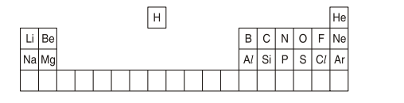
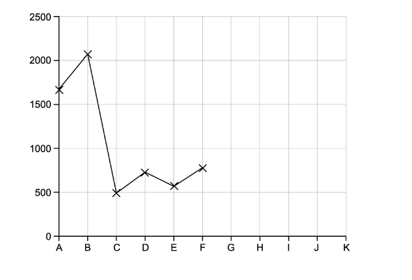

# Exam Questions — Ionisation Energy
**1. Atomic Structure** · Cambridge (CIE) A-LEVEL chemistry (9701)
> Source: [https://www.savemyexams.com/a-level/chemistry/cie/25/topic-questions/](https://www.savemyexams.com/a-level/chemistry/cie/25/topic-questions/) · 24 questions across 2 sets

## Multiple Choice Questions (16 questions)

### Q1 — medium — 1 marks

**Q1** [1 mark]

The graph below shows the variation of a physical property for elements in **Period 3** (Na to Ar).

Which physical property is shown?

### Q2 — medium — 1 marks

**Q2** [1 mark]

Values for the successive ionisation energies of an unknown element are given in the table below.

| **First ionisation energy / kJ mol**-1 | **Second ionisation energy / kJ mol**-1 | **Third ionisation energy / kJ mol**-1 | **Fourth ionisation energy / kJ mol**-1 |
|---|---|---|---|
| 420 | 3600 | 4400 | 5900 |

Which group of the Periodic Table contains this element?

### Q3 — hard — 1 marks

**Q3** [1 mark]

The electronic configurations of four different atoms are shown.

Which atom has the highest first ionisation energy?

### Q4 — hard — 1 marks

**Q4** [1 mark]

The table gives the successive ionisation energies for an element **R**.

|   | **1st** | **2nd** | **3rd** | **4th** | **5th** | **6th** |
|---|---|---|---|---|---|---|
| Ionisation energy / kJ mol-1 | 950 | 1800 | 2700 | 4800 | 6000 | 12300 |

What is the oxidation state of element **R** in its chloride?

### Q5 — easy — 1 marks

**Q5** [1 mark]

Which statement defines the first ionisation energy of an element?

### Q6 — easy — 1 marks

**Q6** [1 mark]

Which statement does **not** explain the increase in **first** ionisation energy across a period?

### Q7 — hard — 1 marks

**Q7** [1 mark]

The first ionisation energy of beryllium is **greater** than that of boron.

Which statement explains why?

### Q8 — easy — 1 marks

**Q8** [1 mark]

Which statement explains why the second ionisation energy of magnesium is **greater** than the first ionisation energy?

### Q9 — medium — 1 marks

**Q9** [1 mark]

The second ionisation energy of magnesium is 1451 kJ mol-1.

Which equation correctly represents this statement?

### Q10 — easy — 1 marks

**Q10** [1 mark]

The first five ionisation energies of an element are shown below.

Which element could this ionisation energy graph belong to?

### Q11 — hard — 1 marks

**Q11** [1 mark]

Element **X** is in period 2 and has the first seven ionisation energies in kJ mol-1 as shown.

| 1300 | 3380 | 5330 | 7460 | 11 010 | 13 320 | 71 200 |
|---|---|---|---|---|---|---|

What is the electronic configuration of element **X**?

### Q12 — easy — 1 marks

**Q12** [1 mark]

Which is the correct equation for the first ionisation energy for magnesium?

### Q13 — hard — 1 marks

**Q13** [1 mark]

Which pair of successive ionisation energies of oxygen shows the largest increase?

### Q14 — medium — 1 marks

**Q14** [1 mark]

Successive ionisation energies for an element, **Y**, are shown in the table below.

| **Electrons removed** | 1st | 2nd | 3rd | 4th | 5th |
|---|---|---|---|---|---|
| **Ionisation energy / kJ mol**-1 | 736 | 1450 | 7740 | 10500 | 13600 |

What is the most stable ion formed by Y?

### Q15 — medium — 1 marks

**Q15** [1 mark]

The successive ionisation energies of element **X** are shown in the table below.

| **Ionisation number of X** | 1 | 2 | 3 | 4 | 5 | 6 | 7 | 8 |
|---|---|---|---|---|---|---|---|---|
| **Ionisation energy (kJ mol**-1**)** | 1314 | 3388 | 5301 | 7469 | 10989 | 13327 | 71337 | 84080 |

Which group of the Periodic Table contains element X?

### Q16 — medium — 1 marks

**Q16** [1 mark]

**X**, **Y** and **Z** are consecutive elements in **Period 3** of the Periodic Table. Element **Y** has the highest first ionisation energy and also the lowest melting point of these three elements.

Which elements represent **X**, **Y** and **Z**?

## Structured Questions (8 questions)

### Q1 — medium — 15 marks

**Q1** [6 marks]

Ionisation energies provide evidence for the electronic structure of atoms.

i) Define the term first ionisation energy.

[2]

ii) Construct an equation to represent the second ionisation energy of magnesium. Include state symbols.

[1]

iii) Explain the trend in first ionisation energies across Period 3 (sodium to argon). Refer to nuclear charge and shielding in your answer.

[3]

**Q1** [7 marks]

Silicon(IV) oxide, SiO2, and phosphorus(III) chloride, PCl3, have different structures and physical properties.

i) Describe the structure and bonding of silicon(IV) oxide.

[2]

ii) Predict the shape and bond angle of a molecule of phosphorus(III) chloride.

[2]

iii) Explain the difference in melting points between silicon(IV) oxide and phosphorus(III) chloride in terms of their structure and bonding.

[3]

**Q1** [2 marks]

Ammonia, NH3, reacts with hydrogen chloride gas to form ammonium chloride, NH4Cl.

NH3 + HCl → NH4Cl

Complete the dot-and-cross diagram to show the bonding in the ammonium ion, NH4+. Show outer electrons only.

### Q2 — easy — 5 marks

**Q2** [2 marks]

State the full electronic configuration of each of the following species.

Mg .......................................................................

Mg2+ ...................................................................

**Q2** [1 mark]

Construct an equation to represent the first ionisation energy of magnesium. Include state symbols.

**Q2** [2 marks]

Explain why the second ionisation energy of magnesium is higher than the first ionisation energy.

### Q3 — medium — 12 marks

**Q3** [3 marks]

All elements have a value for a first ionisation energy.

i) Define the term first ionisation energy of an element.

[2]

ii) Construct an equation to represent the first ionisation energy of aluminium. Include state symbols.

[1]

**Q3** [2 marks]

Table 3.1 shows successive ionisation energies of an element **A**, found in Period 3 of the Periodic Table.

**Table 3.1**

| ionisation | 1st | 2nd | 3rd | 4th | 5th | 6th | 7th | 8th |
|---|---|---|---|---|---|---|---|---|
| ionisation energy / kJ mol-1 | 1012 | 1904 | 2914 | 4964 | 6274 | 21 268 | 25 431 | 29 872 |

Use data from Table 3.1 to deduce the identity of element **A**. Explain your answer.

**Q3** [6 marks]

Fig. 3.1 shows the trend in ionisation energy for Period 3 of the Periodic Table.

**Fig. 3.1**

i) State and explain the general trend in first ionisation energies across Period 3.

[3]

ii) Explain the deviations from the trend shown in Fig. 3.1.

[3]

**Q3** [1 mark]

**Extract:**

The first ionisation energy of an element is:
- The enthalpy / energy needed to remove one mole of electrons from one mole of gaseous atoms
- To form one mole of gaseous 1+ ions / ions with +1 charge

The equation for the first ionisation energy of aluminium is:
- Al (g) → Al^+^ (g) + e^-^

Explain why the second ionisation energy of aluminium is greater than the first ionisation energy.

### Q4 — medium — 10 marks

**Q4** [2 marks]

The first six ionisation energies of an element **X** are given below in Table 5.1.

**Table 5.1**

| ionisation | 1st | 2nd | 3rd | 4th | 5th | 6th |
|---|---|---|---|---|---|---|
| ionisation energy / kJ mol-1 | 950 | 1800 | 2700 | 4800 | 6000 | 12 300 |

Construct an equation to represent the second ionisation energy of element **X**. Include state symbols.

**Q4** [3 marks]

**Extract:**

The first six ionisation energies of an element **X** are given below in Table 5.1.

**Table 5.1**

| ionisation | 1st | 2nd | 3rd | 4th | 5th | 6th |
| --- | :---: | :---: | :---: | :---: | :---: | :---: |
| ionisation energy / kJ mol^-1^ | 950 | 1800 | 2700 | 4800 | 6000 | 12 300 |

Use the data given above to deduce in which group of the Periodic Table element **X** is placed. Explain your answer.

**Q4** [4 marks]

The first ionisation energies of the elements in Group 14 are given below in Table 5.2.

**Table 5.2**

| element | C | Si | Ge | Sn | Pb |
|---|---|---|---|---|---|
| 1st ionisation energy / kJ mol-1 | 1090 | 786 | 762 | 707 | 716 |

Explain the trend shown by these values in terms of the atomic structure of the elements.

**Q4** [1 mark]

State the full electronic configuration of germanium.

### Q5 — easy — 12 marks

**Q5** [1 mark]

An isotope of element **X** has two more protons and two more neutrons than an atom of 41K.

Deduce the identity of element **X**.

**Q5** [3 marks]

State the full electronic configuration of each of the following species.

K+ ......................................................................

Ti .......................................................................

Co ......................................................................

**Q5** [3 marks]

i) Construct equations to represent the first ionisation energy of potassium and the second ionisation energy of scandium.

first ionisation energy of K .....................................................................

second ionisation energy of Sc .................................................................

[2]

ii) State the full electronic configuration of an Sc2+ ion.

[1]

**Q5** [5 marks]

Table 2.1 shows successive ionisation energies of element **Z**, which is in Period 3.

**Table 2.1**

| ionisation | 1st | 2nd | 3rd | 4th | 5th |
|---|---|---|---|---|---|
| **ionisation energy / kJ mol^-1^** | 786 | 1576 | 3232 | 4356 | 16091 |

i) Explain why the first ionisation energy generally increases across Period 3.

[2]

ii) Deduce the group of the Periodic Table to which element **Z** belongs. Explain your answer.

Group ................................

Explanation ........................................................................................

[3]

### Q6 — hard — 9 marks

**Q6** [4 marks]

Successive ionisation energies provide evidence for the arrangement of electrons in atoms. In Table 2.1, the successive ionisation energies of oxygen are given.

**Table 2.1**

| ionisation | 1st | 2nd | 3rd | 4th | 5th | 6th | 7th | 8th |
|---|---|---|---|---|---|---|---|---|
| ionisation energy / kJ mol-1 | 1314 | 3388 | 5301 | 7469 | 10 989 | 13 327 | 71 337 | 84 080 |

i) Construct an equation to represent the third ionisation energy of oxygen. Include state symbols.

[2]

ii) Explain how this data shows evidence of two energy shells in oxygen.

[2]

**Q6** [3 marks]

Give the full electronic configuration of the following atoms and ions.

i) Te

[1]

ii) Zn2+

[1]

iii) Cu2+

[1]

**Q6** [2 marks]

i) Give the electronic configuration for the zirconium 2+ ion, Zr2+, starting with [Kr].

[1]

ii) Construct an equation to represent the third ionisation energy of zirconium, Zr. Include state symbols.

[1]

### Q7 — medium — 14 marks

**Q7** [2 marks]

Complete Table 1.1 to show the composition of the given species.

**Table 1.1**

| atomic number | nucleon number | number of electrons | number of protons | number of neutrons | species |
|---|---|---|---|---|---|
| 9 |   | 10 |   |   | 19F- |
|   |   | 23 | 26 | 32 |   |

**Q7** [2 marks]

Lithium and potassium are Group 1 metals.

State the isotopic symbol and the full electronic configuration for a potassium ion, K+, with a nucleon number of 39.

symbol .......................................................................

electronic configuration .............................................................................

**Q7** [3 marks]

Beams of protons, neutrons and electrons behave differently in an electric field due to their differing properties. Fig. 1.1 shows the path of a beam of electrons in an electric field.

On Fig. 1.1, draw and label the paths of a beam of protons and a beam of neutrons in the same field.

**Fig. 1.1**

**Q7** [7 marks]

Table 1.2 shows the 5th to 8th successive ionisation energies of three elements, **X**, **Y** and **Z**, which are in Period 3 of the Periodic Table.

**Table 1.2**

| element | 5th IE / kJ mol-1 | 6th IE / kJ mol-1 | 7th IE / kJ mol-1 | 8th IE / kJ mol-1 |
|---|---|---|---|---|
| **X** | 6274 | 21269 | 25398 | 29855 |
| **Y** | 7012 | 8496 | 27107 | 31671 |
| **Z** | 6542 | 9362 | 11018 | 33606 |

i) Deduce the group of the Periodic Table to which element **Y** belongs. Explain your answer.

Group ...............................

Explanation ..............................

[2]

ii) State and explain the general trend in first ionisation energies across Period 3.

[2]

iii) Explain why the first ionisation energy of element **Y** is less than that of element **X**.

[2]

iv) Complete the full electronic configuration of an atom of element **Z**.

1s2 .................

[1]

### Q8 — hard — 10 marks

**Q8** [5 marks]

Fig. 1.1 shows the elements from the first three periods of the Periodic Table.

**Fig. 1.1**

Identify an element that fits each of the following descriptions:

i) An element that forms a 2- ion with the same electronic configuration as Ne

[1]

ii) The Period 3 element with the highest boiling point

[1]

iii) The element from the first three periods with the largest atomic radius

[1]

iv) The element from the first three periods with the highest first ionisation energy

[1]

v) The Period 3 element with the successive ionisation energies shown in Table 1.1

**Table 1.1**

| ionisation number | 1st | 2nd | 3rd | 4th |
|---|---|---|---|---|
| ionisation energy / kJ mol-1 | 738 | 1451 | 7733 | 10 541 |

[1]

**Q8** [3 marks]

Fig. 1.2 shows the first ionisation energies for six consecutive elements labelled **A**–**F**.

**Fig. 1.2**

Complete the graph to show the first ionisation energies of elements **G**–**K**.

**Q8** [2 marks]

**Extract:**

Fig. 1.2 shows the first ionisation energies for six consecutive elements labelled **A**–**F**.

Explain why the value of the first ionisation energy for **D** is greater than for **C**.
