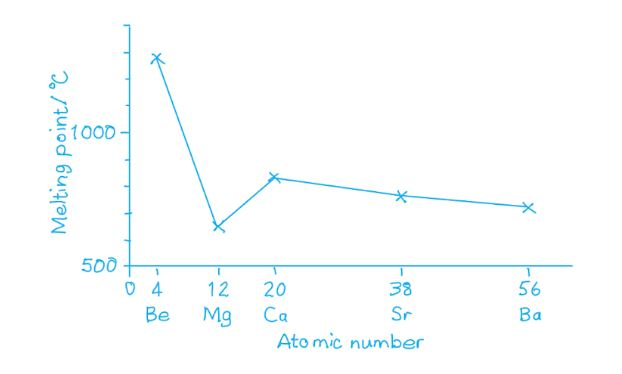

# Mark Schemes — Similarities & Trends in the Properties of the Group 2 Metals, Magnesium to Barium, & Their Compounds
**10. Group 2** · Cambridge (CIE) A-LEVEL chemistry (9701)

## Multiple Choice Questions (30 questions)

### Q1
**Final answer:** **The correct answer is A**

- As you descend Group 2, the solubility of the hydroxides increases.
- The larger Group 2 cations have a lower charge density, so the lattice enthalpy decreases more rapidly than the hydration enthalpy.

  - The net result is that the hydroxides become more soluble down the group.
- As you descend Group 2, the solubility of the sulfates decreases.
- The sulfate ion is large, so the hydration enthalpy of the cation decreases more than the lattice enthalpy as the cation size increases.

  - The net result is that the sulfates become less soluble down the group.

**B** is incorrect as it reverses both trends; the hydroxides become more soluble (not less) and the sulfates become less soluble (not more) going down Group 2.

**C** is incorrect as the sulfates do not become more soluble going down Group 2. Their solubility decreases because the decrease in hydration enthalpy of the cation outweighs the decrease in lattice enthalpy.

**D** is incorrect as the hydroxides do not become less soluble going down Group 2. Their solubility increases because the lattice enthalpy decreases more steeply than the hydration enthalpy.

### Q2
**Final answer:** **The correct answer is D**

- The solubility of Group 2 hydroxides increases down the group:

Mg(OH)2 < Ca(OH)2 < Sr(OH)2 < Ba(OH)2.

- The solubility of Group 2 sulfates decreases down the group:

MgSO4 > CaSO4 > SrSO4 > BaSO4.

- Only strontium satisfies both conditions:

  - Sr(OH)2 is more soluble than Ca(OH)2
  - SrSO4 is more soluble than BaSO4.

**A** is incorrect as barium sulfate is barium's own sulfate. It cannot be more soluble than itself.

**B** is incorrect as calcium hydroxide is no more soluble than itself.

**C** is incorrect as magnesium hydroxide is less soluble than calcium hydroxide, not more soluble.

### Q3
**Final answer:** **The correct answer is C**

- Compound T is used as a refractory kiln lining, requiring a very high melting point.
- Magnesium oxide has an extremely high melting point (~2852°C), making it suitable for this purpose, so T = MgO.
- Since T is MgO, compound S must be the carbonate that decomposes to produce it:

MgCO3 (s) → MgO (s) + CO2 (g)

- MgCO3 releases CO2 on decomposition, consistent with the limewater observation.
- Both MgCO3 (S) and MgO (T) are insoluble in water.

**A** is incorrect as the thermal decomposition of CaCO3 produces CaO. Although CaO is a white solid, it reacts with water to form Ca(OH)2. So, T would not be insoluble in water as stated in the question.

**B** is incorrect as CaO is an oxide, not a carbonate. It does not undergo thermal decomposition to release CO2.

**D** is incorrect as MgO is an oxide and does not thermally decompose to release CO2.

### Q4
**Final answer:** **The correct answer is A**

- When calcium nitrate is strongly heated, it undergoes thermal decomposition to produce calcium oxide, nitrogen dioxide and oxygen:

2Ca(NO3)2 (s) → 2CaO (s) + 4NO2 (g) + O2 (g)

- Calcium oxide also reacts with cold water:

CaO (s) + H2O (l) → Ca(OH)2 (s)

**B** is incorrect as calcium is more reactive than magnesium; magnesium cannot reduce calcium oxide to calcium.

**C** is incorrect as calcium oxide is a basic oxide. It reacts with acids and dissolves in water to produce an alkaline solution.

**D** is incorrect as calcium oxide reacts readily with water to produce calcium hydroxide.

### Q5
**Final answer:** **The correct answer is C**

- The effectiveness of a compound as a fire retardant depends on the volume of CO2 produced under the same conditions.
- Thermal stability of Group 2 carbonates increases down the group, so more energy is required to decompose carbonates containing heavier metals.
- The order of the Group 2 metals in the minerals (from most to least thermally stable) is:

Ba > Ca > Mg

- Huntite, Mg3Ca(CO3)4, has the highest proportion of magnesium and decomposes most readily.

  - It is the best fire retardant.
- Dolomite, CaMg(CO3)2, has equal proportions of calcium and magnesium.

  - Intermediate effectiveness.
- Barytocalcite, BaCa(CO3)2, contains barium (lowest thermal stability).

  - It is the least effective fire retardant.

**A** is incorrect as dolomite is not the most effective. Huntite contains more magnesium and decomposes at a lower temperature.

**B** is incorrect as barytocalcite, which contains the most thermally stable cation (Ba2+), would be the worst retardant, not Huntite.

**D** is incorrect as barytocalcite should be the worst (not middle) retardant due to the presence of barium.

### Q6
**Final answer:** **The correct answer is C**

- The solubility of Group 2 hydroxides increases down the group.
- Calcium hydroxide, Ca(OH)2, has limited solubility in water, so when calcium reacts with cold water a white suspension forms.
- Barium hydroxide, Ba(OH)2, is more soluble than calcium hydroxide, so no white suspension is observed when barium reacts with water.

**A** is incorrect as both calcium and barium react with cold water, releasing hydrogen gas as a product.

**B** is incorrect as barium is more reactive than calcium (reactivity increases down Group 2), so a more vigorous effervescence is observed with barium, not calcium.

**D** is incorrect as both calcium and barium form alkaline hydroxide solutions, turning litmus blue.

### Q7
**Final answer:** **The correct answer is A**

- The solubility properties of the barium compounds in water and dilute acid are shown in the table below.

| **Compound** | **Soluble in water** | **Soluble in stomach acid** |
|---|---|---|
| Barium carbonate | No | Yes |
| Barium chloride | Yes | No |
| Barium hydroxide | Yes | Yes |
| Barium sulfate | No | No |

- Only barium carbonate satisfies both conditions:

  - Insoluble in water (so not washed away by rainwater)
  - Soluble in stomach acid (so absorbed from the stomach)

**B** is incorrect as barium chloride is soluble in water and would dissolve in rainwater, making it an ineffective environmental poison.

**C** is incorrect as barium hydroxide is also soluble in water, so it would not remain in the environment as a persistent poison.

**D** is incorrect as barium sulfate is insoluble in both water and stomach acid, so it would not be absorbed through the stomach wall and is therefore safe to use as a contrast agent in medical imaging.

### Q8
**Final answer:** **The correct answer is D**

- The equation for thermal decomposition of anhydrous Group 2 nitrates is:

2X(NO3)2 (s) → 2XO (s) + 4NO2 (g) + O2 (g)

- Gas **R** is nitrogen dioxide, NO2.
- Gas **S** is oxygen, O2.
- From the equation: 4 mol of NO2 is produced per 1 mol of O2.
- Mass of 4 mol NO2 = 4 x 46 = 184 g
- Mass of 1 mol O2 = 32 g

$\frac{\text{mass of}R}{\text{mass of}S} = \frac{184}{32} = 5 . 75$

**A** is incorrect as 0.17 is the inverse ratio (mass of S / mass of R).

**B** is incorrect as 1.44 would result from incorrectly assuming 1 mol of NO2 is produced per mol of O2.

**C** is incorrect as 2.88 would result from incorrectly assuming 2 mol of NO2 is produced per mol of O2.

### Q9
**Final answer:** **The correct answer is D**

- As the atomic number increases down Group 2, so does the mass number.

| **Group 2 element** | **Atomic number** | **Atomic mass** |
|---|---|---|
| Beryllium (Be) | 4 | 9 |
| Magnesium (Mg) | 12 | 24.3 |
| Calcium (Ca) | 20 | 40.1 |
| Strontium (Sr) | 38 | 87.6 |
| Barium (Ba) | 56 | 137.3 |

- This is the same pattern as shown in the graph.

**A** and **B** are incorrect as the first ionisation energy would be on the y-axis when plotted against atomic number or atomic radius.

**C** is incorrect as a graph showing melting points for Group 2 would not show a simple linear increase with atomic number:

### Q10
**Final answer:** **The correct answer is B**

- In metallic bonding, bond strength depends on the charge of the cation, the size of the cation, and the number of delocalised electrons per atom.
- Group 2 metal atoms have smaller radii than Group 1 metal atoms in the same period, because the greater nuclear charge pulls the outer electrons closer to the nucleus.
- Smaller radii result in shorter interatomic distances and stronger electrostatic attraction between cations and the delocalised electron cloud.
- Group 2 metals also contribute two delocalised electrons per atom compared to one for Group 1 metals, further increasing the strength of the metallic bond.
- Both factors combine to give Group 2 metals higher melting points.

**A** is incorrect as first ionisation energy is the energy required to remove an electron from a gaseous atom; it does not directly determine the strength of metallic bonding in the solid lattice.

**C** is incorrect as metallic bonding involves a sea of delocalised electrons, not ionic bonds between discrete ions.

**D** is incorrect as the mass of atoms does not directly determine melting point; it is the strength of the metallic bond that governs this property.

### Q11
**Final answer:** **The correct answer is A**

- Barium is at the bottom of Group 2 and Ba2+ has the largest ionic radius of the options given.
- The larger Ba2+ ions have a lower charge density and polarise the NO3- ions less than the smaller Group 2 cations higher up in the group.
- The less polarised the nitrate ions are, the more thermally stable they are, requiring a higher temperature to bring about decomposition.
- Therefore, barium nitrate requires the highest temperature to decompose.

**B** is incorrect as Ca2+ is smaller than Ba2+ and has a higher charge density, so calcium nitrate is less thermally stable than barium nitrate and decomposes at a lower temperature.

**C** is incorrect as Mg2+ is the smallest ion in this set and has the highest charge density, so magnesium nitrate is the least thermally stable and decomposes at the lowest temperature.

**D** is incorrect as Sr2+ is smaller than Ba2+, so strontium nitrate is less thermally stable than barium nitrate and decomposes at a lower temperature.

### Q12
**Final answer:** **The correct answer is D**

- As you go down Group 2, the first ionisation energy decreases:
- More filled electron shells increase shielding between the nucleus and outer electrons.
- Increased atomic radius reduces the nuclear attraction on outer electrons, requiring less energy to remove an outer electron.
- Magnesium has a **higher** first ionisation energy than barium; barium has a **lower** first ionisation energy than magnesium.

- As you go down Group 2, reactivity with oxygen increases:
- Magnesium burns with a bright white flame, but reacts relatively slowly compared to barium.
- Barium is so reactive it is stored under oil to prevent contact with air, reacting faster with oxygen.

**A** is incorrect as both the ionisation energy comparison and the reaction speeds with oxygen are reversed.

**B** is incorrect as the ionisation energy values are reversed. Magnesium has a higher first ionisation energy than barium, not lower.

**C** is incorrect as the reaction speeds with oxygen are reversed. Barium reacts faster with oxygen than magnesium, not slower.

### Q13
**Final answer:** **The correct answer is D**

The equation for the thermal decomposition of calcium nitrate is:

Ca(NO3)2 (s) → CaO (s) + 2NO2 (g) + ½O2 (g)

- Calculate the moles of Ca(NO3)2 (*M*r = 164.1):

moles = $\frac{\mathrm{mass}}{M_{r}}$

moles = $\frac{5.10}{164.1}$

moles = 0.03107 mol

- The 1 : 1 molar ratio means moles of CaO produced = 0.03107 mol

- Calculate the mass of CaO (*M*r = 56.1):

mass = moles × *M*r

mass = 0.03107 × 56.1

**Final answer:** **mass = 1.74 g**

**A** is incorrect as 0.70 g arises from an error in the moles calculation, using an incorrect value for *M*r(Ca(NO3)2).

**B** is incorrect as 0.87 g arises from using a 2 : 1 molar ratio of Ca(NO3)2 to CaO, giving half the correct number of moles of CaO.

**C** is incorrect as 1.40 g arises from using an incorrect molar mass for CaO in the final step.

### Q14
**Final answer:** **The correct answer is C**

- Magnesium oxide has a very high melting point.

  - This makes it suitable as a kiln lining (link 5 only).
- Calcium carbonate (limestone) is used in:

  - Building materials (link 1)
  - To neutralise excess acidity in soil
  - In manufacturing processes such as glass-making (link 3).

**A** is incorrect as it includes link 4 for magnesium oxide; magnesium oxide is only used as a kiln lining (link 5), not link 4.

**B** is incorrect as it includes links 4 and 6 for magnesium oxide; only link 5 (kiln lining) is a correct application.

**D** is incorrect as it assigns link 6 rather than link 5 to magnesium oxide; the correct application is link 5 (kiln lining due to its high melting point).

### Q15
**Final answer:** **The correct answer is B**

- Lime is calcium hydroxide, Ca(OH)2.
- In the presence of moisture, it reacts with ammonium sulfate:

(NH4)2SO4 (aq) + Ca(OH)2 (s) → CaSO4 (s) + 2NH3 (g) + 2H2O (l)

- The products are calcium sulfate and ammonia gas.

**A** is incorrect as calcium carbonate is not formed in this reaction. The calcium-containing product is calcium sulfate, not calcium carbonate.

**C** is incorrect as ammonium hydroxide is only a transient intermediate. The warm, moist conditions favour decomposition of NH4OH to release ammonia gas as the final product.

**D** is incorrect as nitrogen gas is not produced; the nitrogenous product is ammonia (NH3), not N2.

### Q16
**Final answer:** **The correct answer is A**

- Group 2 elements get more reactive as you go down the group.
- As you go down Group 2, the solubility of the metal oxides increases, producing more concentrated hydroxide solutions with a higher pH.
- Barium oxide is the lowest Group 2 oxide in this list.

  - So, it produces a saturated Ba(OH)2 solution with the highest pH.

**B** is incorrect as CaO is above BaO in Group 2; the saturated Ca(OH)2 solution has a lower pH than the saturated Ba(OH)2 solution.

**C** is incorrect as MgO is at the top of this group range; magnesium oxide has the lowest solubility and produces a saturated solution with the lowest pH of the four oxides.

**D** is incorrect as SrO lies between CaO and BaO in Group 2; strontium oxide produces a solution with a lower pH than barium oxide.

### Q17
**Final answer:** **The correct answer is A**

The equation for the thermal decomposition of magnesium nitrate is:

Mg(NO3)2 (s) → MgO (s) + 2NO2 (g) + ½O2 (g)

The molar ratio Mg(NO3)2 : O2 = 2 : 1

- Calculate the moles of Mg(NO3)2 (*M*r = 148.3):

moles = $\frac{mass}{M_{r}}$

moles = $\frac{32.3}{148.3}$

moles = 0.2178 mol

- Calculate the moles of O2 produced:

moles of O2 produced = 0.2178 ÷ 2 = 0.1089 mol

- Calculate the mass of O2 (Mr = 32.0):

mass = moles × *M*r

mass = 0.1089 × 32.0

**Final answer:** **mass = 3.48 g**

**B** is incorrect as 8.32 g arises from using an incorrect molar mass for Mg(NO3)2, for example omitting the magnesium atom.

**C** is incorrect as 12.48 g arises from errors in both the molar mass used and the stoichiometric ratio applied.

**D** is incorrect as 19.2 g arises from using an incorrect stoichiometric ratio, treating the molar ratio Mg(NO3)2 : O2 as 1 : 1 rather than 2 : 1.

### Q18
**Final answer:** **The correct answer is D**

- The equation for thermal decomposition of anhydrous Group 2 nitrates is:

2X(NO3)2 (s) → 2XO (s) + 4NO2 (g) + O2 (g)

- Two gases are produced, so their individual moles cannot be found from the total gas mass alone.
- Mass of solid metal oxide = 6.00 – 3.06 = 2.94 g
- From the equation, 2 mol of nitrate produces 2 mol of oxide (1:1 mole ratio).
- The correct nitrate is the one where moles of nitrate equals moles of oxide for the given masses.

- Moles of strontium nitrate, Sr(NO3)2 (*M*r = 211.6):

moles = $\frac{6.00}{211.6}$ = 0.0284 mol

- Moles of strontium oxide, SrO (Mr = 103.6):

moles = $\frac{2.94}{103.6}$ = 0.0284 mol

- The moles are equal, confirming strontium nitrate is correct.

**A** is incorrect as the moles of beryllium nitrate (*M*r = 133) and beryllium oxide (*M*r = 25) are not equal for these masses.

**B** is incorrect as the moles of calcium nitrate (*M*r = 164) and calcium oxide (*M*r = 56) are not equal for these masses.

**C** is incorrect as the moles of magnesium nitrate (*M*r = 148.3) and magnesium oxide (*M*r = 40.3) are not equal for these masses.

### Q19
**Final answer:** **The correct answer is D**

- Going down Group 2, the decomposition temperature of Group 2 carbonates increases.
- The larger positive ions at the bottom of Group 2 have a lower charge density and polarise the CO32- ions less.
- The less polarised the carbonate ions are, the more thermally stable they are, requiring a higher temperature to decompose.
- Going down Group 2, the first ionisation energy decreases.
- There are more filled electron shells between the nucleus and the outer electrons, increasing shielding.
- The atomic radius also increases, so the outer electrons are further from the nucleus.
- Both effects reduce the nuclear attraction on the outer electrons, so less energy is needed to remove them.

**A** is incorrect as the decomposition temperature of Group 2 carbonates increases down the group; larger ions polarise the carbonate less, making it more thermally stable.

**B** is incorrect as both trends are wrong; the decomposition temperature increases (not decreases) and the first ionisation energy decreases (not increases) going down Group 2.

**C** is incorrect as the first ionisation energy decreases going down Group 2 due to increased electron shielding and greater atomic radius, not increases.

### Q20
**Final answer:** **The correct answer is A**

- The equations for these reactions are:

Ba (s) + 2H2O (l) → Ba(OH)2 (aq) + H2 (g)

Ba(OH)2 (aq) + H2SO4 (aq) → BaSO4 (s) + 2H2O (l)

- Barium reacts with water to produce barium hydroxide, which is sufficiently soluble to give a colourless solution.
- When the Ba(OH)2 solution is mixed with H2SO4, an insoluble white precipitate of BaSO4 forms.

**B** is incorrect as magnesium reacts very slowly with cold water and gives a slightly cloudy suspension of Mg(OH)2. The sulfate salt MgSO4 formed with H2SO4 is soluble and no precipitate would form.

**C** is incorrect as potassium reacts vigorously with water and gives a colourless solution of potassium hydroxide, but the salt K2SO4 formed with H2SO4 is soluble.

**D** is incorrect as sodium reacts with water to give a colourless solution of sodium hydroxide, but Na2SO4 formed with H2SO4 is soluble.

### Q21
**Final answer:** **The correct answer is A**

- The flame test for barium produces an apple-green flame.

**B** is incorrect as magnesium burns with a bright white flame.

**C** is incorrect as calcium gives a brick-red flame and strontium gives a scarlet/crimson flame.

**D** is incorrect as sodium burns with a yellow flame.

### Q22
**Final answer:** **The correct answer is A**

- Group 2 metal hydroxides become more soluble as you go down the group.

  - Barium hydroxide dissolves readily in water (observation 1).
- Group 2 metal sulfates become less soluble as you go down the group.

  - Barium sulfate is insoluble and forms a white precipitate (observation 2).
- More heat is required to thermally decompose Group 2 nitrates as you go down the group.

  - Barium nitrate requires a higher temperature than strontium nitrate (observation 3).
- Reactivity with oxygen increases down Group 2.

  - Barium reacts readily with oxygen and is stored under oil to prevent contact with air (observation 4).

**B**, **C** and **D** are incorrect as beryllium, calcium and magnesium are all above barium in Group 2. Their hydroxides are less soluble than barium hydroxide, their sulfates are more soluble than barium sulfate, and their nitrates all require less heat to decompose than strontium nitrate, which fails observation 3.

### Q23
**Final answer:** **The correct answer is C**

- Compound **Q** is the Group 2 oxide with the highest melting point, making it suitable as a refractory kiln lining.
- Magnesium oxide, MgO, has the highest melting point of the Group 2 oxides.

  - So, **Q** = MgO.
- Compound **R** is calcium carbonate, CaCO3 (limestone), widely used as a building material.
- It undergoes thermal decomposition in a kiln to form compound **S**:

CaCO3 (s) → CaO (s) + CO2 (g)

- Therefore **S** = CaO (quicklime).
- When **S** is hydrated, it produces compound **T**, calcium hydroxide, Ca(OH)2 (slaked lime), used to neutralise acidic soils:

CaO (s) + H2O (l) → Ca(OH)2 (s)

**A** is incorrect as CaCO3 is compound **R** (the building material that is heated to form S), not compound **Q**.

**B** is incorrect as CaO is compound **S** (not Q), and Ca(OH)2 is compound **T** (not S).

**D** is incorrect as Ca(OH)2 is compound **T** (produced when S is hydrated), not compound **S** itself.

### Q24
**Final answer:** **The correct answer is B**

- The equation for thermal decomposition of anhydrous Group 2 nitrates is:

2X(NO3)2 (s) → 2XO (s) + 4NO2 (g) + O2 (g)

- Two gases are produced, so their moles cannot be determined individually from the total gas mass.
- Mass of solid metal oxide = 4.00 – 2.64 = 1.36 g
- From the equation: 1:1 mole ratio of nitrate to oxide.
- The correct nitrate is the one where moles of nitrate equals moles of oxide for the given masses.

- Moles of calcium nitrate, Ca(NO3)2 (*M*r = 164):

moles = $\frac{4.00}{164}$ = 0.0244 mol

- Moles of calcium oxide, CaO (*M*r = 56):

moles = $\frac{1.36}{56}$ = 0.0243 mol

- The moles are equal, confirming calcium nitrate.

**A** is incorrect as the moles of beryllium nitrate (*M*r = 133) and beryllium oxide (*M*r = 25) are not equal for these masses.

**C** is incorrect as the moles of magnesium nitrate (*M*r = 148.3) and magnesium oxide (*M*r = 40.3) are not equal for these masses.

**D** is incorrect as the moles of strontium nitrate (*M*r = 211.6) and strontium oxide (*M*r = 103.6) are not equal for these masses.

### Q25
**Final answer:** **The correct answer is C**

- Barytocalcite (BaCO3.CaCO3) is a mixed carbonate containing both calcium and barium.
- When heated to constant mass in a Bunsen burner, the CaCO3 component decomposes readily, releasing CO2 gas:

CaCO3 (s) → CaO (s) + CO2 (g)

- The CO2 turns limewater cloudy.
- BaCO3 requires a much higher temperature to decompose (above 1000°C).
- It does not decompose in a Bunsen burner and remains in the solid residue as BaCO3.
- When hydrochloric acid is added, the remaining BaCO3 effervesces vigorously:

BaCO3 (s) + 2HCl (aq) → BaCl2 (aq) + CO2 (g) + H2O (l)

**A** is incorrect as aragonite (CaCO3) decomposes completely on heating to give CaO. The CaO residue reacts with HCl to form a salt and water, not CO2, so there would be no effervescence.

**B** is incorrect as artinite (MgCO3.Mg(OH)2.3H2O) decomposes fully on heating to leave MgO. This reacts with HCl to give salt and water without effervescence.

**D** is incorrect as both carbonate components in dolomite (CaCO3.MgCO3) decompose on heating to leave a residue of CaO and MgO. Neither oxide effervesces with hydrochloric acid.

### Q26
**Final answer:** **The correct answer is D**

- Mixture **Y** consists of two compounds.
- One of the gaseous products relights a glowing splint, so oxygen must be one of the two gases produced.
- Only Group 2 nitrates release oxygen on thermal decomposition:

2X(NO3)2 (s) → 2XO (s) + 4NO2 (g) + O2 (g)

- Both Mg(NO3)2 and Ca(NO3)2 are nitrates, so their combined decomposition produces exactly two gases: NO2 and O2.

**A** is incorrect as MgCl2 does not thermally decompose to release oxygen, and CaCO3 would release CO2, not O2.

**B** is incorrect as MgCO3 releases CO2 on decomposition, producing three gaseous products (CO2, NO2 and O2), not two.

**C** is incorrect as MgO is thermally stable (used as fireproofing material) and CaSO4 does not release oxygen at Bunsen burner temperatures.

### Q27
**Final answer:** **The correct answer is A**

- Group 2 elements get more reactive as you go down the group.
- Strontium reacts readily with cold water, forming strontium hydroxide and hydrogen gas, producing rapid effervescence.

**B** is incorrect as strontium produces vigorous, not slow, bubbles due to its high reactivity.

**C** is incorrect as the density of strontium is too high for it to float on the surface of the water.

**D** is incorrect as strontium does not glow when placed in cold water, and strontium hydroxide is soluble so no white solid is produced.

### Q28
**Final answer:** **The correct answer is C**

- The solubility of Group 2 hydroxides increases down the group.

  - So, barium hydroxide is more soluble than calcium hydroxide.
- When the two saturated solutions are mixed, the combined concentration of Ca2+ and OH- ions exceeds the solubility product of Ca(OH)2

  - So, calcium hydroxide precipitates as a white solid.
- The precipitate is removed by filtration, leaving a clear Ba(OH)2 (aq) filtrate.
- Bubbling CO2 through the filtrate produces barium carbonate as a white precipitate:

Ba(OH)2 (aq) + CO2 (g) → BaCO3 (s) + H2O (l)

**A** is incorrect as barium hydroxide is more soluble than calcium hydroxide, so it remains dissolved when the solutions are mixed.

**B** is incorrect as Z is BaCO3, not CaCO3. Calcium hydroxide has already been removed as the precipitate Y, leaving barium hydroxide in the filtrate.

**D** is incorrect as bubbling CO2 through the Ba(OH)2 filtrate produces BaCO3 as a precipitate, not Ba(OH)2.

### Q29
**Final answer:** **The correct answer is C**

- Barium nitrate acts as the oxidising agent, decomposing to release oxygen that oxidises the magnesium:

Ba(NO3)2 (s) + 5Mg (s) → BaO (s) + 5MgO (s) + N2 (g)

- Barium is oxidised to barium oxide, BaO (solid).
- Magnesium is oxidised to magnesium oxide, MgO (solid).
- Nitrogen gas is the only gaseous product.

**A** is incorrect as barium nitrite is not a product. The nitrogen from barium nitrate is fully reduced to N2 gas.

**B** is incorrect as magnesium is oxidised to MgO, not reduced to a nitrate compound.

**D** is incorrect as barium peroxide is not formed; barium oxide, BaO, is the product.

### Q30
**Final answer:** **The correct answer is B**

- Fresh lime mortar contains calcium hydroxide, Ca(OH)2.
- Over time, it reacts with carbon dioxide in the air:

Ca(OH)2 (aq) + CO2 (g) → CaCO3 (s) + H2O (l)

- The calcium carbonate formed is a hard solid, explaining why old lime mortar is harder than fresh mortar.
- Old lime mortar contains CaCO3 (s), which effervesces when treated with hydrochloric acid:

CaCO3 (s) + 2HCl (aq) → CaCl2 (aq) + CO2 (g) + H2O (l)

**A** is incorrect as CaO is the starting material (quicklime) before water is added. Once water is mixed in, CaO reacts with H2O to form Ca(OH)2, so fresh lime mortar already contains Ca(OH)2, not CaO.

**C** is incorrect as this is the reverse of the formation of calcium hydroxide from quicklime. This endothermic decomposition requires temperatures of around 512°C and does not occur spontaneously at room temperature.

**D** is incorrect as this equation describes the initial mixing of quicklime with water to produce fresh lime mortar, not the subsequent hardening process.
