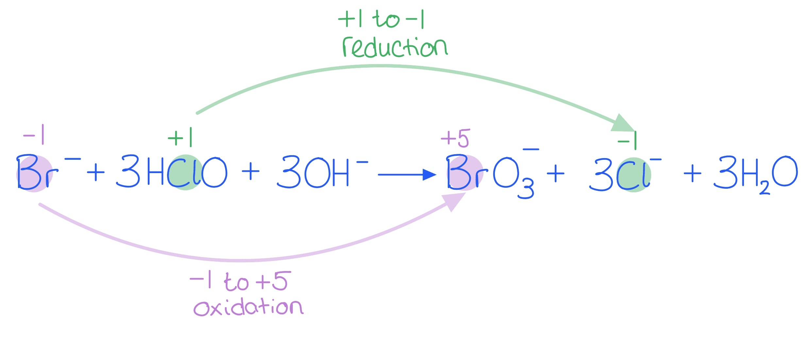

# Mark Schemes — The Reactions of Chlorine
**11. Group 17** · Cambridge (CIE) A-LEVEL chemistry (9701)

## Multiple Choice Questions (10 questions)

### Q1
**Final answer:** **The correct answer is C**

- The question asks for the oxidation half-equation, not the full balanced equation
- In the hot, concentrated NaOH reaction, Cl2 is oxidised to ClO3-:

  - Cl changes from 0 in Cl2 to +5 in ClO3- (increase → oxidation)
  - Each Cl atom loses 5 electrons, so the half-equation shows 5e-

$\frac{1}{2}$Cl2 + 6OH- → ClO3- + 3H2O + 5e-

**A** is incorrect as this is the full equation for the cold, dilute NaOH reaction (producing NaClO, where Cl = +1), not an oxidation half-equation for the hot, concentrated reaction

**B** is incorrect as this is the oxidation half-equation for the cold, dilute NaOH reaction; it produces ClO- where Cl = +1, not ClO3- where Cl = +5

**D** is incorrect as this is the correctly balanced full equation for the hot, concentrated NaOH reaction; however, the question asks for the oxidation half-equation only, not the full ionic equation

### Q2
**Final answer:** **The correct answer is A**

- When chlorine dissolves in water, it reacts reversibly to form chloric(I) acid and hydrochloric acid:

Cl2 (aq) + H2O (l) ⇌ HClO (aq) + HCl (aq)

- Chloric(I) acid (HClO) is the main disinfectant, which kills bacteria in the water

**B** is incorrect as HCl is also produced in this reaction, but hydrochloric acid does not have disinfecting properties

**C** is incorrect as ClO2 is not formed when chlorine reacts with water

**D** is incorrect as CHCl3 is a disinfection byproduct that forms when chlorine reacts with organic matter in water, not from the direct reaction of Cl2 with water

### Q3
**Final answer:** **The correct answer is C**

- Statement C is incorrect: nitrogen is reduced in this reaction, not oxidised
- In NCl3: each Cl = −1, so N + 3(−1) = 0, giving N = +3
- In N2: oxidation state = 0 (uncombined element)
- Decrease in oxidation state (+3 → 0): nitrogen gains electrons.

  - It has been **reduced**

**A** is incorrect as the reaction produces sodium chlorate(I), NaClO (aq), which acts as a bleaching and disinfecting agent. 'Sodium hypochlorite' is an outdated name as CIE uses the IUPAC systematic name. This statement is true.

**B** is incorrect as N2 (g) is produced within an aqueous reaction mixture, producing effervescence. This statement is true.

**D** is incorrect as NaCl (aq) is produced, providing Cl- (aq) ions; adding acidified aqueous silver nitrate gives a white precipitate of AgCl. This statement is true.

### Q4
**Final answer:** **The correct answer is A**

- Chlorine undergoes a reversible disproportionation reaction when dissolved in water:

Cl2 (aq) + H2O (l) ⇌ HCl (aq) + HClO (aq)

- Chlorine is simultaneously reduced to −1 in HCl and oxidised to +1 in HClO

**B** is incorrect as HClO is an acid, so universal indicator turns red (not blue) before the bleaching action of HClO turns it colourless

**C** is incorrect as chloric(I) acid is a weak acid that partially dissociates in water:

HClO (aq) ⇌ H+ (aq) + ClO- (aq)

**D** is incorrect as chlorine reacts with cold, dilute aqueous sodium hydroxide to form three products:

Cl2 (g) + 2NaOH (aq) → NaCl (aq) + NaClO (aq) + H2O (l)

NaClO is sodium chlorate(I), the active ingredient in household bleach

### Q5
**Final answer:** **The correct answer is C**

- The oxidation numbers of chlorine change as follows in this reaction:

  - Cl2: oxidation number = 0
  - NaCl: oxidation number of Cl = −1 (decrease → chlorine is **reduced**)
  - NaClO: oxidation number of Cl = +1 (increase → chlorine is **oxidised**)
- The simultaneous oxidation and reduction of the same species in a single reaction is known as disproportionation

**A** is incorrect as chlorine is both oxidised and reduced in this reaction, not just oxidised

**B** is incorrect as the oxidation number of Cl in NaClO is +1, not 0: Na = +1, O = −2, so Cl must be +1 for the compound to be neutral

**D** is incorrect as Cl2 is an uncombined element, so the oxidation number of chlorine is 0, not −1

### Q6
**Final answer:** **The correct answer is C**

- The ionic equation for this reaction is:

ClO- (aq) + 2Br- (aq) + 2H+ (aq) → Br2 (aq) + Cl- (aq) + H2O (l)

- The chlorate(I) ion oxidises bromide ions to bromine:

2Br- → Br2 + 2e-

- Bromine has an oxidation state of −1 in Br- and 0 in Br2.

  - An increase in oxidation state indicates oxidation has occurred

**A** is incorrect as the oxidation state of chlorine in NaClO is +1, not +5; +5 belongs to NaClO3, which is formed from the reaction of chlorine with hot, concentrated sodium hydroxide

**B** is incorrect as the brown solution is aqueous bromine, Br2 (aq). Chlorine gas would appear as a pale green gas, not a brown solution. A 'red-brown gas' describes bromine vapour above the liquid, whereas in aqueous reactions, the observation is always the colour of the solution

**D** is incorrect as NaClO is the oxidising agent, not the reducing agent; the chlorate(I) ion is itself reduced (Cl changes from +1 in ClO- to −1 in Cl-) and causes the oxidation of the bromide ions

### Q7
**Final answer:** **The correct answer is A**

- When chlorine dissolves in water, it undergoes a reversible disproportionation reaction:

Cl2 (aq) + H2O (l) ⇌ HCl (aq) + HClO (aq)

- 1 mole of Cl2 produces 1 mole of HCl and 1 mole of HClO
- The equilibrium lies to the left in pure water, so only a small proportion of Cl2 dissolves and reacts

**B** is incorrect as the 2:3 molar ratio does not match the balanced equation for the water reaction; HClO2 is not formed here

**C** is incorrect as the 3:5 molar ratio matches the hot, concentrated NaOH reaction, not the water reaction; HClO3 is not formed here

**D** is incorrect as HClO4 is not formed when chlorine reacts with water

### Q8
**Final answer:** **The correct answer is C**

- Statement C is incorrect:

  - The oxidation state of chlorine changes from 0 to +1 (cold, dilute NaOH) or +5 (hot, concentrated NaOH)

- The two reactions are:

Cl2 (g) + 2NaOH (aq) → NaCl (aq) + NaClO (aq) + H2O (l)

(cold, dilute NaOH: chlorine oxidised to +1 in NaClO)

3Cl2 (g) + 6NaOH (aq) → 5NaCl (aq) + NaClO3 (aq) + 3H2O (l)

(hot, concentrated NaOH: chlorine oxidised to +5 in NaClO3)

**A** is a correct statement: in hot, concentrated NaOH, chlorine is oxidised to +5 and ClO3– ions are formed in sodium chlorate(V)

**B** is a correct statement: in cold, dilute NaOH, chlorine is oxidised to +1 and ClO– ions are formed in sodium chlorate(I)

**D** is a correct statement: in both reactions, chlorine from Cl2 (oxidation state 0) is simultaneously reduced to −1 in NaCl and oxidised in the chlorate product, so both are disproportionation reactions

> **[exam-tip]**
> If you are asked for the conditions, always state both the temperature and the concentration as mark schemes require these. For example:
> 
> - 'cold, dilute NaOH'
> - 'hot, concentrated NaOH'

### Q9
**Final answer:** **The correct answer is A**

- The oxidation state of chlorine in each substance:
- Cl2 is an uncombined element, so the oxidation state = 0
- In NaCl: Na = +1, so Cl = −1
- In NaClO3: Na = +1, each O = −2 (total −6); overall charge = 0, so +1 + Cl + (−6) = 0, giving Cl = +5
- This is a disproportionation reaction: Cl2 (oxidation state 0) is simultaneously reduced to −1 in NaCl and oxidised to +5 in NaClO3

**B** and **C** are incorrect as they assign +1 to Cl in NaCl; the sodium ion is always +1, making the chloride ion −1. The +1 oxidation state occurs in NaClO (the cold, dilute NaOH product), not in NaCl

**D** is incorrect as the oxidation state of Cl in NaClO3 would be +3, not +5; the correct calculation gives Cl = +5 (not +3)

### Q10
**Final answer:** **The correct answer is C**

- Chlorine undergoes a reversible disproportionation reaction when dissolved in water:

Cl2 (aq) + H2O (l) ⇌ HCl (aq) + HClO (aq)

- In HCl, Cl has oxidation state −1 (decrease from 0 → chlorine is reduced)
- In HClO, Cl has oxidation state +1 (increase from 0 → chlorine is oxidised)
- The same element is simultaneously oxidised and reduced (disproportionation)
- The equilibrium lies to the left in pure water, so only a small proportion of Cl2 reacts

  - Even a small equilibrium amount of HClO is sufficient to disinfect

**A** is incorrect as chlorine is not only oxidised; it is also simultaneously reduced to form HCl

**B** is incorrect as chlorine is not only reduced; it is also simultaneously oxidised to form HClO

**D** is incorrect as the products of chlorine reacting with water are HCl and HClO, not HClO3; HClO3 (where Cl = +5) is formed in the hot, concentrated NaOH reaction, not the water reaction

> **[exam-tip]**
> A common mistake is to confuse the products of chlorine reacting with water (HCl and HClO, molecular acids) with the products of chlorine reacting with cold, dilute NaOH (NaCl and NaClO, ionic salts). In water, the products are weak acids, while in alkali, they are ionic compounds.

## Structured Questions (5 questions)

### Q1
> **[mark-scheme]**
> i) The ionic half-equation for the reduction of bromine is:
> 
> - Br2 + 2e– → 2Br– **[1 mark]**
> 
> ii) The ionic half-equation for the oxidation of Fe2+ is:
> 
> - Fe2+ → Fe3+ + e– **[1 mark]**
> 
> iii) The overall equation for the reaction of Br2 with Fe2+ is:
> 
> - Br2 + 2Fe2+ → 2Br– + 2Fe3+ **[1 mark]**
> 
> iv) Iodine does not oxidise Fe2+ ions because:
> 
> - Iodine / I2 is not a strong enough oxidising agent **[1 mark]**

> **[exam-tip]**
> The oxidising power of the halogens decreases down the group. Halogen molecules become larger with more electron shells and greater shielding. The increased distance between the nucleus and outer shell weakens nuclear attraction, making it harder to gain electrons.
> 
> The reducing power of the halogens increases down the group. The further the outer shell is from the nucleus, the weaker the attraction and the easier it is to donate an electron.
> 
> Halide ions are good reducing agents as they can donate the electron responsible for their 1– charge. The reducing ability of halide ions increases down the group.
> **[mark-scheme]**
> The oxidation numbers of chlorine are:
> 
> - Cl in HClO = +1 **[1 mark]**
> - Cl in Cl– = –1 **[1 mark]**

> **[exam-tip]**
> To find the oxidation number of Cl in HClO: H = +1 and O = –2. For the molecule to be neutral: +1 + Cl + (–2) = 0, so Cl = +1.
> 
> The oxidation number of Cl in Cl– is simply –1, determined by the charge on the ion.
> **[mark-scheme]**
> The oxidising agent and explanation are:
> 
> - HClO **[1 mark]**
> - HClO oxidises Br– from –1 to +5 in BrO3– **[1 mark]**

> **[exam-tip]**
> Writing all the oxidation numbers on the equation helps identify changes:
> 
> 
> 
> An increase in oxidation number indicates oxidation. A decrease indicates reduction.
> 
> An oxidising agent is itself reduced. HClO is the oxidising agent as chlorine decreases from +1 to –1. The reducing agent is Br–, which is itself oxidised from –1 to +5.

### Q2
> **[mark-scheme]**
> i) The equation for this reaction is:
> 
> - Cl2 + 2NaOH → NaClO + NaCl + H2O **[1 mark]**
> 
> ii) The name of the product containing both oxygen and chlorine is:
> 
> - Sodium chlorate(I) **[1 mark]**
> 
> iii) This is a disproportionation reaction because:
> 
> - The oxidation state of Cl changes from 0 in Cl2 to +1 in NaClO
> **AND**
> to –1 in NaCl **[1 mark]**
> - Chlorine has been simultaneously oxidised and reduced
> **OR**
> Chlorine has undergone both oxidation and reduction **[1 mark]**

> **[exam-tip]**
> The product in this reaction is sodium chlorate(I). Make sure you give the correct name including the Roman numeral (I).
> 
> Sodium chlorate(V), NaClO3, is a different product formed when chlorine reacts with hot aqueous sodium hydroxide.
> 
> When explaining why a reaction is a disproportionation reaction, state the starting and finishing oxidation numbers for chlorine. Simply stating that chlorine is simultaneously oxidised and reduced earns only one of the two marks.
> **[mark-scheme]**
> i) The equation for the reaction of chlorine with cold water is:
> 
> - Cl2 + H2O → HClO + HCl
> **OR**
> Cl2 + H2O → 2H+ + ClO– + Cl– **[1 mark]**
> 
> A reversible arrow (⇌) is also accepted.
> 
> ii) The two active species responsible for killing bacteria are:
> 
> - HClO / HOCl
> **AND**
> ClO– / OCl– **[1 mark]**

> **[exam-tip]**
> You must know all the reactions of chlorine, as they are asked about frequently. Chlorine also reacts with both cold and hot aqueous sodium hydroxide to form different products.
> 
> HClO (hypochlorous acid) and ClO– (chlorate(I) ion / hypochlorite ion) are the active species that kill bacteria by acting as oxidising agents.
> **[mark-scheme]**
> The weak acid formed in part **(b)(i)** and its behaviour are:
> 
> - HClO / HOCl **[1 mark]**
> - HClO (aq) ⇌ H+ (aq) + ClO– (aq) **[1 mark]**

> **[exam-tip]**
> Both HClO and HCl are formed in the reaction. HCl is a strong acid as it fully dissociates, shown by a one-way arrow (→). HClO is a weak acid as it only partially dissociates, shown by an equilibrium arrow (⇌).
> 
> The ClO– ion formed also acts as a sterilising agent that kills bacteria in water.
> **[mark-scheme]**
> The formula and oxidation state of the different product are:
> 
> - NaClO3 **[1 mark]**
> - Chlorine is +5 **[1 mark]**

> **[exam-tip]**
> The full equation for the reaction of chlorine with hot aqueous sodium hydroxide is:
> 
> 3Cl2 (aq) + 6NaOH (aq) → 5NaCl (aq) + NaClO3 (aq) + 3H2O (l)
> 
> Make sure you know the difference between the reactions of chlorine with cold and hot aqueous sodium hydroxide as they produce different products.

### Q3
> **[mark-scheme]**
> An oxidising agent is a substance that:
> 
> - Accepts electrons (from another substance) **[1 mark]**

> **[exam-tip]**
> An oxidising agent is itself reduced, so it accepts electrons. A reducing agent is itself oxidised, so it donates electrons.
> **[mark-scheme]**
> i) The equation for the reaction of chlorine with water is:
> 
> - Cl2 (aq) + H2O (l) → HCl (aq) + HClO (aq) **[1 mark]**
> 
> ii) The oxidation numbers of chlorine in the products are:
> 
> - Cl in HCl = –1
> **AND**
> Cl in HClO = +1 **[1 mark]**

> **[exam-tip]**
> This is an equation you need to know. Make sure you learn all the reactions of chlorine with water and with aqueous sodium hydroxide.
> **[mark-scheme]**
> i) The equation for this reaction is:
> 
> - 3Cl2 (aq) + 6NaOH (aq) → 5NaCl (aq) + NaClO3 (aq) + 3H2O (l) **[1 mark]**
> 
> ii) This is a disproportionation reaction because:
> 
> - Cl2 is both oxidised and reduced at the same time **[1 mark]**
> - Cl2 is oxidised from 0 to +5 in NaClO3
> **AND**
> Cl2 is reduced from 0 to –1 in NaCl **[1 mark]**

> **[exam-tip]**
> Chlorine can react with both cold and hot aqueous sodium hydroxide and you need to know both equations:
> 
> - When hot aqueous sodium hydroxide is used, NaClO3 is produced
> - When cold aqueous sodium hydroxide is used, NaClO is produced
> 
> When describing oxidation and reduction in a disproportionation reaction, state the oxidation states of the relevant species to gain the marks.

### Q4
> **[mark-scheme]**
> Fluorine has a lower boiling point than chlorine as:
> 
> - Fluorine is smaller than chlorine **[1 mark]**
> - The forces between F2 molecules are weaker than the forces between Cl2 molecules **[1 mark]**

> **[exam-tip]**
> Make sure you use comparative words when comparing two substances, for example "smaller" or "larger."
> 
> The forces here are between fluorine and chlorine molecules, not atoms.
> 
> Be specific with your language, as examiners will deduct marks for vague answers.
> **[mark-scheme]**
> The ionic equation for the reaction between chlorine and cold aqueous sodium hydroxide is:
> 
> - Cl2 + 2OH– → OCl– + Cl– + H2O **[1 mark]**
> 
> State symbols are not required.

> **[exam-tip]**
> The full equation for this reaction is:
> 
> Cl2 (aq) + 2NaOH (aq) → NaClO (aq) + NaCl (aq) + H2O (l)
> 
> To find the ionic equation, split ionic substances into ions and remove spectator ions (Na+). Cl2 and H2O are covalent so they cannot be split into ions.
> **[mark-scheme]**
> The oxidation numbers of chlorine in the chlorine-containing ions are:
> 
> - OCl– = +1
> **AND**
> Cl– = –1 **[1 mark]**

> **[exam-tip]**
> To find the oxidation number of Cl in OCl–:
> 
> - Oxygen has an oxidation state of –2
> - (–2) + Cl = –1
> - Cl = +1
> 
> The oxidation number of Cl in Cl– is simply –1, determined by the charge on the ion.

### Q5
> **[mark-scheme]**
> i) The equation for this reaction is:
> 
> - Cl2 + 2NaOH → NaClO + NaCl + H2O **[1 mark]**
> 
> ii) The product and commercial use are:
> 
> - Sodium chlorate(I)
> **AND**
> bleach / disinfectant / to kill bacteria / to kill microorganisms **[1 mark]**
> 
> iii) This is a disproportionation reaction because:
> 
> - The oxidation state of Cl changes from 0 in Cl2 to +1 in NaClO
> **AND**
> to –1 in NaCl **[1 mark]**
> - Chlorine has been simultaneously oxidised and reduced **[1 mark]**

> **[exam-tip]**
> Questions about Group 17 are often linked to the redox topic. Make sure you are confident identifying the oxidation states of elements in different compounds.
> 
> The product in this reaction is sodium chlorate(I). Make sure you include the Roman numeral (I) in your answer. Sodium chlorate(V), NaClO3, is a different product formed when chlorine reacts with hot aqueous sodium hydroxide.
> **[mark-scheme]**
> i) The oxidation state of Cl in HClO is:
> 
> - Cl in HClO = +1 **[1 mark]**
> 
> ii) As HClO reacts with bacteria in the water supply:
> 
> - The equilibrium shifts to the right / towards the products / in the forward direction **[1 mark]**
> - To replace / oppose the loss of HClO that has reacted with bacteria **[1 mark]**

> **[exam-tip]**
> This question asks you to explain the change in the equilibrium. Make sure you give a specific reason why the equilibrium shifts in a particular direction.
> 
> You cannot just state "to oppose the change." You must state what is being replaced, for example "to replace HClO that has reacted with bacteria."
> **[mark-scheme]**
> One disadvantage of treating drinking water with chlorine is:
> 
> Any **one** from:
> 
> - Can react with organic compounds to form harmful / toxic substances
> - Is toxic in high concentrations
> - Some people find the taste or odour unpleasant
> - Not all water treated is used for drinking
> 
> **[1 mark]**

> **[exam-tip]**
> Although there are disadvantages to treating water with chlorine, the benefits in preventing waterborne diseases far outweigh them.
