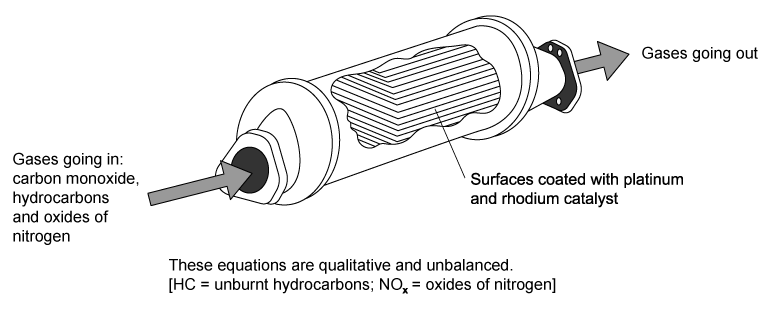
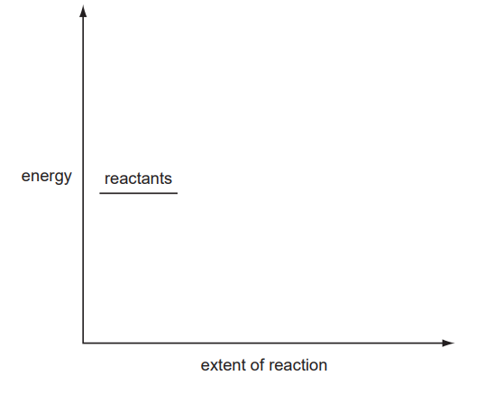

# Exam Questions — Nitrogen and Sulfur
**12. Nitrogen and Sulfur** · Cambridge (CIE) A-LEVEL chemistry (9701)
> Source: [https://www.savemyexams.com/a-level/chemistry/cie/25/topic-questions/](https://www.savemyexams.com/a-level/chemistry/cie/25/topic-questions/) · 27 questions across 2 sets

## Multiple Choice Questions (17 questions)

### Q1 — easy — 1 marks

**Q1** [1 mark]

Oxidation of ammonia by oxygen is the first step in the manufacture of nitric acid, which is used in the production of the synthetic material nylon.

*w*O2 (g) + *x*NH3 (g) → *y*NO (g) + *z*H2O (g)

Which row gives the correct values for w, x, y and z?

|   | *w* | *x* | *y* | *z* |
|---|---|---|---|---|
| **A** | 5 | 4 | 4 | 6 |
| **B** | 5 | 6 | 4 | 4 |
| **C** | 6 | 5 | 4 | 5 |
| **D** | 6 | 6 | 5 | 4 |

### Q2 — medium — 1 marks

**Q2** [1 mark]

“Photochemical smog is produced when <u>   </u><u>**1**</u><u>    </u>acts on<u>    </u><u>**2**</u><u>    </u>and<u>    </u><u>**3**</u><u>   </u>.”

Which row correctly identifies 1, 2 and 3?

|   | **1** | **2** | **3** |
|---|---|---|---|
| **A** | Heat | Hydrocarbons | Oxygen |
| **B** | Heat | Nitrogen | Oxygen |
| **C** | Sunlight | Nitrogen oxides | Hydrocarbons |
| **D** | Sunlight | Nitrogen oxides | Sulfur oxides |

### Q3 — medium — 1 marks

**Q3** [1 mark]

Which statement about ammonia is correct?

### Q4 — easy — 1 marks

**Q4** [1 mark]

Which reaction that takes place in a catalytic converter does **not** remove hazardous gases from car exhaust?

### Q5 — easy — 1 marks

**Q5** [1 mark]

Which gas is present in the largest proportion in the exhaust fumes of a car engine?

### Q6 — hard — 1 marks

**Q6** [1 mark]

Car exhausts release pollutant gases including oxides of nitrogen.

In cities, when a car travels one kilometre, it releases 0.23 g of an oxide of nitrogen NxOy under room conditions, which occupies 120 cm3.

Which row gives the correct values for *x* and *y*?

|   | *x* | *y* |
|---|---|---|
| **A** | 1 | 1 |
| **B** | 1 | 2 |
| **C** | 2 | 1 |
| **D** | 2 | 4 |

### Q7 — medium — 1 marks

**Q7** [1 mark]

Nitrogen dioxide, NO2, sulfur dioxide, SO2, and carbon monoxide, CO, are all atmospheric pollutants.

Which reaction takes place in the atmosphere?

### Q8 — medium — 1 marks

**Q8** [1 mark]

Lime, CaO, is used to reduce the acidity of soil, and ammonium nitrate is a nitrogenous fertiliser.

Which statement explains why these two substances not be mixed together?

### Q9 — easy — 1 marks

**Q9** [1 mark]

Oxides of nitrogen are released into the atmosphere in car engine exhaust fumes.

Which environmental problem is **not** made worse by this occurrence?

### Q10 — easy — 1 marks

**Q10** [1 mark]

Which statement about the ammonium ion, NH4+, is correct?

### Q11 — easy — 1 marks

**Q11** [1 mark]

According to the Brønsted-Lowry theory, which term describes ammonia?

### Q12 — hard — 1 marks

**Q12** [1 mark]

Ammonium sulfate in the soil is slowly oxidised by air, producing sulfuric acid, nitric acid and water as the only products.

How many moles of oxygen gas are needed for the complete oxidation of one mole of ammonium sulfate?

### Q13 — hard — 1 marks

**Q13** [1 mark]

Which reaction of ammonia does **not** involve the nitrogen atom's lone pair?

### Q14 — hard — 1 marks

**Q14** [1 mark]

Aqueous ammonia is added to aqueous sulfur dioxide until just alkaline.

Which salt is produced in this reaction?

### Q15 — hard — 1 marks

**Q15** [1 mark]

The gases nitrogen dioxide (NO2) and sulfur trioxide (SO3) are required during the formation of acid rain.

In a simulation experiment, a volume of 6.00 dm3 of sulfur trioxide gas is measured under room temperature and pressure (r.t.p.). A total of 0.75 mol of nitrogen dioxide is also present in the reaction chamber along with water vapour.

What is the final amount, in mol, of nitrogen dioxide in the reaction chamber after all the sulfur trioxide has reacted to form acid rain?

### Q16 — easy — 1 marks

**Q16** [1 mark]

The manufacture of ammonium nitrate, NH4NO3, occurs on a large scale for use as a fertiliser.

Which statement about ammonium nitrate fertiliser is **not** correct?

### Q17 — hard — 1 marks

**Q17** [1 mark]

In a car engine, multiple reactions take place as molecules are mixed with oxygen at high temperatures.

Which of these reactions is endothermic?

## Structured Questions (10 questions)

### Q1 — medium — 12 marks

**Q1** [5 marks]

Nitrogen and oxygen react together under conditions of high temperature to give oxides of nitrogen.

i) Draw a dot-and-cross diagram to show the arrangement of outer-shell electrons in a molecule of nitrogen.

[2]

ii) Explain why high temperatures are required for oxides of nitrogen to form.

[3]

**Q1** [2 marks]

**Extract:**

Nitrogen and oxygen react together under conditions of high temperature to give oxides of nitrogen.

i) Construct an equation for a possible reaction between nitrogen and oxygen.

[1]

ii) The bond enthalpy of the N≡N triple bond in N2 is +944 kJ mol−1.

Suggest the bond enthalpy of the O=O bond in oxygen. Give a reason for your answer.

[1]

**Q1** [4 marks]

i) Identify one natural process and one man-made process in which nitrogen and oxygen react together to form oxides of nitrogen.

[2]

ii) State **two** environmental effects of the presence of nitrogen oxides in the atmosphere.

[2]

**Q1** [1 mark]

State the systematic name of N2O5.

### Q2 — easy — 6 marks

**Q2** [2 marks]

Atmospheric oxides of nitrogen react with unburned hydrocarbons to form peroxyacetyl nitrate (PAN), which is a component of photochemical smog.

i) Identify the type of organic compound that reacts with nitrogen oxides to form PAN.

[1]

ii) Explain why the term *photochemical* is used to describe this type of smog.

[1]

**Q2** [3 marks]

Nitrogen dioxide, NO2, contributes to the formation of acid rain.

i) Construct an equation for the formation of nitric acid from nitrogen dioxide, NO2, in the atmosphere.

[2]

ii) State the role that nitrogen dioxide, NO2, plays in the oxidation of atmospheric sulfur dioxide, SO2, to form acid rain.

[1]

**Q2** [1 mark]

Deduce the oxidation number of nitrogen in nitrogen monoxide, NO, and nitrogen dioxide, NO2.

| oxidation number in NO |   |
|---|---|
| oxidation number in NO2 |   |

### Q3 — medium — 10 marks

**Q3** [3 marks]

The high temperatures reached in an internal combustion engine cause nitrogen and oxygen from the air to react, forming nitrogen monoxide.

i) Construct an equation for this reaction.

[1]

ii) Deduce the oxidation number of nitrogen in N2 and NO to show that nitrogen is oxidised in this reaction.

[1]

iii) Nitrogen monoxide reacts further with oxygen to form nitrogen dioxide.

Construct an equation for this reaction.

[1]

**Q3** [2 marks]

Nitrogen oxides play a role in the formation of photochemical smog. Explain how.

**Q3** [2 marks]

**Extract:**

Nitrogen oxides contribute to the formation of photochemical smog by:
- Reacting with unburnt hydrocarbons / VOCs in the presence of sunlight
- To form photochemical oxidants / pollutants such as PAN (peroxyacetyl nitrate, CH~3~CO~3~NO~2~)

The brown haze associated with photochemical smog is typically worse in cities in the afternoons of hot sunny days.

Suggest why.

**Q3** [3 marks]

Catalytic converters are fitted to exhaust systems to reduce the pollutants emitted by car engines. Nitrogen monoxide, NO, and carbon monoxide, CO, are removed in a catalytic converter, forming nitrogen and carbon dioxide.

i) Construct an equation for the removal of NO and CO.

[1]

ii) Identify the reducing agent in this reaction. Explain your answer using changes in oxidation numbers.

[2]

### Q4 — hard — 8 marks

**Q4** [1 mark]

Nitrogen dioxide, NO2, is a pollutant gas produced in the combustion of fuels in motor vehicles and power stations.

Construct an equation for the formation of NO2 from its elements.

**Q4** [2 marks]

i) State how NO2 is removed from the exhaust gases of motor vehicles.

[1]

ii) Construct an equation for this process.

[1]

**Q4** [1 mark]

**Extract:**

Nitrogen dioxide, NO~2~, is a pollutant gas produced in the combustion of fuels in motor vehicles and power stations.

The equation for the formation of NO~2~ from its elements is:
N~2~ + 2O~2~ → 2NO~2~

Suggest whether the production of the pollutant NO2 in motor vehicles would be reduced if fossil fuels were replaced by hydrogen as a fuel for combustion. Explain your answer.

**Q4** [4 marks]

In the atmosphere, NO2 acts as a homogeneous catalyst for the oxidation of SO2 to SO3.

SO2 (g) + ½ O2 (g) $\overset{NO_{2}}{\rightarrow}$ SO3 (g)

i) State one environmental consequence of the formation of SO3 in the atmosphere.

[1]

The oxidation takes place in two steps. The initial reaction is between NO2 and SO2.

reaction **1**     NO2 (g) + SO2 (g) $\rightleftharpoons$ NO (g) + SO3 (g)     Δ*H* = −42 kJ mol−1

ii) Construct an equation to show how the NO2 catalyst is regenerated in the second step.

[1]

iii) The temperature of the atmosphere decreases with height from the ground.

Suggest how the position of the equilibrium in reaction **1** changes as height increases. Explain your answer.

[2]

### Q5 — medium — 17 marks

**Q5** [4 marks]

Ammonia, NH3, is synthesised from its elements in the Haber process.

i) Construct an equation for this process.

[1]

ii) State the three usual operating conditions of the Haber process.

[3]

**Q5** [2 marks]

Ammonia can act as a Brønsted–Lowry base.

Explain why.

**Q5** [4 marks]

1.50 dm3 of ammonia gas were dissolved in water to form 300 cm3 of aqueous alkali at room conditions.

i) Calculate the amount, in mol, of NH3(g) dissolved.

Show your working.

[1]

ii) Construct an equation for the neutralisation of aqueous ammonia by dilute sulfuric acid.

[1]

iii) Calculate the volume of 0.80 mol dm–3 sulfuric acid that is required to neutralise the 300 cm3 of aqueous ammonia.

Show your working.

[2]

**Q5** [6 marks]

i) Draw a three-dimensional diagram of each species below to show its shape. Clearly show the bond angles.

[4]

| **Ammonia** | **Ammonium ion** |
|---|---|
|   |   |

ii) State the name of the shape of an ammonia molecule and an ammonium ion.

Ammonia molecule ................................................................................

Ammonium ion .........................................................................................

[2]

**Q5** [1 mark]

Ammonia gas can also be prepared by heating a mixture of ammonium chloride and calcium hydroxide.

Construct an equation for this reaction.

### Q6 — easy — 9 marks

**Q6** [2 marks]

Nitrogen gas, N2, is very unreactive.

Give **two** reasons for the lack of reactivity of the nitrogen molecule.

**Q6** [5 marks]

Under conditions of high temperature, nitrogen and oxygen react together to give oxides of nitrogen.

i) Construct an equation for a possible reaction between nitrogen and oxygen.

[1]

ii) Identify one natural process and one man-made process in which nitrogen and oxygen react together to form oxides of nitrogen.

[2]

iii) State the **two** main environmental effects of the presence of nitrogen oxides in the atmosphere.

[2]

**Q6** [2 marks]

i) State how nitrogen monoxide is removed from the exhaust gases of motor vehicles.

[1]

ii) Construct an equation for this process.

[1]

### Q7 — hard — 8 marks

**Q7** [3 marks]

Ammonia gas can be prepared from ammonium chloride and calcium hydroxide.

i) Explain how ammonia can be prepared from these reagents.

[2]

ii) Describe a test and the expected observation to confirm the presence of ammonia gas.

[1]

**Q7** [2 marks]

Explain, using the Brønsted–Lowry theory, why the reaction between ammonium chloride and calcium hydroxide is an example of an acid-base reaction.

**Q7** [3 marks]

i) Draw a dot-and-cross diagram to show the bonding in an ammonium ion.

Show outer-shell electrons only.

[2]

ii) All four N-H bonds in the ammonium ion are equal in length. Explain why.

[1]

### Q8 — hard — 12 marks

**Q8** [3 marks]

Nitrogen gas, N2, is very unreactive.

i) Explain the lack of reactivity of the nitrogen molecule.

[2]

ii) State the number of σ (sigma) and π (pi) bonds in a nitrogen molecule.

[1]

**Q8** [6 marks]

In an internal combustion engine, nitrogen reacts with oxygen to form nitrogen monoxide, NO. In the atmosphere, NO is further oxidised to nitrogen dioxide, NO2. Nitrogen dioxide then reacts with oxygen and water in the atmosphere to form dilute nitric acid, HNO3.

i) Construct equations for these three reactions. Include state symbols.

[3]

ii) Identify the change in oxidation number of nitrogen in each reaction, and state whether nitrogen is oxidised or reduced.

[3]

**Q8** [3 marks]

A car travelled one kilometre and released 0.23 g of an oxide of nitrogen, N~*x*O*y*~, which occupies 120 cm3 at room conditions.

Calculate the values of *x* and *y*. Show your working.

### Q9 — medium — 11 marks

**Q9** [3 marks]

Nitrogen oxides in the atmosphere act as homogeneous catalysts in the formation of acid rain.

Explain what is meant by the term *homogeneous catalyst*.

**Q9** [2 marks]

Identify one man-made source of oxides of nitrogen in the atmosphere. Explain how they are formed.

**Q9** [3 marks]

Construct equations to show the role played by nitrogen oxides in the formation of acid rain.

**Q9** [3 marks]

On Fig. 1.1, sketch a fully labelled reaction pathway diagram for an exothermic reaction in the presence and absence of a catalyst.

Label the enthalpy change of reaction, Δ*H*, and the activation energy, *E*a, for both pathways.

**Fig. 1.1**

### Q10 — easy — 10 marks

**Q10** [3 marks]

Ammonia, NH3, acts as a weak Brønsted–Lowry base in aqueous solution.

Explain why, and include an equation in your answer.

**Q10** [4 marks]

i) Construct an equation for the neutralisation of aqueous ammonia by dilute sulfuric acid.

[1]

ii) State the H-N-H bond angle in ammonia and in the ammonium ion. Explain any difference.

[3]

**Q10** [3 marks]

Ammonia can be displaced from an ammonium salt by an acid–base reaction. One such reaction is between ammonium chloride and calcium hydroxide.

i) Construct an equation for the reaction between ammonium chloride and calcium hydroxide.

[2]

ii) Describe a test and the expected observation to confirm the presence of ammonia gas.

[1]
