# Mark Schemes — Formulas, Functional Groups & the Naming of Organic Compounds
**13. An Introduction to AS Level Organic Chemistry** · Cambridge (CIE) A-LEVEL chemistry (9701)

## Multiple Choice Questions (14 questions)

### Q1
**Final answer:** **The correct answer is B**

- Check for geometrical (E/Z) isomerism

  - The molecule contains a C=C double bond at position 2
  - Each carbon of the double bond is bonded to two different groups:
  
    - C2: CH3 and H
    - C3: Cl and CH2CH3
  - Therefore, E/Z isomerism is possible.
  - This gives 2 geometrical isomers (E and Z)

- Check for chiral centres

  - No carbon atom is bonded to four different groups.
  - The alkene carbons are sp2, so cannot be chiral.
  - No additional stereoisomerism arises.
- Therefore, the total number of stereoisomers is *2*.

### Q2
**Final answer:** **The correct answer is D**

- The prefix hydroxy– indicates a hydroxyl group (–OH)
- The suffix –nitrile indicates a nitrile group (–C≡N)
- In a nitrile, the carbon of the –C≡N group is always C1 of the parent chain
- But– indicates a four-carbon chain including the nitrile carbon: C1(–C≡N)–C2–C3–C4
- 4-hydroxy places the –OH on C4, the far end of the chain, giving HOCH2CH2CH2CN

**A** is incorrect as it contains a carboxyl group (–COOH) and an amide group (–CONH2); neither matches the functional groups in 4-hydroxybutanenitrile.

**B** is incorrect as it contains an amine group (–NH2) rather than a nitrile group (–C≡N). The –nitrile suffix specifies –C≡N, not –NH2.

**C** is incorrect as it contains –OH and –C≡N but the structural formula CH3CH(OH)CH2CN places the hydroxyl group on C3, making it 3-hydroxybutanenitrile, not 4-hydroxybutanenitrile.

### Q3
**Final answer:** **The correct answer is B**

- Identify the longest carbon chain: five carbons, so the parent chain is pentane

- Number the chain from the end that gives the lowest values:

  - The chloro group at C2
  - The methyl group at C3 (combination 2,3) is lower than 3,4
- The –CH3 group is named methyl; the –Cl is named chloro
- Substituents are listed alphabetically: chloro before methyl
- Systematic name: 2-chloro-3-methylpentane

**A** is incorrect as the longest chain is five carbons (pentane), not four (butane). The –CH3 branch is part of the longest chain, not an ethyl substituent.

**C** is incorrect as the longest chain is five carbons (pentane), not four (butane). The substituents are also listed in the wrong order.

**D** is incorrect as numbering from the wrong end of the chain gives positions 3 and 4, not the lowest possible 2 and 3.

### Q4
**Final answer:** **The correct answer is A**

- The longest carbon chain has seven carbons so the stem of the name is hept-
- The double bond is in position 3 because this is the lowest possible number
- The methyl groups are in positions 3, 4 and 5

**B** is incorrect as the double bond must be in the position with the lowest possible number

**C** is incorrect as the longest possible chain is seven carbons not five

**D** is incorrect as the longest possible chain is seven carbons not six

### Q5
**Final answer:** **The correct answer is A**

- Xylitol contains two primary alcohol groups at the ends of the carbon chain and three secondary alcohol groups on the internal carbons
- Primary alcohols oxidise to aldehydes (under limited oxidation) and to carboxylic acids (under complete oxidation with excess oxidising agent)
- Secondary alcohols oxidise to ketones
- All three of these functional groups (aldehyde, carboxylic acid, ketone) could therefore be produced

**B** is incorrect as it excludes carboxylic acid. Primary alcohols can be fully oxidised to carboxylic acids under suitable conditions.

**C** is incorrect as it excludes both carboxylic acid and ketone. Secondary alcohols oxidise to ketones.

**D** is incorrect as an alkene cannot be produced by oxidation of an alcohol. Alkene formation requires an elimination (dehydration) reaction, not oxidation.

### Q6
**Final answer:** **The correct answer is C**

- A hydrocarbon is a compound containing carbon and hydrogen only
- Molecule 1 is represented by a skeletal formula; no heteroatoms are shown, so it contains only carbon and hydrogen
- Molecule 2 shows a displayed formula with only C–C and C–H bonds, confirming it is also a hydrocarbon
- Molecules 3 and 4 both contain elements other than carbon and hydrogen, so they are not hydrocarbons

**A** and **B** are incorrect as they include a tick for molecule 3, which contains a heteroatom and is not a hydrocarbon.

**D** is incorrect as it marks molecule 4 as the only hydrocarbon. Molecule 4 contains a heteroatom. Molecules 1 and 2 are the hydrocarbons.

### Q7
**Final answer:** **The correct answer is D**

- An aldehyde contains a carbonyl carbon (–C=O) bonded to at least one hydrogen atom
- In condensed structural formulas this is written as –CHO or CHO– (at the start of a chain)
- Molecule D contains a CHO– group at C1, confirming it is an aldehyde (specifically 3-hydroxypentanal)

**A** is incorrect as CH3CH2CH2COCH3 contains a –CO– group flanked by two carbon chains, making it a ketone (pentan-2-one).

**B** is incorrect as CH3CH2CH2COOH contains a –COOH group. The similar notation –CHO (aldehyde) and –COOH (carboxylic acid) is a common source of confusion. In a carboxylic acid the carbonyl carbon is bonded to a hydroxyl group, not a hydrogen atom.

**C** is incorrect as CH3CH2COOCH3 contains a –COO– linkage, which represents an ester (methyl propanoate).

### Q8
**Final answer:** **The correct answer is B**

- Identify the longest carbon chain: six carbons, so the parent chain is hexane
- There are three –CH3 methyl substituents: prefix trimethyl

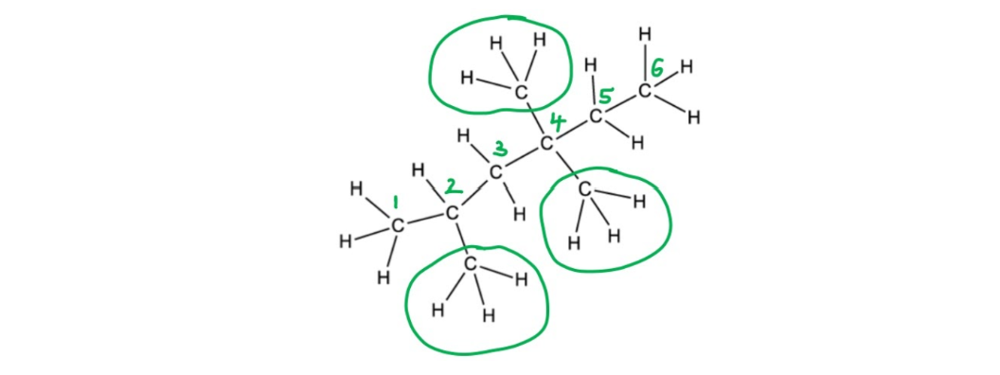

- Number from the end that gives the lowest values:

  - Methyl groups at C2, C4, and C4 (combination 2,4,4) is lower than 3,3,5
- Systematic name: 2,4,4-trimethylhexane

**A** is incorrect as 2,3,3-tetramethylpentane is a different isomer; it has four methyl groups on a five-carbon chain.

**C** is incorrect as the longest continuous carbon chain contains six carbons (hexane), not five. A common mistake is to mistake the end of the chain for an ethyl branch on a pentane, giving the false name 2-ethyl-2,4-dimethylpentane.

**D** is incorrect as numbering from the wrong end of the chain places the methyl groups at C3, C3, and C5 instead of the lower C2, C4, C4.

### Q9
**Final answer:** **The correct answer is D**

- The circled group contains a C=O bond bonded to two other carbon atoms, making it a ketone
- In the molecule shown, one carbon is a –CH3 group and the other is a –CH2– group

**A** is incorrect as an aldehyde also contains a C=O, but the carbonyl carbon is bonded to at least one hydrogen atom (–CHO), not two carbon atoms.

**B** is incorrect as an alkene contains a C=C double bond, not a C=O bond.

**C** is incorrect as a carboxylic acid contains a –COOH group, where the carbonyl carbon is bonded to a hydroxyl group (–OH).

### Q10
**Final answer:** **The correct answer is B**

- The name 1-fluoro-3-methylbut-2-ene identifies the parent chain, double bond, and substituents:

  - Parent chain: but-2-ene — a four-carbon chain with a C=C double bond at C2
  - 1-fluoro: fluorine atom on C1
  - 3-methyl: methyl group (–CH3) on C3
- The molecular formula is C5H9F
- The ratio 5:9:1 cannot be simplified further, so the empirical formula equals the molecular formula: C5H9F

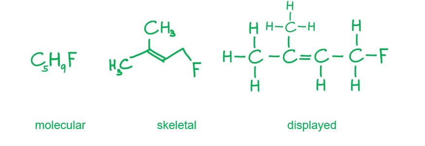

**A** is incorrect as the displayed formula shown places the methyl group on the wrong carbon.

**C** is incorrect as the skeletal formula shown omits the fluorine atom and the C=C double bond, and places the branch on the wrong carbon.

**D** is incorrect as CH2FCH2CH(CH3)2 has no C=C double bond. It is the structural formula for 1-fluoro-3-methylbutane, the saturated compound.

### Q11
**Final answer:** **The correct answer is B**

- For this type of question it's often easier to draw out the displayed structure of the molecule and then work out the correct structural formula
- Begin by drawing the carbon chain, hexane, in this case
- The side groups are:

  - Two bromine atoms (from 'dibromo') which must be on the second carbon
  - One methyl group, CH3, (from -4-methyl) on the fourth carbon

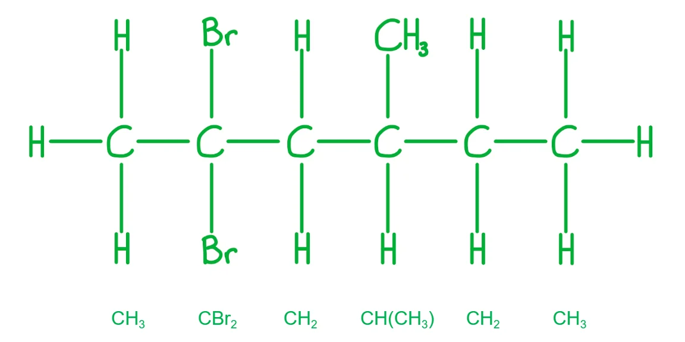

- Transpose the displayed formula into a condensed structural formula

### Q12
**Final answer:** **The correct answer is B**

- The general formula for a ketone is CnH2nO
- The skeletal formula and CH3CH2CH(CH3)CH2COCH3 are correct for 4-methylhexan-2-one

**A** is incorrect as CnH2n+2O is the general formula for an alcohol, not an aldehyde. The general formula for an aldehyde is CnH2nO

**C** is incorrect as the systematic name is 2-methylpentylamine because the lowest possible number is used

**D** is incorrect as the structural formula should be CH3CH2COOCH2CH3. The ester linkage has been written in the wrong order

### Q13
**Final answer:** **The correct answer is D**

- Compound B (C6H14O) fits the general formula CnH2n+2O, which corresponds to an alcohol

  - Alcohols contain a hydroxyl (–OH) functional group
- Compound A (C6H12O2) is produced by oxidation of compound B, confirming B is a primary alcohol

C6H14O → C6H12O2

C6H13OH → C5H11COOH

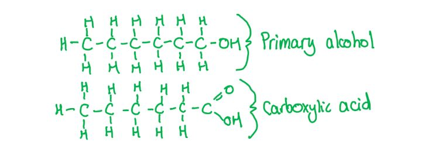

**A** is incorrect as the carbonyl group (C=O) is present in compound A, not B.

**B** is incorrect as the carboxyl group (–COOH) is present in compound A, not B.

**C** is incorrect as an ester (general formula CnH2nO2) also matches compound A, but esters are formed by condensation reactions, not by simple oxidation of an alcohol.

### Q14
**Final answer:** **The correct answer is A**

- Empirical formula is the simplest whole number ratio of atoms in a chemical formula
- Molecular formula is the actual number and type of atoms in a formula
- Counting up the number of C and H atoms in limonene and taking into account the two double bonds, gives a molecular formula of C10H16 and an empirical formula of C5H8

**B** is incorrect as the double bonds have been ignored, resulting in two extra hydrogens in the molecular formula, which also gives an incorrect empirical formula

**C** is incorrect as the CH3 group has been missed, resulting in an incorrect molecular and empirical formula

**D** is incorrect as the molecular formula is correct, but it has not been simplified to give the empirical formula

> **[exam-tip]**
> To get the correct molecular formula, it can help to draw the molecule out with all atoms showing:
> 
> 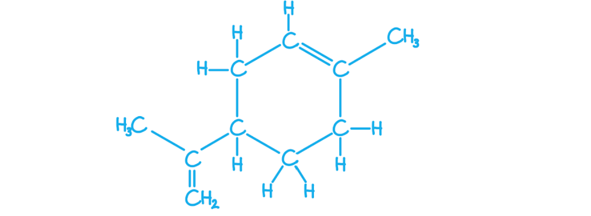
> 
> That way you are less likely to miss any atoms, especially hydrogens

## Structured Questions (4 questions)

### Q1
> **[mark-scheme]**
> i) The molecular formula of nerol is:
> 
> - C10H18O **[1 mark]**

ii) To calculate the relative molecular mass of nerol:

*M*r = (10 x 12.0) + (18 x 1.0) + 16.0

*M*r = 154.0 **[1 mark]**

> **[mark-scheme]**
> iii) The empirical formula of nerol is:
> 
> - C10H18O **[1 mark]**
> 
> The empirical formula is the same as the molecular formula for nerol.

> **[exam-tip]**
> When counting atoms in a skeletal formula, trace each line end and vertex systematically to avoid missing any carbon or hydrogen atoms.
> 
> To find the empirical formula, find the highest common factor (HCF) of all subscripts in the molecular formula. For C10H18O, the HCF of 10, 18, and 1 is 1, so the empirical formula is the same as the molecular formula: C10H18O.
> **[mark-scheme]**
> Geometrical (cis-trans) isomerism:
> 
> - Nerol does show geometrical (cis-trans) isomerism
> **AND**
> there are two different groups attached to each carbon of one of the C=C bonds **[1 mark]**
> - The C=C adjacent to the CH2OH group shows geometrical isomerism; the terminal C=C does not (one carbon of the terminal C=C has two identical methyl groups attached) **[1 mark]**
> 
> Optical isomerism:
> 
> - Nerol does not show optical isomerism
> **AND**
> there are no chiral centres / no carbon atom with four different groups attached **[1 mark]**

> **[exam-tip]**
> Geometrical (cis-trans) isomerism requires restricted rotation around a C=C bond AND two different groups on each of the two carbons forming that bond.
> 
> Nerol has two C=C bonds. The terminal C=C has two methyl groups on one carbon; having identical groups on one carbon means this bond cannot show geometrical isomerism. The other C=C, adjacent to the CH2OH group, has two different groups on each carbon and does show geometrical isomerism. Nerol and geraniol are geometrical isomers of each other.
> 
> Optical isomerism requires a chiral centre: a carbon atom bonded to four different groups. There is no such carbon in nerol, so it does not show optical isomerism.
The completed skeletal formulae are:

Linalool (3,7-dimethylocta-1,6-dien-3-ol):

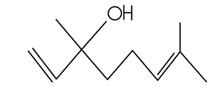

**[1 mark]**

Geraniol (3,7-dimethylocta-2,6-dien-1-ol):

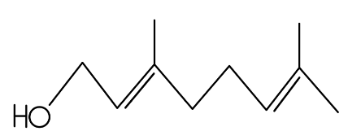

**[1 mark]**

> **[mark-scheme]**
> 1 mark for correct skeletal formula of linalool: hydroxyl at C3, double bonds at C1 and C6, methyl groups at C3 and C7
> 
> 1 mark for correct skeletal formula of geraniol: hydroxyl at C1, double bonds at C2 and C6, methyl groups at C3 and C7

> **[exam-tip]**
> To draw skeletal formulae from IUPAC names, work through the name systematically:
> 
> 1. Identify the parent chain:
> 
>   - "octa" = 8 carbons.
> 2. Identify the principal functional group:
> 
>   - "-ol" = alcohol (OH).
>   - This determines the numbering direction as the OH carbon gets the lowest possible locant.
> 3. Locate the double bonds:
> 
>   - "1,6-dien" (linalool) means double bonds between C1 and C2, and between C6 and C7.
>   - "2,6-dien" (geraniol) means double bonds between C2 and C3, and between C6 and C7.
> 4. Add the substituents:
> 
>   - "3,7-dimethyl" means methyl groups at C3 and C7 for both isomers.

### Q2
> **[mark-scheme]**
> The name and functional groups of **X** are:
> 
> - Name: propenal **[1 mark]**
> - Functional groups: alkene
> **AND**
> aldehyde / carbonyl **[1 mark]**

> **[exam-tip]**
> To name **X** (CH2=CHCHO), identify the longest carbon chain and the principal functional group:
> 
> - Three carbons = prop-
> - The aldehyde group (-CHO) has the highest priority and gives the suffix -al
> - The double bond gives the infix -en-
> - Combining these: prop + en + al = propenal
> 
> The compound contains two functional groups: an aldehyde (the -CHO group) and an alkene (the C=C bond).
> **[mark-scheme]**
> The empirical and molecular formulae of **Y** are:
> 
> - Empirical formula = C2H4O **[1 mark]**
> - Molecular formula = C4H8O2 **[1 mark]**

> **[exam-tip]**
> To find the formulae of **Y**, it helps to draw the fully displayed formula first so that all carbon and hydrogen atoms are shown explicitly and none are missed when counting.
> 
> 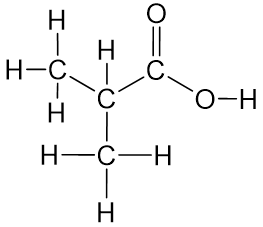
> 
> **Y** has the molecular formula C4H8O2.
> 
> To find the empirical formula, divide all subscripts by their highest common factor: HCF of 4, 8, and 2 is 2, giving C2H4O.
The skeletal formula of **Z** is:

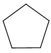

**[1 mark]**

> **[mark-scheme]**
> 1 mark for correct skeletal formula of cyclopentane (a five-membered ring with no substituents or double bonds)

> **[exam-tip]**
> Pentene has the molecular formula C5H10. A saturated hydrocarbon with this molecular formula cannot be a straight-chain alkane (alkanes have the general formula CnH2n+2, which would give C5H12 for five carbons). The formula C5H10 fits the general formula CnH2n, which cycloalkanes also satisfy. The only saturated cyclic hydrocarbon with five carbons is cyclopentane, drawn as a regular pentagon in skeletal form.

### Q3
The completed table is:

| **Compound** | **Displayed formula** | **Functional group(s) present** |
|---|---|---|
| **1** |  | (Primary) alcohol **AND** Bromo / bromine |
| **2** |  | Aldehyde **AND** Chloro / chlorine |
| **3** |  | Alkene **AND** (Primary) alcohol **AND** Chloro / chlorine |
| **4** | 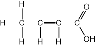 | Alkene **AND** Carboxylic acid |

**[4 marks]**

> **[mark-scheme]**
> 1 mark for identifying (primary) alcohol **AND **bromo / bromine in compound 1
> 
> 1 mark for identifying aldehyde **AND **chloro / chlorine  in compound 2
> 
> 1 mark for identifying alkene **AND **(primary) alcohol **AND **chloro / chlorine  in compound 3
> 
> 1 mark for identifying alkene **AND **carboxylic acid in compound 4

> **[exam-tip]**
> The functional groups you are expected to know for this topic include:
> 
> - Alkenes
> - Halogenoalkanes
> - Alcohols (primary, secondary and tertiary)
> - Aldehydes
> - Ketones
> - Carboxylic acids
> - Esters
> - Primary amines
> - Nitriles
> **[mark-scheme]**
> The systematic names of the compounds are:
> 
> - Compound 1 = 3-bromo-2-methylpropan-1-ol **[1 mark]**
> - Compound 2 = 2-chloropropanal **[1 mark]**
> - Compound 3 = 2-chlorobut-2-en-1-ol **[1 mark]**
> - Compound 4 = but-2-enoic acid **[1 mark]**

> **[exam-tip]**
> To name compound 1:
> 
> - The longest chain has 3 carbons (propan-).
> - The -OH group is at C1 (suffix -1-ol).
> - Br on C3 and CH3 on C2 are added as prefixes in alphabetical order: 3-bromo-2-methyl-.
> 
> To name compound 2:
> 
> - The longest chain has 3 carbons with the -CHO at C1 (suffix -al).
> - The Cl on C2 gives the prefix 2-chloro-.
> 
> To name compound 3:
> 
> - The longest chain has 4 carbons with a C=C starting at C2 (but-2-en-) and -OH at C1 (suffix -1-ol).
> - The Cl on C2 gives the prefix 2-chloro-.
> 
> To name compound 4:
> 
> - The longest chain has 4 carbons with a C=C starting at C2 (but-2-en-) and -COOH at C1 (suffix -oic acid).
> **[mark-scheme]**
> The compounds with empirical formula equal to their molecular formula are:
> 
> - Compounds 1, 2 and 3 **[1 mark]**
> 
> Explanation:
> 
> - The subscripts in the molecular formula of each of compounds 1, 2 and 3 share no common factor greater than 1 / the molecular formula cannot be simplified further **[1 mark]**

> **[exam-tip]**
> Compound 1 (3-bromo-2-methylpropan-1-ol) has molecular formula C4H9BrO. The subscripts 4, 9, 1 and 1 share no common factor greater than 1.
> 
> Compound 2 (2-chloropropanal) has molecular formula C3H5ClO. The subscripts 3, 5, 1 and 1 share no common factor greater than 1.
> 
> Compound 3 (2-chlorobut-2-en-1-ol) has molecular formula C4H7ClO. The subscripts 4, 7, 1 and 1 share no common factor greater than 1.
> 
> Compound 4 (but-2-enoic acid) has molecular formula C4H6O2. The subscripts 4, 6 and 2 share a common factor of 2, so the empirical formula is C2H3O, which differs from the molecular formula.

### Q4
> **[mark-scheme]**
> The empirical formula of crotonic acid is:
> 
> - C2H3O **[1 mark]**

> **[exam-tip]**
> To find the empirical formula, divide all the subscripts in the molecular formula by their highest common factor (HCF). For C4H6O2, the HCF of 4, 6 and 2 is 2, giving C2H3O.
Any **two** of the following displayed formulae are:

But-3-enoic acid:

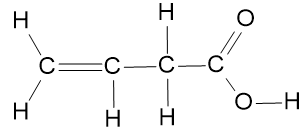

**OR**

2-methylprop-2-enoic acid:

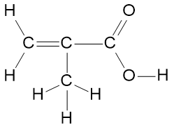

**OR**

Cyclopropanecarboxylic acid

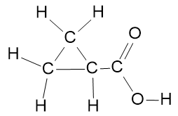

**[2 marks]**

> **[mark-scheme]**
> 1 mark for each correct displayed formula of a structural isomer of but-2-enoic acid that retains the carboxylic acid functional group, up to a maximum of 2 marks
> 
> Correct structural isomers include but-3-enoic acid, 2-methylprop-2-enoic acid, and cyclopropanecarboxylic acid

> **[exam-tip]**
> But-3-enoic acid is a position isomer of but-2-enoic acid. The C=C double bond moves from between C2 and C3 to between C3 and C4.
> 
> 2-methylprop-2-enoic acid is a branched chain isomer. A methyl group is added to C2, shortening the main chain to three carbons.
> 
> Cyclopropanecarboxylic acid is formed by incorporating the double bond into a cyclic structure. The carboxylic acid group remains outside the ring.
> **[mark-scheme]**
> i) The type of formula shown in Fig. 2.1 is:
> 
> - A skeletal formula **[1 mark]**
> 
> ii) The molecular formula of oleic acid is:
> 
> - C18H34O2 **[1 mark]**
> 
> iii) Whether oleic acid belongs to the same homologous series as crotonic acid:
> 
> - Both compounds have the same functional groups / an alkene and carboxylic acid functional group **[1 mark]**
> - Differ from each other in carbon chain length / by the number of CH2 groups **[1 mark]**
> - Both compounds are chemically similar / react in a similar way / same chemical properties **[1 mark]**

> **[exam-tip]**
> In a skeletal formula, hydrogen atoms bonded to carbon atoms are omitted. Line ends and vertices represent carbon atoms, and functional groups and non-C/H atoms are still shown.
> 
> To find the molecular formula from a skeletal formula, count each type of atom, including hydrogen atoms on functional groups.
> 
> You are expected to know the defining features of a homologous series for this topic.
