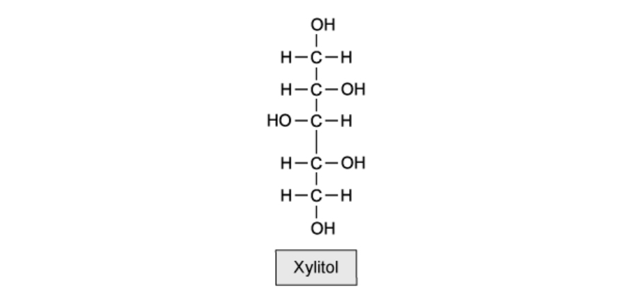
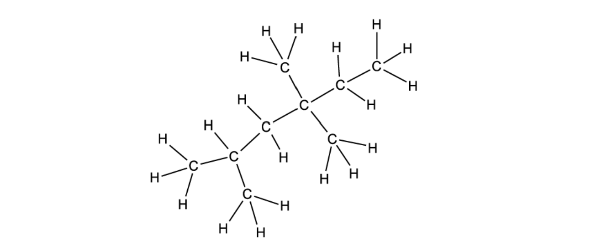
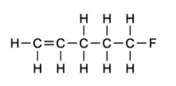
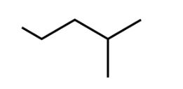
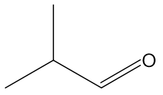
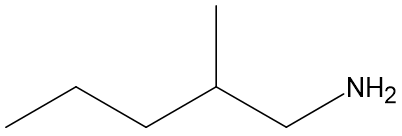

# Exam Questions — Formulas, Functional Groups & the Naming of Organic Compounds
**13. An Introduction to AS Level Organic Chemistry** · Cambridge (CIE) A-LEVEL chemistry (9701)
> Source: [https://www.savemyexams.com/a-level/chemistry/cie/25/topic-questions/](https://www.savemyexams.com/a-level/chemistry/cie/25/topic-questions/) · 14 questions across 1 sets

## Multiple Choice Questions (14 questions)

### Q1 — medium — 1 marks

**Q1** [1 mark]

How many stereoisomers does 3-chloropent-2-ene have?

### Q2 — medium — 1 marks

**Q2** [1 mark]

Which row identifies the functional groups and structural formula of 4-hydroxybutanenitrile?

|   | **group 1** | **group 2** | **structural formula** |
|---|---|---|---|
| **A** | carboxyl | amide | HOOCCH2CH2CONH2 |
| **B** | hydroxyl | amine | HOCH2CH2CH2CH2NH2 |
| **C** | hydroxyl | nitrile | CH3CH(OH)CH2CN |
| **D** | hydroxyl | nitrile | HOCH2CH2CH2CN |

### Q3 — easy — 1 marks

**Q3** [1 mark]

What is the systematic name of the molecule shown?

### Q4 — hard — 1 marks

**Q4** [1 mark]

What is the systematic name of the molecule shown?

### Q5 — medium — 1 marks

**Q5** [1 mark]

Xylitol is an artificial sweetener used in toothpaste.

Which functional groups are formed when xylitol is oxidised?

|   | **alkene** | **aldehyde** | **carboxylic acid** | **ketone** |
|---|---|---|---|---|
| **A** | ⨯ | ✓ | ✓ | ✓ |
| **B** | ⨯ | ✓ | ⨯ | ✓ |
| **C** | ⨯ | ✓ | ⨯ | ⨯ |
| **D** | ✓ | ⨯ | ⨯ | ⨯ |

### Q6 — easy — 1 marks

**Q6** [1 mark]

Which row correctly identifies the hydrocarbon molecules?

|   | **1** | **2** | **3** | **4** |
|---|---|---|---|---|
| **A** | **✓** | **✓** | **✓** | **✓** |
| **B** | **✓** | **✓** | **✓** | **⨯** |
| **C** | **✓** | **✓** | **⨯** | **⨯** |
| **D** | **⨯** | **⨯** | **⨯** | **✓** |

### Q7 — medium — 1 marks

**Q7** [1 mark]

Which molecule contains an aldehyde functional group?

### Q8 — medium — 1 marks

**Q8** [1 mark]

What is the systematic name of the molecule shown?

### Q9 — easy — 1 marks

**Q9** [1 mark]

What is the name of the circled functional group?

### Q10 — easy — 1 marks

**Q10** [1 mark]

What is the correct formula for 1-fluoro-3-methylbut-2-ene?

| **A** | Displayed |  |
|---|---|---|
| **B** | Empirical | C5H9F |
| **C** | Skeletal |  |
| **D** | Structural | CH2FCH2C(CH3)CH3 |

### Q11 — hard — 1 marks

**Q11** [1 mark]

What is the structural formula of 2,2-dibromo-4-methylhexane?

### Q12 — hard — 1 marks

**Q12** [1 mark]

Which row is correct?

|   | **Systematic name** | **General formula** | **Skeletal formula** | **Structural formula** |
|---|---|---|---|---|
| **A** | 2-methylpropanal | CnH2n+2O |  | CH3CH(CH3)CHO |
| **B** | 4-methylhexan-2-one | CnH2nO |  | CH3CH2CH(CH3)CH2COCH3 |
| **C** | 4-methylpentylamine | CnH2n+1NH2 |  | CH3CH2CH2CH(CH3)CH2NH2 |
| **D** | ethyl propanoate | CnH2nO2 |  | CH3COOCH2CH2CH3 |

### Q13 — medium — 1 marks

**Q13** [1 mark]

Compound A, C6H12O2, is produced by the oxidation of compound B, C6H14O.

Which functional group is present in compound B?

### Q14 — hard — 1 marks

**Q14** [1 mark]

Limonene is found in the peel of citrus fruits.

Which row gives the empirical and molecular formulae of limonene?

|   | Empirical formula | Molecular formula |
|---|---|---|
| **A** | C5H8 | C10H16 |
| **B** | C5H9 | C10H18 |
| **C** | C9H13 | C9H13 |
| **D** | C10H16 | C10H16 |
