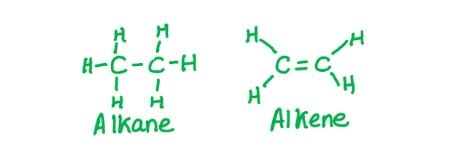

# Mark Schemes — Characteristic Organic Reactions
**13. An Introduction to AS Level Organic Chemistry** · Cambridge (CIE) A-LEVEL chemistry (9701)

## Multiple Choice Questions (10 questions)

### Q1
**Final answer:** **The correct answer is D**

- If a reaction is electrophilic, the inorganic reagent is acting as an electrophile (electron-pair acceptor).
- Therefore, the organic reactant acts as a nucleophile (electron-pair donor). This is usually because the organic molecule is an alkene, and one of the electron pairs in the double bond is donated to the inorganic reagent, e.g. HBr.
- In an addition reaction, the organic molecule gains atoms.
- In an electrophilic addition reaction, an alkene is converted to a halogenoalkane and therefore becomes more saturated.

**A** is incorrect as the inorganic reagent (e.g. HBr) acts as the electrophile, not the organic molecule. In addition reactions the organic molecule gains atoms, becoming more saturated.

**B** is incorrect as the inorganic reagent acts as the electrophile, not the organic molecule. In electrophilic addition, the organic molecule acts as the nucleophile.

**C** is incorrect as addition reactions result in the organic molecule gaining atoms, making it more saturated, not less saturated.

### Q2
**Final answer:** **The correct answer is D**

- A nucleophile is an electron-pair donor; it is either a negative ion or has a lone pair of electrons capable of being donated.

- OH- has three lone pairs of electrons and a negative charge, making it a nucleophile.

**A** is incorrect as ethane has no lone pairs and will not act as a nucleophile.

**B** is incorrect as a free radical has an unpaired electron and reacts via homolytic (radical) mechanisms. It does not donate or accept electron pairs, so it is neither a nucleophile nor an electrophile.

**C** is incorrect as a hydrogen ion has no electrons. It accepts electron pairs and is therefore an electrophile, not a nucleophile.

### Q3
**Final answer:** **The correct answer is A**

- Nucleophiles have a lone pair of electrons and are electron-pair donors.
- Electrophiles accept electron pairs and are electron-pair acceptors.

**B** is incorrect as both nucleophiles and electrophiles can be covalently bonded molecules or atoms. For example, the double bond in alkenes makes them nucleophiles, and the permanent dipole in HBr makes it an electrophile.

**C** is incorrect as nucleophiles react with many functional groups, not just molecules with double bonds. Electrophiles are involved in both addition reactions (e.g. electrophilic addition to alkenes) and substitution reactions (e.g. electrophilic substitution in benzene).

**D** is incorrect as nucleophiles are electron-pair donors and electrophiles are electron-pair acceptors.

### Q4
**Final answer:** **The correct answer is B**

- Heterolytic fission involves the movement of a pair of electrons.
- This means that a double-headed arrow is required.
- To form a chloride ion, Cl-, the double-headed arrow should go from the centre of the bond to the chlorine atom.

**A** is incorrect as the electron pair (double-headed arrow) is going to the carbon atom, which would result in a CH3CH2CH2- ion and a Cl+ ion.

**C** is incorrect as there are 2 double-headed arrows, which would suggest the movement of 4 electrons from a single covalent bond that contains only 2 electrons.

**D** is incorrect as this is the correct diagram for homolytic fission of the C–Cl bond, which forms a CH3CH2CH2• radical and a Cl• radical.

### Q5
**Final answer:** **The correct answer is A**

- A homologous series is a family of carbon compounds that all contain the same functional group.
- All members can be represented by the same general formula, e.g. CnH2n+2 for alkanes.
- Since all members contain the same functional group, they have similar chemical properties and undergo the same types of reactions.
- As successive members increase in size by one –CH2– unit, their intermolecular forces increase.

  - This results in a gradual change in physical properties, such as increasing boiling points and densities.

**B** is incorrect as members of a homologous series do have similar chemical properties, because they all contain the same functional group and undergo the same types of reactions.

**C** is incorrect as all members of a homologous series share the same general formula by definition (e.g. CnH2n+2 for alkanes).

**D** is incorrect as the gradual increase in chain length does produce a gradual change in physical properties, such as increasing boiling points and densities.

### Q6
**Final answer:** **The correct answer is B**

- A nucleophile is a species that donates a pair of electrons.

  - The CH3 species has a lone pair of electrons when it has 8 outer shell electrons.

- An electrophile is a species that accepts a pair of electrons.

  - An electron-deficient CH3 species has 6 outer shell electrons.

- To act as a free radical, the CH3 species must have an unpaired electron, giving 7 outer shell electrons.

**A** is incorrect as the nucleophile and electrophile values are swapped. The nucleophile (lone pair, electron donor) requires 8 outer shell electrons and the electrophile (electron-deficient) requires 6.

**C** is incorrect as the free radical requires 7 outer shell electrons (unpaired electron), not 8. The electrophile requires 6 outer shell electrons, not 7.

**D** is incorrect as the free radical requires 7 outer shell electrons (unpaired electron), not 6. The electrophile requires 6 outer shell electrons, not 7.

### Q7
**Final answer:** **The correct answer is B**

- A homologous series is a group with the same functional group and similar chemical properties.
- Alkanes and alkenes are different homologous series as they have different functional groups.
- Alkanes have single carbon-carbon bonds and the general formula CnH2n+2
- Alkenes have a double carbon-carbon bond and the general formula CnH2n

**A** is incorrect as aldehydes and ketones both have the general formula CnH2nO, giving a C:H ratio of 1:2.

**C** is incorrect as aldehydes (CnH2nO) and alkenes (CnH2n) both have a C:H ratio of 1:2.

**D** is incorrect as carboxylic acids and esters both have the general formula CnH2nO2, giving a C:H ratio of 1:2.

### Q8
**Final answer:** **The correct answer is D**

- The first reaction is electrophilic addition because:

  - HI is acting as an electrophile and is accepting a bonding pair of electrons from the alkene double bond; therefore the reaction is electrophilic.

  - The resulting organic molecule contains 2 more atoms than the initial organic molecule; therefore it is an addition reaction.

- The second reaction is nucleophilic substitution because:

  - The OH- ion from NaOH is acting as a nucleophile and is donating a bonding pair of electrons to the organic molecule; therefore the reaction is nucleophilic.

  - In the resulting organic molecule, the hydroxyl (OH) group has replaced the iodine; therefore it is a substitution reaction.

**A** is incorrect as the first reaction is not nucleophilic addition. HI acts as the electrophile by accepting electrons from the alkene double bond, making reaction 1 electrophilic addition.

**B** is incorrect as the second reaction is not electrophilic substitution. OH- is a nucleophile that replaces the iodine atom, making reaction 2 nucleophilic substitution.

**C** is incorrect as the first reaction is not nucleophilic addition. HI acts as the electrophile, not as a nucleophile, making reaction 1 electrophilic addition.

### Q9
**Final answer:** **The correct answer is D**

- When a halogenoalkane reacts with aqueous sodium or potassium hydroxide, the OH- ion replaces the halogen, forming an alcohol.
- The hydroxide ion is a **nucleophile** (an electron-pair donor).
- The hydroxide ion takes the place of the halogen in the compound, so this is a **substitution** reaction.
- The overall mechanism is nucleophilic substitution.

  - The reaction can be summarised as:

**A** is incorrect as electrophilic addition involves an electrophile attacking a C=C double bond. 1-chloroethane has no double bond, and OH- is a nucleophile, not an electrophile.

**B** is incorrect as electrophilic substitution involves an electrophile. OH- is a nucleophile, not an electrophile.

**C** is incorrect as nucleophilic addition adds atoms across a double bond. 1-chloroethane has no C=C double bond. Instead, the halogen is replaced by OH- in a substitution reaction.

### Q10
**Final answer:** **The correct answer is A**

- The reaction between hydrogen cyanide and propanone is a nucleophilic addition reaction.
- A nucleophile is an electron-pair donor.
- An electrophile is an electron-pair acceptor.
- In this reaction, CN- is donating a pair of electrons (as shown by the arrow) and the carbon in propanone is accepting them.

**B** is incorrect as this is heterolytic bond breaking. Only one atom receives both electrons from the covalent bond, making this heterolytic.

**C** is incorrect as propanone is a ketone, so this statement is true.

**D** is incorrect as this is an example of a nucleophilic addition reaction.
