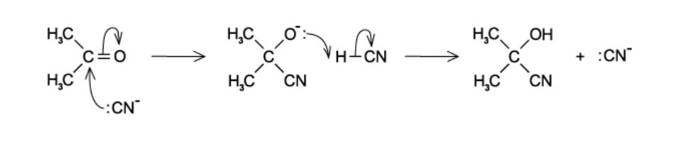
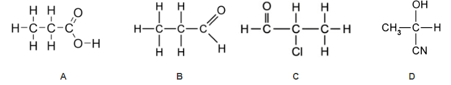

# Exam Questions — Characteristic Organic Reactions
**13. An Introduction to AS Level Organic Chemistry** · Cambridge (CIE) A-LEVEL chemistry (9701)
> Source: [https://www.savemyexams.com/a-level/chemistry/cie/25/topic-questions/](https://www.savemyexams.com/a-level/chemistry/cie/25/topic-questions/) · 15 questions across 2 sets

## Multiple Choice Questions (10 questions)

### Q1 — easy — 1 marks

**Q1** [1 mark]

Which statement describes an electrophilic addition reaction?

### Q2 — easy — 1 marks

**Q2** [1 mark]

Which species acts as a nucleophile?

### Q3 — hard — 1 marks

**Q3** [1 mark]

Which row correctly describes a nucleophile and an electrophile?

|   | **nucleophile** | **electrophile** |
|---|---|---|
| **A** | Has a lone pair of electrons | Accepts a pair of electrons |
| **B** | Is a negative ion | Is a positive ion |
| **C** | Attacks double bonds | Is only involved in substitution reactions |
| **D** | Accepts a pair of electrons | Has a lone pair of electrons |

### Q4 — medium — 1 marks

**Q4** [1 mark]

Which diagram correctly shows the heterolytic fission of the C–Cl bond in 1-chloropropane?

### Q5 — medium — 1 marks

**Q5** [1 mark]

Which row gives correct statements about a homologous series?

|   | **same general formula** | **similar chemical properties** | **gradual change in physical properties** |
|---|---|---|---|
| **A** | ✓ | ✓ | ✓ |
| **B** | ✓ | ⨯ | ✓ |
| **C** | ⨯ | ✓ | ✓ |
| **D** | ✓ | ✓ | ⨯ |

### Q6 — hard — 1 marks

**Q6** [1 mark]

The methyl group, CH3, can exist as an anion, a cation or a free radical. The CH3 species can act as a nucleophile, an electrophile or a free radical depending on the number of outer shell electrons on the methyl carbon atom.

How many outer shell electrons must be present for CH3 to act in these different ways?

|   | **nucleophile** | **electrophile** | **free radical** |
|---|---|---|---|
| **A** | 6 | 8 | 7 |
| **B** | 8 | 6 | 7 |
| **C** | 6 | 7 | 8 |
| **D** | 8 | 7 | 6 |

### Q7 — easy — 1 marks

**Q7** [1 mark]

Which pair of homologous series does **not** have the same C:H ratio in their general formulae?

### Q8 — hard — 1 marks

**Q8** [1 mark]

The reaction sequence below shows a pair of reaction types.

CH3CH=CHCH3 $\overset{\mathrm{HI} \mathrm{in} \mathrm{CH}_{3}\mathrm{COOH}}{\rightarrow}$ CH3CH2CHICH3 $\xrightarrow{NaOH ( \text{aq} )}$ CH3CH2CH(OH)CH3

Which row in the table identifies reaction 1 and reaction 2?

|   | **Reaction 1** | **Reaction 2** |
|---|---|---|
| **A** | Nucleophilic addition | Nucleophilic substitution |
| **B** | Electrophilic addition | Electrophilic substitution |
| **C** | Nucleophilic addition | Electrophilic substitution |
| **D** | Electrophilic addition | Nucleophilic substitution |

### Q9 — medium — 1 marks

**Q9** [1 mark]

What type of reaction occurs when 1-chloroethane reacts with aqueous sodium hydroxide?

### Q10 — easy — 1 marks

**Q10** [1 mark]

The following mechanism shows hydrogen cyanide reacting with propanone.

Which statement is **not** correct?

## Structured Questions (5 questions)

### Q1 — easy — 9 marks

**Q1** [3 marks]

State the names of the three steps involved in a free radical substitution reaction.

**Q1** [2 marks]

A molecule of chlorine, Cl2, undergoes bond fission when exposed to UV light.

i) Construct an equation for this reaction.

[1]

ii) State the type of bond fission involved.

[1]

**Q1** [1 mark]

Fig 2.1 shows the breaking of a covalent bond.

**Fig 2.1**

State the name of this type of bond fission.

**Q1** [3 marks]

**Extract:**

State the names of the three steps involved in a free radical substitution reaction.

State **three** other types of reaction mechanism.

### Q2 — easy — 15 marks

**Q2** [3 marks]

i) Define the term *hydrocarbon*.

[1]

ii) State the general formula for the homologous series of alkanes.

[1]

iii) State the molecular formula of an **alkane** containing five carbon atoms.

[1]

**Q2** [2 marks]

State **two** characteristics of a homologous series.

**Q2** [4 marks]

State the systematic names for the following organic molecules in **Table 1.1**.

**Table 1.1**

| **Molecule** | **Name** |
|---|---|
| CH3CH(Cl)CH3 |   |
| CH3CH2CH=CH2 |   |
| CH3CH2CH2OH |   |
| CH3CH2CH(Br)CH2OH |   |

**Q2** [4 marks]

The structures of four organic compounds are shown in **Fig 1.1**.

**Fig 1.1**

Complete **Table 1.2** to show the name and functional group(s) of each organic compound.

**Table 1.2**

| **Organic compound** | **Name** | **Functional groups** |
|---|---|---|
| **A** | Propanoic acid |   |
| **B** |   | Aldehyde |
| **C** |   | Aldehyde **AND** Halogenoalkane |
| **D** | 2-hydroxypropanenitrile |   |

**Q2** [2 marks]

The structural formula of 2,2-dimethylpentan-3-ol can be shown as C(CH3)3CH(OH)CH2CH3.

i) Deduce the empirical formula of 2,2-dimethylpentan-3-ol.

[1]

ii) Draw the skeletal formula of 2,2-dimethylpentan-3-ol.

[1]

### Q3 — medium — 11 marks

**Q3** [3 marks]

A reaction scheme involving butanone is shown in **Fig. 3.1**.

Butanone $\overset{\mathrm{reaction}1}{\rightarrow}$ **X** $\overset{\mathrm{reaction}2}{\rightarrow}$ **Y** $\overset{\mathrm{reaction}3}{\rightarrow}$ 2-chlorobutane

**Fig. 3.1**

i) State suitable reagents and conditions for reactions **1** and **2**.

[2]

ii) State the type of reaction that occurs in reaction **2**.

[1]

**Q3** [5 marks]

**Extract:**

A reaction scheme involving butanone is shown in **Fig. 3.1**.

Butanone → **X** → **Y** → 2-chlorobutane

**Fig. 3.1**

i) Name the mechanism for reaction **3** in **Fig. 3.1**.

[1]

ii) Complete the diagram to show the mechanism for reaction **3**. Include charges, dipoles, lone pairs of electrons and curly arrows, as appropriate. Draw the structure of the organic intermediate.

[4]

**Q3** [3 marks]

**Extract:**

A reaction scheme involving butanone is shown in **Fig. 3.1**.

{align=center} Butanone \$\$\overset{reaction 1}{\rightarrow}\$\$ **X** \$\$\overset{reaction 2}{\rightarrow}\$\$ **Y** \$\$\overset{reaction 3}{\rightarrow}\$\$ 2-chlorobutane

{align=center} **Fig. 3.1**

Describe a chemical test and observation which would distinguish between butane and **Y** in Fig. 3.1.

### Q4 — medium — 7 marks

**Q4** [4 marks]

4-Methylpent-2-ene reacts with hydrogen bromide to form 2-bromo-4-methylpentane as shown.

CH3CH(CH3)CH=CHCH3 + HBr → CH3CH(CH3)CH2CHBrCH3

Complete the diagram to show the mechanism for this reaction. Include charges, dipoles, lone pairs of electrons and curly arrows, as appropriate. Draw the structure of the organic intermediate.

**Q4** [1 mark]

**Extract:**

4-Methylpent-2-ene reacts with hydrogen bromide to form 2-bromo-4-methylpentane as shown.

CH₃CH(CH₃)CH=CHCH₃ + HBr → CH₃CH(CH₃)CH₂CHBrCH₃

State the role of HBr in the reaction in **(a)**.

**Q4** [2 marks]

**Extract:**

4-Methylpent-2-ene reacts with hydrogen bromide to form 2-bromo-4-methylpentane as shown.

CH₃CH(CH₃)CH=CHCH₃ + HBr → CH₃CH(CH₃)CH₂CHBrCH₃

The halogenoalkane produced in **(a)** can be converted back into 4-methylpent-2-ene.

State the reagents and conditions required for this reaction to occur.

### Q5 — medium — 10 marks

**Q5** [3 marks]

i) State two characteristics of a homologous series.

[2]

ii) State the homologous series to which propene belongs.

[1]

*Source: June 2019 8CHO/02 Q2A*

**Q5** [3 marks]

Propene reacts to form a mixture of 1-chloropropane and 2-chloropropane.

i) State a suitable reagent for this reaction.

[1]

ii) Suggest which halogenoalkane is formed as the major product of this reaction. Explain your answer.

[2]

*Source: June 2019 8CHO/02 Q2B*

**Q5** [4 marks]

i) State the reagents and conditions required for the conversion of 1-chloropropane into butanenitrile, CH3CH2CH2CN.

[2]

ii) 2-chloropropane can be converted into a structural isomer of butanenitrile.

Name this isomer and draw its displayed formula.

[2]

*Source: June 2019 8CHO/02 Q2C*

