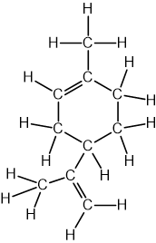
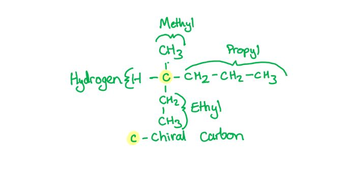
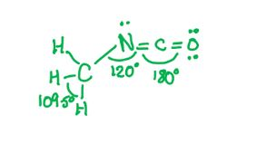

# Mark Schemes — Shapes of Organic Molecules; σ & π Bonds
**13. An Introduction to AS Level Organic Chemistry** · Cambridge (CIE) A-LEVEL chemistry (9701)

## Multiple Choice Questions (11 questions)

### Q1
**Final answer:** **The correct answer is B**

- An atom is sp2 hybridised when it is surrounded by three regions of electron density, as a double bond counts as one region
- In cysteine, only the carboxyl carbon (-COOH) is bonded to three groups: a hydroxyl (-OH) group, the adjacent carbon, and a C=O double bond
- The alpha-carbon and beta-carbon each form four σ bonds with no double bonds, so both are sp3 hybridised

**A** is incorrect as there is one sp2 hybridised carbon atom in cysteine (the carboxyl carbon). A value of 0 would suggest no carbon atom in the molecule contains a double bond.

**C** is incorrect as only one carbon atom (the carboxyl carbon) is sp2 hybridised. The alpha-carbon has four different single-bond groups attached and is sp3 hybridised.

**D** is incorrect as only one carbon atom is sp2 hybridised. The alpha-carbon and beta-carbon each form four σ bonds with no double bonds and are therefore sp3 hybridised.

### Q2
**Final answer:** **The correct answer is B**

- A double bond consists of one σ bond, formed by the head-on overlap of atomic orbitals, and one π bond, formed by the sideways overlap of p orbitals

**A** is incorrect as a combination of 0 σ bonds and 2 π bonds is not possible. The internuclear axis between two bonded atoms must always be occupied by a σ bond before any π bonds can form.

**C** is incorrect as a combination of 1 σ bond and 2 π bonds is the composition of a triple bond, not a double bond.

**D** is incorrect as a combination of 2 σ bonds and 0 π bonds would suggest a double bond consists of two σ bonds. A double bond always consists of one σ bond and one π bond.

### Q3
**Final answer:** **The correct answer is D**

- Limonene has the molecular formula C10H16

- Every covalent bond contains one σ bond

  - The carbon skeleton contains 10 C-C σ bonds and 16 C-H σ bonds
  - This gives 26 σ bonds in total
- Each C=C double bond consists of one σ bond and one π bond:

  - Limonene contains two C=C double bonds
  - This gives 2 π bonds

**A** is incorrect as 12 σ bonds accounts only for the visible bonds in the carbon skeleton and does not include the C-H σ bonds to implicit hydrogen atoms. Each CH, CH2, or CH3 group contains additional σ bonds that must be counted.

**B** is incorrect as 4 π bonds would suggest each double bond contains two π bonds. A C=C double bond consists of one σ bond and one π bond only, giving 2 π bonds for a molecule with two double bonds.

**C** is incorrect as 24 σ bonds and 4 π bonds reflects an undercount of σ bonds and an overcount of π bonds. Not all C-H σ bonds have been included in the total, and each double bond contributes only one π bond.

### Q4
**Final answer:** **The correct answer is C**

- Methane contains four σ bonds between the central carbon atom and four hydrogen atoms
- To form four equivalent bonds, the carbon atom hybridises one s orbital and three p orbitals to give four identical sp3 hybrid orbitals
- Four sp3 hybrid orbitals arrange themselves tetrahedrally to minimise repulsion

**A** is incorrect as sp hybridisation involves mixing one s orbital and one p orbital, producing two hybrid orbitals. This is associated with triple bonds, such as in ethyne.

**B** is incorrect as sp2 hybridisation involves mixing one s orbital and two p orbitals, producing three hybrid orbitals. This is associated with double bonds, such as in ethene.

**D** is incorrect as sp4 hybridisation is not possible. The p subshell contains only three orbitals (px, py, pz), so a maximum of three p orbitals can participate in hybridisation with one s orbital.

### Q5
**Final answer:** **The correct answer is C**

- A π bond is formed by the sideways overlap of adjacent p orbitals above and below the internuclear axis

**A** is incorrect as a dative covalent bond is formed when one atom donates both electrons to a shared pair. It is not formed by the sideways overlap of p orbitals.

**B** is incorrect as a hydrogen bond is an intermolecular force of attraction between an electron-deficient hydrogen atom (bonded to N, O, or F) and a lone pair on a neighbouring electronegative atom. It is not formed by orbital overlap.

**D** is incorrect as a σ bond is formed by the head-on (end-to-end) overlap of atomic orbitals along the internuclear axis, not by sideways overlap.

### Q6
**Final answer:** **The correct answer is C**

- An sp2 hybridised carbon atom has three regions of electron density (three σ bonds and no lone pairs)
- Three regions of electron density arrange in a trigonal planar geometry to minimise repulsion
- A trigonal planar geometry gives bond angles of 120°

**A** is incorrect as 104.5° is the bond angle associated with a central atom having two bond pairs and two lone pairs, such as the oxygen atom in water (H2O). Carbon does not have two lone pairs in any stable organic molecule.

**B** is incorrect as 109.5° is the bond angle for a perfect tetrahedral geometry, corresponding to sp3 hybridisation with four σ bonds and no lone pairs, such as in methane (CH4).

**D** is incorrect as 180° is the bond angle for a linear geometry, corresponding to sp hybridisation with only two regions of electron density, such as in ethyne.

### Q7
**Final answer:** **The correct answer is B**

- For a carbon atom to be a chiral centre, it must be bonded to four different groups
- In an acyclic alkane, the four substituents are limited to hydrogen atoms and alkyl chains
- The four smallest different substituents are: H (0 additional carbons), methyl (1 carbon), ethyl (2 carbons), and propyl (3 carbons)
- Minimum total: 1 (central chiral carbon) + 0 + 1 + 2 + 3 = 7 carbon atoms

**A** is incorrect as 6 carbon atoms is not sufficient. After the central chiral carbon, only 5 remain. The three smallest different alkyl groups (methyl, ethyl, propyl) require 1 + 2 + 3 = 6 carbons, but only 5 are available. Any valid distribution of 5 carbons among three groups requires two identical groups, which destroys the chiral centre.

**C** is incorrect as 9 carbon atoms, while sufficient, is not the minimum. The smallest chiral acyclic alkane (3-methylhexane) requires only 7 carbon atoms.

**D** is incorrect as 11 carbon atoms, while sufficient, is not the minimum required to form a chiral acyclic alkane.

### Q8
**Final answer:** **The correct answer is D**

- A straight-chain hydrocarbon consists of a continuous series of carbon atoms without any branches or ring structures
- Propane (CH3CH2CH3) contains a continuous, unbranched chain of three carbon atoms

**A** is incorrect as 2-methylpropane is a branched aliphatic hydrocarbon. The longest continuous chain contains three carbon atoms with a methyl group branching off the central carbon atom.

**B** is incorrect as benzene is an aromatic hydrocarbon. It consists of a planar, cyclic ring of six carbon atoms, not an open chain.

**C** is incorrect as cyclopentane is an alicyclic hydrocarbon. The five carbon atoms form a closed ring rather than an open chain.

### Q9
**Final answer:** **The correct answer is B**

- π bonds are formed by the sideways overlap of adjacent p orbitals
- Ethene contains one carbon-carbon double bond (C=C)
- The C=C double bond consists of one σ bond, formed by head-on orbital overlap, and one π bond, formed by sideways overlap of p orbitals

**A** is incorrect as 0 would suggest ethene contains only single bonds with no π bonds present.

**C** is incorrect as 2 would suggest the C=C double bond consists of two π bonds. A double bond consists of one σ bond and one π bond only.

**D** is incorrect as 3 π bonds would require multiple double or triple bonds, which are not present in ethene.

### Q10
**Final answer:** **The correct answer is C**

- Angle *y*:

  - The central carbon atom has four bond pairs and no lone pairs, giving a tetrahedral geometry with a bond angle of 109.5°
- Angle *x*:

  - The nitrogen atom in the amine group has three bond pairs and one lone pair, giving a trigonal pyramidal geometry with a bond angle of 107°
- Angle *z*:

  - The oxygen atom has two bond pairs and two lone pairs, giving a bent geometry with a bond angle of 104.5°
- The correct size order from smallest to largest is *z* (104.5°) < *x* (107°) < *y* (109.5°)
- All three central atoms have a base tetrahedral electron geometry. Lone pairs repel more strongly than bond pairs, compressing the bond angle by approximately 2.5° per lone pair.

**A** is incorrect as *x* < *y* < *z* would place the oxygen atom as having the largest bond angle. Oxygen has two lone pairs, which cause greater repulsion and produce a smaller bond angle than either carbon or nitrogen.

**B** is incorrect as *x* < *z* < *y* incorrectly assigns a smaller angle to oxygen than to nitrogen. Oxygen has two lone pairs (giving 104.5°), which produce a smaller bond angle than the single lone pair on nitrogen (107°).

**D** is incorrect as *z* < *y* < *x* would suggest the nitrogen atom has the largest bond angle. The tetrahedral carbon atom, with no lone pairs, has the largest bond angle of 109.5°.

### Q11
**Final answer:** **The correct answer is C**

- From the sequence H3C—N=C=O, the nitrogen atom forms a single bond with the methyl group and a double bond with the isocyanate carbon
- Nitrogen has 5 valence electrons; after forming these bonds, one lone pair remains
- The nitrogen atom therefore has three regions of electron density: two bonding regions and one lone pair

- Three regions of electron density arrange in a trigonal planar geometry, giving an approximate bond angle of 120° (slightly less than 120° due to the greater repulsion from the lone pair)

**A** is incorrect as 107° is the bond angle in ammonia (NH3), where nitrogen has three bonding pairs and one lone pair giving a tetrahedral electron geometry. In methyl isocyanate, the nitrogen has three regions of electron density, not four.

**B** is incorrect as 109.5° is the bond angle for a perfect tetrahedral geometry with four bonding pairs and no lone pairs. The nitrogen in methyl isocyanate has three regions of electron density, giving a trigonal planar geometry.

**D** is incorrect as 180° is the bond angle for a linear geometry with only two regions of electron density. The carbon atom in the isocyanate group (—N=C=O) has a 180° bond angle, not the nitrogen atom.
