# Exam Questions — Shapes of Organic Molecules; σ & π Bonds
**13. An Introduction to AS Level Organic Chemistry** · Cambridge (CIE) A-LEVEL chemistry (9701)
> Source: [https://www.savemyexams.com/a-level/chemistry/cie/25/topic-questions/](https://www.savemyexams.com/a-level/chemistry/cie/25/topic-questions/) · 16 questions across 2 sets

## Multiple Choice Questions (11 questions)

### Q1 — hard — 1 marks

**Q1** [1 mark]

The structure of the amino acid cysteine is shown.

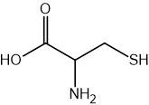

How many carbon atoms in a molecule of cysteine are sp2 hybridised?

### Q2 — easy — 1 marks

**Q2** [1 mark]

How many σ bonds and π bonds are present in a double bond?

|   | **σ bonds** | **π bonds** |
|---|---|---|
| **A** | 0 | 2 |
| **B** | 1 | 1 |
| **C** | 1 | 2 |
| **D** | 2 | 0 |

### Q3 — hard — 1 marks

**Q3** [1 mark]

Limonene is found in the peel of citrus fruits.

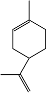

How many σ and π bonds are present in this molecule?

|   | **σ** | **π** |
|---|---|---|
| **A** | 12 | 2 |
| **B** | 22 | 4 |
| **C** | 24 | 4 |
| **D** | 26 | 2 |

### Q4 — easy — 1 marks

**Q4** [1 mark]

What is the hybridisation of the carbon atom in methane?

### Q5 — easy — 1 marks

**Q5** [1 mark]

Which type of bond is formed by the sideways overlap of p orbitals?

### Q6 — hard — 1 marks

**Q6** [1 mark]

What is the bond angle around an sp2 hybridised carbon atom?

### Q7 — medium — 1 marks

**Q7** [1 mark]

What is the minimum number of carbon atoms required to form a chiral acyclic alkane?

### Q8 — easy — 1 marks

**Q8** [1 mark]

Which molecule is a straight-chain hydrocarbon?

### Q9 — easy — 1 marks

**Q9** [1 mark]

How many π bonds are present in one molecule of ethene?

### Q10 — medium — 1 marks

**Q10** [1 mark]

The diagram shows part of the structure of cysteine, an amino acid, with three bond angles labelled.

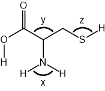

What is the correct order of the bond angles *x*, *y* and *z*, from smallest to largest?

### Q11 — medium — 1 marks

**Q11** [1 mark]

Methyl isocyanate, CH3NCO, is a toxic liquid which is used in the production of adhesives.

The sequence of atoms in a methyl isocyanate molecule is H3C—N=C=O.

What is the approximate angle between the bonds formed by the N atom?

## Structured Questions (5 questions)

### Q1 — hard — 7 marks

**Q1** [2 marks]

The structure of ibuprofen is shown in Fig. 1.1.

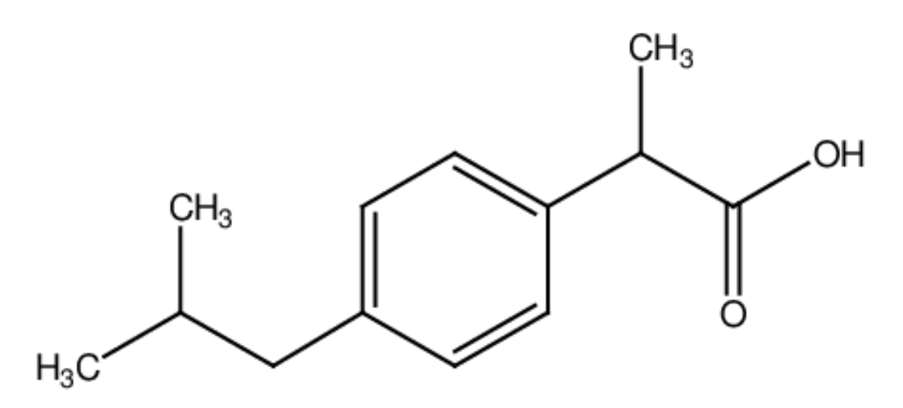

**Fig. 1.1**

State the number of pi (π) bonds and the number of chiral centres in a molecule of ibuprofen.

number of π bonds ..............................

number of chiral centres ..............................

**Q1** [2 marks]

**Extract:**

The structure of ibuprofen is shown in Fig. 1.1.

Fig. 1.1

State the number of sp2 and sp3 hybridised carbon atoms in a molecule of ibuprofen.

sp2 hybridised carbon atoms ..............................

sp3 hybridised carbon atoms ..............................

**Q1** [3 marks]

**Extract:**

The structure of ibuprofen is shown in Fig. 1.1.

Describe and explain the shape of the benzene ring in ibuprofen.

In your answer, include:

- the bond angle between carbon atoms
- the hybridisation of the carbon atoms
- how orbital overlap forms σ and π bonds between the carbon atoms

### Q2 — medium — 16 marks

**Q2** [2 marks]

Gasoline is a mixture of hydrocarbons. Compound **X** is a component of gasoline. The displayed formula of compound **X** is shown in Fig. 2.1.

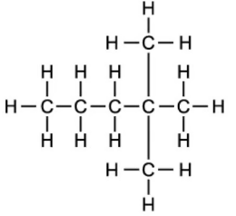

**Fig. 2.1**

i) State the systematic name of compound **X**.

[1]

ii) State the general formula for the homologous series to which compound **X** belongs.

[1]

**Q2** [6 marks]

**Extract:**

Gasoline is a mixture of hydrocarbons. Compound **X** is a component of gasoline. The displayed formula of compound **X** is shown in Fig. 2.1.

**Fig. 2.1**

Compound **X** shown in Fig. 2.1 can react with chlorine in the presence of UV light to form various chlorinated products.

i) Name the mechanism for this reaction.

[1]

ii) Draw the skeletal formulae of the **four** monochlorinated isomers formed when compound **X** reacts with chlorine.

[4]

iii) State the type of structural isomerism shown by the isomers in **(ii)**.

[1]

**Q2** [4 marks]

Fig. 2.2 shows the mechanism for the reaction of aqueous sodium hydroxide with 1-bromopropane.

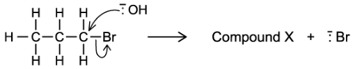

**Fig. 2.2**

i) State the role of the aqueous hydroxide ion in this reaction.

[1]

ii) State the systematic name of compound **X**.

[1]

iii) Under different reaction conditions, 1-bromopropane reacts with hydroxide ions to form propene.

State the conditions required for this reaction and name the mechanism.

[2]

**Q2** [4 marks]

Pentanal reacts with HCN in the presence of NaCN to form 2-hydroxyhexanenitrile as shown in Fig. 2.3.

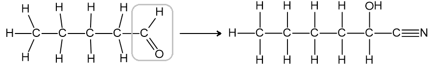

**Fig. 2.3**

i) By reference to hybridisation and orbital overlap, explain why the carbonyl carbon in pentanal is trigonal planar.

[3]

ii) State the shape and bond angle around carbon-2 in 2-hydroxyhexanenitrile.

[1]

### Q3 — medium — 7 marks

**Q3** [3 marks]

By reference to the hybridisation of the carbon atoms and orbital overlap, describe how the σ and π bonds are formed in the triple bond of propyne.

**Q3** [1 mark]

The structure of an organic molecule is shown in Fig. 1.1.

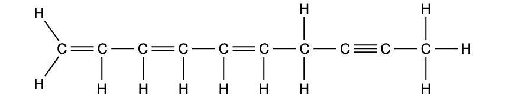

**Fig. 1.1**

State the number of carbon atoms that are sp2 hybridised in this molecule.

**Q3** [3 marks]

Complete Table 1.1 to state the hybridisation of the nitrogen atom in each species.

**Table 1.1**

|   | ** NF****4****+** | **N****2****H****2** | **N****2****H****4** |
|---|---|---|---|
| hybridisation |   |   |   |

### Q4 — easy — 8 marks

**Q4** [1 mark]

The carbon chain of an aliphatic organic molecule can be described as straight-chained.

State two other terms used to describe the arrangement of carbon atoms in an aliphatic organic molecule.

**Q4** [3 marks]

Complete Table 1.1 to state the number of σ and π bonds in each type of hybridised bond.

**Table 1.1**

| hybridisation | number of σ bonds | number of π bonds |
|---|---|---|
| sp3 |   |   |
| sp2 |   |   |
| sp |   |   |

**Q4** [4 marks]

Four compounds are shown in Fig. 1.1.

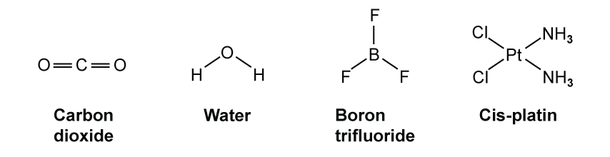

**Fig. 1.1**

Complete Table 1.2 to state the shape and bond angle of each molecule.

**Table 1.2**

| molecule | shape | bond angle / ° |
|---|---|---|
| **carbon dioxide** | linear |   |
| **water** |   | 104.5 |
| **boron trifluoride** |   | 120 |
| **cis-platin** | square planar |   |

### Q5 — medium — 11 marks

**Q5** [2 marks]

Explain why the ring of carbon atoms in cyclohexane, C6H12, is non-planar. In your answer, refer to the hybridisation of the carbon atoms and the C–C–C bond angles.

**Q5** [4 marks]

The structure of urea, CO(NH2)2, is shown in Fig. 3.1.

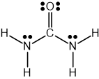

**Fig. 3.1**

Complete Table 3.1 to state the hybridisation and approximate bond angle around the carbon atom and each nitrogen atom in urea.

**Table 3.1**

| atom | hybridisation | approximate bond angle / ° |
|---|---|---|
| carbon |   |   |
| nitrogen |   |   |

**Q5** [4 marks]

State the hybridisation of the carbon atom in methane, CH4. Name the shape of the molecule and explain why it has this shape.

hybridisation:

shape:

explanation:

**Q5** [1 mark]

A molecule of ethanol is shown in Fig. 3.2.

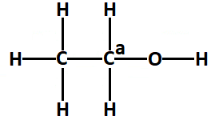

**Fig. 3.2**

State the hybridisation of the carbon atom marked in Fig. 3.2.
