# Mark Schemes — Isomerism: Structural Isomerism & Stereoisomerism
**13. An Introduction to AS Level Organic Chemistry** · Cambridge (CIE) A-LEVEL chemistry (9701)

## Multiple Choice Questions (12 questions)

### Q1
**Final answer:** **The correct answer is A**

- Chain isomers have the same molecular formula but a different length carbon chain due to branching.
- 2,2-dimethylpropane has the same molecular formula as pentane (C5H12), but the longest carbon chain is three carbons long in 2,2-dimethylpropane and five carbons long in pentane.

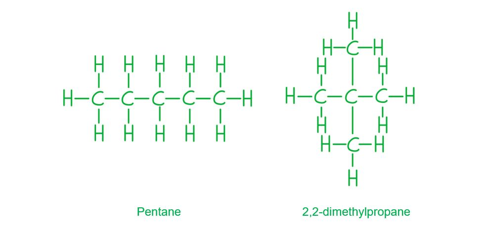

**B** is incorrect as there is not a different functional group in 2,2-dimethylpropane compared to pentane, so it cannot be a functional group isomer.

**C** is incorrect as position isomers have the same carbon skeleton with a substituent at a different position. The carbon chain length changes between pentane and 2,2-dimethylpropane, so they are chain isomers, not position isomers.

**D** is incorrect as 2,2-dimethylpropane does not show stereoisomerism. It has no chiral centre and no restricted double bond.

### Q2
**Final answer:** **The correct answer is D**

- Structural isomers have the atoms arranged in a completely different order.

  - Isomeric esters are esters with a different location of the functional group or different carbon chain arrangement.
- The 9 possible ester structural isomers of C5H10O2 are shown below:

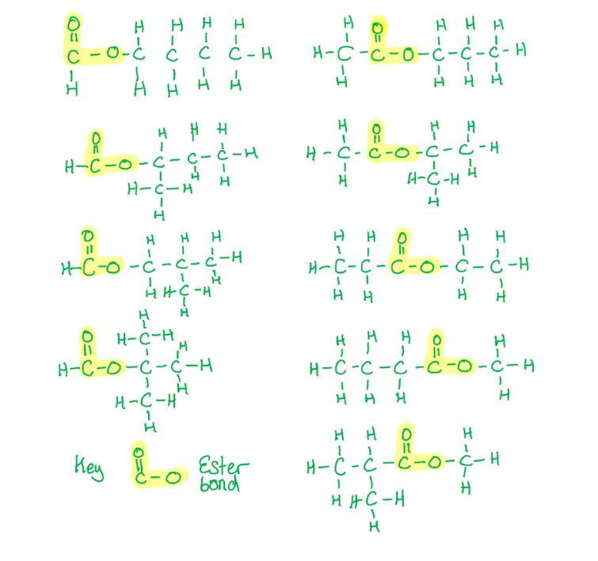

**A** is incorrect as 4 accounts for only the methanoate ester isomers of C5H10O2. The ethanoate, propanoate, and butanoate ester groups must also be considered, giving 9 structural isomers in total.

**B** is incorrect as 5 does not account for all structural isomers of C5H10O2. Both branched and unbranched carbon chains must be considered for each ester group, giving 9 structural isomers in total.

**C** is incorrect as 7 does not include all possible branched-chain arrangements. A systematic approach considering all combinations of ester group and alkyl group, including chain branching in both R and R' groups, gives 9 structural isomers.

### Q3
**Final answer:** **The correct answer is C**

- The question states that it is a *cis* isomer. In a *cis* isomer, the substituents are on the **same** side of the double bond, as shown below.

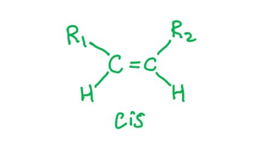

- The cyclohexene ring contains one C=C double bond. There are 4 further C=C double bonds on the aliphatic chain, giving 5 carbon-carbon double bonds in total.

**A** is incorrect as the image shows a *trans* arrangement of substituents around the C11=C12 double bond. 11-*cis* retinal has a *cis* arrangement at this position.

**B** is incorrect as the image shows a *trans* arrangement at C11=C12, and 6 incorrectly includes the C=O double bond of the aldehyde group. Only carbon-carbon double bonds are counted, giving 5.

**D** is incorrect as 6 includes the C=O double bond of the aldehyde group in the count. The question specifies carbon-carbon double bonds only, of which there are 5.

### Q4
**Final answer:** **The correct answer is D**

- Stereoisomers are compounds only different by the **spatial arrangement** of the atoms in the molecule.
- One type of stereoisomerism is **optical isomerism.**

  - These are non-superimposable mirror images of each other around a chiral carbon.
  - A chiral carbon is one with 4 different bonds attached.
  - No carbon atoms in this molecule are chiral.
- Another type of stereoisomerism is **geometric.**

  - This is shown below showing examples of ***cis-trans isomers*** of gamma-linolenic acid.
  - In **trans** isomers, the groups on either side of the double bond are on **different** sides of the double bond plane.
  - In **cis** isomers, the groups on either side of the double bond are on the **same** side of the double bond plane.

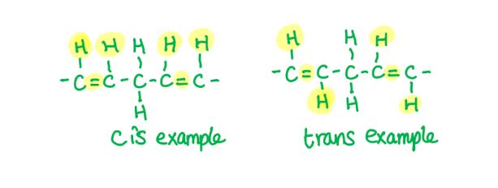

- The maximum number of stereoisomers of gamma-linolenic acid is 8, as the configuration at each double bond can be as follows:

  1. cis, cis, cis
  2. cis, cis, trans
  3. cis, trans, trans
  4. cis, trans, cis
  5. trans, cis, cis
  6. trans, cis, trans
  7. trans, trans, cis
  8. trans, trans, trans

**A** is incorrect as 3 is the number of C=C double bonds in gamma-linolenic acid, not the number of stereoisomers. Each double bond can independently adopt a cis or trans configuration, giving 23 = 8 stereoisomers in total.

**B** is incorrect as 4 would result from considering only 2 of the 3 double bonds as sources of geometric isomerism (22 = 4). All three double bonds in gamma-linolenic acid produce cis/trans isomers.

**C** is incorrect as 6 is not the correct count. The number of stereoisomers is 2n, where n is the number of double bonds giving geometric isomerism. With 3 such double bonds, there are 23 = 8 stereoisomers.

### Q5
**Final answer:** **The correct answer is C**

- When a halogenoalkane reacts with ethanolic NaOH (elimination conditions), dehydrohalogenation occurs.
- Secondary halogenoalkanes undergo both substitution and elimination; the ethanolic solvent favours elimination.
- The following elimination reactions can occur, producing 3 isomeric alkenes:

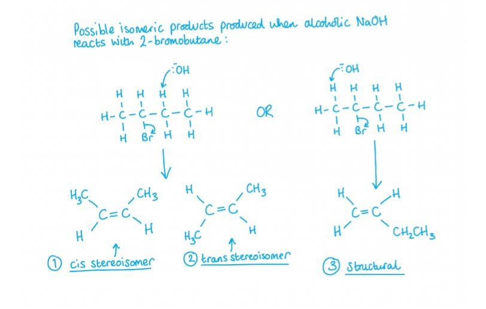

**A** is incorrect as only one product (the major alkene) has been identified, without considering elimination in both directions.

**B** is incorrect as this identifies but-1-ene and but-2-ene as structural isomers but misses that but-2-ene exists as cis and trans stereoisomers.

**D** is incorrect as but-1-ene cannot show cis-trans isomerism. The terminal alkene carbon (=CH2) is bonded to two identical hydrogen atoms, so no geometric isomerism is possible.

### Q6
**Final answer:** **The correct answer is B**

- Structural isomers have the atoms arranged in a completely different order.
- These can be:

  - Chain isomers (branched chains)
  - Position isomers (groups moved on the carbon skeleton)
  - Functional group isomerism (different functional groups and a member of a different homologous series).
- The 5 structural isomers of C3H5Br3 are shown below:

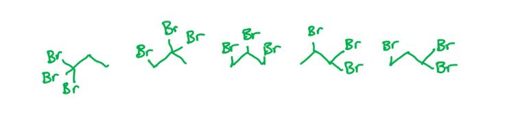

**A** is incorrect as there are more than 4 structural isomers of C3H5Br3. Systematically placing the three bromine atoms at all possible positions on the propane chain gives 5 unique structures.

**C** is incorrect as 6 would involve counting the same structure twice when numbered from opposite ends of the chain. For example, 1,2,2-tribromopropane and 2,2,3-tribromopropane are the same compound. There are only 5 unique structural isomers.

**D** is incorrect as 7 significantly overcounts the structural isomers of C3H5Br3. A systematic approach to placing three bromine atoms at all positions on the propane chain gives only 5 unique structures.

### Q7
**Final answer:** **The correct answer is C**

- Optical isomers are isomers that have the same atoms and bonds but different spatial arrangements of the atoms.

  - The isomers are mirror images of each other and cannot be superimposed over one another (they are enantiomers).

- These are formed when a molecule has a chiral centre.

  - A chiral centre is identified by a carbon atom with 4 different groups/atoms bonded to it.
- Two types of geometric isomers are possible due to the restriction surrounding the C=C double bond.

  - Cis isomers have the functional groups on the same side of the carbon chain.
  - Trans isomers have the functional groups on opposite sides of the carbon chain.

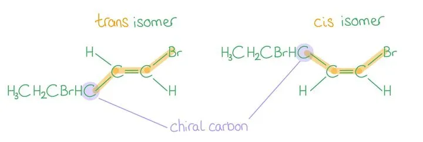

**A** is incorrect as this has cis-trans but no chiral carbons, therefore no optical isomerism.

**B** is incorrect as this has cis-trans but no chiral carbons and therefore no optical isomerism.

**D** is incorrect as this doesn't have cis-trans isomerism.

### Q8
**Final answer:** **The correct answer is C**

- The following **8** carbons are chiral centres:

  - C3 (OH, C4, C2, H).
  - C8 (C9, C14, C7, H).
  - C9 (C10, C8, C11, H).
  - C10 (C5, C9, C1, C19).
  - C13 (C14, C17, C12, C18).
  - C14 (C13, C8, C15, H).
  - C17 (C13, C20, C16, H).
  - C20 (C17, C22, C21, H).

- The 4 different groups that each carbon is bonded to are shown in brackets.

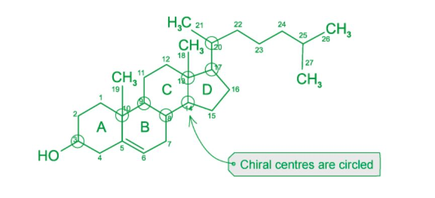

- A chiral centre is an atom that has four different groups bonded to it. Each chiral centre gives rise to 2 optical isomers.
- When trying to find chiral centres, remember the following:

  - Hydrogens are not shown in skeletal drawings, but hydrogens often determine if the carbon is chiral. If a carbon has more than one hydrogen attached, you can dismiss it as a potential chiral centre.
  - Carbons on double or triple bonds cannot be chiral centres because they can't have bonds to 4 **different** groups.
  - Within complex cyclic molecules, each carbon in a ring can be considered as a different group if the overall group it is attached to is different.

**A** is incorrect as there are more than 5 chiral centres in cholesterol. This answer arises from identifying only the most visually obvious stereocentres and missing the ring junction carbons.

**B** is incorrect as one of the tertiary ring junction carbons (C8, C9, or C14) has been missed. These carbons have an implicit hydrogen atom that is not drawn in the skeletal structure.

**D** is incorrect as this overcounts the chiral centres. Carbons in the C=C double bond are sp2 hybridised and cannot be chiral, and C25 at the end of the tail is bonded to two identical methyl groups.

### Q9
**Final answer:** **The correct answer is C**

- This carbon has four different atoms / groups of atoms:

  - A hydrogen atom.
  - A CH2NH2 group.
  - A chlorine atom.
  - A COCH2Cl group.

**A** is incorrect as this carbon has two hydrogen atoms attached.

**B** is incorrect as this carbon does not have four groups attached due to the C=O carbonyl group.

**D** is incorrect as this carbon has two hydrogen atoms attached.

### Q10
**Final answer:** **The correct answer is D**

- The question asks for a molecule that is both chiral and acidic.
- Molecule **D** is acidic due to the carboxylic acid group (COOH).
- Molecule **D** is chiral because the highlighted carbon is bonded to 4 different groups:

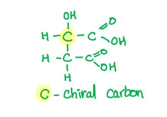

**A** is incorrect as this is 1-methylcyclohexanol, an alcohol, and it is achiral (no carbon atoms with 4 different groups attached to it).

**B** is incorrect as it is acidic but not chiral due to the double bond.

**C** is incorrect as this is chiral but not acidic.

### Q11
**Final answer:** **The correct answer is D**

- There are 6 different isomers of C5H10 that contain a π bond (have a C=C double bond).

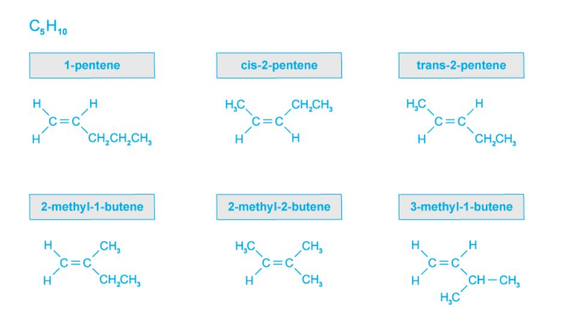

**A** is incorrect as there are more than 3 isomers of C5H10 that contain a π bond. All 5 alkene structural isomers must be identified, and cis-pent-2-ene and trans-pent-2-ene must be counted as separate stereoisomers, giving a total of 6.

**B** is incorrect as 4 is an undercount of the structural isomers of C5H10 that are alkenes. Five structural isomers exist; including cis- and trans-pent-2-ene as separate stereoisomers gives a total of 6.

**C** is incorrect as 5 represents only the number of structural isomers of C5H10 that are alkenes. Cis-pent-2-ene and trans-pent-2-ene are two distinct stereoisomers, so the total is 6.

### Q12
**Final answer:** **The correct answer is D**

- Structural isomers include chain isomers, positional isomers and functional group isomers.
- All of which have the same molecular formula but different structural formula.

**A** is incorrect as this is an incorrect definition. Isomers must have the same molecular formula, not a different one.

**B** is incorrect as this is the definition for stereoisomers, which have the same molecular and structural formula but atoms arranged differently in space.

**C** is incorrect as empirical formula is the smallest whole number ratio of atoms in a compound. Molecular formula is the actual number of atoms of elements in a compound.

## Structured Questions (6 questions)

### Q1
> **[mark-scheme]**
> i) The systematic name of compound **A** is:
> 
> - 4-methylheptan-3-ol **[1 mark]**

ii) One pair of optical isomers of compound **A**:

| 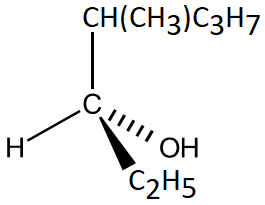 | 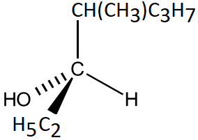 |
|---|---|

**OR**

| 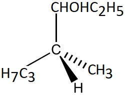 | 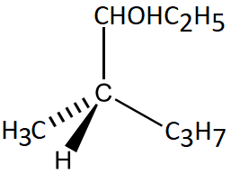 |
|---|---|

**[2 marks]**

> **[mark-scheme]**
> 1 mark for one correct three-dimensional structure of compound **A**
> 
> 1 mark for the second structure drawn as a mirror image of the first

> **[exam-tip]**
> Compound **A** is 4-methylheptan-3-ol. The two chiral centres are at C3 (bonded to OH, H, ethyl group, and the C4-side chain) and C4 (bonded to methyl branch, H, propyl group, and the C3-side chain).
> 
> To draw a pair of optical isomers, arrange the four substituents on one chiral centre in a 3D tetrahedral arrangement using wedge and dash bonds, then draw its non-superimposable mirror image.
The bond(s) responsible for geometrical (cis/trans) isomerism in each compound are:

Compound **B**:

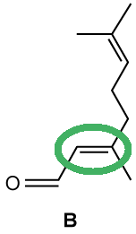

Compound **C**:

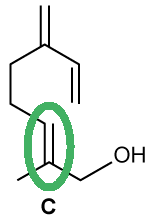

Compound **D**:

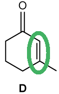

Compound **E**:

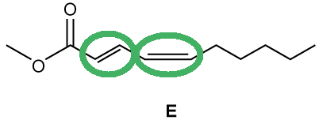

**[3 marks]**

> **[mark-scheme]**
> 1 mark for the correct C=C bond in compound **B** circled and no other C=C bond circled in compound **B**
> 
> 1 mark for the correct C=C bond in compound **C** circled and no other C=C bond circled in compound **C**
> 
> 1 mark for the C=C bond in compound **D** circled **AND **both C=C bonds in compound **E** circled

> **[exam-tip]**
> Not all C=C bonds show geometrical (cis/trans) isomerism. A C=C bond only shows this isomerism if both carbons of the double bond each have two different substituents. If one carbon has two identical groups, that C=C bond cannot show geometrical isomerism.
> **[mark-scheme]**
> i) The mechanism for this reaction is:
> 
> - Electrophilic addition **[1 mark]**

ii) The three-dimensional structures of this pair of stereoisomers are:

| 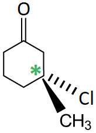 | 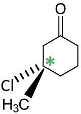 |
|---|---|

**[3 marks]**

> **[mark-scheme]**
> 1 mark for one correct three-dimensional structure of the product
> 
> 1 mark for the second structure drawn as a mirror image of the first
> 
> 1 mark for an asterisk (*) correctly placed on the chiral carbon in one of the structures

> **[exam-tip]**
> Compound **D** is a cyclic alkene. When HCl adds across the C=C bond, the major product (Markovnikov's rule) is 3-chloro-3-methylcyclohexan-1-one, which has a chiral centre at C3.
> 
> The four different groups on C3 are: Cl, CH3, and the two non-equivalent portions of the ring (one side leads to the C=O group; the other does not).
> **[mark-scheme]**
> The type of reaction is:
> 
> - Hydrolysis **[1 mark]**

> **[exam-tip]**
> Compound **E** is a methyl ester. Hydrolysis is the reaction in which the ester bond is broken by water, producing the parent alcohol (methanol) and the carboxylic acid (deca-2,4-dienoic acid). This can occur under acid or alkaline conditions.

### Q2
> **[mark-scheme]**
> The two types of stereoisomerism are:
> 
> - Geometrical (cis/trans)
> **AND**
> Optical **[1 mark]**

> **[exam-tip]**
> Stereoisomers are molecules with the same structural formula but a different arrangement of atoms in 3D space.
> **[mark-scheme]**
> A chiral centre is:
> 
> - A carbon atom that has four different atoms / groups of atoms attached to it **[1 mark]**

> **[exam-tip]**
> Defining a chiral centre is not a common question as the focus is usually on identifying and drawing them. However, you cannot identify or draw chiral centres without knowing this definition.
The three-dimensional structure of the other optical isomer is:

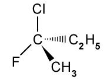

**[1 mark]**

> **[mark-scheme]**
> 1 mark for a correct mirror image of the structure shown in Fig 2.1

> **[exam-tip]**
> Enantiomers are non-superimposable mirror images of each other. To draw the other enantiomer, simply draw the mirror image of the structure given in Fig 2.1.
> **[mark-scheme]**
> The carbon atom labelled **a** is not a chiral centre because:
> 
> - It has two methyl groups attached
> **OR**
> It does not have four different atoms / groups of atoms attached **[1 mark]**

> **[exam-tip]**
> Remember: chiral centres have four different atoms or groups of atoms attached. If any two substituents on a carbon are identical, it cannot be a chiral centre.

### Q3
> **[mark-scheme]**
> The three types of structural isomerism are:
> 
> - Chain (isomerism) **[1 mark]**
> - Positional (isomerism) **[1 mark]**
> - Functional group (isomerism) **[1 mark]**

> **[exam-tip]**
> Structural isomers are compounds that have the same molecular formula but different structural formulae.
> 
> You should know the three different types and be prepared to determine the possible structural formulae of an organic molecule given its molecular formula.
> **[mark-scheme]**
> i) The type of structural isomerism shown by 2-methylpentane and 2,3-dimethylbutane is:
> 
> - Chain (isomerism) **[1 mark]**
> 
> ii) The type of structural isomerism shown by butan-1-ol and butan-2-ol is:
> 
> - Positional (isomerism) **[1 mark]**

> **[exam-tip]**
> Chain isomers have the same molecular formula but different longest carbon chain lengths because a section of the chain has been branched off.
> 
> Positional isomers arise from differences in the position of a functional group along the carbon chain. Both butan-1-ol and butan-2-ol are C4H10O alcohols but the –OH group is on a different carbon.
> **[mark-scheme]**
> i) The systematic name of compound **B** is:
> 
> - Butanoic acid **[1 mark]**
> 
> ii) The type of structural isomerism shown by compounds **A** and **D** is:
> 
> - Functional group isomerism **[1 mark]**
> 
> iii) The type of structural isomerism shown by compounds **C** and **E** is:
> 
> - Chain isomerism **[1 mark]**

> **[exam-tip]**
> Compound **B** has four carbons (but–), single carbon–carbon bonds (–an–) and a carboxylic acid functional group (–oic acid). This gives the systematic name butanoic acid.
> 
> Compounds **A** (a ketone) and **D** (an aldehyde) are functional group isomers. Both have the molecular formula C4H8O but the C=O group has moved from within the chain to the terminal position, changing the functional group.
> 
> Compounds **C** and **E** are chain isomers. Both are C4H10O alcohols but one has a branched carbon chain and the other is straight-chain.

### Q4
The completed table is:

| **Compound** | **Displayed formula** | **Skeletal formula** |
|---|---|---|
| **1. ***Z*-2-chloro-but-2-en-1-ol | 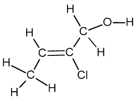 | 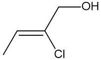 |
| **2. **2-chloropropanal | 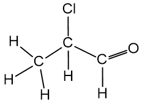 | 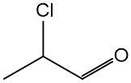 |
| **3. **3-bromo-2-methylpropan-1-ol | 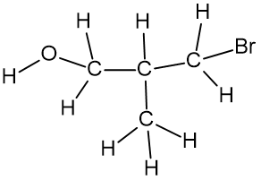 | 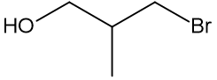 |
| **4. **3-methyl-but-2-enoic acid | 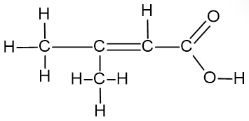 | 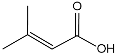 |

**[3 marks]**

> **[mark-scheme]**
> 1 mark for compound 2 displayed formula correct **AND** compound 2 skeletal formula correct
> 
> 1 mark for compound 3 systematic name correct **AND** compound 3 skeletal formula correct
> 
> 1 mark for compound 4 systematic name correct **AND** compound 4 displayed formula correct

> **[exam-tip]**
> For compound 2 (2-chloropropanal):
> 
> - The -prop- portion tells you the main carbon chain is 3 carbons long
> - The -an- portion tells you the main chain contains only single bonds
> - The -al suffix tells you carbon-1 is an aldehyde (CHO) group
> - The 2-chloro portion tells you there is a chlorine atom attached to carbon-2
> - A common mistake when drawing the skeletal formula of any aldehyde is to forget the hydrogen atom attached to the carbonyl (C=O) bond
> 
> For compound 3 (3-bromo-2-methylpropan-1-ol):
> 
> - The main carbon chain is 3 carbons with single bonds, so the name is propane-based
> - There is an alcohol group, a methyl group and a bromine group
> - The alcohol is highest priority, so it is on carbon-1: propan-1-ol
> - The methyl group is second highest priority: 2-methylpropan-1-ol
> - The bromine group is lowest priority: 3-bromo-2-methylpropan-1-ol
> - For the skeletal formula: re-draw the displayed formula, remove the carbon symbols (angling the chain to show structure clearly), then remove all hydrogen atoms except the one attached to the oxygen
> 
> For compound 4 (3-methylbut-2-enoic acid):
> 
> - The longest carbon chain is 4 carbons, so the name is but-based
> - The carboxylic acid group is automatically carbon-1: butanoic acid
> - There is a C=C double bond at carbon-2: but-2-enoic acid
> - There is a methyl group on carbon-3: 3-methylbut-2-enoic acid
> - For the displayed formula: re-draw the skeletal formula, place carbon symbols at each junction and chain end, then add the correct number of hydrogen atoms to each carbon — take care around double bonds as carbon has a maximum of 4 bonds
> **[mark-scheme]**
> The empirical formula of compound **1** is:
> 
> - C4H7ClO **[1 mark]**

> **[exam-tip]**
> The empirical formula gives the simplest whole number ratio of atoms of each element in a compound.
> 
> The molecular formula of compound 1, found by counting all atoms in the structure, is C4H7ClO. Since this cannot be simplified further, the empirical formula is the same as the molecular formula.
> **[mark-scheme]**
> Compound **1** shows geometrical (cis/trans) isomerism but compound **4** does not because:
> 
> - There is no free rotation about the C=C / carbon-carbon double bond **[1 mark]**
> - Due to the presence of a π bond **[1 mark]**
> - The C=C of compound **1** has different atoms / groups on each carbon **[1 mark]**
> - The C=C of compound **4** has two identical groups / methyl groups on one carbon **[1 mark]**

> **[exam-tip]**
> For an alkene to show geometrical (cis/trans) isomerism, each carbon of the C=C double bond must have two different atoms or groups attached.
> 
> Compound 1 has a hydrogen atom and a methyl group at one end of the C=C, and a chlorine atom and a CH2OH group at the other end. Both ends have two different groups, so compound 1 shows geometrical isomerism.
> 
> Compound 4 has two methyl groups at one end of the C=C. Because this end has two identical groups, geometrical isomerism is not possible.
> 
> The isomerism arises because the π bond system above and below the σ bond prevents free rotation about the C=C.
> **[mark-scheme]**
> i) The type of stereoisomerism shown by compounds **2** and **3** is:
> 
> - Optical (isomerism) **[1 mark]**
> 
> ii) Compound **2** shows optical isomerism because:
> 
> - There is a carbon atom with four different atoms or groups of atoms attached **[1 mark]**
> - The two molecules are non-superimposable mirror images of each other **[1 mark]**

iii) The three-dimensional structures of the two optical isomers of compound **2** are:

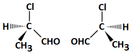

**[1 mark]**

> **[mark-scheme]**
> 1 mark for two correct three-dimensional structures drawn as non-superimposable mirror images

> **[exam-tip]**
> A chiral centre is a carbon atom with four different atoms or groups of atoms attached to it.
> 
> Optical isomerism arises because the four different groups can be arranged in two orientations that are non-superimposable mirror images of each other.
> 
> 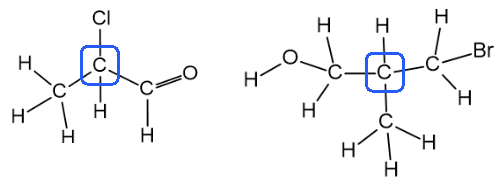
> 
> Compounds 2 and 3 both contain chiral centres, as shown in the diagram above.

### Q5
> **[mark-scheme]**
> i) The systematic name of the unbranched alkane with the fewest carbon atoms that shows structural isomerism is:
> 
> - Butane **[1 mark]**
> 
> ii) The type of structural isomerism shown is:
> 
> - Chain / branched chain **[1 mark]**

> **[exam-tip]**
> The three types of structural isomerism are chain isomerism, positional isomerism and functional group isomerism.
> 
> A straight-chain alkane cannot show functional group isomerism because the molecule is saturated. This means you are looking for chain or positional isomerism.
> 
> Methane, ethane and propane cannot have chain or positional isomers as their chains are too short. Butane is the first straight-chain alkane long enough to rearrange:
> 
> - Taking a methyl group from the main chain leaves a 3-carbon chain
> - Placing the methyl group on carbon-2 gives 2-methylpropane, a chain isomer of butane
> 
> 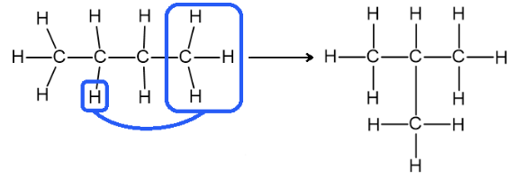
> **[mark-scheme]**
> i) The homologous series that C4H8 belongs to is:
> 
> - Alkenes **[1 mark]**
> 
> Cycloalkanes is also accepted

ii) The skeletal formulae are:

Cyclic isomers

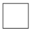

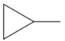

Isomers showing geometrical (cis/trans) isomerism

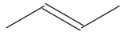

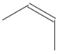

**[4 marks]**

> **[mark-scheme]**
> 1 mark for each correct skeletal formula drawn:
> 
> - Cyclobutane
> - Methylcyclopropane
> - (E)-but-2-ene
> - (Z)-but-2-ene

> **[mark-scheme]**
> iii) The two unsaturated C4H8 isomers that do not show geometrical (cis/trans) isomerism are:
> 
> - But-1-ene **[1 mark]**
> - Methylpropene **[1 mark]**
> 
> These isomers do not show geometrical (cis/trans) isomerism because one carbon of the C=C has two identical atoms or groups attached **[1 mark]**

> **[exam-tip]**
> The general formula CnH2n matches both alkenes and cycloalkanes, so C4H8 belongs to both homologous series.
> 
> For cyclic isomers of C4H8, there are exactly two possibilities:
> 
> - A 4-membered ring: cyclobutane
> - A 3-membered ring with a methyl substituent: methylcyclopropane
> 
> For unsaturated (alkene) isomers, draw out all possibilities and check each for geometrical isomerism. An alkene shows geometrical (cis/trans) isomerism only if both carbons of the C=C have two different atoms or groups attached.
> 
> But-1-ene has two hydrogen atoms on carbon-1 of the C=C, so geometrical isomerism is not possible.
> 
> Methylpropene has two methyl groups on one carbon of the C=C, so geometrical isomerism is not possible:
> 
> 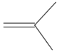
The displayed formulae and chiral centres are:

2,4-dimethylhexan-3-ol

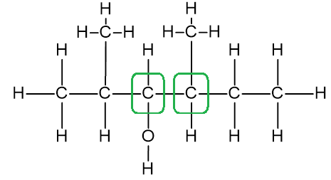

**[3 marks]**

> **[mark-scheme]**
> 1 mark for correct displayed formula including the O–H bond
> 
> 1 mark for chiral centre on carbon-3 identified with an asterisk
> 
> 1 mark for chiral centre on carbon-4 identified with an asterisk

3-chloro-2,4-dimethylpentane

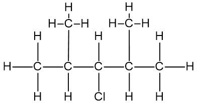

**[1 mark]**

> **[mark-scheme]**
> 1 mark for correct displayed formula (no chiral centres are present in this compound)

2-aminobutane

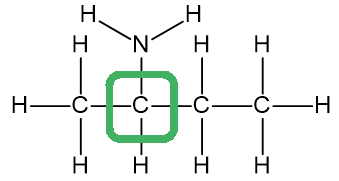

**[2 marks]**

> **[mark-scheme]**
> 1 mark for correct displayed formula including the N–H bonds
> 
> 1 mark for chiral centre on carbon-2 identified with an asterisk

> **[exam-tip]**
> A chiral centre is a carbon atom with four different atoms or groups of atoms attached. Identify these with an asterisk (*).
> 
> When drawing displayed formulae, show all bonds, including C–H, O–H and N–H bonds.
> 
> For 2,4-dimethylhexan-3-ol: carbon-2 is not chiral as it is bonded to two identical methyl groups (from carbon-1 and the 2-methyl branch). Carbons 3 and 4 each have four different groups attached, so both are chiral centres.
> 
> For 3-chloro-2,4-dimethylpentane: carbon-3 is bonded to a chlorine atom, a hydrogen atom and two identical isopropyl groups, so it is not a chiral centre. This compound has no chiral centres.
> 
> For 2-aminobutane: carbon-2 is bonded to H, NH2, CH3 and CH2CH3, all different, so it is a chiral centre.
> 
> Some mark schemes accept functional group shorthand (OH, NH2) rather than explicitly showing all bonds.
The three-dimensional structures of the two optical isomers of 1-bromopropan-1-ol are:

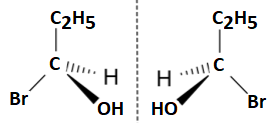

**[2 marks]**

> **[mark-scheme]**
> 1 mark for a correct three-dimensional structure of one enantiomer
> 
> 1 mark for a second enantiomer shown as a non-superimposable mirror image of the first

> **[exam-tip]**
> Other three-dimensional representations are acceptable as the placement of the four different groups in the first enantiomer can vary.
> 
> For 1-bromopropan-1-ol, the chiral carbon has four different groups: H, Br, OH and an ethyl group (CH2CH3).
> 
> The second enantiomer must always be drawn as a non-superimposable mirror image of the first.

### Q6
The displayed formulae of butan-2-ol and its positional isomer are:

Butan-2-ol

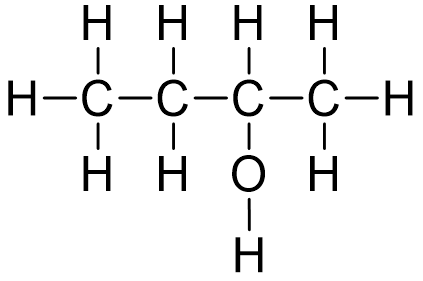

**[1 mark]**

Butan-1-ol (positional isomer)

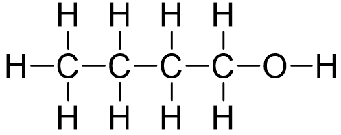

**[1 mark]**

> **[mark-scheme]**
> 1 mark for correct displayed formula of butan-2-ol including the O–H bond
> 
> 1 mark for correct displayed formula of butan-1-ol including the O–H bond

> **[exam-tip]**
> The structure of butan-2-ol can be read from its name:
> 
> - But- = 4 carbon atoms in the main chain
> - -an- = all carbon-carbon single bonds
> - -2-ol = a hydroxyl group on carbon-2
> 
> The positional isomer of butan-2-ol has the hydroxyl group on carbon-1, giving butan-1-ol.
> 
> When drawing a displayed formula, show all bonds, including the bond between the oxygen and hydrogen atoms in the hydroxyl group.
> **[mark-scheme]**
> The two branched-chain structural isomers of butan-2-ol are:
> 
> - 2-methylpropan-1-ol **[1 mark]**
> - 2-methylpropan-2-ol **[1 mark]**

> **[exam-tip]**
> A branched-chain isomer has the same molecular formula as butan-2-ol but a shorter main chain with a methyl branch.
> 
> To find the branched-chain isomers, reduce the main chain from 4 carbons to 3 and consider where the removed methyl group can be placed:
> 
> - Moving a methyl from carbon-1 gives 2-methylpropan-1-ol
> - Moving a methyl from carbon-4 gives 2-methylpropan-2-ol
> 
> Take care not to count different orientations (branch pointing up vs. down) as different isomers. The true test is to name each structure: a genuine isomer will have a different systematic name.
> **[mark-scheme]**
> The positional isomer of butan-2-ol (butan-1-ol) does not show stereoisomerism because:
> 
> - It does not contain a C=C / carbon-carbon double bond
> **AND**
> so cannot show geometrical (cis/trans) isomerism **[1 mark]**
> - It does not contain a chiral centre
> **AND**
> so cannot show optical isomerism **[1 mark]**

> **[exam-tip]**
> Stereoisomerism has two types: geometrical (cis/trans) isomerism and optical isomerism.
> 
> Geometrical (cis/trans) isomerism requires a C=C double bond with two different groups on each carbon of the double bond.
> 
> Optical isomerism requires a chiral centre: a carbon atom with four different atoms or groups attached.
> 
> Butan-1-ol contains only single bonds and its carbon-1 has two hydrogen atoms attached, so it meets neither condition for stereoisomerism.
