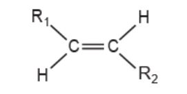
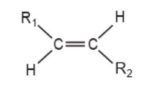
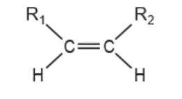
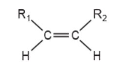
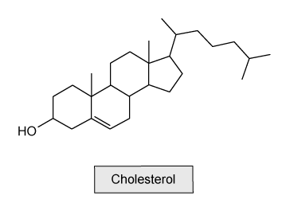
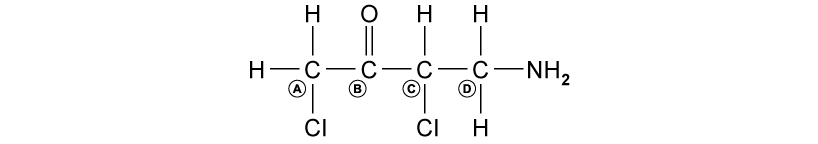
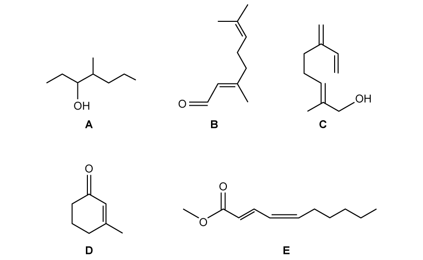
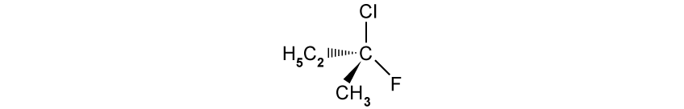
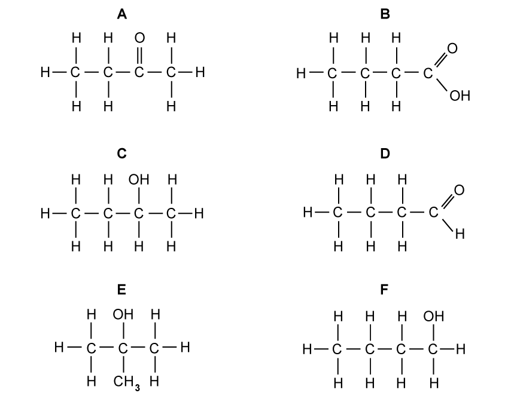

# Exam Questions — Isomerism: Structural Isomerism & Stereoisomerism
**13. An Introduction to AS Level Organic Chemistry** · Cambridge (CIE) A-LEVEL chemistry (9701)
> Source: [https://www.savemyexams.com/a-level/chemistry/cie/25/topic-questions/](https://www.savemyexams.com/a-level/chemistry/cie/25/topic-questions/) · 18 questions across 2 sets

## Multiple Choice Questions (12 questions)

### Q1 — easy — 1 marks

**Q1** [1 mark]

Pentane and 2,2-dimethylpropane are isomers.

Which type of isomerism exists between these two molecules?

### Q2 — medium — 1 marks

**Q2** [1 mark]

How many structural isomers with the molecular formula C5H10O2 are esters?

### Q3 — medium — 1 marks

**Q3** [1 mark]

11-*cis* retinal, C20H28O, is found in the retina of animal eyes and is required for vision. The molecule contains an aldehyde group, a cyclohexene ring and an aliphatic side chain. Within the side chain, there is a double bond between carbons 11 and 12.

Which row shows the correct information for 11-*cis* retinal?

|   | **Arrangement of atoms around the adjacent carbons 11 and 12 ** | **Total number of carbon-carbon double bonds** |
|---|---|---|
| **A** |  | 5 |
| **B** |  | 6 |
| **C** |  | 5 |
| **D** |  | 6 |

### Q4 — medium — 1 marks

**Q4** [1 mark]

Gamma-linolenic acid is an active compound found in evening primrose oil.

CH3(CH2)4CH=CHCH2CH=CHCH2CH=CH(CH2)4COOH

What is the maximum number of stereoisomers of gamma-linolenic acid?

### Q5 — hard — 1 marks

**Q5** [1 mark]

How many isomeric alkenes, including stereoisomers, are produced when 2-bromobutane is heated with ethanolic NaOH?

### Q6 — medium — 1 marks

**Q6** [1 mark]

How many structural isomers have the molecular formula C3H5Br3?

### Q7 — easy — 1 marks

**Q7** [1 mark]

Which compound exhibits both optical and geometrical isomerism?

### Q8 — hard — 1 marks

**Q8** [1 mark]

Cholesterol is a biological molecule used in the production of steroid hormones.

How many chiral centres are there in one molecule of cholesterol?

### Q9 — easy — 1 marks

**Q9** [1 mark]

Which labelled carbon atom is a chiral centre?

### Q10 — hard — 1 marks

**Q10** [1 mark]

Which compound is both chiral and acidic?

### Q11 — hard — 1 marks

**Q11** [1 mark]

How many isomers, including structural and stereoisomers, with the molecular formula C5H10 contain a π bond?

### Q12 — easy — 1 marks

**Q12** [1 mark]

Which statement defines **structural isomers**?

## Structured Questions (6 questions)

### Q1 — hard — 11 marks

**Q1** [3 marks]

The organic compounds in **Fig. 1.1** are shown below.

**Fig. 1.1**

i) State the systematic name of compound **A**.

[1]

ii) Compound **A** has two chiral centres.

Draw the three-dimensional structures of one pair of optical isomers of compound **A**.

[2]

**Q1** [3 marks]

**Extract:**

The organic compounds in **Fig. 1.1** are shown below.

{align=center} **Fig. 1.1**

Compounds **B**, **C**, **D** and **E** all show the same type of stereoisomerism.

On **Fig. 1.1**, circle the bond(s) in each molecule that are responsible for this isomerism.

**Q1** [4 marks]

**Extract:**

The organic compounds in **Fig. 1.1** are shown below.

{align=center} **Fig. 1.1**

Compound **D** reacts with hydrogen chloride to form two products.

i) Name the mechanism for this reaction.

[1]

ii) One of the products formed exists as a pair of stereoisomers.

Draw the three-dimensional structures of this pair of stereoisomers. Identify the chiral centre with an asterisk (*) on one of your structures.

[3]

**Q1** [1 mark]

**Extract:**

The organic compounds in **Fig. 1.1** are shown below.

{align=center} **Fig. 1.1**

Name the type of reaction that occurs when compound **E** reacts to form methanol and deca-2,4-dienoic acid.

### Q2 — easy — 4 marks

**Q2** [1 mark]

State the two types of stereoisomerism.

**Q2** [1 mark]

Explain what is meant by the term *chiral centre*.

**Q2** [1 mark]

The structure of one optical isomer of a chlorofluorocarbon is shown in Fig 2.1.

**Fig 2.1**

Draw the three-dimensional structure of the other optical isomer.

**Q2** [1 mark]

**Extract:**

A chiral centre is:

- A carbon atom that has four different atoms / groups of atoms attached to it

The skeletal formula of a halogenoalkane is shown in Fig 2.2.

**Fig 2.2**

Explain why the carbon atom labelled **a** is not a chiral centre.

### Q3 — easy — 8 marks

**Q3** [3 marks]

State the **three** different types of structural isomerism.

**Q3** [2 marks]

State the type of **structural** isomerism that occurs between the following pairs of compounds.

i) 2-methylpentane and 2,3-dimethylbutane.

[1]

ii) butan-1-ol and butan-2-ol

[1]

**Q3** [3 marks]

Compounds **A** to **F** are shown in **Fig 1.1**.

**Fig 1.1**

i) State the systematic name of compound **B**.

[1]

ii) State the type of structural isomerism shown by compounds **A** and **D**.

[1]

iii) State the type of structural isomerism shown by compounds **C** and **E**.

[1]

### Q4 — medium — 12 marks

**Q4** [3 marks]

Table 1.1 shows information about four organic compounds.

**Table 1.1**

| **Compound** | **Displayed formula** | **Skeletal formula** |
|---|---|---|
| **1. ***Z*-2-chloro-but-2-en-1-ol |  |  |
| **2. **2-chloropropanal |   |   |
| **3. **  ** **  ** **  ** ** |  |   |
| **4. **  ** **  ** **  ** ** |   |  |

Complete Table 1.1.

**Q4** [1 mark]

**Extract:**

Table 1.1 shows information about four organic compounds.

| **Compound** | **Displayed formula** | **Skeletal formula** |
| --- | :---: | :---: |
| **1. ***Z*-2-chloro-but-2-en-1-ol | | |

State the empirical formula of compound **1**.

**Q4** [4 marks]

**Extract:**

Table 1.1 shows information about four organic compounds.

**Table 1.1**

| **Compound** | **Displayed formula** | **Skeletal formula** |
| --- | :---: | :---: |
| **1. ***Z*-2-chloro-but-2-en-1-ol |  |  |
| **2. **2-chloropropanal |   |   |
| **3. **** **** **** ** |  |   |
| **4. **** **** **** ** |   |  |

Explain why compound **1** shows geometrical (cis/trans) isomerism but compound **4** does not.

**Q4** [4 marks]

**Extract:**

Table 1.1 shows information about four organic compounds.

| **Compound** | **Displayed formula** | **Skeletal formula** |
| --- | :---: | :---: |
| **1. ***Z*-2-chloro-but-2-en-1-ol | | |
| **2. **2-chloropropanal | | |
| **3. **3-bromo-2-methylpropan-1-ol | | |
| **4. **3-methyl-but-2-enoic acid | | |

Compounds **2** and **3** both show the same type of stereoisomerism.

i) State the type of stereoisomerism shown by compounds **2** and **3**.

[1]

ii) Explain why compound **2** shows this type of stereoisomerism.

[2]

iii) Draw the three-dimensional structures of the two optical isomers of compound **2**.

[1]

### Q5 — medium — 18 marks

**Q5** [2 marks]

i) State the systematic name of the unbranched alkane with the fewest carbon atoms that shows structural isomerism.

[1]

ii) State the type of isomerism shown by the isomers in part (i).

[1]

**Q5** [8 marks]

C4H8 exists as several isomers.

i) Name the homologous series that C4H8 belongs to.

[1]

ii) Draw the skeletal formulae of **two** cyclic C4H8 isomers and **two** C4H8 isomers that show geometrical (cis/trans) isomerism.

[4]

iii) There are **two** unsaturated C4H8 isomers that do **not** show geometrical (cis/trans) isomerism. Name these isomers and explain why they do not show geometrical (cis/trans) isomerism.

[3]

**Q5** [6 marks]

Draw the displayed formulae of the following compounds and, where appropriate, identify any chiral centres with an asterisk (*).

- 2,4-dimethylhexan-3-ol
- 3-chloro-2,4-dimethylpentane
- 2-aminobutane

**Q5** [2 marks]

Draw the three-dimensional structures of the two optical isomers of 1-bromopropan-1-ol.

### Q6 — medium — 6 marks

**Q6** [2 marks]

Draw the displayed formula of butan-2-ol and the positional isomer of butan-2-ol.

**Q6** [2 marks]

State the systematic names of the two branched-chain structural isomers of butan-2-ol.

**Q6** [2 marks]

**Extract:**

Draw the displayed formula of butan-2-ol and the positional isomer of butan-2-ol.

The positional isomer of butan-2-ol is butan-1-ol.

Explain why the positional isomer of butan-2-ol does not show stereoisomerism.
