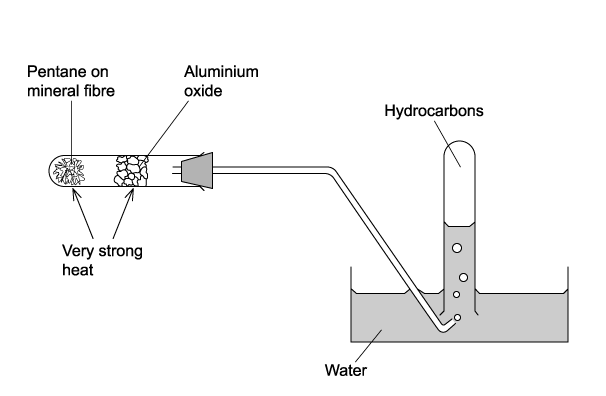
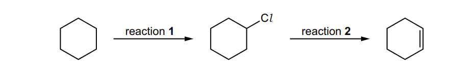
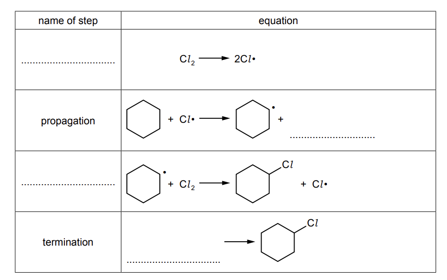

# Exam Questions — Alkanes
**14. Hydrocarbons** · Cambridge (CIE) A-LEVEL chemistry (9701)
> Source: [https://www.savemyexams.com/a-level/chemistry/cie/25/topic-questions/](https://www.savemyexams.com/a-level/chemistry/cie/25/topic-questions/) · 17 questions across 2 sets

## Multiple Choice Questions (11 questions)

### Q1 — medium — 1 marks

**Q1** [1 mark]

Which statement about the free-radical substitution of ethane with chlorine is correct?

### Q2 — medium — 1 marks

**Q2** [1 mark]

Which hydrocarbon would **not** be collected in the inverted tube by heating pentane, CH3(CH2)3CH3, in the apparatus shown?

### Q3 — easy — 1 marks

**Q3** [1 mark]

The hydrocarbon C17H36 can be cracked.

Which compound is the **least** likely to be produced in this reaction?

### Q4 — easy — 1 marks

**Q4** [1 mark]

Which equation represents a valid propagation step in the free radical reaction between ethane and chlorine?

### Q5 — easy — 1 marks

**Q5** [1 mark]

One of the reactions taking place in a catalytic converter in a car exhaust system is between nitrogen oxide and octane (unburned petrol). The products of this reaction are non-toxic.

Which is the correct equation for the reaction?

### Q6 — hard — 1 marks

**Q6** [1 mark]

The petrol additive tetraethyl-lead (IV), Pb(C2H5)4, is now banned in many countries. When it is completely burned in air, lead (II) oxide, CO2 and H2O are formed.

How many moles of oxygen are required to burn one mole of Pb(C2H5)4?

### Q7 — easy — 1 marks

**Q7** [1 mark]

In the presence of ultraviolet light, ethane and chlorine react to give a mixture of products.

Which compound could be present in the mixture of products?

### Q8 — hard — 1 marks

**Q8** [1 mark]

The cracking of eicosane, C20H42, produces a hydrocarbon that is in very high demand for transportation and also three consecutive members of the same homologous series of hydrocarbons.

What are the correct products of cracking for the given reaction?

### Q9 — medium — 1 marks

**Q9** [1 mark]

0.200 mol of a hydrocarbon undergoes complete combustion to give 35.2 g of carbon dioxide and 14.4 g of water as the only products.

What is the molecular formula of the hydrocarbon?

### Q10 — hard — 1 marks

**Q10** [1 mark]

Samples of 10 cm3 of each of the first four members of the alkane series are separately mixed with 70 cm3 of oxygen. Each is then burned and the total volume, *V*, of residual gas measured again at room temperature and pressure.

Which graph represents the results that would be obtained?

### Q11 — medium — 1 marks

**Q11** [1 mark]

The cracking of a single hydrocarbon molecule, CnH2n+2, produces two hydrocarbon molecules only. Each hydrocarbon product contains the same number of carbon atoms in one molecule.  Each hydrocarbon product has non-cyclic structural isomers.

What is the value of n?

## Structured Questions (6 questions)

### Q1 — hard — 8 marks

**Q1** [2 marks]

1,2-dibromoethane reacts with bromine in the presence of ultraviolet light to produce a mixture of further substituted halogenoalkanes.

i) Construct an equation for the initiation step of this reaction.

[1]

ii) Explain why the bond breaking in the initiation step is described as homolytic fission.

[1]

**Q1** [2 marks]

**Extract:**

1,2-dibromoethane reacts with bromine in the presence of ultraviolet light to produce a mixture of further substituted halogenoalkanes.

Construct two equations to show the propagation steps in this mechanism that produce 1,1,2-tribromoethane.

**Q1** [2 marks]

**Extract:**

1,2-dibromoethane reacts with bromine in the presence of ultraviolet light to produce a mixture of further substituted halogenoalkanes.

The two propagation steps are:
- CH₂BrCH₂Br + Br• → CH₂BrCHBr• + HBr
- CH₂BrCHBr• + Br₂ → CH₂BrCHBr₂ + Br•

Traces of 1,2,3,4-tetrabromobutane are found in the reaction mixture.

i) Construct an equation for the termination step that forms 1,2,3,4-tetrabromobutane.

[1]

ii) Construct an equation to show the overall reaction for the formation of hexabromoethane from 1,1,2-tribromoethane.

[1]

**Q1** [2 marks]

**Extract:**

1,2-dibromoethane reacts with bromine in the presence of ultraviolet light to produce a mixture of further substituted halogenoalkanes.

Suggest two reasons why free-radical substitution is not a good method for producing a single, pure halogenoalkane.

### Q2 — medium — 9 marks

**Q2** [1 mark]

A reaction scheme involving cyclohexane is shown in Fig. 1.1.

**Fig. 1.1.**

Reaction **1** involves a free radical substitution mechanism.

State the essential condition required for reaction **1** to occur.

*Source: 2022 Specimen Paper 2 Q4A*

**Q2** [5 marks]

**Extract:**

A reaction scheme involving cyclohexane is shown in Fig. 1.1.

Reaction 1 involves a free radical substitution mechanism.

Complete Table 1.1 to give details of the mechanism in reaction **1**. Include curly arrows to show the movement of electrons occurring in the termination step.

**Table 1.1**

*Source: 2022 Specimen Paper 2 Q4B*

**Q2** [1 mark]

**Extract:**

A reaction scheme involving cyclohexane is shown in Fig. 1.1.

Reaction scheme: cyclohexane converted by reaction 1 to chlorocyclohexane, then by reaction 2 to cyclohexene with a double bond in the ring

Fig. 1.1.

Deduce the type of reaction that occurs in reaction **2.**

*Source: 2022 Specimen Paper 2 Q4C*

**Q2** [2 marks]

Hex-3-ene is an isomer of cyclohexane. Hex-3-ene can be converted into propanoic acid.

hex-3-ene $\overset{\mathrm{reaction}3}{\rightarrow}$ propanoic acid

Deduce the reagents and conditions for reaction **3.**

*Source: 2022 Specimen Paper 2 Q4D*

### Q3 — medium — 9 marks

**Q3** [2 marks]

i) Explain what is meant by the term *cracking*.

[1]

ii) Suggest why cracking is a useful process in the petroleum industry.

[1]

**Q3** [3 marks]

i) State the reagent and conditions required for the cracking of alkanes.

[2]

ii) Construct an equation for the cracking of tetradecane, C14H30, to form heptane, C7H16, and two other organic products.

[1]

**Q3** [3 marks]

The combustion of octane, C8H18, in internal combustion engines produces a mixture of pollutants, including carbon monoxide, nitrogen monoxide and unburnt hydrocarbons.

i) State one adverse effect of carbon monoxide on human health.

[1]

ii) State one environmental consequence of releasing nitrogen monoxide / oxides of nitrogen into the atmosphere.

[1]

iii) State one environmental consequence of releasing unburnt hydrocarbons into the atmosphere.

[1]

**Q3** [1 mark]

Construct an equation to demonstrate how a catalytic converter removes carbon monoxide and nitrogen monoxide from exhaust gases.

### Q4 — medium — 12 marks

**Q4** [5 marks]

Methane reacts with chlorine gas under suitable conditions to form chloromethane.

i) Name the mechanism that occurs in this reaction.

[1]

ii) Two test tubes are set up, each containing a small amount of methane and pale green chlorine gas. One test tube is left in the dark, whereas the other is placed in direct sunlight.

State and explain the observations in each test tube.

[3]

iii) Construct an equation for the overall reaction that occurs in the sunlight.

[1]

**Q4** [4 marks]

**Extract:**

Methane reacts with chlorine gas under suitable conditions to form chloromethane.

The mechanism for this reaction involves an initiation step.

i) Name the type of bond breaking that occurs in the initiation step. Explain what happens to the electrons in the bond.

[2]

ii) Explain what is meant by the term *free radical*.

[1]

iii) Suggest why the Cl–Cl bond is broken in the initiation step rather than the C–H bond.

[1]

**Q4** [3 marks]

**Extract:**

Methane reacts with chlorine gas under suitable conditions to form chloromethane.

i) Name the mechanism that occurs in this reaction.

The mechanism is:
- Free-radical substitution

The mechanism also involves propagation and termination steps.

i) Construct two equations to show the propagation steps in this mechanism.

[2]

ii) Construct an equation to show one possible termination step.

[1]

### Q5 — easy — 8 marks

**Q5** [2 marks]

Explain why alkanes are generally unreactive.

**Q5** [2 marks]

Methane reacts with chlorine to produce chloromethane, CH3Cl. The reaction is initiated by the formation of chlorine free radicals.

i) Explain what is meant by the term *free radical*.

[1]

ii) State the condition required to form chlorine free radicals from Cl2.

[1]

**Q5** [1 mark]

**Extract:**

Methane reacts with chlorine to produce chloromethane, CH~3~Cl. The reaction is initiated by the formation of chlorine free radicals.

Name the type of bond fission that occurs in the initiation step.

**Q5** [3 marks]

**Extract:**

Methane reacts with chlorine to produce chloromethane, CH~3~Cl. The reaction is initiated by the formation of chlorine free radicals.

i) Construct two equations to show the propagation steps in this mechanism.

[2]

ii) Ethane is produced as a by-product in this reaction.

Construct an equation for the termination step that forms ethane.

[1]

### Q6 — easy — 12 marks

**Q6** [3 marks]

Describe the difference in conditions between the complete and incomplete combustion of octane.

Construct one equation for the complete combustion and one equation for the incomplete combustion of octane.

**Q6** [3 marks]

Carbon monoxide is an atmospheric pollutant produced in the internal combustion engines of motor vehicles.

i) State one adverse effect of carbon monoxide on human health.

[1]

ii) Identify one other pollutant produced in internal combustion engines. State the environmental consequence of this pollutant.

[2]

**Q6** [3 marks]

Octane can be cracked to form pentane and one other product.

i) Construct an equation for this reaction.

[1]

ii) State the reagent and conditions required for this cracking reaction.

[2]

**Q6** [3 marks]

**Extract:**

Octane can be cracked to form pentane and one other product.

i) Construct an equation for this reaction.

The equation for the reaction is:

- C~8~H~18~ → C~5~H~12~ + C~3~H~6~

Describe a chemical test and the expected observations to distinguish between the two organic products formed in (c).
