# Mark Schemes — Alkenes
**14. Hydrocarbons** · Cambridge (CIE) A-LEVEL chemistry (9701)

## Multiple Choice Questions (18 questions)

### Q1
**Final answer:** **The correct answer is B**

- The repeating unit shows a two-carbon backbone, indicating addition polymerisation of an alkene.
- One backbone carbon has one H atom and one CH3 group; the other has two H atoms.
- This corresponds to propene, CH2=CH–CH3, which gives the repeating unit –[–CH2–CH(CH3)–]–.

**A** is incorrect as ethene would produce a –[–CH2–CH2–]– backbone with no CH3 side groups.

**C** is incorrect as butane is a saturated alkane and cannot undergo addition polymerisation.

**D** is incorrect as but-2-ene would give a repeating unit in which both backbone carbons carry a CH3 group, not just one.

### Q2
**Final answer:** **The correct answer is B**

- Hot, concentrated, acidified KMnO4 causes oxidative cleavage, meaning the C=C bond breaks and each carbon is oxidised as far as possible.
- In CH2=C(R)2, the CH2 end is terminal, so it is fully oxidised to CO2 (and H2O).
- The other carbon is disubstituted (no H attached to that double-bond carbon), so it forms a ketone, which is not oxidised further under these conditions.
- Therefore, the final products are carbon dioxide and a ketone.

**A** is incorrect because R–CH=CH–R’ gives two monosubstituted alkene carbons. Each –CH= fragment is oxidised to a carboxylic acid, not an aldehyde as aldehydes are intermediate products that are further oxidised.

**C** is incorrect because the terminal =CH2 end in R–CH=CH2 is fully oxidised to CO2 (and H2O), not methanoic acid.

**D** is incorrect because oxidative cleavage produces carbonyl compounds (carboxylic acids or ketones), not alcohols.

### Q3
**Final answer:** **The correct answer is D**

- Limonene contains two C=C double bonds

  - One in the six-membered ring
  - One in the isopropenyl side chain.
- The reaction is carried out at room temperature in the dark.

  - In the dark, only electrophilic addition occurs.
  - UV light would initiate free-radical substitution instead.
- When reacted with excess Br2, electrophilic addition occurs across both double bonds.
- Each double bond reacts with one molecule of Br2, adding two Br atoms across each bond, giving four Br atoms in total.

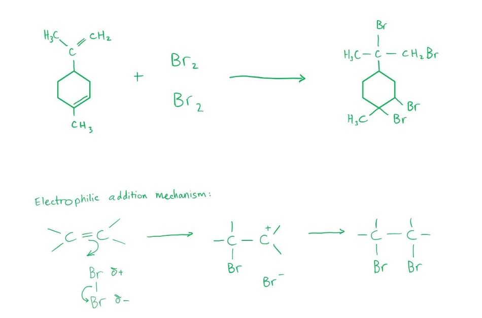

**A** is incorrect as it shows bromine added across only one of the two double bonds. Excess Br2 ensures both double bonds react fully.

**B** is incorrect as it shows an incomplete or incorrect bromination product of limonene.

**C** is incorrect as it shows addition to only one double bond or addition in the wrong positions.

### Q4
**Final answer:** **The correct answer is B**

- Adding warm aqueous sodium hydroxide to 2-bromopropane gives propan-2-ol via nucleophilic substitution, not propene.

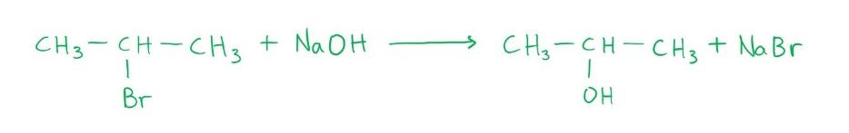

**A** is incorrect as adding excess hot concentrated sulfuric acid to propan-1-ol gives propene by a dehydration reaction:

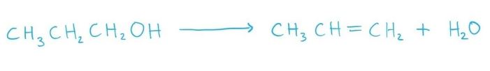

**C** is incorrect as adding warm ethanolic sodium hydroxide to 1-bromopropane gives propene by an elimination reaction:

**D** is incorrect as passing propan-2-ol vapour over heated aluminium oxide gives propene by a dehydration reaction:

### Q5
**Final answer:** **The correct answer is A**

- When ethene reacts with cold, dilute, acidified manganate(VII) ions, ethane-1,2-diol is produced.

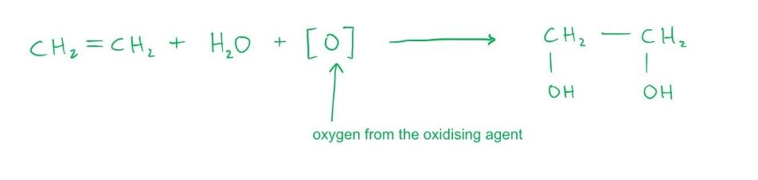

- In a similar way, pent-2-ene reacts with cold, dilute, acidified manganate(VII) ions to form pentan-2,3-diol:

CH3CH2CH=CHCH3 + H2O + [O] → CH3CH2CH(OH)CH(OH)CH3

**B** is incorrect as CH3CH2COCOCH3 (pentane-2,3-dione) cannot be synthesised from pent-2-ene by mild oxidation with cold, dilute manganate(VII) ions.

**C** is incorrect as CH3CH2CH(OH)CH2CH3 (pentan-3-ol) and CH3CH2CH2CH(OH)CH3 (pentan-2-ol) are the products of hydration of pent-2-ene, not mild oxidation with manganate(VII) ions.

**D** is incorrect as CH3CH2COOH (propanoic acid) and CH3COOH (ethanoic acid) are produced only by oxidative cleavage using hot, concentrated, acidified manganate(VII) ions.

### Q6
**Final answer:** **The correct answer is D**

- HBr undergoes electrophilic addition with alkenes only: H adds to one carbon and Br adds to the other across the C=C double bond. Only alkenes react with HBr, so only **B** and **D** are candidates.
- Check compound **D** (hex-3-ene, C6H12):
- Calculate the *M*r of hex-3-ene:

*M*r = (6 x 12) + (12 x 1)

*M*r = 72 + 12

*M*r = 84

- In electrophilic addition, HBr adds across the C=C bond. The *M*r of the product equals *M*r(alkene) + *M*r(HBr):

*M*r(product) = 84 + 80.9

*M*r(product) = 164.9

- Both conditions are satisfied, confirming compound **D**.

**A** and **C** are incorrect as these compounds are not alkenes and do not react with HBr by electrophilic addition.

**B** is incorrect as although it is an alkene with *M*r = 84, its product with HBr does not have *M*r = 164.9.

### Q7
**Final answer:** **The correct answer is B**

- Alkane **X** (C4H10) must be branched for two different monochloroalkanes to both give the same alkene on dehydrohalogenation.

  - Alkane **X** is therefore 2-methylpropane, (CH3)3CH.
- Free radical substitution of 2-methylpropane with Cl2 in sunlight gives 1-chloro-2-methylpropane and 2-chloro-2-methylpropane.
- Both undergo dehydrohalogenation with hot ethanolic KOH to give the same alkene, **Y** = 2-methylprop-1-ene (CH2=C(CH3)2).

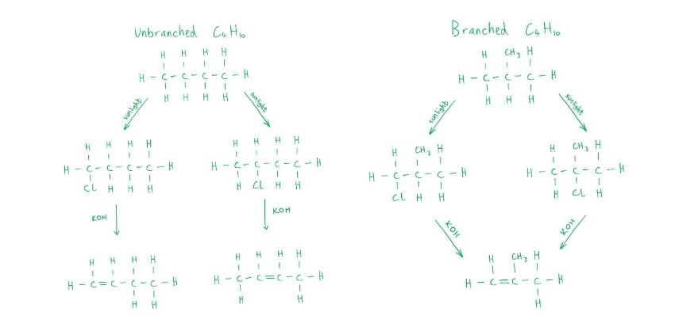

- Hot concentrated acidified KMnO4 cleaves the C=C bond by vigorous oxidation:

  - The terminal =CH2 end is fully oxidised to CO2 (and H2O).
  - The C(CH3)2 end is disubstituted (no H on that carbon) and forms a ketone: CH3COCH3 (propanone).

**A** is incorrect as propanoic acid (CH3CH2CO2H) would require a –CH2CH3 fragment on the double bond, which is not present in 2-methylprop-1-ene.

**C** is incorrect as methanoic acid (HCO2H) comes from a –CH= fragment. The terminal =CH2 in 2-methylprop-1-ene is fully oxidised to CO2, not methanoic acid.

**D** is incorrect as ethanoic acid (CH3CO2H) alone would result from oxidative cleavage of a symmetric alkene such as but-2-ene, not 2-methylprop-1-ene.

### Q8
**Final answer:** **The correct answer is C**

- Mild oxidation with cold dilute KMnO4 converts the C=C double bond into a diol, adding an –OH group to each alkene carbon.
- For the diol to undergo further oxidation to a diketone, both –OH groups must be secondary, i.e. each carbon bearing –OH must also carry at least one H atom.

  - A secondary alcohol oxidises to a ketone.
  - A tertiary alcohol (no H on that carbon) cannot be oxidised further.
- In option **C** (C6H5CH=CHC6H5), each alkene carbon carries one H and one C6H5 group. After diol formation, both –OH groups are secondary and are oxidised to C=O, giving a diketone.

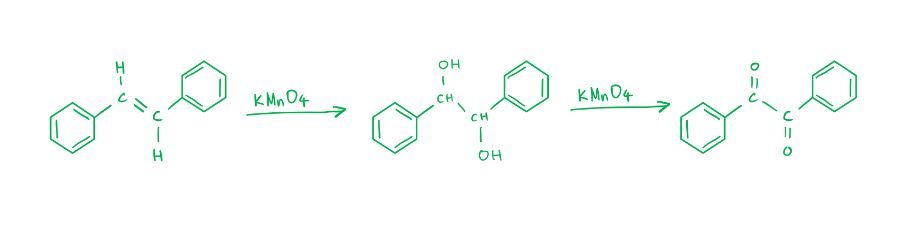

**A** is incorrect as CH3CH=C(CH3)2 gives a diol in which the right-hand C bears no H atoms (tertiary). This –OH group cannot be oxidised further, so a diketone cannot form.

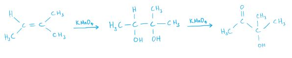

**B** is incorrect as (CH3)2CHCH=CH2 gives a diol in which the terminal C has a primary –OH group. A primary alcohol oxidises to a carboxylic acid, not a ketone, so a diketone is not formed.

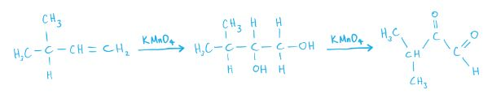

**D** is incorrect as (C6H5)2C=CHCH3 gives a diol in which the left-hand C carries two C6H5 groups and no H atoms (tertiary). This –OH group cannot be further oxidised.

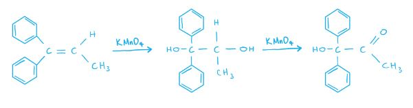

### Q9
**Final answer:** **The correct answer is A**

1. Identify the monomers in the displayed diagram

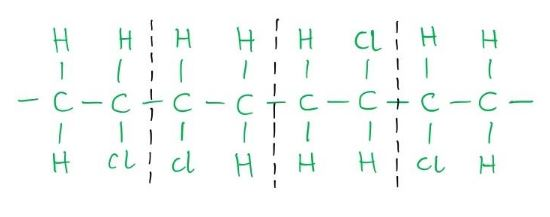

2. Break the bond between these monomers

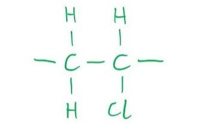

3. Add in the double bond between the carbon atoms

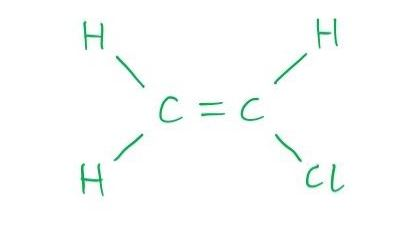

4. Convert the structural formula to the condensed formula

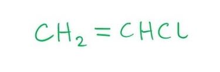

**B** is incorrect as CHCl=CHCl (1,2-dichloroethene) would produce a polymer in which every backbone carbon carries a Cl atom, giving two Cl atoms per repeating unit. This is inconsistent with the structure shown.

**C** is incorrect as CH3CCl=CH2 is a three-carbon monomer. Polymerisation would give a three-carbon backbone repeating unit, not a two-carbon one.

**D** is incorrect as CH3CCl=CHCl is also a three-carbon monomer. Polymerisation would give a three-carbon backbone with two Cl atoms per repeating unit.

### Q10
**Final answer:** **The correct answer is A**

- In an addition reaction, two compounds come together to form one larger compound with no other products, as shown:

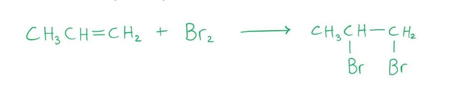

- As Br2 approaches the electron-rich C=C double bond in propene, the Br2 molecule is polarised: the nearer Br atom develops a δ+ charge and acts as an electrophile.
- The π electrons from the C=C double bond attack the δ+ Br atom, and the Br–Br bond breaks heterolytically.
- A Br atom becomes attached to each carbon.
- Therefore, it is an electrophilic addition reaction.

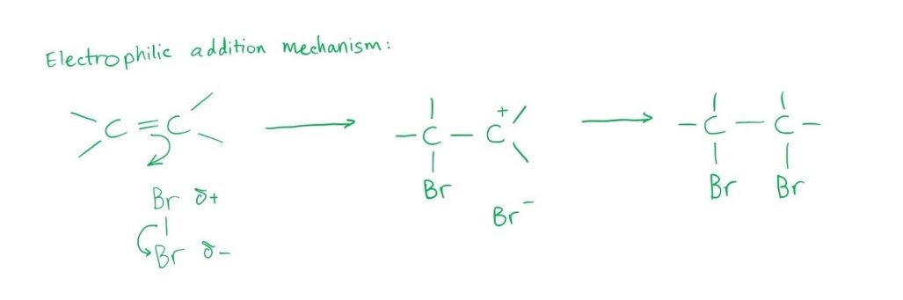

**B** is incorrect as electrophilic substitution involves an electrophile replacing an existing atom or group. No atoms are replaced here.

**C** is incorrect as nucleophilic addition involves a nucleophile attacking an electrophilic carbon. Br2 acts as an electrophile, not a nucleophile.

**D** is incorrect as nucleophilic substitution involves a nucleophile replacing a leaving group. There is no leaving group in this reaction.

### Q11
**Final answer:** **The correct answer is B**

- In the electrophilic addition of HBr to an alkene, the H end of HBr acts as the electrophile.

  - The δ+ H is attracted to the electron-rich C=C double bond.
- H adds to one carbon and Br adds to the other, breaking the C=C double bond.
- Drawing out the structural formula of each product from X and Y is the clearest approach:

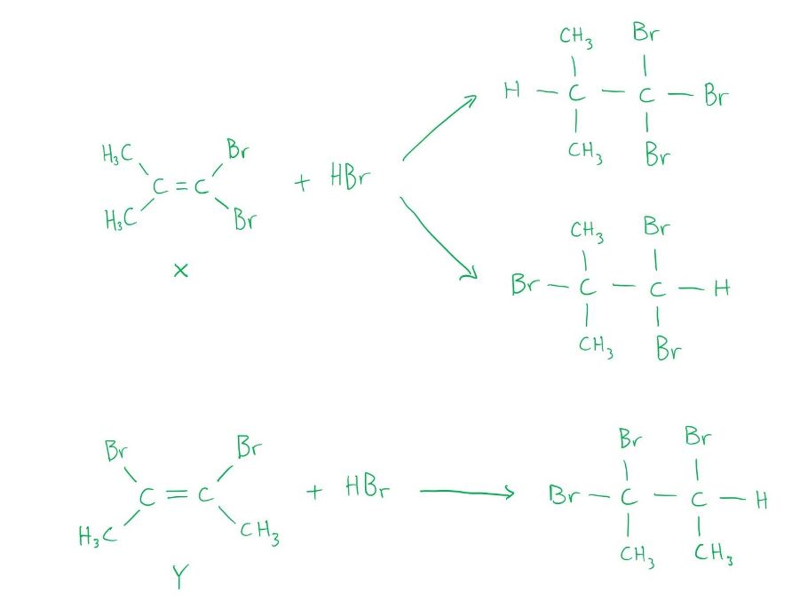

- The three different products from the reaction of HBr with isomers **X** and **Y** are:

  1. (CH3)2CHCBr3
  2. (CH3)2CBrCHBr2
  3. CH3CBr2CHBrCH3

**A** is incorrect as the third product listed (CH3CHBrCHBrCH3) is not formed from this reaction. This product would arise from addition of Br2, not HBr.

**C** is incorrect as the first product listed ((CH3)2CBrCBr3) is not formed; HBr addition to these isomers cannot produce a CBr3 group at that position.

**D** is incorrect as none of the three products in that row correctly reflects the regiochemistry of HBr addition to isomers X and Y.

### Q12
**Final answer:** **The correct answer is B**

- In an addition reaction, two compounds come together to form one larger compound.
- There are no other products produced.
- Therefore, the reaction between ethene and steam is an addition reaction.

**A** is incorrect as an acid-base reaction involves an acid and a base as reactants.

**C** is incorrect as in a hydrolysis reaction, chemical bonds are broken by the addition of water, however that is not the case here.

**D** is incorrect as in a substitution reaction, an atom or functional group is replaced by another similar species.

> **[exam-tip]**
> This reaction is also known as hydration, which is the addition of water across the C=C double bond. Do not confuse hydration with hydrolysis:
> 
> - Hydration forms a single product with no bonds broken by water
> - Hydrolysis uses water to break a bond in the substrate (e.g. ester → carboxylic acid + alcohol).

### Q13
**Final answer:** **The correct answer is C**

1. Draw the monomer structural formula

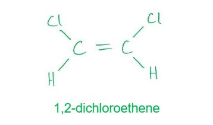

2. Break the C=C double bond to form the polymer backbone unit

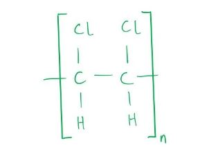

3. Replace each –Cl with –OH by hydrolysis

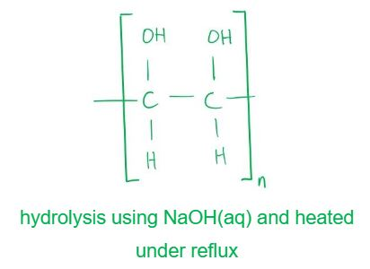

**A** is incorrect as polymerising ethene gives a saturated poly(ethene) backbone with no substituents. Hydrating a saturated polymer does not introduce –OH groups along the chain.

**B** and **D** are incorrect as oxidation with cold acidified KMnO4 converts C=C double bonds into diol groups. Once polymerised, the backbone is saturated and has no C=C bonds to oxidise. In option **D**, the –Cl groups in poly(1,2-dichloroethene) cannot be replaced by cold KMnO4 oxidation because hydrolysis is the correct method.

### Q14
**Final answer:** **The correct answer is C**

- Each –OH group in compound Q reacts with HBr to undergo nucleophilic substitution, replacing –OH with Br.
- The C=C double bond also reacts with HBr by electrophilic addition, adding H to one carbon and Br to the other.
- With excess HBr, both types of reaction proceed fully, giving the product shown in option **C**.

**A** is incorrect as it does not show complete substitution of all –OH groups or full addition across the C=C double bond.

**B** is incorrect as it shows an incorrect or incomplete transformation of compound Q with excess HBr.

**D** is incorrect as it shows incorrect regiochemistry or an incomplete reaction with excess HBr.

### Q15
**Final answer:** **The correct answer is C**

- 2,4-Dinitrophenylhydrazine (2,4-DNPH) reacts with the C=O bond in aldehydes and ketones to give an orange precipitate.
- Although acrylic acid contains a C=O bond (as part of the –COOH group), 2,4-DNPH does not react with carboxylic acids.
- Therefore, acrylic acid does not produce an orange precipitate with 2,4-DNPH.

**A** is incorrect as each sp2 carbon in acrylic acid has 3 bonding groups and no lone pairs, giving bond angles x and y of approximately 120°.

**B** is incorrect as acrylic acid contains a C=C double bond, which undergoes electrophilic addition with aqueous bromine and decolourises it.

**D** is incorrect as acrylic acid is a carboxylic acid, which reacts with alcohols in an esterification reaction to form an ester.

### Q16
**Final answer:** **The correct answer is C**

- Ethanol undergoes dehydration to form ethene.

  - Concentrated H2SO4 (heated) is the correct reagent for this reaction, eliminating options **A** and **D**.
- The ethene produced contains acidic impurities, principally SO2 formed by oxidation of ethanol by hot concentrated H2SO4.

  - These must be removed before the gas is collected.
- In option **C**, passing the gas through dilute NaOH neutralises the acidic SO2 impurity, giving purified ethene.

**A** is incorrect as acidified K2Cr2O7 oxidises ethanol to ethanal rather than dehydrating it to ethene.

**B** is incorrect as passing the gas through dilute H2SO4 adds more acid rather than removing it.

**D** is incorrect as ethanolic NaOH promotes elimination of HX from haloalkanes, not dehydration of alcohols.

### Q17
**Final answer:** **The correct answer is C**

- Bromine is an electrophile (electron-accepting species) and reacts with ethene via electrophilic addition.

- Both products, CH2BrCH2Br (1,2-dibromoethane) and CH2BrCH2OH (2-bromoethanol), can be hydrolysed using hot aqueous NaOH to give the same organic compound, ethane-1,2-diol.

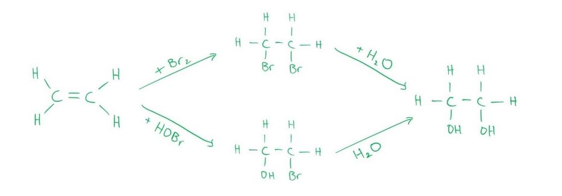

**A** and **B** are incorrect as both products are formed by electrophilic addition, not electrophilic substitution or nucleophilic addition.

**D** is incorrect as 1,2-dibromoethane (CH2BrCH2Br) has no N–H, O–H, or F–H bonds, so it cannot form hydrogen bonds with water. Only 2-bromoethanol (CH2BrCH2OH) can form hydrogen bonds via its –OH group.

### Q18
**Final answer:** **The correct answer is B**

- Alcohols can be dehydrated to form alkenes by losing a water molecule across adjacent carbons to form a C=C double bond.
- CH3CH2CH2CH(OH)CH2CH3 (hexan-3-ol) can lose H from either C2 or C4, giving two constitutional isomers, each with E/Z stereoisomers:

  - hex-2-ene: (E)-hex-2-ene and (Z)-hex-2-ene
  - hex-3-ene: (E)-hex-3-ene and (Z)-hex-3-ene
- That gives 4 different alkenes in total (more than any other option).

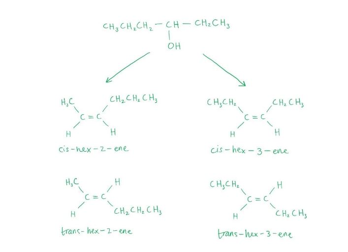

**A** and **D** are incorrect as these are primary alcohols. Elimination can only occur in one direction, giving fewer alkene isomers than a secondary alcohol.

**C** is incorrect as CH3CH2C(CH3)(OH)CH2CH3 (3-methylpentan-3-ol) gives 3 different alkenes on dehydration: (E)-3-methylpent-2-ene, (Z)-3-methylpent-2-ene and 2-ethylbut-1-ene, which is fewer than the 4 from option **B**.
