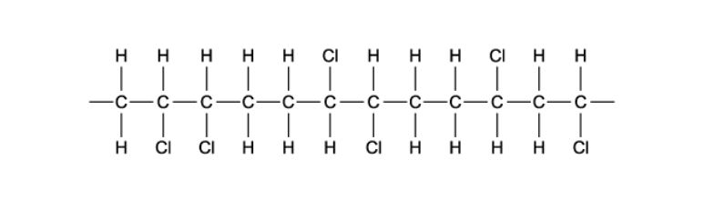
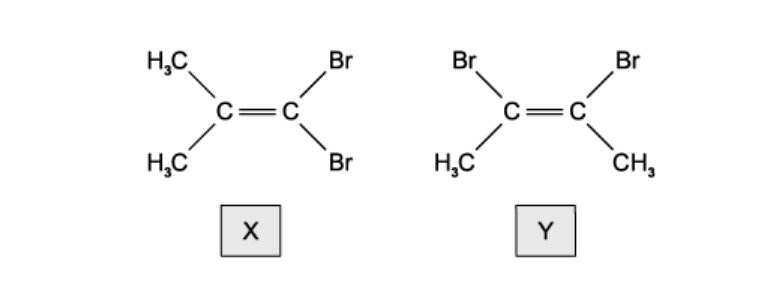
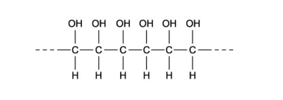
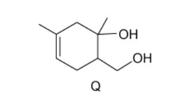
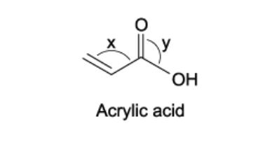
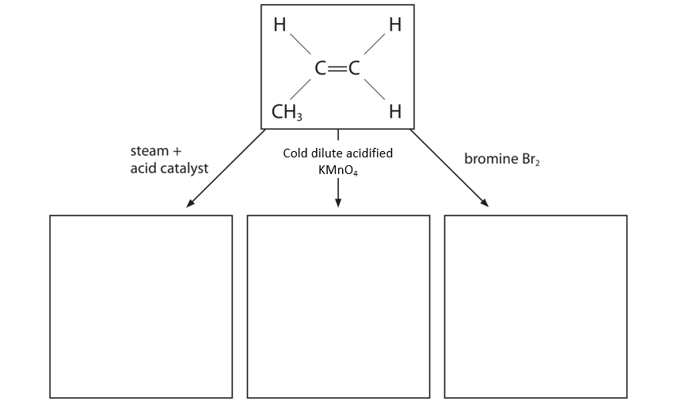
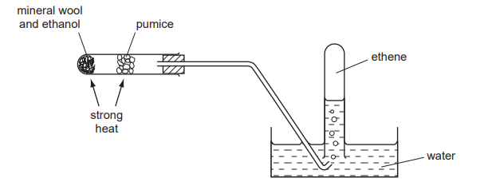
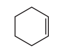
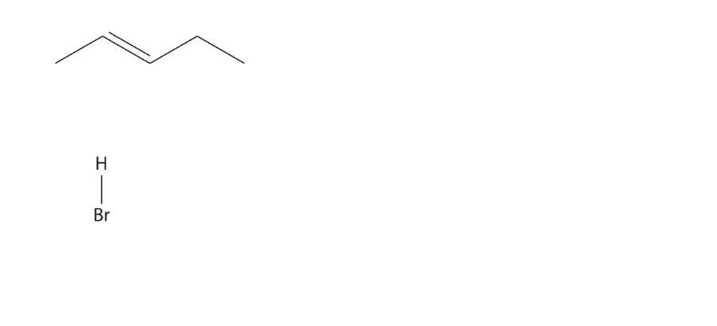

# Exam Questions — Alkenes
**14. Hydrocarbons** · Cambridge (CIE) A-LEVEL chemistry (9701)
> Source: [https://www.savemyexams.com/a-level/chemistry/cie/25/topic-questions/](https://www.savemyexams.com/a-level/chemistry/cie/25/topic-questions/) · 25 questions across 2 sets

## Multiple Choice Questions (18 questions)

### Q1 — medium — 1 marks

**Q1** [1 mark]

A polymer has the repeating unit

Which monomer would produce this polymer by addition polymerisation?

### Q2 — medium — 1 marks

**Q2** [1 mark]

The oxidative cleavage of an alkene using hot, concentrated, acidified potassium manganate(VII) results in the complete rupture of the carbon–carbon double bond.

Which row correctly identifies the final products formed from the specified structural groups?

|   | Structural group in alkene | Final products formed |
|---|---|---|
| **A** | R–CH=CH–R′ | Two different aldehydes |
| **B** | CH₂=C(R)₂ | Carbon dioxide and a ketone |
| **C** | R–CH=CH₂ | A carboxylic acid and methanoic acid |
| **D** | R–CH=C(R)₂ | A carboxylic acid and an alcohol |

### Q3 — hard — 1 marks

**Q3** [1 mark]

Limonene is an oil formed in the peel of citrus fruits.

Which product is formed when an excess of bromine, Br2 (l), reacts with limonene at room temperature in the dark?

### Q4 — medium — 1 marks

**Q4** [1 mark]

Which reaction would **not** give propene?

### Q5 — medium — 1 marks

**Q5** [1 mark]

Pent-2-ene, CH3CH2CH=CHCH3, reacts in a similar way to ethene.

Pent-2-ene is reacted with cold, dilute, acidified manganate (VII) ions.

What will be produced in the greatest amount?

### Q6 — hard — 1 marks

**Q6** [1 mark]

Which compound has an *M*r of 84 and will react with HBr to give a product with an *M*r of 164.9?

### Q7 — hard — 1 marks

**Q7** [1 mark]

Alkane **X** has molecular formula C4H10.

**X** reacts with Cl2 (g) in the presence of ultraviolet light to produce only two different monochloroalkanes, C4H9Cl. Both of these monochloroalkanes produce the same alkene **Y**, and no other organic products, when they are treated with hot ethanolic KOH.

What is produced when **Y** is treated with hot concentrated acidified KMnO4?

### Q8 — hard — 1 marks

**Q8** [1 mark]

Oxidation of an alkene **Y** gives a diol; further oxidation gives a diketone.

What could be **Y**?

### Q9 — easy — 1 marks

**Q9** [1 mark]

A molecule of a polymer contained the sequence shown.

Which monomer could produce this polymer by addition polymerisation?

### Q10 — easy — 1 marks

**Q10** [1 mark]

What is the mechanism for the reaction between propene and bromine in an organic solvent?

### Q11 — medium — 1 marks

**Q11** [1 mark]

Isomers **X** and **Y** both react with HBr.

A mixture of **X** and **Y** is reacted with HBr.

Which three structures represent three **different** possible products of this reaction?

| **A** | (CH3)2CHCBr3 | (CH3)2CBrCHBr2 | CH3CHBrCHBrCH3 |
|---|---|---|---|
| **B** | (CH3)2CHCBr3 | (CH3)2CBrCHBr2 | CH3CBr2CHBrCH3 |
| **C** | (CH3)2CBrCBr3 | (CH3)2CHCBr3 | CH3CBr2CHBrCH3 |
| **D** | (CH3)2CBrCHBr2 | CHBr2CBr(CH3)CH3 | CH3CHBrCBr2CH3 |

### Q12 — easy — 1 marks

**Q12** [1 mark]

Ethene reacts with steam in the presence of phosphoric acid.

C2H4 + H2O → CH3CH2OH

What type of reaction is this?

### Q13 — hard — 1 marks

**Q13** [1 mark]

The following diagram represents the structure of a possible polymer.

Which sequence of reactions could be used to produce this polymer?

### Q14 — medium — 1 marks

**Q14** [1 mark]

What is the major product formed when compound Q is warmed with excess HBr?

### Q15 — hard — 1 marks

**Q15** [1 mark]

Acrylic acid is produced from propene, a gaseous product of oil refineries.

Which statement about acrylic acid is **not** correct?

### Q16 — hard — 1 marks

**Q16** [1 mark]

Ethene is prepared by adding ethanol dropwise to heated reagent **Y**. To purify the ethene, it is bubbled through solution **Z** and then collected.

Which row identifies reagent **Y** and solution **Z**?

|   | **Reagent Y** | **Solution Z** |
|---|---|---|
| **A** | Acidified K2Cr2O7 | Dilute NaOH |
| **B** | Concentrated H2SO4 | Dilute H2SO4 |
| **C** | Concentrated H2SO4 | Dilute NaOH |
| **D** | Ethanolic NaOH | Concentrated H2SO4 |

### Q17 — medium — 1 marks

**Q17** [1 mark]

Ethene reacts with aqueous bromine to give two products, CH2BrCH2Br and CH2BrCH2OH.

Which statement about these products is correct?

### Q18 — hard — 1 marks

**Q18** [1 mark]

Which isomer of C6H13OH gives the greatest number of different alkenes when it is dehydrated?

## Structured Questions (7 questions)

### Q1 — medium — 15 marks

**Q1** [2 marks]

Compound **B** contains carbon, hydrogen and oxygen only.

It has the following percentage composition by mass: C 54.5%, H 9.1%, O 36.4%.

Calculate the empirical formula of **B**.

Show your working.

**Q1** [4 marks]

Compound **C** is the secondary alcohol, butan-2-ol, CH3CH(OH)CH2CH3.

i) Butan-2-ol can be converted into but-2-ene by dehydration.

State the reagent and conditions required for this reaction.

[2]

ii) Butan-2-ol is heated under reflux with acidified potassium dichromate(VI).

State the colour change observed.

[1]

iii) Name the organic product formed in (b)(ii).

[1]

**Q1** [5 marks]

But-2-ene shows geometrical (cis/trans) isomerism.

i) Explain the term geometrical isomerism.

In your answer, refer to the features of the double bond and the groups attached to it.

[2]

ii) Draw the displayed formula of trans-but-2-ene.

[1]

iii) Describe a chemical test to show the presence of the C=C double bond in but-2-ene.

Reagent: …………………………………………

Observation: …………………………………

[2]

**Q1** [4 marks]

**Extract:**

Compound **C** is the secondary alcohol, butan-2-ol, CH~3~CH(OH)CH~2~CH~3~.

ii) Butan-2-ol is heated under reflux with acidified potassium dichromate(VI).

iii) Name the organic product formed in (b)(ii).

Infrared spectroscopy is used to identify functional groups.

Use the Data Booklet to identify the bond responsible for the following absorption peaks found in organic spectra.

i) A strong absorption peak at 1700 cm⁻¹.

[1]

ii) A broad absorption peak in the range 3200–3600 cm⁻¹.

[1]

iii) State how the infrared spectrum of the product formed in (b)(iii) would differ from the spectrum of butan-2-ol.

[2]

### Q2 — medium — 11 marks

**Q2** [2 marks]

This question is about alkanes and alkenes.

Propene and propane can be produced from the cracking of hexane, C6H14.

C6H14 → C3H8 + C3H6

Explain why propane is relatively unreactive.

**Q2** [2 marks]

**Extract:**

This question is about alkanes and alkenes.

Propene and propane can be produced from the cracking of hexane, C~6~H~14~.

C~6~H~14~ → C~3~H~8~ + C~3~H~6~

Describe and give the result of a test that can be done to distinguish between the two hydrocarbons.

**Q2** [6 marks]

Propene, C3H6 , is an alkene.

The reagents needed for three reactions of propene are shown in Fig. 2.1.

Complete Fig. 2.1 by drawing the structure of the organic product produced in each reaction.

**Fig. 2.1**

[3]

ii) Propene also reacts with hydrogen bromide, HBr.

Give the mechanism for this reaction to form the **major** product.

Include curly arrows, and relevant lone pairs and dipoles.

[3]

**Q2** [1 mark]

Propene reacts by addition polymerisation to form poly(propene).

Draw the structure of poly(propene), showing **two** repeat units.

### Q3 — medium — 11 marks

**Q3** [2 marks]

This question is about alkenes.

One method of preparing ethene in a school or college laboratory is from ethanol by using the apparatus shown below in Fig. 3.1.

**Fig. 3.1**

i) Write a balanced equation for this reaction.

[1]

ii) What type of reaction is this?

[1]

**Q3** [4 marks]

Ethene is bubbled into two separate test-tubes, one containing aqueous hydrogen bromide and the other containing cold, dilute acidified potassium manganate(VII).

In each case, complete Table 3.1** **to describe any colour changes you would see and give the structural formula of the organic product.

**Table 3.1**

|   | aqueous hydrogen bromide | cold, dilute acidified potassium manganate(VII) |
|---|---|---|
| colour at start |   |   |
| colour after reaction |   |   |
| structural formula of organic product |   |   |

**Q3** [1 mark]

Cyclohexene has the following structural formula.

What is the molecular formula of cyclohexene?

**Q3** [3 marks]

**Extract:**

Cyclohexene has the following structural formula.

Cyclohexene can react with bromine.

i) Draw the structural formula of the compound formed when cyclohexene is reacted with bromine.

[1]

ii) State what type of mechanism is involved in forming this product.

[2]

**Q3** [1 mark]

**Extract:**

Cyclohexene has the following structural formula.

Draw the structural formula of the compound formed when cyclohexene is reacted with hot concentrated acidified potassium manganate(VII).

### Q4 — easy — 10 marks

**Q4** [3 marks]

This question is about the reactions of propene.

Complete the flowchart below to show the **major** organic product formed in each of the addition reactions.

**Q4** [3 marks]

Complete the mechanism below to show the electrophilic addition of hydrogen bromide, HBr, to propene, CH3CH=CH2, giving the major product. Include charges, dipoles, lone pairs of electrons and curly arrows, as appropriate.

**Q4** [1 mark]

**Extract:**

This question is about the reactions of propene.

The major product is 2-bromopropane because the secondary carbocation intermediate (positive charge on C2, stabilised by two alkyl groups) is more stable than the primary carbocation (positive charge on C1). The bromide ion attacks the more stable carbocation to give the major product.

Draw the displayed formula of the minor product formed from the reaction of propene and hydrogen bromide.

**Q4** [3 marks]

Explain why there is a major and minor product formed from the reaction between propene and hydrogen bromide.

### Q5 — hard — 12 marks

**Q5** [2 marks]

A student completed an investigation into the amount of C=C bonds in a molecule of cooking oil, with a density of 0.526 g cm-3, by titrating samples with 0.02 mol dm-3 bromine water.

The student plans to use the following procedure for their investigation.

1. Measure 5.0 cm3 of solvent into a conical flask.
2. Add five drops of cooking oil to the solvent, using a dropping pipette.
3. Swirl to ensure mixing.
4. Note the initial reading of the bromine water in the burette.
5. Add the 2.0 x 10-2 mol dm-3 bromine water from the burette to the solution in the conical flask slowly.

  - Shake vigorously after each addition until the bromine colour disappears.
6. As the bromine colour takes longer to fade with each addition, add less bromine water each time until there is just an excess of bromine in the flask.

  - This will be shown by a permanent yellow tint.
7. Note the final reading of the burette.

Suggest **two **improvements that the student could make to this procedure to obtain more consistent results.

**Q5** [6 marks]

**Extract:**

A student completed an investigation into the amount of C=C bonds in a molecule of cooking oil, with a density of 0.526 g cm^-3^, by titrating samples with 0.02 mol dm^-3^ bromine water.

The student plans to use the following procedure for their investigation.

1. Measure 5.0 cm^3^ of solvent into a conical flask.
2. Add five drops of cooking oil to the solvent, using a dropping pipette.
3. Swirl to ensure mixing.
4. Note the initial reading of the bromine water in the burette.
5. Add the 2.0 x 10^-2^ mol dm^-3^ bromine water from the burette to the solution in the conical flask slowly.

- Shake vigorously after each addition until the bromine colour disappears.
6. As the bromine colour takes longer to fade with each addition, add less bromine water each time until there is just an excess of bromine in the flask.

- This will be shown by a permanent yellow tint.
7. Note the final reading of the burette.

The student’s titration results are shown in Table 2.1.

**Table 2.1**

| **Experiment ** | **Initial volume / cm****3**** ** | **Final volume / cm****3**** ** |
|---|---|---|
| Rough | 0.00 | 26.35 |
| 1 | 0.00 | 26.25 |
| 2 | 0.10 | 26.45 |
| 3 | 0.00 | 26.10 |

The approximate *M*r of the cooking oil is 1002 and its density is 0.526 g cm–3.

Assume each drop of cooking oil has a volume of 5.0 × 10–2 cm3.

The concentration of bromine water used was 2.0 × 10–2 mol dm–3.

Use this data and the titration results from Table 3.1 to deduce the number of C=C double bonds in a molecule of the oil. Show your working.

**Q5** [4 marks]

Fig. 2.1 shows the structure of a mono-unsaturated oil and a polyunsaturated oil.

**Fig. 2.1**

i) Suggest what is meant by the terms mono-unsaturated oil and polyunsaturated.

[2]

ii) Suggest the reagent and conditions necessary to produce the mono-unsaturated oil from the polyunsaturated oil.

[2]

### Q6 — hard — 17 marks

**Q6** [8 marks]

This question is about hydrocarbons.

10 cm3 of a gaseous hydrocarbon, C*x*H*y*, was reacted with 100 cm3 of oxygen gas, an excess. The final volume of the gaseous mixture was 95 cm3.

This gaseous mixture was treated with concentrated, aqueous sodium hydroxide to absorb the carbon dioxide present. This reduced the gas volume to 75 cm3.

All gas volumes were measured at 298 K and 100 kPa.

i) Write an equation for the reaction between sodium hydroxide and carbon dioxide.

[1]

ii) Calculate the volume of carbon dioxide produced by the combustion of the hydrocarbon.

volume of CO2 produced = ................. cm3 [1]

iii) Calculate the volume of oxygen used up in the reaction with the hydrocarbon.

volume of O2 used = ................. cm3 [1]

iv) Use your answers to **(b)(ii)** and **(b)(iii)**, together with the initial volume of hydrocarbon, to balance the equation below.

............C*x*H*y* + ............O2 → ............CO2 + *z*H2O

[2]

v) Deduce the values of *x*, *y* and *z* in the equation in** (iv)**.

*x* = .............................
*y* = .............................
*z* = .............................

[3]

**Q6** [5 marks]

A branched-chain hydrocarbon, **W**, with the formula C4H8, reacts with hydrogen bromide, HBr, to give two products **X** and **Y**.

**X** and **Y** are structural isomers of molecular formula C4H9Br. More **X** is produced than **Y**.

i) Give the structural formulae **and** names of the compounds **W**, **X**, and **Y**.

[3]

ii) When **W** reacts with hydrogen bromide, more **X** than **Y** is produced. Explain why.

[2]

**Q6** [4 marks]

Pent-2-ene will react with HBr.

Draw the mechanism for the reaction of pent-2-ene with hydrogen bromide. You do not need to include any partial charges.

### Q7 — medium — 13 marks

**Q7** [3 marks]

This question is about alkenes with the molecular formula C5H10 .

Draw the **skeletal **formulae of three **branched** chain alkenes with the molecular formula C5H10 .

*Source: Oct 2021 9CHO/02 Q4A*

**Q7** [2 marks]

An alcohol can react with concentrated phosphoric acid, H3PO4, to form pent-2-ene.

i) Give the formula of the alcohol that will form only pent-2-ene during this reaction.

[1]

ii) Give a name for this type of reaction.

[1]

*Source: Oct 2021 9CHO/02 Q4B*

**Q7** [4 marks]

Pent-2-ene reacts with hydrogen bromide, HBr, to form two bromoalkanes.

Complete the diagram to show the mechanism for the formation of 2-bromopentane in this reaction. Include curly arrows, and relevant lone pairs and dipoles.

*Source: Oct 2021 9CHO/02 Q4C*

**Q7** [4 marks]

A sample of pent-1-ene, with a mass of 1.33 g, is warmed to 60°C in a sealed container. The volume of the container is 500 cm3.

Calculate the pressure inside the container.

Include units and give your answer to an appropriate number of significant figures. [molar gas constant (*R*) = 8.31 J mol−1 K−1]

*Source: Oct 2021 9CHO/02 Q4D*

