# Mark Schemes — Halogenoalkanes
**15. Halogen Compounds** · Cambridge (CIE) A-LEVEL chemistry (9701)

## Multiple Choice Questions (30 questions)

### Q1
**Final answer:** **The correct answer is A**

**Step 1: Ethane → bromoethane**

- Ethane is an alkane, so it reacts with bromine by free-radical substitution.
- This requires Br2 and UV light to initiate homolytic fission of the Br–Br bond and form radicals.

**Step 2: Bromoethane → ethylamine**

- Bromoethane undergoes nucleophilic substitution with ammonia to form an amine.
- The conditions used are ethanolic ammonia, heat in a sealed tube, to prevent ammonia escaping and to increase the yield.

**B** is incorrect as HBr does not convert an alkane into a bromoalkane under these conditions.

**C** is incorrect as KCN would form a nitrile, not an amine.

**D** is incorrect as PBr3 is used to convert alcohols to bromoalkanes, not alkanes, and HNO3 is not used to make amines from halogenoalkanes.

### Q2
**Final answer:** **The correct answer is D**

- Bromoethane reacts with ammonia by nucleophilic substitution to form ethylamine.
- To maximise the yield of the primary amine, a large excess of ammonia is used.
- This reduces the chance of the ethylamine product acting as a nucleophile and undergoing further substitution to form secondary and tertiary amines.
- Ethanol is used as the solvent because it dissolves both the halogenoalkane and ammonia.
- A sealed tube is required to prevent volatile ammonia from escaping during heating.

**A** is incorrect as using excess bromoethane increases the likelihood of further substitution of the amine product, reducing the yield of ethylamine.

**B** is incorrect as, although heating bromoethane with excess ammonia in a sealed tube would form ethylamine, the solvent used is not ethanol. Without ethanol the halogenoalkane and ammonia are not in a suitable common solvent, reducing the yield of the primary amine.

**C** is incorrect as aqueous ammonia is a less effective solvent for the halogenoalkane and encourages competing reactions, reducing the yield of the primary amine.

### Q3
**Final answer:** **The correct answer is B**

- The table shows the reaction is slowest for 1-chlorobutane and fastest for 1-iodobutane.
- In this test, the rate depends mainly on how easily the C–X bond breaks to form ions.

  - C–I has the lowest bond enthalpy, so it breaks most easily → fastest precipitate.
  - C–Cl has the highest bond enthalpy, so it breaks least easily → slowest precipitate.
- This trend explains the observed order of reaction times.

**A** is incorrect as the C–I bond is the weakest of the carbon-halogen bonds, not the strongest.

**C** is incorrect as the oxidising power of the halogen is not the factor controlling the rate of this hydrolysis reaction.

**D** is incorrect as bond polarity is not the main factor here; it is the overall bond enthalpy that determines how easily the bond breaks.

### Q4
**Final answer:** **The correct answer is D**

- A nucleophile is either a negatively charged species or a molecule with a lone pair of electrons.
- Nucleophilic substitution involves a nucleophile replacing a leaving group at a carbon atom.
- In this reaction, the Br– leaving group departs and is replaced by a nucleophile, as shown below:

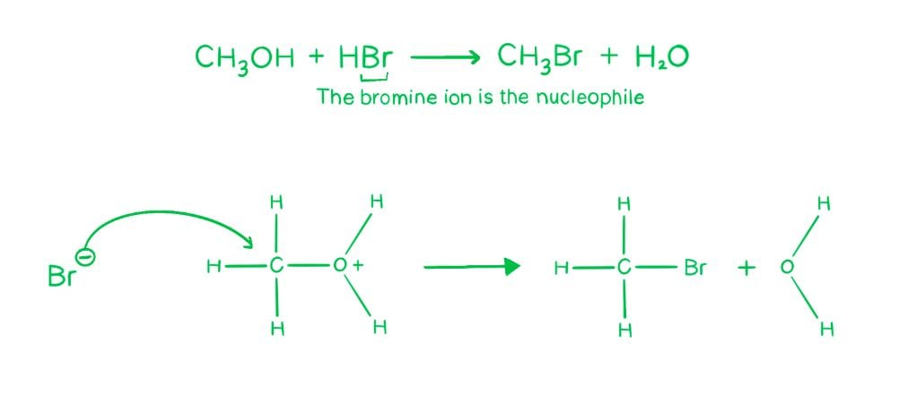

**A** is incorrect as condensation reactions involve the joining of two molecules with the loss of a small molecule (e.g. H2O); that does not occur here.

**B** is incorrect as electrophilic substitution requires an electrophile attacking an electron-rich centre (e.g. a benzene ring); OH– is a nucleophile, not an electrophile.

**C** is incorrect as free radical substitution involves homolytic fission and radical intermediates, initiated by UV light; no radicals are involved in this reaction.

### Q5
**Final answer:** **The correct answer is C**

- The structure of phenacyl chloride is:

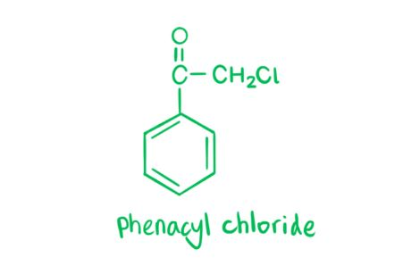

- In an SN2 mechanism, OH– attacks the carbon bonded to Cl, while the C–Cl bond breaks simultaneously, forming a pentacoordinate transition state.
- When reacted with aqueous NaOH, the reaction proceeds as follows:

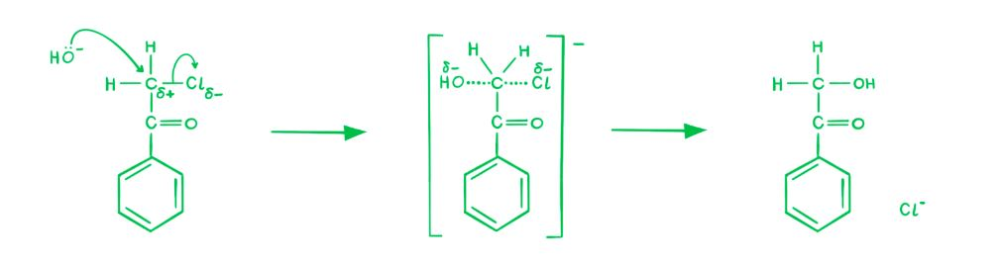

- Option **C** correctly represents the transition state for this SN2 reaction.

**A** is incorrect as the structure shown does not represent the correct transition state for SN2 attack on phenacyl chloride.

**B** is incorrect as the structure shown does not correspond to the transition state for the SN2 mechanism of this reaction.

**D** is incorrect as the structure shown does not correspond to the transition state formed during the SN2 reaction of phenacyl chloride with NaOH.

### Q6
**Final answer:** **The correct answer is B**

- When halogenoalkanes are heated under reflux with ethanolic potassium cyanide, the CN– ion replaces the halogen and adds one carbon atom to the chain.
- 2-ethyl-3-methylbutanoic acid has a total of 7 carbon atoms.
- Therefore, the starting halogenoalkane must contain 6 carbon atoms.
- Compound **B** is a 6-carbon halogenoalkane; when heated with KCN in ethanol, the Br is substituted by CN:

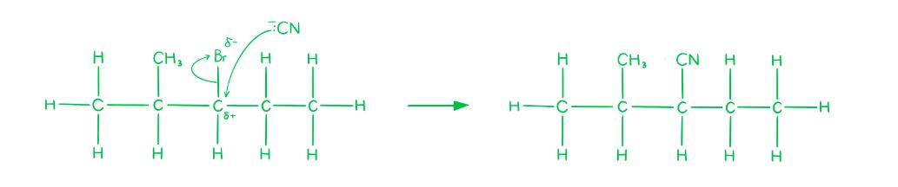

- Acid hydrolysis of the nitrile then gives the carboxylic acid:

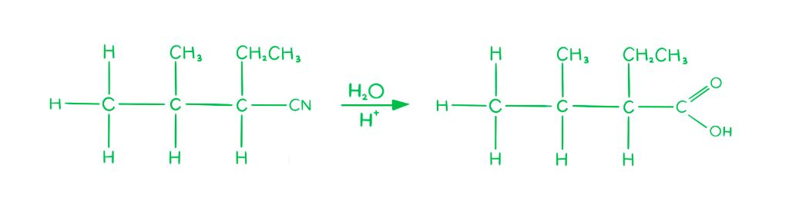

**A** is incorrect as it contains a different number of carbons or a different connectivity. Substitution with CN would not give the required branching pattern to produce 2-ethyl-3-methylbutanoic acid.

**C** is incorrect as its carbon skeleton does not match the structure needed. Even after CN substitution and hydrolysis, the product would not be 2-ethyl-3-methylbutanoic acid.

**D** is incorrect for the same reason that the carbon framework does not give the correct branching pattern in the target molecule.

### Q7
**Final answer:** **The correct answer is C**

- Heating the compounds causes the bonds to break, releasing the halide ions, which then react with the silver ions in AgNO3 to form precipitates.
- The smaller the bond energy, the weaker the bond, the more quickly it breaks and the faster a precipitate is produced.
- Among F, Cl, Br and I, iodine has the largest atomic radius and the lowest electronegativity, so the C–I bond is the longest and least polar and therefore the weakest.
- Compound **C** is the only compound containing I, so it produces a precipitate most quickly.

**A** is incorrect as the compound shown contains Br. The C–Br bond is stronger than the C–I bond, so it reacts more slowly.

**B** is incorrect as the compound shown also contains Br. The same reasoning applies where C–Br breaks less easily than C–I.

**D** is incorrect as the compound shown contains Cl. The C–Cl bond has the highest bond energy of the three and is the slowest to break.

### Q8
**Final answer:** **The correct answer is D**

- In the reaction CCl3CF3 → CCl2FCF3
- A Cl atom is replaced with an F atom.
- F– (fluoride ion) is the nucleophile; hence it undergoes nucleophilic substitution:

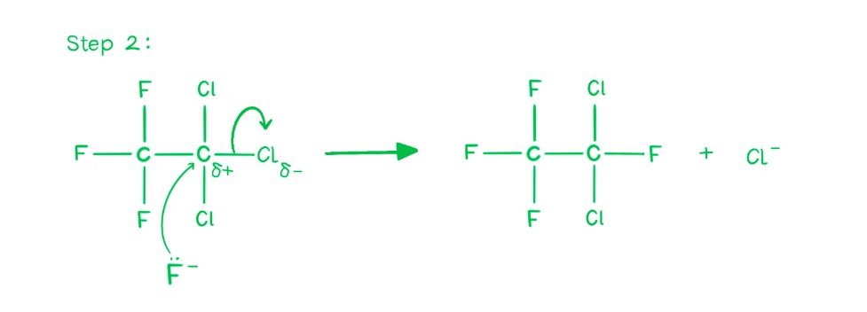

**A** is incorrect as electrophilic substitution requires an electrophile attacking an electron-rich centre; F– is a nucleophile, not an electrophile.

**B** is incorrect as free-radical substitution involves homolytic fission and radical intermediates initiated by UV light; no radicals are involved in this halogen exchange reaction.

**C** is incorrect as isomerisation involves rearrangement of atoms within the same molecular formula; here a Cl atom is replaced by F, changing the formula.

### Q9
**Final answer:** **The correct answer is D**

- The reaction between bromoethane and sodium hydroxide is **nucleophilic substitution**.
- The OH– ion uses a lone pair to attack the δ+ carbon bonded to Br – OH– is the attacking nucleophile.
- The Br– ion departs with both bonding electrons – Br– has lone pairs and is the leaving nucleophile.
- Therefore, both the attacking group and the leaving group are nucleophiles.

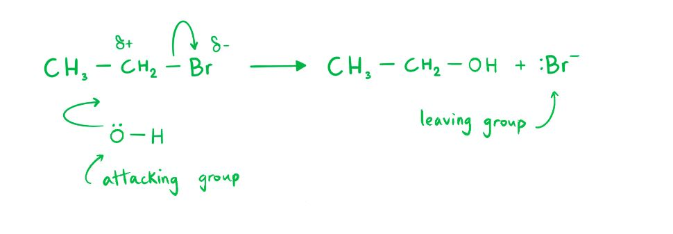

**A** is incorrect as OH– is a nucleophile, not an electrophile; electrophiles accept electron pairs, whereas OH– donates them.

**B** is incorrect as the attacking group (OH–) is a nucleophile, not an electrophile.

**C** is incorrect as the leaving group (Br–) has lone pairs of electrons and acts as a nucleophile, not an electrophile.

### Q10
**Final answer:** **The correct answer is C**

- In the given molecule above, there are:

C–H bonds, C–F bonds, C–Cl bonds and a C–C bond.

- In all the options the C–C bond remains intact.
- The order of bond strength of the remaining 3 bonds is:

C–F > C–H > C–Cl

- Therefore, a C–Cl bond will be broken since it requires the least energy – this only occurs in option **C**.

**A** is incorrect as the molecule loses an F atom, suggesting that a C–F bond is broken.

**B** is incorrect as the molecule loses a different F atom, yet still suggesting that a C–F bond is broken.

**D** is incorrect as the molecule loses an H atom, suggesting that a C–H bond is broken.

### Q11
**Final answer:** **The correct answer is D**

- Homolytic fission = splitting a bond to produce two free radicals (that are the same).
- Heterolytic fission = splitting a bond to produce a positive ion and a negative ion (that are different).
- Propane reacts with chlorine by free radical substitution in the presence of UV light.
- In the presence of UV, Cl2 breaks down to form two chlorine radicals.

Cl2 → 2Cl•

- This is an example of homolytic fission, which eliminates options **A** and **B**.
- In the next step, propane reacts with a chlorine radical to form the two isomers of chloropropane.

C3H8 + Cl• → C3H7Cl

- For 1-chloropropane to form, the chlorine radical has 6 hydrogens it can react with – probability $\frac{6}{8}$
- For 2-chloropropane to form, the chlorine radical has 2 hydrogens it can react with – probability $\frac{2}{8}$
- Therefore, the expected ratio of 1-chloropropane to 2-chloropropane = 6 : 2 = **3 : 1**.

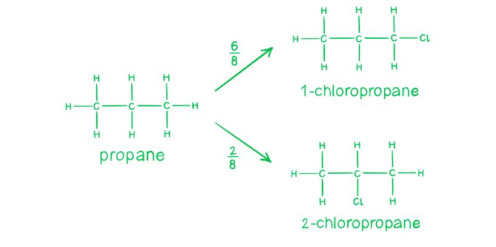

### Q12
**Final answer:** **The correct answer is B**

- The cyanide ion CN– is a nucleophile and reacts with haloalkanes to produce a nitrile.
- This is a useful reaction for increasing the chain length by one carbon atom.

Potassium cyanide + 1-chloropropane → butanenitrile + potassium chloride

KCN + CH3CH2CH2Cl → CH3CH2CH2CN + KCl

- Mechanism:

  - **Step 1:** The cyanide ion attacks at the partially positive carbon of the C–Cl dipole, leading to a high energy transition state.
  - **Step 2:** The chlorine atom leaves with its bonding electrons as a chloride ion.
  - **Step 3:** The final product is butanenitrile, a 4-carbon nitrile.

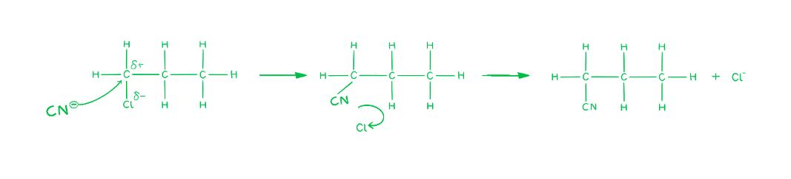

**A** is incorrect as the CN– replaces Cl and extends the chain. No chlorine remains in the organic product, so 1-chloropropanenitrile cannot form.

**C** is incorrect as ethanenitrile contains only 2 carbons. The product must contain the original 3-carbon chain plus the CN carbon, giving 4 carbons in total.

**D** is incorrect as propanenitrile contains only 3 carbons. The CN group adds one carbon to the chain, giving a 4-carbon nitrile, not a 3-carbon one.

### Q13
**Final answer:** **The correct answer is C**

- A tertiary halogenoalkane reacts with a hydroxide ion by a two-step mechanism.
- This mechanism is known as an SN1 mechanism.

  - The '1' tells us that the rate of the reaction only depends on one reagent, in this case the concentration of the halogenoalkane, as shown in the first (slow) step of the mechanism.
- The first step in the mechanism is the breaking of the carbon-halogen bond – this forms a tertiary carbocation, as shown below:

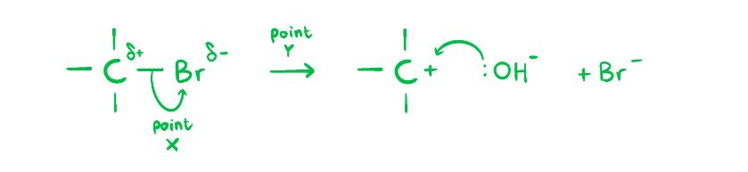

- Then, the tertiary carbocation is attacked immediately by the hydroxide ion.
- Reaction pathway diagrams display information about the energy changes during chemical reactions.
- The first bump corresponds to the slow step, as more energy is required here, and the second bump corresponds to the fast step, as less energy is required at this stage.
- Point X corresponds to the breaking of the C–Br bond (first transition state, energy maximum).
- Point Y corresponds to the intermediate step when the tertiary carbocation is formed (energy minimum between the two bumps).
- Therefore, option **C** is correct.

**A** is incorrect as it misidentifies point Y – in a two-step SN1 mechanism, Y is the energy minimum between the two transition states, corresponding to the tertiary carbocation intermediate, not a transition state.

**B** is incorrect as it misidentifies point X – X is at the first energy maximum (transition state for C–Br bond breaking), not at the carbocation intermediate.

**D** is incorrect as it misidentifies both points X and Y in the double-bump energy profile of the SN1 mechanism.

### Q14
**Final answer:** **The correct answer is C**

- CFCs and chloroalkanes are similar as they both contain C–Cl bonds, but they differ in that CFCs contain C–F bonds.
- The bond energy of the C–F bond is larger than the C–Cl bond.
- So, it takes less energy to release Cl atoms than F atoms from CFCs.

  - This is why CFCs are more stable than chloroalkanes.

**A** and **B** are incorrect as the stability of a molecule comes from the strength of the bonds within the molecule, not the ionisation energy or stability of radicals.

**D** is incorrect as the polarity of a bond tells us how electronegative an atom is, which contributes to the strength of the bond, but is not the direct reason for the stability of the molecule overall.

### Q15
**Final answer:** **The correct answer is C**

- In dichlorodifluoromethane, there are two C–F bonds and two C–Cl bonds.
- Both are strong bonds, and the C–F bond energy is the larger of the two.
- The C–F bond strength is the reason for the inertness of CCl2F2 and CFCs in general.
- These bonds are so strong that they do not break under the energy of ordinary visible light.

  - UV light is required to break them.

**A** is incorrect as the non-flammability of fluorine compounds is a consequence of the inertness of CCl2F2, not a reason for it.

**B** is incorrect as the high electronegativity of fluorine contributes to the strength of the C–F bond, but electronegativity alone is not the direct reason for the inertness.

**D** is incorrect as the C–F bond is in fact highly polar; furthermore, bond polarity is not the direct reason for the inertness – bond energy is.

### Q16
**Final answer:** **The correct answer is D**

- SN1 reactions are nucleophilic substitutions, involving a nucleophile replacing a leaving group (just like in SN2).

  - However, SN1 reactions are unimolecular, so the rate of this reaction depends only on one species (the halogenoalkane).
- Tertiary halogenoalkanes tend to be the most reactive and tend to undergo nucleophilic substitution via the SN1 carbocation mechanism.
- Whereas, primary halogenoalkanes tend to be the least reactive and react via the SN2 mechanism.
- So, overall carbocation stability:

3º > 2º >> 1º

- Option **D**, 1-chloro-1-methylcyclohexane, is a tertiary halogenoalkane, hence it is the most likely option to undergo SN1 substitution.

**A** is incorrect as (CH3)3CCH2I is a primary halogenoalkane (neopentyl iodide). Despite the bulky neopentyl group, the carbon bearing the iodine has no alkyl substituents, so this compound favours SN2.

**B** is incorrect as CH2=CHCl is a vinyl halide, where the halogen is directly attached to a C=C double bond, which delocalises electron density and makes nucleophilic substitution extremely unfavourable.

**C** is incorrect as CH3CH2CH2Br is a primary halogenoalkane, which favours SN2 nucleophilic substitution rather than SN1.

### Q17
**Final answer:** **The correct answer is B**

- Ethane reacts with chlorine by free radical substitution in the presence of sunlight.
- In the presence of sunlight, Cl2 breaks down to form two chlorine radicals:

Cl2 → 2Cl•

- The generated chlorine radical can then react with ethane to give an ethane radical (C2H5•) and HCl:

C2H6 + Cl• → C2H5• + HCl

- Therefore, the reaction is a free-radical substitution with hydrogen chloride produced.

**A** is incorrect as free radical substitution produces HCl, not H2.

**C** is incorrect as the reaction produces HCl gas; a gas is produced.

**D** is incorrect as the mechanism is free radical substitution, not nucleophilic substitution. Nucleophilic substitution requires a nucleophile attacking a carbon bonded to a leaving group, which does not apply here.

### Q18
**Final answer:** **The correct answer is B**

- Propan-2-ol reacts with SOCl2 to give 2-chloropropane as the only organic product.
- The by-products SO2 and HCl are gases and are easily removed.
- This makes the reaction high yielding and selective for 2-chloropropane.

**A** is incorrect as no substitution reaction occurs between alcohols and dilute NaCl without a catalyst or halogenating agent.

**C** is incorrect as free radical substitution of propane with chlorine forms a mixture of chloropropanes and other substitution products, lowering the yield of 2-chloropropane.

**D** is incorrect as the electrophilic addition of HCl (g) to propene follows Markovnikov’s rule and gives mainly 2-chloropropane, but also forms some 1-chloropropane, so the yield is lower than with SOCl2.

### Q19
**Final answer:** **The correct answer is C**

- If a halogenoalkane is heated under reflux with a solution of potassium cyanide in ethanol, the halogen is replaced by a -CN group and a nitrile is produced.

  - So, reagent X must be KCN in C2H5OH.
- Next, to produce a carboxylic acid, the nitrile is heated under reflux with dilute hydrochloric acid.

  - So, reagent Y must be HCl.

**A** is incorrect as the reaction of a halogenoalkane with ammonia would produce a primary amine, not a carboxylic acid.

**B** and **D** are incorrect as reagent Y could not be NaOH, as this would produce the sodium salt –COONa rather than the carboxylic acid –COOH.

### Q20
**Final answer:** **The correct answer is B**

- Reaction pathway diagrams display information about the energy changes during chemical reactions.
- The reaction pathway diagram shown has two bumps, indicating a two-step mechanism with a stable intermediate between the two transition states.

  - This is characteristic of the SN1 mechanism.
- The halogenoalkane C2H5Br in option **B** is a primary halogenoalkane, which undergoes the SN2 mechanism for nucleophilic substitution.
- SN2 is a concerted one-step mechanism with a single transition state, represented by a single-bump energy profile.

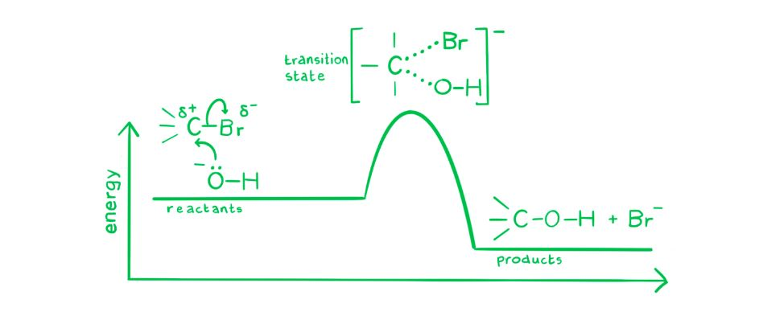

- Therefore, **B** does not have the double-bump profile shown.

**A** is not the answer as (CH3)3CBr is a tertiary halogenoalkane that reacts by the SN1 mechanism, giving the double-bump profile shown.

**C** is not the answer as the addition of HCN to CH3CHO proceeds by nucleophilic addition to the carbonyl group. Although this is not an SN1 reaction, it is a two-step mechanism: CN– attacks the carbonyl carbon to form a tetrahedral alkoxide intermediate, which is then protonated. This gives a double-bump energy profile.

**D** is not the answer as the addition of Br2 to cyclohex-1-ene proceeds via a cyclic bromonium ion intermediate; this two-step mechanism also gives a double-bump energy profile.

### Q21
**Final answer:** **The correct answer is A**

- Haloalkanes undergo nucleophilic substitution because the greater electronegativity of the halogen creates a partial positive charge (Cδ+) on the carbon bonded to it.
- The nucleophile attacks the Cδ+ carbon while the C–Br bond breaks simultaneously.

  - This is a concerted, one-step process with no carbocation intermediate.
- This is an SN2 reaction.

  - **S**ubstitution **N**ucleophilic **b**imolecular, a reaction in which a bond is broken and a new bond formed simultaneously in one step.

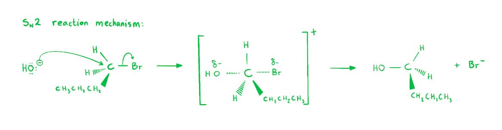

**B** is incorrect as, although the C–Br bond does break by heterolytic fission, SN2 has no discrete carbocation intermediate as the bond breaks and the new bond forms in the same step.

**C** is incorrect as the hydroxide ion (OH–) is a nucleophile, not an electrophile.

**D** is incorrect as the reaction does not involve homolytic fission. Homolytic fission produces two free radicals and is characteristic of radical chain reactions. Nucleophilic substitution proceeds by heterolytic fission of the C–Br bond, not radical combination.

### Q22
**Final answer:** **The correct answer is C**

- C2Cl4 (tetrachloroethene) is a symmetrical molecule: both carbon atoms carry two Cl atoms each.
- The C–Cl bond dipoles are arranged symmetrically and cancel exactly, so there is no net permanent dipole.

**A** is incorrect as CCl2F2 contains both C–Cl and C–F bonds. These bonds have different dipole magnitudes because F and Cl have different electronegativities, so the bond dipoles do not cancel – there is a net permanent dipole.

**B** is incorrect as CHCl3 contains three C–Cl bonds and one C–H bond. The molecule is not symmetrical, so the dipoles do not cancel – there is a net permanent dipole.

**D** is incorrect as C2H5Cl contains a C–Cl bond and the molecule is not symmetrical, giving a net permanent dipole.

### Q23
**Final answer:** **The correct answer is C**

- When bromine and propene undergo an addition reaction, the double bond breaks, and a bromine atom becomes attached to each carbon.
- In this reaction with propene, 1,2-dibromopropane is formed.

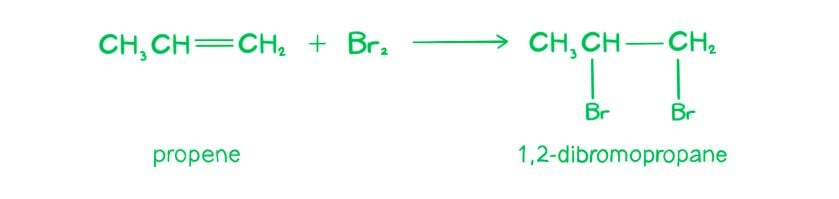

- A chiral carbon atom is a carbon atom that is attached to four different types of atoms or groups of atoms.

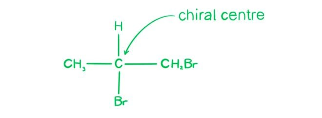

- 1,2-dibromopropane possesses a chiral centre, so **C** is correct.

**A** is incorrect as haloalkanes don't contain a double bond, and hence don't exist as cis-trans isomers.

**B** is incorrect as 1,2-dibromopropane is less volatile than propene. Volatility depends on intermolecular forces, not covalent bond strength. 1,2-dibromopropane has a larger, more polarisable electron cloud, resulting in stronger London dispersion forces between molecules compared to propene.

**D** is incorrect as carbon-halogen bonds do not enable hydrogen bonding. Hydrogen bonding requires hydrogen to be directly bonded to a highly electronegative atom (N, O, or F).

### Q24
**Final answer:** **The correct answer is D**

- Coniine contains a six-membered ring with a nitrogen atom (a piperidine ring).
- To form a six-membered ring from NH3 via two nucleophilic substitutions, the two Br atoms must be separated by four carbons (positions 1 and 5 of an octane chain).
- 1,5-dibromooctane has Br at C1 and C5, which allows NH3 to displace both Br atoms and close into a six-membered ring.

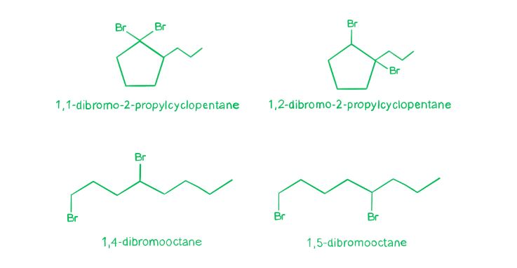

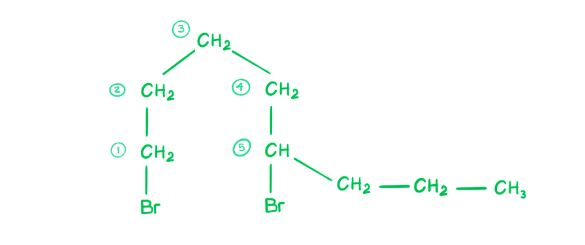

- Ammonia attacks the C–Br bonds via nucleophilic substitution to form coniine.

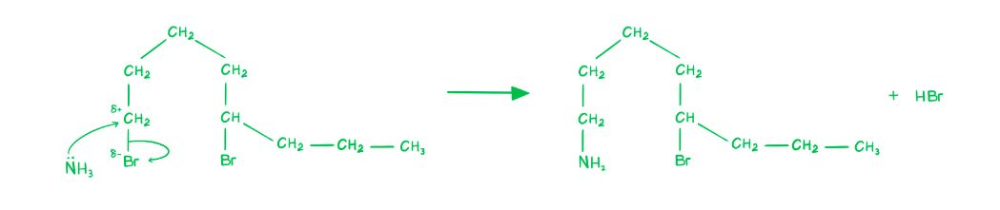

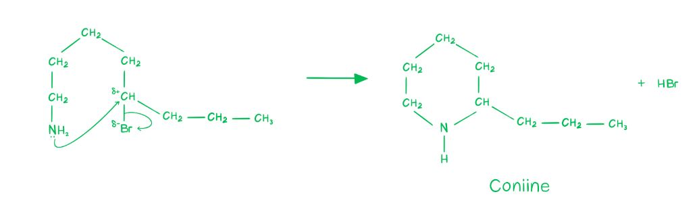

**A** is incorrect as 1,1-dibromo-2-propylcyclopentane has both Br atoms on the same carbon (geminal dibromide). Two substitutions at the same carbon cannot form the required ring.

**B** is incorrect as 1,2-dibromo-2-propylcyclopentane has Br atoms on adjacent carbons. The two N–C bonds formed would be too close together to produce the six-membered ring of coniine.

**C** is incorrect as 1,4-dibromooctane has Br at C1 and C4, separated by only three carbons. Double substitution with NH3 would give a five-membered ring, not the six-membered piperidine ring of coniine.

### Q25
**Final answer:** **The correct answer is C**

- A nucleophile is either a negatively charged species or a molecule with a lone pair of electrons, e.g. H2O.
- Nucleophilic substitution reactions involve substitution of a group or atom by a nucleophile.
- The only option which contains a nucleophile is water (H2O) in **C**, which acts via a lone pair on the oxygen atom.
- The mechanism for the reaction with bromopropane is as follows:

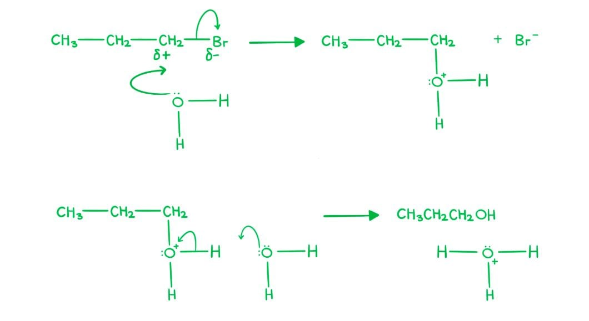

**A** is incorrect as this is an elimination reaction; KOH in ethanolic solution removes HBr to form the alkene.

**B** is incorrect as this is an electrophilic addition reaction.

**D** is incorrect as this is a free radical substitution.

### Q26
**Final answer:** **The correct answer is A**

- This reaction can be written as follows:

CH3CH2CH2Br + OH– → CH3CH2CH2OH + Br–

- The mechanism is SN2 nucleophilic substitution, and can be drawn as follows:

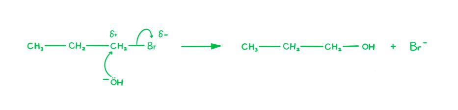

- The OH– ion, acting as a nucleophile, uses its lone pair to attack the δ+ carbon bonded to Br.
- This is shown by a curly arrow from the lone pair on OH– to the carbon atom.

**B** is incorrect as curly arrows always go from the nucleophile to the electrophile, not the other way around.

**C** is incorrect as the curly arrow should go from the C–Br bond to the Br atom to show bond breaking, not from the bond to the C atom.

**D** is incorrect as the C–Br bond breaks by heterolytic fission (both electrons go to Br–), not homolytic fission.

### Q27
**Final answer:** **The correct answer is C**

- This reaction is known as chlorination of methane and proceeds through the radical chain mechanism.
- The radical chain mechanism involves three steps: **initiation**, **propagation** and **termination**.
- Initiation requires an input of energy but after that the reaction is self-sustaining.
- This energy comes from the ultraviolet light source, which breaks the Cl–Cl bond homolytically to form two chlorine radicals.

**A** is incorrect as ultraviolet light does not break the C–H bonds in methane. It is the chlorine radical produced in initiation that abstracts a hydrogen atom in the propagation step.

**B** is incorrect as ultraviolet light causes homolytic fission of the Cl–Cl bond to give radicals, not ions.

**D** is incorrect as ultraviolet light provides the activation energy to form radicals, not heat for the mixture. The reaction proceeds at room temperature once initiated.

### Q28
**Final answer:** **The correct answer is A**

- The rate of formation of cloudiness (the order of reactivity) is related to the strength of the R–*X* bond.
- The carbon-iodine bond is the weakest and the carbon-chlorine bond is the strongest: C–Cl > C–Br > C–I
- So 1-iodobutane would react the quickest, followed by 1-bromobutane and then 1-chlorobutane.
- In order for a halide ion to be produced, the carbon-halogen bond must break – the weaker the bond, the more easily it breaks.
- Therefore, **bond energy** is the main factor deciding the relative rates of reaction.

**B** is incorrect as the ionisation energy of the halogen is a property of the isolated atom. It does not determine how easily the C–*X* bond breaks in solution.

**C** is incorrect as bond polarity is not the main factor here; although polarity contributes to bond strength, the dominant factor is bond energy.

**D** is incorrect as the solubility of the silver halide precipitate does not control the rate of the initial hydrolysis reaction.

### Q29
**Final answer:** **The correct answer is D**

- Homolytic fission = splitting a bond to produce two particles which both have a single unpaired electron (both are free radicals).

- Heterolytic fission = producing two particles which are different because one is a positive ion and the other is a negative ion.

- In this photochemical reaction, energy from sunlight causes chlorine molecules to split into two chlorine atoms, each with one unpaired electron.

- Free radicals are formed when a bond splits evenly, with each atom getting one of the two electrons.

- Hence, chlorine undergoes homolytic fission to give free radicals.

**A** is incorrect as heterolytic fission produces ions, not free radicals, and would give an electrophile (Cl+), not a radical.

**B** is incorrect as heterolytic fission does not occur here; the process is homolytic, producing radicals not electrophiles.

**C** is incorrect as homolytic fission does occur, but it produces free radicals, not electrophiles.

### Q30
**Final answer:** **The correct answer is C**

- The rate of reaction is independent of the concentration of OH–, which means the rate depends only on the concentration of the halogenoalkane, not the nucleophile.

  - This is characteristic of an SN1 reaction (**S**ubstitution **N**ucleophilic **u**nimolecular).
- In SN1, the C–Br bond breaks first (slow step) to form a carbocation intermediate, and then the nucleophile attacks (fast step).
- Tertiary carbocations are stabilised by the electron-donating inductive effect of three alkyl groups, making them more stable than secondary or primary carbocations.
- This stability lowers the activation energy of the first step and makes the SN1 pathway favourable.
- (CH3)3CBr is a tertiary halogenoalkane, so it readily forms a stable tertiary carbocation and undergoes SN1 hydrolysis.

**A** is incorrect as (CH3)2CHCH2Br has Br on a primary carbon. Primary halogenoalkanes react by SN2, where the rate depends on the concentration of both the halogenoalkane and the nucleophile.

**B** is incorrect as CH3CH2CH2CH2Br is a primary halogenoalkane and reacts by SN2. Its rate would be affected by changes in [OH–].

**D** is incorrect as CH3CH2CHBrCH3 is a secondary halogenoalkane. Secondary halogenoalkanes can undergo both SN1 and SN2, but the rate is not entirely independent of [OH–] as it would be for a tertiary compound.
