# Mark Schemes — Halogenoalkanes
**15. Halogen Compounds** · Cambridge (CIE) A-LEVEL chemistry (9701)

## Multiple Choice Questions (30 questions)

### Q1
**Final answer:** **The correct answer is A**

**Step 1: Ethane → bromoethane**

- Ethane is an alkane, so it reacts with bromine by free-radical substitution.
- This requires Br2 and UV light to initiate homolytic fission of the Br–Br bond and form radicals.

**Step 2: Bromoethane → ethylamine**

- Bromoethane undergoes nucleophilic substitution with ammonia to form an amine.
- The conditions used are ethanolic ammonia, heat in a sealed tube, to prevent ammonia escaping and to increase the yield.

**B** is incorrect as HBr does not convert an alkane into a bromoalkane under these conditions.

**C** is incorrect as KCN would form a nitrile, not an amine.

**D** is incorrect as PBr3 is used to convert alcohols to bromoalkanes, not alkanes, and HNO3 is not used to make amines from halogenoalkanes.

### Q2
**Final answer:** **The correct answer is D**

- Bromoethane reacts with ammonia by nucleophilic substitution to form ethylamine.
- To maximise the yield of the primary amine, a large excess of ammonia is used.
- This reduces the chance of the ethylamine product acting as a nucleophile and undergoing further substitution to form secondary and tertiary amines.
- Ethanol is used as the solvent because it dissolves both the halogenoalkane and ammonia.
- A sealed tube is required to prevent volatile ammonia from escaping during heating.

**A** is incorrect as using excess bromoethane increases the likelihood of further substitution of the amine product, reducing the yield of ethylamine.

**B** is incorrect as, although heating bromoethane with excess ammonia in a sealed tube would form ethylamine, the solvent used is not ethanol. Without ethanol the halogenoalkane and ammonia are not in a suitable common solvent, reducing the yield of the primary amine.

**C** is incorrect as aqueous ammonia is a less effective solvent for the halogenoalkane and encourages competing reactions, reducing the yield of the primary amine.

### Q3
**Final answer:** **The correct answer is B**

- The table shows the reaction is slowest for 1-chlorobutane and fastest for 1-iodobutane.
- In this test, the rate depends mainly on how easily the C–X bond breaks to form ions.

  - C–I has the lowest bond enthalpy, so it breaks most easily → fastest precipitate.
  - C–Cl has the highest bond enthalpy, so it breaks least easily → slowest precipitate.
- This trend explains the observed order of reaction times.

**A** is incorrect as the C–I bond is the weakest of the carbon-halogen bonds, not the strongest.

**C** is incorrect as the oxidising power of the halogen is not the factor controlling the rate of this hydrolysis reaction.

**D** is incorrect as bond polarity is not the main factor here; it is the overall bond enthalpy that determines how easily the bond breaks.

### Q4
**Final answer:** **The correct answer is D**

- A nucleophile is either a negatively charged species or a molecule with a lone pair of electrons.
- Nucleophilic substitution involves a nucleophile replacing a leaving group at a carbon atom.
- In this reaction, the Br– leaving group departs and is replaced by a nucleophile, as shown below:

**A** is incorrect as condensation reactions involve the joining of two molecules with the loss of a small molecule (e.g. H2O); that does not occur here.

**B** is incorrect as electrophilic substitution requires an electrophile attacking an electron-rich centre (e.g. a benzene ring); OH– is a nucleophile, not an electrophile.

**C** is incorrect as free radical substitution involves homolytic fission and radical intermediates, initiated by UV light; no radicals are involved in this reaction.

### Q5
**Final answer:** **The correct answer is C**

- The structure of phenacyl chloride is:

- In an SN2 mechanism, OH– attacks the carbon bonded to Cl, while the C–Cl bond breaks simultaneously, forming a pentacoordinate transition state.
- When reacted with aqueous NaOH, the reaction proceeds as follows:

- Option **C** correctly represents the transition state for this SN2 reaction.

**A** is incorrect as the structure shown does not represent the correct transition state for SN2 attack on phenacyl chloride.

**B** is incorrect as the structure shown does not correspond to the transition state for the SN2 mechanism of this reaction.

**D** is incorrect as the structure shown does not correspond to the transition state formed during the SN2 reaction of phenacyl chloride with NaOH.

### Q6
**Final answer:** **The correct answer is B**

- When halogenoalkanes are heated under reflux with ethanolic potassium cyanide, the CN– ion replaces the halogen and adds one carbon atom to the chain.
- 2-ethyl-3-methylbutanoic acid has a total of 7 carbon atoms.
- Therefore, the starting halogenoalkane must contain 6 carbon atoms.
- Compound **B** is a 6-carbon halogenoalkane; when heated with KCN in ethanol, the Br is substituted by CN:

- Acid hydrolysis of the nitrile then gives the carboxylic acid:

**A** is incorrect as it contains a different number of carbons or a different connectivity. Substitution with CN would not give the required branching pattern to produce 2-ethyl-3-methylbutanoic acid.

**C** is incorrect as its carbon skeleton does not match the structure needed. Even after CN substitution and hydrolysis, the product would not be 2-ethyl-3-methylbutanoic acid.

**D** is incorrect for the same reason that the carbon framework does not give the correct branching pattern in the target molecule.

### Q7
**Final answer:** **The correct answer is C**

- Heating the compounds causes the bonds to break, releasing the halide ions, which then react with the silver ions in AgNO3 to form precipitates.
- The smaller the bond energy, the weaker the bond, the more quickly it breaks and the faster a precipitate is produced.
- Among F, Cl, Br and I, iodine has the largest atomic radius and the lowest electronegativity, so the C–I bond is the longest and least polar and therefore the weakest.
- Compound **C** is the only compound containing I, so it produces a precipitate most quickly.

**A** is incorrect as the compound shown contains Br. The C–Br bond is stronger than the C–I bond, so it reacts more slowly.

**B** is incorrect as the compound shown also contains Br. The same reasoning applies where C–Br breaks less easily than C–I.

**D** is incorrect as the compound shown contains Cl. The C–Cl bond has the highest bond energy of the three and is the slowest to break.

### Q8
**Final answer:** **The correct answer is D**

- In the reaction CCl3CF3 → CCl2FCF3
- A Cl atom is replaced with an F atom.
- F– (fluoride ion) is the nucleophile; hence it undergoes nucleophilic substitution:

**A** is incorrect as electrophilic substitution requires an electrophile attacking an electron-rich centre; F– is a nucleophile, not an electrophile.

**B** is incorrect as free-radical substitution involves homolytic fission and radical intermediates initiated by UV light; no radicals are involved in this halogen exchange reaction.

**C** is incorrect as isomerisation involves rearrangement of atoms within the same molecular formula; here a Cl atom is replaced by F, changing the formula.

### Q9
**Final answer:** **The correct answer is D**

- The reaction between bromoethane and sodium hydroxide is **nucleophilic substitution**.
- The OH– ion uses a lone pair to attack the δ+ carbon bonded to Br – OH– is the attacking nucleophile.
- The Br– ion departs with both bonding electrons – Br– has lone pairs and is the leaving nucleophile.
- Therefore, both the attacking group and the leaving group are nucleophiles.

**A** is incorrect as OH– is a nucleophile, not an electrophile; electrophiles accept electron pairs, whereas OH– donates them.

**B** is incorrect as the attacking group (OH–) is a nucleophile, not an electrophile.

**C** is incorrect as the leaving group (Br–) has lone pairs of electrons and acts as a nucleophile, not an electrophile.

### Q10
**Final answer:** **The correct answer is C**

- In the given molecule above, there are:

C–H bonds, C–F bonds, C–Cl bonds and a C–C bond.

- In all the options the C–C bond remains intact.
- The order of bond strength of the remaining 3 bonds is:

C–F > C–H > C–Cl

- Therefore, a C–Cl bond will be broken since it requires the least energy – this only occurs in option **C**.

**A** is incorrect as the molecule loses an F atom, suggesting that a C–F bond is broken.

**B** is incorrect as the molecule loses a different F atom, yet still suggesting that a C–F bond is broken.

**D** is incorrect as the molecule loses an H atom, suggesting that a C–H bond is broken.

### Q11
**Final answer:** **The correct answer is D**

- Homolytic fission = splitting a bond to produce two free radicals (that are the same).
- Heterolytic fission = splitting a bond to produce a positive ion and a negative ion (that are different).
- Propane reacts with chlorine by free radical substitution in the presence of UV light.
- In the presence of UV, Cl2 breaks down to form two chlorine radicals.

Cl2 → 2Cl•

- This is an example of homolytic fission, which eliminates options **A** and **B**.
- In the next step, propane reacts with a chlorine radical to form the two isomers of chloropropane.

C3H8 + Cl• → C3H7Cl

- For 1-chloropropane to form, the chlorine radical has 6 hydrogens it can react with – probability $\frac{6}{8}$
- For 2-chloropropane to form, the chlorine radical has 2 hydrogens it can react with – probability $\frac{2}{8}$
- Therefore, the expected ratio of 1-chloropropane to 2-chloropropane = 6 : 2 = **3 : 1**.

### Q12
**Final answer:** **The correct answer is B**

- The cyanide ion CN– is a nucleophile and reacts with haloalkanes to produce a nitrile.
- This is a useful reaction for increasing the chain length by one carbon atom.

Potassium cyanide + 1-chloropropane → butanenitrile + potassium chloride

KCN + CH3CH2CH2Cl → CH3CH2CH2CN + KCl

- Mechanism:

  - **Step 1:** The cyanide ion attacks at the partially positive carbon of the C–Cl dipole, leading to a high energy transition state.
  - **Step 2:** The chlorine atom leaves with its bonding electrons as a chloride ion.
  - **Step 3:** The final product is butanenitrile, a 4-carbon nitrile.

**A** is incorrect as the CN– replaces Cl and extends the chain. No chlorine remains in the organic product, so 1-chloropropanenitrile cannot form.

**C** is incorrect as ethanenitrile contains only 2 carbons. The product must contain the original 3-carbon chain plus the CN carbon, giving 4 carbons in total.

**D** is incorrect as propanenitrile contains only 3 carbons. The CN group adds one carbon to the chain, giving a 4-carbon nitrile, not a 3-carbon one.

### Q13
**Final answer:** **The correct answer is C**

- A tertiary halogenoalkane reacts with a hydroxide ion by a two-step mechanism.
- This mechanism is known as an SN1 mechanism.

  - The '1' tells us that the rate of the reaction only depends on one reagent, in this case the concentration of the halogenoalkane, as shown in the first (slow) step of the mechanism.
- The first step in the mechanism is the breaking of the carbon-halogen bond – this forms a tertiary carbocation, as shown below:

- Then, the tertiary carbocation is attacked immediately by the hydroxide ion.
- Reaction pathway diagrams display information about the energy changes during chemical reactions.
- The first bump corresponds to the slow step, as more energy is required here, and the second bump corresponds to the fast step, as less energy is required at this stage.
- Point X corresponds to the breaking of the C–Br bond (first transition state, energy maximum).
- Point Y corresponds to the intermediate step when the tertiary carbocation is formed (energy minimum between the two bumps).
- Therefore, option **C** is correct.

**A** is incorrect as it misidentifies point Y – in a two-step SN1 mechanism, Y is the energy minimum between the two transition states, corresponding to the tertiary carbocation intermediate, not a transition state.

**B** is incorrect as it misidentifies point X – X is at the first energy maximum (transition state for C–Br bond breaking), not at the carbocation intermediate.

**D** is incorrect as it misidentifies both points X and Y in the double-bump energy profile of the SN1 mechanism.

### Q14
**Final answer:** **The correct answer is C**

- CFCs and chloroalkanes are similar as they both contain C–Cl bonds, but they differ in that CFCs contain C–F bonds.
- The bond energy of the C–F bond is larger than the C–Cl bond.
- So, it takes less energy to release Cl atoms than F atoms from CFCs.

  - This is why CFCs are more stable than chloroalkanes.

**A** and **B** are incorrect as the stability of a molecule comes from the strength of the bonds within the molecule, not the ionisation energy or stability of radicals.

**D** is incorrect as the polarity of a bond tells us how electronegative an atom is, which contributes to the strength of the bond, but is not the direct reason for the stability of the molecule overall.

### Q15
**Final answer:** **The correct answer is C**

- In dichlorodifluoromethane, there are two C–F bonds and two C–Cl bonds.
- Both are strong bonds, and the C–F bond energy is the larger of the two.
- The C–F bond strength is the reason for the inertness of CCl2F2 and CFCs in general.
- These bonds are so strong that they do not break under the energy of ordinary visible light.

  - UV light is required to break them.

**A** is incorrect as the non-flammability of fluorine compounds is a consequence of the inertness of CCl2F2, not a reason for it.

**B** is incorrect as the high electronegativity of fluorine contributes to the strength of the C–F bond, but electronegativity alone is not the direct reason for the inertness.

**D** is incorrect as the C–F bond is in fact highly polar; furthermore, bond polarity is not the direct reason for the inertness – bond energy is.

### Q16
**Final answer:** **The correct answer is D**

- SN1 reactions are nucleophilic substitutions, involving a nucleophile replacing a leaving group (just like in SN2).

  - However, SN1 reactions are unimolecular, so the rate of this reaction depends only on one species (the halogenoalkane).
- Tertiary halogenoalkanes tend to be the most reactive and tend to undergo nucleophilic substitution via the SN1 carbocation mechanism.
- Whereas, primary halogenoalkanes tend to be the least reactive and react via the SN2 mechanism.
- So, overall carbocation stability:

3º > 2º >> 1º

- Option **D**, 1-chloro-1-methylcyclohexane, is a tertiary halogenoalkane, hence it is the most likely option to undergo SN1 substitution.

**A** is incorrect as (CH3)3CCH2I is a primary halogenoalkane (neopentyl iodide). Despite the bulky neopentyl group, the carbon bearing the iodine has no alkyl substituents, so this compound favours SN2.

**B** is incorrect as CH2=CHCl is a vinyl halide, where the halogen is directly attached to a C=C double bond, which delocalises electron density and makes nucleophilic substitution extremely unfavourable.

**C** is incorrect as CH3CH2CH2Br is a primary halogenoalkane, which favours SN2 nucleophilic substitution rather than SN1.

### Q17
**Final answer:** **The correct answer is B**

- Ethane reacts with chlorine by free radical substitution in the presence of sunlight.
- In the presence of sunlight, Cl2 breaks down to form two chlorine radicals:

Cl2 → 2Cl•

- The generated chlorine radical can then react with ethane to give an ethane radical (C2H5•) and HCl:

C2H6 + Cl• → C2H5• + HCl

- Therefore, the reaction is a free-radical substitution with hydrogen chloride produced.

**A** is incorrect as free radical substitution produces HCl, not H2.

**C** is incorrect as the reaction produces HCl gas; a gas is produced.

**D** is incorrect as the mechanism is free radical substitution, not nucleophilic substitution. Nucleophilic substitution requires a nucleophile attacking a carbon bonded to a leaving group, which does not apply here.

### Q18
**Final answer:** **The correct answer is B**

- Propan-2-ol reacts with SOCl2 to give 2-chloropropane as the only organic product.
- The by-products SO2 and HCl are gases and are easily removed.
- This makes the reaction high yielding and selective for 2-chloropropane.

**A** is incorrect as no substitution reaction occurs between alcohols and dilute NaCl without a catalyst or halogenating agent.

**C** is incorrect as free radical substitution of propane with chlorine forms a mixture of chloropropanes and other substitution products, lowering the yield of 2-chloropropane.

**D** is incorrect as the electrophilic addition of HCl (g) to propene follows Markovnikov’s rule and gives mainly 2-chloropropane, but also forms some 1-chloropropane, so the yield is lower than with SOCl2.

### Q19
**Final answer:** **The correct answer is C**

- If a halogenoalkane is heated under reflux with a solution of potassium cyanide in ethanol, the halogen is replaced by a -CN group and a nitrile is produced.

  - So, reagent X must be KCN in C2H5OH.
- Next, to produce a carboxylic acid, the nitrile is heated under reflux with dilute hydrochloric acid.

  - So, reagent Y must be HCl.

**A** is incorrect as the reaction of a halogenoalkane with ammonia would produce a primary amine, not a carboxylic acid.

**B** and **D** are incorrect as reagent Y could not be NaOH, as this would produce the sodium salt –COONa rather than the carboxylic acid –COOH.

### Q20
**Final answer:** **The correct answer is B**

- Reaction pathway diagrams display information about the energy changes during chemical reactions.
- The reaction pathway diagram shown has two bumps, indicating a two-step mechanism with a stable intermediate between the two transition states.

  - This is characteristic of the SN1 mechanism.
- The halogenoalkane C2H5Br in option **B** is a primary halogenoalkane, which undergoes the SN2 mechanism for nucleophilic substitution.
- SN2 is a concerted one-step mechanism with a single transition state, represented by a single-bump energy profile.

- Therefore, **B** does not have the double-bump profile shown.

**A** is not the answer as (CH3)3CBr is a tertiary halogenoalkane that reacts by the SN1 mechanism, giving the double-bump profile shown.

**C** is not the answer as the addition of HCN to CH3CHO proceeds by nucleophilic addition to the carbonyl group. Although this is not an SN1 reaction, it is a two-step mechanism: CN– attacks the carbonyl carbon to form a tetrahedral alkoxide intermediate, which is then protonated. This gives a double-bump energy profile.

**D** is not the answer as the addition of Br2 to cyclohex-1-ene proceeds via a cyclic bromonium ion intermediate; this two-step mechanism also gives a double-bump energy profile.

### Q21
**Final answer:** **The correct answer is A**

- Haloalkanes undergo nucleophilic substitution because the greater electronegativity of the halogen creates a partial positive charge (Cδ+) on the carbon bonded to it.
- The nucleophile attacks the Cδ+ carbon while the C–Br bond breaks simultaneously.

  - This is a concerted, one-step process with no carbocation intermediate.
- This is an SN2 reaction.

  - **S**ubstitution **N**ucleophilic **b**imolecular, a reaction in which a bond is broken and a new bond formed simultaneously in one step.

**B** is incorrect as, although the C–Br bond does break by heterolytic fission, SN2 has no discrete carbocation intermediate as the bond breaks and the new bond forms in the same step.

**C** is incorrect as the hydroxide ion (OH–) is a nucleophile, not an electrophile.

**D** is incorrect as the reaction does not involve homolytic fission. Homolytic fission produces two free radicals and is characteristic of radical chain reactions. Nucleophilic substitution proceeds by heterolytic fission of the C–Br bond, not radical combination.

### Q22
**Final answer:** **The correct answer is C**

- C2Cl4 (tetrachloroethene) is a symmetrical molecule: both carbon atoms carry two Cl atoms each.
- The C–Cl bond dipoles are arranged symmetrically and cancel exactly, so there is no net permanent dipole.

**A** is incorrect as CCl2F2 contains both C–Cl and C–F bonds. These bonds have different dipole magnitudes because F and Cl have different electronegativities, so the bond dipoles do not cancel – there is a net permanent dipole.

**B** is incorrect as CHCl3 contains three C–Cl bonds and one C–H bond. The molecule is not symmetrical, so the dipoles do not cancel – there is a net permanent dipole.

**D** is incorrect as C2H5Cl contains a C–Cl bond and the molecule is not symmetrical, giving a net permanent dipole.

### Q23
**Final answer:** **The correct answer is C**

- When bromine and propene undergo an addition reaction, the double bond breaks, and a bromine atom becomes attached to each carbon.
- In this reaction with propene, 1,2-dibromopropane is formed.

- A chiral carbon atom is a carbon atom that is attached to four different types of atoms or groups of atoms.

- 1,2-dibromopropane possesses a chiral centre, so **C** is correct.

**A** is incorrect as haloalkanes don't contain a double bond, and hence don't exist as cis-trans isomers.

**B** is incorrect as 1,2-dibromopropane is less volatile than propene. Volatility depends on intermolecular forces, not covalent bond strength. 1,2-dibromopropane has a larger, more polarisable electron cloud, resulting in stronger London dispersion forces between molecules compared to propene.

**D** is incorrect as carbon-halogen bonds do not enable hydrogen bonding. Hydrogen bonding requires hydrogen to be directly bonded to a highly electronegative atom (N, O, or F).

### Q24
**Final answer:** **The correct answer is D**

- Coniine contains a six-membered ring with a nitrogen atom (a piperidine ring).
- To form a six-membered ring from NH3 via two nucleophilic substitutions, the two Br atoms must be separated by four carbons (positions 1 and 5 of an octane chain).
- 1,5-dibromooctane has Br at C1 and C5, which allows NH3 to displace both Br atoms and close into a six-membered ring.

- Ammonia attacks the C–Br bonds via nucleophilic substitution to form coniine.

**A** is incorrect as 1,1-dibromo-2-propylcyclopentane has both Br atoms on the same carbon (geminal dibromide). Two substitutions at the same carbon cannot form the required ring.

**B** is incorrect as 1,2-dibromo-2-propylcyclopentane has Br atoms on adjacent carbons. The two N–C bonds formed would be too close together to produce the six-membered ring of coniine.

**C** is incorrect as 1,4-dibromooctane has Br at C1 and C4, separated by only three carbons. Double substitution with NH3 would give a five-membered ring, not the six-membered piperidine ring of coniine.

### Q25
**Final answer:** **The correct answer is C**

- A nucleophile is either a negatively charged species or a molecule with a lone pair of electrons, e.g. H2O.
- Nucleophilic substitution reactions involve substitution of a group or atom by a nucleophile.
- The only option which contains a nucleophile is water (H2O) in **C**, which acts via a lone pair on the oxygen atom.
- The mechanism for the reaction with bromopropane is as follows:

**A** is incorrect as this is an elimination reaction; KOH in ethanolic solution removes HBr to form the alkene.

**B** is incorrect as this is an electrophilic addition reaction.

**D** is incorrect as this is a free radical substitution.

### Q26
**Final answer:** **The correct answer is A**

- This reaction can be written as follows:

CH3CH2CH2Br + OH– → CH3CH2CH2OH + Br–

- The mechanism is SN2 nucleophilic substitution, and can be drawn as follows:

- The OH– ion, acting as a nucleophile, uses its lone pair to attack the δ+ carbon bonded to Br.
- This is shown by a curly arrow from the lone pair on OH– to the carbon atom.

**B** is incorrect as curly arrows always go from the nucleophile to the electrophile, not the other way around.

**C** is incorrect as the curly arrow should go from the C–Br bond to the Br atom to show bond breaking, not from the bond to the C atom.

**D** is incorrect as the C–Br bond breaks by heterolytic fission (both electrons go to Br–), not homolytic fission.

### Q27
**Final answer:** **The correct answer is C**

- This reaction is known as chlorination of methane and proceeds through the radical chain mechanism.
- The radical chain mechanism involves three steps: **initiation**, **propagation** and **termination**.
- Initiation requires an input of energy but after that the reaction is self-sustaining.
- This energy comes from the ultraviolet light source, which breaks the Cl–Cl bond homolytically to form two chlorine radicals.

**A** is incorrect as ultraviolet light does not break the C–H bonds in methane. It is the chlorine radical produced in initiation that abstracts a hydrogen atom in the propagation step.

**B** is incorrect as ultraviolet light causes homolytic fission of the Cl–Cl bond to give radicals, not ions.

**D** is incorrect as ultraviolet light provides the activation energy to form radicals, not heat for the mixture. The reaction proceeds at room temperature once initiated.

### Q28
**Final answer:** **The correct answer is A**

- The rate of formation of cloudiness (the order of reactivity) is related to the strength of the R–*X* bond.
- The carbon-iodine bond is the weakest and the carbon-chlorine bond is the strongest: C–Cl > C–Br > C–I
- So 1-iodobutane would react the quickest, followed by 1-bromobutane and then 1-chlorobutane.
- In order for a halide ion to be produced, the carbon-halogen bond must break – the weaker the bond, the more easily it breaks.
- Therefore, **bond energy** is the main factor deciding the relative rates of reaction.

**B** is incorrect as the ionisation energy of the halogen is a property of the isolated atom. It does not determine how easily the C–*X* bond breaks in solution.

**C** is incorrect as bond polarity is not the main factor here; although polarity contributes to bond strength, the dominant factor is bond energy.

**D** is incorrect as the solubility of the silver halide precipitate does not control the rate of the initial hydrolysis reaction.

### Q29
**Final answer:** **The correct answer is D**

- Homolytic fission = splitting a bond to produce two particles which both have a single unpaired electron (both are free radicals).

- Heterolytic fission = producing two particles which are different because one is a positive ion and the other is a negative ion.

- In this photochemical reaction, energy from sunlight causes chlorine molecules to split into two chlorine atoms, each with one unpaired electron.

- Free radicals are formed when a bond splits evenly, with each atom getting one of the two electrons.

- Hence, chlorine undergoes homolytic fission to give free radicals.

**A** is incorrect as heterolytic fission produces ions, not free radicals, and would give an electrophile (Cl+), not a radical.

**B** is incorrect as heterolytic fission does not occur here; the process is homolytic, producing radicals not electrophiles.

**C** is incorrect as homolytic fission does occur, but it produces free radicals, not electrophiles.

### Q30
**Final answer:** **The correct answer is C**

- The rate of reaction is independent of the concentration of OH–, which means the rate depends only on the concentration of the halogenoalkane, not the nucleophile.

  - This is characteristic of an SN1 reaction (**S**ubstitution **N**ucleophilic **u**nimolecular).
- In SN1, the C–Br bond breaks first (slow step) to form a carbocation intermediate, and then the nucleophile attacks (fast step).
- Tertiary carbocations are stabilised by the electron-donating inductive effect of three alkyl groups, making them more stable than secondary or primary carbocations.
- This stability lowers the activation energy of the first step and makes the SN1 pathway favourable.
- (CH3)3CBr is a tertiary halogenoalkane, so it readily forms a stable tertiary carbocation and undergoes SN1 hydrolysis.

**A** is incorrect as (CH3)2CHCH2Br has Br on a primary carbon. Primary halogenoalkanes react by SN2, where the rate depends on the concentration of both the halogenoalkane and the nucleophile.

**B** is incorrect as CH3CH2CH2CH2Br is a primary halogenoalkane and reacts by SN2. Its rate would be affected by changes in [OH–].

**D** is incorrect as CH3CH2CHBrCH3 is a secondary halogenoalkane. Secondary halogenoalkanes can undergo both SN1 and SN2, but the rate is not entirely independent of [OH–] as it would be for a tertiary compound.

## Structured Questions (12 questions)

### Q1
> **[mark-scheme]**
> The purpose of the condenser:
> 
> Any **one** from:
> 
> - Returns / condenses volatile reactants back to the reaction mixture so they are not lost
> - Returns 1-bromobutane / water to the reaction mixture so they are not lost
> - Prevents loss of reactants, allowing them more time to react
> - Allows a higher temperature to be used without loss of reactants
> - Prevents gases other than but-1-ene from entering the gas syringe
> 
> **[1 mark]**
> 
> 'The condenser cools or condenses gases' is not accepted without specifying what happens to the condensed material.
> 
> 'But-1-ene is condensed' is not accepted as but-1-ene does not condense in the condenser; it remains as a gas and collects in the syringe.

> **[exam-tip]**
> To gain this mark, give more detail than simply saying the condenser cools or condenses gases. State what happens as a result (the volatile reactants are returned to the flask).
> **[mark-scheme]**
> Chemical test and observation to confirm the C=C double bond:
> 
> Any **one** of the following pairs (1 mark for the test and 1 mark for the observation):
> 
> **EITHER**
> 
> - Test: Add / bubble the gas through bromine water / aqueous bromine
> - Observation: Bromine water decolourises / changes from orange-brown to colourless
> 
> **OR**
> 
> - Test: Bubble the gas through acidified potassium manganate(VII)
> - Observation: Acidified potassium manganate(VII) decolourises / changes from purple to colourless
> 
> **[2 marks]**
> 
> If a colour change is given, the final colour must not be "clear"

> **[exam-tip]**
> - The gas in the syringe is but-1-ene, an alkene with a C=C double bond.
> - When describing colour changes, always state the final colour as 'colourless' not 'clear'.
> - Acidified potassium manganate(VII) also reacts with alkenes, but the expected CIE test for the presence of a C=C bond is bromine water.
To calculate the percentage of 1-bromobutane converted to but-1-ene:

- Calculate the theoretical volume of but-1-ene if all 1-bromobutane reacted:

theoretical volume = 0.0080 × 24 000 = 192 cm3 **[1 mark]**

- Calculate the percentage converted:

percentage = $\frac{22.0}{192}$ × 100 = **11.5 %** **[1 mark]**

> **[mark-scheme]**
> A correct answer without working scores 2 marks.
> 
> Allow alternative method:
> 
> moles of but-1-ene = 22.0 ÷ 24 000 = 9.17 × 10-4 mol
> 
> percentage = (9.17 × 10-4 ÷ 0.0080) × 100 = 11.5%

> **[exam-tip]**
> As the reaction ratio is 1:1, 0.0080 mol of 1-bromobutane could produce a maximum of 0.0080 mol but-1-ene.
> 
> Method 1: calculate the theoretical volume (moles × 24 000), then find what percentage 22.0 cm3 is of that volume.
> 
> Method 2: use moles = volume ÷ 24 000 to find the actual moles of but-1-ene, then calculate this as a percentage of 0.0080 mol.
> 
> Don't forget to multiply by 100 to convert to a percentage.
To calculate the temperature of the gas in the syringe before cooling:

- At constant pressure and constant moles, V/T = constant:

$\frac{V_{1}}{T_{1}} = \frac{V_{2}}{T_{2}}$

$\frac{24.0}{T_{1}} = \frac{22.0}{298}$

$T_{1} = \frac{24.0\times298}{22.0}$ **[1 mark]**

Temperature = **325 K** **[1 mark]**

> **[mark-scheme]**
> 1 mark for correct substitution into V/T = V/T (or equivalent form)
> 
> 1 mark for correct final answer: 325 K (allow 325.1 K)
> 
> A correct answer without working scores 2 marks.

> **[exam-tip]**
> - At constant pressure and constant moles: V/T = constant, so V1/T1 = V2/T2.
> - Remember to use temperature in kelvin: 25 °C = 298 K.
> **[mark-scheme]**
> i) The type of reaction to form butan-1-ol is nucleophilic substitution is:
> 
> - Nucleophilic substitution **[1 mark]**

ii) The mechanism for the reaction of 1-bromobutane with hydroxide ions:

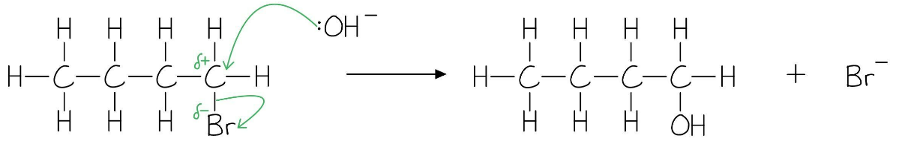

**[3 marks]**

> **[mark-scheme]**
> 1 mark for :OH– shown **AND** Br– present as a product
> 
> 1 mark for a curly arrow from the lone pair of :OH– to the carbon of the C-Br bond
> 
> 1 mark for correct dipole / partial charges on the C-Br bond **AND** a curly arrow from the C-Br bond to, or just beyond, the Br atom

> **[mark-scheme]**
> iii) Chemical test and observation for the hydroxyl group in butan-1-ol:
> 
> Any **one** complete set (1 mark for each point):
> 
> Set 1
> 
> - Warm with acidified potassium dichromate(VI) solution
> - Colour changes from orange to green
> 
> **OR**
> 
> Set 2
> 
> - Warm with acidified potassium manganate(VII)
> - Solution decolourises / changes from purple to colourless
> 
> **[2 marks]**

> **[exam-tip]**
> 1-bromobutane is a primary halogenoalkane, so nucleophilic substitution follows the SN2 mechanism: the hydroxide ion attacks the C-Br carbon in a single step.
> 
> The curly arrow from the nucleophile must start at the lone pair of electrons on :OH–.
> 
> Butan-1-ol is a primary alcohol, which can be oxidised by acidified potassium dichromate(VI), changing the solution colour from orange to green.
The three isomeric alkenes formed are:

But-1-ene:

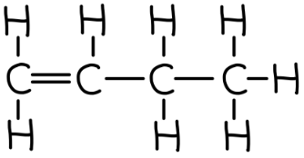

*E*-but-2-ene (trans-but-2-ene):

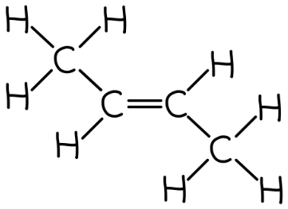

*Z*-but-2-ene (cis-but-2-ene):

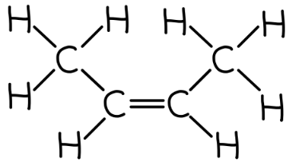

**[3 marks]**

> **[mark-scheme]**
> - 1 mark for but-1-ene (correct displayed formula)
> - 1 mark for *E*-but-2-ene / trans-but-2-ene (correct displayed formula)
> - 1 mark for *Z*-but-2-ene / cis-but-2-ene (correct displayed formula)

> **[exam-tip]**
> HBr is eliminated from 2-bromobutane. The bromine is on carbon-2.
> 
> A hydrogen can be lost from carbon-1, giving but-1-ene, or from carbon-3, giving but-2-ene.
> 
> But-2-ene exists as *E* and *Z* (cis and trans) geometrical isomers because both carbons of the C=C have two different substituents; hence three alkene isomers in total.

### Q2
The completed table is:

| organic product | name | mechanism involved |
|---|---|---|
| alkene | **Final answer:** **(2-)methylpropene** | **Final answer:** **Elimination** |
| alcohol | **Final answer:** **(2-)methylpropan-2-ol** | **Final answer:** **S****N****1** |

**[2 marks]**

> **[mark-scheme]**
> 1 mark for correct systematic name and mechanism for the alkene: (2-)methylpropene **AND **elimination
> 
> 1 mark for correct systematic name and mechanism for the alcohol: (2-)methylpropan-2-ol **AND **SN1

> **[exam-tip]**
> - Ethanolic / alcoholic conditions favour elimination to form the alkene; aqueous conditions favour nucleophilic substitution to form the alcohol.
> - 2-bromo-2-methylpropane is a tertiary halogenoalkane, so the nucleophilic substitution mechanism is SN1.
> **[mark-scheme]**
> Explanation of why a mixture of products is produced:
> 
> - The reaction conditions influence but do not exclusively determine the product
> **OR**
> The conditions favour one product but do not prevent the other from forming **[1 mark]**
> - The structure of the halogenoalkane also influences the product: tertiary halogenoalkanes tend to favour elimination reactions
> **OR**
> Primary halogenoalkanes tend to favour substitution reactions **[1 mark]**

> **[exam-tip]**
> The structure of a halogenoalkane influences which product is favoured:
> 
> - Primary halogenoalkanes tend towards substitution
> - Tertiary halogenoalkanes tend towards elimination.
> 
> Refluxing with ethanolic potassium hydroxide encourages elimination but the reaction is not exclusively elimination. Altering conditions changes the ratio, but a mixture is still typically obtained.
> **[mark-scheme]**
> The equation is:
> 
> - 3CH3CH(OH)CH2CH3 + PI3 → 3CH3CH(I)CH2CH3 + H3PO3
> **OR**    
> 3C4H10O + PI3 → 3C4H9I + H3PO3 **[1 mark]**
> 
> State symbols are not required

> **[exam-tip]**
> Butan-2-ol substitutes the –OH group for –I. Since PI3 provides three iodine atoms, three molecules of alcohol react with one PI3.
> 
> The formula H3PO3 is given in the question. Make sure your equation balances with respect to both atoms and charge.
> **[mark-scheme]**
> Concentrated sulfuric acid cannot be used because:
> 
> - Concentrated sulfuric acid will oxidise I- ions to I2 / iodide ions to iodine
> **OR**
> Iodide ions would be oxidised: 2I- → I2 + 2e- **[1 mark]**

> **[exam-tip]**
> This question links to the reducing ability of halide ions. The reducing ability increases down Group 17:
> 
> F- < Cl- < Br- < I-.
> 
> In the reaction with concentrated sulfuric acid, iodide ions are strong enough reducing agents to reduce the sulfuric acid, which means the iodide ions are oxidised to iodine (I2) instead of forming HI. No HI is produced, so no iodoalkane can be formed.

### Q3
The skeletal structures of compounds **G** and **H** are:

Compound **G**:

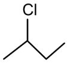

Compound **H**:

**[2 marks]**

> **[mark-scheme]**
> - 1 mark for correct skeletal structure of compound **G**: 2-chlorobutane
> - 1 mark for correct skeletal structure of compound **H**: but-1-ene

> **[exam-tip]**
> - Compound **H** cannot be but-2-ene, as but-2-ene exists as *E* and *Z* (cis and trans) geometrical isomers. Compound **H** must therefore be but-1-ene.
> - Cis/trans notation is also accepted for geometrical isomers.
> **[mark-scheme]**
> The reagents and conditions for reaction A:
> 
> - Alcoholic / ethanolic NaOH
> **OR**
> Alcoholic / ethanolic KOH **[1 mark]**
> - Heat under reflux **[1 mark]**

> **[exam-tip]**
> - You must know the reagents and conditions for the conversion of a halogenoalkane to an alkene by elimination.
> **[mark-scheme]**
> i) The mechanism for reaction **B** is:
> 
> - Nucleophilic substitution **[1 mark]**

ii) The mechanism for reaction **B** is:

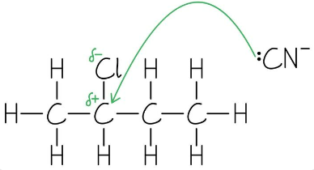

**[3 marks]**

> **[mark-scheme]**
> 1 mark for :CN– shown (if the bonding is shown, the C-N bond must be an unambiguous triple bond)
> 
> 1 mark for a curly arrow from the :CN lone pair to the C-Cl carbon
> 
> 1 mark for correct dipole / partial charges on the C-Cl bond **AND** a curly arrow from the C-Cl bond to the chlorine atom

> **[exam-tip]**
> - Nucleophilic substitution of halogenoalkanes is an important mechanism to learn.
> - The nucleophile can be:
> 
>   - The hydroxide ion / :OH–
>   - The cyanide ion / :CN–
>   - Ammonia / :NH3
> - The curly arrow from the nucleophile must start at the lone pair of electrons.
> - Work backwards from the product to identify the starting compound, then fill in the mechanism.

### Q4
> **[mark-scheme]**
> i) Alterations the student could make to the method:
> 
> - Add the same volume / a specified volume of ethanol to each test tube / reaction
> **AND**
> Add the same volume / a specified volume of silver nitrate solution to each test tube / reaction **[1 mark]**
> - Use measured volumes of the halogenoalkanes (rather than six drops) **[1 mark]**
> - Ensure the silver nitrate solution is warmed to 50 °C before adding
> **OR**
> Ensure that all the reactants are at a constant temperature before mixing them **[1 mark]**
> 
> ii) The type of reaction occurring in this method:
> 
> - Hydrolysis (in aqueous conditions)
> **OR**
> Nucleophilic substitution **[1 mark]**

> **[exam-tip]**
> To score all the marks for part (i), give all the alterations required to make the method more accurate.
> 
> The addition of the same volume of ethanol and the same volume of silver nitrate solution address the same variable, and both comments are needed to score that mark.
> 
> Ensuring all reactants are at the same temperature before mixing is a crucial step to keep the temperature as close to 50 °C as possible during the reaction.
> **[mark-scheme]**
> Description and explanation of two factors that influence the rate of this type of reaction:
> 
> Factor 1: halogen
> 
> - Iodoalkanes react the fastest
> **OR**
> Chloroalkanes react the slowest **[1 mark]**
> - The C–I bond is weaker than the C–Br or C–Cl bond / bond strength: C–Cl > C–Br > C–I
> **OR**
> The C–I bond is hydrolysed faster than C–Br or C–Cl bonds
> **OR**
> Chlorine has a higher electronegativity than bromine or iodine **[1 mark]**
> 
> Factor 2: structure
> 
> - Branched-chain halogenoalkanes react faster than straight-chain halogenoalkanes
> **OR**
> Tertiary halogenoalkanes react faster than secondary, which react faster than primary **[1 mark]**
> - Branched-chain halogenoalkanes form more stable carbocations
> **OR**
> Tertiary carbocations are more stable than secondary, which are more stable than primary carbocations **[1 mark]**

> **[exam-tip]**
> The results table includes primary, secondary, and tertiary halogenoalkanes; chloro-, bromo-, and iodoalkanes; and straight-chain and branched-chain structures. Use the table to identify two trends, then explain each one.
> 
> For the halogen factor, explanations can reference C–X bond strength, C–X bond hydrolysis rate, halogen electronegativity, or C–X dipole strength.
> 
> For the structural factor, explanations must reference the stability of the carbocation intermediate. Primary/secondary/tertiary and straight-chain/branched-chain are the same structural factor and are covered by the same marking points.
> **[mark-scheme]**
> i) The mechanism for this reaction:
> 
> - SN2 **[1 mark]**
> 
> ii) The systematic name of the inorganic product:
> 
> - Sodium bromide **[1 mark]**
> 
> iii) The reagents and conditions required:
> 
> - NaOH / KOH in ethanol / ethanolic NaOH / ethanolic KOH **[1 mark]**
> - Heat **[1 mark]**

> **[exam-tip]**
> 1-bromopentane is a primary halogenoalkane, which undergoes SN2 nucleophilic substitution with aqueous sodium hydroxide.
> 
> The two products of nucleophilic substitution are pentan-1-ol and sodium bromide. NaBr is the inorganic product.
> 
> To favour elimination over substitution, change the solvent from aqueous to ethanolic and ensure heat is applied. NaOH or KOH in ethanol with heat are the standard conditions.
i) The equation for the preparation of 1-chloropentane is:

CH3CH2CH2CH2CH2OH (l) + SOCl2 (l) → CH3CH2CH2CH2CH2Cl (l) + HCl (g) + SO2 (g)

**[2 marks]**

> **[mark-scheme]**
> 1 mark for correct chemical formulae for all species
> 
> 1 mark for correct state symbols for all species
> 
> ii) One safety precaution and explanation:
> 
> - Use of a fume cupboard **[1 mark]**
> - SO2 / sulfur dioxide and HCl / hydrogen chloride are produced
> **AND**
> Both are acidic gases that can cause damage to the respiratory tract if inhaled **[1 mark]**

> **[exam-tip]**
> - The primary alcohol pentan-1-ol reacts with thionyl chloride to substitute the -OH group with -Cl.
> - You are told that two additional products are formed — from the remaining atoms, these are HCl and SO2.
> - Both HCl and SO2 are acidic gases, so the reaction should be carried out in a fume cupboard.

### Q5
> **[mark-scheme]**
> i) A tertiary halogenoalkane is one where:
> 
> - The carbon atom bonded to the halogen is bonded to three other carbon atoms / alkyl groups **[1 mark]**
> 
> ii) The meaning of the numbers 1 and 2 is:
> 
> - The number of reacting species in the rate-determining step
> **OR**
> 2: rate-determining step involves two species; 1: rate-determining step involves one species **[1 mark]**

> **[exam-tip]**
> Primary halogenoalkanes react via SN2, where both the nucleophile and the halogenoalkane are involved in the rate-determining step.
> 
> Tertiary halogenoalkanes react via SN1, where only the halogenoalkane is involved in the rate-determining step.
i) The completed mechanism is:

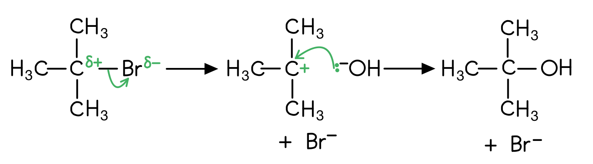

**[3 marks]**

> **[mark-scheme]**
> 1 mark for δ+ on C bonded to Br **AND** δ– on Br **AND** curly arrow from C–Br bond to Br
> 
> 1 mark for intermediate with + charge on correct carbon
> 
> 1 mark for lone pair on OH– **AND** curly arrow from lone pair to correct C atom

> **[mark-scheme]**
> ii) The rate-determining step is:
> 
> - Step 1 **[1 mark]**

> **[exam-tip]**
> In the SN1 mechanism, step 1 (ionisation of the C–Br bond) is the rate-determining step as it is the slowest step.
> 
> Only the halogenoalkane is involved in this step, hence the 1 in SN1.
i) The structure of the organic product formed is:

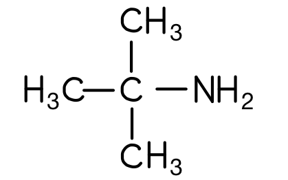

**[1 mark]**

> **[mark-scheme]**
> 1 mark for the correct structure of 2-methylpropan-2-amine
> 
> ii) The functional group is:
> 
> - Amine **[1 mark]**

> **[exam-tip]**
> When a halogenoalkane is heated under pressure with excess ethanolic ammonia, an amine is formed:
> 
> (CH3)3CBr + NH3 → (CH3)3CNH2 + HBr

### Q6
> **[mark-scheme]**
> i) The systematic name of compound **X** is:
> 
> - 2-bromopropane **[1 mark]**
> 
> ii) Compound **X** is:
> 
> - Secondary **[1 mark]**

> **[exam-tip]**
> Compound **X** has a Br atom attached to a carbon bonded to two other carbon atoms, making it a secondary halogenoalkane.
> 
> To classify halogenoalkanes, count the carbon atoms bonded directly to the carbon bearing the halogen:
> 
> - Primary: one carbon
> - Secondary: two carbons
> - Tertiary: three carbons
> **[mark-scheme]**
> The colour of the precipitate is:
> 
> - Cream **[1 mark]**

> **[exam-tip]**
> Dilute and concentrated ammonia are used to further distinguish between the silver halide precipitates:
> 
> - AgCl (s) = white and soluble in dilute ammonia
> - AgBr (s) = cream and insoluble in dilute ammonia, but soluble in concentrated ammonia
> - AgI (s) = yellow and insoluble in concentrated ammonia
The organic product formed is:

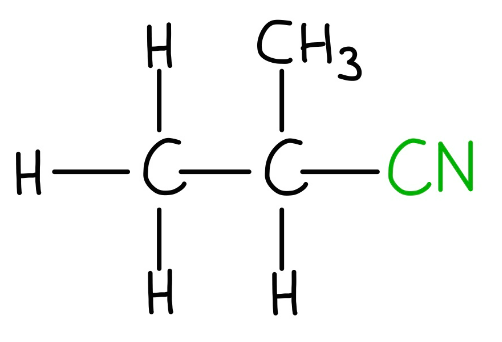

**[1 mark]**

> **[mark-scheme]**
> 1 mark for a correct structure showing 2-methylpropanenitrile

> **[exam-tip]**
> The CN- ion acts as a nucleophile, attacking the δ+ carbon bonded to Br. The C–Br bond breaks and CN- bonds in its place to form a nitrile.
> **[mark-scheme]**
> Compound **X** reacts faster than 2-chloropropane because:
> 
> - The C–Br bond is weaker than the C–Cl bond **[1 mark]**
> - The C–Br bond requires less energy to break / the activation energy is lower **[1 mark]**

> **[exam-tip]**
> Bond strength decreases down Group 17: C–Cl > C–Br > C–I.
> 
> A weaker C–X bond means a lower activation energy for the substitution reaction.
> 
> So, rate increases from Cl to Br to I.

### Q7
> **[mark-scheme]**
> The H–C–H bond angle at the terminal =CH2 group in propene is:
> 
> - An angle in the range 117°–120° **[1 mark]**

> **[exam-tip]**
> The terminal carbon in propene has three bonding regions (two C–H bonds and one C=C). These repel equally, giving a trigonal planar arrangement with bond angles of approximately 120°.
> **[mark-scheme]**
> i) The mechanism for this reaction is:
> 
> - Electrophilic addition **[1 mark]**

ii) The displayed formulae of the three compounds are:

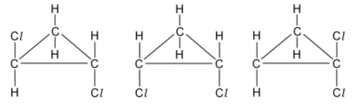

**[3 marks]**

> **[mark-scheme]**
> 1 mark for trans-1,2-dichlorocyclopropane: chlorine atoms on neighbouring carbon atoms, one above and one below the ring
> 
> 1 mark for cis-1,2-dichlorocyclopropane: chlorine atoms on neighbouring carbon atoms, both on the same side of the ring
> 
> 1 mark for 1,1-dichlorocyclopropane: both chlorine atoms on the same carbon atom

> **[exam-tip]**
> The δ+ end of Cl2 acts as the electrophile and adds across the C=C double bond in propene. This is electrophilic addition.
> 
> Cyclopropane undergoes free radical substitution with Cl2, with Cl atoms replacing H atoms at different positions on the intact ring to give three isomers:
> 
> 1. Trans-1,2-dichlorocyclopropane
> 2. Cis-1,2-dichlorocyclopropane
> 3. 1,1-dichlorocyclopropane
> **[mark-scheme]**
> i) The conditions needed are:
> 
> - UV / ultraviolet light
> **OR**
> A temperature of approximately 300 °C **[1 mark]**
> 
> ii) The mechanism is:
> 
> - Free radical substitution **[1 mark]**

> **[exam-tip]**
> UV light initiates the reaction by causing homolytic fission of the Cl–Cl bond.
i) To calculate the enthalpy change, Δ*H*:

Δ*H* = bond energy (C–H) – bond energy (H–Cl)

Δ*H* = 410 – 431 = **−**21 kJ mol-1 **[1 mark]**

ii) To calculate the enthalpy change, Δ*H*, of the similar reaction:

Δ*H* = bond energy (C–H) – bond energy (H–I)

Δ*H* = 410 – 299 = +111 kJ mol-1 **[1 mark]**

iii) It is not possible to make iodoethane by reacting together iodine and ethane because:

- The propagation step with I● is highly endothermic / Δ*H* is positive, so the reaction does not proceed / is not feasible **[1 mark]**

> **[exam-tip]**
> For each propagation step:
> 
> Δ*H* = bond energy of bond broken (C–H) – bond energy of bond formed (H–X).
> 
> For chlorination, Δ*H* = −21 kJ mol–1 (exothermic, feasible).
> 
> For iodination, Δ*H* = +111 kJ mol–1 (endothermic, so propagation cannot proceed).
> **[mark-scheme]**
> The completed equations are:
> 
> - Cl2 → **2Cl●** **[1 mark]**
> - CH3CH2● + **Cl****2** → **CH****3****CH****2****Cl** + **Cl●** **[1 mark]**
> - **CH****3****CH****2****●** + **Cl●** → CH3CH2Cl **[1 mark]**

> **[exam-tip]**
> The first equation is initiation (homolytic fission of Cl2).
> 
> The second is propagation (a radical reacts and another is produced).
> 
> The third is termination (two radicals combine and no new radicals are produced).

### Q8
The completed table is:

| skeletal formula | primary, secondary or tertiary |
|---|---|
| 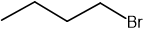 | primary |
| 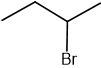 | secondary |
| 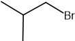 | primary |
| 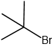 | tertiary |

**[4 marks]**

> **[mark-scheme]**
> 1 mark for the skeletal structure of 1-bromobutane **AND **primary
> 
> 1 mark for the skeletal structure of 2-bromobutane **AND **secondary
> 
> 1 mark for the skeletal structure of 1-bromo-2-methylpropane **AND **primary
> 
> 1 mark for the skeletal structure of 2-bromo-2-methylpropane **AND **tertiary

> **[exam-tip]**
> When drawing isomers, take a systematic approach
> 
> - Draw the straight chain isomers first
> 
>   - Bromine can be on carbon 1 or 2
> - Then identify the branched chain isomers
> 
>   - A methyl group can be on carbon 2 with bromine on carbon 1
>   - 2 methyl groups can be on carbon 1 with bromine also on carbon 1
> 
> Remember: To identify whether it is a primary, secondary or tertiary halogenoalkane, count how many alkyl groups the carbon which is attached to the halogen, is itself attached to
> **[mark-scheme]**
> i) The systematic name of the isomer is:
> 
> - 2-bromobutane **[1 mark]**

ii) The three-dimensional structures of the two optical isomers are:

| 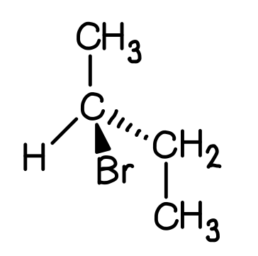 | 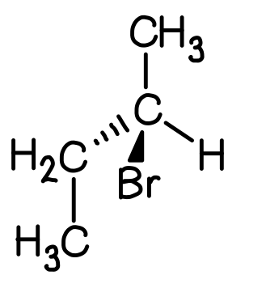 |
|---|---|

**[2 marks]**

> **[mark-scheme]**
> 1 mark for the three-dimensional structure of chiral 2-bromobutane, showing a central carbon bonded to CH3, CH2CH3, H and Br with wedge and dash stereochemistry
> 
> 1 mark for the non-superimposable mirror image of the three-dimensional structure of chiral 2-bromobutane

> **[exam-tip]**
> In 2-bromobutane, carbon 2 is bonded to H, Br, CH3 and CH2CH3, giving four different groups and therefore a chiral centre.
> 
> Always use wedge bonds to show three-dimensional structure.
> **[mark-scheme]**
> The observations can be explained by:
> 
> - The halide ions released during hydrolysis form a precipitate with silver ions: Ag+ + X– → AgX **[1 mark]**
> - The order reflects decreasing C–X bond strength, where C–I (weakest) reacts fastest and C–Cl (strongest) reacts slowest **[1 mark]**

> **[exam-tip]**
> The colour of each silver halide precipitate:
> 
> - AgI = yellow
> - AgBr = cream
> - AgCl = white
> 
> Bond strength decreases down Group 17; a weaker C–X bond means lower activation energy and faster hydrolysis.
> **[mark-scheme]**
> i) The mechanism is nucleophilic substitution is:
> 
> - Nucleophilic substitution **[1 mark]**

ii) The completed mechanism is:

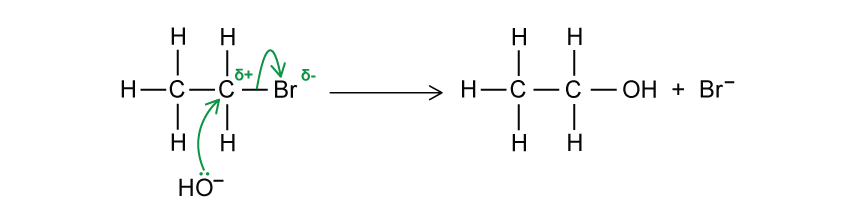

**[2 marks]**

> **[mark-scheme]**
> 1 mark for curly arrow from lone pair on OH– to the C atom of the C–Br bond
> 
> 1 mark for correct dipole on C–Br bond **AND** curly arrow from C–Br bond to Br

> **[exam-tip]**
> The OH– ion acts as a nucleophile, donating a lone pair to the δ+ carbon. Br is displaced as the leaving group (Br–).
> 
> Bromoethane is a primary halogenoalkane, so this is an SN2 reaction (single-step mechanism).
> **[mark-scheme]**
> i) The mechanisms are:
> 
> - Primary halogenoalkane: SN2 **[1 mark]**
> - Tertiary halogenoalkane: SN1 **[1 mark]**
> 
> ii) A tertiary carbocation is more stable than a primary carbocation because:
> 
> - Alkyl groups have a positive inductive effect / donate electron density towards the positively charged carbon **[1 mark]**
> - Three alkyl groups (tertiary) push more electron density onto the carbon than one alkyl group (primary), reducing the positive charge density more effectively **[1 mark]**

> **[exam-tip]**
> SN stands for nucleophilic substitution. The number refers to the molecularity of the rate-determining step:
> 
> - SN2 (two species involved)
> - SN1 (one species involved).
> 
> Greater electron density on the cationic carbon = more stable carbocation.

### Q9
> **[mark-scheme]**
> The equations for each stage are:
> 
> - Stage 1: KBr + H2SO4 → KHSO4 + HBr
> **OR** 
> 2KBr + H2SO4 → K2SO4 + 2HBr **[1 mark]**
> - Stage 2: C4H9OH + HBr → C4H9Br + H2O **[1 mark]**

> **[exam-tip]**
> Stage 1 only involves the inorganic reagents (KBr and H2SO4).
> 
> Butan-1-ol reacts in Stage 2 with the HBr generated in Stage 1.
> **[mark-scheme]**
> Any **two** from:
> 
> - Br2 / bromine **AND** butane **AND** UV light
> - Butene **AND** HBr
> - Butan-1-ol **AND** PBr3 **AND** heat
> - Butan-1-ol **AND** P + Br2 **AND** heat
> 
> **[2 marks]**

> **[exam-tip]**
> HBr + H2SO4 / H3PO4 method is not accepted for this question as it is the method described in part (a).
> 
> Make sure you state any necessary reaction conditions.
The completed reaction scheme is:

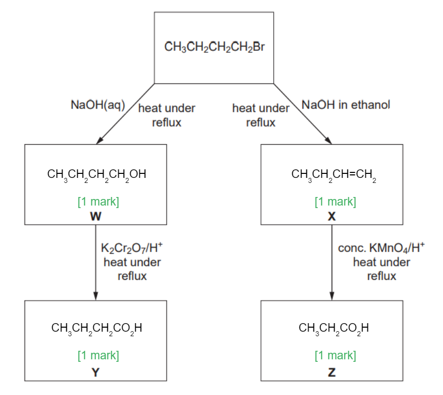

**[4 marks]**

> **[mark-scheme]**
> 1 mark for identifying compound **W** as CH3CH2CH2CH2OH
> 
> 1 mark for identifying compound **X** as CH3CH2CH=CH2
> 
> 1 mark for identifying compound **Y** as CH3CH2CH2COOH **OR **CH3CH2CH2CO2H
> 
> 1 mark for identifying compound **Z** as CH3CH2COOH **OR **CH3CH2CO2H

> **[mark-scheme]**
> ii) The type of reaction when compound **X** is produced is:
> 
> - Elimination **[1 mark]**

> **[exam-tip]**
> The products of halogenoalkane reactions depend on conditions:
> 
> - Aqueous NaOH + heat → alcohol (nucleophilic substitution)
> - Ethanolic NaOH + heat → alkene (elimination)
> - KCN in ethanol + heat → nitrile (chain extension)
> - NH3 in ethanol + heat + pressure → amine
> **[mark-scheme]**
> Compound **W** forms more slowly with aqueous silver nitrate because:
> 
> - The hydroxide ion is a better nucleophile than water **[1 mark]**
> - The OH– ion has a full negative charge, whereas water has only a partial negative charge on oxygen **[1 mark]**

> **[exam-tip]**
> Both reactions are nucleophilic substitution reactions.
> 
> A stronger nucleophile (higher electron density, full negative charge) attacks the electrophilic carbon more effectively, increasing the rate.

### Q10
> **[mark-scheme]**
> i) The reagent and conditions for step 1 are:
> 
> - Cl2 / chlorine **[1 mark]**
> - UV light **[1 mark]**
> 
> ii) The mechanism for step 1 is:
> 
> - Free radical substitution **[1 mark]**

> **[exam-tip]**
> UV light provides the energy to break the Cl–Cl bond homolytically, generating two chlorine free radicals.
> 
> Cl2 is the reagent and UV light is the condition.
> **[mark-scheme]**
> The two propagation equations are:
> 
> - Cl● + CH3CH2CH3 → CH3CH2CH2● + HCl **[1 mark]**
> - CH3CH2CH2● + Cl2 → CH3CH2CH2Cl + Cl● **[1 mark]**

> **[exam-tip]**
> In the propagation steps there is no net change in the number of free radicals, as the Cl● used in the first step is regenerated in the second step.
> **[mark-scheme]**
> i) The mechanism for step 2 is:
> 
> - Elimination **[1 mark]**
> 
> ii) The reagent and conditions for step 2 are:
> 
> - (Concentrated) NaOH / KOH in ethanol **[1 mark]**
> - Heat **[1 mark]**

> **[exam-tip]**
> Elimination produces an alkene by removing HCl. Using aqueous NaOH instead of ethanolic NaOH favours nucleophilic substitution to form an alcohol instead.

### Q11
> **[mark-scheme]**
> The experiment should include:
> 
> - Using ethanol (as a co-solvent) **[1 mark]**
> - Adding aqueous silver nitrate to each **[1 mark]**
> - Using equal amounts / volumes of each halogenoalkane (fair test) **[1 mark]**
> - Recording the time taken for a precipitate to form in each **[1 mark]**
> - Using a water bath to control temperature **[1 mark]**

> **[exam-tip]**
> Halogenoalkanes are insoluble in water, so ethanol is added as a co-solvent to allow mixing. Equal volumes must be used to ensure a fair comparison of rates.
> **[mark-scheme]**
> The trend in rates of hydrolysis is:
> 
> - The rate increases in the order: 1-chlorobutane < 1-bromobutane < 1-iodobutane **[1 mark]**
> - Because the C–Cl bond is stronger than the C–Br bond, which is stronger than the C–I bond **[1 mark]**

> **[exam-tip]**
> Bond strength decreases as the halogen atom increases in size down Group 17. A weaker C–X bond has a lower activation energy for hydrolysis, so the reaction is faster.
> **[mark-scheme]**
> i) A chiral centre is:
> 
> - A carbon atom that has four different atoms or groups attached **[1 mark]**

ii) The three-dimensional structures of the two optical isomers of butan-2-ol are:

| 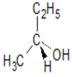 | 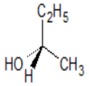 |
|---|---|

**[2 marks]**

> **[mark-scheme]**
> 1 mark for a structure with a chiral carbon bonded to C2H5, CH3, OH and H, with wedge and dashed bonds showing three-dimensional arrangement
> 
> 1 mark for the non-superimposable mirror image of the first structure

> **[exam-tip]**
> In butan-2-ol, carbon 2 is bonded to H, OH, CH3 and CH2CH3, giving a chiral centre. The two enantiomers are non-superimposable mirror images.
> 
> Always use wedge bonds to show three-dimensional structure in optical isomer diagrams.
> **[mark-scheme]**
> i) The mechanism for hydrolysis of RCH2X (primary) is:
> 
> - SN2 **[1 mark]**
> 
> The transition state is:
> 
> 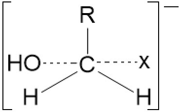
> 
> **[1 mark]**
> 
> ii) The mechanism for hydrolysis of R3CX (tertiary) is:
> 
> - SN1 **[1 mark]**
> 
> The structure of the intermediate formed in this reaction is:
> 
> 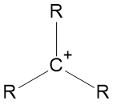
> 
> **[1 mark]**
> 
> iii) One difference between these two mechanisms in terms of the species involved in the rate-determining step is:
> 
> - In SN2 (primary), both RCH2X **AND** OH− are involved in the rate-determining step **[1 mark]**
> - In SN1 (tertiary), only R3CX is involved in the rate-determining step **[1 mark]**

> **[exam-tip]**
> SN2 (primary):
> 
> - One-step mechanism
> - OH− attacks as X− leaves simultaneously
> - Pentavalent transition state.
> 
> SN1 (tertiary):
> 
> - Two-step mechanism
> - C–X ionises first (slow, rate-determining)
> - OH− then attacks the carbocation (fast)
> 
> Both are nucleophilic substitution reactions.

### Q12
> **[mark-scheme]**
> i) The reagent and conditions for Reaction 1 are:
> 
> - (Concentrated) NaOH / KOH **[1 mark]**
> - Ethanol (solvent) **AND** heat **[1 mark]**
> 
> ii) A suitable reagent for Reaction 2 is:
> 
> - KCN / potassium cyanide 
> **OR**
> NaCN / sodium cyanide **[1 mark]**
> 
> Explanation:
> 
> - It increases the number of carbon atoms in the chain / extends the carbon chain **[1 mark]**
> 
> iii) The conditions for Reaction 3 are:
> 
> - Heat **[1 mark]**
> - Under pressure **[1 mark]**
> 
> iv) The structural formula of the product is:
> 
> - CH3CH2CH2OH **[1 mark]**

> **[exam-tip]**
> The three reactions in Fig. 2.1 represent key reactions of halogenoalkanes:
> 
> - Reaction 1 is elimination (ethanolic NaOH + heat) to form an alkene.
> - Reaction 2 is nitrile formation (KCN in ethanol); the key synthetic advantage is chain extension by one carbon.
> - Reaction 3 is amine formation (NH3 in ethanol, heat and pressure).
> - Reaction with aqueous NaOH gives nucleophilic substitution to form an alcohol.
To calculate the rate of reaction at *t* = 50 s:

- Draw a tangent to the curve at t = 50 s:

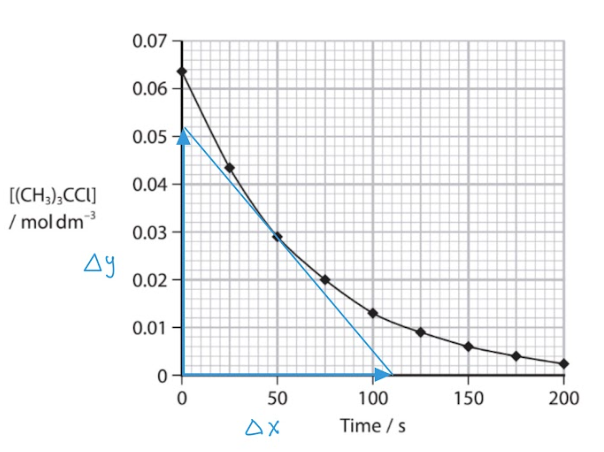

**[1 mark]**

- Calculate the gradient:

gradient = $\frac{\Deltay}{\Deltax}$

gradient =  $\frac{0.052}{110}$

gradient = 4.72 x 10-4 **[1 mark]**

units = mol dm-3 s-1 **[1 mark]**

> **[mark-scheme]**
> 1 mark for a tangent drawn on graph at *t* = 50 s
> 
> 1 mark for the gradient of tangent calculated correctly (answers in the range of 4.0 –6.0 x 10-4)
> 
> 1 mark for units of mol dm-3 s-1
> 
> A correctly drawn tangent at *t* = 50 s gives a rate in the range 4.0 to 6.0 × 10-4 mol dm-3 s-1
> 
> Allow any gradient consistently derived from a correctly drawn tangent

> **[exam-tip]**
> Draw the tangent as a straight line touching the curve at exactly *t* = 50 s.
> 
> Calculate the gradient using Δ*y*/Δ*x*.
> 
> The rate of reaction equals the magnitude of this gradient.
> **[mark-scheme]**
> The mechanism is:
> 
> - Nucleophilic substitution **[1 mark]**

> **[exam-tip]**
> 2‑chloro‑2‑methylpropane is a tertiary halogenoalkane, so it reacts via an SN1 mechanism.
> 
> The OH− acts as the nucleophile, attacking the tertiary carbocation intermediate formed after ionisation of the C–Cl bond.
> **[mark-scheme]**
> i) The observation in the test-tube containing **X** is:
> 
> - Cream / off-white precipitate **[1 mark]**
> - AgBr **[1 mark]**
> - A very pale yellow colour is also accepted for the AgBr precipitate.
> 
> ii) The order of rate of reaction is:
> 
> - Y > X > Z
> **OR**
> 1-iodobutane > 1-bromobutane > 1-chlorobutane **[1 mark]**

> **[exam-tip]**
> The order of reactivity reflects C–X bond strength.
> 
> - C–I (weakest bond) reacts fastest
> - C–Cl (strongest bond) reacts slowest
The completed mechanism is:

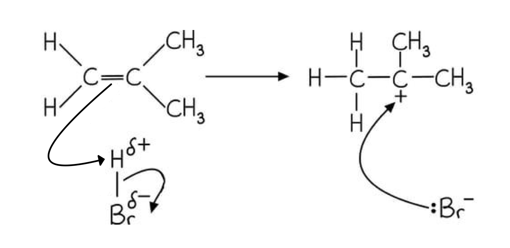

**[4 marks]**

> **[mark-scheme]**
> 1 mark for curly arrow from C=C to H of HBr **AND** correct dipole on HBr
> 
> 1 mark for curly arrow from H–Br bond to Br atom
> 
> 1 mark for intermediate with + charge on the correct (tertiary) carbon **AND** Br−
> 
> 1 mark for lone pair on Br− **AND** curly arrow from lone pair to C+

> **[exam-tip]**
> The major product is 2-bromo-2-methylpropane because the tertiary carbocation intermediate is more stable than the primary alternative. This is Markovnikov addition, where the nucleophile (Br−) attacks the more substituted carbon.
