# Exam Questions — Halogenoalkanes
**15. Halogen Compounds** · Cambridge (CIE) A-LEVEL chemistry (9701)
> Source: [https://www.savemyexams.com/a-level/chemistry/cie/25/topic-questions/](https://www.savemyexams.com/a-level/chemistry/cie/25/topic-questions/) · 42 questions across 2 sets

## Multiple Choice Questions (30 questions)

### Q1 — medium — 1 marks

**Q1** [1 mark]

Consider the two-step synthesis:

ethane  $\overset{\mathrm{step}1}{\rightarrow}$ bromoethane $\overset{\mathrm{step}2}{\rightarrow}$ ethylamine

|   | step 1 reagents | step 2 reagents |
|---|---|---|
| **A** | Br2, UV light | NH3, ethanol, heat under pressure |
| **B** | HBr, room temperature | NH3, aqueous, reflux |
| **C** | Br2, UV light | KCN, ethanol, reflux |
| **D** | PBr3, reflux | HNO3, room temperature |

Which row shows the correct reagents and conditions?

### Q2 — medium — 1 marks

**Q2** [1 mark]

Bromoethane reacts with ammonia to form ethylamine.

Which set of conditions is required to maximise the yield of ethylamine and minimise further substitution products?

### Q3 — medium — 1 marks

**Q3** [1 mark]

The table shows the time taken for a silver halide precipitate to appear when halogenoalkanes react with aqueous ethanolic silver nitrate at 50 oC.

| halogenoalkane | time for precipitate / s |
|---|---|
| 1-chlorobutane | >300 |
| 1-bromobutane | 120 |
| 1-iodobutane | 15 |

Which statement explains the differences in the times taken for the precipitate to appear?

### Q4 — easy — 1 marks

**Q4** [1 mark]

Bromomethane, CH3Br, is used as a fumigant to destroy insect pests in grain that is to be stored. It can be made by reacting methanol with hydrogen bromide.

CH3OH  +  HBr  $\rightarrow$  CH3Br  + H2O

What type of reaction is this?

### Q5 — hard — 1 marks

**Q5** [1 mark]

When phenacyl chloride, C6H5COCH2Cl, is reacted with aqueous NaOH, the substitution reaction follows an SN2 mechanism.

Which structure represents the transition state for this reaction?

### Q6 — hard — 1 marks

**Q6** [1 mark]

The compound 2-ethyl-3-methylbutanoic acid is used as a flavouring in some food.

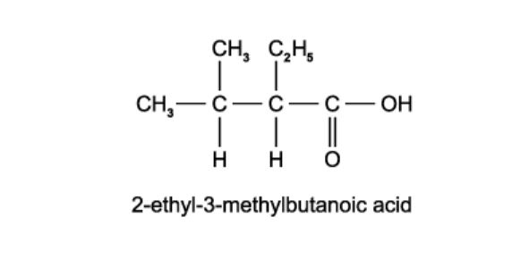

Which compound produces 2-ethyl-3-methylbutanoic acid when heated under reflux with potassium cyanide in ethanol, followed by acid hydrolysis of the reaction product?

### Q7 — medium — 1 marks

**Q7** [1 mark]

The presence of a halogen in an organic compound may be detected by warming the organic compound with aqueous ethanolic silver nitrate.

Which compound would be the quickest to produce a precipitate?

### Q8 — medium — 1 marks

**Q8** [1 mark]

CCl2FCClF2 is converted to a fluorocarbon by the following route:

CCl2FCClF2 $\overset{\text{step 1}}{\rightarrow}$ CCl3CF3 $\overset{\text{step 2}}{\rightarrow}$ CCl2FCF3

What type of reaction is **step 2**?

### Q9 — medium — 1 marks

**Q9** [1 mark]

In the hydrolysis of bromoethane by aqueous sodium hydroxide, which row correctly describes the attacking group and the leaving group?

|   | **Attacking group** | **Leaving group** |
|---|---|---|
| **A** | Electrophile | Electrophile |
| **B** | Electrophile | Nucleophile |
| **C** | Nucleophile | Electrophile |
| **D** | Nucleophile | Nucleophile |

### Q10 — easy — 1 marks

**Q10** [1 mark]

High-energy irradiation in the stratosphere produces radicals from halogenoalkanes.

Which radical could result from this irradiation of CHFClCF2Cl?

### Q11 — medium — 1 marks

**Q11** [1 mark]

A reaction between chlorine and propane in the presence of ultraviolet light produces two isomeric monochloropropanes, C3H7Cl.

Which row identifies the type of bond fission in the initiation step and the expected ratio of 1-chloropropane to 2-chloropropane produced?

|   | **Type of bond fission in initiation step** | **Expected ratio of 1-chloropropane to 2-chloropropane produced** |
|---|---|---|
| **A** | Heterolytic | 1:1 |
| **B** | Heterolytic | 3:1 |
| **C** | Homolytic | 1:1 |
| **D** | Homolytic | 3:1 |

### Q12 — hard — 1 marks

**Q12** [1 mark]

When a solution of potassium cyanide in ethanol is heated under reflux with 1-chloropropane, what is the organic product of the reaction?

### Q13 — hard — 1 marks

**Q13** [1 mark]

A tertiary bromoalkane, indicated here by      C–Br, reacts with aqueous NaOH. The mechanism has the reaction pathway below.

Which point in the diagram is correctly identified?

### Q14 — easy — 1 marks

**Q14** [1 mark]

Chlorofluoroalkanes, CFCs, can be used as refrigerants, aerosol propellants and fire extinguishers.

CFCs such as CCl3F and CCl2F2 are more stable than chloroalkanes such as CCl4.

What is the reason for their greater stability?

### Q15 — easy — 1 marks

**Q15** [1 mark]

Dichlorodifluoromethane, CCl2F2, has been used in aerosol propellants and as a refrigerant.

Which statement helps to explain why dichlorodifluoromethane is chemically inert?

### Q16 — medium — 1 marks

**Q16** [1 mark]

Which compound undergoes an SN1 substitution reaction?

### Q17 — easy — 1 marks

**Q17** [1 mark]

Which reaction occurs when ethane and chlorine are mixed in diffused sunlight?

### Q18 — medium — 1 marks

**Q18** [1 mark]

Which reaction will give the highest yield of 2-chloropropane as the only organic product?

### Q19 — easy — 1 marks

**Q19** [1 mark]

**X** and **Y** are the reagents required to convert 1-bromopropane into butanoic acid.

Which row correctly identifies **X** and **Y**?

|   | **X** | **Y** |
|---|---|---|
| **A** | NH3 | HCl (aq) |
| **B** | KCN in C2H5OH | NaOH (aq) |
| **C** | KCN in C2H5OH | HCl (aq) |
| **D** | HCN | NaOH (aq) |

### Q20 — hard — 1 marks

**Q20** [1 mark]

A reaction pathway diagram is shown.

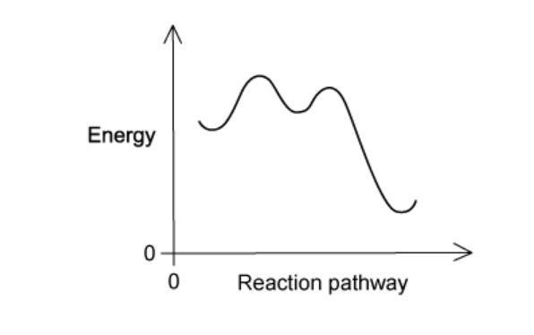

Which reaction does **not** have such a profile?

### Q21 — medium — 1 marks

**Q21** [1 mark]

What is involved in the mechanism of the reaction between aqueous sodium hydroxide and 1-bromobutane?

### Q22 — hard — 1 marks

**Q22** [1 mark]

Which molecule has **no** permanent dipole?

### Q23 — medium — 1 marks

**Q23** [1 mark]

Bromine and propene undergo an addition reaction.

Which statement about the product is correct?

### Q24 — hard — 1 marks

**Q24** [1 mark]

Coniine is the major constituent of the poison 'oil of hemlock'.

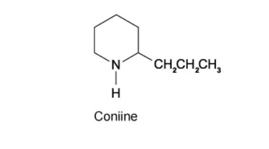

Coniine can be synthesised by reacting ammonia with a dibromo compound, **X,**C8H16Br2 .

NH3 + **X**$\rightarrow$ coniine + 2HBr

What is the name of compound **X**?

### Q25 — easy — 1 marks

**Q25** [1 mark]

Which reaction is an example of nucleophilic substitution?

### Q26 — medium — 1 marks

**Q26** [1 mark]

Aqueous sodium hydroxide reacts with 1-bromopropane to give propan-1-ol.

Which statement correctly describes the mechanism of this reaction?

### Q27 — easy — 1 marks

**Q27** [1 mark]

The reaction of chlorine with methane is carried out in the presence of ultraviolet light.

What is the function of the ultraviolet light?

### Q28 — medium — 1 marks

**Q28** [1 mark]

Four drops of 1-chlorobutane, 1-bromobutane and 1-iodobutane were put separately into three test-tubes containing 1.0 cm3 of aqueous silver nitrate at 60 °C.

A hydrolysis reaction occurred.

R represents the butane chain C4H9– and *X* the halogen atom.

H2O (l) + R–*X* (l) + Ag+ (aq) $\rightarrow$ R–OH (aq) + Ag*X* (s) + H+ (aq)

The rate of formation of cloudiness in the tubes was in the order RCl < RBr < RI

Which statement explains this order of reactivity?

### Q29 — easy — 1 marks

**Q29** [1 mark]

Light initiates the following reaction.

alkane + chlorine $\rightarrow$ chloroalkane + hydrogen chloride

What happens to the chlorine molecule during this photochemical reaction?

### Q30 — hard — 1 marks

**Q30** [1 mark]

When an isomer **Y** of molecular formula C4H9Br undergoes hydrolysis in aqueous sodium hydroxide to form an alcohol C4H9OH, the rate of reaction is found to be independent of the concentration of OH– ions present.

Which is the most likely molecular structure of **Y**?

## Structured Questions (12 questions)

### Q1 — hard — 16 marks

**Q1** [1 mark]

Bromobutanes react with hot ethanolic potassium hydroxide solution to produce gaseous butenes.

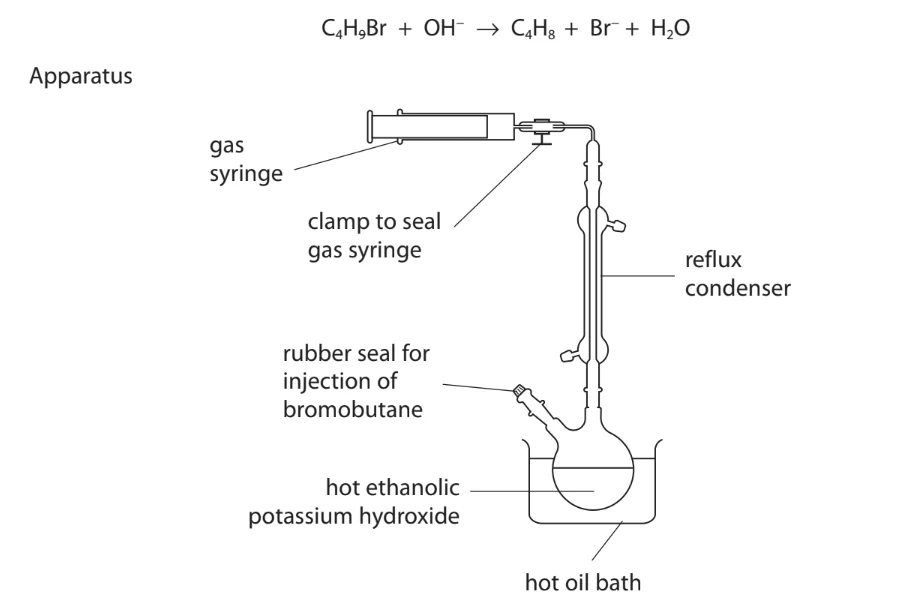

0.0080 mol of liquid 1-bromobutane was injected into a round bottom flask containing hot ethanolic potassium hydroxide. After the reaction, the syringe was sealed using a clamp and removed from the apparatus. It was then allowed to cool to 25 °C.

The final volume of but-1-ene collected was 22.0 cm3.

State the purpose of the condenser.

*Source: June 2019 8CHO/02 Q5A*

**Q1** [2 marks]

**Extract:**

Bromobutanes react with hot ethanolic potassium hydroxide solution to produce gaseous butenes.

0.0080 mol of liquid 1-bromobutane was injected into a round bottom flask containing hot ethanolic potassium hydroxide. After the reaction, the syringe was sealed using a clamp and removed from the apparatus. It was then allowed to cool to 25 °C.

The final volume of but-1-ene collected was 22.0 cm^3^.

Describe a chemical test and expected observation to confirm the presence of the carbon-carbon double bond in the gas in the syringe.

*Source: June 2019 8CHO/02 Q5B*

**Q1** [2 marks]

**Extract:**

0.0080 mol of liquid 1-bromobutane was injected into a round bottom flask containing hot ethanolic potassium hydroxide. After the reaction, the syringe was sealed using a clamp and removed from the apparatus. It was then allowed to cool to 25 °C.

The final volume of but-1-ene collected was 22.0 cm^3^.

Calculate the percentage of 1-bromobutane which was converted to but-1-ene. Show your working.

*Source: June 2019 8CHO/02 Q5C*

**Q1** [2 marks]

**Extract:**

0.0080 mol of liquid 1-bromobutane was injected into a round bottom flask containing hot ethanolic potassium hydroxide. After the reaction, the syringe was sealed using a clamp and removed from the apparatus. It was then allowed to cool to 25 °C.

The final volume of but-1-ene collected was 22.0 cm³.

Before cooling, the volume of but-1-ene in the gas syringe was 24.0 cm3.

Assuming constant pressure and that no but-1-ene is lost from the gas syringe during cooling, calculate the temperature of the gas in the syringe before cooling. Show your working.

Temperature = ...................... K

*Source: June 2019 8CHO/02 Q5D*

**Q1** [6 marks]

**Extract:**

Bromobutanes react with hot ethanolic potassium hydroxide solution to produce gaseous butenes.

0.0080 mol of liquid 1-bromobutane was injected into a round bottom flask containing hot ethanolic potassium hydroxide.

i) Another compound formed from 1-bromobutane under these conditions is butan-1-ol.

Name the type of reaction taking place to form butan-1-ol.

[1]

ii) Draw the mechanism for the reaction of 1-bromobutane with hydroxide ions to form butan-1-ol. Include charges, dipoles, lone pairs of electrons and curly arrows, as appropriate.

[3]

iii) Describe a chemical test and expected observation to confirm the presence of the hydroxyl group in butan-1-ol.

[2]

*Source: June 2019 8CHO/02 Q5E*

**Q1** [3 marks]

The elimination reaction of 2-bromobutane produces a mixture of three isomeric alkenes.

Draw the displayed formulae of the three alkene isomers formed.

*Source: June 2019 8CHO/02 Q5F*

### Q2 — hard — 6 marks

**Q2** [2 marks]

2-bromo-2-methylpropane is refluxed with ethanolic potassium hydroxide, KOH.

Complete Table 2.1 to state the systematic name of each organic product and identify the mechanism involved.

**Table 2.1**

| organic product | name | mechanism involved |
|---|---|---|
| alkene |   |   |
| alcohol |   |   |

**Q2** [2 marks]

**Extract:**

2-bromo-2-methylpropane is refluxed with ethanolic potassium hydroxide, KOH.

Complete Table 2.1 to state the systematic name of each organic product and identify the mechanism involved.

Table 2.1

| organic product | name | mechanism involved |
| --- | :---: | :---: |
| alkene |   |   |
| alcohol |   |   |

Explain why a mixture of an alkene and an alcohol is produced in the reaction outlined in part **(a)**.

**Q2** [1 mark]

Butan-2-ol reacts with phosphorus(III) iodide, PI3, to produce an iodoalkane and phosphorous acid, H3PO3.

Construct an equation for this reaction.

**Q2** [1 mark]

Explain why concentrated sulfuric acid cannot be used to prepare iodoalkanes from potassium iodide.

### Q3 — hard — 8 marks

**Q3** [2 marks]

Compound **G** is a chloroalkane that can undergo two different reactions as outlined in Fig. 3.1.

**Fig. 3.1**

Compound **H** is an alkene which does not show geometrical (cis/trans) isomerism.

Draw the skeletal structures of compounds **G** and **H**.

**Q3** [2 marks]

**Extract:**

Compound **G** is a chloroalkane that can undergo two different reactions as outlined in Fig. 3.1.

**Fig. 3.1**

Compound **H** is an alkene which does not show geometrical (cis/trans) isomerism.

Compound **G**: 2-chlorobutane
Compound **H**: but-1-ene

State the reagents and conditions for reaction **A** in Fig. 3.1.

**Q3** [4 marks]

**Extract:**

Compound **G** is a chloroalkane that can undergo two different reactions as outlined in Fig. 3.1.

**Fig. 3.1**

Compound **H** is an alkene which does not show geometrical (cis/trans) isomerism.

Compound **G**: 2-chlorobutane

Reaction B gives a four-carbon chain with a carbon-2 bonded to CN and H.

i) Name the mechanism for reaction **B** in Fig. 3.1.

[1]

ii) Draw the mechanism for reaction **B**. Include charges, dipoles, lone pairs of electrons and curly arrows, as appropriate.

[3]

### Q4 — hard — 16 marks

**Q4** [4 marks]

A student investigates the rate of reaction of six halogenoalkanes using the following method.

1. Mix ethanol with six drops of halogenoalkane.
2. Warm the mixture in a water bath at 50 °C.
3. Add silver nitrate solution.
4. Record the time taken for the precipitate to form.

Table 1.1 shows the student's results.

**Table 1.1**

| **Halogenoalkane** | **Time taken for the precipitate to form (s) at 50 °C** |
|---|---|
| CH3CH2CH2CH2CH2Cl | 265 |
| CH3CH2CH2CH2CH2Br | 152 |
| CH3CH2CH2CH2CH2I | 65 |
| CH3CH2CH2CHBrCH3 | 88 |
| (CH3)2CHCHClCH3 | 190 |
| CH3CH2C(CH3)2Cl | 88 |

i) Suggest **three **modifications to the experimental procedure to improve the reliability of the results.

[3]

ii) Name the type of reaction occurring in this method, other than precipitation.

[1]

**Q4** [4 marks]

**Extract:**

A student investigates the rate of reaction of six halogenoalkanes using the following method.

1. Mix ethanol with six drops of halogenoalkane.
2. Warm the mixture in a water bath at 50 °C.
3. Add silver nitrate solution.
4. Record the time taken for the precipitate to form.

Table 1.1 shows the student's results.

**Table 1.1**

| **Halogenoalkane** | **Time taken for the precipitate to form (s) at 50 °C** |
| :---: | :---: |
| CH~3~CH~2~CH~2~CH~2~CH~2~Cl | 265 |
| CH~3~CH~2~CH~2~CH~2~CH~2~Br | 152 |
| CH~3~CH~2~CH~2~CH~2~CH~2~I | 65 |
| CH~3~CH~2~CH~2~CHBrCH~3~ | 88 |
| (CH~3~)~2~CHCHClCH~3~ | 190 |
| CH~3~CH~2~C(CH~3~)~2~Cl | 88 |

Using Table 1.1, describe and explain **two **factors that influence the rate of this type of reaction in halogenoalkanes.

**Q4** [4 marks]

1-bromopentane reacts with an aqueous solution of sodium hydroxide.

i) Name the mechanism for this reaction.

[1]

ii) State the systematic name of the inorganic product formed.

[1]

iii) State the reagents and conditions required to favour an elimination reaction rather than nucleophilic substitution.

[2]

**Q4** [4 marks]

1-chloropentane and two other products can be prepared in the laboratory by the reaction of pentan-1-ol with thionyl chloride, SOCl2.

i) Construct an equation for this reaction. Include state symbols.

[2]

ii) Identify one safety precaution necessary for carrying out this reaction. Explain why it is required.

[2]

### Q5 — easy — 8 marks

**Q5** [2 marks]

i) Explain what is meant by the term *tertiary halogenoalkane*.

[1]

ii) State the meaning of the numbers 1 and 2 in the terms SN1 and SN2.

[1]

**Q5** [4 marks]

2-bromo-2-methylpropane reacts with hydroxide ions via an SN1 mechanism.

i) The incomplete reaction mechanism for this reaction is shown in Fig. 3.1.

Complete the mechanism in Fig. 3.1. Include charges, dipoles, lone pairs of electrons and curly arrows, as appropriate.

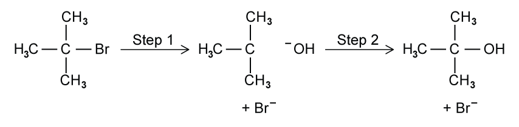

**Fig. 3.1**

[3]

ii) State which step in this mechanism is the rate-determining step.

[1]

**Q5** [2 marks]

An ethanolic solution of excess ammonia (NH3 in ethanol) is heated under pressure with 2-bromo-2-methylpropane.

i) Draw the structure of the organic product formed.

[1]

ii) Name the functional group present in the organic product.

[1]

### Q6 — easy — 6 marks

**Q6** [2 marks]

Compound **X** is a halogenoalkane. Its structure is shown in Fig. 1.1.

**Fig. 1.1**

i) State the systematic name of compound **X**.

[1]

ii) State whether compound **X** is a primary, secondary or tertiary halogenoalkane.

[1]

**Q6** [1 mark]

**Extract:**

Compound **X** is a halogenoalkane. Its structure is shown in Fig. 1.1.

{align=center} **Fig. 1.1**

Compound **X** is added to aqueous silver nitrate in ethanol.

State the colour of the precipitate formed.

**Q6** [1 mark]

**Extract:**

Compound **X** is a halogenoalkane. Its structure is shown in Fig. 1.1.

Fig. 1.1

The systematic name of compound **X** is 2-bromopropane.

Compound **X** is heated under reflux with KCN in ethanol.

Draw the structure of the organic product formed.

**Q6** [2 marks]

**Extract:**

Compound **X** is a halogenoalkane. Its structure is shown in Fig. 1.1.

i) State the systematic name of compound **X**.

i) The systematic name of compound **X** is:

- 2-bromopropane

Fig. 1.2 shows the structure of 2-chloropropane.

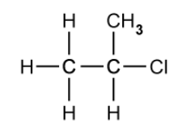

**Fig. 1.2**

Explain why compound **X** reacts with KCN in ethanol at a faster rate than 2-chloropropane.

### Q7 — medium — 13 marks

**Q7** [1 mark]

Propene and cyclopropane are structural isomers with the molecular formula C3H6. Their structures are shown in Fig. 1.1.

| 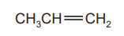 | 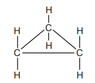 |
|---|---|

**Fig. 1.1**

State the H–C–H bond angle at the terminal =CH2 group in propene.

**Q7** [4 marks]

**Extract:**

Propene and cyclopropane are structural isomers with the molecular formula C~3~H~6~. Their structures are shown in Fig. 1.1.

Under suitable conditions, propene and cyclopropane each react with chlorine.

i) Propene reacts with chlorine to form 1,2-dichloropropane, CH3CHClCH2Cl.

Name the mechanism for this reaction.

[1]

ii) When cyclopropane reacts with chlorine, three different compounds with the molecular formula C3H4Cl2 can be formed.

Draw the displayed formulae of these three compounds.

[3]

**Q7** [2 marks]

Ethane reacts with chlorine according to the following equation.

C2H6 + Cl2 → C2H5Cl + HCl

i) State the conditions needed for this reaction.

[1]

ii) Name the mechanism for this reaction.

[1]

**Q7** [3 marks]

**Extract:**

Ethane reacts with chlorine according to the following equation.

C₂H₆ + Cl₂ → C₂H₅Cl + HCl

The mechanism is: Free radical substitution

i) One of the steps during the reaction in **(c)** is the following process.

Cl● + CH3CH3 → HCl + CH3CH2●

**Table 1.1**

| **Bond** | **Bond enthalpy / kJ mol****-1** |
|---|---|
| C–H | 410 |
| H–Cl | 431 |
| H–I | 299 |

Use the data in Table 1.1 to calculate the enthalpy change, Δ*H*, of this step.

[1]

Δ*H* = ................................ kJ mol-1

ii) Use the data in Table 1.1 to calculate the enthalpy change, Δ*H*, of the similar reaction:

I● + CH3CH3 → HI + CH3CH2●

[1]

Δ*H* = ................................ kJ mol-1

iii) Use your answer to (d)(ii) to suggest why it is not possible to make iodoethane by reacting together iodine and ethane.

[1]

**Q7** [3 marks]

Complete the equations to show the steps in the mechanism for the formation of chloroethane.

Cl2 → ..............

Cl● + CH3CH3 → HCl + CH3CH2●

CH3CH2● + .............. → ................ + ..............

.............. + .............. → CH3CH2Cl

### Q8 — medium — 16 marks

**Q8** [4 marks]

There are four structural isomers with the molecular formula C4H9Br.

Complete Table 1.1 to draw the skeletal formula of each isomer and state whether each is a primary, secondary or tertiary halogenoalkane.

**Table 1.1**

| skeletal formula | primary, secondary or tertiary |
|---|---|
|   |   |
|   |   |
|   |   |
|   |   |

**Q8** [3 marks]

One of the isomers of C4H9Br contains a chiral centre.

i) State the systematic name of this isomer.

[1]

ii) Draw the three-dimensional structures of the two optical isomers of this compound.

[2]

**Q8** [2 marks]

Aqueous silver nitrate in ethanol was added to separate test-tubes containing chloroethane, bromoethane and iodoethane. The test-tubes were placed in a hot water bath.

A yellow precipitate appeared first in the tube containing iodoethane, followed by a cream precipitate in the tube containing bromoethane and finally a white precipitate appeared in the tube containing chloroethane.

Explain these observations.

**Q8** [3 marks]

Bromoethane reacts with aqueous sodium hydroxide.

i) Name the mechanism for this reaction.

[1]

ii) Complete the diagram below to show the mechanism for this reaction.

Include charges, dipoles, lone pairs of electrons and curly arrows, as appropriate.

[2]

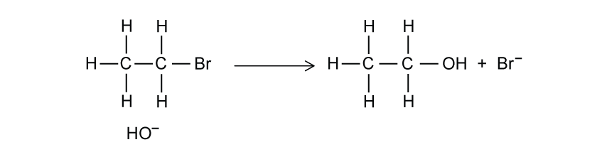

**Q8** [4 marks]

Primary and tertiary halogenoalkanes have different reaction mechanisms when they react with aqueous sodium hydroxide.

i) State the name of the mechanism when aqueous sodium hydroxide reacts with each of the following types of halogenoalkane.

primary halogenoalkane ....................................................................................

tertiary halogenoalkane ....................................................................................

[2]

ii) Explain why a tertiary carbocation is more stable than a primary carbocation.

[2]

### Q9 — medium — 11 marks

**Q9** [2 marks]

One method of preparing 1-bromobutane in the laboratory is described below.

35 g of solid potassium bromide, 30 cm3 of water, and 25 cm3 of butan-1-ol are placed in a 250 cm3 two-necked flask fitted with a tap funnel and reflux condenser. Concentrated sulfuric acid (25 cm3) is then added drop by drop from the tap funnel, keeping the contents well shaken and cooled in an ice-water bath.

The overall reaction takes place in two stages. In the first stage, the inorganic reagents react to form HBr. In the second stage, the organic reagent reacts with the HBr formed in the first stage.

Construct an equation for each of these stages.

stage 1 ......................................................................

stage 2 ......................................................................

**Q9** [2 marks]

**Extract:**

One method of preparing 1-bromobutane in the laboratory is described below.

35 g of solid potassium bromide, 30 cm^3^ of water, and 25 cm^3^ of butan-1-ol are placed in a 250 cm^3^ two-necked flask fitted with a tap funnel and reflux condenser. Concentrated sulfuric acid (25 cm^3^) is then added drop by drop from the tap funnel, keeping the contents well shaken and cooled in an ice-water bath.

The overall reaction takes place in two stages. In the first stage, the inorganic reagents react to form HBr. In the second stage, the organic reagent reacts with the HBr formed in the first stage.

Identify two different reagents and conditions that can be used to prepare 1-bromobutane. Include the reagents and conditions for each method.

**Q9** [5 marks]

i) Complete the reaction scheme in Fig. 3.1, which starts with 1-bromobutane.

In each empty box, draw the structural formula of the organic compound that would be formed.

[4]

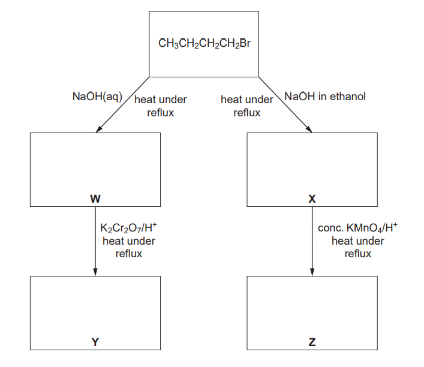

**Fig. 3.1**

ii) Name the type of reaction that occurs when compound **X** is produced from 1-bromobutane.

[1]

**Q9** [2 marks]

**Extract:**

Complete the reaction scheme in Fig. 3.1, which starts with 1-bromobutane.

In each empty box, draw the structural formula of the organic compound that would be formed.

Flow diagram of reactions of CH₃CH₂CH₂CH₂Br with aqueous NaOH or NaOH in ethanol, under reflux, forming intermediates W and X, then oxidised to Y and Z

1 mark for identifying compound W as CH₃CH₂CH₂CH₂OH

Compound **W** can also be formed by heating 1-bromobutane under reflux with aqueous silver nitrate.

Suggest why the rate of formation of compound **W** is slower in this reaction than when 1-bromobutane is heated under reflux with aqueous sodium hydroxide.

### Q10 — easy — 8 marks

**Q10** [3 marks]

Fig. 2.1 shows the reaction scheme for the production of propene.

**Propane   **$\overset{\mathrm{step}1}{\rightarrow}$**   1-chloropropane   **$\overset{\mathrm{step}2}{\rightarrow}$** Propene**

**Fig. 2.1**

i) State the reagent and conditions required for step 1.

[2]

ii) Name the mechanism for step 1.

[1]

**Q10** [2 marks]

**Extract:**

Fig. 2.1 shows the reaction scheme for the production of propene.

Propane → step 1 → 1-chloropropane → step 2 → Propene

Fig. 2.1

The mechanism for step 1 involves initiation, propagation and termination steps.

Construct two equations to show the propagation steps in this mechanism.

**Q10** [3 marks]

**Extract:**

Fig. 2.1 shows the reaction scheme for the production of propene.

Propane \$\$\overset{ step 1 }{\rightarrow}\$\$ 1-chloropropane \$\$\overset{ step 2 }{\rightarrow}\$\$ Propene

Fig. 2.1

i) Name the mechanism for step 2.

[1]

ii) State the reagent and conditions required for step 2.

[2]

### Q11 — medium — 16 marks

**Q11** [5 marks]

Describe an experiment that would allow the relative rates of hydrolysis of 1-chlorobutane, 1-bromobutane and 1-iodobutane to be compared.

*Source: June 2018 9CHO/02 Q6A*

**Q11** [2 marks]

Explain the trend in the rates of hydrolysis of 1-chlorobutane, 1-bromobutane and 1-iodobutane.

*Source: June 2018 9CHO/02 Q6B*

**Q11** [3 marks]

The hydrolysis of 2-bromobutane produces butan-2-ol.

i) Explain what is meant by the term *chiral centre*.

[1]

ii) Draw the three-dimensional structures of the two optical isomers of butan-2-ol.

[2]

*Source: June 2018 9CHO/02 Q6C*

**Q11** [6 marks]

Primary halogenoalkanes, such as RCH2X, and tertiary halogenoalkanes, such as R3CX, undergo hydrolysis with aqueous sodium hydroxide via different mechanisms.

i) Name the mechanism for the hydrolysis of a primary halogenoalkane.

Draw the structure of the transition state formed in this reaction.

[2]

ii) Name the mechanism for the hydrolysis of a tertiary halogenoalkane.

Draw the structure of the intermediate formed in this reaction.

[2]

iii) State one difference between these two mechanisms in terms of the species involved in the rate-determining step.

[2]

*Source: June 2018 9CHO/02 Q6D*

### Q12 — medium — 18 marks

**Q12** [7 marks]

1-chloropropane reacts to form organic products as shown in the reaction scheme in Fig. 2.1.

**Fig. 2.1**

i) State the reagent and conditions for Reaction 1.

[2]

ii) Identify a suitable reagent for Reaction 2. Explain why this reaction is useful in organic synthesis.

[2]

Reagent ..................................................

Explanation ..................................................

iii) State the conditions for Reaction 3.

[2]

iv) Draw the structural formula of the organic product formed when 1-chloropropane is heated under reflux with aqueous sodium hydroxide.

[1]

*Source: 2018 June 8CHO/02 Q4A*

**Q12** [3 marks]

2‑chloro‑2‑methylpropane reacts with aqueous alkali to form 2-methylpropan-2-ol.

(CH3)3CCl + OH- → (CH3)3COH + Cl-

The graph in Fig. 2.2 shows how the concentration of 2‑chloro‑2‑methylpropane changes with time during an investigation of this reaction.

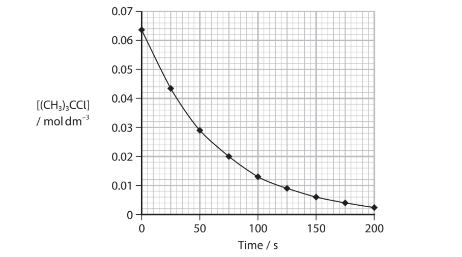

**Fig. 2.2**

Use the graph in Fig. 2.2 to calculate the rate of reaction at *t* = 50 s. Show your working on the graph.

Rate of reaction = ............................ units ............................

*Source: Oct 2021 8CHO/02 Q6A*

**Q12** [1 mark]

**Extract:**

2‑chloro‑2‑methylpropane reacts with aqueous alkali to form 2-methylpropan-2-ol.

(CH~3~)~3~CCl + OH^-^ → (CH~3~)~3~COH + Cl^-^

Name the mechanism for the reaction of 2‑chloro‑2‑methylpropane with aqueous sodium hydroxide.

*Source: Oct 2021 8CHO/02 Q6B*

**Q12** [3 marks]

**X** is 1‑bromobutane, **Y** is 1‑iodobutane and **Z** is 1-chlorobutane.

Equal volumes of **X**, **Y** and **Z** are added to separate test-tubes containing aqueous silver nitrate in ethanol at 50 °C.

i) State what is observed in the test-tube containing **X**. Give the formula of the compound responsible for this observation.

[2]

ii) Deduce the order of the rate of reaction of **X**, **Y** and **Z**, starting with the fastest.

fastest ........................ > ........................ > ........................ slowest

[1]

*Source: Oct 2021 8CHO/02 Q6C*

**Q12** [4 marks]

2-bromo-2-methylpropane can be prepared from the addition of hydrogen bromide, HBr, to 2-methylpropene.

Complete the diagram to show the mechanism for this reaction.

Include charges, dipoles, lone pairs of electrons and curly arrows, as appropriate.

*Source: Oct 2021 8CHO/02 Q6D*

