# Mark Schemes — Alcohols
**16. Hydroxy Compounds** · Cambridge (CIE) A-LEVEL chemistry (9701)

## Multiple Choice Questions (29 questions)

### Q1
**Final answer:** **The correct answer is C**

- Alkyl groups have a **positive inductive effect**
- They donate electron density towards the electronegative oxygen atom
- This increases the electron density on the oxygen in the alkoxide ion, RO-
- A more electron-rich alkoxide ion is less stable (destabilised) compared to hydroxide, OH-
- The less stable conjugate base means the equilibrium lies further to the left
- Fewer H+ ions are released, so alcohols are weaker acids than water

**A** is incorrect as alkyl groups have a positive, not negative, inductive effect. They donate electron density to oxygen, they do not withdraw it

**B** is incorrect as alkyl groups have a positive, not negative, inductive effect

**D** is incorrect as the increased electron density on the alkoxide ion destabilises it, not stabilises it. A more electron-rich RO- is more basic and has a greater tendency to accept H+, pushing the equilibrium to the left

### Q2
**Final answer:** **The correct answer is A**

- Propan-1-ol is a primary alcohol
- Primary alcohols are oxidised to carboxylic acids when heated under reflux with acidified potassium dichromate(VI)
- This produces propanoic acid

**B** is incorrect as propan-2-ol is a secondary alcohol, which oxidises to a ketone, not a carboxylic acid

**C** is incorrect as this is a nucleophilic substitution to form propan-1-ol

**D** is incorrect as this is esterification, producing an ester, not an acid

### Q3
**Final answer:** **The correct answer is B**

- Propan-2-ol is a secondary alcohol, and secondary alcohols are oxidised to ketones.
- Acidified potassium dichromate(VI) oxidises secondary alcohols to ketones.
- Heating under reflux ensures the reaction goes to completion.

**A** is incorrect as sodium borohydride is a reducing agent, not an oxidising agent.

**C** is incorrect as lithium aluminium hydride is also a reducing agent.

**D** is incorrect as concentrated sulfuric acid at 170 °C causes dehydration to form an alkene, not oxidation.

### Q4
**Final answer:** **The correct answer is C**

- The hydroxy group –OH in leaf alcohol is at the end of the carbon chain.

  - Therefore, it is a primary alcohol.
- When a primary alcohol is heated under reflux with an excess of acidified aqueous potassium dichromate(VI), a carboxylic acid is produced.
- The reaction looks like this:

CH3CH2CH=CHCH2**CH**2**OH** $\rightarrow$ CH3CH2CH=CHCH2**CO**2**H** + H2O

- Therefore, option **C** is correct.

### Q5
**Final answer:** **The correct answer is C**

- When a **primary alcohol** reacts with **sodium**, a **salt** (sodium alkoxide) and **hydrogen gas** are formed.

  - For example:

2CH3OH + 2Na $\rightarrow$ 2CH3ONa + H2

- When a **carboxylic acid** reacts with **sodium**, a **carboxylate salt** and **hydrogen gas** are formed.

  - For example:

2CH3COOH + 2Na $\rightarrow$ 2CH3COONa + H2

- **1** alcohol group reacts with **1** Na atom to produce **1** hydrogen atom.
- **1** carboxylic acid group reacts with **1** Na atom to produce **1** hydrogen atom.

  - Lactic acid contains both an alcohol group and a carboxylic acid group.
  - Therefore, sodium will react with **both** of these –OH groups.

**A** is incorrect as acidified aqueous potassium dichromate(VI) only reacts with the alcohol to oxidise it. Carboxylic acid groups are not oxidised further.

**B** is incorrect as ethanol will only react with the carboxylic acid group to form an ester.

**D** is incorrect as aqueous sodium hydroxide only reacts with the carboxylic acid in a neutralisation reaction, producing a carboxylate salt and water.

### Q6
**Final answer:** **The correct answer is A**

- First, draw each compound:

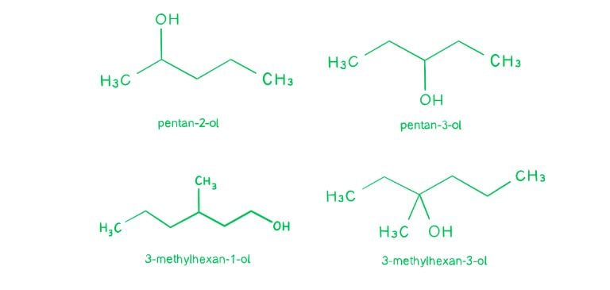

- A ketone is produced when a **secondary alcohol** is oxidised.

  - This eliminates options **C** (a primary alcohol) and **D** (a tertiary alcohol).
- A chiral centre is a carbon atom bonded to four different atoms or groups.
- The only compound with a chiral centre is pentan-2-ol:

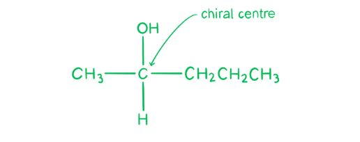

- Therefore, **A** is correct.

**B** is incorrect as pentan-3-ol is a secondary alcohol, but it does not have a chiral centre.

**C** is incorrect as 3-methylhexan-1-ol is a primary alcohol.

**D** is incorrect as 3-methylhexan-3-ol is a tertiary alcohol.

### Q7
**Final answer:** **The correct answer is D**

- When an alcohol reacts with concentrated sulfuric acid, dehydration takes place.

  - Dehydration is the loss of a water molecule.
  - This is an **acid catalysed** reaction because H2SO4 donates an H+ which is regenerated by the production of H3O+ (which dissociates into H2O + H+).
- For dehydration to take place, the carbon atom **adjacent** to the alcohol must be bonded to hydrogen atoms so it can be **deprotonated** (lose a H+) to form a C=C bond — therefore, (CH3)3CCH2OH **cannot** be dehydrated.

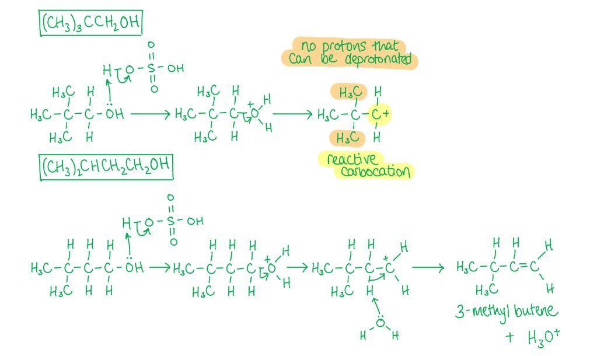

**A** is incorrect as both alcohols contain an –OH group which will react with reactive metals such as Na to form a salt and hydrogen gas.

**B** is incorrect as both alcohols contain a primary alcohol group which will be oxidised to a carboxylic acid.

**C** is incorrect as both are primary alcohols which will undergo nucleophilic substitution of a chlorine atom to form a primary halogenoalkane.

### Q8
**Final answer:** **The correct answer is D**

- When a **primary alcohol** reacts with sodium, a salt (sodium alkoxide) and hydrogen gas are formed.

  - For example:

2CH3OH + 2Na $\rightarrow$ 2CH3ONa + H2

- When a **carboxylic acid** reacts with sodium, a carboxylate salt and hydrogen gas are formed.

  - For example:

2CH3COOH + 2Na $\rightarrow$ 2CH3COONa + H2

- So, 1 alcohol group reacts with 1 Na atom to produce 1 hydrogen atom. The same applies for 1 carboxylic acid group.

- For 1 mol of compound **X** to produce 1 mol of H2, it must have **2 reactive –OH groups** (2 alcohol groups, 2 carboxylic acid groups, or 1 of each).

- **D** has 2 reacting groups:

  - 1 carboxylic acid group
  - 1 alcohol group
- Therefore, option **D** is correct.

**A** and **B** are incorrect as both have only 1 alcohol group.

**C** is incorrect as there is only 1 carboxylic acid group.

### Q9
**Final answer:** **The correct answer is C**

- The question is about the **total volume** of **gases** when cooled to room temperature.

  - At room temperature H2O is a liquid and not a gas, so water can be disregarded.
- Volume of methanethiol combusted: **15 cm****3**.
- An initial, change and final volume table should be made as follows:

|   | **CH****3****SH** | **O****2** | **CO****2** | **SO****2** |
|---|---|---|---|---|
| **Initial (cm****3****)** | 15 | 90 | 0 | 0 |
| **Mole ratio** | 1 | 3 | 1 | 1 |
| *calculation* | *1 × –15* | *3 × –15* | *1 × +15* | *1 × +15* |
| **Change (cm****3****)** | –15 | –45 | +15 | +15 |
| *calculation* | *15 – 15* | *90 – 45* | *0 + 15* | *0 + 15* |
| **Final volume (cm****3****)** | 0 | 45 | 15 | 15 |

- Since there is 45 cm3 of the initial 90 cm3 O2 left and 15 cm3 each of CO2 and SO2 produced, the total volume of gases is **75 cm**3.

**A** is incorrect as the 45 cm3 of leftover O2 has not been added to the total volume of gases produced.

**B** is incorrect as this is only the volume of O2 remaining.

**D** is incorrect as the volume of H2O has been included in the total; however, at room temperature H2O is a liquid, not a gas.

### Q10
**Final answer:** **The correct answer is B**

- Butanal is an **aldehyde** which will undergo a **nucleophilic addition** reaction with HCN to form a **hydroxynitrile** (compound **X**).

- Compound **X** is **hydrolysed** by reacting with hot dilute H2SO4 to form a **carboxylic acid** (compound **Y**) and ammonium sulfate.

- Compound **Y** reacts with ethanol to form an **ester** (compound **Z**).

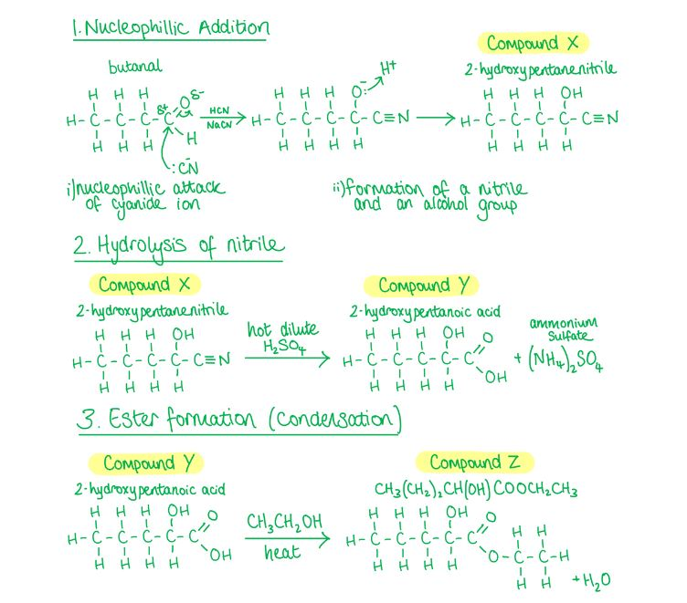

**A** is incorrect as the –OH group has been left out.

**C** is incorrect as this structure would be produced from propanaldehyde (3 carbons), not butanal (4 carbons). HCN addition to butanal gives a 5-carbon chain, so the ester product has 5 carbons in the chain.

**D** is incorrect as ethanol reacts at the carboxylic acid group of compound **Y** to form the ester, not at the alcohol group.

### Q11
**Final answer:** **The correct answer is A**

- Prop-2-en-1-ol reacts with bromine to form **2,3-dibromopropan-1-ol**.

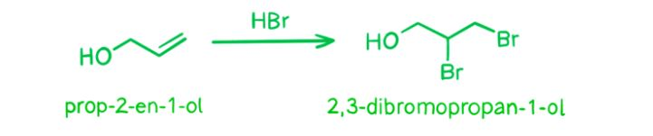

- Bromine will not replace the alcohol group unless it is in the form HBr where the oxygen can be protonated to create a good leaving group.
- Optical isomers are two compounds that contain the same number and type of atoms and bonds, but have **non-superimposable mirror images**.
- 2,3-dibromopropan-1-ol forms **two optical isomers** as shown:

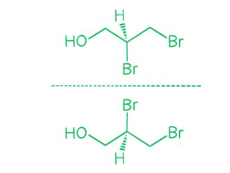

**B** is incorrect as hydrogenation of prop-2-en-1-ol breaks the C=C double bond to give propan-1-ol. The resulting compound has no chiral centre.

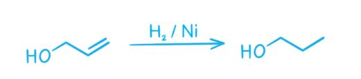

**C** is incorrect as phosphorus pentachloride replaces the –OH group with Cl to give 3-chloroprop-1-ene. The resulting compound has no chiral centre.

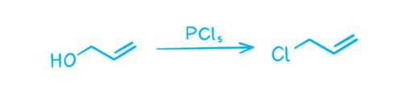

**D** is incorrect as sodium reacts with the –OH group to form a sodium alkoxide salt and hydrogen gas. The carbon skeleton is unchanged and the resulting compound has no chiral centre.

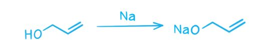

### Q12
**Final answer:** **The correct answer is C**

- Ethanol CH3CH2**OH** is a **primary alcohol**.
- Ethanal CH3CH**O** is an **aldehyde**.
- Aldehydes can be obtained from primary alcohols by one of two methods:

  - By oxidation with acidified potassium dichromate(VI).
  - By **catalytic dehydrogenation** over **hot copper**.
- Oxidation is not listed, so the answer is dehydrogenation.

**A** is incorrect as condensation is the joining of two molecules with the loss of a small molecule such as water, forming a single larger product. This is the opposite of what is shown in step 1.

**B** is incorrect as dehydration is the loss of a water molecule causing a double bond to be formed.

**D** is incorrect as hydrogenation is the addition of hydrogen to a molecule. In this example there is a loss of hydrogen.

### Q13
**Final answer:** **The correct answer is D**

- **Alkanes** and **alkenes** do **not** react with **sodium**, whereas alcohols do.
- When an alcohol reacts with sodium, a salt (sodium alkoxide) and hydrogen gas are formed.
- If a small piece of sodium is added to the petrol mixture and **bubbles of hydrogen** are produced, then the liquid contains an alcohol.

**A** is incorrect as 2,4-dinitrophenylhydrazine is used to detect the presence of aldehydes and ketones.

**B** is incorrect as aqueous potassium manganate(VII) will oxidise both alcohols and alkenes, so it cannot uniquely identify the alcohol.

**C** is incorrect as bromine in carbon tetrachloride undergoes electrophilic addition with alkenes and so would only confirm the presence of alkenes, which the question already states are present.

### Q14
**Final answer:** **The correct answer is A**

- **Step 1:** Write out the equation for the complete combustion of propan-1-ol.

C3H7OH + O2 $\rightarrow$ CO2 + H2O

- **Step 2:** Balance the equation.

C3H7OH + $\frac{9}{2}$O2 $\rightarrow$ **3**CO2 + **4**H2O

- **Step 3:** Determine moles of oxygen using molar ratios.

  - For every 1 mole of propan-1-ol, 4.5 moles of oxygen are required.
  - So, 0.100 mol of propan-1-ol completely combusts in 0.450 mol of oxygen.
- **Step 4:** Multiply moles of oxygen by 24.0 dm3 mol-1 to determine volume.

Volume of oxygen = 0.450 × 24.0 dm3 = **10.8 dm**3

### Q15
**Final answer:** **The correct answer is C**

- Since tertiary alcohols do not react with dichromate(VI) ions, the alcohol must be a **tertiary alcohol**.

  - So, the basic structure of the compound is a carbon with a hydroxy group, ‒OH, and three different alkyl groups attached to it.
- We are told the compound has a chiral centre, so each group attached must be different.
- In order to have the smallest possible value of n:

  - The first bond must be with OH
  - The second bond must be with a methyl group (1 carbon)
  - The third bond must be with an ethyl group (2 carbons)
  - The fourth bond must be with a propyl group (3 carbons)
- This makes a total of 7 C atoms.

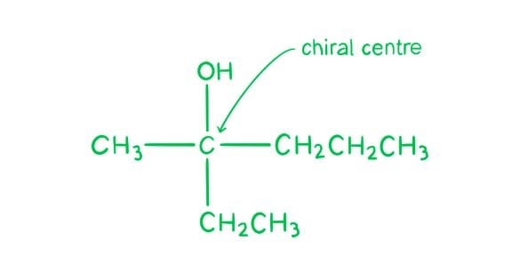

### Q16
**Final answer:** **The correct answer is B**

- Butan-2-ol is a **secondary alcohol** and therefore will be oxidised to the **ketone** butanone when heated under reflux with acidified potassium dichromate(VI).
- **Known quantities:**

  - Mass of butan-2-ol: 1.50 g
  - Molecular weight of butan-2-ol: 74 g mol-1
  - Percentage yield: 80.0%
  - Molecular weight of product (butanone): 72 g mol-1
- **Calculate the moles of butan-2-ol:**

moles = $\frac{\mathrm{mass}}{M_{r}}$

moles = $\frac{1.50}{74}$ = 0.0203 mol

- **Calculate the yield of product in moles:**

moles of product = 0.0203 × $\frac{80}{100}$ = 0.0162 mol

- **Calculate the mass of butanone formed:**

mass = moles × *M*r

mass = 0.0162 × 72 = 1.166 g = **1.17 g** (3 s.f.)

**A** is incorrect as this would be the mass of product if butan-2-ol were dehydrated to butene.

**C** is incorrect as this would be the mass of product if butan-1-ol (a primary alcohol) had been oxidised to butanoic acid.

**D** is incorrect as this would be the mass of product at 100% yield.

### Q17
**Final answer:** **The correct answer is B**

- Primary alcohols are oxidised to aldehydes and then to carboxylic acids.
- Secondary alcohols are only oxidised to ketones, and cannot be oxidised further.
- Tertiary alcohols cannot be oxidised.

  - Therefore, the only alcohol which gives only **one** oxidation product is the secondary alcohol, butan-2-ol.

**A** and **C** are incorrect as butan-1-ol and 2-methylpropan-1-ol are primary alcohols, so they could produce **two** products when oxidised: an aldehyde and a carboxylic acid.

**D** is incorrect as 2-methylpropan-2-ol is a tertiary alcohol, so it cannot be oxidised.

### Q18
**Final answer:** **The correct answer is ****C**

- **Potassium dichromate (VI)** solution has a bright **orange **colour.

  - If oxidation occurs, the orange solution containing the dichromate (VI) ions is reduced to a **green** solution containing **chromium (III)** ions.
  - So, this eliminates options **A** and **D.**
- **Potassium manganate (VII)** solution has a strong **purple** colour.

  - If oxidation occurs, the purple solution containing the manganate (VII) ions is reduced to a **colourless** solution containing **manganate (II)** ions.

### Q19
**Final answer:** **The correct answer is C**

- Both **ketones** and **tertiary alcohols** are unreactive towards hot acidified aqueous potassium dichromate(VI).

- However, alcohols undergo dehydration to form an alkene, therefore compound **Q** is a **tertiary alcohol**.

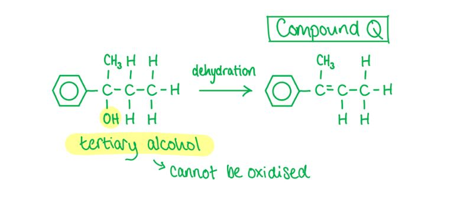

**A** is incorrect as this is the dehydration product of a secondary alcohol, which is reactive towards hot acidified aqueous potassium dichromate(VI) as it is oxidised to a ketone.

**B** and **D** are incorrect as these are the dehydration products of primary alcohols, which are reactive towards hot acidified aqueous potassium dichromate(VI) as they are oxidised to aldehydes and further to carboxylic acids.

### Q20
**Final answer:** **The correct answer is ****C**

- Since the question is only asking for structural isomers, we do not need to consider stereoisomers.
- **Primary**

  - Pentan-1-ol
  - 2-methylbutan-1-ol
  - 3-methylbutan-1-ol
  - 2,2-dimethylpropan-1-ol

- **Secondary**

  - Pentan-2-ol
  - Pentan-3-ol
  - 3-methylbutan-2-ol

- **Tertiary**

  - 2-methylbutan-2-ol

### Q21
**Final answer:** **The correct answer is D**

- When a primary alcohol reacts with sodium, a salt (sodium alkoxide) and hydrogen gas are formed.
- The reaction between methanol and sodium:

2CH3OH + 2Na $\rightarrow$ 2CH3ONa + H2

- The number of oxygen atoms does not change, so the answer is **D**.

**A** is incorrect as dehydration over Al2O3 removes the oxygen atom as water:

CH3CH2OH $\overset{Al_{2}O_{3}}{\rightarrow}$ CH2=CH2 + H2O

1 oxygen $\rightarrow$ 0 oxygen

**B** is incorrect as esterification produces a product with 2 oxygen atoms:

CH3OH + CH3CO2H $\rightarrow$ CH3CO2CH3 + H2O

1 oxygen $\rightarrow$ 2 oxygen

**C** is incorrect as reaction with HBr removes the oxygen atom as water:

CH3OH + HBr $\rightarrow$ CH3Br + H2O

1 oxygen $\rightarrow$ 0 oxygen

### Q22
**Final answer:** **The correct answer is B**

- Instead of using hydrobromic acid, propan-1-ol can be treated with a mixture of sodium or potassium bromide and concentrated sulfuric acid.

H2SO4 + 2KBr $\rightarrow$ K2SO4 + 2HBr

- The hydrogen bromide then reacts with the alcohol.
- The reaction mixture is then warmed to distil off the bromoalkane.

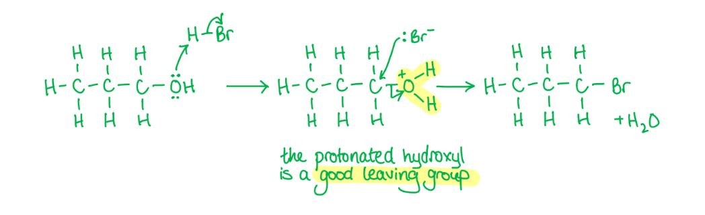

### Q23
**Final answer:** **The correct answer is B**

- Butan-2-ol will form 2 structural alkenes since it has an equal chance of producing an alkene with the double bond between carbons 1 and 2 or carbons 2 and 3.

- Due to the placement of the double bond in but-2-ene, it exhibits cis-trans isomerism, hence it forms a mixture of **three** alkenes (including stereoisomers).

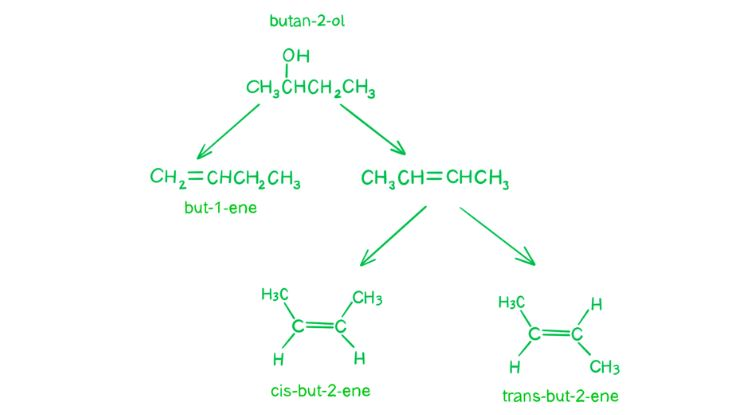

- So, the alkenes formed are:

  - But-1-ene
  - Cis-but-2-ene
  - Trans-but-2-ene

**A** is incorrect as butan-1-ol will form only one alkene.

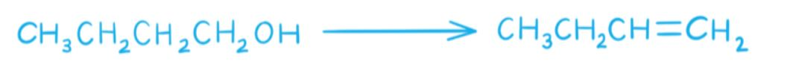

**C** is incorrect as 2-methylpropan-1-ol will form only one alkene.

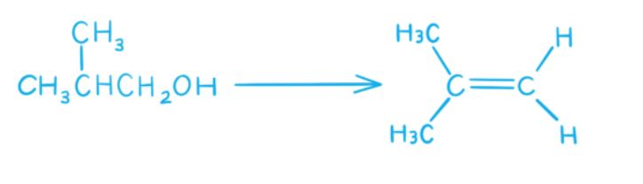

**D** is incorrect as 2-methylpropan-2-ol will form only one alkene.

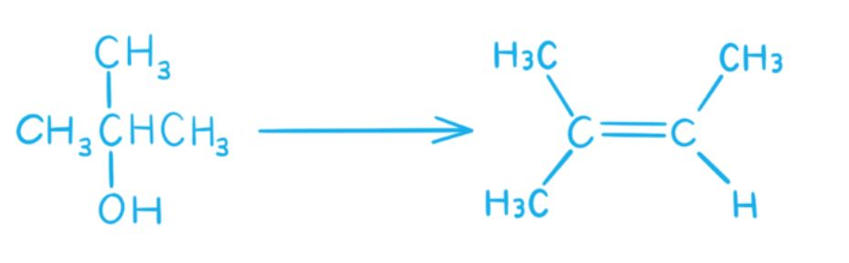

### Q24
**Final answer:** **The correct answer is A**

- **Step 1:** Write the chemical equation.

C2H5OH + [O] $\rightarrow$ CH3CHO + H2O

- **Step 2:** Calculate the moles of ethanol.

moles = $\frac{\mathrm{mass}}{M_{r}}$

moles = $\frac{2.30}{46}$ = 0.05 mol

- **Step 3:** Calculate the mass of ethanal.

  - From the equation, 1 mol of ethanol produces 1 mol of ethanal.
  - So, the number of moles of ethanal is 0.05 mol.
- **Step 4:** Calculate the theoretical yield of ethanal.

mass = moles × *M*r

mass = 0.05 × 44 = 2.2 g

- **Step 5:** Calculate the actual yield.

actual yield = $\frac{70}{100}$ × 2.2 g = **1.54 g**

### Q25
**Final answer:** **The correct answer is D**

- The best approach to questions like this is to number the carbon chains.
- Generally, the lowest possible numbers want to be used, then groups are numbered in order of priority.
- The hydroxyl (OH) group is a higher priority group and therefore has a lower number, 2.
- Chlorine therefore takes the higher number, 4.

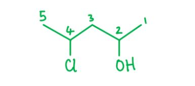

- The compound is called 4-chloropentan-2-ol.

  - Pentane has 5 carbons, so draw and label this first.
  - Then, the -OH group will be on carbon 2, and the Cl will be on carbon 4.

**A** is incorrect as this compound has 6 carbons. It is 2-chlorohexan-4-ol.

**B** is incorrect as this compound is 2-chloropentan-3-ol.

**C** is incorrect as this compound is 3-chloropentan-2-ol.

### Q26
**Final answer:** **The correct answer is D**

- Sodium reacts with **both** alcohols and carboxylic acids.
- When ethanol reacts with sodium, sodium ethoxide and hydrogen gas are formed.

  - For example:

2CH3CH2OH + 2Na $\rightarrow$ 2CH3CH2ONa + H2

- When ethanoic acid reacts with sodium, sodium ethanoate and hydrogen gas are formed.

  - For example:

2CH3COOH + 2Na $\rightarrow$ 2CH3COONa + H2

**A** is incorrect as acidified aqueous potassium dichromate(VI) oxidises ethanol, but not ethanoic acid.

**B** and **C** are incorrect as aqueous sodium carbonate and aqueous sodium hydroxide react with ethanoic acid, but not ethanol. Both form carboxylate salts and water. Sodium carbonate also produces carbon dioxide.

### Q27
**Final answer:** **The correct answer is A**

- When an aldehyde is heated under reflux with acidified potassium dichromate(VI), a carboxylic acid is produced.

  - This is an oxidation reaction.
- Propanal is an aldehyde, so oxidation of this compound would produce a carboxylic acid.
- Propanal does not react with sodium metal.

**B** and **D** are incorrect as propanone is a ketone, and propan-2-ol is a secondary alcohol. Secondary alcohols are oxidised to ketones, and ketones do not oxidise further.

**C** is incorrect as propan-1-ol is a primary alcohol. Primary alcohols are oxidised to aldehydes and then to carboxylic acids. Alcohols react with sodium metal, so compound **X** cannot be propan-1-ol.

### Q28
**Final answer:** **The correct answer is D**

- To distinguish between primary and secondary alcohols you would use Tollens' reagent or Fehling's solution.
- The unknown alcohol would **first need to be oxidised** to either the ketone or the aldehyde.

  - Primary alcohols are oxidised to **aldehydes** (and then to carboxylic acids).
  - Secondary alcohols are oxidised to **ketones**.
- Tollens' reagent or Fehling's solution would then be added as they are both oxidising agents which are themselves reduced, causing a colour change.

  - Aldehydes **will** react because they are further oxidised to a carboxylic acid.
  - Ketones will **not** react because they are not oxidised.
- For Tollens' reagent, a positive result produces a **silver mirror**.
- For Fehling's solution, a positive result causes a blue (CuSO4 (aq)) to red (Cu2O (s)) colour change as the copper is reduced.

**A** and **B** are incorrect as acidified potassium manganate(VII) and acidified potassium dichromate(VI) oxidise **both** primary and secondary alcohols. Therefore, we would not be able to distinguish between the products without further tests.

**C** is incorrect as **both** primary and secondary alcohols can be dehydrated to form alkenes. The test with bromine water only tells us about the presence of a C=C double bond, nothing else.

### Q29
**Final answer:** **The correct answer is C**

- Sodium (Na) can react with both carboxylic acid –CO2H and alcohol –OH groups.
- Aqueous sodium hydroxide only reacts with the carboxylic acid –CO2H group.
- Consider option **C**:

  - **HO**CH2CH(**OH**)CH2**CO**~**2**~**H**
- This compound contains 2 alcohol groups and 1 carboxylic acid group.

  - In the reaction with sodium, Na would react with all 3 groups and hence form an organic ion with charge –3.
  - In the reaction with aqueous sodium hydroxide, it would react with the carboxylic acid group only and hence form an organic ion with charge –1.
- Therefore, option **C** is correct.

**A** is incorrect as this compound contains 2 carboxylic acid groups and 1 alcohol group. **Na**: reacts with all 3 groups and hence would form an organic ion with charge –3. **Aqueous NaOH**: reacts with the 2 carboxylic acid groups only and hence would form an organic ion with charge –2.

**B** is incorrect as this compound contains 1 carboxylic acid group, 1 alcohol group and an aldehyde group. **Na**: reacts with the alcohol and carboxylic acid group and hence would form an organic ion with charge –2. **Aqueous NaOH**: reacts with the carboxylic acid group only and hence would form an organic ion with charge –1.

**D** is incorrect as this compound contains 1 alcohol group, 1 aldehyde group and 1 ketone group. **Na**: reacts with the alcohol group only and hence would form an organic ion with charge –1. **Aqueous NaOH**: reacts with no groups and hence the organic ion has charge 0.

## Structured Questions (10 questions)

### Q1
> **[mark-scheme]**
> i) The colour change is:
> 
> - Purple / violet to colourless **[1 mark]**
> 
> ii) The equation for this oxidation:
> 
> - CH3CH2CH2CH2OH + [O] → CH3CH2CH2CHO + H2O **[1 mark]**

> **[exam-tip]**
> When butan-1-ol is added dropwise and the product distilled off immediately, the primary alcohol is oxidised only to the aldehyde (butanal). If heated under reflux instead, oxidation continues to give the carboxylic acid.
> **[mark-scheme]**
> The systematic name of the organic product is:
> 
> - Butanoic acid **[1 mark]**

> **[exam-tip]**
> Heating under reflux with an excess of acidified KMnO4 allows full oxidation:
> 
> butan-1-ol → butanal → butanoic acid.
> 
> Reflux conditions prevent the aldehyde from escaping, so it is oxidised further to the carboxylic acid.
The structural formulae and systematic names of the two isomers are:

|   | **Isomer A** | **Isomer B** |
|---|---|---|
| Name | 2-methylpropan-1-ol | 2-methylpropan-2-ol |
| Structure | 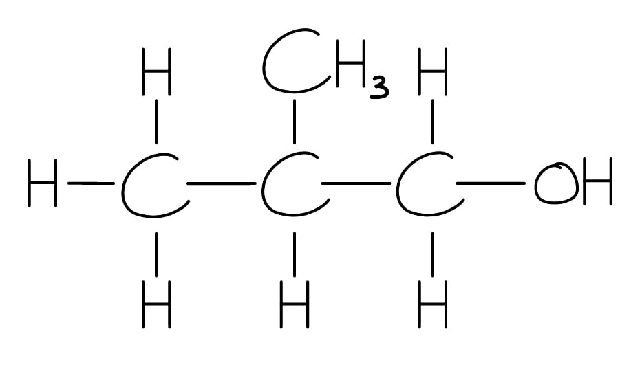 | 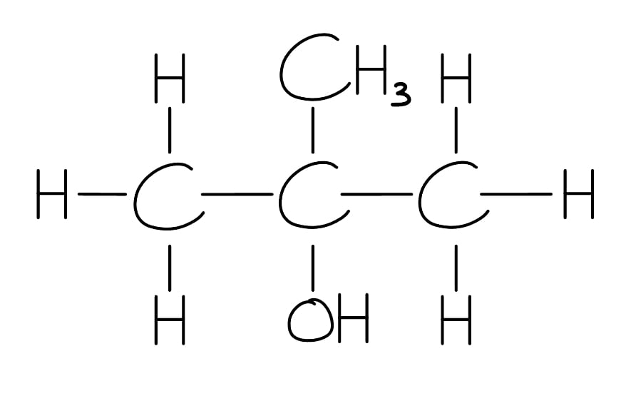 |

**[4 marks]**

> **[mark-scheme]**
> 1 mark for correct name of Isomer **A** (2-methylpropan-1-ol)
> 
> 1 mark for correct structure of Isomer **A**
> 
> 1 mark for correct name of Isomer **B** (2-methylpropan-2-ol)
> 
> 1 mark for correct structure of Isomer **B**

> **[exam-tip]**
> Isomer **A** must be a primary alcohol (can be oxidised).
> 
> Isomer **B** must be tertiary (cannot be oxidised).
> 
> Both must be branched C4 alcohols.
> 
> The only primary branched C4 alcohol is 2-methylpropan-1-ol; the only tertiary C4 alcohol is 2-methylpropan-2-ol.
> **[mark-scheme]**
> The ionic half-equation for the reduction of MnO4- is:
> 
> - MnO4- + 8H+ + 5e- → Mn2+ + 4H2O **[1 mark]**

> **[exam-tip]**
> To balance this half-equation:
> 
> - Write MnO4- → Mn2+
> 
> MnO4- → Mn2+
> 
> - Add 4H2O to balance O
> 
> MnO4- → Mn2+ + 4H2O
> 
> - Add 8H+ to balance H
> 
> MnO4- + 8H+ → Mn2+ + 4H2O
> 
> - Add 5e- on the left to balance charge
> 
> MnO4- + 8H+ + 5e- → Mn2+ + 4H2O
> 
> Check:
> 
> - Left charge = –1 + 8 – 5 = +2
> - Right charge = +2

### Q2
The structures of alkenes **X**, **Y** and **Z** are:

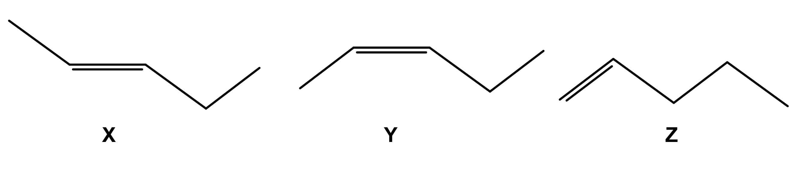

**[3 marks]**

> **[mark-scheme]**
> 1 mark for the correct structure of **X** / trans-pent-2-ene
> 
> 1 mark for the correct structure of **Y** / cis-pent-2-ene
> 
> 1 mark for the correct structure of **Z** / pent-1-ene
> 
> Structures **X** and **Y** are interchangeable.

> **[exam-tip]**
> Elimination of pentan-2-ol (loss of water) can give pent-1-ene or pent-2-ene.
> 
> Pent-2-ene shows E/Z stereoisomerism because each carbon of the C=C has two different substituents, which gives the two stereoisomers **X** and **Y**.
> 
> The question asks for skeletal structures.
> **[mark-scheme]**
> Stereoisomers **X** and **Y** arise because:
> 
> - The C=C bond has two different atoms / groups bonded to each carbon **[1 mark]**
> - The C=C bond cannot rotate **[1 mark]**

> **[exam-tip]**
> E/Z stereoisomerism requires both carbons of the C=C to each bear two different substituents. In pent-2-ene, one carbon has H and CH3; the other has H and CH2CH3. The rigid C=C bond prevents rotation, locking the groups into fixed spatial arrangements.
> **[mark-scheme]**
> i) The equation with oxygen:
> 
> - 2CH3CHOHCH2CH2CH3 + 15O2 → 10CO2 + 12H2O **[1 mark]**
> 
> State symbols are not required.
> 
> ii) The equation with sodium:
> 
> - 2CH3CHOHCH2CH2CH3 + 2Na → 2CH3CHO-Na+CH2CH2CH3 + H2 **[1 mark]**
> 
> State symbols are not required.
> 
> iii) The equation with phosphorus(V) chloride:
> 
> - CH3CHOHCH2CH2CH3 + PCl5 → CH3CHClCH2CH2CH3 + HCl + POCl3 **[1 mark]**
> 
> State symbols are not required.

> **[exam-tip]**
> For combustion: balance C, H, then O. Doubling the alcohol molecule helps.
> 
> For Na: the O–H hydrogen is replaced, forming a sodium alkoxide and H2.
> 
> For PCl5: the products are always chloroalkane + HCl + POCl3.
The apparatus for heating under reflux is:

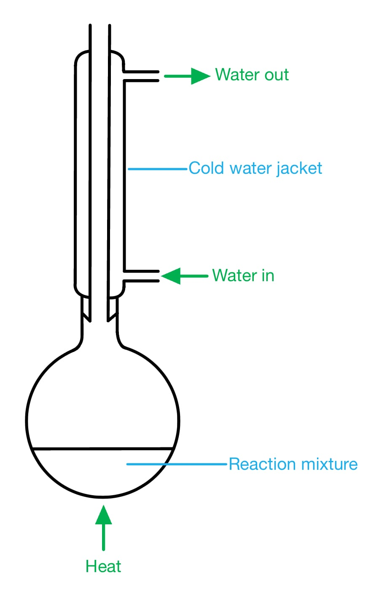

**[2 marks]**

> **[mark-scheme]**
> 1 mark for round / pear-shaped flask with condenser set up vertically for reflux, with no gaps other than at the very top
> 
> 1 mark for water in and water out correctly labelled on the condenser

> **[exam-tip]**
> The condenser must be vertical and open at the top as a sealed top creates a dangerous closed system. Water enters at the bottom of the condenser jacket and exits at the top to ensure effective cooling.

### Q3
> **[mark-scheme]**
> The systematic name of alcohol **C** is:
> 
> - 2-methylpropan-2-ol **[1 mark]**
> 
> Alcohol **C** is:
> 
> - Tertiary **[1 mark]**

> **[exam-tip]**
> A tertiary alcohol has the C–OH group bonded to three other carbon atoms. In 2-methylpropan-2-ol, the central carbon bears three methyl groups, which is the defining feature of a tertiary alcohol.
> **[mark-scheme]**
> i) The systematic name of the organic product is:
> 
> - Propanoic acid **[1 mark]**
> 
> ii) The colour change is from:
> 
> - Orange to green **[1 mark]**

> **[exam-tip]**
> Alcohol **A** (propan-1-ol) is a primary alcohol. Heating under reflux with acidified potassium dichromate(VI) fully oxidises it to a carboxylic acid. The dichromate(VI) is reduced from Cr6+ (orange) to Cr3+ (green).
> **[mark-scheme]**
> The alcohol that gives a yellow precipitate is:
> 
> - (Alcohol) **B** **[1 mark]**

> **[exam-tip]**
> The iodoform (triiodomethane) test is positive for alcohols containing the CH3CH(OH)– group.
> 
> Alcohol **B** (propan-2-ol) contains this group.
> 
> Alcohol **A** (propan-1-ol, primary, except ethanol) and alcohol **C** (2-methylpropan-2-ol, tertiary) do not give a positive result.

### Q4
To deduce the systematic name of compound **Y**:

- Calculate the molar mass of compound **Y**:

*M*r = $\frac{\mathrm{mass}}{\mathrm{moles}}$

*M*r = $\frac{5.508}{0.054}$

*M*r = 102.0 g mol-1 **[1 mark]**

- Identify the systematic name:

Compound **Y** = **Pentanoic acid** **[1 mark]**

- Justification: compound **Y** has the formula C5H10O2 
**AND** 
Is an oxidation product of compound **X** **[1 mark]**

> **[exam-tip]**
> There is a lot of information given in the question and the first step will be to calculate the *M*r of compound **Y**
> 
> You know that it contains 5 C atoms so that is most of the molecule accounted for
> 
> You are aware that it is an oxidation product so must contain at least 1 oxygen atom
> 
> In this case, it contains 2 oxygen atoms
> 
> The *M*r of pentanoic acid is 102.0 whereas the *M*r of pentanal is 86.0
> 
> Therefore, compound **Y** has to be pentanoic acid
i) The displayed formula of compound **W** is:

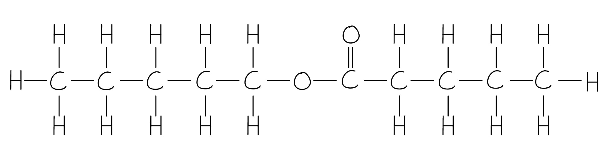

**[1 mark]**

> **[mark-scheme]**
> 1 mark for correct displayed formula of pentyl pentanoate
> 
> ii) Compound **Z** is formed by:
> 
> - Compound **Z** is water / H2O
> **AND**
> Produced by condensation reaction between pentanoic acid and pentan-1-ol / compounds **X** and **Y** **[1 mark]**

> **[exam-tip]**
> The reaction between a carboxylic acid and an alcohol produces an ester (compound **W**) and water (compound **Z**). This is a condensation reaction because a small molecule (water) is eliminated.
> 
> Concentrated H2SO4 acts as a catalyst.
> **[mark-scheme]**
> A student could stop the full oxidation of compound **X** by:
> 
> - Using compound **X** / pentan-1-ol / primary alcohol in excess **[1 mark]**
> - Distilling off the aldehyde / pentanal as soon as it is produced **[1 mark]**

> **[exam-tip]**
> Full oxidation of a primary alcohol proceeds:
> 
> alcohol → aldehyde → carboxylic acid.
> 
> To stop at the aldehyde stage, remove the aldehyde from the reaction mixture immediately by distillation. Using the alcohol in excess ensures the oxidising agent is the limiting reagent and cannot drive the reaction to the carboxylic acid.
> **[mark-scheme]**
> i) A structural formula of a tertiary isomer of compound **X** is:
> 
> - CH3C(CH3)(OH)CH2CH3 **[1 mark]**
> 
> Any other correct tertiary C5 alcohol structure is accepted.
> 
> ii) The isomer will not react because:
> 
> - Tertiary alcohols cannot be oxidised **[1 mark]**

> **[exam-tip]**
> For part (i), any tertiary C5 alcohol is valid but the carbon bearing the –OH group must be bonded to three other carbon atoms.
> 
> For part (ii), oxidation requires a C–H bond at the carbon bearing the –OH group. Tertiary alcohols lack this bond, so no C=O can form.

### Q5
The structural formula of alcohol **A** is:

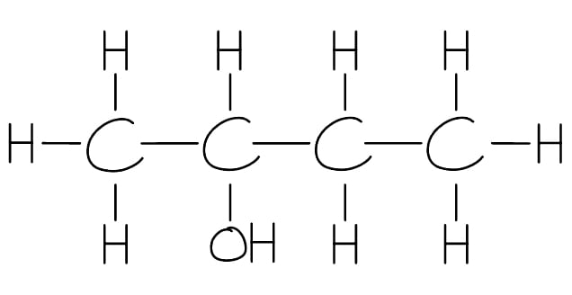

**[1 mark]**

> **[mark-scheme]**
> 1 mark for correct structure of butan-2-ol

> **[exam-tip]**
> Aqueous OH- acts as a nucleophile, replacing the Br at carbon 2. The product is butan-2-ol, which is a secondary alcohol with the –OH group at position 2.
The reaction mechanism for the formation of alcohol **A** is:

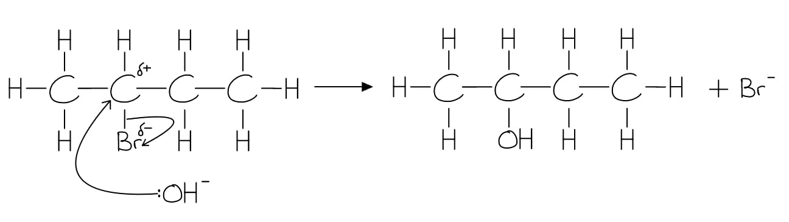

**[3 marks]**

> **[mark-scheme]**
> 1 mark for δ+ on carbon bonded to Br and δ– on bromine correctly identified
> 
> 1 mark for curly arrow from lone pair on OH- nucleophile to δ+ carbon
> 
> 1 mark for curly arrow from C–Br bond to δ– bromine atom

> **[exam-tip]**
> Curly arrows must start from an area of high electron density (a lone pair or a bond) and point towards a lower electron density region. All partial charges (δ+ and δ–) must be shown. This is an SN2 mechanism: the OH- attacks while the Br- leaves simultaneously.
The structure of compound **B** is:

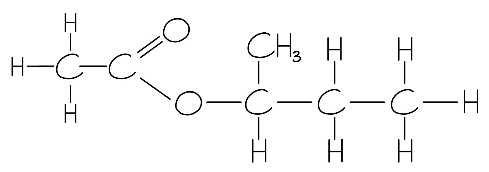

**[1 mark]**

> **[mark-scheme]**
> 1 mark for correct ester structure

> **[exam-tip]**
> The –OH of butan-2-ol reacts with the –COOH of ethanoic acid to form the ester linkage (–COO–). The systematic name of compound **B** is butan-2-yl ethanoate.
> **[mark-scheme]**
> Alcohol **A** is a weaker acid than water because:
> 
> - Alkyl R group has a positive inductive effect / donates electron density to the O- atom **[1 mark]**
> - The alkoxide O- has more electron density and more readily accepts H+ / the dissociation equilibrium lies further to the left compared with water **[1 mark]**

> **[exam-tip]**
> Compare the alkoxide ion (RO-) with hydroxide (OH-). The alkyl group donates electron density to O-, making it a better base. Therefore, it more readily accepts H+ and reforms the alcohol. This means the alcohol dissociates less than water, making it the weaker acid.

### Q6
The completed Table 2.1 is:

| Alcohol | Class of alcohol |
|---|---|
| 2-methylpropan-2-ol | **Final answer:** **Tertiary** |
| Butan-1-ol | **Final answer:** **Primary** |
| Butan-2-ol | **Final answer:** **Secondary** |
| 2-methylpropan-1-ol | **Final answer:** **Primary** |

**[4 marks]**

> **[mark-scheme]**
> 1 mark for tertiary for 2-methylpropan-2-ol
> 
> 1 mark for primary for butan-1-ol
> 
> 1 mark for secondary for butan-2-ol
> 
> 1 mark for primary for 2-methylpropan-1-ol

> **[exam-tip]**
> Count the carbon atoms bonded to the carbon bearing the –OH group:
> 
> - One other carbon = primary
> - Two = secondary
> - Three = tertiary
> 
> Drawing out the displayed formula first makes this easier to see.
> **[mark-scheme]**
> i) The equation for the dissociation of water:
> 
> - H2O (l) $\rightleftharpoons$ OH- (aq) + H+ (aq) **[1 mark]**
> 
> State symbols are not required.
> 
> A reversible arrow must be written for the mark to be awarded.
> 
> ii) The equation for the dissociation of butan-1-ol:
> 
> - CH3CH2CH2CH2OH (aq) $\rightleftharpoons$ CH3CH2CH2CH2O- (aq) + H+ (aq) **[1 mark]**
> 
> State symbols are not required.
> 
> A reversible arrow must be written for the mark to be awarded.

> **[exam-tip]**
> Both water and alcohols are weak acids, so they only partially dissociate, so the reversible arrows ($\rightleftharpoons$) are essential.
> 
> The species formed when an alcohol dissociates is an alkoxide ion (RO-).
> **[mark-scheme]**
> Alcohols are weaker acids than water because:
> 
> - Alkyl group has a positive inductive effect / donates electron density to the negatively charged O- atom **[1 mark]**
> - The alkoxide O- has greater electron density and more readily accepts H+ / the dissociation equilibrium lies further to the left compared with water **[1 mark]**

> **[exam-tip]**
> Compare the alkoxide ion (RO-) with hydroxide (OH-). The alkyl R group donates electron density to O-, making RO- a better base as it more readily reforms the alcohol by accepting H+. This shifts the equilibrium to the left, making alcohols weaker acids than water.

### Q7
The completed Table 2.1 is:

| Reagent | Observation with glycolic acid | Functional group |
|---|---|---|
| Mg (s) | **Final answer:** **Effervescence / fizzing / bubbling** | **Final answer:** **–COOH / carboxylic acid** |
| 2,4-DNPH | **Final answer:** **No visible reaction** | **Final answer:** **—** |
| Acidified KMnO4 | **Final answer:** **Purple to colourless** | **Final answer:** **–OH / alcohol** |

**[3 marks]**

> **[mark-scheme]**
> 1 mark for effervescence / fizzing **AND** –COOH / carboxylic acid for Mg(s)
> 
> 1 mark for no visible reaction for 2,4-DNPH (no functional group required)
> 
> 1 mark for purple to colourless **AND** –OH / alcohol for acidified KMnO4

> **[exam-tip]**
> Make sure you pick out the correct functional groups for each reaction. It can help to circle the functional groups present:
> 
> 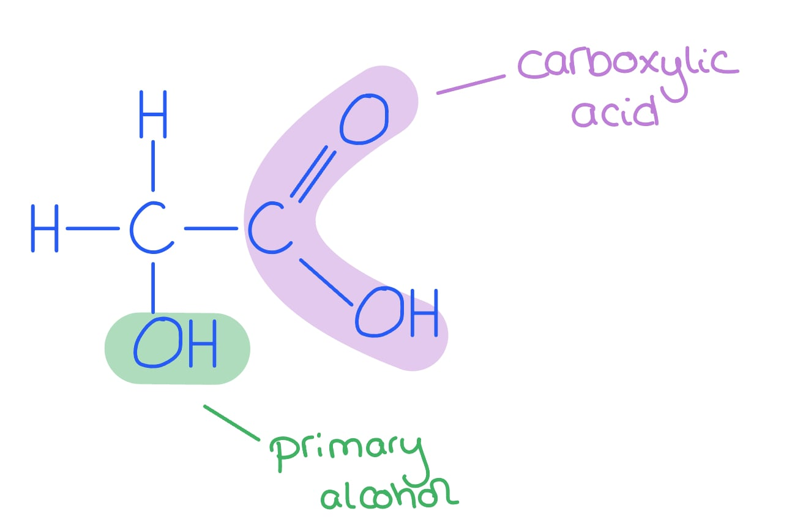
> 
> Carboxylic acids react with the more reactive metals to produce a salt and hydrogen
> 
> 2,4-DNPH detects carbonyl compounds (aldehydes and ketones). Glycolic acid has no carbonyl group, so no reaction occurs.
> 
> For the KMnO4 row, both the observation and the responsible functional group are needed for the mark.
> **[mark-scheme]**
> i) The role of NaBH4 is:
> 
> - Reducing agent / reductant **[1 mark]**
> 
> ii) The equation for this reaction:
> 
> - C2H2O3 + 2[H] → C2H4O3 **[1 mark]**
> 
> iii) NaBH4 is suitable because:
> 
> - It reduces the C=O / aldehyde group of glyoxylic acid **AND** does not reduce the COOH group **[1 mark]**

> **[exam-tip]**
> NaBH4 is a selective reducing agent, which reduces aldehydes and ketones but not carboxylic acids.
> 
> LiAlH4 reduces both.
> 
> This selectivity makes NaBH4 the right choice here, where only the aldehyde group should be reduced.
> **[mark-scheme]**
> i) Glycolic acid would show absorptions not present in the spectrum of **Y**:
> 
> - An absorption in the range 2500–3000 cm-1 due to O–H of RCO2H / carboxylic acid **[1 mark]**
> - An absorption in the range 3200–3600 cm-1 due to O–H of R–OH / alcohol **[1 mark]**

ii) A possible structure for **Y** is:

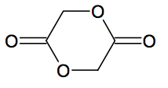

**[2 marks]**

> **[mark-scheme]**
> 1 mark for an ester group **AND** molecular formula C4H4O4
> 
> 1 mark for a correct cyclic structure

> **[exam-tip]**
> For part (i), compare the functional groups in glycolic acid (–OH and –COOH) with what is absent from compound **Y**.
> 
> For part (ii), glycolic acid can react with itself: the –OH of one molecule reacts with the –COOH of another to form a cyclic di-ester (lactide). The molecular formula must be C4H4O4.

### Q8
The equation for the complete combustion of butan-1-ol is:

C4H9OH + 6O2 → 4CO2 + 5H2O

**[2 marks]**

> **[mark-scheme]**
> 1 mark for correct reactants and products
> 
> 1 mark for correct balancing

> **[exam-tip]**
> Write out the molecular formula of butan-1-ol (C4H9OH) before balancing. Balance in the order: C, H, then O.
> 
> A common mistake is to omit O2 as a reactant, but combustion always requires oxygen.
> **[mark-scheme]**
> i) The reagents and conditions for Reaction 1:
> 
> - Al2O3 / aluminium oxide catalyst
> **AND**
> Heat
> 
> **OR**
> 
> - Concentrated H2SO4 / concentrated H3PO4
> **AND**
> Heat
> 
> **[2 marks]**
> 
> ii) The reagent for Reaction 3:
> 
> Any **one** from:
> 
> - NaBr / KBr **AND** concentrated H2SO4
> - HBr
> - PBr3 with heat
> 
> **[1 mark]**

> **[exam-tip]**
> For Reaction 1 (dehydration), both Al2O3 and concentrated acid catalysts are valid and heat is always required.
> 
> For Reaction 3 (substitution to a halogenoalkane), the acid-salt mixture (NaBr + conc H2SO4) generates HBr in situ; naming HBr directly is also accepted.
> **[mark-scheme]**
> The systematic name of compound **A** is:
> 
> - Butanone / butan-2-one **[1 mark]**

> **[exam-tip]**
> Butan-2-ol is a secondary alcohol. Secondary alcohols are oxidised to ketones when heated under reflux with acidified potassium dichromate(VI).
> 
> Since the C=O group can only sit at position 2, the number is not strictly necessary, but butanone and butan-2-one are both accepted answers.

### Q9
i) The structure of compound **A** is:

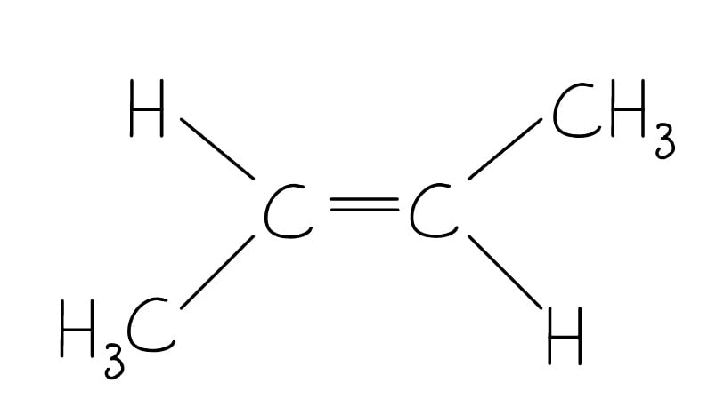

**[1 mark]**

> **[mark-scheme]**
> 1 mark for correct structure of trans-but-2-ene
> 
> ii) Compound **A** is less soluble in water than butan-2-ol because:
> 
> - It does not contain an OH / hydroxyl group
> **OR**
> It is not an alcohol **[1 mark]**
> - It cannot form hydrogen bonds with water **[1 mark]**

> **[exam-tip]**
> For part (i), the question asks for the stereoisomer of cis-but-2-ene, which is trans-but-2-ene, check carefully before drawing.
> 
> For part (ii), solubility in water depends on the ability to form hydrogen bonds. Alkenes lack an OH group and cannot hydrogen bond with water molecules.
> **[mark-scheme]**
> i) Reagent **Y** is:
> 
> - Phosphorus pentachloride / PCl5 **[1 mark]**
> 
> ii) The formulae of the **two** other products are:
> 
> - HCl **[1 mark]**
> - POCl3 **[1 mark]**

> **[exam-tip]**
> The clue to the identity of reagent **Y** is the reaction conditions: room temperature. PCl5 reacts with alcohols at room temperature, whereas PCl3 requires heat. The products are always the chloroalkane, HCl, and POCl3.
> **[mark-scheme]**
> The equation for the overall reaction is:
> 
> - PBr3 + 3C4H9OH → 3C4H9Br + H3PO3 **[1 mark]**
> 
> State symbols are not required.

> **[exam-tip]**
> One mole of PBr3 reacts with three moles of the alcohol.
> 
> The inorganic by-product is phosphorous acid (H3PO3), not phosphoric acid (H3PO4). Take care not to confuse the inorganic by-product.
> **[mark-scheme]**
> i) Reagent **X** is:
> 
> - SOCl2 / thionyl chloride **[1 mark]**

ii) The structure of compound **B** is:

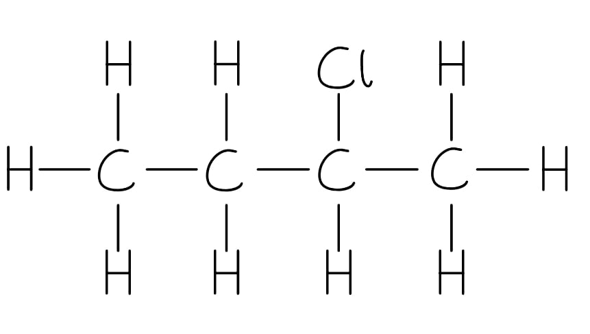

**[1 mark]**

> **[mark-scheme]**
> 1 mark for correct structure of 2-chlorobutane

> **[exam-tip]**
> The clue to reagent **X** is the other products: HCl and SO2.
> 
> Only thionyl chloride (SOCl2) produces both of these alongside the chloroalkane. Compound **B** is 2-chlorobutane, with the Cl at position 2.

### Q10
i) The displayed formula of alcohol **A** is:

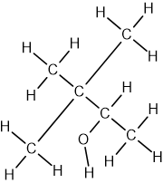

**[1 mark]**

> **[mark-scheme]**
> 1 mark for correct displayed formula of 3,3-dimethylbutan-2-ol
> 
> The systematic name of alcohol **A** is:
> 
> - 3,3-dimethylbutan-2-ol **[1 mark]**

ii) The product formed when alcohol **A** is heated under reflux with acidified potassium dichromate(VI) is:

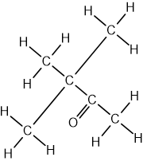

**[1 mark]**

> **[mark-scheme]**
> 1 mark for correct displayed formula of the 3,3-dimethylbutan-2-one product

iii) The product formed when alcohol **B** is heated under reflux with acidified potassium dichromate(VI) is:

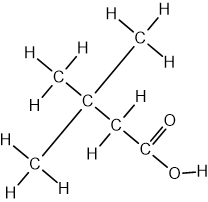

**[1 mark]**

> **[mark-scheme]**
> 1 mark for correct displayed formula of the 3,3-dimethylbutanoic acid product
> 
> Alcohol **B** gives a different product because:
> 
> - A carboxylic acid is formed instead of a ketone **[1 mark]**
> - Alcohol **B** is a primary alcohol whereas alcohol **A** is a secondary alcohol **[1 mark]**

> **[exam-tip]**
> Alcohol **A** is secondary (C–OH bonded to two alkyl groups) so oxidises to a ketone.
> 
> Alcohol **B** is primary (C–OH bonded to one alkyl group) so oxidises fully to a carboxylic acid under reflux.
> **[mark-scheme]**
> i) The type of reaction is:
> 
> - Substitution **[1 mark]**
> 
> ii) Suitable reagents are:
> 
> - NaBr / KBr **AND** concentrated H2SO4 **[1 mark]**
> 
> HBr is also accepted.

> **[exam-tip]**
> The NaBr / conc H2SO4 mixture generates HBr in situ, which reacts with the alcohol by nucleophilic substitution. The OH- of the alcohol is replaced by Br-.
> **[mark-scheme]**
> Both alcohols are soluble in water because:
> 
> - They contain O–H bonds / hydroxy groups **[1 mark]**
> - Hydrogen bonds can form between the O–H of the alcohol and water molecules **[1 mark]**

> **[exam-tip]**
> Hydrogen bonding occurs between the lone pairs on the electronegative oxygen of the alcohol and the H atoms of water molecules (and vice versa). Solubility in water decreases as the non-polar hydrocarbon chain lengthens, but both alcohols here are sufficiently short-chain to remain water-soluble.
> **[mark-scheme]**
> When heated with alkaline I2 (aq):
> 
> - Alcohol **A**: yellow precipitate **[1 mark]**
> - Alcohol **B**: no visible change **[1 mark]**

> **[exam-tip]**
> The iodoform test is positive for alcohols containing the CH3CH(OH)– group.
> 
> Alcohol **A** (3,3-dimethylbutan-2-ol) contains this structural feature
> 
> Alcohol **B** (3,3-dimethylbutan-1-ol, primary) does not, and primary alcohols (except ethanol) do not give a positive iodoform test.
