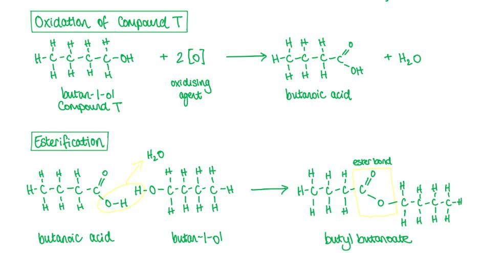
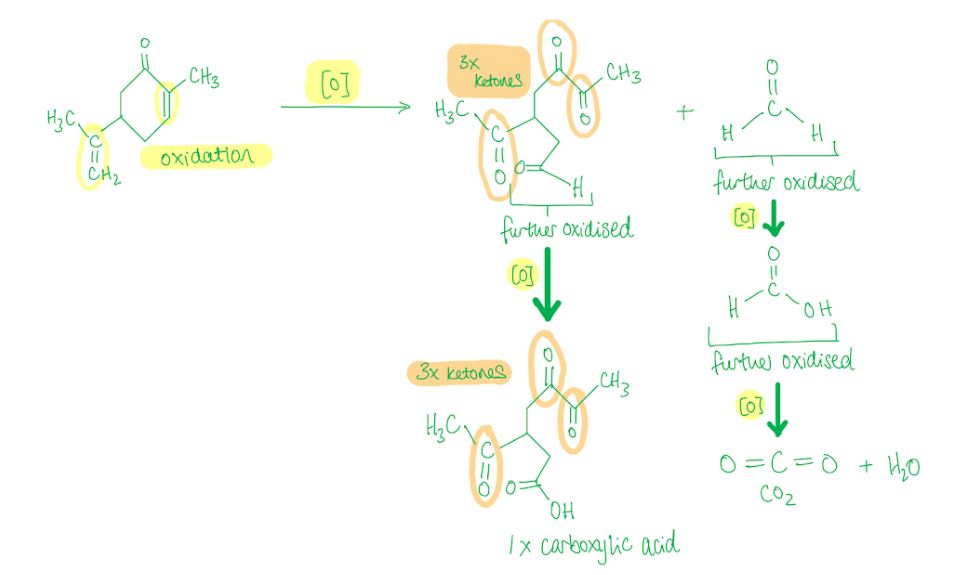
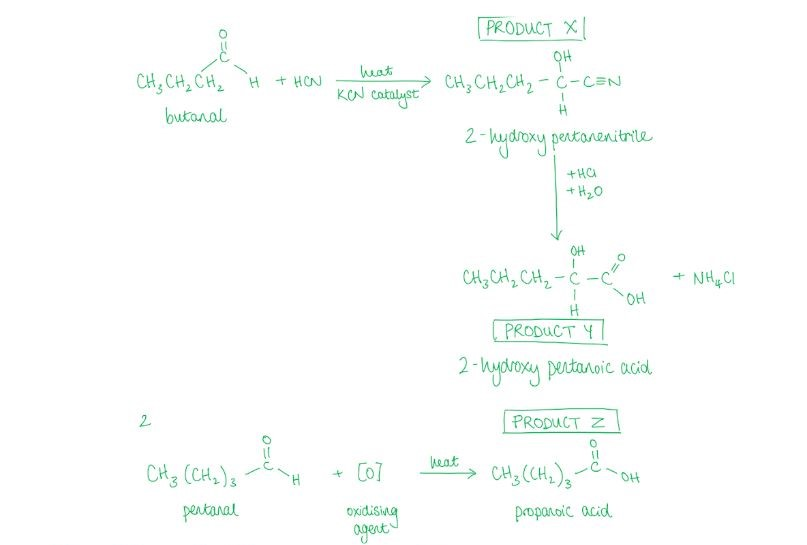
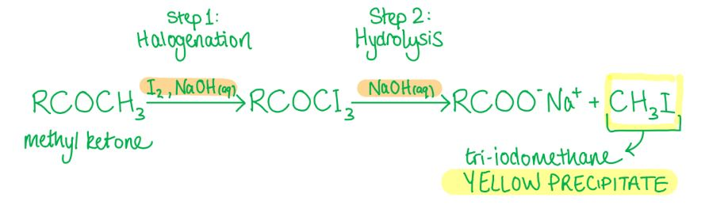
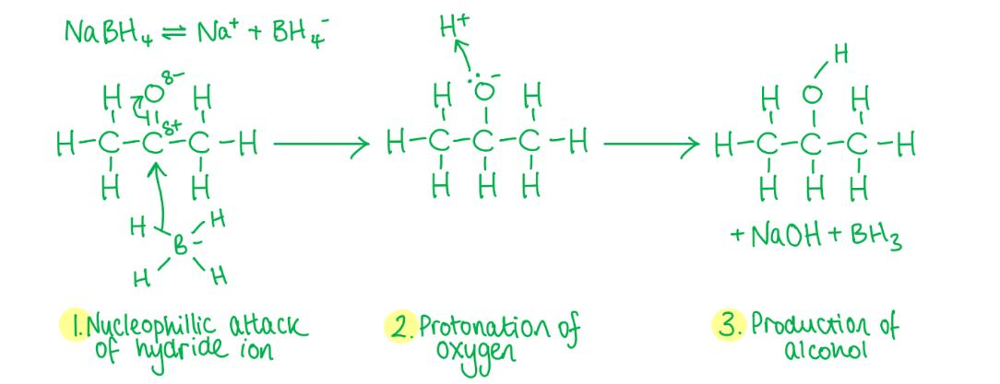
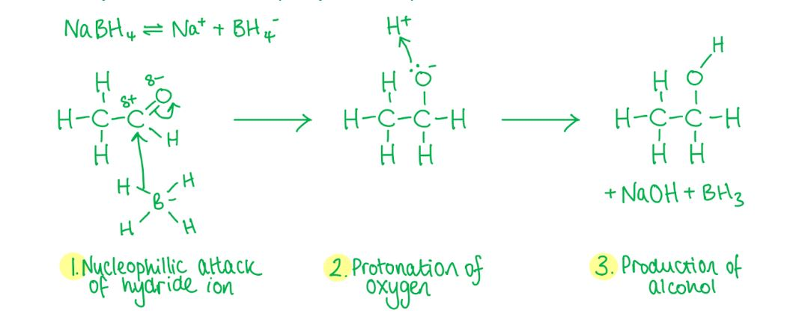
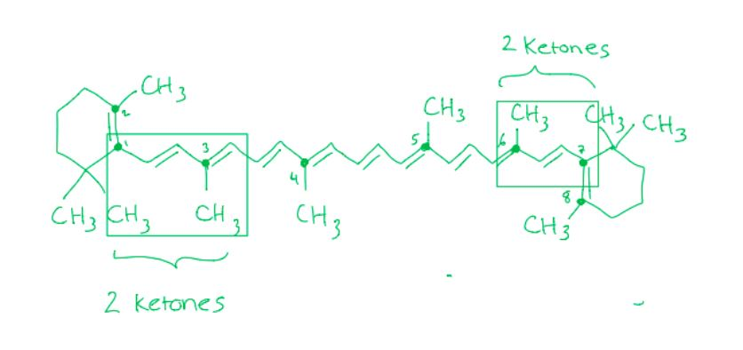
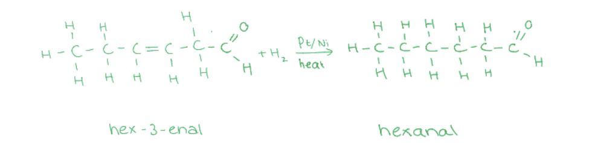
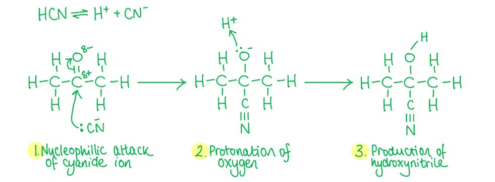

# Mark Schemes — Aldehydes & Ketones
**17. Carbonyl Compounds** · Cambridge (CIE) A-LEVEL chemistry (9701)

## Multiple Choice Questions (21 questions)

### Q1
**Final answer:** **The correct answer is D**

- The molecular ion peak at m/z = 58 shows that *M*r = 58.
- This fits **D **(propanone), **B **(propanal) and **A **(butane), but not **C **(propanoic acid, *M*r = 74).
- An orange precipitate with 2,4-DNPH confirms a carbonyl (C=O) group, so **A** (butane) is eliminated.
- Tollens' reagent gives no change, so X is not an aldehyde, eliminating **B **(propanal).
- Therefore X must be a ketone, which matches propanone (**D**).

**A** is incorrect because butane has no carbonyl group and would not react with 2,4-DNPH.

**B** is incorrect because propanal is an aldehyde and would give a positive Tollens' test (silver mirror).

**C** is incorrect because propanoic acid has *M*r = 74, not 58.

### Q2
**Final answer:** **The correct answer is B**

- The results of the chemical tests identify the functional group and structure of **X**
- 2,4-DNPH gives an orange precipitate

  - This shows that X contains a carbonyl group (aldehyde or ketone)
  - This eliminates **A**, butan-2-ol
- Tollens’ reagent gives no silver mirror

  - This shows that X is not an aldehyde
  - This eliminates **D**, propanal
- Alkaline aqueous iodine gives a yellow precipitate

  - This is a positive iodoform test, showing that a CH3CO– group (a methyl ketone) is present
- Among the remaining options

  - Butanone (CH3COCH2CH3) is a methyl ketone and fits all three results.
  - Pentan-3-one (CH3CH2COCH2CH3) is a ketone but does not contain a CH3CO– group.
- Therefore, the identity of **X** is butanone.

### Q3
**Final answer:** **The correct answer is C**

- Hydroxynitriles can be formed from the nucleophilic addition reaction of aldehydes and ketones with HCN.
- CH3CO2CH3 in the presence of a strong base generates –CH2CO2CH3, which acts as a nucleophile analogously to CN–.
- The reaction of propanal (an aldehyde) with –CH2CO2CH3 forms compound C.

**A** is incorrect as this is the reaction between a ketone (propanone) and –CH2CO2CH3.

**B** is incorrect as the aldehyde is ethanal. The nucleophile is –CH2CO2CH3, not –CO2CH3.

**D** is incorrect as the aldehyde is methanal. The nucleophile is –CH2CO2CH3, not –CHCH2CO2CH3.

### Q4
**Final answer:** **The correct answer is A**

- Esters are sweet and fruity-smelling organic compounds formed by the reaction of alcohols with carboxylic acids.
- Butan-1-ol is a primary alcohol which can be oxidised to butanoic acid (a carboxylic acid).
- The reaction of butan-1-ol with butanoic acid forms the ester butyl butanoate.

**B** is incorrect as butanal is an aldehyde and will be oxidised to butanoic acid. The reaction of butanal with butanoic acid does not produce an ester.

**C** is incorrect as butanoic acid is a carboxylic acid and cannot be further oxidised.

**D** is incorrect as butanone is a ketone and cannot be further oxidised.

### Q5
**Final answer:** **The correct answer is C**

- Oxidation in organic chemistry is the gain of oxygen atoms.
- Acidified potassium manganate(VII) solution oxidises alkenes by breaking the C=C double bond and replacing it with two C=O double bonds.

  - The products are known as carbonyl compounds.
- As carvone is heated under reflux with excess hot concentrated acidified potassium manganate(VII), complete oxidation will take place wherever possible.

  - Compound **X** contains 3 carbonyl groups (three ketones).
- 2,4-dinitrophenylhydrazine (2,4-DNPH) reacts with carbonyl groups (ketones and aldehydes) and will therefore react with all 3 ketones.

- The CO2 is formed from the oxidation of –C=CH2 to methanal, which is then oxidised to methanoic acid, which in turn is oxidised to carbon dioxide.

### Q6
**Final answer:** **The correct answer is C**

- Only primary alcohols, secondary alcohols and aldehydes can be oxidised by acidified potassium dichromate(VI).
- Hydroxyethanal contains a primary alcohol and an aldehyde group.
- Since the compound is heated under reflux until no further oxidation takes place, both groups are oxidised to carboxylic acid groups:

Primary alcohol → aldehyde → carboxylic acid

Aldehyde → carboxylic acid

- The correct answer is therefore **C**.

**A** is incorrect as only the aldehyde group has been oxidised.

**B** is incorrect as this compound contains the incorrect number of carbon atoms (there should be only 2).

**D** is incorrect as the molecule is not fully oxidised; the aldehyde can undergo further oxidation to a carboxylic acid.

### Q7
**Final answer:** **The correct answer is C**

- Butanal will undergo a nucleophilic addition reaction with HCN, with KCN as catalyst and heat, to form the hydroxynitrile 2-hydroxypentanenitrile (product **X**).
- The hydrolysis of hydroxynitriles by aqueous acid, such as dilute HCl, results in the formation of a carboxylic acid and an ammonium salt.

  - Hydrolysis of 2-hydroxypentanenitrile gives 2-hydroxypentanoic acid (product **Y**).
- Acidified potassium dichromate(VI) is an orange oxidising agent which oxidises primary alcohols, secondary alcohols and aldehydes.

  - Pentanal is an aldehyde and will be oxidised to pentanoic acid (product **Z**).

- The relative molecular masses are as follows:

| **Compound** | **Carbon** | **Hydrogen** | **Oxygen** | **Total** |
|---|---|---|---|---|
| **Y** (CH3(CH2)2CH(OH)COOH) | 5 x 12 | 10 x 1 | 3 x 16 | 118 |
| **Z** (CH3(CH2)3COOH) | 5 x 12 | 10 x 1 | 2 x 16 | 102 |

- The difference in relative molecular mass is (118 – 102) = 16.

### Q8
**Final answer:** **The correct answer is A**

- CH3COCH2CH2CHO contains two carbonyl groups:

  - A ketone (C=O)
  - An aldehyde (CHO).
- HCN undergoes nucleophilic addition with carbonyl groups in a 1:1 molar ratio.
- **Test-tube 3** (no reagent):

  - Both carbonyl groups remain intact.
  - 2 mol HCN react.
- **Test-tube 1** (excess NaBH4):

  - NaBH4 reduces both the ketone and the aldehyde to alcohols.
  - No carbonyl groups remain.
  - 0 mol HCN react.
- **Test-tube 2** (excess acidified KMnO4):

  - KMnO4 oxidises the aldehyde to a carboxylic acid but cannot oxidise the ketone.
  - One ketone remains.
  - 1 mol HCN reacts.

**B** is incorrect as it assumes acidified KMnO4 can oxidise the ketone to give an additional carbonyl group. Ketones are resistant to oxidation by KMnO4.

**C** is incorrect as it assumes NaBH4 only reduces one of the two carbonyl groups. Excess NaBH4 reduces both the ketone and the aldehyde.

**D** is incorrect as it reverses the effects of NaBH4 and acidified KMnO4 on the compound.

### Q9
**Final answer:** **The correct answer is C**

- The presence of a carbonyl group in an aldehyde or ketone can be tested by adding 2,4-DNPH.

  - A deep-orange precipitate is formed via a condensation reaction.
- Therefore, only one of the three compounds should contain an aldehyde or ketone group.
- Alcohols and carboxylic acids react with PCl5 to generate hydrogen chloride.
- In option **C**: only compound 2 contains an aldehyde group (reacts with 2,4-DNPH), and all three compounds contain an alcohol or carboxylic acid group (or both), which react with PCl5.

**A** is incorrect as both compounds 2 and 3 contain an aldehyde group and will react with 2,4-DNPH.

**B** is incorrect as both compounds 1 and 3 contain an aldehyde group and will react with 2,4-DNPH.

**D** is incorrect as compound 2 does not contain an alcohol or carboxylic acid group and will not react with PCl5.

### Q10
**Final answer:** **The correct answer is D**

- Acidified potassium dichromate(VI) is an orange oxidising agent that turns green as the Cr2O72- ions are reduced to Cr3+ ions.
- Only primary alcohols, secondary alcohols and aldehydes can be oxidised by acidified potassium dichromate(VI).

  - Compound Y therefore contains an aldehyde group.
- Hydroxynitriles can be formed from the nucleophilic addition reaction of aldehydes and ketones with HCN.

  - Since two moles of CN- react with 1 mol of Y, compound Y must contain two aldehyde groups.

**A** and **C** are incorrect as these compounds only contain one aldehyde group.

**B** is incorrect as this compound contains two ketone groups. Though ketones react with hydrogen cyanide, they will not be oxidised by acidified potassium dichromate(VI).

### Q11
**Final answer:** **The correct answer is D**

- Tri-iodomethane (also known as iodoform) forms a yellow precipitate with compounds containing a methyl ketone (CH3CO–) group.
- An alkaline solution of iodine is warmed with the substance to be tested.
- The carbonyl compound is triply halogenated at the CH3 group adjacent to the carbonyl, replacing the three hydrogen atoms with iodine atoms.
- An intermediate is then hydrolysed to form the yellow precipitate of tri-iodomethane.

**A** is incorrect as this is the carboxylate salt formed from hydrolysis of the halogenated ketone intermediate, not the yellow precipitate.

**B** is incorrect as the ketone has not been fully halogenated. All three hydrogen atoms in the CH3 group must be replaced.

**C** is incorrect as halogenation takes place on the methyl ketone (CH3CO–) group, not an internal CH2 group.

### Q12
**Final answer:** **The correct answer is A**

- The presence of a carbonyl group in an aldehyde or ketone can be tested by adding 2,4-dinitrophenylhydrazine (2,4-DNPH).
- If an aldehyde or ketone is present, a deep-orange precipitate is formed via a condensation reaction.
- 2,4-DNPH will therefore form a deep-orange precipitate with both propanone (a ketone) and propanal (an aldehyde).

**B** is incorrect as acidified potassium dichromate(VI) only oxidises propanal (an aldehyde). Ketones such as propanone cannot be further oxidised.

**C** is incorrect as Fehling's solution tests for aldehydes only. Only propanal changes the solution from blue to red.

**D** is incorrect as Tollens' reagent only reacts with propanal, producing a silver mirror. Propanone does not give a positive Tollens' test.

### Q13
**Final answer:** **The correct answer is C**

- Hydroxynitriles can be formed from the nucleophilic addition reaction of aldehydes and ketones with HCN, with KCN as catalyst and heat.
- The cyanide ion, CN-, acts as a nucleophile and adds on to the carbonyl carbon.
- Both the aldehyde and ketone groups in the compound will undergo a nucleophilic addition reaction with HCN.

**A** is incorrect as acidified potassium dichromate(VI) turns green as the Cr2O72- ions are reduced to Cr3+ ions when reacting with primary alcohols, secondary alcohols and aldehydes. The ketone group cannot be oxidised by this reagent.

**B** is incorrect as Fehling's solution is an alkaline solution containing copper(II) ions. When warmed with an aldehyde, the Cu2+ ions are reduced to Cu+, giving an opaque red precipitate of copper(I) oxide. Fehling's solution only reacts with the aldehyde group, not the ketone.

**D** is incorrect as aldehydes and ketones do not react with sodium hydroxide.

### Q14
**Final answer:** **The correct answer is A**

- Tollens' reagent is an aqueous solution of silver ions (Ag+) in excess ammonia solution, used to test for the presence of aldehyde compounds.

  - The silver ions act as a mild oxidising agent.
- When warmed with the silver ions, an aldehyde will be oxidised to form a carboxylic acid, which is then neutralised to the carboxylate ion in the alkaline conditions of the test.

  - The silver ions themselves are reduced to silver atoms, forming a 'mirror' on the inside of the tube.
  - No change is observed when a ketone is warmed in Tollens' reagent, as no redox reaction can take place.
- LiAlH4 is a strong reducing agent that reduces both aldehydes and ketones to alcohols.

  - Aldehydes are reduced to primary alcohols; ketones are reduced to secondary alcohols.

**B** and **C** are incorrect as ketones do not react with Tollens' reagent as they cannot be further oxidised.

**D** is incorrect as both aldehydes and ketones react with LiAlH4. Only aldehydes react with Tollens' reagent.

### Q15
**Final answer:** **The correct answer is A**

- Reduction is the addition of hydrogen to an organic compound.
- NaBH4 is a reducing agent.

  - Aldehydes are reduced to primary alcohols by warming with an aqueous alkaline solution of NaBH4.
- The carbonyl group in aldehydes and ketones is polarised due to the high electronegativity of the oxygen atom.

  - This makes the carbon atom open to attack by a nucleophile (in this case H-).
  - The negatively charged intermediate formed in the first step reacts quickly with an aqueous H+ ion to form an alcohol.

**B** is incorrect as H- is a nucleophile and attacks a partial positively charged centre. The oxygen atom of the carbonyl group is partially negatively charged and repels the H- ion.

**C** and **D** are incorrect as NaBH4 provides H- (hydride) ions as the nucleophile, not H+ ions.

### Q16
**Final answer:** **The correct answer is A**

- NaBH4 is a reducing agent that reduces aldehydes to primary alcohols.
- The carbonyl group is polarised due to the high electronegativity of the oxygen atom, making the carbon atom open to attack by a nucleophile (H-).
- The negatively charged intermediate then reacts quickly with an aqueous H+ ion to form an alcohol.

**B** and **D** are incorrect as NaBH4 provides H- (hydride) ions as the nucleophile, not H+ ions.

**C** is incorrect as H- is a nucleophile and attacks a partial positively charged centre. The oxygen atom is partially negatively charged and repels the H- ion.

### Q17
**Final answer:** **The correct answer is B**

- Oxidation in organic chemistry is the gain of oxygen atoms.
- Acidified potassium manganate(VII) solution oxidises alkenes by breaking the C=C double bond and replacing it with two C=O double bonds.

  - The products are known as carbonyl compounds.
- In β-carotene, look at the carbon atoms in the double bonds that are attached to two other carbon atoms, which will form ketone functional groups upon oxidation.
- There are 8 such carbon atoms, but upon oxidation the double bonds are broken to form 6 product molecules.

  - 4 of these product molecules contain one ketone group.
  - 2 of these product molecules contain two ketone groups.

### Q18
**Final answer:** **The correct answer is C**

- The two functional groups in hex-3-enal are the alkene (C=C) and aldehyde (CHO) groups.
- H2 with a nickel catalyst is a hydrogenation reagent that reduces C=C double bonds.

  - The carbonyl group remains unaffected.
- NaBH4 reduces aldehydes to primary alcohols. It is not strong enough to reduce the alkene.

**A** is incorrect as H2 + Ni reduces only the C=C double bond, leaving the carbonyl group unaffected. The product is hexanal, not hexane.

**B** and **D** are incorrect as NaBH4 reduces the aldehyde to a primary alcohol and cannot reduce the alkene. The C=C bond remains unaffected.

### Q19
**Final answer:** **The correct answer is B**

- Tollens' reagent is an aqueous solution of silver ions in excess ammonia solution, used to test for the presence of aldehydes.

  - The silver ions act as a mild oxidising agent.
- When warmed with the silver ions, an aldehyde is oxidised to a carboxylic acid, which is then neutralised to the carboxylate ion in the alkaline conditions.

  - The silver ions are reduced to silver atoms, forming a 'mirror' on the inside of the tube.
- CH3CH2CHO is an aldehyde and will react with Tollens' reagent to form CH3CH2COOH (propanoic acid).

**A** is incorrect as alcohols react with concentrated phosphoric acid to generate an alkene via a dehydration (elimination) reaction. No change in oxidation state occurs.

**C** is incorrect as this is a hydrolysis reaction of a nitrile with dilute acid, not a redox reaction.

**D** is incorrect as 2,4-DNPH forms a deep-orange precipitate with carbonyl compounds via a condensation reaction. No change in oxidation state occurs.

### Q20
**Final answer:** **The correct answer is C**

- A nucleophilic addition reaction is when a nucleophile is added to an unsaturated bond to form a single product.
- A nucleophile is a species that donates a pair of electrons.
- Hydroxynitriles can be formed from the nucleophilic addition reaction of aldehydes and ketones with HCN, with KCN as catalyst and heat.
- The cyanide ion, CN-, acts as a nucleophile and is added on to the carbonyl carbon to form a single product only.
- The reaction of propanone with hydrogen cyanide results in the formation of 2-hydroxy-2-methylpropanenitrile.
- The reaction mechanism is:

**A** and **B** are incorrect as the cyanide ion, CN-, is a nucleophile, not an electrophile. The reaction is an addition reaction, not a substitution reaction.

**D** is incorrect as the cyanide ion, CN-, is a nucleophile but it is not replacing another atom or group in propanone. An addition reaction produces one product; a substitution reaction produces two products.

### Q21
**Final answer:** **The correct answer is B**

- Reduction is the addition of hydrogen to an organic compound.
- Butanone is a ketone and ketones undergo reduction reactions when warmed with a reducing agent such as NaBH4 or LiAlH4.
- A secondary alcohol is formed from the reduction of a ketone.
- Butan-2-ol is a secondary alcohol.
- The reaction mechanism for this reaction is:

**A** is incorrect as butan-1-ol is a primary alcohol and would have been formed from the reduction of an aldehyde (butanal) with NaBH4.

**C** is incorrect as butanal is an **aldehyde**. The reduction of a ketone with NaBH4 produces a secondary alcohol.

**D** is incorrect as butane is an **alkane**. The reduction of a ketone with NaBH4 produces a **secondary alcohol**.
