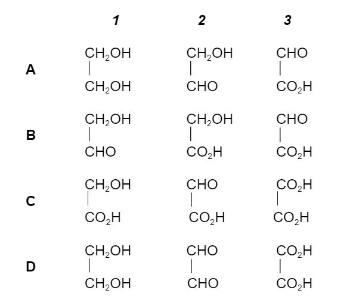

# Exam Questions — Aldehydes & Ketones
**17. Carbonyl Compounds** · Cambridge (CIE) A-LEVEL chemistry (9701)
> Source: [https://www.savemyexams.com/a-level/chemistry/cie/25/topic-questions/](https://www.savemyexams.com/a-level/chemistry/cie/25/topic-questions/) · 21 questions across 1 sets

## Multiple Choice Questions (21 questions)

### Q1 — medium — 1 marks

**Q1** [1 mark]

An organic compound **X** has a molecular ion peak at **m/z = 58** in its mass spectrum.

Experimental data for compound **X** is shown in the table below:

| Test | Observation |
|---|---|
| Addition of 2,4-dinitrophenylhydrazine (2,4-DNPH) | Orange precipitate formed |
| Warming with Tollens' reagent | No visible change |

What is the identity of compound **X**?

### Q2 — medium — 1 marks

**Q2** [1 mark]

An organic liquid **X** gives the following results:

- Forms an orange precipitate with 2,4-DNPH
- Does **not** form a silver mirror with Tollens’ reagent
- Forms a yellow precipitate with alkaline aqueous iodine

What is the identity of **X**?

### Q3 — hard — 1 marks

**Q3** [1 mark]

Hydroxynitriles can be made from carbonyl compounds by generating CN– ions from HCN in the presence of a weak base.

In a similar reaction, –CH2CO2CH3 ions are generated from CH3CO2CH3 by strong bases.

Which compound can be made from an aldehyde and CH3CO2CH3 in the presence of a strong base?

### Q4 — hard — 1 marks

**Q4** [1 mark]

When compound **T** reacts with its own oxidation product, a sweet-smelling liquid is produced.

What is the identity of compound **T**?

### Q5 — medium — 1 marks

**Q5** [1 mark]

Carvone is used as a flavouring for spearmint chewing gum.

When carvone is heated under reflux with excess hot concentrated acidified potassium manganate(VII) the products carbon dioxide and compound **X** are formed.

**X** contains nine carbon atoms and reacts with 2,4-dinitrophenylhydrazine reagent.

What is the maximum number of molecules of 2,4-dinitrophenylhydrazine that will react with one molecule of **X**?

### Q6 — medium — 1 marks

**Q6** [1 mark]

Hydroxyethanal has the structural formula HOCH2CHO.

In an experiment hydroxyethanal is heated under reflux with an excess of acidified potassium dichromate (VI) until no further oxidation takes place.

What is the skeletal formula of the organic product formed in the experiment?

### Q7 — hard — 1 marks

**Q7** [1 mark]

When HCN reacts with butanal, CH3CH2CH2CHO, product X is formed. If X is then hydrolysed by aqueous acid, product Y is produced.

When pentanal, CH3CH2CH2CH2CHO, is heated under reflux with acidified potassium dichromate(VI), product Z is formed.

What is the difference in relative molecular mass of products Y and Z?

### Q8 — hard — 1 marks

**Q8** [1 mark]

1 mol of CH3COCH2CH2CHO is placed into each of three separate test-tubes.

An excess of NaBH4 is added to test-tube 1 and an excess of acidified potassium manganate(VII) is added to test-tube 2. No reagent is added to test-tube 3.

An excess of HCN is then added to each test-tube.

Which row correctly shows the number of moles of HCN that react with the organic compound in each test-tube?

|   | test-tube 1 | test-tube 2 | test-tube 3 |
|---|---|---|---|
| **A** | 0 | 1 | 2 |
| **B** | 0 | 2 | 2 |
| **C** | 1 | 1 | 2 |
| **D** | 2 | 1 | 0 |

### Q9 — medium — 1 marks

**Q9** [1 mark]

When compounds 1, 2 and 3 react with PCl5, hydrogen chloride is evolved. However, only one of the three reacts with 2,4-dinitrophenylhydrazine reagent.

Which one of the following combinations could be 1, 2 and 3?

### Q10 — medium — 1 marks

**Q10** [1 mark]

The colour of warm acidified potassium dichromate(VI) changes from orange to green when added to compound Y. 1 mol of Y reacts with 2 mol of hydrogen cyanide in the presence of potassium cyanide.

What could Y be?

### Q11 — medium — 1 marks

**Q11** [1 mark]

When alkaline I2 solution is added to butanone, a yellow precipitate is formed.

Which of the following compounds is responsible for the precipitate?

### Q12 — medium — 1 marks

**Q12** [1 mark]

Which reagent will give similar results with both propanone and propanal?

### Q13 — easy — 1 marks

**Q13** [1 mark]

The characteristic smell of burnt sugar is partly caused by the following compound.

Which reagent will react with **both** functional groups?

### Q14 — easy — 1 marks

**Q14** [1 mark]

Which carbonyl compound(s) react with **both** LiAlH4 and Tollens’ reagent?

### Q15 — easy — 1 marks

**Q15** [1 mark]

An aqueous methanolic solution of NaBH4 acts as a reducing agent when added to propanal, CH3CH2CHO.

What is the first step of this mechanism?

### Q16 — easy — 1 marks

**Q16** [1 mark]

Ethanal, CH3CHO, is reduced using NaBH4 in aqueous ethanol.

What is the first step of this mechanism?

### Q17 — easy — 1 marks

**Q17** [1 mark]

The orange colour of carrots is due to the presence of β-carotene, the structure of which is shown in the diagram below.

Excess hot concentrated acidified potassium manganate(VII) will oxidise β-carotene.

When an individual molecule of β-carotene is oxidised in this way there are multiple possible products.

How many of these product molecules contain a ketone functional group?

### Q18 — easy — 1 marks

**Q18** [1 mark]

Hex-3-enal is used as a flavouring agent.

CH3CH2CH=CHCH2CHO

Which row correctly shows the product formed when hex-3-enal is treated with the given reducing agent?

|   | **Product** | **Reducing agent** |
|---|---|---|
| **A** | CH3(CH2)4CH3 | H2 + Ni |
| **B** | CH3(CH2)4CH2OH | NaBH4 |
| **C** | CH3(CH2)4CHO | H2 + Ni |
| **D** | CH3(CH2)4CHO | NaBH4 |

### Q19 — easy — 1 marks

**Q19** [1 mark]

In which reaction is the organic compound oxidised?

### Q20 — easy — 1 marks

**Q20** [1 mark]

In 1903, Arthur Lapworth investigated the reaction of hydrogen cyanide with propanone.

What is the name of this type of mechanism?

### Q21 — easy — 1 marks

**Q21** [1 mark]

What is formed when butanone is warmed with a solution of NaBH4?
