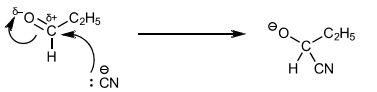
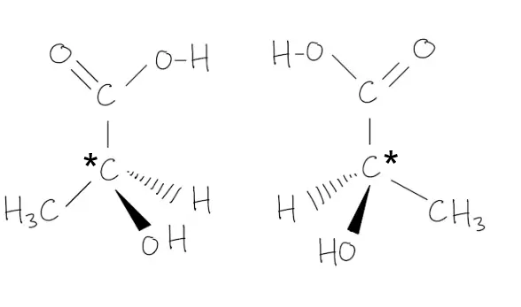
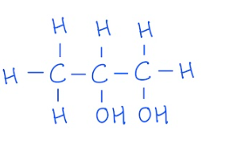
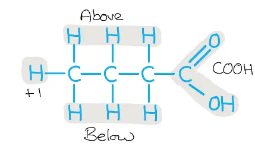
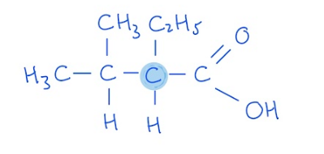
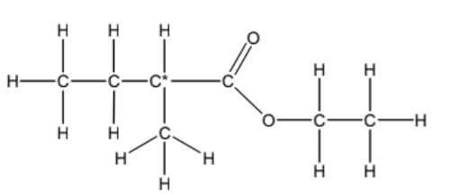
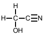
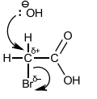

# Mark Schemes — Carboxylic Acids
**18. Carboxylic Acids & Derivatives** · Cambridge (CIE) A-LEVEL chemistry (9701)

## Multiple Choice Questions (13 questions)

### Q1
**Final answer:** **The correct answer is A**

- Ethanolic sodium cyanide (NaCN) reacts with the halogenoalkane in option A via nucleophilic substitution, extending the carbon chain by one carbon to form a nitrile.
- Acid hydrolysis of the nitrile produces the corresponding carboxylic acid: 2-ethyl-3-methylbutanoic acid.

**B**, **C** and **D** are incorrect as these halogenoalkanes would produce different carboxylic acids on reaction with ethanolic NaCN followed by acid hydrolysis.

### Q2
**Final answer:** **The correct answer is A**

- When propanenitrile is heated under reflux with dilute acid, an ammonium salt and propanoic acid are produced.

**B** is incorrect as acidified potassium dichromate(VI) is used to oxidise alcohols and aldehydes to carboxylic acids, not to hydrolyse nitriles.

**C** is incorrect as sodium borohydride is a mild reducing agent and will not reduce nitrile groups.

**D** is incorrect as while nitriles can be hydrolysed with alkali under reflux, the resulting solution would need to be acidified to produce the carboxylic acid.

### Q3
**Final answer:** **The correct answer is D**

- Malic acid has 2 carboxylic acid groups, so 1 mole of malic acid requires 2 moles of NaOH for complete neutralisation.
- Each of the compounds in **A**, **B **and **C **has only 1 carboxylic acid group, requiring only 1 mole of NaOH per mole of compound.

**A**, **B** and **C** are incorrect as lactic acid, gluconic acid and aspirin each have only 1 carboxylic acid group and therefore each require only 1 mole of NaOH per mole.

### Q4
**Final answer:** **The correct answer is C**

- Calculate moles of NaOH required:

- Citric acid contains 3 carboxylic acid groups, each neutralised by one NaOH molecule.
- Therefore, for every 1 mole of citric acid, 3 moles of NaOH are required.
- 0.008 moles of citric acid is used.

0.008 x 3 = 0.024 moles of NaOH are required.

- Calculate volume of NaOH required:

moles = concentration x volume

volume = $\frac{\mathrm{moles}}{\mathrm{concentration}}$

volume = $\frac{0.024}{0.2}$

volume = 0.12 dm3

- Convert from dm3 to cm3:

volume = 0.12 × 1000 = 120 cm3

**A** is incorrect as it assumes a 1:1 molar ratio between citric acid and NaOH, giving 40 cm3. The word "acid" does not always mean one acidic group.

**B** is incorrect as it assumes a 1:2 molar ratio. This occurs when only two of the three carboxylic acid groups are identified, giving 80 cm3. The most common mistake is missing the one written as CO2H in the central bracket

**D** is incorrect as it assumes a 1:4 molar ratio by incorrectly treating the alcohol –OH group as acidic. The –OH group is an alcohol, not a phenol, and does not react with NaOH. Counting all four –OH-containing groups gives 160 cm3.

### Q5
**Final answer:** **The correct answer is C**

- 2-hydroxybutanoic acid has both an alcohol and carboxylic acid group
- Therefore, 2 molecules can react together in a condensation reaction, forming a diester (a molecule with two ester groups).
- Concentrated sulfuric acid acts as a catalyst in condensation reactions that result in esters.

**A** is incorrect as reacting 2-hydroxybutanoic acid with acidified aqueous potassium manganate(VII) would cause the secondary alcohol group to oxidise to a ketone, resulting in 2-oxobutanoic acid (CH3CH2COCOOH).

**B** is incorrect as aluminium oxide (Al2O3) acts as a catalyst in the dehydration of alcohols to alkenes, therefore reacting 2-hydroxybutanoic acid with aluminium oxide would produce but-2-en-oic acid (CH3CH=CHCOOH).

**D** is incorrect as 2-hydroxybutanoic acid and sodium hydroxide would undergo a neutralisation reaction resulting in an organic salt CH3CH2CH(OH)COONa and water.

### Q6
**Final answer:** **The correct answer is B**

- Fumaric acid has an alkene functional group and oxaloacetic acid has a carbonyl functional group.
- Therefore, in step 1 the alkene group in fumaric acid is hydrated to produce an alcohol (**Z**) and in step 2 this alcohol group is oxidised to a ketone.
- The structure of **Z **is HO2CCH(OH)CH2CO2H as there is an alcohol group on the 2nd carbon (which has the alkene group in fumaric acid).
- The reagent for step 2 is acidified aqueous potassium dichromate(VI), heated.

**A** is incorrect as Fehling's solution is an oxidising agent that converts aldehydes into carboxylic acids. Fehling's solution does not oxidise secondary alcohols as Cu2+ is not a sufficiently strong oxidising agent.

**C** is incorrect as HO2CCHBrCH2CO2H cannot be converted into oxaloacetic acid in a single step using acidified aqueous potassium manganate(VII).

**D** is incorrect as although the bromohydrin Z can be made in step 1 using Br2 (aq), in step 2 NaOH would cause nucleophilic substitution of the C–Br bond and neutralise the carboxylic acid groups. It cannot produce the required ketone in a single step.

### Q7
**Final answer:** **The correct answer is C**

- NaOH hydrolyses the ester and amide bonds in sirolimus.
- The carboxylic acid produced undergoes neutralisation with NaOH to produce a carboxylate salt (RCOO–Na+) and water.

> **[exam-tip]**
> Amide bonds appear in Topic 28 of the syllabus and, like ester bonds, can be hydrolysed by hot aqueous sodium hydroxide. Being familiar with both bond types helps when analysing complex molecules such as sirolimus, which contains both.

### Q8
**Final answer:** **The correct answer is C**

- C5H12O has zero degrees of unsaturation.

  - So, **K **must be a saturated compound.
  - It cannot be a ketone or aldehyde.
- Since **K **is oxidised to give a carboxylic acid, **K **must be a primary alcohol and **L **is a carboxylic acid.
- When a carboxylic acid reacts with an alcohol in the presence of a sulfuric acid catalyst, an ester is produced.
- The ester contains the butan-2-ol portion -OCH(CH3)CH2CH3

  - This is seen in **C**: CH3(CH2)3CO2CH(CH3)CH2CH3

**A** is incorrect as this would be the product if compound **L** reacted with 2-methylpropan-2-ol.

**B** is incorrect as this would be the product if compound **L** reacted with butan-1-ol.

**D** is incorrect as this would be the product if compound **L** reacted with 2-methylpropan-1-ol.

### Q9
**Final answer:** **The correct answer is B**

- Lactic acid has a secondary alcohol group and a carboxylic acid group.
- Reacting lactic acid with **methanoic acid** (HCO2H) produces an **ester** from the secondary alcohol group, as shown in reaction B.
- This is a condensation reaction and produces water alongside the ester.

**A** is incorrect as Cl2 does not substitute the –OH group of a secondary alcohol under normal conditions. The byproduct would also be HOCl, not OCl.

**C** is incorrect as methanol (CH3OH) would react with the **carboxylic acid** group in lactic acid, not the alcohol group, producing the methyl ester CH3CH(OH)CO2CH3.

**D** is incorrect as NaHCO3 reacts with the **carboxylic acid** group, not the alcohol group. The product would be CH3CH(OH)CO2Na, not CH3CH(ONa)CO2H as shown.

### Q10
**Final answer:** **The correct answer is A**

- A 'hydroxyl' group is an '–OH' group, which in malic acid appears in both carboxylic acid groups and the alcohol group.
- If the substance only reacts with one hydroxyl group, this must be the alcohol group.

  - So, we must identify what does not react with a carboxylic acid group.
- The dichromate ion (Cr2O72-), produced when K2Cr2O7 is dissolved in acidified aqueous solution, acts as an oxidising agent.
- Carboxylic acids are already at their highest oxidation state and therefore will not react with acidified dichromate ions.
- The secondary alcohol in malic acid is oxidised to a ketone, which is not oxidised further.

**B** is incorrect as sodium metal reacts with **both** the carboxylic acid groups and the alcohol group in redox reactions, producing a salt and hydrogen gas:

2RCOOH + 2Na $\rightarrow$ 2RCOONa + H2

2ROH + 2Na $\rightarrow$ 2RONa + H2

**C** is incorrect as sodium hydroxide reacts with **both** carboxylic acid groups in a neutralisation reaction:

RCOOH + NaOH $\rightarrow$ RCOONa + H2O

**D** is incorrect as PCl5 reacts with **both** the carboxylic acid groups (producing an acyl chloride) and the alcohol group (producing a haloalkane):

RCOOH + PCl5 $\rightarrow$ RCOCl + POCl3 + HCl

ROH + PCl5 $\rightarrow$ RCl + POCl3 + HCl

### Q11
**Final answer:** **The correct answer is C**

- When propanenitrile is heated with aqueous sodium hydroxide under reflux, the products are sodium propanoate and ammonia.
- To produce the free carboxylic acid the products would need to be acidified.

**A**, **B** and **D** are incorrect as all of these reactions would produce propanoic acid.

### Q12
**Final answer:** **The correct answer is C**

- 'Trans fat' is a carboxylic acid with a long aliphatic chain that is unsaturated.

**A** is incorrect as this compound is not optically active as it does not have a chiral carbon.

**B** and **D** are incorrect as they are not 'trans' in structure as the hydrogen atoms are on the same side of the double bond.

### Q13
**Final answer:** **The correct answer is A**

- Compound 1, propanenitrile, can be hydrolysed to propanoic acid by heating with dilute hydrochloric acid.

- Compound 2, propanal, can be oxidised to propanoic acid by heating with acidified aqueous potassium dichromate(VI).

- Compound 3, propan-1-ol, can be oxidised to propanoic acid by heating under reflux with acidified aqueous potassium dichromate(VI).

**B**, **C** and **D** are incorrect as each is missing at least one valid reaction route to propanoic acid.

## Structured Questions (7 questions)

### Q1
> **[mark-scheme]**
> The white precipitate is:
> 
> - Aluminium hydroxide / Al(OH)3 **[1 mark]**

> **[exam-tip]**
> LiAlH4 contains both lithium and aluminium. When it reacts with water:
> 
> - Lithium forms LiOH (given in the question)
> - Aluminium forms Al(OH)3, a white precipitate
> 
> Al(OH)3 is amphoteric and it dissolves in excess NaOH to form the aluminate ion [Al(OH)4]-. This behaviour is a useful identifier: if a white precipitate dissolves in excess sodium hydroxide solution, aluminium ions are present.
> **[mark-scheme]**
> i) The reagents and conditions for reaction 1:
> 
> - Potassium dichromate(VI) (K2Cr2O7) / potassium manganate(VII) (KMnO4) **[1 mark]**
> - Acidified (with dilute sulfuric acid)
> **AND**
> Heat under reflux **[1 mark]**
> 
> ii) Which compound is 2-hydroxybutanoic acid and the difference between reactions 2 and 3:
> 
> - **R** is 2-hydroxybutanoic acid **[1 mark]**
> - NaBH4 reduces only carbonyl (C=O) groups and cannot reduce carboxyl (–COOH) groups; LiAlH4 reduces both **[1 mark]**

> **[exam-tip]**
> Compound P contains both a ketone (C=O) and a carboxylic acid (–COOH) group, formed by oxidising both alcohol groups in butane-1,2-diol.
> 
> NaBH4 is a mild reducing agent that selectively reduces aldehydes and ketones but cannot reduce the more stable carboxylic acid group. This gives R, which retains the –COOH group and is therefore 2-hydroxybutanoic acid.
> 
> LiAlH4 is a stronger reducing agent that reduces both C=O and –COOH groups, converting the carboxylic acid to a primary alcohol. Q therefore has two alcohol groups rather than the required carboxylic acid.
The mechanism for the reaction of propanal with HCN / NaCN to form S is:

**[4 marks]**

> **[mark-scheme]**
> 1 mark for :CN- identified as the ion that reacts with propanal
> 
> 1 mark for a curly arrow from the lone pair on :CN- to the carbonyl carbon
> 
> 1 mark for correct partial charges (δ+ on carbonyl carbon, δ− on oxygen) AND a curly arrow from the C=O bond to the oxygen
> 
> 1 mark for a correct tetrahedral intermediate drawn

> **[exam-tip]**
> This is a nucleophilic addition mechanism. The cyanide ion (:CN-) is the nucleophile as it carries a lone pair on the carbon atom and attacks the δ+ carbonyl carbon.
> 
> In the NaCN / HCN mixture, NaCN provides the CN- ions and HCN provides the proton that converts the alkoxide intermediate to the hydroxyl group in product S.
> 
> When drawing the mechanism:
> 
> - The curly arrow from :CN- must originate from the lone pair on the cyanide carbon (not from the nitrogen end)
> - The curly arrow from C=O must come from the double bond, pushing electrons onto the oxygen to form O-
> - The intermediate must show a tetrahedral carbon with an O- charge
> **[mark-scheme]**
> A balanced equation for the acid hydrolysis of S in step 2:
> 
> - C2H5CH(OH)CN + HCl + 2H2O → C2H5CH(OH)COOH + NH4Cl **[1 mark]**

> **[exam-tip]**
> The nitrile group (–C≡N) is hydrolysed to a carboxylic acid (–COOH) by heating under reflux with dilute acid. Both HCl and water are required as reactants, but the question may not make this obvious.
> 
> The same hydrolysis can also be carried out using an alkali, but this produces a carboxylate salt and ammonia rather than the free carboxylic acid and ammonium chloride.

### Q2
The three-dimensional structures of the two optical isomers of lactic acid are:

**[3 marks]**

> **[mark-scheme]**
> 1 marks for one correct three-dimensional structures with wedge-and-dash bonds shown
> 
> 1 mark for the non-superimposable mirror image
> 
> Allow 1 mark if the structures are drawn as displayed formulae without 3D representation but are otherwise correct
> 
> 1 mark for the chiral carbon atom correctly identified with an asterisk (*) in one of the structures

> **[exam-tip]**
> Optical isomers are non-superimposable mirror images of each other. To draw them correctly for lactic acid:
> 
> - Draw all bonds to the chiral carbon (the one bearing four different groups: H, OH, CH3, and COOH)
> - Use wedge bonds (solid triangle) for bonds coming towards you and dashed bonds for bonds going away
> - The second isomer is the mirror image of the first, with the arrangement of groups reversed
> 
> Note that the carbon atom in the COOH group is not chiral as it is bonded to only three different groups (=O, –OH, and the carbon chain), not four.
> **[mark-scheme]**
> Step 1:
> 
> - Acidified potassium dichromate(VI) / acidified potassium manganate(VII) **[1 mark]**
> - Distillation **[1 mark]**
> 
> Step 2:
> 
> - HCN / mixture of HCN and NaCN
> **OR**
> KCN with dilute acid **[1 mark]**
> - Room temperature **[1 mark]**
> 
> Step 3:
> 
> - Dilute acid (e.g. HCl / H2SO4)
> **OR**
> Dilute alkali / NaOH **[1 mark]**
> - Heat under reflux **[1 mark]**

> **[exam-tip]**
> The reaction pathway converts ethanol to lactic acid through three steps:
> 
> - Step 1: Ethanol (primary alcohol) → ethanal (aldehyde) by partial oxidation
> - Step 2: Ethanal → 2-hydroxypropanenitrile (hydroxynitrile) by nucleophilic addition of HCN
> - Step 3: 2-hydroxypropanenitrile → 2-hydroxypropanoic acid by hydrolysis of the nitrile group
> 
> In step 1, distillation is essential to remove ethanal as it forms and prevent further oxidation to ethanoic acid.
> 
> In step 3, acid hydrolysis gives the free carboxylic acid; alkali hydrolysis gives a carboxylate salt and ammonia. Both are accepted.
> **[mark-scheme]**
> i) An equation for the reduction of lactic acid by LiAlH4:
> 
> - CH3CH(OH)COOH + 4[H] → CH3CH(OH)CH2OH + H2O **[1 mark]**
> 
> ii) The systematic name of the organic product:
> 
> - Propane-1,2-diol **[1 mark]**

> **[exam-tip]**
> LiAlH4 reduces the carboxylic acid group (–COOH) to a primary alcohol (–CH2OH). Four [H] atoms are needed overall: two to add across the C=O, one to protonate the O- to give –OH, and one is lost as part of the water molecule produced.
> 
> The product (propane-1,2-diol) has two alcohol groups:
> 
> 
> 
> - The secondary alcohol on carbon-2 was already present in the lactic acid molecule
> - The primary alcohol on carbon-1 is newly formed from reduction of the –COOH group

### Q3
> **[mark-scheme]**
> The general formula of a carboxylic acid is:
> 
> - CnH2n+1COOH **[1 mark]**

> **[exam-tip]**
> The general formula can be understood by thinking about the carbon chain:
> 
> 
> 
> - For every carbon in the hydrocarbon chain, there is a hydrogen above and a hydrogen below, giving 2n hydrogens for n carbons
> - There is also one extra hydrogen at the end of the chain, giving 2n + 1 hydrogens in total
> - This gives the CnH2n+1 portion of the formula, with the carboxylic acid group (–COOH) added at the end
> **[mark-scheme]**
> The systematic name of the carboxylic acid in Fig. 1.1 is:
> 
> - 3-methylbutanoic acid **[1 mark]**

> **[exam-tip]**
> To name a carboxylic acid systematically:
> 
> - Identify the longest carbon chain that includes the –COOH group — four carbons gives the stem "butan-"
> - The –COOH carbon is always carbon-1, so it does not need to be numbered in the name
> - Identify any substituents: there is a methyl group attached to carbon-3
> - Combine to give: 3-methylbutanoic acid
> **[mark-scheme]**
> i) The balanced equation for the dissociation of 3-methylbutanoic acid is:
> 
> - CH3CH(CH3)CH2COOH ⇋ CH3CH(CH3)CH2COO- + H+
> **OR**
> C4H9COOH ⇋ C4H9COO- + H+ **[1 mark]**
> 
> The equation must have a reversible arrow
> 
> ii) The position of the equilibrium and what this indicates:
> 
> - To the left **[1 mark]**
> - (This indicates it is a) weak acid **[1 mark]**

> **[exam-tip]**
> Carboxylic acids are weak acids because they only partially dissociate in aqueous solution. The equilibrium lies to the left, meaning most molecules remain in the undissociated acid form.
> 
> Compare this with strong acids such as HCl, which fully dissociate and their equilibria lie completely to the right.
> 
> Always use the equilibrium symbol (⇋) rather than a forward arrow (→) when showing the dissociation of a weak acid, to reflect the reversible nature of the reaction.
The balanced symbol equation for the reaction of propanoic acid with sodium hydrogen carbonate is:

CH3CH2COOH (aq) + NaHCO3 (s) → CH3CH2COONa (aq) + H2O (l) + CO2 (g)

**OR**

C2H5COOH (aq) + NaHCO3 (s) → C2H5COONa (aq) + H2O (l) + CO2 (g)

**[2 marks]**

> **[mark-scheme]**
> 1 mark for a correct balanced equation with correct formulae for all species
> 
> Allow CH3CH2COOH or C2H5COOH for propanoic acid
> 
> 1 mark for correct state symbols: (aq) for propanoic acid and sodium propanoate, (s) for sodium hydrogen carbonate, (l) for water, and (g) for carbon dioxide

> **[exam-tip]**
> The reaction of a carboxylic acid with a hydrogen carbonate follows the pattern:
> 
> acid + hydrogen carbonate → salt + water + carbon dioxide
> 
> The salt formed is sodium propanoate (CH3CH2COONa), which is soluble and has the state symbol (aq). The sodium hydrogen carbonate is a solid powder (s), the water produced is a liquid (l), and the carbon dioxide produced is a gas (g).

### Q4
> **[mark-scheme]**
> An equation for reaction 1, using [H] to represent one atom of hydrogen from the reducing agent:
> 
> - CH3CH2CO2H + 4[H] → CH3CH2CH2OH + H2O **[1 mark]**

> **[exam-tip]**
> Reaction 1 shows the reduction of propanoic acid to propan-1-ol. The [H] notation represents one atom of hydrogen from the reducing agent, so four [H] atoms are needed overall.
> 
> The reduction of a carboxylic acid follows the pattern:
> 
> R–COOH + 4[H] → R–CH2OH + H2O
> **[mark-scheme]**
> i) The type of reaction for reaction 2 is:
> 
> - Oxidation **[1 mark]**
> 
> ii) A suitable reagent and conditions for reaction 2:
> 
> - Acidified potassium dichromate(VI) / acidified potassium manganate(VII) **[1 mark]**
> - Reflux **[1 mark]**

> **[exam-tip]**
> Reaction 2 converts propan-1-ol to propanoic acid. Since the organic product gains oxygen compared to the reactant, this is oxidation.
> 
> The two standard oxidising agents for oxidising primary alcohols to carboxylic acids are:
> 
> - Acidified potassium dichromate(VI) (K2Cr2O7): orange solution turns green as Cr(VI) is reduced to Cr(III)
> - Acidified potassium manganate(VII) (KMnO4): purple solution turns colourless as Mn(VII) is reduced
> 
> Reflux conditions are required to ensure complete oxidation to the carboxylic acid and to prevent any aldehyde intermediate from escaping as vapour.
> **[mark-scheme]**
> An equation for the reaction of propanoic acid with calcium carbonate:
> 
> - 2CH3CH2CO2H + CaCO3 → (CH3CH2CO2)2Ca + H2O + CO2 **[1 mark]**

> **[exam-tip]**
> Propanoic acid reacts with calcium carbonate in the same way as any acid reacts with a metal carbonate:
> 
> acid + metal carbonate → salt + water + carbon dioxide
> 
> The salt formed is calcium propanoate, (CH3CH2CO2)2Ca. Two molecules of propanoic acid are needed to react with one molecule of CaCO3 because calcium forms a 2+ ion, so two propanoate anions are required to balance the charge.
> **[mark-scheme]**
> i) A suitable reagent and conditions for reaction 3:
> 
> - CH3CO2H / ethanoic acid **[1 mark]**
> - Warm / heat / reflux
> **AND**
> Concentrated sulfuric acid **[1 mark]**
> 
> ii) The other product of reaction 3:
> 
> - Water **[1 mark]**

> **[exam-tip]**
> Reaction 3 shows propan-1-ol reacting with ethanoic acid to form propyl ethanoate, which is an esterification reaction.
> 
> The name of the ester tells you the reagents: the first part of the name (propyl) comes from the alcohol (propan-1-ol), and the second part (ethanoate) comes from the carboxylic acid (ethanoic acid, CH3CO2H).
> 
> Esterification is a condensation reaction, where the two reactants join together and a small molecule (water) is eliminated. Concentrated sulfuric acid acts as a catalyst, and heating is required to achieve a reasonable rate of reaction.

### Q5
> **[mark-scheme]**
> i) The molecular formula of 2-ethyl-3-methylbutanoic acid is:
> 
> - C7H14O2 **[1 mark]**
> 
> ii) The number of chiral carbon atoms:
> 
> - 1 / one **[1 mark]**

> **[exam-tip]**
> To deduce the molecular formula, count the atoms in the structural formula:
> 
> 
> 
> - Count carbons:
> 
>   - Main chain (4) + ethyl substituent (2) + methyl substituent (1) = 7 carbons
> - Saturated monocarboxylic acids follow CnH2nO2
> 
>   - For n = 7 this gives C7H14O2
> 
> To identify chiral carbons, use the displayed formula shown above and look for carbons bonded to four different groups:
> 
> - Carbon-2 is bonded to H, the ethyl group (–C2H5), the carboxylic acid group (–CO2H), and the C3–C4 chain (–CH(CH3)CH3)
> 
>   - All four are different, so carbon-2 is chiral
> - Carbon-3 is bonded to H, the methyl substituent (–CH3), the terminal methyl (C4, also –CH3), and the C2 chain
> 
>   - It has two identical methyl groups, so it is not chiral
> **[mark-scheme]**
> i) The reagent and colour change for this oxidation:
> 
> - Acidified potassium dichromate(VI) / acidified K2Cr2O7
> **OR**
> Acidified potassium manganate(VII) / acidified KMnO4 **[1 mark]**
> - Orange to green (for K2Cr2O7)
> **OR**
> Purple to colourless (for KMnO4) **[1 mark]**
> 
> The colour change must match the reagent chosen.
> 
> ii) The main organic impurity and reason:
> 
> - 2-ethyl-3-methylbutanal / (CH3)2CHCH(C2H5)CHO **[1 mark]**
> - (Because) partial oxidation of the primary alcohol produces an aldehyde / the primary alcohol is not fully oxidised **[1 mark]**
> 
> iii) The apparatus and reason:
> 
> - Reflux **[1 mark]**
> - To ensure complete oxidation of the primary alcohol to the carboxylic acid / to prevent the intermediate aldehyde from escaping as vapour **[1 mark]**

> **[exam-tip]**
> The two common oxidising agents both change colour as they are reduced:
> 
> - Acidified potassium dichromate(VI): orange turns green (Cr(VI) reduced to Cr(III))
> - Acidified potassium manganate(VII): purple turns colourless (Mn(VII) reduced to Mn(II))
> 
> Distillation is used when you want to collect the product as it forms and prevent further oxidation. For example, when stopping at the aldehyde stage. Reflux keeps the mixture in the flask to ensure complete oxidation all the way to the carboxylic acid.
> **[mark-scheme]**
> The colour change observed when 2-ethyl-3-methylbutan-2-ol is heated with the oxidising agent from part (b)(i):
> 
> - No colour change **[1 mark]**
> - (Because) 2-ethyl-3-methylbutan-2-ol is a tertiary alcohol / the –OH group is bonded to a carbon bearing three alkyl groups **[1 mark]**
> 
> Tertiary alcohols cannot be oxidised by acidified dichromate(VI) or manganate(VII).

> **[exam-tip]**
> Classify the alcohol before predicting the outcome of oxidation:
> 
> - Primary alcohols (–OH on a carbon bonded to one alkyl group) can be oxidised to aldehydes, then to carboxylic acids
> - Secondary alcohols (–OH on a carbon bonded to two alkyl groups) can be oxidised to ketones only
> - Tertiary alcohols (–OH on a carbon bonded to three alkyl groups) cannot be oxidised
> 
> 2-ethyl-3-methylbutan-2-ol has the –OH group on a carbon bonded to three alkyl groups, making it a tertiary alcohol. No oxidation occurs and no colour change is observed.
The displayed formula of the ethyl ester with the chiral carbon atom marked is:

**[3 marks]**

> **[mark-scheme]**
> 1 mark for a correct displayed formula of the ethyl ester
> 
> 1 mark for all bonds between atoms shown explicitly in the displayed formula
> 
> 1 mark for the correct chiral carbon atom identified with an asterisk (*)
> 
> If the overall structure is incorrect, 1 mark may still be awarded for correctly identifying a chiral carbon in the drawn structure.

> **[exam-tip]**
> The compound is an ethyl ester and an isomer of 2-ethyl-3-methylbutanoic acid (C7H14O2). Replacing the –OH of the carboxylic acid with –OC2H5 gives the ester group; the remaining acid fragment must be rearranged to give a branched chain with a chiral centre.
> 
> In a displayed formula, all bonds including C–H bonds must be drawn explicitly as this distinguishes it from a structural formula where C–H bonds are implied.

### Q6
The completed table is:

| reagent | observation with glycolic acid | functional group |
|---|---|---|
| Na2CO3 | **Final answer:** **Effervescence / fizzing / bubbling** | **Final answer:** **–COOH / carboxylic acid** |
| 2,4-DNPH | **Final answer:** **No visible reaction** | **Final answer:** **–** |
| acidified K2Cr2O7 (aq) and heat | **Final answer:** **Orange to green** | **Final answer:** **–OH / alcohol** |

**[4 marks]**

> **[mark-scheme]**
> 1 mark for effervescence / fizzing **AND** –COOH / carboxylic acid for Na2CO3
> 
> 1 mark for no visible reaction for 2,4-DNPH (no functional group required)
> 
> 1 mark for orange to green **AND** –OH / alcohol for acidified K2Cr2O7(aq) and heat

> **[exam-tip]**
> Glycolic acid (HOCH2COOH) contains two functional groups: a primary alcohol (–OH) and a carboxylic acid (–COOH).
> 
> - Na2CO3: reacts with the –COOH group, producing CO2 (seen as effervescence), water, and sodium glycolate
> - 2,4-DNPH: tests specifically for aldehydes and ketones (C=O groups); glycolic acid has no aldehyde or ketone group, so no reaction occurs
> - Acidified K2Cr2O7(aq) and heat: the primary alcohol (–OH) is oxidised; Cr(VI) (orange) is reduced to Cr(III) (green)
i) The structure of X:

**[1 mark]**

> **[mark-scheme]**
> ii) The reagent for reaction 2:
> 
> - Dilute acid / dilute HCl / dilute H2SO4 **[1 mark]**
> 
> iii) The mechanism for reaction 3:
> 
> - Free radical substitution **[1 mark]**
> 
> iv) The essential condition for reaction 3:
> 
> - UV light / sunlight **[1 mark]**

v) The completed SN2 mechanism for reaction 4:

**[3 marks]**

> **[mark-scheme]**
> 1 mark for a lone pair shown on OH-
> 
> 1 mark for a curly arrow from the lone pair on OH- to the electrophilic carbon of the C–Br bond
> 
> 1 mark for correct partial charges (δ+ on C, δ− on Br) AND a curly arrow from the C–Br bond to Br

> **[exam-tip]**
> In reaction 2, the nitrile group (–C≡N) of compound X is hydrolysed to a carboxylic acid (–COOH) using dilute acid under reflux. Alkali hydrolysis is not accepted because it produces a carboxylate salt rather than the free carboxylic acid.
> 
> In reaction 3, free radical bromination introduces a bromine atom at the carbon adjacent to the –COOH group. UV light or sunlight is required to generate Br• radicals from Br2 and initiate the chain reaction.
> 
> In the SN2 mechanism for reaction 4:
> 
> - The curly arrow from OH- must originate from the lone pair on oxygen, pointing to the electrophilic carbon
> - The curly arrow from C–Br must come from the bond itself, pointing to Br
> - SN2 is a concerted single-step mechanism, where no intermediate is drawn
> **[mark-scheme]**
> i) The role of NaBH4:
> 
> - Reducing agent / reductant **[1 mark]**
> 
> ii) An equation using molecular formulae:
> 
> - C2H2O3 + 2[H] → C2H4O3 **[1 mark]**

> **[exam-tip]**
> The question asks for molecular formulae (e.g. C2H2O3), not structural formulae (e.g. CHOCOOH). Writing structural formulae will not score the mark.
> 
> The reduction converts the aldehyde group (–CHO) in glyoxylic acid to a hydroxyl group (–CH2OH), giving glycolic acid. Only the aldehyde is reduced, the carboxylic acid group (–COOH) is unaffected by NaBH4.

### Q7
> **[mark-scheme]**
> The systematic name of the intermediate is:
> 
> - Propanal **[1 mark]**

> **[exam-tip]**
> When a primary alcohol is oxidised, the reaction proceeds in two stages:
> 
> 1. Partial oxidation: primary alcohol → aldehyde (using distillation conditions to remove the aldehyde as it forms)
> 2. Full oxidation: primary alcohol → carboxylic acid (using excess oxidising agent under reflux)
> 
> Propan-1-ol oxidises to propanal as the intermediate, which then further oxidises to propanoic acid.
> **[mark-scheme]**
> i) The final colour of the reaction mixture after the potassium dichromate(VI) has reacted:
> 
> - Green **[1 mark]**
> 
> ii) The conditions to obtain propanoic acid in a high yield:
> 
> - Excess acidified potassium dichromate(VI) **[1 mark]**
> - Reflux **[1 mark]**

> **[exam-tip]**
> When propan-1-ol is fully oxidised to propanoic acid:
> 
> - The potassium dichromate(VI) is reduced: the orange Cr(VI) solution turns green as it is converted to Cr(III)
> - Excess oxidising agent is needed to ensure all the aldehyde intermediate (propanal) is further oxidised to propanoic acid
> - Reflux prevents the volatile propanal from escaping as vapour and keeps it in contact with the oxidising agent until fully converted
> **[mark-scheme]**
> A chemical test and observation to confirm the presence of a carboxyl group:
> 
> - Add sodium carbonate (Na2CO3) / potassium carbonate (K2CO3)
> **OR**
> Add sodium hydrogen carbonate (NaHCO3) / potassium hydrogen carbonate (KHCO3) **[1 mark]**
> - Effervescence / fizzing / bubbling observed **[1 mark]**

> **[exam-tip]**
> Carboxylic acids react with carbonates and hydrogen carbonates to produce carbon dioxide gas, which is observed as effervescence. This is a classic test for the carboxyl (–COOH) functional group.
> 
> Note that phenols do not react with sodium hydrogen carbonate, so NaHCO3 in particular is useful for distinguishing carboxylic acids from other weakly acidic compounds.
