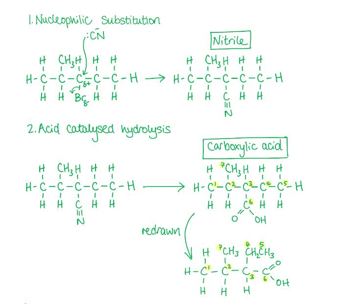
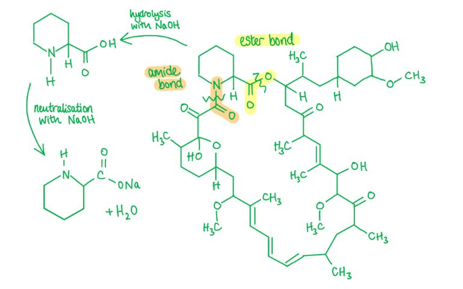
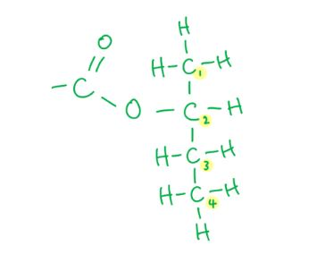
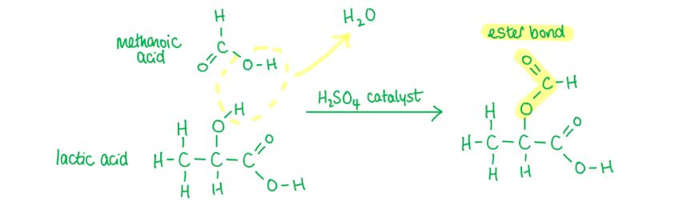
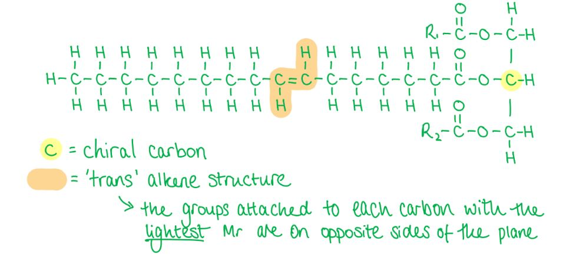

# Mark Schemes — Carboxylic Acids
**18. Carboxylic Acids & Derivatives** · Cambridge (CIE) A-LEVEL chemistry (9701)

## Multiple Choice Questions (13 questions)

### Q1
**Final answer:** **The correct answer is A**

- Ethanolic sodium cyanide (NaCN) reacts with the halogenoalkane in option A via nucleophilic substitution, extending the carbon chain by one carbon to form a nitrile.
- Acid hydrolysis of the nitrile produces the corresponding carboxylic acid: 2-ethyl-3-methylbutanoic acid.

**B**, **C** and **D** are incorrect as these halogenoalkanes would produce different carboxylic acids on reaction with ethanolic NaCN followed by acid hydrolysis.

### Q2
**Final answer:** **The correct answer is A**

- When propanenitrile is heated under reflux with dilute acid, an ammonium salt and propanoic acid are produced.

**B** is incorrect as acidified potassium dichromate(VI) is used to oxidise alcohols and aldehydes to carboxylic acids, not to hydrolyse nitriles.

**C** is incorrect as sodium borohydride is a mild reducing agent and will not reduce nitrile groups.

**D** is incorrect as while nitriles can be hydrolysed with alkali under reflux, the resulting solution would need to be acidified to produce the carboxylic acid.

### Q3
**Final answer:** **The correct answer is D**

- Malic acid has 2 carboxylic acid groups, so 1 mole of malic acid requires 2 moles of NaOH for complete neutralisation.
- Each of the compounds in **A**, **B **and **C **has only 1 carboxylic acid group, requiring only 1 mole of NaOH per mole of compound.

**A**, **B** and **C** are incorrect as lactic acid, gluconic acid and aspirin each have only 1 carboxylic acid group and therefore each require only 1 mole of NaOH per mole.

### Q4
**Final answer:** **The correct answer is C**

- Calculate moles of NaOH required:

- Citric acid contains 3 carboxylic acid groups, each neutralised by one NaOH molecule.
- Therefore, for every 1 mole of citric acid, 3 moles of NaOH are required.
- 0.008 moles of citric acid is used.

0.008 x 3 = 0.024 moles of NaOH are required.

- Calculate volume of NaOH required:

moles = concentration x volume

volume = $\frac{\mathrm{moles}}{\mathrm{concentration}}$

volume = $\frac{0.024}{0.2}$

volume = 0.12 dm3

- Convert from dm3 to cm3:

volume = 0.12 × 1000 = 120 cm3

**A** is incorrect as it assumes a 1:1 molar ratio between citric acid and NaOH, giving 40 cm3. The word "acid" does not always mean one acidic group.

**B** is incorrect as it assumes a 1:2 molar ratio. This occurs when only two of the three carboxylic acid groups are identified, giving 80 cm3. The most common mistake is missing the one written as CO2H in the central bracket

**D** is incorrect as it assumes a 1:4 molar ratio by incorrectly treating the alcohol –OH group as acidic. The –OH group is an alcohol, not a phenol, and does not react with NaOH. Counting all four –OH-containing groups gives 160 cm3.

### Q5
**Final answer:** **The correct answer is C**

- 2-hydroxybutanoic acid has both an alcohol and carboxylic acid group
- Therefore, 2 molecules can react together in a condensation reaction, forming a diester (a molecule with two ester groups).
- Concentrated sulfuric acid acts as a catalyst in condensation reactions that result in esters.

**A** is incorrect as reacting 2-hydroxybutanoic acid with acidified aqueous potassium manganate(VII) would cause the secondary alcohol group to oxidise to a ketone, resulting in 2-oxobutanoic acid (CH3CH2COCOOH).

**B** is incorrect as aluminium oxide (Al2O3) acts as a catalyst in the dehydration of alcohols to alkenes, therefore reacting 2-hydroxybutanoic acid with aluminium oxide would produce but-2-en-oic acid (CH3CH=CHCOOH).

**D** is incorrect as 2-hydroxybutanoic acid and sodium hydroxide would undergo a neutralisation reaction resulting in an organic salt CH3CH2CH(OH)COONa and water.

### Q6
**Final answer:** **The correct answer is B**

- Fumaric acid has an alkene functional group and oxaloacetic acid has a carbonyl functional group.
- Therefore, in step 1 the alkene group in fumaric acid is hydrated to produce an alcohol (**Z**) and in step 2 this alcohol group is oxidised to a ketone.
- The structure of **Z **is HO2CCH(OH)CH2CO2H as there is an alcohol group on the 2nd carbon (which has the alkene group in fumaric acid).
- The reagent for step 2 is acidified aqueous potassium dichromate(VI), heated.

**A** is incorrect as Fehling's solution is an oxidising agent that converts aldehydes into carboxylic acids. Fehling's solution does not oxidise secondary alcohols as Cu2+ is not a sufficiently strong oxidising agent.

**C** is incorrect as HO2CCHBrCH2CO2H cannot be converted into oxaloacetic acid in a single step using acidified aqueous potassium manganate(VII).

**D** is incorrect as although the bromohydrin Z can be made in step 1 using Br2 (aq), in step 2 NaOH would cause nucleophilic substitution of the C–Br bond and neutralise the carboxylic acid groups. It cannot produce the required ketone in a single step.

### Q7
**Final answer:** **The correct answer is C**

- NaOH hydrolyses the ester and amide bonds in sirolimus.
- The carboxylic acid produced undergoes neutralisation with NaOH to produce a carboxylate salt (RCOO–Na+) and water.

> **[exam-tip]**
> Amide bonds appear in Topic 28 of the syllabus and, like ester bonds, can be hydrolysed by hot aqueous sodium hydroxide. Being familiar with both bond types helps when analysing complex molecules such as sirolimus, which contains both.

### Q8
**Final answer:** **The correct answer is C**

- C5H12O has zero degrees of unsaturation.

  - So, **K **must be a saturated compound.
  - It cannot be a ketone or aldehyde.
- Since **K **is oxidised to give a carboxylic acid, **K **must be a primary alcohol and **L **is a carboxylic acid.
- When a carboxylic acid reacts with an alcohol in the presence of a sulfuric acid catalyst, an ester is produced.
- The ester contains the butan-2-ol portion -OCH(CH3)CH2CH3

  - This is seen in **C**: CH3(CH2)3CO2CH(CH3)CH2CH3

**A** is incorrect as this would be the product if compound **L** reacted with 2-methylpropan-2-ol.

**B** is incorrect as this would be the product if compound **L** reacted with butan-1-ol.

**D** is incorrect as this would be the product if compound **L** reacted with 2-methylpropan-1-ol.

### Q9
**Final answer:** **The correct answer is B**

- Lactic acid has a secondary alcohol group and a carboxylic acid group.
- Reacting lactic acid with **methanoic acid** (HCO2H) produces an **ester** from the secondary alcohol group, as shown in reaction B.
- This is a condensation reaction and produces water alongside the ester.

**A** is incorrect as Cl2 does not substitute the –OH group of a secondary alcohol under normal conditions. The byproduct would also be HOCl, not OCl.

**C** is incorrect as methanol (CH3OH) would react with the **carboxylic acid** group in lactic acid, not the alcohol group, producing the methyl ester CH3CH(OH)CO2CH3.

**D** is incorrect as NaHCO3 reacts with the **carboxylic acid** group, not the alcohol group. The product would be CH3CH(OH)CO2Na, not CH3CH(ONa)CO2H as shown.

### Q10
**Final answer:** **The correct answer is A**

- A 'hydroxyl' group is an '–OH' group, which in malic acid appears in both carboxylic acid groups and the alcohol group.
- If the substance only reacts with one hydroxyl group, this must be the alcohol group.

  - So, we must identify what does not react with a carboxylic acid group.
- The dichromate ion (Cr2O72-), produced when K2Cr2O7 is dissolved in acidified aqueous solution, acts as an oxidising agent.
- Carboxylic acids are already at their highest oxidation state and therefore will not react with acidified dichromate ions.
- The secondary alcohol in malic acid is oxidised to a ketone, which is not oxidised further.

**B** is incorrect as sodium metal reacts with **both** the carboxylic acid groups and the alcohol group in redox reactions, producing a salt and hydrogen gas:

2RCOOH + 2Na $\rightarrow$ 2RCOONa + H2

2ROH + 2Na $\rightarrow$ 2RONa + H2

**C** is incorrect as sodium hydroxide reacts with **both** carboxylic acid groups in a neutralisation reaction:

RCOOH + NaOH $\rightarrow$ RCOONa + H2O

**D** is incorrect as PCl5 reacts with **both** the carboxylic acid groups (producing an acyl chloride) and the alcohol group (producing a haloalkane):

RCOOH + PCl5 $\rightarrow$ RCOCl + POCl3 + HCl

ROH + PCl5 $\rightarrow$ RCl + POCl3 + HCl

### Q11
**Final answer:** **The correct answer is C**

- When propanenitrile is heated with aqueous sodium hydroxide under reflux, the products are sodium propanoate and ammonia.
- To produce the free carboxylic acid the products would need to be acidified.

**A**, **B** and **D** are incorrect as all of these reactions would produce propanoic acid.

### Q12
**Final answer:** **The correct answer is C**

- 'Trans fat' is a carboxylic acid with a long aliphatic chain that is unsaturated.

**A** is incorrect as this compound is not optically active as it does not have a chiral carbon.

**B** and **D** are incorrect as they are not 'trans' in structure as the hydrogen atoms are on the same side of the double bond.

### Q13
**Final answer:** **The correct answer is A**

- Compound 1, propanenitrile, can be hydrolysed to propanoic acid by heating with dilute hydrochloric acid.

- Compound 2, propanal, can be oxidised to propanoic acid by heating with acidified aqueous potassium dichromate(VI).

- Compound 3, propan-1-ol, can be oxidised to propanoic acid by heating under reflux with acidified aqueous potassium dichromate(VI).

**B**, **C** and **D** are incorrect as each is missing at least one valid reaction route to propanoic acid.
