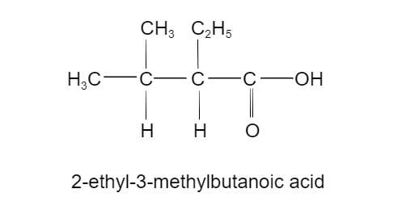
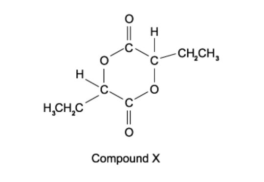
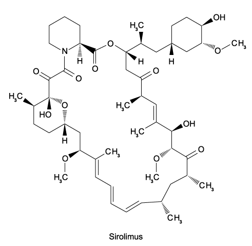
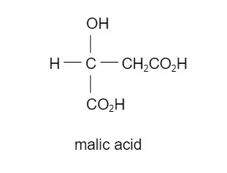
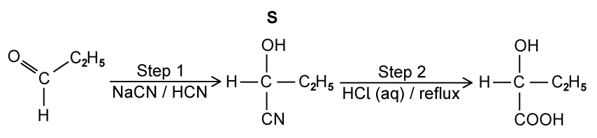
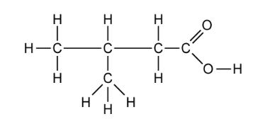
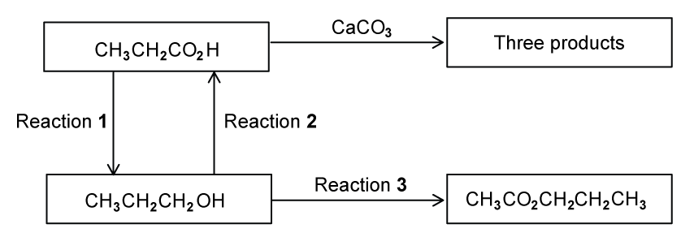
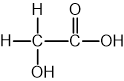
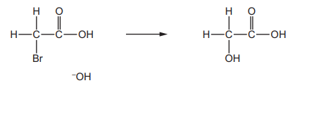

# Exam Questions — Carboxylic Acids
**18. Carboxylic Acids & Derivatives** · Cambridge (CIE) A-LEVEL chemistry (9701)
> Source: [https://www.savemyexams.com/a-level/chemistry/cie/25/topic-questions/](https://www.savemyexams.com/a-level/chemistry/cie/25/topic-questions/) · 20 questions across 2 sets

## Multiple Choice Questions (13 questions)

### Q1 — hard — 1 marks

**Q1** [1 mark]

The compound 2-ethyl-3-methylbutanoic acid has the following structure:

Which compound will produce 2-ethyl-3-methylbutanoic acid by heating under reflux with ethanolic sodium cyanide and subsequent acid hydrolysis of the reaction product?

### Q2 — easy — 1 marks

**Q2** [1 mark]

Propanenitrile, CH3CH2C$\equiv$N, is used to produce propanoic acid.

What are the conditions for this reaction?

### Q3 — hard — 1 marks

**Q3** [1 mark]

Which compound requires the largest amount of cold aqueous sodium hydroxide for the complete neutralisation of 1 mole?

### Q4 — hard — 1 marks

**Q4** [1 mark]

Citric acid has the formula HO2CCH2C(OH)(CO2H)CH2CO2H.

What is the volume of 0.2 mol dm–3 aqueous sodium hydroxide required to neutralise a solution containing 0.008 mol of citric acid?

### Q5 — hard — 1 marks

**Q5** [1 mark]

Compound **X** can be made from 2-hydroxybutanoic acid.

What should be heated with 2-hydroxybutanoic acid in order to make compound **X**?

### Q6 — hard — 1 marks

**Q6** [1 mark]

Oxaloacetic acid can be synthesised from fumaric acid in a two-step process involving intermediate **Z**.

HO2CCH=CHCO2H $\overset{\mathrm{step}1}{\rightarrow}$ **Z** $\overset{\mathrm{step}2}{\rightarrow}$ HO2CCOCH2CO2H

Each step involved can be achieved in the laboratory by using a single reagent.

Which row identifies intermediate **Z** and the reagent for step 2?

|   | **Z** | Reagent for step 2 |
|---|---|---|
| A | HO2CCH(OH)CH2CO2H | Fehling's solution |
| B | HO2CCH(OH)CH2CO2H | Acidified aqueous potassium manganate(VII), heat |
| C | HO2CCHBrCH2CO2H | Acidified aqueous potassium manganate(VII), heat |
| D | HO2CCHBrCH(OH)CO2H | Warm NaOH (aq) |

### Q7 — hard — 1 marks

**Q7** [1 mark]

*Sirolimus* is a drug used to treat patients after kidney transplants.

*Sirolimus* produces an equimolar mixture of two organic products, on reaction with hot aqueous sodium hydroxide.

What is the structural formula of the product with the lower relative molecular mass?

### Q8 — hard — 1 marks

**Q8** [1 mark]

Compound **K**, C5H12O, is oxidised by acidified aqueous potassium dichromate(VI) to compound **L**.

Compound **L** reacts with butan-2-ol in the presence of a little concentrated sulfuric acid to give liquid **M**.

What could be the formula of liquid **M**?

### Q9 — medium — 1 marks

**Q9** [1 mark]

Sour milk contains a compound called lactic acid (2-hydroxypropanoic acid) which has the molecular formula CH3CH(OH)CO2H.

Which of the following reactions could lactic acid undergo?

### Q10 — medium — 1 marks

**Q10** [1 mark]

Apples contain a compound called malic acid.

Which substance will react with only one hydroxyl group in malic acid under suitable conditions?

### Q11 — easy — 1 marks

**Q11** [1 mark]

Which reaction does **not** produce propanoic acid?

### Q12 — easy — 1 marks

**Q12** [1 mark]

'Trans fats' can be found in some vegetable oils and are known to lead to increased blood cholesterol levels.

In the diagrams below, R1 and R2 are different hydrocarbon chains.

Which structure represents an optically active trans fatty acid?

### Q13 — medium — 1 marks

**Q13** [1 mark]

The natural bacterial fermentation of milk produces a compound called propanoic acid.

Propanoic acid is partly responsible for the flavour of Swiss cheese. Its structure is shown below:

Which starting materials could be used to produce propanoic acid?

| ** ** | **CH****3****CH****2****CN** | **CH****3****CH****2****CHO** | **CH****3****CH****2****CH****2****OH** |
|---|---|---|---|
| **A** | **✓** | **✓** | **✓** |
| **B** | **✓** | **✓** | **x** |
| **C** | **x** | **✓** | **✓** |
| **D** | **✓** | **x** | **x** |

## Structured Questions (7 questions)

### Q1 — hard — 10 marks

**Q1** [1 mark]

LiAlH4 is a reducing agent.

LiAlH4 cannot be used in aqueous solution because it reacts with water to produce LiOH(aq), H2 (g) and a white precipitate which is soluble in excess sodium hydroxide. Identify the white precipitate.

**Q1** [4 marks]

Butane-1,2-diol is oxidised to form compound **P** in reaction 1. Compound **P** is then reduced using LiAlH4 in reaction 2 to give **Q**, and using NaBH4 in reaction 3 to give **R**, as shown in Fig. 1.1.

**Fig. 1.1**

i) State the reagents and conditions required for reaction 1.

[2]

ii) Deduce whether **Q** or **R** is 2-hydroxybutanoic acid and explain the difference between reactions 2 and 3.

[2]

**Q1** [4 marks]

A third student prepares 2-hydroxybutanoic acid using propanal as the starting material as shown in Fig. 1.2. In step 1, propanal reacts with a mixture of NaCN and HCN.

**Fig. 1.2**

Draw the mechanism for the reaction of propanal with the mixture of NaCN and HCN to form **S**.

In your mechanism, include:

- the identity of the ion that reacts with propanal
- the structure of the intermediate
- all charges, partial charges, lone pairs and curly arrows

**Q1** [1 mark]

**Extract:**

A third student prepares 2-hydroxybutanoic acid using propanal as the starting material as shown in Fig. 1.2. In step 1, propanal reacts with a mixture of NaCN and HCN.

Fig. 1.2

In step 1, propanal reacts with NaCN and HCN to form S. In step 2, S reacts with HCl under reflux to give 2-hydroxybutanoic acid.

Construct a balanced equation for step 2, in which **S** is heated under reflux with dilute hydrochloric acid.

### Q2 — hard — 11 marks

**Q2** [3 marks]

Lactic acid, 2-hydroxypropanoic acid, CH3CH(OH)COOH, occurs naturally in sour milk.

Lactic acid is chiral and shows stereoisomerism.

Draw the three-dimensional structures of the two optical isomers of lactic acid.

Use an asterisk (*) to identify the chiral carbon atom in one of the structures.

**Q2** [6 marks]

Lactic acid may be synthesised from ethanol by the following route.

CH3CH2OH $\overset{\mathrm{step}1}{\rightarrow}$ CH3CHO $\overset{\mathrm{step}2}{\rightarrow}$ CH3CH(OH)CN $\overset{\mathrm{step}3}{\rightarrow}$ CH3CH(OH)COOH

State the reagent(s) and essential condition(s) for each step.

step 1

reagent(s) .......................................................................................

conditions .......................................................................................

step 2

reagent(s) .......................................................................................

condition(s) .......................................................................................

step 3

reagent(s) .......................................................................................

condition(s) .......................................................................................

**Q2** [2 marks]

Lactic acid, CH3CH(OH)COOH can be reduced by LiAlH4.

i) Construct an equation to show this reaction, using [H] to represent one atom of hydrogen from the reducing agent.

[1]

ii) State the systematic name of the organic product formed in this reaction.

[1]

### Q3 — easy — 7 marks

**Q3** [1 mark]

This question is about carboxylic acids.

State the general formula of a carboxylic acid

**Q3** [1 mark]

State the systematic name of the carboxylic acid shown in Fig. 1.1.

**Fig. 1.1**

**Q3** [3 marks]

**Extract:**

State the systematic name of the carboxylic acid shown in Fig. 1.1.

Displayed formula of a carboxylic acid, CH3CH(CH3)CH2COOH

Fig. 1.1

The systematic name of the carboxylic acid in Fig. 1.1 is:

- 3-methylbutanoic acid

i) Construct a balanced symbol equation to show the dissociation of the acid from part (b).

[1]

ii) State where the position of the equilibrium lies and what this says about the strength of the acid.

[2]

**Q3** [2 marks]

Construct a balanced symbol equation, including state symbols, for the reaction of propanoic acid with sodium hydrogen carbonate powder.

### Q4 — medium — 8 marks

**Q4** [1 mark]

A series of reactions based on propanoic acid is shown.

Construct an equation for reaction **1**, using [H] to represent one atom of hydrogen from the reducing agent.

**Q4** [3 marks]

**Extract:**

A series of reactions based on propanoic acid is shown.

i) Name the type of reaction for reaction **2**.

[1]

ii) State a suitable reagent and conditions for reaction **2**.

[2]

**Q4** [1 mark]

Construct an equation for the reaction of propanoic acid with calcium carbonate, CaCO3.

**Q4** [3 marks]

**Extract:**

A series of reactions based on propanoic acid is shown.

i) State a suitable reagent and conditions for reaction **3**.

[2]

ii) Identify the other product of reaction **3**.

[1]

### Q5 — medium — 13 marks

**Q5** [2 marks]

2-ethyl-3-methylbutanoic acid is present in fermented products such as rum.

i) Deduce the molecular formula of 2-ethyl-3-methylbutanoic acid.

[1]

ii) State the number of chiral carbon atoms in a molecule of 2-ethyl-3-methylbutanoic acid.

[1]

**Q5** [6 marks]

A sample of 2-ethyl-3-methylbutanoic acid may be prepared in a school or college laboratory by the oxidation of:

**2-ethyl-3-methylbutan-1-ol** (CH3)2CHCH(C2H5)CH2OH

i) State the reagent(s) that would be used for this oxidation.

reagent(s) .................................................................................................

colour change from .............................. to ..............................

[2]

ii) This reaction is carried out by heating the reacting chemicals together. What could be the main organic impurity present in the sample of the acid? Explain your answer.

[2]

iii) State whether a distillation apparatus or a reflux apparatus should be used.

Explain your answer.

[2]

**Q5** [2 marks]

**Extract:**

i) State the reagent(s) that would be used for this oxidation.

reagent(s) .................................................................................................

colour change from .............................. to ..............................

A structural isomer of 2-ethyl-3-methylbutan-1-ol is 2-ethyl-3-methylbutan-2-ol, (CH3)2CHC(OH)(C2H5)CH3.

What colour change would be seen if this were heated with the reagents you have given in part **(b)(i)**?

Explain your answer.

**Q5** [3 marks]

**Extract:**

2-ethyl-3-methylbutanoic acid is present in fermented products such as rum.

The molecular formula of 2-ethyl-3-methylbutanoic acid is: C7H14O2

An isomer of 2-ethyl-3-methylbutanoic acid which is an ethyl ester is a very strong smelling compound which is found in some wines. This ethyl ester contains a branched hydrocarbon chain and is chiral.

Draw the displayed formula of this ethyl ester.

Identify the chiral carbon atom with an asterisk (*).

### Q6 — hard — 13 marks

**Q6** [4 marks]

Glycolic acid is commonly used in skin care products.

The structure is shown in Fig. 3.1.

**Fig. 3.1**

Glycolic acid is added separately to each of the three reagents below.

Complete the table to show what you would observe. If a reaction occurs, state the functional group of glycolic acid responsible for the reaction.

| reagent | observation with glycolic acid | functional group |
|---|---|---|
| Na2CO3 |   |   |
| 2,4-DNPH |   |   |
| acidified K2Cr2O7 (aq) and heat |   |   |

**Q6** [7 marks]

Two reaction sequences to produce glycolic acid are shown.

**Sequence A**:

HCHO `-> from reaction 1 to HCN and NaCN of` **X **$\underset{\mathrm{reaction}2}{\rightarrow}$ CH2(OH)COOH

**Sequence B**:

CH3COOH `-> from reaction 3 to Br _ 2 of` CH2BrCOOH $\underset{\mathrm{reaction}4}{\rightarrow}$ CH2(OH)COOH

i) Draw the structure of **X**.

[1]

ii) Identify the reagent used for reaction **2**.

[1]

iii) Name the mechanism for reaction **3**.

[1]

iv) State the essential condition for reaction **3**.

[1]

v) Reaction 4 occurs via an SN2 mechanism. Complete the diagram for the mechanism for reaction **4**.

In your mechanism, include all relevant charges, partial charges, curly arrows and lone pairs.

[3]

**Q6** [2 marks]

Glycolic acid can also be made by reacting glyoxylic acid with NaBH4.

i) State the role of NaBH4 in this reaction.

[1]

ii) Construct an equation for this reaction using molecular formulae. Use [H] to represent one atom of hydrogen from NaBH4.

[1]

### Q7 — medium — 6 marks

**Q7** [1 mark]

Propan-1-ol can be oxidised to propanoic acid using acidified potassium dichromate(VI).

State the systematic name of the intermediate formed during this oxidation.

**Q7** [3 marks]

**Extract:**

Propan-1-ol can be oxidised to propanoic acid using acidified potassium dichromate(VI).

i) State the final colour of the reaction mixture after the potassium dichromate(VI) has reacted.

[1]

ii) State the conditions to ensure that propanoic acid is obtained in a high yield.

[2]

**Q7** [2 marks]

Describe a chemical test and observation which confirms the presence of a carboxyl functional group.
