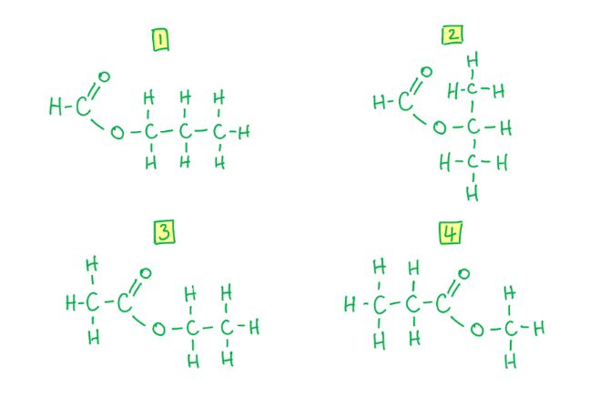
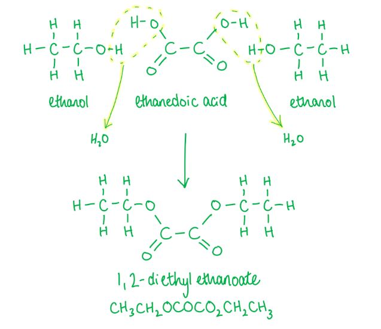
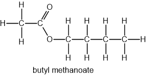
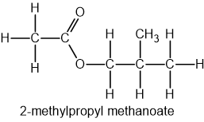
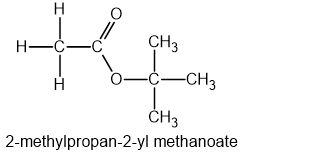
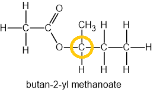
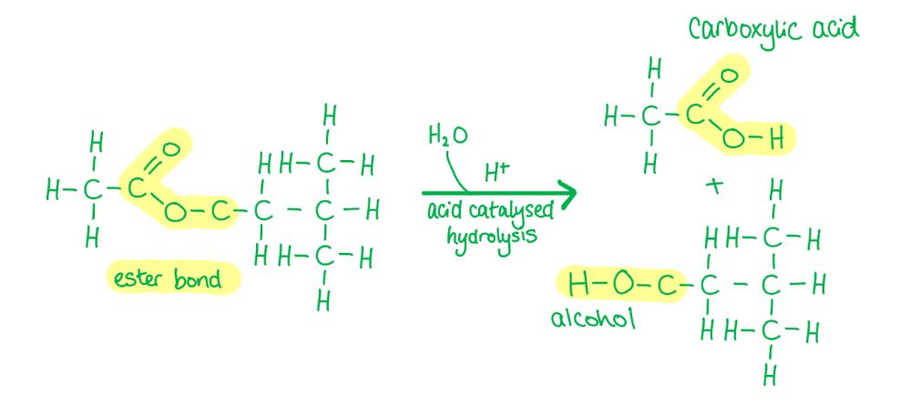
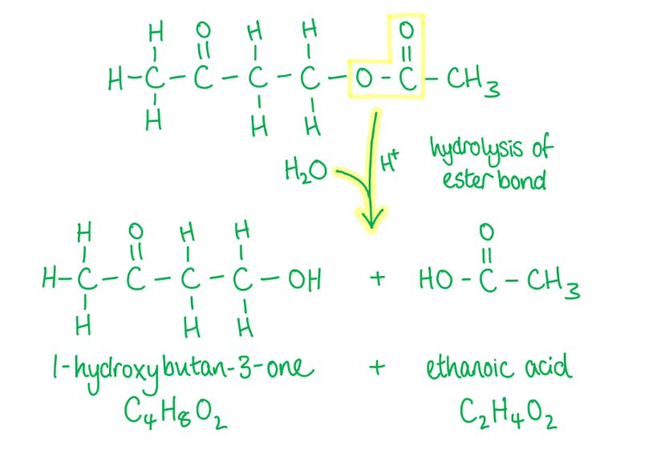
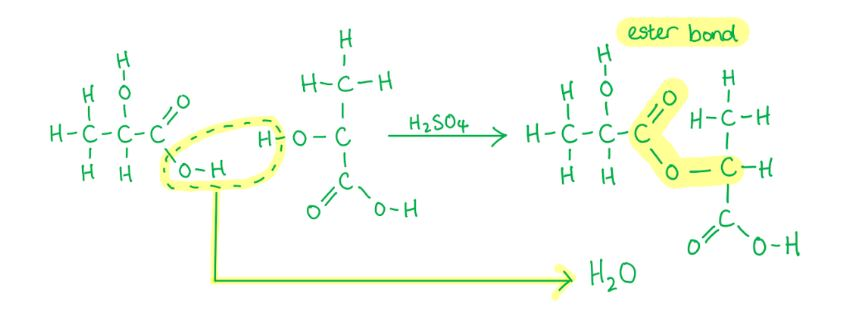

# Mark Schemes — Esters
**18. Carboxylic Acids & Derivatives** · Cambridge (CIE) A-LEVEL chemistry (9701)

## Multiple Choice Questions (12 questions)

### Q1
**Final answer:** **The correct answer is C**

- Acid hydrolysis of an ester (using dilute acid such as sulfuric acid) produces a carboxylic acid and an alcohol.
- This reaction is reversible, so an equilibrium mixture is formed.
- Rule of thumb:

  - Acid hydrolysis = reversible → carboxylic acid
  - Alkaline hydrolysis = irreversible → carboxylate salt

**A** is incorrect as sodium carboxylates are formed in alkaline, not acidic, hydrolysis.

**B** is incorrect as alkaline hydrolysis forms a carboxylate salt, not a carboxylic acid.

**D** is incorrect as alkaline hydrolysis is irreversible, not reversible.

### Q2
**Final answer:** **The correct answer is A**

- Step 1: the **ester**, C15H31CO2C16H33, is hydrolysed by dilute alkali under heat:

C15H31CO2C16H33 + NaOH → C15H31CO2H + C16H33OH

- Step 2: the carboxylic acid product, C15H31CO2H, reacts with excess sodium hydroxide in a neutralisation reaction to produce C15H31CO2Na and water:

C15H31CO2H + NaOH → C15H31CO2Na + H2O

- Therefore, the two organic products are C15H31CO2Na and C16H33OH.

**B** is incorrect as sodium does not replace hydrogen in alcohol groups, only in carboxylic acids.

**C** is incorrect as the structural formula C15H31CO2C16H33 shows the carboxylic acid part of the ester before the ester bond and the alcohol part after. This option gets this the wrong way around.

**D** is incorrect as sodium does not replace hydrogen in alcohol groups, only in carboxylic acids. The structural formula also shows the carboxylic acid part before the ester bond and the alcohol part after, so this option reverses both.

### Q3
**Final answer:** **The correct answer is D**

- 1 mole of alcohol reacts with 1 mole of carboxylic acid to produce 1 mole of ester.
- Propyl butanoate is produced from propanol (C3H7OH) and butanoic acid (C3H7COOH).
- Known values:

  - mass of propanol = 30 g
  - *M*r(propanol) = (3 x 12) + (8 x 1) + 16 = 60 g mol-1
  - mass of butanoic acid = 30 g
  - *M*r(butanoic acid) = (4 x 12) + (8 x 1) + (2 x 16) = 88 g mol-1
  - *M*r(propyl butanoate) = (7 x 12) + (14 x 1) + (2 x 16) = 130 g mol-1
  - mass of propyl butanoate produced = 33.2 g
- Calculate the moles of each reactant:

moles of propanol = $\frac{30}{60}$

moles of propanol = 0.50 mol

moles of butanoic acid = $\frac{30}{88}$

moles of butanoic acid = 0.34 mol

- Butanoic acid provides fewer moles and is therefore the limiting reactant.

- Calculate the theoretical yield of propyl butanoate:

theoretical yield = 0.34 x 130

theoretical yield = 44.2 g

- Calculate the percentage yield:

% yield = $\frac{33.2}{44.2}$ x 100

% yield = 75 %

**A** is incorrect as 25% is obtained by dividing the mass of ester produced (33.2 g) by its *M*r (130 g mol-1) and treating the result as a percentage, rather than calculating the theoretical yield from the limiting reactant.

**B** is incorrect as 38% arises from dividing the actual mass of ester (33.2 g) by the *M*r of butanoic acid (88 g mol-1) rather than the theoretical yield (44.2 g).

**C** is incorrect as 50% arises from using propanol as the limiting reactant. Propanol provides 0.50 mol whereas butanoic acid provides only 0.34 mol, so butanoic acid is the limiting reactant, giving a theoretical yield of 44.2 g.

### Q4
**Final answer:** **The correct answer is A**

- Compound Q is an **ester** made from propanoic acid, CH3CH2CO2H, and methanol, CH3OH.
- The name of an ester starts with the alkyl group from the alcohol (in this case **methyl**), followed by the name of the carboxylic acid (in this case **propanoate**).
- Therefore, the name is **methyl propanoate**.
- The boiling point of methyl propanoate is **lower** than that of butanoic acid because it has only **dipole-dipole attractions** between molecules, whereas butanoic acid has stronger **hydrogen bonds**.

**B** is incorrect as propyl methanoate is the ester formed from methanoic acid and propan-1-ol, not propanoic acid and methanol. The name must reflect which compound provides the alkyl group (methanol → methyl) and which provides the acyl group (propanoic acid → propanoate).

**C** is incorrect as the name methyl propanoate is correct, but the boiling point comparison is wrong. Methyl propanoate has a lower boiling point than butanoic acid, not higher.

**D** is incorrect as both the name and the boiling point comparison are wrong. The correct name is methyl propanoate (not propyl methanoate) and the boiling point is lower than butanoic acid (not higher).

### Q5
**Final answer:** **The correct answer is C**

- C4H8O2 has one degree of unsaturation, consistent with the C=O group in an ester.
- By varying which part comes from the carboxylic acid and which from the alcohol, exactly 4 structural ester isomers are possible:

  - **Methyl propanoate**: CH3CH2CO2CH3 (propanoic acid + methanol)
  - **Ethyl ethanoate**: CH3CO2CH2CH3 (ethanoic acid + ethanol)
  - **Propan-1-yl methanoate**: HCO2CH2CH2CH3 (methanoic acid + propan-1-ol)
  - **Propan-2-yl methanoate**: HCO2CH(CH3)2 (methanoic acid + propan-2-ol)

**A** is incorrect as 2 is an undercount. There are more structural isomers possible by varying both the acid and alcohol components.

**B** is incorrect as 3 is also an undercount. A common error is to overlook propan-2-yl methanoate (the branched-chain methanoate ester).

**D** is incorrect as 5 is an overcount. C4H8O2 has two other isomers with this molecular formula (butanoic acid and 2-methylpropanoic acid) but these are carboxylic acids, not esters. Counting these as esters gives 5.

### Q6
**Final answer:** **The correct answer is C**

- The ester in the question is **3-methylbutan-1-yl ethanoate**.
- To identify the reactants, the ester bond is broken:

  - The –C(=O)O– linkage shows the acid contributes –C(=O)–
  - The alcohol contributes –O–.
- The acid part is **ethanoic acid** (CH3COOH) as it is a straight-chain 2-carbon carboxylic acid.
- The alcohol part is **3-methylbutan-1-ol** as it is a branched 5-carbon alcohol with the methyl group at C3.
- **C** shows ethanoic acid and 3-methylbutan-1-ol, which is the correct pair.

**A** is incorrect as option A shows a branched carboxylic acid paired with an unbranched alcohol. The branching belongs on the alcohol (3-methylbutan-1-ol), not the acid. The acid in this ester is the straight-chain ethanoic acid.

**B** is incorrect as option B makes the same error as A. A branched carboxylic acid is shown paired with an unbranched alcohol, but the correct combination requires the straight-chain ethanoic acid and the branched 3-methylbutan-1-ol.

**D** is incorrect as option D shows ethanoic acid paired with an alcohol in which the methyl branch is on the wrong carbon. The correct alcohol is 3-methylbutan-1-ol (methyl at C3), not 2-methylbutan-1-ol (methyl at C2).

### Q7
**Final answer:** **The correct answer is B**

- Ethanedioic acid has two –COOH groups, each of which undergoes esterification with one ethanol molecule to form one ester linkage.
- After both –COOH groups react, the product is the diester **diethyl oxalate**: CH3CH2-O-CO-CO-O-CH2CH3.
- The two adjacent carbonyl groups (–CO–CO–) come from the ethanedioic acid backbone, and each is linked to an ethyl group (–O–CH2CH3) from ethanol.

**A** is incorrect as this structural formula shows two ester linkages joined directly (–CO2CO2–), which places four oxygens consecutively and is not the structure of diethyl oxalate.

**C** is incorrect as the ester linkage atoms are in the wrong order (–O2C– instead of –CO2–). In a valid ester the carbonyl carbon must come before the ester oxygen when reading from the acid side.

**D** is incorrect as this structural formula represents the diester of ethane-1,2-diol with ethanoic acid (CH3CO2CH2CH2OCOCH3). This is a different combination of reactants, not the product of ethanedioic acid with ethanol.

### Q8
**Final answer:** **The correct answer is ****C**

- Methanoic acid has the formula HCOOH
- When an ester is formed:

  - The acid contributes the group HCOO–
  - The rest of the ester comes from the C4H9 alcohol
  - This gives an overall molecular formula of C5H10O2
- There are four different alcohols that can combine with methanoic acid to give four structural isomers of methanoate esters

  - One of these esters (butan-2-yl methanoate) contains a chiral centre, meaning it exists as two enantiomers
- This gives a total of 5 isomers (4 structural isomers, with 1 of them existing as a pair of optical isomers)

### Q9
**Final answer:** **The correct answer is B**

- Ester E is **3-methylbutan-1-yl ethanoate**.
- Acid hydrolysis (using dilute HCl and heat) breaks the ester bond by adding water across it.
- The ethanoate group produces **ethanoic acid**: CH3CO2H.
- The 3-methylbutan-1-yl group produces **3-methylbutan-1-ol**: (CH3)2CHCH2CH2OH.

**A** is incorrect as the alcohol product is incorrectly written as an aldehyde with an extra carbon. Acid hydrolysis of an ester produces an alcohol, not an aldehyde, and 3-methylbutan-1-ol has 5 carbons, not 6.

**C** is incorrect as chloride ions are spectator ions in acid hydrolysis and do not substitute into the ester. The reaction is a hydrolysis (addition of water across the ester bond), not a nucleophilic substitution by Cl-.

**D** is incorrect as CH3CHO is an aldehyde, not a carboxylic acid. Hydrolysis of an ester always produces a carboxylic acid, in this case ethanoic acid (CH3CO2H), not an aldehyde.

### Q10
**Final answer:** **The correct answer is B**

- The ester shown is produced when compound X reacts with ethanoic acid, CH3COOH, in an esterification reaction.
- The -O-C(=O)-CH3 group in the ester is the ethanoate part, contributed by ethanoic acid.
- The remaining part of the ester, CH3-C(=O)-CH2-CH2-, must come from compound X minus its -OH group.
- Compound X is therefore 1-hydroxybutan-3-one: HO-CH2-CH2-C(=O)-CH3.
- Its molecular formula is C4H8O2.

**A** is incorrect as C4H8O has only one oxygen atom. Compound X requires two oxygen atoms: one for the alcohol (-OH) group and one for the ketone (C=O) group.

**C** is incorrect as C2H6O2 contains only two carbon atoms. The 3-oxobutyl chain in the ester requires compound X to have four carbon atoms.

**D** is incorrect as C2H6O3 contains only two carbon atoms and three oxygen atoms, so neither the carbon count nor the oxygen count matches compound X.

### Q11
**Final answer:** **The correct answer is C**

- Alkaline hydrolysis of ethyl propanoate produces ethanol and sodium propanoate.
- After acidification, the sodium propanoate is converted to propanoic acid.
- The two organic products weighed are therefore **ethanol** and **propanoic acid**.
- Known values:

  - *M*r(ethanol, C2H5OH) = (2 x 12) + (6 x 1) + 16 = 46 g mol-1
  - *M*r(propanoic acid, C2H5COOH) = (3 x 12) + (6 x 1) + (2 x 16) = 74 g mol-1
- The two products are formed in a 1:1 molar ratio, so total *M*r = 46 + 74 = 120 g mol-1
- Calculate the percentage by mass of propanoic acid:

% propanoic acid = $\frac{74}{120}$ x 100

% propanoic acid = 61.7%

- Calculate the percentage by mass of ethanol:

% ethanol = $\frac{46}{120}$ x 100

% ethanol = 38.3%

**A** is incorrect as the two products have different molecular masses, so their percentage by masses cannot be equal.

**B** is incorrect as 57.7% and 42.3% arise from using incorrect molecular masses.

**D** is incorrect as 67.6% and 32.4% are obtained when sodium propanoate (*M*r = 96) is used instead of propanoic acid (*M*r = 74). The mixture was acidified before weighing, so the carboxylate salt is converted to the carboxylic acid.

### Q12
**Final answer:** **The correct answer is B**

- Lactic acid (2-hydroxypropanoic acid) contains both an **alcohol** (–OH) and a **carboxylic acid** (–COOH) functional group in the same molecule.
- In the presence of concentrated sulfuric acid as a catalyst, the –OH group of one lactic acid molecule reacts with the –COOH group of another in a condensation reaction.
- An ester linkage (–CO–O–) forms and water is eliminated, producing a dimer ester.
- The product has the structure: HOOC–CH(CH3)–O–CO–CH(OH)–CH3.

**A** is incorrect as aqueous bromine is decolourised by alkenes via electrophilic addition. Lactic acid contains no C=C double bond, so it does not react with bromine water.

**C** is incorrect as Fehling's solution is only reduced by aldehydes. Lactic acid does not contain an aldehyde group.

**D** is incorrect as lactic acid is soluble in water because the alcohol (–OH) and carboxylic acid (–COOH) groups both form hydrogen bonds with water molecules.
