# Mark Schemes — Esters
**18. Carboxylic Acids & Derivatives** · Cambridge (CIE) A-LEVEL chemistry (9701)

## Multiple Choice Questions (12 questions)

### Q1
**Final answer:** **The correct answer is C**

- Acid hydrolysis of an ester (using dilute acid such as sulfuric acid) produces a carboxylic acid and an alcohol.
- This reaction is reversible, so an equilibrium mixture is formed.
- Rule of thumb:

  - Acid hydrolysis = reversible → carboxylic acid
  - Alkaline hydrolysis = irreversible → carboxylate salt

**A** is incorrect as sodium carboxylates are formed in alkaline, not acidic, hydrolysis.

**B** is incorrect as alkaline hydrolysis forms a carboxylate salt, not a carboxylic acid.

**D** is incorrect as alkaline hydrolysis is irreversible, not reversible.

### Q2
**Final answer:** **The correct answer is A**

- Step 1: the **ester**, C15H31CO2C16H33, is hydrolysed by dilute alkali under heat:

C15H31CO2C16H33 + NaOH → C15H31CO2H + C16H33OH

- Step 2: the carboxylic acid product, C15H31CO2H, reacts with excess sodium hydroxide in a neutralisation reaction to produce C15H31CO2Na and water:

C15H31CO2H + NaOH → C15H31CO2Na + H2O

- Therefore, the two organic products are C15H31CO2Na and C16H33OH.

**B** is incorrect as sodium does not replace hydrogen in alcohol groups, only in carboxylic acids.

**C** is incorrect as the structural formula C15H31CO2C16H33 shows the carboxylic acid part of the ester before the ester bond and the alcohol part after. This option gets this the wrong way around.

**D** is incorrect as sodium does not replace hydrogen in alcohol groups, only in carboxylic acids. The structural formula also shows the carboxylic acid part before the ester bond and the alcohol part after, so this option reverses both.

### Q3
**Final answer:** **The correct answer is D**

- 1 mole of alcohol reacts with 1 mole of carboxylic acid to produce 1 mole of ester.
- Propyl butanoate is produced from propanol (C3H7OH) and butanoic acid (C3H7COOH).
- Known values:

  - mass of propanol = 30 g
  - *M*r(propanol) = (3 x 12) + (8 x 1) + 16 = 60 g mol-1
  - mass of butanoic acid = 30 g
  - *M*r(butanoic acid) = (4 x 12) + (8 x 1) + (2 x 16) = 88 g mol-1
  - *M*r(propyl butanoate) = (7 x 12) + (14 x 1) + (2 x 16) = 130 g mol-1
  - mass of propyl butanoate produced = 33.2 g
- Calculate the moles of each reactant:

moles of propanol = $\frac{30}{60}$

moles of propanol = 0.50 mol

moles of butanoic acid = $\frac{30}{88}$

moles of butanoic acid = 0.34 mol

- Butanoic acid provides fewer moles and is therefore the limiting reactant.

- Calculate the theoretical yield of propyl butanoate:

theoretical yield = 0.34 x 130

theoretical yield = 44.2 g

- Calculate the percentage yield:

% yield = $\frac{33.2}{44.2}$ x 100

% yield = 75 %

**A** is incorrect as 25% is obtained by dividing the mass of ester produced (33.2 g) by its *M*r (130 g mol-1) and treating the result as a percentage, rather than calculating the theoretical yield from the limiting reactant.

**B** is incorrect as 38% arises from dividing the actual mass of ester (33.2 g) by the *M*r of butanoic acid (88 g mol-1) rather than the theoretical yield (44.2 g).

**C** is incorrect as 50% arises from using propanol as the limiting reactant. Propanol provides 0.50 mol whereas butanoic acid provides only 0.34 mol, so butanoic acid is the limiting reactant, giving a theoretical yield of 44.2 g.

### Q4
**Final answer:** **The correct answer is A**

- Compound Q is an **ester** made from propanoic acid, CH3CH2CO2H, and methanol, CH3OH.
- The name of an ester starts with the alkyl group from the alcohol (in this case **methyl**), followed by the name of the carboxylic acid (in this case **propanoate**).
- Therefore, the name is **methyl propanoate**.
- The boiling point of methyl propanoate is **lower** than that of butanoic acid because it has only **dipole-dipole attractions** between molecules, whereas butanoic acid has stronger **hydrogen bonds**.

**B** is incorrect as propyl methanoate is the ester formed from methanoic acid and propan-1-ol, not propanoic acid and methanol. The name must reflect which compound provides the alkyl group (methanol → methyl) and which provides the acyl group (propanoic acid → propanoate).

**C** is incorrect as the name methyl propanoate is correct, but the boiling point comparison is wrong. Methyl propanoate has a lower boiling point than butanoic acid, not higher.

**D** is incorrect as both the name and the boiling point comparison are wrong. The correct name is methyl propanoate (not propyl methanoate) and the boiling point is lower than butanoic acid (not higher).

### Q5
**Final answer:** **The correct answer is C**

- C4H8O2 has one degree of unsaturation, consistent with the C=O group in an ester.
- By varying which part comes from the carboxylic acid and which from the alcohol, exactly 4 structural ester isomers are possible:

  - **Methyl propanoate**: CH3CH2CO2CH3 (propanoic acid + methanol)
  - **Ethyl ethanoate**: CH3CO2CH2CH3 (ethanoic acid + ethanol)
  - **Propan-1-yl methanoate**: HCO2CH2CH2CH3 (methanoic acid + propan-1-ol)
  - **Propan-2-yl methanoate**: HCO2CH(CH3)2 (methanoic acid + propan-2-ol)

**A** is incorrect as 2 is an undercount. There are more structural isomers possible by varying both the acid and alcohol components.

**B** is incorrect as 3 is also an undercount. A common error is to overlook propan-2-yl methanoate (the branched-chain methanoate ester).

**D** is incorrect as 5 is an overcount. C4H8O2 has two other isomers with this molecular formula (butanoic acid and 2-methylpropanoic acid) but these are carboxylic acids, not esters. Counting these as esters gives 5.

### Q6
**Final answer:** **The correct answer is C**

- The ester in the question is **3-methylbutan-1-yl ethanoate**.
- To identify the reactants, the ester bond is broken:

  - The –C(=O)O– linkage shows the acid contributes –C(=O)–
  - The alcohol contributes –O–.
- The acid part is **ethanoic acid** (CH3COOH) as it is a straight-chain 2-carbon carboxylic acid.
- The alcohol part is **3-methylbutan-1-ol** as it is a branched 5-carbon alcohol with the methyl group at C3.
- **C** shows ethanoic acid and 3-methylbutan-1-ol, which is the correct pair.

**A** is incorrect as option A shows a branched carboxylic acid paired with an unbranched alcohol. The branching belongs on the alcohol (3-methylbutan-1-ol), not the acid. The acid in this ester is the straight-chain ethanoic acid.

**B** is incorrect as option B makes the same error as A. A branched carboxylic acid is shown paired with an unbranched alcohol, but the correct combination requires the straight-chain ethanoic acid and the branched 3-methylbutan-1-ol.

**D** is incorrect as option D shows ethanoic acid paired with an alcohol in which the methyl branch is on the wrong carbon. The correct alcohol is 3-methylbutan-1-ol (methyl at C3), not 2-methylbutan-1-ol (methyl at C2).

### Q7
**Final answer:** **The correct answer is B**

- Ethanedioic acid has two –COOH groups, each of which undergoes esterification with one ethanol molecule to form one ester linkage.
- After both –COOH groups react, the product is the diester **diethyl oxalate**: CH3CH2-O-CO-CO-O-CH2CH3.
- The two adjacent carbonyl groups (–CO–CO–) come from the ethanedioic acid backbone, and each is linked to an ethyl group (–O–CH2CH3) from ethanol.

**A** is incorrect as this structural formula shows two ester linkages joined directly (–CO2CO2–), which places four oxygens consecutively and is not the structure of diethyl oxalate.

**C** is incorrect as the ester linkage atoms are in the wrong order (–O2C– instead of –CO2–). In a valid ester the carbonyl carbon must come before the ester oxygen when reading from the acid side.

**D** is incorrect as this structural formula represents the diester of ethane-1,2-diol with ethanoic acid (CH3CO2CH2CH2OCOCH3). This is a different combination of reactants, not the product of ethanedioic acid with ethanol.

### Q8
**Final answer:** **The correct answer is ****C**

- Methanoic acid has the formula HCOOH
- When an ester is formed:

  - The acid contributes the group HCOO–
  - The rest of the ester comes from the C4H9 alcohol
  - This gives an overall molecular formula of C5H10O2
- There are four different alcohols that can combine with methanoic acid to give four structural isomers of methanoate esters

  - One of these esters (butan-2-yl methanoate) contains a chiral centre, meaning it exists as two enantiomers
- This gives a total of 5 isomers (4 structural isomers, with 1 of them existing as a pair of optical isomers)

### Q9
**Final answer:** **The correct answer is B**

- Ester E is **3-methylbutan-1-yl ethanoate**.
- Acid hydrolysis (using dilute HCl and heat) breaks the ester bond by adding water across it.
- The ethanoate group produces **ethanoic acid**: CH3CO2H.
- The 3-methylbutan-1-yl group produces **3-methylbutan-1-ol**: (CH3)2CHCH2CH2OH.

**A** is incorrect as the alcohol product is incorrectly written as an aldehyde with an extra carbon. Acid hydrolysis of an ester produces an alcohol, not an aldehyde, and 3-methylbutan-1-ol has 5 carbons, not 6.

**C** is incorrect as chloride ions are spectator ions in acid hydrolysis and do not substitute into the ester. The reaction is a hydrolysis (addition of water across the ester bond), not a nucleophilic substitution by Cl-.

**D** is incorrect as CH3CHO is an aldehyde, not a carboxylic acid. Hydrolysis of an ester always produces a carboxylic acid, in this case ethanoic acid (CH3CO2H), not an aldehyde.

### Q10
**Final answer:** **The correct answer is B**

- The ester shown is produced when compound X reacts with ethanoic acid, CH3COOH, in an esterification reaction.
- The -O-C(=O)-CH3 group in the ester is the ethanoate part, contributed by ethanoic acid.
- The remaining part of the ester, CH3-C(=O)-CH2-CH2-, must come from compound X minus its -OH group.
- Compound X is therefore 1-hydroxybutan-3-one: HO-CH2-CH2-C(=O)-CH3.
- Its molecular formula is C4H8O2.

**A** is incorrect as C4H8O has only one oxygen atom. Compound X requires two oxygen atoms: one for the alcohol (-OH) group and one for the ketone (C=O) group.

**C** is incorrect as C2H6O2 contains only two carbon atoms. The 3-oxobutyl chain in the ester requires compound X to have four carbon atoms.

**D** is incorrect as C2H6O3 contains only two carbon atoms and three oxygen atoms, so neither the carbon count nor the oxygen count matches compound X.

### Q11
**Final answer:** **The correct answer is C**

- Alkaline hydrolysis of ethyl propanoate produces ethanol and sodium propanoate.
- After acidification, the sodium propanoate is converted to propanoic acid.
- The two organic products weighed are therefore **ethanol** and **propanoic acid**.
- Known values:

  - *M*r(ethanol, C2H5OH) = (2 x 12) + (6 x 1) + 16 = 46 g mol-1
  - *M*r(propanoic acid, C2H5COOH) = (3 x 12) + (6 x 1) + (2 x 16) = 74 g mol-1
- The two products are formed in a 1:1 molar ratio, so total *M*r = 46 + 74 = 120 g mol-1
- Calculate the percentage by mass of propanoic acid:

% propanoic acid = $\frac{74}{120}$ x 100

% propanoic acid = 61.7%

- Calculate the percentage by mass of ethanol:

% ethanol = $\frac{46}{120}$ x 100

% ethanol = 38.3%

**A** is incorrect as the two products have different molecular masses, so their percentage by masses cannot be equal.

**B** is incorrect as 57.7% and 42.3% arise from using incorrect molecular masses.

**D** is incorrect as 67.6% and 32.4% are obtained when sodium propanoate (*M*r = 96) is used instead of propanoic acid (*M*r = 74). The mixture was acidified before weighing, so the carboxylate salt is converted to the carboxylic acid.

### Q12
**Final answer:** **The correct answer is B**

- Lactic acid (2-hydroxypropanoic acid) contains both an **alcohol** (–OH) and a **carboxylic acid** (–COOH) functional group in the same molecule.
- In the presence of concentrated sulfuric acid as a catalyst, the –OH group of one lactic acid molecule reacts with the –COOH group of another in a condensation reaction.
- An ester linkage (–CO–O–) forms and water is eliminated, producing a dimer ester.
- The product has the structure: HOOC–CH(CH3)–O–CO–CH(OH)–CH3.

**A** is incorrect as aqueous bromine is decolourised by alkenes via electrophilic addition. Lactic acid contains no C=C double bond, so it does not react with bromine water.

**C** is incorrect as Fehling's solution is only reduced by aldehydes. Lactic acid does not contain an aldehyde group.

**D** is incorrect as lactic acid is soluble in water because the alcohol (–OH) and carboxylic acid (–COOH) groups both form hydrogen bonds with water molecules.

## Structured Questions (6 questions)

### Q1
> **[mark-scheme]**
> i) The reagents and conditions for hydrolysis:
> 
> - Dilute acid (sulfuric acid / hydrochloric acid)
> **OR**
> Dilute alkali (sodium hydroxide) **[1 mark]**
> - Heat / reflux / warm **[1 mark]**
> 
> ii) The equation for hydrolysis:
> 
> - CH3(CH2)2CO2CH3 + H2O → CH3(CH2)2CO2H + CH3OH **[1 mark]**
> 
> iii) One major commercial use of esters:
> 
> Any **one** from:
> 
> - Solvents
> - Plasticisers / plastics
> - Textiles / synthetic fibres
> 
> **[1 mark]**

> **[exam-tip]**
> In acid hydrolysis the reaction is reversible (ester reforms). In alkaline hydrolysis the carboxylate salt is formed irreversibly.
> 
> When an ester is hydrolysed it reforms the carboxylic acid (from the left-hand side of –COO–) and the alcohol (from the right-hand side). For methyl butanoate: butanoic acid (4 carbons) and methanol (1 carbon).
i) The other stereoisomer of leaf alcohol is:

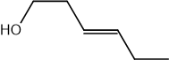

**[1 mark]**

> **[mark-scheme]**
> 1 mark for the correct (E)-stereoisomer of leaf alcohol

> **[exam-tip]**
> To draw the other stereoisomer: swap the position of the CH2CH3 group to the opposite side of the double bond. The original leaf alcohol is the (Z)-isomer (cis, with CH2OH and C2H5 on the same side). The other stereoisomer is the (E)-isomer (trans).

ii) The ester formed when leaf alcohol reacts with ethanoic acid is:

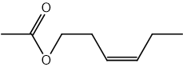

**[2 marks]**

> **[mark-scheme]**
> 1 mark for correct ester linkage with all bonds displayed
> 
> 1 mark for correct rest of molecule

> **[exam-tip]**
> To draw the ester: replace the –OH group of leaf alcohol with –O–CO–CH3. Show the ester linkage as –C(=O)–O– with all bonds clearly drawn.
i) To calculate the *M*r of leaf alcohol:

*M*r = (6 x 12) + (12 x 1) + 16

*M*r = **100** **[1 mark]**

> **[mark-scheme]**
> ii) The structure of the dehydration product and type of reaction:
> 
> - CH2 = CH – CH = CH – CH2CH3 **[1 mark]**
> - Dehydration / elimination **[1 mark]**

> **[exam-tip]**
> A product with Mr 18 less than leaf alcohol has lost water (Mr of H2O = 18). The loss of H2O from an alcohol is dehydration / elimination and forms an alkene.
> 
> Leaf alcohol already has a C=C at C3. Eliminating H2O from C1 (where –OH is) and C2 introduces a second double bond: the product is hexa-1,3-diene, CH2=CH–CH=CH–CH2CH3.
> **[mark-scheme]**
> A chemical test to distinguish between leaf alcohol and the product in (c)(ii):
> 
> Any **one** of the following (1 mark per reagent and observation pair):
> 
> Alternative 1:
> 
> - Reagent: PCl5
> - Observation with leaf alcohol: steamy / misty fumes
> - Observation with the product: no reaction
> 
> **OR**
> 
> Alternative 2:
> 
> - Reagent: Acidified / H+ / Cr2O72-
> - Observation with leaf alcohol: changes from orange to green
> - Observation with the product: no change / remains orange
> 
> **OR**
> 
> Alternative 3:
> 
> - Reagent: Concentrated H2SO4 with a carboxylic acid
> - Observation with leaf alcohol: sweet / fruity ester smell
> - Observation with the product: no reaction
> 
> **OR**
> 
> Alternative 4:
> 
> - Reagent: Sodium
> - Observation with leaf alcohol: effervescence / bubbles / gas produced
> - Observation with the product: no reaction
> 
> **[2 marks]**

> **[exam-tip]**
> The key difference between leaf alcohol and the dehydration product is the –OH group. Choose a test that is specific to the hydroxyl group.
> 
> Do not use bromine water: both leaf alcohol and the alkene product have a C=C double bond, so bromine water would decolourise for both and cannot distinguish between them.

### Q2
i) The fully displayed formula of  3-methylbutanoic acid is:

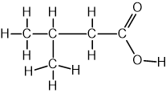

**[1 mark]**

> **[mark-scheme]**
> 1 mark for correct fully displayed formula of 3-methylbutanoic acid

ii) The fully displayed formula of  methyl ethanoate is:

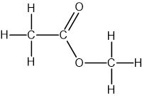

**[1 mark]**

> **[mark-scheme]**
> 1 mark for correct fully displayed formula of methyl ethanoate

> **[exam-tip]**
> When drawing 3-methylbutanoic acid, the COOH carbon counts as C1, so the methyl branch is on C3 (second carbon from the left in the main chain).
> 
> For methyl ethanoate, the ester linkage (-COO-) connects the ethanoate group on the left to the methyl group on the right.
> **[mark-scheme]**
> The colour change observed is:
> 
> - Orange to green **[1 mark]**

> **[exam-tip]**
> The orange dichromate(VI) ions (Cr2O72-) are reduced to green chromium(III) ions (Cr3+) as the alcohol is oxidised to the carboxylic acid.
> 
> Heating under reflux ensures complete oxidation to the carboxylic acid rather than stopping at the aldehyde stage.
> **[mark-scheme]**
> The organic products formed are:
> 
> - Methanol
> **AND**
> Ethanoic acid **[1 mark]**

> **[exam-tip]**
> Acidic hydrolysis of an ester reforms the alcohol and carboxylic acid it was made from. For methyl ethanoate: the methyl group comes from methanol and the ethanoate group comes from ethanoic acid.
i) The two products formed are:

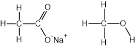

**[2 marks]**

> **[mark-scheme]**
> 1 mark for correct fully displayed formula of sodium ethanoate
> 
> 1 mark for correct fully displayed formula of methanol

> **[mark-scheme]**
> ii) The reagent required to convert the salt into a carboxylic acid:
> 
> - Dilute acid / dilute HCl / dilute H2SO4 **[1 mark]**
> 
> iii) One difference between acid and alkaline hydrolysis (other than reagents and products):
> 
> - Acid hydrolysis is reversible / alkaline hydrolysis is irreversible / acid hydrolysis establishes an equilibrium **[1 mark]**

> **[exam-tip]**
> In alkaline hydrolysis, sodium hydroxide acts as a reactant rather than just a catalyst, making the reaction irreversible. The carboxylate salt must then be acidified to release the free carboxylic acid.
> 
> In acid hydrolysis, an equilibrium is established, so some ester is always present and the yield of carboxylic acid is lower than in alkaline hydrolysis.

### Q3
> **[mark-scheme]**
> i) The systematic names of the two isomers are:
> 
> - A = 3-hydroxy-3-methylbutanoic acid
> **AND**
> B = 2-hydroxy-3-methylbutanoic acid **[1 mark]**
> 
> ii) A reagent to distinguish the isomers and the type of reaction:
> 
> - Acidified / H+ / H2SO4
> **AND**
> (potassium) dichromate(VI) / K2Cr2O7 / Cr2O72-
> **OR**
> Acidified / H+ / H2SO4
> **AND**
> (potassium) manganate(VII) / KMnO4 / MnO4- **[1 mark]**
> - Oxidation **[1 mark]**
> 
> iii) The observations in each case are:
> 
> - Isomer A: no change / no reaction
> - Isomer B: changes from orange to green
> 
> **OR**
> 
> - Isomer A: no change / no reaction
> - Isomer B: changes from purple to colourless
> 
> **[2 marks]**
> 
> The observations in part (iii) must match the reagent specified in part (ii)

> **[exam-tip]**
> Naming priority: when a molecule contains both a carboxylic acid and a hydroxyl group, the carboxylic acid takes priority as the principal characteristic group. The hydroxyl group is named as a prefix (hydroxy–) and the methyl branch is also a prefix (methyl–).
> 
> Isomer A is a tertiary alcohol where the –OH group is on a carbon bonded to three other carbon groups. Tertiary alcohols cannot be oxidised by dichromate(VI) or manganate(VII) under standard conditions, so isomer A gives no reaction.
> 
> Always state both the before and after colours for the oxidising agent test. 'The solution turns green' is not awarded because you must state it turns from orange to green (for dichromate) or from purple to colourless (for manganate(VII)).
> **[mark-scheme]**
> i) The equation for this oxidation, using [O] to represent the oxidising agent is:
> 
> - CH3CH(CH3)CH(OH)COOH + [O] → CH3CH(CH3)COCOOH + H2O **[1 mark]**
> 
> State symbols are not required

ii) The overall ionic equation for the oxidation of B to C is:

3CH3CH(CH3)CH(OH)COOH (aq) + Cr2O72- (aq) + 8H+ (aq) → 3CH3CH(CH3)COCOOH (aq) + 2Cr3+ (aq) + 7H2O (l)

**[2 marks]**

> **[mark-scheme]**
> 1 mark for correct reactants and products in the overall equation
> 
> 1 mark for correct balancing
> 
> State symbols are not required

> **[exam-tip]**
> For part (i):
> 
> - [O] represents one oxygen atom from the oxidising agent.
> - In the oxidation of a secondary alcohol –CHOH– to a ketone –C=O–, two hydrogen atoms are removed as H2O, so one [O] is needed.
> 
> For part (ii):
> 
> - The B→C half-equation shows 2 electrons transferred.
> - The dichromate half-equation shows 6 electrons.
> - Multiply the B→C half-equation by 3 (to give 6e–), add the two half-equations, then cancel the 6H+ that appear on both sides:
> 
>   - 14H+ − 6H+ = 8H+ on the left.
> **[mark-scheme]**
> To produce ethanal or ethanoic acid from the oxidation of ethanol:
> 
> - To produce ethanal: distil the product immediately as it forms / carry out a simple distillation so the product is removed as soon as it is formed **[1 mark]**
> - To produce ethanoic acid: heat under reflux
> **OR**
> Use an excess of the oxidising agent **[1 mark]**

> **[exam-tip]**
> Ethanal has a lower boiling point than ethanol or ethanoic acid (no hydrogen bonding to self), so it vaporises easily. Distilling it off as soon as it forms removes it from contact with the oxidising agent and prevents further oxidation to ethanoic acid.
> 
> Heating under reflux keeps all the product in the reaction mixture in contact with excess oxidising agent, allowing the aldehyde to be further oxidised to the carboxylic acid.
> **[mark-scheme]**
> i) The type of reaction and conditions:
> 
> - Esterification / condensation **[1 mark]**
> - Warm / heat with concentrated sulfuric acid / conc. H2SO4 **[1 mark]**

ii) The structure of the dimer product is:

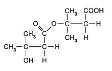

**OR**

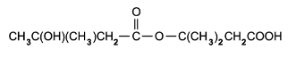

**[1 mark]**

> **[mark-scheme]**
> 1 mark for a correct drawing showing the ester linkage

> **[exam-tip]**
> A dimer is a molecule made from two identical repeating units. When two molecules of compound A (a hydroxy acid) react together, one –OH group reacts with the –COOH group of the other molecule to form an ester linkage, releasing water in an esterification reaction.
> 
> The concentrated sulfuric acid acts as a catalyst for the esterification reaction.

### Q4
> **[mark-scheme]**
> The acid, alcohol, catalyst, condition, and equation for the formation of ester S:
> 
> - Propanoic acid **[1 mark]**
> - 2-methylpropan-1-ol **[1 mark]**
> - Concentrated sulfuric acid / conc. H2SO4 **[1 mark]**
> - Heat / warm / heat under reflux **[1 mark]**
> - CH3CH2COOH + HOCH2CH(CH3)2 ⇌ CH3CH2COOCH2CH(CH3)2 + H2O **[1 mark]**
> 
> Only systematic names are accepted. The common name 'isobutanol' for 2-methylpropan-1-ol is not accepted.

> **[exam-tip]**
> You need to state both the catalyst (concentrated sulfuric acid) and a condition (heat) or you will lose a mark.
i) The organic products of acid hydrolysis are:

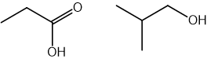

**[2 marks]**

> **[mark-scheme]**
> 1 mark for propanoic acid structure shown correctly
> 
> 1 mark for 2-methylpropan-1-ol structure shown correctly)

ii) The organic products of alkaline hydrolysis are:

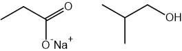

**[2 marks]**

> **[mark-scheme]**
> 1 mark for sodium propanoate structure shown correctly
> 
> 1 mark for 2-methylpropan-1-ol structure shown correctly

> **[exam-tip]**
> In alkaline hydrolysis, the carboxylic acid product is the carboxylate salt (sodium propanoate), not propanoic acid. Sodium hydroxide reacts irreversibly with the acid to form the sodium salt.
Ester T is made from:

- methanoic acid
- 2-methylpropan-1-ol

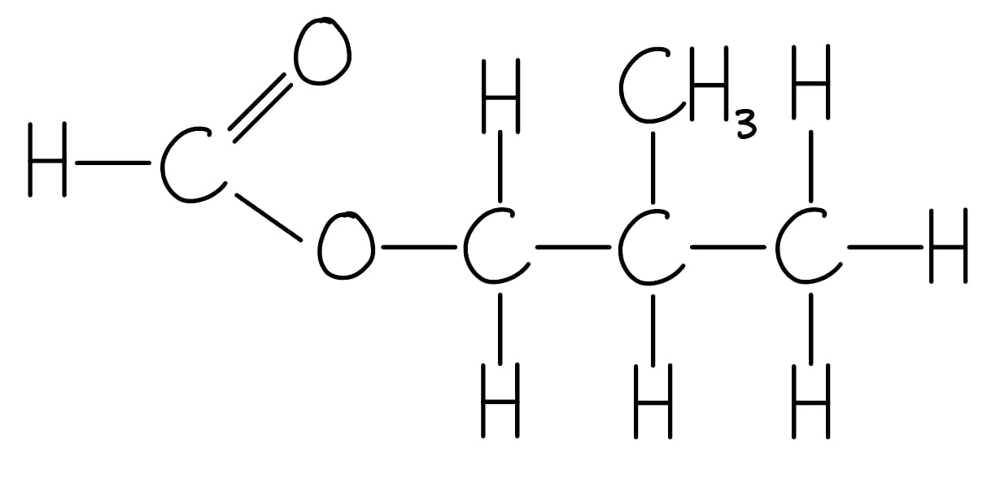

It is called 2-methylpropyl methanoate

**[4 marks]**

> **[mark-scheme]**
> 1 mark for identifying the carboxylic acid as methanoic acid
> 
> 1 mark for identifying the alcohol as 2-methylpropan-1-ol
> 
> 1 mark for correct displayed formula of ester T
> 
> 1 mark for systematic name: 2-methylpropyl methanoate
> 
> 'Formic acid' is not accepted for methanoic acid

> **[exam-tip]**
> To deduce ester T:
> 
> - The molecular formula C5H10O2 shows 5 carbons total.
> - 2-methylpropan-1-ol contributes 4 carbons
> - So, the acid must contribute 1 carbon
> - The acid is methanoic acid (HCOOH).
> 
> Use the systematic name methanoic acid. The common name 'formic acid' is not accepted.

### Q5
The completed table is:

| carboxylic acid | alcohol | ester |
|---|---|---|
| ethanoic acid | **Final answer:** **methanol** | methyl ethanoate |
| **Final answer:** **propanoic acid** | ethanol | ethyl propanoate |
| butanoic acid | propan-1-ol | **Final answer:** **propyl butanoate** |

**[3 marks]**

> **[mark-scheme]**
> 1 mark for methanol
> 
> 1 mark for propanoic acid
> 
> 1 mark for propyl butanoate

> **[exam-tip]**
> When naming an ester, the alcohol provides the first part of the name and the carboxylic acid provides the second part. For methyl ethanoate, methanol contributes the methyl group and ethanoic acid contributes the ethanoate group.
> **[mark-scheme]**
> The catalyst and conditions required for esterification are:
> 
> - Concentrated sulfuric acid catalyst **[1 mark]**
> - Heat / heat under reflux **[1 mark]**

> **[exam-tip]**
> This reaction is also called esterification. The concentrated sulfuric acid acts as a catalyst and speeds up the reaction without being consumed. Heating under reflux prevents volatile products from escaping while allowing the reaction to reach equilibrium.
> **[mark-scheme]**
> The reagents and conditions required for the acidic hydrolysis of an ester are:
> 
> - Dilute acid / dilute H2SO4 / dilute HCl **[1 mark]**
> - Heat / heat under reflux **[1 mark]**

> **[exam-tip]**
> Acidic hydrolysis is a reversible reaction that reforms the original carboxylic acid and alcohol. Because it is reversible, heating under reflux is used to keep reactants and products in contact.
> 
> Alkaline hydrolysis (using NaOH) is irreversible and produces a carboxylate salt rather than the free carboxylic acid. This question specifies acidic conditions, so only dilute acid and heat are needed.
> **[mark-scheme]**
> One commercial use of esters is:
> 
> Any **one** from:
> 
> - Food flavourings / artificial flavourings
> - Perfumes / fragrances
> - Solvents
> - Plasticisers
> 
> **[1 mark]**

> **[exam-tip]**
> Esters are widely used because of their pleasant fruity or floral smells and low toxicity. As well as food and fragrance applications, they are important industrial solvents and plasticisers used to soften polymers such as PVC.

### Q6
> **[mark-scheme]**
> The molecular formula of B:
> 
> - C4H8O2 **[1 mark]**

> **[exam-tip]**
> The *M*r of the empirical formula C2H4O is (2 x 12) + 4 + 16 = 44.
> 
> Dividing 88.0 by 44 gives exactly 2
> 
> So, the molecular formula is 2 x C2H4O = C4H8O2.
The skeletal formulae of four isomers of **B** that are esters are:

| 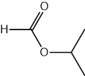 | 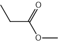 |
|---|---|
| 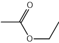 | 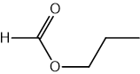 |

**[4 marks]**

> **[mark-scheme]**
> 1 mark for the correct skeletal structure of 1-methylethyl methanoate (top left)
> 
> 1 mark for the correct skeletal structure of methyl propanoate (top right)
> 
> 1 mark for the correct skeletal structure of ethyl ethanoate (bottom left)
> 
> 1 mark for the correct skeletal structure of propyl methanoate (bottom right)
> 
> Any correct structural representation of each ester is accepted

> **[exam-tip]**
> Start by drawing the ester functional group (–COO–) then vary the lengths of the carbon chains on either side.
> 
> With molecular formula C4H8O2 and an ester group, the possible carbon splits are 1+3, 2+2, and 3+1.
> 
> The 1+3 split gives two isomers: one with a straight three-carbon chain (propyl methanoate) and one with a branched chain (1-methylethyl methanoate).
> **[mark-scheme]**
> i) The functional group shown to be present in D:
> 
> - C=O / carbonyl group **[1 mark]**
> 
> ii) The result of the Tollens' reagent test shows:
> 
> - No aldehyde / –CHO group is present
> **OR**
> D is a ketone **[1 mark]**
> 
> iii) The structural formula of alcohol C:
> 
> - (CH3)2CHOH **[1 mark]**
> 
> iv) The ester with the same structure as B:
> 
> - 1-methylethyl methanoate / HCO2CH(CH3)2 **[1 mark]**

> **[exam-tip]**
> 2,4-DNP reacts with all carbonyl compounds (aldehydes and ketones) to form a yellow/orange precipitate. Tollens' reagent gives a silver mirror only with aldehydes. A positive 2,4-DNP result combined with a negative Tollens' result confirms D is a ketone, not an aldehyde.
> 
> The ketone D must be propanone (3 carbons), so the original alcohol C was a secondary alcohol: propan-2-ol, (CH3)2CHOH. The –OR side of the ester –COO– comes from the alcohol. Propan-2-ol gives the –OCH(CH3)2 group, which matches 1-methylethyl methanoate / HCO2CH(CH3)2.
> **[mark-scheme]**
> Which, if any, of the esters is chiral, and the reason:
> 
> - None **[1 mark]**
> - No chiral centre(s) present / no carbon atom bonded to four different groups in any of the four esters **[1 mark]**

> **[exam-tip]**
> A chiral centre is a carbon atom bonded to four different atoms or groups. Check each ester by inspecting every carbon atom. None of the four isomers contains a carbon bonded to four different substituents, so none is chiral.
