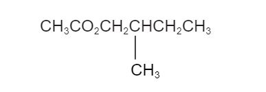
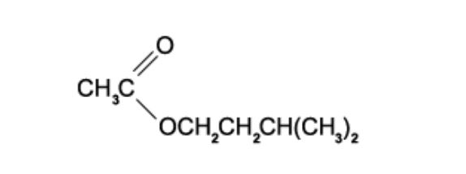
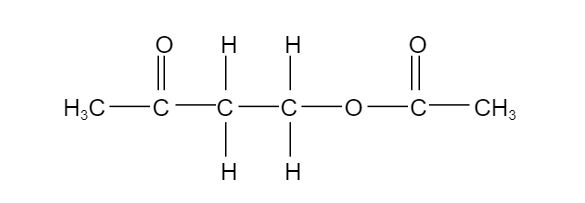
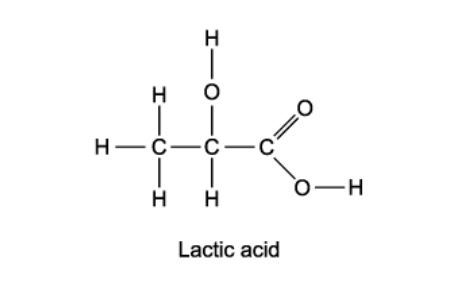

# Exam Questions — Esters
**18. Carboxylic Acids & Derivatives** · Cambridge (CIE) A-LEVEL chemistry (9701)
> Source: [https://www.savemyexams.com/a-level/chemistry/cie/25/topic-questions/](https://www.savemyexams.com/a-level/chemistry/cie/25/topic-questions/) · 12 questions across 1 sets

## Multiple Choice Questions (12 questions)

### Q1 — hard — 1 marks

**Q1** [1 mark]

Which statement correctly describes the hydrolysis of an ester?

### Q2 — medium — 1 marks

**Q2** [1 mark]

Cetyl palmitate is a waxy solid and has the molecular formula C15H31CO2C16H33.

Which products are formed when cetyl palmitate is heated under reflux with an excess of aqueous sodium hydroxide?

### Q3 — hard — 1 marks

**Q3** [1 mark]

30 g of an alcohol and 30 g of a carboxylic acid are heated under reflux together to produce 33.2 g of propyl butanoate.

What is the yield of the ester?

### Q4 — medium — 1 marks

**Q4** [1 mark]

Compound **Q** has the formula CH3CH2CO2CH3.

Which row correctly shows the name of compound **Q** and how its boiling point compares with that of butanoic acid?

|   | **Name of Q** | **Boiling point compared to butanoic acid** |
|---|---|---|
| **A** | Methyl propanoate | Lower |
| **B** | Propyl methanoate | Lower |
| **C** | Methyl propanoate | Higher |
| **D** | Propyl methanoate | Higher |

### Q5 — medium — 1 marks

**Q5** [1 mark]

How many ester compounds have the molecular formula C4H8O2?

### Q6 — easy — 1 marks

**Q6** [1 mark]

The ester shown is responsible for the odour of bananas.

Which pair of compounds reacts to form this ester?

### Q7 — medium — 1 marks

**Q7** [1 mark]

The diagram shows the structure of ethanedioic acid.

Ethanedioic acid reacts with ethanol in the presence of a few drops of concentrated sulfuric acid to form a diester. The molecular formula of the diester is C6H10O4.

What is the structural formula of the diester?

### Q8 — easy — 1 marks

**Q8** [1 mark]

How many isomeric esters, including stereoisomers, can be synthesised from the reaction of methanoic acid with an alcohol of formula C4H10O?

### Q9 — easy — 1 marks

**Q9** [1 mark]

The structure of ester **E** is shown in the diagram below.

**E** is hydrolysed in the presence of hydrochloric acid.

Which are the products of this hydrolysis?

### Q10 — hard — 1 marks

**Q10** [1 mark]

In the presence of an H+ catalyst, compound X reacts with ethanoic acid to produce the compound below.

What is the molecular formula of compound X?

### Q11 — hard — 1 marks

**Q11** [1 mark]

During a lesson, a teacher heated ethyl propanoate under reflux with aqueous sodium hydroxide. The mixture was then acidified, and the two organic products are then separated, purified and weighed.

Out of the total mass of products obtained, what is the percentage by mass of each product?

### Q12 — medium — 1 marks

**Q12** [1 mark]

Lactic acid is a naturally occurring molecule.

What is a property of lactic acid?
