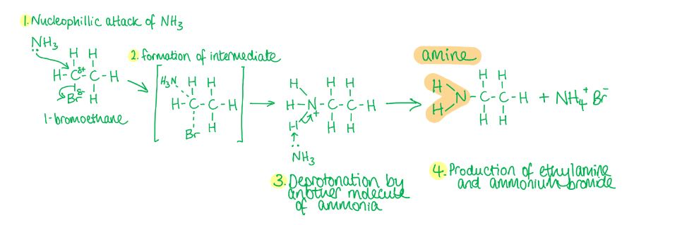

# Mark Schemes — Primary Amines
**19. Nitrogen Compounds** · Cambridge (CIE) A-LEVEL chemistry (9701)

## Multiple Choice Questions (9 questions)

### Q1
**Final answer:** **The correct answer is D**

- Nitrile reduction always produces a primary amine with the -NH2 group on a primary carbon.
- When a nitrile (-C≡N) is reduced, the nitrile carbon gains two hydrogen atoms and the nitrogen gains two more, giving a -CH2NH2 group.

  - The -NH2 is always positioned on a primary carbon.
- Butan-2-amine has the -NH2 group attached to C-2, a secondary carbon, which cannot arise from nitrile reduction.

**A** is incorrect as 2,2-dimethylpropan-1-amine can be produced by reducing 2,2-dimethylpropanenitrile. The -NH2 group is on a primary carbon.

**B** is incorrect as 2-methylpropan-1-amine can be produced by reducing 2-methylpropanenitrile. The -NH2 group is on a primary carbon.

**C** is incorrect as butan-1-amine can be produced by reducing butanenitrile. The -NH2 group is on a primary carbon.

### Q2
**Final answer:** **The correct answer is A**

- When ammonia is not in excess, the primary amine formed (methylamine) can react further with iodomethane.
- Methylamine acts as a nucleophile and reacts with a second molecule of iodomethane to form dimethylamine (a secondary amine).
- Dimethylamine reacts with a third molecule of iodomethane to form trimethylamine (a tertiary amine).
- A mixture of all three amines is therefore produced.

**B** is incorrect as dimethylamine alone would only be produced if the reaction stopped after a single further substitution. In practice all three amines form when ammonia is not in excess.

**C** is incorrect as trimethylamine also forms when ammonia is not in excess. The cascade continues past dimethylamine.

**D** is incorrect as methylamine alone would only be the sole product if ammonia were in excess. Without excess ammonia the reaction cascade continues to give secondary and tertiary amines.

> **[exam-tip]**
> To produce only a primary amine, excess ethanolic ammonia under pressure should be used. The high concentration of ammonia suppresses further substitution, favouring formation of the primary amine only.

### Q3
**Final answer:** **The correct answer is D**

- 1-chloropropane reacts with excess ethanolic ammonia under pressure via nucleophilic substitution.
- Ammonia acts as the nucleophile, attacking the electron-deficient carbon bonded to chlorine; the chlorine is displaced as a chloride ion to form propylamine.
- The overall equation is:

CH3CH2CH2Cl + 2NH3 → CH3CH2CH2NH2 + NH4Cl

**A** is incorrect as electrophilic addition requires an electrophile as the attacking species and applies only to unsaturated molecules. 1-chloropropane is saturated and ammonia is a nucleophile, not an electrophile.

**B** is incorrect as aqueous ammonia hydrolyses 1-chloropropane via nucleophilic substitution to form propan-1-ol (an alcohol), not propylamine. Ethanolic ammonia is required to synthesise the amine.

**C** is incorrect as electrophilic addition applies only to unsaturated molecules. Even with ethanolic ammonia, the reaction type is nucleophilic substitution, not electrophilic addition.

### Q4
**Final answer:** **The correct answer is B**

- Bromoethane reacts with excess ethanolic ammonia under pressure.
- Ammonia acts as a nucleophile, donating a lone pair to the electron-deficient carbon bonded to bromine.
- Bromine is displaced as a bromide ion, forming ethylamine via nucleophilic substitution.
- The reaction mechanism is:

**A** is incorrect as electrophilic substitution requires an electrophile as the attacking species. Ammonia is a nucleophile, not an electrophile.

**C** is incorrect as oxidation of bromoethane replaces the C-Br bond with a C-OH bond, forming ethanol (an alcohol), not an amine.

**D** is incorrect as reduction of bromoethane replaces the C-Br bond with a C-H bond, forming ethane (an alkane), not an amine.

### Q5
**Final answer:** **The correct answer is A**

- The compound is a quaternary ammonium salt containing two ethyl groups and two methyl groups bonded to a positively charged nitrogen, with chloride as the counterion.
- Substituents are named in alphabetical order.

  - So, diethyl (e) comes before dimethyl (m).
- Each pair of identical groups requires the prefix 'di-'.
- The systematic name is therefore diethyldimethylammonium chloride.

**B** is incorrect as the compound contains two methyl groups; the 'di-' prefix is missing, giving 'diethylmethyl' instead of 'diethyldimethyl'.

**C** is incorrect as the groups are correct but placed in the wrong alphabetical order. Dimethyl appears before diethyl, whereas alphabetically diethyl (e) precedes dimethyl (m).

**D** is incorrect as both 'di-' prefixes are absent. The compound contains two ethyl and two methyl groups, requiring 'diethyldimethyl', not 'ethylmethyl'.

### Q6
**Final answer:** **The correct answer is D**

- In the first reaction, propanone undergoes nucleophilic addition with acidified KCN (KCN and dilute H2SO4); CN- acts as the nucleophile, attacking the carbonyl carbon to form 2-hydroxy-2-methylpropanenitrile.
- Dilute H2SO4 is required to generate HCN in situ and maintain the acidic conditions needed for nucleophilic addition.

  - Ethanolic KCN alone does not give the cyanohydrin product reliably.
- In the second reaction, 2-chloropropane undergoes nucleophilic substitution with excess ethanolic ammonia under pressure.

  - Ammonia acts as the nucleophile, displacing chlorine to form propan-2-amine.
- Propan-2-amine (CH3CH(NH2)CH3) is a primary amine because the nitrogen carries only one carbon substituent, regardless of the class of the carbon it is bonded to.
- Excess ammonia suppresses further substitution and ensures the primary amine is the main product.

**A** is incorrect as ethanolic KCN does not provide the acidic conditions required for nucleophilic addition in reaction 1, and aqueous ammonia hydrolyses 2-chloropropane to give propan-2-ol (an alcohol) rather than the amine in reaction 2.

**B** is incorrect as ethanolic KCN is the wrong reagent for reaction 1. Dilute H2SO4 is required to generate HCN in situ and promote cyanohydrin formation.

**C** is incorrect as aqueous ammonia hydrolyses 2-chloropropane via nucleophilic substitution to give propan-2-ol (an alcohol), not an amine. Ethanolic ammonia under pressure is required for amine synthesis.

### Q7
**Final answer:** **The correct answer is A**

- Halogenoalkanes react with excess ethanolic ammonia under pressure via nucleophilic substitution to form a primary amine.
- Ammonia acts as the nucleophile, donating a lone pair to the electron-deficient carbon bonded to bromine, displacing bromide to form ethylamine.

**B** is incorrect as methanol reacts with bromoethane via nucleophilic substitution to form an ether (methoxyethane), not an ester.

**C** is incorrect as methylamine does react with bromoethane via nucleophilic substitution, but the product is a secondary amine (N-methylethanamine), not an amide.

**D** is incorrect as water reacts with bromoethane via hydrolysis (nucleophilic substitution) to form ethanol, which is an alcohol and not an acid.

### Q8
**Final answer:** **The correct answer is B**

- 'Ethyl' indicates a two-carbon chain.
- '-amine' indicates the -NH2 group is at the end of the chain.
- Therefore, B shows ethylamine, a primary amine with a two-carbon chain terminating in -NH2.

**A** is incorrect as this is dimethylamine, a secondary amine with two methyl groups bonded to nitrogen.

**C** is incorrect as this is methylamine, a primary amine with only one carbon atom rather than two.

**D** is incorrect as this is trimethylamine, a tertiary amine with three methyl groups bonded to nitrogen.

### Q9
**Final answer:** **The correct answer is A**

- When a halogenoalkane is reacted with excess ethanolic ammonia under pressure, the main product is a primary amine.
- Ammonia acts as the nucleophile, displacing the chlorine atom from chloroethane via nucleophilic substitution to form ethylamine.
- Excess ammonia suppresses further substitution, so the primary amine is the main product.

**B** is incorrect as diethylamine is a secondary amine formed when ethylamine undergoes a further substitution with chloroethane. Excess ammonia suppresses this reaction.

**C** is incorrect as triethylamine is a tertiary amine that would form through a further cascade substitution. Again, excess ammonia prevents this from being the main product.

**D** is incorrect as tetraethylammonium chloride is a quaternary ammonium salt, not an amine, and would only form through extensive substitution in the absence of excess ammonia.
