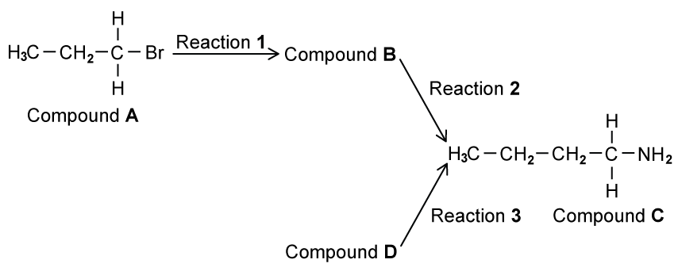

# Exam Questions — Primary Amines
**19. Nitrogen Compounds** · Cambridge (CIE) A-LEVEL chemistry (9701)
> Source: [https://www.savemyexams.com/a-level/chemistry/cie/25/topic-questions/](https://www.savemyexams.com/a-level/chemistry/cie/25/topic-questions/) · 14 questions across 2 sets

## Multiple Choice Questions (9 questions)

### Q1 — hard — 1 marks

**Q1** [1 mark]

Which amine can **not** be produced by the reduction of a nitrile?

### Q2 — medium — 1 marks

**Q2** [1 mark]

Iodomethane is heated under pressure with ethanolic ammonia. The ammonia is not in excess. Which organic compounds are formed in the reaction mixture?

### Q3 — medium — 1 marks

**Q3** [1 mark]

1-chloropropane can be used to make propylamine.

Which row shows the correct reagent and type of reaction?

|   | **Reagent** | **Type of reaction** |
|---|---|---|
| **A** | Aqueous ammonia | Electrophilic addition |
| **B** | Aqueous ammonia | Nucleophilic substitution |
| **C** | Ethanolic ammonia | Electrophilic addition |
| **D** | Ethanolic ammonia | Nucleophilic substitution |

### Q4 — easy — 1 marks

**Q4** [1 mark]

Which type of reaction is used to synthesise ethylamine from bromoethane?

### Q5 — hard — 1 marks

**Q5** [1 mark]

What is the systematic name of the compound shown?

### Q6 — hard — 1 marks

**Q6** [1 mark]

Which row correctly identifies the reagents and conditions for the two reactions shown?

|   | **(CH****3****)****2****CO **$\rightarrow$** (CH****3****)****2****CHCN** | **CH****3****CHC*****l*****CH****3**** **$\rightarrow$** CH****3****CH(NH****2****)CH****3** |
|---|---|---|
| **A** | Ethanolic KCN, heat | Aqueous NH3, heat |
| **B** | Ethanolic KCN, heat | Excess ethanolic NH3, heat under pressure |
| **C** | KCN and dilute H2SO4 | Aqueous NH3, heat |
| **D** | KCN and dilute H2SO4 | Excess ethanolic NH3, heat under pressure |

### Q7 — easy — 1 marks

**Q7** [1 mark]

Bromoethane reacts with reagent **X**. Which row correctly identifies reagent **X** and the organic product formed?

|   | **X** | **Product** |
|---|---|---|
| **A** | Excess ethanolic ammonia | Primary amine |
| **B** | Methanol | Ether |
| **C** | Methylamine | Secondary amine |
| **D** | Water | Alcohol |

### Q8 — easy — 1 marks

**Q8** [1 mark]

What is the displayed formula of ethylamine?

### Q9 — medium — 1 marks

**Q9** [1 mark]

Chloroethane is heated under pressure with an excess of ethanolic ammonia.

Which compound is the main organic product?

## Structured Questions (5 questions)

### Q1 — medium — 11 marks

**Q1** [5 marks]

**Fig. 2.1** shows a reaction sequence to form an amine.

**Fig. 2.1**

i) State the systematic name of compound **A**.

[1]

ii) Reaction **1** heats compound **A** under reflux with an ethanolic solution of potassium cyanide.

Draw the mechanism for the reaction of compound **A** with the cyanide ion (CN-). Include charges, dipoles, lone pairs of electrons and curly arrows, as appropriate. Draw the structure of compound **B** in your answer.

[4]

**Q1** [1 mark]

**Extract:**

**Fig. 2.1** shows a reaction sequence to form an amine.

{align=center} **Fig. 2.1**

In Fig. 2.1, compound **B** reacts with hydrogen gas over a nickel catalyst to form compound **C**.

State the type of reaction that occurs.

**Q1** [3 marks]

**Extract:**

**Fig. 2.1** shows a reaction sequence to form an amine.

Fig. 2.1 shows compound A reacting with KCN in ethanol under reflux to form compound B, then compound B reacting with hydrogen gas over a nickel catalyst to form compound C.

Compound **C** can also be produced in a single step from compound **D**.

i) Draw the displayed formula of compound **D**.

[1]

ii) State suitable reagents and conditions for reaction **3**.

[2]

**Q1** [2 marks]

**Extract:**

**Fig. 2.1** shows a reaction sequence to form an amine.

Compound A reacts with KCN in ethanol under reflux to form compound B, then compound B reacts with hydrogen gas over a nickel catalyst to form compound C.

The systematic name of compound **A** is 1-bromopropane.

Compound **B** is butanenitrile (CH3CH2CH2CN).

Compound **C** is formed by reduction of the nitrile with hydrogen gas over a nickel catalyst.

Draw the skeletal formulae of two isomers of compound **C** that are also primary amines.

### Q2 — easy — 4 marks

**Q2** [1 mark]

Propylamine can be produced from 1-bromopropane.

Construct an equation for this reaction.

**Q2** [2 marks]

State the reagents and conditions required to produce propylamine from 1-bromopropane.

**Q2** [1 mark]

Name the mechanism for the reaction of 1-bromopropane with ammonia.

### Q3 — hard — 8 marks

**Q3** [4 marks]

Compound **X** is produced from cyclohexene by reaction with a hydrogen halide.

An amine which is a relatively weak base containing one nitrogen atom can be produced from compound **X** in one step.

Draw the mechanism for the formation of compound **X** from cyclohexene. Include charges, dipoles, lone pairs of electrons and curly arrows, as appropriate. State the hydrogen halide used in your answer.

**Q3** [3 marks]

**Extract:**

Compound **X** is produced from cyclohexene by reaction with a hydrogen halide.

An amine which is a relatively weak base containing one nitrogen atom can be produced from compound **X** in one step.

Allow HBr, HCl, or HI as the hydrogen halide; compound **X** is then the corresponding halocyclohexane

Compound **X** reacts with ammonia to form cyclohexylamine.

i) State the reagents and conditions required for this reaction.

[2]

ii) Suggest why an excess of ammonia is used.

[1]

**Q3** [1 mark]

Propylamine acts as a Brønsted-Lowry base when it dissolves in water.

Construct an equation to show this behaviour.

### Q4 — medium — 7 marks

**Q4** [2 marks]

Propylamine can be produced by the reaction of 1-chloropropane with ammonia.

CH3CH2CH2Cl $\overset{\mathrm{NH}_{3}}{\rightarrow}$ CH3CH2CH2NH2

i) State the role of ammonia in this reaction.

[1]

ii) Name the mechanism of this reaction.

[1]

**Q4** [2 marks]

Use a chemical equation to explain why propylamine acts as a Brønsted-Lowry base when it dissolves in water.

**Q4** [3 marks]

**Extract:**

Propylamine can be produced by the reaction of 1-chloropropane with ammonia.

CH~3~CH~2~CH~2~Cl → CH~3~CH~2~CH~2~NH~2~

The reaction between 1-chloropropane and ammonia proceeds in two steps. Step 1 involves the formation of an intermediate. Step 2 forms the final propylamine product.

As the reaction proceeds, the bond angles around the nitrogen atom change. Explain these changes in the bond angles around the nitrogen atom.

### Q5 — medium — 10 marks

**Q5** [3 marks]

One possible method of making butylamine from 1-chlorobutane is shown in Fig. 3.1.

**Fig. 3.1**

i) Name the mechanism of reaction **1**.

[1]

ii) State suitable reagents and conditions for reaction **1**.

[2]

**Q5** [4 marks]

**Extract:**

One possible method of making butylamine from 1-chlorobutane is shown in Fig. 3.1.

**Fig. 3.1**

Draw the mechanism for reaction **1** and label compound **X** in your answer. Include charges, dipoles, lone pairs of electrons and curly arrows, as appropriate.

**Q5** [3 marks]

**Extract:**

One possible method of making butylamine from 1-chlorobutane is shown in Fig. 3.1.

**Fig. 3.1**

Compound **X** undergoes another reaction in reaction **2** before butylamine is formed.

i) State the role of ammonia in reaction **2**.

[1]

ii) State the formula of compound **Y**.

[1]

iii) The by-products Cl- and compound **Y** can combine together to form compound **Z**. State the name of compound **Z**.

[1]
