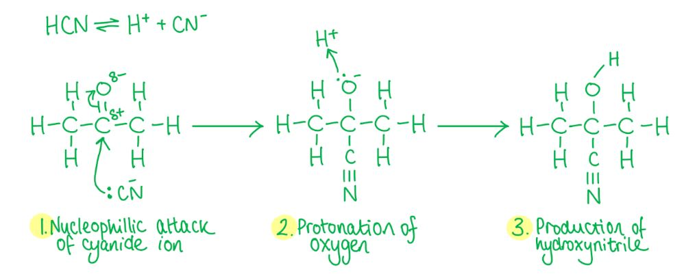
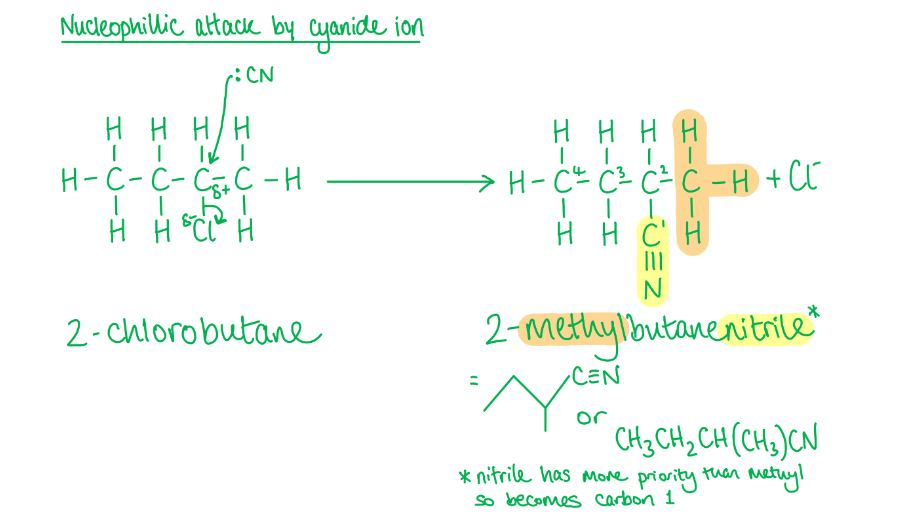
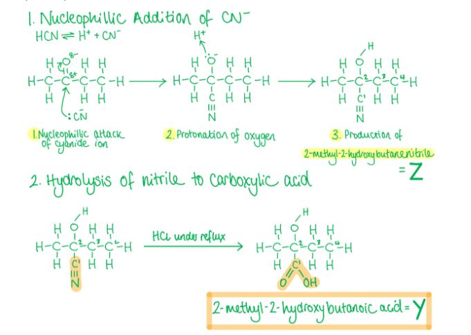

# Mark Schemes — Nitriles & Hydroxynitriles
**19. Nitrogen Compounds** · Cambridge (CIE) A-LEVEL chemistry (9701)

## Multiple Choice Questions (15 questions)

### Q1
**Final answer:** **The correct answer is B**

- Heating a nitrile with aqueous NaOH under reflux hydrolyses it to a carboxylate salt
- Acidification converts the carboxylate salt into the carboxylic acid
- This sequence correctly converts butanenitrile into butanoic acid

**A** is incorrect as acid hydrolysis already forms the acid and does not require neutralisation.

**C** is incorrect as LiAlH4 reduces nitriles to primary amines, not acids.

**D** is incorrect as distillation is a separation technique, it does not change the functional group.

### Q2
**Final answer:** **The correct answer is B**

- Alkanes are very unreactive compounds due to their non-polar C-H bonds.
- They are therefore not likely to undergo reactions with nucleophiles and electrophiles.

  - Nucleophiles are species that can donate a pair of electrons.
  - Electrophiles are species that can accept a pair of electrons.
- The conversion of alkanes to nitriles is therefore a multi-step process.

**A **is incorrect as aldehydes can undergo a 1-step addition reaction with HCN at room temperature to form nitriles:

CH3CHO + HCN → CH3CH(OH)(CN)

**C **is incorrect as amides can undergo a 1-step dehydration reaction to form nitriles.

**D **is incorrect as halogenoalkanes undergo a 1-step substitution reaction with KCN in ethanol and heat to form nitriles:

CH3CH2CH2Br + CN- → CH3CH2CH2CN + Br-

### Q3
**Final answer:** **The correct answer is B**

- The reaction of a halogenoalkane with ethanolic KCN and heat is a nucleophilic substitution reaction to form a nitrile.

  - A nucleophilic substitution reaction is a reaction in which a nucleophile replaces another nucleophile.
  - A nucleophile is a species that can donate a pair of electrons.
- Therefore, only option **B** and **D** can be correct.
- The reaction of nitriles with aqueous alkali solution when heated is a hydrolysis reaction to produce a sodium salt (sodium butanoate) and ammonia.

  - In a hydrolysis reaction a compound is broken down by water.
- The sodium butanoate is acidified with dilute hydrochloric acid.
- The butanoate ion in the sodium butanoate salt will react with the hydrogen ions to form butanoic acid.

  - Once reacted, butanoic acid is a weak acid and holds onto the hydrogen rather than dissociating.
- Therefore, only option **B** is correct.

**A** & **C** are incorrect as compound **X** is not a **nitrile** and option **C** has compounds **Y** and **Z** swapped around.

**D** is incorrect as compound **Y** and **Z** are swapped around.

### Q4
**Final answer:** **The correct answer is B**

- Hydrolysis is the breakdown of a compound using water.
- When a nitrile is refluxed with dilute hydrochloric acid, hydrolysis occurs.
- The -CN group at the end of the hydrocarbon chain is converted into a -COOH group, forming a carboxylic acid.
- The ammonia in solution will act as a base and form an ammonium salt with Cl- (NH4Cl).
- The reaction equation for this hydrolysis is:

CH3CN + 2H2O + HCl → CH3COOH + NH4Cl

**C** & **D** are incorrect as the number of carbons in the carbon chain remains unchanged. The carboxylic acid should therefore be ethanoic acid and not propanoic acid.

**A** is incorrect as the ammonia will react in solution to form an ammonium salt.

### Q5
**Final answer:** **The correct answer is D**

- 2-hydroxy-2-methylpropanenitrile is a hydroxynitrile.
- Hydroxynitriles can be formed from the nucleophilic addition reaction of aldehydes and ketones with HCN at room temperature.
- A nucleophilic addition is when a nucleophile is added to an unsaturated bond to form a single product.

  - A nucleophile is a species that donates a pair of electrons.
- Propanone (which is a ketone) and hydrogen cyanide are the correct reagents required for the conversion of propanone to 2-hydroxy-2-methylpropanenitrile.
- The reaction mechanism is:

**A, B** & **C** are incorrect as though these reactions contain the correct reactant (either an aldehyde or ketone), they do not contain the correct reagent (hydrogen cyanide, HCN).

### Q6
**Final answer:** **The correct answer is A**

- A nucleophilic addition is when a nucleophile is added to an unsaturated bond to form a single product.
- A nucleophile is a species that donates a pair of electrons.
- Hydroxynitriles are formed from the nucleophilic addition reaction of aldehydes and ketones with HCN at room temperature.
- Option **A** shows the reaction type, reactants and reagents correctly.

**B** is incorrect as this is a nucleophilic substitution reaction to form an amine.

**C** is incorrect as this is an addition reaction, not a substitution reaction, to form a hydroxynitrile.

**D** is incorrect as this is a nucleophilic substitution reaction to form a nitrile.

### Q7
**Final answer:** **The correct answer is D**

- To produce nitriles from aldehydes and ketones, **hydrogen cyanide** should be used.
- The reagent in option D should have been **hydrogen cyanide** and not ammonia.

**A, B** & **C** are incorrect as these are all correct combinations of reactants and reagents.

### Q8
**Final answer:** **The correct answer is D**

- A **nucleophilic substitution** reaction is one in which a **nucleophile** replaces another nucleophile.

  - A **nucleophile** is a species which can donate a pair of electrons.
- The cyanide ion (CN-) in this reaction is the **nucleophile** and replaces the **chlorine atom** in CH3CH2CHClCH3.
- 2-chlorobutane is a **secondary halogenoalkane** so the nucleophilic substitution of 2-chlorobutane by the cyanide ion can follow an SN2 or SN1 reaction mechanism.
- The reaction of the halogenoalkane with cyanide ions (CN-) will add an extra carbon atom to the carbon chain.
- The reaction mechanism for this reaction via SN2 is as follows:

**A** is incorrect as CN- is not an **electrophile**, which is an electron pair acceptor.

**B** is incorrect as a free radical substitution reaction is the reaction in which **halogen atoms** (not CN-) replace **hydrogen atoms** in alkanes.

**C** is incorrect as the reaction is a substitution reaction, **not** an addition reaction.

### Q9
**Final answer:** **The correct answer is D**

- A **nucleophilic substitution** reaction is one in which a **nucleophile** replaces another nucleophile.

  - A **nucleophile** is a species which can **donate** a pair of electrons.
- The reaction of halogenoalkanes with cyanide ions, CN-, is an example of a **nucleophilic substitution** reaction.
- The cyanide ion (CN-) in this reaction is the **nucleophile** and **replaces** the **bromine atom** in bromopropane to give butanenitrile.
- The reaction of the halogenoalkane with cyanide ions (CN-) will add an extra carbon atom to the carbon chain.

  - '-**propane**' changes into '**butane**-' as there are now four carbon atoms in the carbon chain instead of three.
- The reaction should be carried out with KCN (to provide the **nucleophile** which is the cyanide ion) in ethanol (also known as **ethanolic solution of potassium cyanide**) which is then **heated** under reflux with the 1-bromopropane.

**A** is incorrect as ethanol and heat alone do not provide the cyanide ion (CN-) needed for the nucleophilic substitution reaction.

**B** is incorrect as KCN alone does not provide the correct conditions. Ethanol (as solvent) and heat under reflux are also required.

**C** is incorrect as KCN and ethanol are necessary but heat under reflux is also required to drive the nucleophilic substitution reaction.

### Q10
**Final answer:** **The correct answer is A**

- 2-hydroxybutanenitrile is a hydroxynitrile.
- Hydroxynitriles can be formed from the nucleophilic addition reaction of aldehydes and ketones with HCN at room temperature.
- A nucleophilic addition is when a nucleophile is added to an unsaturated bond to form a single product — a nucleophile donates a pair of electrons.
- Since propan-1-ol is a primary alcohol it should be first oxidised to an aldehyde using acidified potassium dichromate under distillation to form propanal.
- The aldehyde propanal is then reacted with hydrogen cyanide (acidified NaCN) at room temperature to produce 2-hydroxybutanenitrile.

**B** is incorrect as the reaction of propan-1-ol with NaCl / H2SO4 will result in a nucleophilic substitution reaction resulting in the removal of the OH group so the compound cannot be oxidised to an aldehyde.

**C** is incorrect as the steps are in the wrong order because the CN- group will only attack a carbonyl carbon atom so propan-1-ol needs to be oxidised first.

**D** is incorrect as this is similar to reaction B but the steps are in the wrong order.

### Q11
**Final answer:** **The correct answer is A**

- Hydrolysis is the breakdown of a compound using water.
- When a nitrile is refluxed with sodium hydroxide solution, hydrolysis occurs.
- Instead of forming an ammonium salt (as seen in HCl reflux reactions), a sodium salt is formed, and ammonia gas is given off.
- The ammonia is formed from the reaction between ammonium (NH4+) ions and hydroxide (OH-) ions.
- The reaction equation for this hydrolysis is:

CH3CN + H2O + NaOH → CH3COONa + NH3

- To form the free carboxylic acid the final solution has to be acidified with a strong acid such as dilute hydrochloric acid (HCl)

  - This means that the ethanoate ion in the sodium ethanoate salt will react with the hydrogen ions to form ethanoic acid.
  - Once reacted, ethanoic acid is a weak acid and holds onto the hydrogen rather than dissociating.

**C** & **D** are incorrect as the number of carbons in the carbon chain remain unchanged. The sodium salt should therefore be sodium ethanoate and not sodium propanoate.

**B** is incorrect as the ammonium salt is formed when a nitrile is refluxed with dilute hydrochloric acid, not sodium hydroxide.

### Q12
**Final answer:** **The correct answer is C**

- **Hydrolysis** is the breakdown of a compound using water.
- When a nitrile is **refluxed** with dilute hydrochloric acid, **hydrolysis** occurs.
- The -CN group at the end of the hydrocarbon chain is converted into a -COOH group, forming a **carboxylic acid.**
- The ammonia in solution will act as a **base** and form an **ammonium salt** with Cl- (**NH**~**4**~**Cl**).
- The reaction equation for this **hydrolysis** is:

CH3CH2CN + 2H2O + HCl → CH3CH2COOH + NH4Cl

**A** is incorrect as this is a primary amine which would have been formed if the nitrile group in CH3CH2CN was **reduced** instead of **hydrolysed**.

**B** is incorrect as this is an aldehyde and would not form upon hydrolysis of the nitrile.

**D** is incorrect as though a carboxylic acid is formed, the carbon chain is one carbon too short.

### Q13
**Final answer:** **The correct answer is D**

- A nucleophilic addition is when a nucleophile is added to an unsaturated bond to form a single product.
- Hydroxynitriles are formed from the nucleophilic addition reaction of aldehydes and ketones with HCN at room temperature.
- Butanone is a ketone and will form 2-methyl-2-hydroxybutanenitrile.
- Hydrolysis is the breakdown of a compound using water.

  - Nitriles can be hydrolysed by refluxing it with dilute hydrochloric acid.
- The -CN group is converted into a -COOH group, forming a carboxylic acid.
- The ammonia in solution will act as a base and form an ammonium salt with Cl- (NH4Cl).

**A** & **B** are incorrect as these are amine products formed when the CN- group in Z is reduced rather than hydrolysed.

**C** is incorrect as this is the product if the reactant is an **aldehyde** rather than a **ketone.**

### Q14
**Final answer:** **The correct answer is B**

- Hydrolysis is the breakdown of a compound using water.
- Nitriles can be hydrolysed either by refluxing it with dilute hydrochloric acid or with sodium hydroxide solution.
- When hydrolysed with a dilute acid the -CN group at the end of the hydrocarbon chain is converted into a -COOH group, forming a carboxylic acid.
- Ammonia in solution will act as a base to form ammonium salt with Cl- (NH4Cl).

  - Option **B **is therefore the only correct option.
- When a nitrile is refluxed with sodium hydroxide solution, hydrolysis can also occur.

  - Instead of forming an ammonium salt, now a sodium salt is formed, and ammonia gas is given off.
  - The ammonia is formed from the reaction between ammonium (NH4+) ions and hydroxide (OH-) ions.
- The reaction equation for this hydrolysis is:

CH3CN + H2O + NaOH → CH3COONa + NH3

- To form the free carboxylic acid the final solution has to be acidified with a strong acid such as dilute hydrochloric acid (HCl).

  - This means that the ethanoate ion in the sodium ethanoate salt will react with the hydrogen ions to form ethanoic acid.
  - Once reacted, ethanoic acid is a weak acid and holds onto the hydrogen rather than dissociating.

**A** is incorrect as ammonium chloride (NH4Cl) is formed, not ammonia chloride (NH3Cl).

**C** is incorrect as ammonium chloride (NH4Cl) is formed, **not** ammonia (NH3). Ammonia would have been formed if the nitrile was hydrolysed by a sodium hydroxide solution.

**D** is incorrect as the water molecules are not correctly balanced in this reaction. 2 moles of water are needed for the reaction to become balanced.

### Q15
**Final answer:** **The correct answer is C**

- **Hydrolysis** is the breakdown of a compound using water.
- **Nitriles** can be hydrolysed either by **refluxing** it with **dilute hydrochloric acid** or with **sodium hydroxide solution.**
- When hydrolysed with **sodium hydroxide solution**, instead of forming an **ammonium salt**, now a **sodium salt** is formed, and **ammonia gas** is given off.
- The ammonia is formed from the reaction between **ammonium** (NH4+) ions and **hydroxide** (OH-) ions.

  - Option **C** is therefore the correct option.
- To form the free carboxylic acid the final solution has to be acidified with a strong acid such as dilute hydrochloric acid (HCl).

  - This means that the ethanoate ion in the sodium ethanoate salt will react with the hydrogen ions to form ethanoic acid.
  - Once reacted, ethanoic acid is a weak acid and holds onto the hydrogen rather than dissociating.

**A** is incorrect as the water molecules are not correctly balanced in this reaction. 1 mole of water is needed for the reaction to become balanced.

**B** is incorrect as the water molecules are not correctly balanced in this reaction. 1 mole of water is needed for the reaction to become balanced and ammonium is not formed in the hydrolysis of nitriles by dilute aqueous hydroxide.

**D** is incorrect as ammonia (NH3) is formed, not ammonium (NH4+). An ammonium salt would have been formed if the nitrile was hydrolysed by dilute hydrochloric acid solution.
