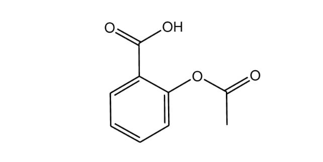

# Exam Questions — Relative Masses of Atoms & Molecules
**2. Atoms, Molecules & Stoichiometry** · Cambridge (CIE) A-LEVEL chemistry (9701)
> Source: [https://www.savemyexams.com/a-level/chemistry/cie/25/topic-questions/](https://www.savemyexams.com/a-level/chemistry/cie/25/topic-questions/) · 10 questions across 1 sets

## Multiple Choice Questions (10 questions)

### Q1 — hard — 1 marks

**Q1** [1 mark]

An element, **X**, has a relative atomic mass of *A*r and exists as a diatomic molecule, **X**2.

Which expression represents the total number of atoms present in *m* grams of the gas?

(Where *L* represents the Avogadro constant.)

### Q2 — medium — 1 marks

**Q2** [1 mark]

Hydrated copper(II) sulfate has the formula CuSO4·*x*H2O and a relative formula mass of 231.6.

What is the value of *x*?

### Q3 — hard — 1 marks

**Q3** [1 mark]

Aspirin is a common analgesic used for the relief of aches and pains.

Which row correctly describes aspirin?

|   | **Empirical formula** | **Molecular formula** | ***M*****r** |
|---|---|---|---|
| **A** | C2H2O | C9H8O4 | 180.0 |
| **B** | C3H3O | C9H12O4 | 184.0 |
| **C** | C9H12O4 | C9H12O4 | 184.0 |
| **D** | C9H8O4 | C9H8O4 | 180.0 |

### Q4 — easy — 1 marks

**Q4** [1 mark]

What is the relative formula mass of ammonium sulfate, (NH4)2SO4?

### Q5 — hard — 1 marks

**Q5** [1 mark]

A sample of strontium was analysed by mass spectrometry. The relative abundances of some of the isotopes are shown.

| ***m*** **/** ***z*** **value** | 84 | 86 | 87 | 88 |
|---|---|---|---|---|
| **% abundance** | 0.56 |   |   | 82.58 |

The relative atomic mass of this sample of strontium is 87.71.

Which row gives the percentage abundances of 86Sr and 87Sr?

|   | **86****Sr** | **87****Sr** |
|---|---|---|
| **A** | 6.96 | 9.90 |
| **B** | 8.43 | 8.43 |
| **C** | 9.90 | 6.96 |
| **D** | 11.58 | 5.84 |

### Q6 — easy — 1 marks

**Q6** [1 mark]

Iron has many different naturally occurring isotopes.

| **Isotope** | **% Abundance** | **Isotopic mass** |
|---|---|---|
| 54Fe | 5.845 | 53.9396 |
| 56Fe | 91.754 | 55.9349 |
| 57Fe | 2.119 | 56.9354 |
| 58Fe | 0.282 | 57.9333 |

What is the relative atomic mass of iron?

### Q7 — medium — 1 marks

**Q7** [1 mark]

A sample of metal **Z** was analysed by mass spectrometry. The relative abundance of each isotope in a mass spectrum of the sample is shown.

| ***m*** **/** ***z*** **value** | 70 | 72 | 74 |
|---|---|---|---|
| **Relative abundance (%)** | 24.4 | 32.4 | 43.2 |

What is the relative atomic mass of metal **Z** to 3 significant figures?

### Q8 — easy — 1 marks

**Q8** [1 mark]

Which expression defines the unified atomic mass unit?

### Q9 — medium — 1 marks

**Q9** [1 mark]

A sample of neon contains only the isotopes 20Ne and 21Ne.

The relative atomic mass of this sample is 20.2.

What is the percentage of 21Ne atoms in this sample?

### Q10 — hard — 1 marks

**Q10** [1 mark]

An element, **X**, consists of only two isotopes, 69**X** and 71**X**, with percentage abundances of 60% and 40% respectively.

What is the relative atomic mass of element X?
