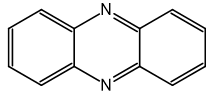
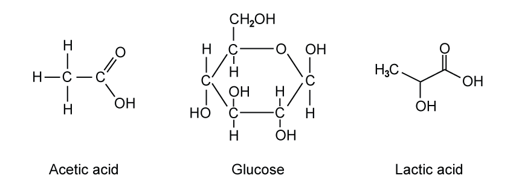

# Exam Questions — Formulas
**2. Atoms, Molecules & Stoichiometry** · Cambridge (CIE) A-LEVEL chemistry (9701)
> Source: [https://www.savemyexams.com/a-level/chemistry/cie/25/topic-questions/](https://www.savemyexams.com/a-level/chemistry/cie/25/topic-questions/) · 20 questions across 2 sets

## Multiple Choice Questions (12 questions)

### Q1 — medium — 1 marks

**Q1** [1 mark]

Hydrated copper(II) sulfate, CuSO4**∙***x*H2O, has a relative formula mass of 231.6.

What is the value of *x*?

### Q2 — medium — 1 marks

**Q2** [1 mark]

An additive in leaded petrol is composed of lead, carbon and hydrogen only. The compound contains 6.19% hydrogen and 29.7% carbon by mass.

What is the value of *x* in the empirical formula PbC8Hx?

### Q3 — medium — 1 marks

**Q3** [1 mark]

The skeletal formula of phenazine is shown.

What is the empirical formula of phenazine?

### Q4 — medium — 1 marks

**Q4** [1 mark]

A hydrated carbonate of an unknown Group 1 metal, **X**, has the formula **X**2CO3**∙**10H2O and a relative formula mass of 286.

What is the identity of **X**?

### Q5 — easy — 1 marks

**Q5** [1 mark]

A sample of hydrated calcium sulfate, CaSO4**∙***x*H2O, has a relative formula mass of 172.2.

What is the value of *x*?

### Q6 — easy — 1 marks

**Q6** [1 mark]

Which ionic equation represents the reaction between aqueous sodium ethanoate and aqueous hydrochloric acid?

### Q7 — easy — 1 marks

**Q7** [1 mark]

A compound contains 52.2% carbon, 13.0% hydrogen and 34.8% oxygen by mass.

What is the empirical formula of this compound?

### Q8 — hard — 1 marks

**Q8** [1 mark]

A compound has the following composition by mass: H, 5.00%; N, 35.00%; O, 60.00%.

What is the identity of the compound?

### Q9 — hard — 1 marks

**Q9** [1 mark]

A sample of compound **M** contains 1.46 g of carbon, 0.482 g of hydrogen and 1.69 g of nitrogen.

What is the empirical formula of **M**?

### Q10 — hard — 1 marks

**Q10** [1 mark]

An organic compound has the following composition by mass: C, 53.33%; H, 11.11%; O, 35.56%.

What is the empirical formula of the compound?

### Q11 — easy — 1 marks

**Q11** [1 mark]

Which ionic equation represents the reaction between aqueous calcium chloride and aqueous silver nitrate?

### Q12 — easy — 1 marks

**Q12** [1 mark]

The equation for a reaction is shown.

Mg3N2 (s) + H2O (l) → Mg(OH)2 (aq) + NH3 (aq)

Which row gives the smallest whole-number coefficients required to balance the equation?

|   | **Mg**3**N**2 | **H**2**O** | **Mg(OH)**2 | **NH**3 |
|---|---|---|---|---|
| **A** | 1 | 6 | 3 | 2 |
| **B** | 1 | 3 | 3 | 1 |
| **C** | 2 | 6 | 2 | 2 |
| **D** | 2 | 6 | 3 | 2 |

## Structured Questions (8 questions)

### Q1 — medium — 7 marks

**Q1** [3 marks]

A synthetic carbohydrate was isotopically labelled with carbon-13.

Analysis of a 12 g sample of the carbohydrate found it to contain 6.93 g carbon, 0.80 g hydrogen and the remainder was oxygen.

Calculate the empirical formula of the carbohydrate. Show your working.

**Q1** [1 mark]

The fermentation of glucose, C6H12O6, produces ethanol and carbon dioxide.

Construct an equation for this reaction.

**Q1** [3 marks]

**Extract:**

The fermentation of glucose, C~6~H~12~O~6~, produces ethanol and carbon dioxide.

The balanced equation for fermentation of glucose:
C~6~H~12~O~6~ → 2C~2~H~5~OH + 2CO~2~

During the fermentation process in the reaction in part (b), 312 g of ethanol was produced from 1.5 kg of glucose.

Calculate the percentage yield of this reaction. Give your answer to 3 significant figures. Show your working.

### Q2 — medium — 10 marks

**Q2** [2 marks]

Chevreul's salt or copper(I, II) sulfite dihydrate, Cu3(SO3)2•2H2O, is an unusual hydrated salt as it contains copper in both of its common oxidation states.

The first step in the formation of Chevreul's salt is the reaction of aqueous copper sulfate with a solution of potassium metabisulfite, K2S2O5.

Complete the equation for the reaction to form the anhydrous Chevreul's salt.

_CuSO4 + _K2S2O5 → _Cu3(SO3)2 + 4K2SO4 + _SO2

**Q2** [3 marks]

The chemical formula of Chevreul's salt is sometimes written as Cu2SO3•CuSO3•2H2O to show that it contains copper(I) sulfite and copper(II) sulfite.

Calculate the percentage by mass of copper(I) ions in copper(I) sulfite.

Show your working.

**Q2** [2 marks]

**Extract:**

Chevreul's salt or copper(I, II) sulfite dihydrate, Cu₃(SO₃)₂•2H₂O, is an unusual hydrated salt as it contains copper in both of its common oxidation states.

The chemical formula of Chevreul's salt is sometimes written as Cu₂SO₃•CuSO₃•2H₂O to show that it contains copper(I) sulfite and copper(II) sulfite.

Chevreul's salt can react with ammonia solution to form a deep blue solution of the tetraamminecopper(II) complex, [Cu(NH3)4]2+ (aq). It can also react with hydrochloric acid to form a white solid of copper(I) chloride, water and sulfur dioxide.

Write an **ionic** equation for the formation of copper(I) chloride from Chevreul's salt. Include state symbols.

**Q2** [3 marks]

When Chevreul's salt is heated in an inert atmosphere, it is stable to around 200 oC. Above this temperature, a variety of compounds can be produced although the final product of sustained heating at high temperatures is copper(II) oxide.

During the heating process, a sample of the mixture is taken. After separation, the most common compound was analysed and found to contain 39.8% copper, 20.1% sulfur and the rest oxygen.

Calculate the empirical formula of the most common compound. Show your working.

### Q3 — medium — 10 marks

**Q3** [2 marks]

Cobalt(II) sulfate is used in storage batteries, electroplating baths and as an additive to soils and animal feeds.

A sample of hydrated cobalt sulfate, CoSO4•xH2O, has a relative formula mass of 173.0.

Calculate a value for 'x'.

**Q3** [4 marks]

A student completed an experiment to determine the value of 'x' in a hydrated salt.

They heated a solid sample of the salt, CoSO4.xH2O, in a crucible for 60 seconds and recorded the following set of results.

**Table 2.1**

| Mass of empty crucible (g) | 29.22 |
|---|---|
| Mass of crucible and solid before heating (g) | 32.67 |
| Mass of crucible and solid after heating (g) | 32.02 |

Use the data obtained by the student in Table 2.1 to calculate a value for 'x'.

**Q3** [3 marks]

**Extract:**

A student completed an experiment to determine the value of 'x' in a hydrated salt.

They heated a solid sample of the salt, CoSO~4~.xH~2~O, in a crucible for 60 seconds and recorded the following set of results.

**Table 2.1**

| Mass of empty crucible (g) | 29.22 |
| --- | :---: |
| Mass of crucible and solid before heating (g) | 32.67 |
| Mass of crucible and solid after heating (g) | 32.02 |

The actual value for x in CoSO4.xH2O is 7.

i) Suggest **one** reason for the difference between your calculated value in **part (b)** and the actual value.

[1]

ii) Explain how you could improve the experiment the student did, using the same equipment, to achieve a value closer to the correct value for x.

[2]

**Q3** [1 mark]

Cobalt(II) sulfate undergoes a displacement reaction with magnesium because magnesium is a more reactive metal than cobalt.

Write an **ionic **equation for this reaction. State symbols are **not** required.

### Q4 — hard — 10 marks

**Q4** [2 marks]

Magnesium carbonate is a common antacid that is used to neutralise excess stomach acid, HCl.

MgCO3 (s) + 2HCl (aq) → MgCl2 (aq) + CO2 (g) + H2O (l)

5.31 g of magnesium carbonate reacts completely with an excess of hydrochloric acid.

Calculate the volume, in dm3, of carbon dioxide produced at room conditions. Show your working.

Volume of CO2 = .................. dm3

**Q4** [3 marks]

Another magnesium salt, magnesium sulfate, can exist in hydrated or anhydrous forms.

6.31 g of a sample of magnesium sulfate, MgSO4.xH2O, was strongly heated until a mass of 3.61 g of solid remained with no further change in mass recorded.

Calculate the value of x. Show your working.

x = .....................

**Q4** [3 marks]

Another sample of hydrated magnesium sulfate, MgSO4.xH2O, is found to contain 51.1% water by mass.

Calculate the value of x. Show your working.

x = .....................

**Q4** [2 marks]

**Extract:**

Another magnesium salt, magnesium sulfate, can exist in hydrated or anhydrous forms.

6.31 g of a sample of magnesium sulfate, MgSO~4~.xH~2~O, was strongly heated until a mass of 3.61 g of solid remained with no further change in mass recorded.

Calculate the value of x. Show your working.

State the effect on the calculated value of x if the salt was not heated to constant mass. Explain your answer.

### Q5 — hard — 5 marks

**Q5** [1 mark]

A sample of a caffeinated drink contains 34 mg of caffeine, *M*r = 194.0 g mol-1.

Calculate the amount, in mol, of caffeine in the sample. Show your working.

amount of caffeine = .................... mol

**Q5** [3 marks]

Caffeine contains 49.48% carbon, 5.20% hydrogen and 28.85% nitrogen by mass. The remainder is oxygen.

Calculate the empirical formula of caffeine. Show your working.

**Q5** [1 mark]

**Extract:**

A sample of a caffeinated drink contains 34 mg of caffeine, Mr = 194.0 g mol^-1.

Caffeine contains 49.48% carbon, 5.20% hydrogen and 28.85% nitrogen by mass. The remainder is oxygen.

Calculate the empirical formula of caffeine.

Use your answer to (b) and the *M*r of caffeine given in part (a) to deduce the molecular formula of caffeine. Show your working.

### Q6 — hard — 11 marks

**Q6** [4 marks]

Apatite is a general term used for a family of various calcium phosphate compounds commonly found in rocks and minerals, bones and teeth.

i) State the formula of calcium phosphate.

[1]

ii) Hydroxylapatite, Ca5(PO4)3OH, is one member of the apatite family and is a major component of bone.

Deduce the oxidation number of phosphorus in hydroxylapatite, Ca5(PO4)3OH. Show your working.

[2]

iii) Another member of the apatite family is chlorapatite.

Suggest the formula of chlorapatite.

[1]

**Q6** [2 marks]

Fluorapatite, Ca5(PO4)3F, reacts with sulfuric acid to form phosphoric acid, calcium sulfate and hydrogen fluoride.

Construct a balanced equation for this reaction.

**Q6** [5 marks]

Fluorapatite, Ca5(PO4)3F, can also react with sulfuric acid to form calcium dihydrogenphosphate, Ca(H2PO4)2, calcium sulfate and hydrogen fluoride.

2Ca5(PO4)3F + 7H2SO4 → 3Ca(H2PO4)2 + 7CaSO4 + 2HF

Calculate the mass of calcium dihydrogenphosphate formed when 50.2 g of Ca5(PO4)3F reacts with 87.9 g H2SO4. Show your working.

mass of Ca(H2PO4)2 = ............................ g

### Q7 — easy — 12 marks

**Q7** [3 marks]

Complete Table 1.1.

**Table 1.1**

| **Ion** | **Formula** |
|---|---|
| Nitrate | NO3- |
|   | CO32- |
| Sulfate |   |
|   | OH- |
|   | NH4+ |
| Zinc(II) |   |
|   | Ag+ |
|   | HCO3- |
| Phosphate |   |

**Q7** [3 marks]

Complete Table 1.2.

**Table 1.2**

| **Ionic compound** | **Formula** |
|---|---|
| Sodium chloride | NaCl |
| Potassium oxide |   |
|   | Al2(CO3)3 |
| Copper(II) nitrate |   |

**Q7** [3 marks]

Aqueous silver nitrate should not be acidified with hydrochloric acid as it forms a white precipitate of silver chloride, AgCl, and nitric acid.

i) Write the chemical equation for the reaction of silver nitrate with hydrochloric acid. Your answer should include state symbols.

[2]

ii) Silver ions from the silver nitrate and chloride ions from the hydrochloric acid are responsible for the formation of silver chloride.

Ag+ + Cl- → AgCl

Suggest why the nitrate ions and hydrogen ions do not appear in this ionic equation.

[1]

**Q7** [3 marks]

Aqueous barium chloride should not be acidified with sulfuric acid as it forms a white precipitate of barium sulfate and hydrochloric acid.

i) Write the chemical equation for the reaction of barium chloride with sulfuric acid. Your answer should include state symbols.

[2]

ii) Write the ionic equation for the formation of barium sulfate.

[1]

### Q8 — easy — 15 marks

**Q8** [2 marks]

Define the terms empirical formula and molecular formula.

**Q8** [4 marks]

Three organic compounds are shown in Fig. 5.1.

**Fig. 5.1**

i) State the molecular formula of each compound.

Acetic acid ..............................

Glucose ..............................

Lactic acid ..............................

[3]

ii) State the empirical formula of all three compounds.

[1]

**Q8** [5 marks]

An unknown hydrocarbon contains 85.7% carbon. The relative molecular mass of the unknown hydrocarbon is 56.0.

i) Calculate the empirical formula of the unknown hydrocarbon. Show your working.

[3]

ii) Determine the molecular formula of the unknown hydrocarbon. Show your working.

[2]

**Q8** [1 mark]

State the difference between an anhydrous salt and a hydrated salt.

**Q8** [3 marks]

Gypsum is a salt that can contain water of crystallisation. In its anhydrous form, the chemical formula of gypsum is CaSO4. 1.80 g of water is added to 6.81 g of gypsum to form the hydrated salt, CaSO4•xH2O.

Calculate the value of x in CaSO4•xH2O. Show your working.
